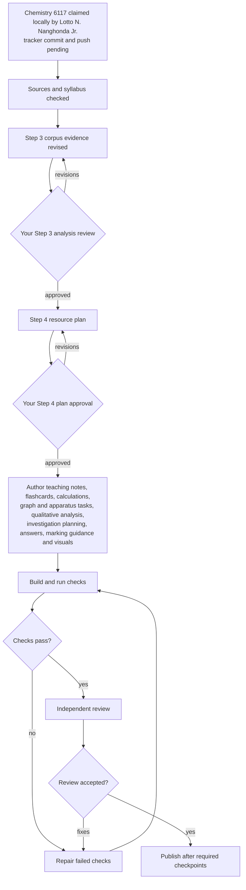

# NSSCO Chemistry 6117: corpus analysis (Step 3 review)

**Status:** Revised on 2026-10-26 for the user's Step 3 review. The user approved Step 3 on 2026-10-26. The 2018 syllabus and its stated requirements remain the authority; frequencies below describe the 2020–2025 papers only. The Step 4 resource plan is now ready for re-review in `work/nam-6117-nssco-2026/PLAN-6117-nssco-chemistry.md`; its approval remains open.

## 1. Corpus and source quality

The local corpus contains Papers 1, 2 and 3 for each year 2020–2025 (18 papers) and six October/November examiner reports. The reports include Paper 1 keys and many Paper 2 and 3 answer and marking tables. No stand-alone Chemistry mark-scheme PDF was found. The 2020 answer tables are image based and were checked with OCR and page images. The 2022 and 2023 paper filenames say first or revised proof; equivalence to final printing is unverified. The 2025 Paper 1 cover says **1 hour**, while the syllabus duration is **45 minutes**. These source caveats are in `assessment-evidence/GAPS.md`.

The extraction reconciles **691 paper items/marked parts and 960 raw marks**: each year has 40 + 80 + 40 marks. This is a count check, not a manual audit of every answer or outcome assignment. The 2025 Paper 2 Q2(d)(ii) report has a recorded arithmetic error: 0.200 × 20.0/1000 = **0.00400 mol HCl**, while the table says “0.02 seen”. Its next answer, 0.002 mol sodium carbonate, supports 0.00400 mol HCl. See `assessment-evidence/source-discrepancies.json` and the report PDF viewer pp. 93–94. Worked solutions must recompute report numerics independently.

## 2. Paper structure

| Paper | Observed demand | Marks per year | AO basis |
|---|---|---:|---|
| 1 | 40 four-option multiple-choice questions | 40 | A and B |
| 2 | Compulsory short-answer, structured and free-response questions | 80 | A and B |
| 3 | Written alternative to practical: apparatus, measurements, graphs, tests and planning | 40 | C |

Across six years, Paper 2 has 325 marked parts (191 one-mark, 115 two-mark, 17 three-mark, two four-mark). Paper 3 has 126 parts (57 one-mark, 48 two-mark, 14 three-mark and seven parts of four to eight marks). Paper 1 has 240 one-mark items. Syllabus qualification weights are approximately A 50% (**no more than 25% recall**), B 30% and C 20%; these syllabus weights must not be inferred from raw corpus counts.

## 3. Command words and printed tariffs

`assessment-evidence/command-part-audit.json` groups **all 451 written marked parts** by their resolved opening command and printed tariff. Counts use that opening command, including inherited opening instructions, rather than every verb appearing in a question. There are no null commands. The parser recognises lowercase instructions while filtering ordinary nouns and page headers. Origins are explicit (385), inherited from a preceding instruction (36), inherited from a printed parent (10), manually verified OCR or compound instructions (16), or explicit interrogatives (4). The inherited and compound forms remain marked for prompt review. The old line-level `command-openings.json` is superseded for tariffs.

| Resolved command | Parts | Modal tariff | Tariffs seen |
|---|---:|---:|---|
| State | 96 | 1 | 1, 2, 3 |
| Describe | 53 | 2 | 1, 2, 3, 6 |
| Name | 45 | 1 | 1, 2, 3 |
| Explain | 38 | 1 | 1, 2, 3 |
| Give | 30 | 1 | 1, 2, 3 |
| Calculate | 29 | 2 | 1, 2, 3 |
| Complete | 21 | 1 | 1, 2, 3, 4 |
| Suggest | 20 | 1 | 1, 2, 4 |
| Identify | 19 | 1 | 1, 2 |
| Draw | 16 | 2 | 1, 2, 3 |
| Write | 12 | 1 | 1, 2 |
| Choose | 8 | 1 | 1, 2 |
| Use | 8 | 2 | 1, 2, 3 |
| Which | 8 | 1 | 1 |
| Define | 7 | 1 | 1, 2 |

The corrected tasks include 2021 Paper 2 Q2(c)(ii) **Describe**, 2023 Paper 2 Q4(b)(i) **Draw**, and 2024 Paper 3 Q3(d) **Sketch**, as well as 2025 Paper 3 Q2(d) **State** and Q1(d)(i) **Suggest**. `assessment-evidence/question_parts.json` records these at part level. A command's presence in this table establishes observed use; the eventual prompt flags still need to respect the task type, inherited wording and syllabus scope.

### Syllabus glossary compared with observed paper commands

The syllabus glossary is on printed pp. 42–43 (PDF viewer pp. 45–46). The generated comparison in `command-part-audit.json` distinguishes glossary entries from commands actually used to open or govern a written marked part.

- **Listed but not observed as the resolved opening command:** List, Comment, Find, Measure, Estimate, Classify and “What do you understand by / What is meant by”. This does not mean the words never occur inside instructions: for example, “Use the graph to find…” is recorded under Use. The two bare What questions are distinct from the longer glossary phrase.
- **Rare glossary commands:** Discuss, Outline, Construct and Compare occur once each; Sketch and Determine occur three times each.
- **Frequent paper commands absent from the glossary:** **Name (45)**, **Give (30)**, **Complete (21)**, **Identify (19)**, **Draw (16)**, **Write (12)**, **Use (8)**, **Choose (8)**, **Which (8)**, **Plot (6)**.
- **Other observed forms absent from the glossary:** Plan (5), Record (2), Label (2), Balance (2), What (2), Match (1), Arrange (1), Circle (1), Distinguish (1), Show (1). Deduce and Predict belong to the glossary's combined “Deduce / predict” entry and are not counted as extra words.

Prompt openings must follow the observed task and tariff evidence, including commands absent from the glossary. An unused glossary entry does not become an approved prompt opening merely because it is listed. Generic Use, Which and What forms and compound instructions need task-specific wording review during planning.

## 4. Marking and answer structure

`assessment-evidence/guidance-coverage.json` classifies all **451 written parts**: **147** have paraphrased part-level guidance (including image answers and split shared-row observations), **299** have a verified examiner-report answer row retained as *internal source text*, and **5** parts in 2022 Paper 2 Q3 have commentary but no printed part-level allocation. `report-guidance-alignment.json` holds 324 positional candidates; `report-alignment-audit.json` checks their printed labels and reviewed question/answer meanings, with source-pair hashes that invalidate changed links. All 324 current links pass. The 299 internal source rows still require paraphrasing and independent arithmetic checks before learner-facing use. The five commentary-only parts must not be presented as if an exact allocation is known.

Common shapes supported by the reports are distinct points per mark, method and result stages in calculations, follow-through from earlier parts, plotting thresholds, an observation separated from an inference, and apparatus use within a method. The 2025 Paper 3 six-mark metal-reactivity plan preserves M1 setup; two control marks from valid fair-test controls; two coherent measurement marks from accepted time, fixed-time gas or temperature routes; and M6 conclusion from the chosen measure. A bare apparatus list does not earn use credit. Other long plans are recorded with their report-specific thresholds: 2020 eight of nine points, 2021 six points, 2022 six of seven, 2023 eight points and 2024 seven of eight.

## 5. Exposure and objective mapping

`curriculum/exam-exposure.json` is recomputed from the individual evidence records. All **240 Paper 1 items and 325 Paper 2 parts** have a named syllabus content subtopic as primary mapping; all **126 Paper 3 parts** have an AO C criterion plus a practical skill type (for example measurements, graph work, qualitative tests, apparatus or planning). These are semantic assignments based on the assessed task, not keyword matching. The content IDs are named syllabus subtopics; they are not a claim that each nested teaching competency has already been mapped. Step 4's objective registry must keep that remaining granularity visible.

Paper 3 criterion exposure over six years: C1 apparatus and safe technique **33 parts/59 marks**; C2 planning **8/44**; C3 measuring, observing and recording **35/57**; C4 interpretation **41/66**; C5 evaluation **9/14**. These criterion totals sum to 126 parts and 240 marks. Practical skill types prevent qualitative tests and graph work from disappearing inside one generic “practical” label.

The following content shares use each Paper 1 or 2 item's primary subtopic once. They total 720 raw content-paper marks; Paper 3 is shown separately above. They describe observed emphasis and do not reduce syllabus coverage.

| Syllabus topic | P1 marks | P2 marks | Total | Share | Years seen |
|---|---:|---:|---:|---:|---:|
| 1 Scientific processes | 11 | 2 | 13 | 1.8% | 5 |
| 2 Matter | 61 | 93 | 154 | 21.4% | 6 |
| 3 Materials | 14 | 9 | 23 | 3.2% | 6 |
| 4 Stoichiometry | 14 | 52 | 66 | 9.2% | 6 |
| 5 Electrochemistry | 10 | 31 | 41 | 5.7% | 6 |
| 6 Chemical reactions | 27 | 53 | 80 | 11.1% | 6 |
| 7 Acids, bases and salts | 16 | 39 | 55 | 7.6% | 6 |
| 8 Qualitative analysis | 7 | 11 | 18 | 2.5% | 6 |
| 9 Metals | 17 | 58 | 75 | 10.4% | 6 |
| 10 Organic chemistry | 33 | 64 | 97 | 13.5% | 6 |
| 11 Environmental and industrial chemistry | 30 | 68 | 98 | 13.6% | 6 |

## 6. Examiner findings and learning consequences

The evidence file now has **34 curated, source-located report findings**, compared with 14 in the earlier draft; **19** are curated as chemistry misconceptions with diagnostic tests. Findings are linked to question records where a printed question can be identified. Some report comments refer to a whole main question, so their part link should be checked before using them to justify an individual card. A targeted sample includes:

| Report finding | Locator | Resource consequence |
|---|---|---|
| Bromide ion counted as a neutral atom; ionic and covalent bonding confused | 2024 Paper 2 Q2, PDF p. 108 | Electron-count and bonding diagrams with reasons for the charge and bond type |
| Deep-blue **solution** after excess ammonia called a precipitate | 2025 Paper 3 Q3(b), commentary PDF p. 101; answer table p. 102 | Observation sequence: initial solid, dissolution, solution colour |
| Flat gas-volume graph called equilibrium rather than a finished reaction | 2023 Paper 3 Q2, PDF p. 105 | Graph interpretation with endpoint and rate reasoning |
| Masses at two times added instead of subtracted | 2022 Paper 3 Q2, commentary PDF p. 99; answer table p. 100 | Interval-change tasks with explicit subtraction and units |
| Marked-cross paper treated as chromatography paper | 2023 Paper 3 Q4, commentary PDF p. 106; marking points p. 107 | Investigation setup and disappearance timing task |
| Acid volume expressed as “amount” or drops; apparatus named without use | 2025 Paper 3 Q4, PDF p. 102 | Controlled-volume planning and method-specific apparatus credit |

The page audit in `assessment-evidence/report-citation-audit.json` checks all 34 findings against curated source anchors on the **exact PDF viewer page**; adjacent pages are searched only to diagnose a failure. Rebuilding evidence fails if the cited page lacks those anchors. `report-answer-page-audit.json` checks the row-level pages of all 324 report links, including continuation pages. `manual-plan-page-audit.json` checks the four text-native planning tables. These checks establish source location; they do not independently prove the interpretation or all marking alternatives.

The latest external review manually spot-checked about **12 of the 34 findings**; it did not audit every finding or all 691 parts. Codex also visually checked **6 of the 42 corrected continuation-row locators**, spanning 2021, 2023 and 2025, against rendered report PDF pages. All six matched their row labels and answer content; details are in `assessment-evidence/continuation-page-spot-check.json`. These samples do not establish that every paraphrase or allocation is correct.

The 2022 Paper 3 Q2(b) finding describes plotting accuracy on PDF p. 99: difficulties with the points at 2, 6 and 8 minutes, oversized plotting marks and unbalanced curves. Its anchors name those specific features. The separate read-off marking guidance is on p. 100 and is not part of this finding.

For 2024 Paper 2 Q2(d)(ii), the report on PDF p. 108 says that candidates used electrons instead of ions. The aqueous/molten condition belongs to the question context and is recorded separately in the evidence notes.

## 7. Misconceptions and scope

`curriculum/misconceptions.json` contains the 19 report-evidenced confusions with diagnostic tests. Reporting habits and omitted method steps remain findings, not false conceptual misconceptions. `curriculum/scope-scan.json` carries the explicit syllabus limits from Step 2. The syllabus content and limits win when a paper appears to favour one topic or style.

## 8. Workflow and plan handoff

Step 4 must give concrete deliverables, topic and objective coverage, command and tariff choices grounded in the part audit, answer structures, visuals and the practical skill balance. The Chemistry owner is confirmed locally; the tracker claim still needs the owner’s commit and push. This analysis does not assert a Biology claim. The user approved Step 3 on 2026-10-26; Step 4 planning may proceed.

Step 4 carry-forward requirements: reword and independently recalculate the 299 internal report answers before learner use; preserve the five 2022 Paper 2 Q3 parts as commentary-only without invented allocations; retain the first/revised-proof caveat for the 2022 and 2023 papers; use the syllabus Paper 1 duration of **45 minutes**.
