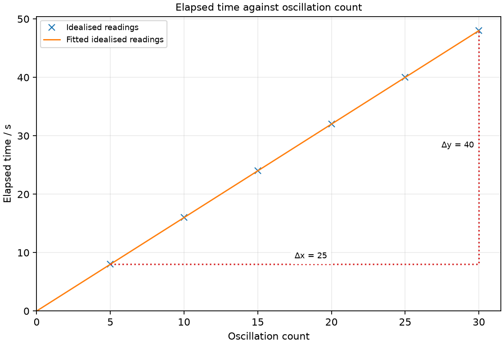

# 1 Mathematical skills and units

*nam-6118-nssco-2026. Offline study notes, rendered from the approved content units on 2026-10-31. Everything here is also what the flashcards are built from.*

---

## Mathematical skills and units — 1.1

### add, subtract, multiply and divide rounding the answer correctly

Addition and subtraction combine measured amounts or find their difference. Multiplication and division combine a measurement with a scale factor or form a ratio.

Choose the operation from the physical question before touching the calculator. A change in temperature is a subtraction, whereas energy supplied at fixed power is found by multiplication. Keep units beside the values so that a sum of unlike quantities is not mistaken for a physical result. Retain extra digits during a calculation and round the final answer. If several steps are required, write them in order; rounding an early intermediate can change the last reported digit.

### Add and subtract with justified rounding

A measured change is the final value minus the initial value. A sum or difference of measurements should not imply finer decimal-place precision than its least precise input.

A water temperature changes from 18.6 °C to 37.2 °C, giving a rise of 18.6 °C. Subtract the initial reading from the final reading, rather than adding the two temperatures. If the final temperature is lower, the signed change is negative. When adding 6.25 cm to 1.8 cm, the calculator gives 8.05 cm, but a sensible recorded sum is 8.1 cm because one measurement was given to only one decimal place. Do not discard useful digits until the final result.

### Multiply and divide with justified rounding

Products and quotients relate physical quantities through multiplication or division. For measurements multiplied or divided, final precision is usually limited by the input with the fewest significant figures.

If a model moves 8.0 m in 3.0 s, distance divided by time gives approximately 2.7 m/s. The quotient carries units because metres are divided by seconds. Multiplying instead would produce m s, which is a different kind of quantity. In a longer calculation retain the unrounded quotient until it is used in the next step. A value such as 2.666666 on a display does not mean the original measurements were that precise; a two-significant-figure final answer is 2.7.

### use averages, decimals, fractions, percentages, ratios and reciprocals

A mean summarises repeated values, while a ratio compares two quantities. Fractions, decimals and percentages can represent the same proportion; a reciprocal reverses a nonzero ratio.

Use a mean when several readings estimate the same quantity under the same conditions. Do not replace the physics of a whole journey by simply averaging speeds when their durations differ. A fraction describes a part relative to a whole, and multiplying that fraction by 100 expresses it as a percentage. A ratio can also carry a unit, such as metres per second. Before using a reciprocal, identify which quantity belongs in the numerator; reversing a ratio changes its meaning and its unit.

### Calculate a mean

The arithmetic mean is the total of the values divided by their number. Repeated readings should describe the same quantity under comparable conditions before their mean is used.

Three timings of an unchanged motion are 8.2 s, 8.4 s and 8.3 s. Their sum is 24.9 s; dividing by three gives 8.3 s. Include a unit in the result. Check for an anomalous reading before calculating, and investigate it rather than silently deleting an inconvenient number. A mean can reduce the influence of random variation, but does not automatically remove a zero error that shifts every reading together. Keep a record of the original readings so that the calculation can be followed.

### Use decimal and fractional representations

A decimal can be expressed as a fraction by using its place value. The numerator and denominator of a fraction can be scaled together without changing its value.

The decimal 0.35 means thirty-five hundredths, so it equals 35/100 and simplifies to 7/20. To turn a fraction back into a decimal, divide its numerator by its denominator. For example, 3/8 equals 0.375. Distinguish a fraction of a measured amount from the amount itself: three eighths of 16 m is 6 m, not 0.375 m. Write the fraction first, then apply it to the stated total. Equivalent representations should give the same result when used consistently.

### Use percentages

A percentage is a proportion expressed per hundred. Percentage = part divided by whole, multiplied by 100.

If a device converts 18 J of an input of 60 J to the desired output, the useful fraction is 18/60. Multiplying by 100 gives 30%. Identify the relevant whole before calculating: using the output as the denominator would answer a different question. A percentage does not carry the unit of the original quantities when like units cancel. Convert unlike energy units before forming the fraction. Conversely, to find 30% of an amount, multiply the amount by 0.30.

### Use ratios

A ratio compares quantities by division or by an equivalent colon notation. Quantities expressed in the same units can form a dimensionless ratio.

A comparison of 12 cm with 8 cm can be written 12:8 and simplified to 3:2. Both lengths must use compatible units: comparing 0.12 m with 8 cm requires conversion first. The ratio does not state the total size of the objects; 30 cm and 20 cm have the same 3:2 ratio. When dividing a total in a ratio, add the ratio parts first. A total length of 25 cm shared in a 3:2 ratio has five parts, each 5 cm long.

### Use reciprocals

The reciprocal of a nonzero number is one divided by that number. Taking a reciprocal also reverses the units of a physical ratio.

The reciprocal of 0.20 is 5.0 because 1 divided by 0.20 equals 5.0. If the original quantity is a time of 0.20 s, its reciprocal has units s⁻¹. This is useful when frequency is obtained from a period. The reciprocal of a fraction is found by reversing its numerator and denominator. Zero has no finite reciprocal, so a zero denominator signals that the chosen calculation is not defined. State which physical quantity the reciprocal represents; a numerical reversal alone does not explain its meaning.

### use direct and inverse proportion

In direct proportion, doubling one quantity doubles the other when relevant conditions are fixed. In inverse proportion, their product is constant, so doubling one quantity halves the other.

For direct proportion, y/x stays constant and a graph of y against x is a straight line through the origin. A straight line with a nonzero intercept is not direct proportion between those plotted quantities. For inverse proportion, xy stays constant and the y-versus-x graph is curved. Compare numerical ratios or products to distinguish the cases. Keep the stated conditions: pressure varies inversely with area only if the force stays fixed. A changing second condition can invalidate a simple scaling prediction.

### use positive and negative, whole number indices and exponents in calculations

A positive integer index means repeated multiplication of the base. A negative integer index represents the reciprocal of the corresponding positive power.

For example, 10³ is 1000, while 10⁻³ is 0.001. A square applies to an entire quantity: (2 m)² is 4 m², so both the number and the unit are squared. Keep brackets around a negative value before squaring it: (−3)² is positive nine, whereas −3² conventionally means the negative of nine. When multiplying powers of the same base, add their indices; when dividing, subtract them. Indices help express small prefixes and derived units clearly.

### make approximate evaluations of numerical expressions

An estimate uses rounded values to judge a numerical result before or after exact calculation. An estimate should retain the scale and unit of the original physical problem.

A quotient of 398 by 19.8 should be near 400 divided by 20, or 20. If the calculator result is around 2000, inspect the decimal places and the entered denominator. Estimation is especially helpful with powers of ten and small unit prefixes. It does not replace the final calculation when precise data are available. State that a value is approximate, rather than presenting rounded input as an exact measurement. A rough upper or lower bound can also reveal an impossible answer.

### use usual mathematical instruments (ruler, compasses, protractor, set square)

A ruler measures lengths, a protractor measures angles, compasses transfer distances or draw circles, and a set square establishes straight perpendicular directions. Choosing an instrument depends on the geometric feature that needs to be measured or constructed.

The tools can be combined in one construction. A ruler can draw a ray, a protractor can measure its angle, and a set square can construct the normal at a surface. Compasses can keep a radius unchanged while a circle or arc is drawn. Read the instrument before using it: identify the zero, direction of numbering and smallest division. Using a more elaborate tool does not automatically make a result accurate if it is aligned incorrectly.

### Use a ruler

A ruler measures the separation of two positions along its graduated scale. The measured length is the final scale reading minus the initial reading.

Align the ruler with the length to be measured and view the graduation directly above it. The physical end of a ruler may be worn or separated from its zero mark. An intact internal mark can be used as a start, provided its reading is subtracted. For an object extending from 1.2 cm to 7.6 cm, the length is 6.4 cm. Do not automatically treat the end reading as the length when the start is not zero.

### Use compasses

Compasses draw a circle or arc at a fixed distance from their pivot point. The distance between the point and pencil is the radius of the construction.

Set the separation against a ruler before drawing a circle of a given radius. Place the point at the chosen centre, then rotate the pencil while keeping the opening unchanged. A circle of radius 3 cm has a diameter of 6 cm; setting the compasses to 6 cm instead would make the circle too large. Compasses can also transfer an existing separation without reading it numerically. Hold the point carefully so that it does not slip or damage the working surface.

### Use a protractor

A protractor measures the angle between two directions. Its centre must be placed at the vertex and its zero line aligned with one ray.

Choose the row of numbers that begins at the aligned ray. Many protractors carry clockwise and anticlockwise scales; using the wrong scale changes an acute angle into its supplementary obtuse angle. For example, an intended 40° construction may be misread as 140°. Extend a short ray with a ruler so that it reaches the scale clearly. In optics, identify the normal before measuring incidence or refraction: an angle to the surface is generally a different angle.

### Use a set square

A set square provides a right-angle edge for constructing or checking perpendicular directions. A perpendicular normal makes a 90° angle with the surface at the point of interest.

Place one straight edge along the surface or baseline. Draw along the adjoining right-angle edge through the required point. This is useful when a ray diagram needs a normal, or when a ruler must be viewed squarely to a scale. The normal is a geometrical reference line; it is not a light ray or a force by itself. If the baseline is tilted, the normal tilts with it rather than remaining automatically vertical on the page.

### explain the meaning of angle, curve, circle, radius, diameter, square, parallelogram, rectangle, diagonal

Geometric terms describe the features used in measurement and physical diagrams. An angle describes a turn, while lengths such as radius, diameter and diagonal describe particular separations.

Name the relevant feature before choosing a formula. A radius runs from the centre of a circle to its boundary, whereas a diameter passes across the circle through the centre. A diagonal joins non-adjacent vertices of a polygon. These are not interchangeable lengths even when they appear on the same drawing. Shapes also determine area formulas: multiplying two perpendicular side lengths works for a rectangle, but a triangle uses half the corresponding base-height product.

### Define an angle

An angle is the amount of turn between two directions meeting at a vertex. A full turn is 360° and a right angle is 90°.

When an angle is drawn, label its vertex and the two rays that define it. The size does not depend on how long those rays are drawn. A very short ray and a long ray can make the same angle. In physical diagrams an angle should be measured from the reference specified in the question, such as a normal or a horizontal line.

### Describe a curve

A curve is a line whose direction changes along its length. A graph can contain a smooth curve rather than a straight fitted line.

Distinguish the shape of the line from errors caused by thick plotting marks. A smooth curve should follow the trend of the readings without joining every neighbouring pair by straight segments. Its steepness can change from one location to another. An arc of a circle is one example of a curve, but not every curve is circular.

### Describe a circle

A circle is a plane curve whose points are the same distance from one centre. That fixed centre-to-curve distance is its radius.

The centre may lie inside the drawn region without being a marked point on the curve. Use a labelled centre when identifying a radius or diameter. If a string traces points that are not the same distance from the centre, it has not constructed a circle. The region enclosed by the circumference has area πr².

### Define radius

A radius is a straight distance from the centre of a circle to its circumference. Radii of the same circle have equal lengths.

Draw a radius from the labelled centre to any point on the circle, rather than from one boundary point to another. A circle can have many drawn radii but one radius value. If its diameter is given, divide that value by two before using an equation containing r.

### Define diameter

A diameter is a straight line segment across a circle through its centre. Its length is twice the radius.

A line joining two points on a circle is a chord, but it is a diameter only when it passes through the centre. This distinction matters when a wide object is measured with calipers. An off-centre chord is shorter than the diameter, so alignment can affect the reading.

### Describe a square

A square is a four-sided plane shape with equal side lengths and right angles. Its area is the square of its side length.

Check both conditions when recognising the shape. Equal sides without right angles describe a different quadrilateral, while right angles without equal side lengths may describe a non-square rectangle. For a square surface the two perpendicular dimensions have the same value, which is why its area can be written a².

### Describe a parallelogram

A parallelogram is a quadrilateral with opposite sides parallel. Its perpendicular height is not generally the length of a sloping side.

The separation between its parallel base lines is the relevant height in an area construction. A diagonal runs across the shape and is another distinct length. In a vector diagram a parallelogram helps combine two directions: the resultant runs from their shared starting point to the opposite corner.

### Describe a rectangle

A rectangle is a quadrilateral with four right angles. Opposite sides are equal and parallel.

Length and width are measured along perpendicular directions. Its area is their product, so a thin strip and a wider strip can have equal areas even though their side lengths differ. A square is the special rectangular case in which all sides have equal lengths. Avoid identifying the diagonal as the width.

### Define a diagonal

A diagonal joins two non-adjacent vertices of a polygon. In a rectangle its length can be found using the two perpendicular sides and Pythagoras’ theorem.

A diagonal crosses the inside of a convex polygon instead of following one of its edges. Mark the endpoints to distinguish it from a height drawn to the middle of an edge. In a rectangle with sides 3 cm and 4 cm, the diagonal is 5 cm. Its length is not the sum of the side lengths.

### recall and use formulae for the area of a square, rectangle, triangle and circle

An area describes how much surface is enclosed by a boundary. The correct area equation depends on the shape and on perpendicular dimensions.

For a square use a²; for a rectangle use length times width. A triangle is half a rectangle with the same base and perpendicular height, so its area is ½bh. For a circle use πr². Do not use a sloping triangle side as its height unless it is perpendicular to the chosen base. Give an area unit such as m² or cm². Changing the length unit changes the numerical area by a squared scale factor.

### Calculate square area

A square of side a has area a². Both dimensions must be expressed in the same length unit.

For a square tile with side 0.30 m, the area is 0.090 m². Squaring the unit is part of the calculation. A side described in centimetres can first be converted to metres, or the resulting area can be converted afterwards using the squared conversion. Doubling the side length makes the area four times larger, because two dimensions change.

### Calculate rectangle area

A rectangle has area equal to length multiplied by perpendicular width. An area calculation requires two lengths, not a boundary length added to another.

For a rectangular panel 0.80 m long and 0.25 m wide, the product is 0.20 m². Adding the dimensions gives a length, not a surface area. If the widths of two panels differ, compare the products rather than their lengths alone. A width labelled in centimetres must be put into a compatible unit before multiplying by a length in metres.

### Calculate triangle area

A triangle has area equal to half its base multiplied by its perpendicular height. The height meets the chosen base line at a right angle.

A sloping edge is not automatically the height. Draw or identify the perpendicular separation to the base, even when its foot lies outside an obtuse triangle. For a triangle with base 12 cm and perpendicular height 5 cm, the area is 30 cm². Omitting the half would calculate the surrounding parallelogram or rectangle instead of the triangular region.

### Calculate circle area

A circle of radius r has area πr². The radius is half the diameter and its square carries an area unit.

For a circular opening of diameter 8 mm, first identify its radius as 4 mm. Then its area is 16π mm², approximately 50.3 mm². A diameter mistaken for a radius gives an area four times too large. Keep π or additional calculator digits until the final rounding. Annular regions require subtraction of the inner circular area from the outer area, using radii consistently.

### recall and use formulae for the volume of a cuboid and a cylinder

A volume measures the three-dimensional space occupied by a region. A cuboid uses three perpendicular dimensions, while a cylinder uses circular cross-sectional area multiplied by length.

A volume unit is cubic, such as m³, cm³ or mm³. A cuboid has volume lwh. A cylinder has volume πr²h, where h is measured perpendicular to its circular face. Distinguish the wall material of a hollow object from its internal capacity: they are not necessarily the same volume. Check whether a stated diameter belongs to an outer wall or an inner opening before choosing the radius.

### Calculate cuboid volume

A cuboid has volume equal to length times width times height. All three dimensions must use compatible length units.

A box 20 cm long, 10 cm wide and 5 cm high has an internal volume of 1000 cm³ if those are its internal dimensions. Its outer dimensions would include the wall thickness and give a larger value. Write the three lengths with their units before multiplying. If every length is doubled, the volume is multiplied by eight because three factors each double. A volume is not found by adding lengths or by using just a face area.

### Calculate cylinder volume

A cylinder has volume πr²h. The value h is the perpendicular distance between its circular end faces.

Find the circular area first, then multiply by the height. A cylinder of radius 2 cm and height 10 cm has volume 40π cm³, approximately 126 cm³. If its diameter rather than radius is supplied, halve the diameter before squaring it. Keep the same length unit in r and h. A tilted sketch does not change which length is perpendicular to the circular base; labels and geometry determine the dimensions.

### use the refractive index n = sin i /sin r

Refractive index for the stated boundary can be calculated as sin i divided by sin r. The incidence and refraction angles are measured from the normal, with the calculator in degree mode when the angles use degrees.

The sine operation must be applied to each angle; dividing the angles themselves does not give the index. For incidence 30° and refraction 20°, the ratio is approximately 1.46. To find a missing angle, first isolate its sine and then use the inverse-sine function. A sine value greater than one signals that the assumed refracted ray or the entered quantities need reconsideration. The optical meaning of refraction is developed later; here the focus is using the mathematical ratio correctly.

### solve equations of the form x = y + z and x = yz for any one term when the other two are known

An equation remains balanced when the same valid operation is applied to both sides. Rearrangement isolates the unknown before numerical substitution.

From x = y + z, subtract z to obtain y = x − z. From x = yz, divide by the nonzero factor z to obtain y = x/z. Do not merely move a symbol and guess its new sign or position. Check a rearrangement by inserting simple known values. In physical equations the units provide an additional guide: if distance equals speed times time, time is distance divided by speed, giving seconds. Brackets preserve grouped terms when more than one operation is involved.

### recall and use Pythagoras’ theorem for a right angled triangle

For a right-angled triangle, the hypotenuse squared equals the sum of the squares of the perpendicular sides. The hypotenuse is opposite the right angle and is the longest side.

Identify the right angle before using a² + b² = c². The result does not apply directly to an arbitrary non-right-angled triangle. With perpendicular sides 5 m and 12 m, the sum of their squares is 169 m² and the hypotenuse is 13 m. Remember the final square root. If one perpendicular side is missing, subtract the square of the known side from the hypotenuse squared. This method also gives the magnitude of a resultant built from perpendicular components.

### recognise and use points of the compass (N, S, E, W), bearings taken and the rules for bearing taking

A bearing specifies a direction by an angle measured clockwise from north. Bearings are conventionally recorded using three digits, such as 090° for east.

Draw a north reference at the starting point before measuring. East has bearing 090°, south 180° and west 270°. A northeast direction halfway between north and east is 045°. A reverse bearing differs by 180°; add 180° to a bearing below 180°, or subtract it from a larger bearing. For example, the reverse of 070° is 250°. A compass diagram keeps direction information separate from the magnitude of a displacement or velocity.

### Practice task with worked feedback

Choose one correct option for each original practice question.

1. Which operation produces the arithmetic mean of four comparable readings?
A. Largest minus smallest
B. Their sum multiplied by four
C. Their sum divided by four
D. The last reading divided by four

2. What does the prefix kilo mean?
A. 1000000
B. 0.001
C. 1000
D. 100

3. Which length is a radius?
A. Centre to circumference
B. Between arbitrary polygon vertices
C. Across a circle through its centre
D. Around the circle

4. Which expression gives triangular area?
A. base × sloping side
B. ½ × base × perpendicular height
C. base × height
D. base + height

5. Which is the SI unit of mass?
A. Pa
B. N
C. W
D. kg

6. Which bearing points east?
A. 270°
B. 180°
C. 000°
D. 090°

7. Which expression is the reciprocal of a nonzero period T?
A. T/2
B. 1/T
C. 2T
D. T²

8. Three repeated times are 9.0 s, 9.2 s and 9.1 s. What is their mean?
A. 3.03 s
B. 9.1 s
C. 27.3 s
D. 0.2 s

9. What is 72 ms in seconds?
A. 0.072 s
B. 72 s
C. 0.72 s
D. 72000 s

10. A square has side 0.50 m. What is its area?
A. 2.0 m²
B. 0.50 m²
C. 1.0 m²
D. 0.25 m²

11. What percentage is 9 J out of 30 J?
A. 30%
B. 300%
C. 3.33%
D. 0.30%

12. What is 6.284 rounded to three significant figures?
A. 6.3
B. 6.284
C. 6.28
D. 6.29

Worked feedback

1. Key C. A: This gives the range. B: This scales the total instead of averaging it. C: The total is shared across the number of readings. D: This discards the other readings.

2. Key C. A: This is the mega factor. B: This is the milli factor. C: Kilo multiplies the unit by 10³. D: This is not the kilo factor.

3. Key A. A: A radius starts at the centre. B: That describes neither a circle radius nor its fixed endpoints. C: That is a diameter. D: That is circumference length.

4. Key B. A: The height must be perpendicular and a half is needed. B: The triangular region is half the matching parallelogram. C: This misses the factor one half. D: Adding lengths does not give area.

5. Key D. A: A pascal measures pressure. B: A newton measures force. C: A watt measures power. D: The kilogram measures mass.

6. Key D. A: This points west. B: This points south. C: This points north. D: Bearings are clockwise from north.

7. Key B. A: Halving is not taking a reciprocal. B: The reciprocal reverses the ratio. C: Doubling is not taking a reciprocal. D: Squaring is not taking a reciprocal.

8. Key B. A: This divides a single representative reading by three. B: The sum 27.3 s divided by three is 9.1 s. C: This is the sum, before division. D: This is the range.

9. Key A. A: Milliseconds are divided by 1000. B: The prefix has been ignored. C: This uses the wrong factor. D: This changes in the wrong direction.

10. Key D. A: This is numerically the perimeter, with the wrong unit. B: This leaves the side value unchanged. C: This adds two sides instead of multiplying. D: The product is 0.50 × 0.50.

11. Key A. A: The ratio is 0.30, or thirty per hundred. B: This introduces an extra factor of ten. C: This reverses the ratio and misuses percent. D: This omits multiplication by 100.

12. Key C. A: This gives two significant figures. B: This keeps four significant figures. C: The next digit is 4, so the retained hundredths digit stays unchanged. D: This rounds upward despite the next digit being less than five.

### Practice task with worked feedback

Investigation aim: measure the period of a pendulum by timing several complete oscillations. These are invented, idealised practice readings; real readings have scatter. 

| Oscillation count | Elapsed time / s |
|---:|---:|
| 5 | 8 |
| 10 | 16 |
| 15 | 24 |
| 20 | 32 |
| 25 | 40 |
| 30 | 48 |

(a) Draw Elapsed time / s vertically against Oscillation count horizontally. Plot the supplied readings and add a separate fitted line. [5]
(b) Show two widely separated points on your fitted line and calculate its gradient. State the gradient unit. [3]
(c) Plan how to measure the period of a pendulum by timing several complete oscillations. Name the equipment and arrangement, describe the measurements and repeats, state controls and a relevant precaution, design the results table and explain how the results answer the aim. [8]

Worked feedback

Graph: Elapsed time / s is vertical and Oscillation count horizontal. Use the six readings, draw a separate best-fit line and show a wide gradient triangle; do not join scattered readings in a zigzag.

Gradient construction: choose the separated fitted-line points (5, 8) and (30, 48). Gradient = (48 − 8) / (30 − 5) = 1.6 s per oscillation. The slope is the period: elapsed time divided by number of full oscillations, 1.6 s.

Arrangement: A small-angle pendulum on a secured clamp stand, a stopwatch and a fixed fiducial mark

Plan: 1. Measure pendulum length from pivot to bob centre and secure the stand. 2. Displace by a small angle and release without a push. 3. Start the stopwatch as the bob passes the reference mark in a chosen direction. 4. Count 5, 10, 15, 20, 25 and 30 full returns in that same direction and record elapsed times. 5. Repeat each timing at least three times and record every raw reading before finding a mean.
Control and accuracy: Keep string length and release angle fixed. Count consistently at the same reference; keep the swinging bob clear of people.
Table: Oscillation count; Elapsed time / s; repeat readings in separate columns. 
Graph and conclusion: The slope is the period: elapsed time divided by number of full oscillations, 1.6 s. Compare repeated readings and report the tested range rather than claiming an exact law from scattered observations.

---

## Mathematical skills and units — 1.2.4

### explain and use the relationship between length, surface area and volume and their units on metric scales

Length, area and volume scale with one, two and three powers of a length conversion respectively. A conversion factor must be squared for area and cubed for volume.

Because one metre is 100 centimetres, one square metre contains 10,000 square centimetres and one cubic metre contains 1,000,000 cubic centimetres. Picture the number of small squares covering a face before extending the idea to small cubes filling a box. Dividing 500 cm² by 100 would be wrong; divide by 10,000 to obtain 0.050 m². When a numerical result appears unexpectedly large, check whether the problem involved a squared or cubed unit rather than a length.

### identify the correct SI unit and derived units (see annexe C)

An SI unit states the standard physical quantity represented by a number. Derived units combine base units, such as metres per second for speed.

Use metres for length, kilograms for mass, seconds for time, amperes for current and kelvin for absolute temperature. Common derived units include newtons for force, joules for energy, watts for power and pascals for pressure. A correct number without its unit is incomplete because it does not identify the physical size. Distinguish a quantity from its unit: mass is the quantity and kilogram the unit. Unit symbols are not shortened versions of every word, so learn the accepted forms such as kg, s, N and Pa.

### explain and use multiple prefixes (mega, kilo) and sub-multiple prefixes (centi, milli, micro, nano) of units

A prefix multiplies a unit by a specified power of ten without changing the kind of quantity measured. The prefix symbol is part of the unit and its case matters, for example M and m have different meanings.

A prefixed unit can make a very large or small value easier to read. A kilometre is longer than a metre, so the same distance uses fewer kilometres than metres. A millimetre is shorter, so more millimetres are needed. Before substitution into an equation, choose a consistent set of units and apply the prefix factor explicitly. Do not assume that matching initial letters mean matching factors. Mega, milli and micro describe very different scales.

### Use mega and kilo prefixes

Kilo represents 10³ and mega represents 10⁶. A value in kilounits or megaunits is multiplied by the appropriate factor to obtain the unprefixed unit.

A generator rated at 2.4 kW has power 2400 W. An energy of 1.8 MJ equals 1,800,000 J. Keep the physical quantity unchanged while converting its unit: energy in MJ does not become power in W. Capital M is the mega prefix; lower-case m represents milli. To convert in the opposite direction, divide by the same factor. For example, 7500 W is 7.5 kW. Include the unit on both sides of a conversion.

### Use centi and milli prefixes

Centi represents 10⁻² and milli represents 10⁻³. For area or volume units the entire prefixed length factor must be raised to the appropriate power.

A length of 8 mm is 0.008 m, while 8 cm is 0.08 m. These conversions concern one dimension. A cross-sectional area of 8 mm² is 8 × 10⁻⁶ m² because each of its two dimensions contributes a factor of one thousandth. Write the unit powers before entering values into a calculator. A millisecond is likewise one thousandth of a second, but it is a time conversion rather than a squared length conversion.

### Use micro and nano prefixes

Micro represents 10⁻⁶ and nano represents 10⁻⁹. A micrometre is one thousand nanometres.

These small units are useful for wavelengths and fine dimensions. A wavelength of 650 nm equals 6.50 × 10⁻⁷ m. Moving between micro and nano requires the ratio of their factors, not simply moving a decimal point by one place. The symbol μ is used for micro, while n is used for nano. Read the unit carefully before using a wavelength in an equation whose other quantities are in SI units. A wavelength in nanometres is still a length, not a frequency.

### use standard notation

Standard notation writes a nonzero number as a coefficient from 1 up to but not including 10 multiplied by an integer power of ten. A negative power is used for a positive number smaller than one.

The value 0.00072 becomes 7.2 × 10⁻⁴. Moving the decimal four places right makes the coefficient larger, so the power of ten compensates by dividing by ten four times. A value of 720,000 becomes 7.2 × 10⁵. Keep the unit attached; standard notation changes the representation, not the quantity. For calculations involving powers, write the coefficient and the power separately so that order-of-magnitude mistakes are easier to spot.

### round a value correctly to an appropriate number of significant figures when required

Significant figures count the meaningful digits used to report a value. Leading zeros locate the decimal point, whereas zeros after a significant digit can carry precision information.

In 0.00480, the significant digits are 4, 8 and the final zero, giving three significant figures. To round 3.746 to three significant figures, retain 3.74 and inspect the following 6; the result becomes 3.75. Do not confuse three significant figures with three decimal places. Preserve intermediate calculator digits until the final result, because rounding at several successive stages can shift the final value. If a requested precision is given explicitly, follow it consistently across a results table.

### use acceptable methods of stating units, e.g. metres per second or m per s can be written as m/s or m s -1

A compound unit can be written using a solidus or a negative exponent. Metres per second can be written m/s or m s⁻¹.

The negative index applies to the unit, not to the sign of the physical quantity. A positive speed of 4 m s⁻¹ is four metres travelled per second, not a negative speed. Acceleration can be written m s⁻² because velocity changes by metres per second during each second. Use spacing to separate unit factors and brackets when needed to avoid an ambiguous chain of divisions. A unit expression should make clear which factors belong in a numerator and which in a denominator.

### Practice task with worked feedback

Original structured practice. Answer the parts with working and units where needed.

(a) State the prefix factor represented by milli. [1]

(b) State the unit notation for seconds to the power minus one. [1]

(c) Explain why repeated timings should refer to the same unchanged motion before a mean is used. [2]

(d) Calculate the mean of timings 12.4 s, 12.6 s and 12.5 s. [2]

(e) Calculate the time in seconds represented by 1850 ms. [2]

Worked feedback

(a) Milli represents 10⁻³.

(b) s⁻¹

(c) They should estimate the same physical time. Changing the motion would mix different quantities rather than simply reduce random variation.

(d) The total is 37.5 s; 37.5/3 gives a mean of 12.5 s.

(e) 1850/1000 gives 1.85 s.
