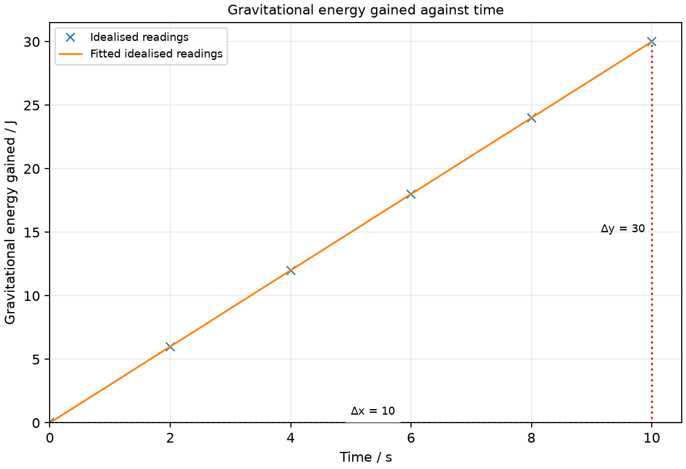

# 10 Energy, work, efficiency and power

*nam-6118-nssco-2026. Offline study notes, rendered from the approved content units on 2026-10-31. Everything here is also what the flashcards are built from.*

---

## Energy, work, efficiency and power — 2.10.3

### give examples of energy in different forms, its conversion and conservation and apply the principle of energy conservation to simple examples (e.g. the kinetic energy changing to potential energy in a pendulum and the sum of the two is constant if air resistance is negligible)

Energy is conserved across a complete system and its surroundings. A decrease in one energy store is balanced by increases elsewhere or by transfers across the chosen boundary.

A pendulum exchanges gravitational potential and kinetic energy. At the highest points it has maximum gravitational energy and momentarily zero speed; near the bottom its speed and kinetic energy are greatest. If air resistance and pivot friction are negligible, the sum of these two stores stays constant. With resistance, the mechanical sum falls while internal energy of the surroundings rises. Define the boundary before deciding whether energy has been lost from a particular store. Examples of energy stores and transfers include chemical, internal, nuclear, kinetic, gravitational and strain potential energy, plus transfers by light, sound and electricity. A torch transfers battery chemical energy through electrical work to light and heating. A fuel engine transfers chemical energy to motion and internal energy. A hydroelectric station transfers raised water’s gravitational energy through turbine motion to electrical output.

### describe energy transfer in terms of work done and make calculations involving F × d

Doing mechanical work transfers energy through a force acting over a displacement. For a constant force parallel to motion, transferred energy is Fd.

Pulling a trolley with 7 N over 3 m transfers 21 J through that force. This is not necessarily its gain in kinetic energy: other forces may transfer energy to internal stores. At steady speed, kinetic energy is unchanged even though the pulling force does positive work. Distinguish the work by one force from net work by the resultant force.

### describe kinetic energy as energy of motion and potential energy as energy of position (e.g. gravitational potential energy and strain potential energy)

Kinetic energy is associated with motion; potential energy is associated with position or configuration. Gravitational and strain energy are different potential energy stores.

A raised load stores gravitational energy relative to a chosen reference height. A stretched spring stores strain energy because of its deformation. Releasing either can produce motion and kinetic energy. More than one store may be present at once: an object falling from a height generally has both gravitational potential and kinetic energy before it reaches the reference level.

### Describe kinetic energy

Kinetic energy is the energy of motion. For a given mass, increasing speed increases kinetic energy.

The relationship Ek = ½mv² shows that doubling speed multiplies kinetic energy by four, rather than two. The speed is squared, so kinetic energy is nonnegative and does not record motion direction. A moving trolley can transfer its kinetic energy by doing work on a resisting object.

### Describe gravitational potential energy

Gravitational potential energy depends on position in a gravitational field. Near Earth’s surface, raising a mass through a height increases its gravitational store by mgh.

Height is measured vertically, not along a sloping path. A long gentle ramp and a short steep ramp reaching the same height give the same gravitational energy gain for the same mass in the same field. The work input may differ when friction is included. The reference level sets the quoted store, while a change in height sets its change.

### Describe strain potential energy

Strain potential energy is stored when a body is elastically deformed. It can be released when the body returns toward its original shape.

A stretched spring and a compressed spring can both store strain energy. Stretching beyond the elastic range can leave permanent deformation and dissipate energy. Do not equate deformation length directly with energy: work depends on the force acting throughout the deformation. This topic uses the qualitative store and its transfers rather than assuming an unstated spring-energy formula.

### Using kinetic and gravitational energy equations

Near a uniform gravitational field, gravitational energy change is mgh and kinetic energy is ½mv². Equating an energy decrease with an increase requires accounting for other transfers.

For an object released from rest through height h with negligible resistance, mgh = ½mv². The mass cancels, giving v² = 2gh. If drag is appreciable, some gravitational energy is transferred to internal energy and the kinetic gain is smaller. Do not equate the two stores merely because both formulas are available.

### Use gravitational potential energy Ep = mgh

A near-surface gravitational energy change is ΔEp = mgΔh. Use kilograms, N/kg and metres for an answer in joules.

A 3 kg load raised by 1.2 m where g = 10 N/kg gains 36 J. A downward displacement gives a decrease in the gravitational store. State whether reporting the signed change or its magnitude. The same school formula assumes the field does not vary appreciably over the height.

### Use kinetic energy Ek = ½mv²

Kinetic energy is Ek = ½mv². Use mass in kg and speed in m/s to obtain joules.

For 4 kg moving at 3 m/s, square the speed first: Ek = ½ × 4 × 9 = 18 J. When finding speed from energy, rearrange v² = 2Ek/m and take the square root. Kinetic energy is nonnegative because speed is squared; motion direction does not change this energy.

### Practice task with worked feedback

Choose one correct option for each original practice question.

1. Which store is associated with motion?
A. Kinetic
B. Chemical alone
C. Gravitational alone
D. Strain alone

2. Which distance belongs in W = Fd for a parallel force?
A. Distance to Earth’s centre
B. Width of the object
C. Displacement along the force
D. Perpendicular arm to a pivot

3. What does an efficiency below 100% mean?
A. Some input is not useful output
B. Power must be zero
C. Energy is destroyed
D. Output exceeds input

4. Which unit measures power?
A. kg
B. N
C. W
D. J

5. What is the main ideal effect of a single fixed pulley?
A. Halving effort force
B. Changing effort direction
C. Halving effort distance
D. Doubling output work

6. Why does a real swinging pendulum slow?
A. The period consumes energy by itself
B. Energy transfers to surroundings
C. Mechanical energy is destroyed
D. Gravitational field weakens each swing

7. A small external gear drives a larger one. How does the larger gear turn?
A. Faster in opposite direction
B. Slower in same direction
C. Faster in same direction
D. Slower and oppositely

8. What is Ek for 2 kg at 3 m/s?
A. 18 J
B. 3 J
C. 6 J
D. 9 J

9. What energy is gained by 4 kg raised 0.5 m with g = 10 N/kg?
A. 80 J
B. 20 J
C. 200 J
D. 2 J

10. A 5 N force acts along 4 m. What work does it do?
A. 9 J
B. 0.8 J
C. 20 J
D. 1.25 J

11. Useful output is 90 J from 150 J input. What is efficiency?
A. 167%
B. 90%
C. 40%
D. 60%

12. What average power transfers 240 J in 8 s?
A. 30 W
B. 0.033 W
C. 240 W
D. 1920 W

Worked feedback

1. Key A. A: It depends on mass and speed. B: This concerns material configuration. C: This depends on height. D: This depends on deformation.

2. Key C. A: That is not the work distance here. B: It need not be a displacement. C: This is the work distance. D: This belongs to moment.

3. Key A. A: Other stores or surroundings receive it. B: Useful transfer may still occur. C: Total energy is conserved. D: That reverses the comparison.

4. Key C. A: This measures mass. B: This measures force. C: One watt is one joule per second. D: This measures energy.

5. Key B. A: Single fixed pulley changes direction, not ideal force. B: It does not reduce force in the simple model. C: Effort distance equals load rise in this arrangement. D: An ideal pulley conserves work.

6. Key B. A: Dissipative interactions cause the loss. B: Drag and friction reduce mechanical energy. C: Energy transfers to surroundings instead. D: Friction and drag explain the damping.

7. Key D. A: Larger driven gear rotates slower. B: External meshed gears turn oppositely. C: Both speed and direction changes are wrong. D: Its larger circumference requires more tooth movement per turn.

8. Key D. A: This omits the half. B: This fails to square speed. C: This uses mv rather than energy. D: Half times 2 times 3 squared is 9.

9. Key B. A: This divides by height. B: Use mgh. C: This misplaces a factor of ten. D: This omits g.

10. Key C. A: Adding unlike quantities does not give work. B: This reverses that ratio. C: Multiply force by displacement. D: This divides force by distance.

11. Key D. A: This reverses the ratio. B: This ignores total input. C: This is the non-useful fraction. D: The useful fraction is 0.6.

12. Key A. A: Divide energy by time. B: This uses time per energy. C: This ignores duration. D: This multiplies by time.

### Practice task with worked feedback

Investigation aim: measure useful power during a steady vertical lift. These are invented, idealised practice readings; real readings have scatter. 

| Time / s | Gravitational energy gained / J |
|---:|---:|
| 0 | 0 |
| 2 | 6 |
| 4 | 12 |
| 6 | 18 |
| 8 | 24 |
| 10 | 30 |

(a) Draw Gravitational energy gained / J vertically against Time / s horizontally. Plot the supplied readings and add a separate fitted line. [5]
(b) Show two widely separated points on your fitted line and calculate its gradient. State the gradient unit. [3]
(c) Plan how to measure useful power during a steady vertical lift. Name the equipment and arrangement, describe the measurements and repeats, state controls and a relevant precaution, design the results table and explain how the results answer the aim. [8]

Worked feedback

Graph: Gravitational energy gained / J is vertical and Time / s horizontal. Use the six readings, draw a separate best-fit line and show a wide gradient triangle; do not join scattered readings in a zigzag.

Gradient construction: choose the separated fitted-line points (0, 0) and (10, 30). Gradient = (30 − 0) / (10 − 0) = 3 J/s or W. The energy-time gradient is useful lifting power, 3 W; the electrical or human input power can be greater.

Arrangement: A guarded hand-operated lifting mechanism, a 3.0 kg secured load, metre rule and stopwatch; at g = 10 N/kg a 1.0 m rise gains 30 J

Plan: 1. Secure the 3.0 kg load in a rated guarded manual hoist and set a vertical metre rule beside it. 2. Record starting height and the stated g = 10 N/kg. 3. Raise the load steadily through up to 1.0 m while a second observer times the lift. 4. Record height gained at 2 s intervals and calculate mgh at each time. 5. Lower safely and repeat the run with the same mass and lifting rate.
Control and accuracy: Keep mass and lifting arrangement fixed; avoid acceleration intervals and secure the load against falling.
Table: Time / s; Gravitational energy gained / J; repeat readings in separate columns. 
Graph and conclusion: The energy-time gradient is useful lifting power, 3 W; the electrical or human input power can be greater. Compare repeated readings and report the tested range rather than claiming an exact law from scattered observations.

### Energy forms and transfers

Useful school descriptions include kinetic (motion), gravitational potential (height), strain/elastic potential (deformation), chemical (fuels and batteries), nuclear and internal/thermal energy stores. Energy is transferred electrically, by heating, by mechanical work, or by radiation such as light. Sound also carries energy through matter. A falling ball changes gravitational potential energy into kinetic energy; a lamp transfers electrical input into light and internal energy. The complete energy balance includes the surroundings.

### Further practice: State any two energy forms or stores and give one example of each.

Examples include kinetic energy of a moving trolley, gravitational potential energy of raised water, strain energy of a stretched spring, chemical energy in fuel, nuclear energy in a fuel nucleus and internal energy in warm water.

---

## Energy, work, efficiency and power — 2.10.4

### Work done

Work done by a constant force is force multiplied by displacement in the force direction. The displacement component, rather than the lever arm, is relevant.

A force perpendicular to motion does no work through that displacement. Holding a stationary bag does no mechanical work on the bag during the hold because its displacement is zero, though the person uses energy internally. For an opposing force, energy is transferred out of the moving object’s mechanical store. These distinctions keep work separate from everyday meanings of effort.

### Recall and use work = force × displacement in the force direction, W = Fd

For parallel constant force and displacement, W = Fd. Rearrange as F = W/d or d = W/F when the physical conditions fit.

If 48 J is transferred by a constant 12 N force along the motion, the displacement is 4 m. Use the force responsible for the stated transfer. An effort force and a resultant force need not be equal; using the resultant computes net mechanical work, while using one applied force computes that force’s contribution.

### explain that energy is the ability to do work and that the joule [J] is the unit of both work and energy

Energy is the capacity to do work in the syllabus description. Both energy and work are measured in joules.

A battery, raised load and moving object have different energy stores but can each transfer energy to other systems. Work describes one transfer mechanism, rather than an additional substance stored in a body. Use the same joule unit when comparing an energy decrease with work done.

### state the unit of work as 1 J = 1 N m

One joule equals one newton metre of work. It is the work done by 1 N acting over 1 m in its direction.

Keep both quantities in SI units before combining them. A force of 1 N moving its application point through 1 cm does 0.01 J, not 1 J. Although a moment may also use N m, it describes turning effect rather than energy transfer.

### identify examples of levers, gears and pulleys and explain how they are used for making the effort easier (NOTE: the work stays the same but the force required becomes less)

Ideal machines can reduce effort by increasing the distance through which the effort moves. In a lossless arrangement, input work equals output work.

A lever, gear system or movable pulley can trade a smaller force for a greater effort distance. This does not create energy. Real friction increases the input work needed for a given useful output. A fixed pulley may mainly change force direction without reducing its size; identify the arrangement before making an effort claim. A wheelbarrow, scissors, spanner and crowbar are lever examples. Bicycle gears trade turning effect against rotation rate. A crane can use movable pulleys, while a flagpole uses a fixed pulley mainly to change the pull direction.

### Explain how a lever trades force against distance

A lever with a longer effort arm can require less effort for a fixed load moment. The effort point then moves farther than the load point for the same rotation.

Balance moments to compare force sizes, then compare point movements through the rotation. For an ideal lever, halving effort while doubling its movement leaves work unchanged. A real lever has friction and deformation losses. The longer arm is a moment arm, while actual movement is used for work.

### Explain the action of gears

Meshing gears transfer rotational motion and change turning effect and rotation rate. A larger driven gear turns more slowly and can provide greater turning effect than a smaller driving gear in an ideal pair.

Meshing teeth make equal lengths of the two rims pass the contact point. Adjacent external gears rotate in opposite directions. The increase in turning effect is accompanied by fewer turns over the same time; it does not create power. Real friction reduces useful output. A bicycle’s gear choice changes the force-distance or turning-effect-speed trade.

### Explain how a pulley reduces required effort

A movable pulley can share a load between supporting rope sections. Reducing effort requires pulling a greater rope length in the ideal arrangement.

With two parallel supporting sections carrying equal tension, the ideal effort is half the supported load, while twice the load’s rise must be pulled through the free end. A single fixed pulley changes direction with no ideal force reduction. Pulley mass and friction must be included when they matter.

### define efficiency as the percentage of useful energy output from the total energy input

Efficiency is the percentage of total input energy transferred into the intended useful output. The useful output depends on the purpose of the device.

Heating is useful in a heater but often unwanted in a motor. Define the output before computing the fraction. An efficiency below 100% means some input reaches other stores or surroundings; it does not mean energy is destroyed. Equivalent useful-output-power over input-power ratios can be used for a common steady interval.

### Use efficiency = useful energy output / total energy input × 100%

Percentage efficiency is useful output energy divided by total input energy, multiplied by 100%. Use matching energy units and include the whole stated input.

If a motor takes in 250 J and gives 175 J of useful mechanical energy, its efficiency is 70%. The remaining 75 J is transferred elsewhere, commonly as internal energy. Reverse the relationship carefully: input energy equals useful output divided by the efficiency expressed as a fraction.

### Practice task with worked feedback

Original structured practice. Answer the parts with working and units where needed.

(a) State the SI unit of energy. [1]

(b) State what 1 W means. [1]

(c) Explain how a lossless machine reduces effort. [2]

(d) Calculate the energy gained by a 3 kg load raised 2 m where g = 10 N/kg. [2]

(e) Calculate average power when that 60 J lift takes 5 s. [2]

Worked feedback

(a) Joule, J.

(b) A transfer rate of 1 J/s.

(c) The smaller effort acts through a greater displacement. The input and output work are equal.

(d) ΔEp = mgh = 60 J.

(e) P = E/t = 12 W.

### Named levers, gears and pulleys

A crowbar pivots against a support: a long effort arm can lift a load with a smaller force. Scissors are paired levers with the screw as fulcrum. A bicycle’s chain connects toothed gears; a small driving gear turning a larger driven gear gives lower output speed and greater turning effect in an ideal model. A crane can use a movable pulley supported by two rope sections: half the ideal load force is traded for twice the pulled-rope distance. A single fixed flagpole pulley mainly changes the effort direction. Real friction increases the input work; an ideal machine conserves work.

### Further practice: Explain how a crowbar can lift a load with a smaller effort.

The support is its fulcrum and the effort acts farther from it than the load. The longer perpendicular effort arm gives the needed turning moment with less force, while the effort travels farther.

### Further practice: State one named use of gears.

Bicycle gears change the relationship between pedalling speed and wheel turning effect.

### Further practice: Explain how a crane’s ideal two-section movable pulley reduces the lifting effort.

Two rope sections support the load, each carrying the same tension. The effort is half the load force, while twice the rope length must be pulled for a given rise.

---

## Energy, work, efficiency and power — 2.10.5

### define power as the rate of doing work or the rate of energy conversion (1 J s -1 = 1 W)

Power is the rate of energy transfer or doing work. One watt is one joule per second.

Two people can do equal work lifting equal loads to the same height, but the faster lift has greater average power. Power describes how quickly energy transfers, not the total energy transferred. A high-power device operating briefly may use less energy than a lower-power device operating for a long time.

### Use power = energy transferred / time = work done / time

Average power is P = E/t or W/t over the stated interval. With energy in joules and time in seconds, power is in watts.

A lift transferring 360 J in 12 s has an average power of 30 W. Rearranging gives E = Pt for constant power. On an energy-time graph, the gradient is power; a straight line means constant rate. If power varies, the whole-interval ratio gives an average rather than each instantaneous value.
