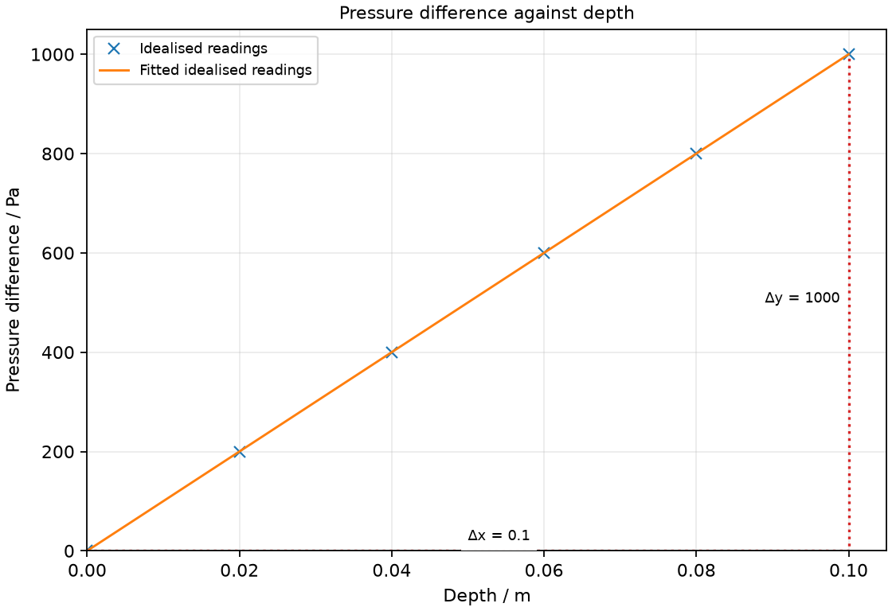

# 11 Pressure and hydraulics

*nam-6118-nssco-2026. Offline study notes, rendered from the approved content units on 2026-10-31. Everything here is also what the flashcards are built from.*

---

## Pressure and hydraulics — 2.11

### Pressure definition

Pressure is perpendicular force per unit area. Its SI unit is the pascal, equal to N/m².

Force and pressure are different quantities. The same weight spread over a larger contact area gives a smaller average pressure. A sharp edge concentrates a force onto a small area and can produce a large pressure. The force component normal to the surface is relevant; a force parallel to a surface is not substituted directly into the normal-pressure relationship.

### Use pressure = force / area, P = F/A; convert pascal and kilopascal units

Average pressure is P = F/A. Force must be in N and area in m² for pressure in Pa; 1 kPa = 1000 Pa.

A 60 N force over 0.020 m² gives 3000 Pa or 3 kPa. Area conversions are squared: 1 cm² = 0.0001 m². Convert a measured rectangular area either by converting both lengths first or by correctly converting the final area. Dividing by an area in cm² gives N/cm², not Pa. Rearranging gives force = pressure × area.

### interpret the relationship between pressure, force and area: explain, for example, what happens to the pressure when either the force or the area is changed

For a fixed area, pressure increases in proportion to perpendicular force. For a fixed force, increasing the contact area decreases average pressure.

A bag’s broad strap spreads its support force and reduces pressure on a shoulder. A nail tip does the reverse by applying the driving force to a small area. State which quantity is held fixed: doubling force and area together leaves their ratio unchanged. These examples concern average contact pressure; real local distributions need not be perfectly uniform.

### describe and explain the transmission of pressure in hydraulic systems with particular reference to hydraulic brakes on vehicles and hydraulic jacks

An applied pressure change is transmitted through an enclosed nearly incompressible fluid. At the same level in an ideal hydraulic system, a larger piston area gives a larger force for the same pressure.

With P = F/A, input force F1 over area A1 gives an additional pressure transmitted to output area A2, producing F2 = F1 A2/A1 in the ideal model. A jack multiplies force but the smaller piston moves farther, so useful work is not created. Brake fluid transmits a pedal-induced pressure to wheel mechanisms. Trapped air compresses and can make the response less effective; this is an explanatory model, not a repair procedure. In an enclosed liquid an applied pressure change is transmitted equally in all directions. A brake pedal pushes the master-cylinder piston; the pressure change travels through brake fluid to wheel cylinders, whose pistons press pads or shoes against the moving wheel surfaces. Force depends on piston area, so equal pressure does not require equal force at differently sized pistons.

### state that the pressure beneath a liquid surface is related to depth and to density using appropriate examples

Pressure increases with depth in a stationary liquid. At the same depth increase and field strength, a denser liquid gives a larger pressure increase.

A lower hole in a water container can eject a jet more strongly because its pressure above the outside atmosphere is greater. Compare points at equal vertical depths rather than equal distances along a sloping wall. Container shape does not enter the simple hydrostatic pressure difference. Surface pressure must be added when finding an absolute pressure rather than a difference.

### derive, from the definitions of pressure and density, the equation Δp = ρgΔh

For a stationary uniform-density liquid, Δp = ρgΔh follows from the weight of a vertical liquid column. A column of cross-sectional area A and height Δh has volume AΔh and mass ρAΔh.

The extra force supporting this column is its weight, ρAΔhg. Divide by its area using pressure = force/area: Δp = ρAΔhg/A = ρgΔh. The cancellation explains why the pressure difference does not depend on the chosen column area. The derivation assumes static liquid, approximately constant density and gravitational field. For water of density 1000 kg/m³ over 0.40 m with g = 10 N/kg, the difference is 4000 Pa.

### recall and use the equation Δp = ρgΔh

Hydrostatic pressure difference is Δp = ρgΔh. Use vertical height difference in metres and density in kg/m³ for Pa.

A difference between two submerged points is not automatically the total pressure at the lower point. If the upper point is an open surface, the expression gives pressure above atmospheric pressure. A negative upward depth change gives a decrease in pressure; reporting its magnitude without direction can hide this meaning. Use one consistent height convention.

### describe the atmospheric pressure changes with changes of altitude

Atmospheric pressure generally decreases as altitude increases. A higher location has less overlying air weight per area.

Air is compressible, so the change over a large height is not represented accurately by treating the whole atmosphere as a constant-density liquid. The qualitative explanation is that fewer overlying air molecules contribute weight above a higher level. A local pressure reading also varies with weather, so altitude is not its sole influence.

### use and describe the use of a manometer and perform calculations on the manometer

A manometer uses a liquid-level difference to measure a pressure difference. The larger pressure pushes its connected liquid surface lower, and Δp = ρgΔh uses the vertical separation of levels.

For a U-tube with one arm open, compare the gas side with atmospheric pressure. If the gas pushes its side down, its pressure exceeds atmosphere by the calculated liquid-column difference. If its side is higher, the gas pressure is below atmosphere. Read both levels and subtract their heights; the length along the curved tube is irrelevant. A school demonstration should use a suitable safe liquid and low pressures, rather than mercury. For a gas-side water level lower by 0.12 m, ρ = 1000 kg/m³ and g = 10 N/kg give gas excess pressure 1200 Pa. With atmospheric pressure given as 100 000 Pa, absolute gas pressure is 101 200 Pa. If the gas-side level is higher, subtract the difference instead. Typical atmospheric pressure is about 100 kPa; 760 mm Hg is approximately 101 000 Pa.

### perform calculations involving interconversion of units of pressure (mm Hg, Pa)

A pressure in mm Hg describes the pressure difference supported by that height of mercury under specified conditions. For these conversions, a supplied school approximation is 1 mm Hg ≈ 133 Pa.

Multiply a mm Hg value by the stated Pa-per-mm-Hg factor to obtain Pa. For the reverse direction, divide by that factor. For example, 50 mm Hg corresponds to approximately 6650 Pa using 133 Pa per mm Hg. The conversion is a numerical exercise, not a recommendation to use mercury in a student apparatus. State rounding consistently with the supplied factor.

### state that a wind is caused by high and low pressure systems

A pressure difference can drive air from higher toward lower pressure. This pressure-gradient effect contributes to wind.

Real wind direction also depends on Earth’s rotation, friction and local terrain, so it need not travel in a straight line from a high-pressure centre to a low-pressure centre. For the basic model, a pressure difference across a region produces a resultant force on the air. Do not describe wind as a flow from low to high pressure caused by the pressure difference alone.

### Practice task with worked feedback

Choose one correct option for each original practice question.

1. Which quantity is force per area?
A. Power
B. Density
C. Work
D. Pressure

2. Which unit equals a pascal?
A. kg/m³
B. J/s
C. N m
D. N/m²

3. A fixed force acts over twice the area. What happens to pressure?
A. It stays the same
B. It quadruples
C. It halves
D. It doubles

4. What is transmitted through an ideal hydraulic liquid?
A. Equal displacement of both pistons
B. Applied pressure change
C. Larger output pressure due only to larger area
D. Equal force at both pistons

5. At greater altitude, what generally happens to atmospheric pressure?
A. It rises
B. It stays constant
C. It falls only if temperature rises
D. It falls

6. In an open U-tube, gas pushes its side lower. How does gas pressure compare with atmosphere?
A. Equal
B. Higher
C. Lower
D. Higher only for a wider gas-side tube

7. What does a pressure difference tend to do to air?
A. No tendency unless temperature differs
B. Drive it toward lower pressure
C. Toward higher pressure
D. Upward regardless of pressure pattern

8. What pressure is 30 N over 0.010 m²?
A. 3 Pa
B. 0.30 Pa
C. 3000 Pa
D. 300 Pa

9. For ρ = 1000 kg/m³ and g = 10 N/kg, what is Δp over 0.20 m?
A. 2000 Pa
B. 50 000 Pa
C. 20 Pa
D. 200 Pa

10. Using 133 Pa per mm Hg, what is 20 mm Hg?
A. 2660 Pa
B. 0.150 Pa
C. 6.65 Pa
D. 153 Pa

11. At the same pressure, output piston area is three times input area. What is ideal output force?
A. Equal input force
B. One third input force
C. Three times input force
D. Nine times input force

12. What is 4 kPa in Pa?
A. 4000 Pa
B. 0.004 Pa
C. 400 Pa
D. 40 Pa

Worked feedback

1. Key D. A: This is energy per time. B: This is mass per volume. C: This uses force times displacement. D: That is its definition.

2. Key D. A: This measures density. B: This measures power. C: This is not force per area. D: This is force per area.

3. Key C. A: The force-to-area ratio changes. B: There is no area-squared relationship here. C: The denominator doubles. D: This reverses the area dependence.

4. Key B. A: Displacements depend on piston areas. B: The same pressure change acts over different areas. C: Pressure change is transmitted, output force scales with area. D: Equal pressure can act over different areas.

5. Key D. A: Less overlying air generally means less pressure. B: Pressure varies with altitude. C: Reduced overlying air does not require rising temperature. D: There is less overlying air weight.

6. Key B. A: A nonzero height difference requires a pressure difference. B: The additional pressure supports the level difference. C: The stronger gas pushes its side down. D: Vertical level difference, not width, sets the pressure difference.

7. Key B. A: A pressure difference itself exerts net force. B: The gradient supplies a resultant force. C: That is opposite the net pressure-force tendency. D: Direction depends on pressure differences.

8. Key C. A: This misplaces three powers of ten. B: This multiplies force and area. C: Divide force by area. D: This is ten times too small.

9. Key A. A: Use ρgΔh. B: This divides by depth. C: This omits the density scale. D: This omits g.

10. Key A. A: Multiply by 133. B: This reverses the conversion. C: This divides the conversion factor by the reading. D: This adds unlike values.

11. Key C. A: The areas differ. B: This reverses the area effect. C: F = PA with common pressure. D: Force is proportional to area, not its square.

12. Key A. A: The prefix kilo means one thousand. B: This converts in the wrong direction. C: This uses a factor of one hundred. D: This uses a factor of ten.

### Practice task with worked feedback

Original structured practice. Answer the parts with working and units where needed.

(a) State the SI unit of pressure. [1]

(b) State how increasing liquid density changes pressure at a fixed depth and g. [1]

(c) Explain the force multiplication in an ideal hydraulic jack. [2]

(d) Calculate water pressure above atmosphere at 0.35 m depth using ρ = 1000 kg/m³ and g = 10 N/kg. [2]

(e) Calculate the force on 0.020 m² subject to 3500 Pa additional pressure. [2]

Worked feedback

(a) Pascal, Pa.

(b) It increases the pressure above the surface value.

(c) The same pressure change acts on the output piston. Its larger area gives a larger force through F = PA.

(d) Δp = ρgh = 3500 Pa.

(e) F = PA = 70 N.

### Practice task with worked feedback

Investigation aim: measure how liquid pressure changes with depth. These are invented, idealised practice readings; real readings have scatter. 

| Depth / m | Pressure difference / Pa |
|---:|---:|
| 0 | 0 |
| 0.02 | 200 |
| 0.04 | 400 |
| 0.06 | 600 |
| 0.08 | 800 |
| 0.1 | 1000 |

(a) Draw Pressure difference / Pa vertically against Depth / m horizontally. Plot the supplied readings and add a separate fitted line. [5]
(b) Show two widely separated points on your fitted line and calculate its gradient. State the gradient unit. [3]
(c) Plan how to measure how liquid pressure changes with depth. Name the equipment and arrangement, describe the measurements and repeats, state controls and a relevant precaution, design the results table and explain how the results answer the aim. [8]

Worked feedback

Graph: Pressure difference / Pa is vertical and Depth / m horizontal. Use the six readings, draw a separate best-fit line and show a wide gradient triangle; do not join scattered readings in a zigzag.

Gradient construction: choose the separated fitted-line points (0, 0) and (0.1, 1000). Gradient = (1000 − 0) / (0.1 − 0) = 10000 Pa/m. The pressure-depth gradient equals ρg, 10 000 Pa/m; dividing by g = 10 N/kg gives ρ = 1000 kg/m³.

Arrangement: A water tank, metre rule, thistle funnel with a flexible membrane and tube connected to a water U-tube manometer

Plan: 1. Connect the membrane-covered funnel to a water U-tube manometer and mark the zero level difference. 2. Lower the funnel into a tall water tank and measure membrane depth vertically from the free surface. 3. Wait for levels to settle and measure their vertical separation in metres. 4. Calculate pressure difference as ρmanometer g times the level separation and record it with funnel depth. 5. Repeat at 0.02 m depth intervals and then on withdrawal to check reproducibility.
Control and accuracy: Keep the liquid and its temperature similar, keep the sensor orientation fixed, remove bubbles and prevent electrical equipment contacting spilled water.
Table: Depth / m; Pressure difference / Pa; repeat readings in separate columns. 
Graph and conclusion: The pressure-depth gradient equals ρg, 10 000 Pa/m; dividing by g = 10 N/kg gives ρ = 1000 kg/m³. Compare repeated readings and report the tested range rather than claiming an exact law from scattered observations.

### Further practice: Explain how pressing a vehicle’s brake pedal can apply braking forces at the wheels in a hydraulic system.

The pedal pushes a master piston, raising pressure in the enclosed brake fluid. That pressure change reaches wheel pistons, which push the pads or shoes against the moving surfaces.

### Further practice: An open water manometer has its gas-side surface 0.12 m lower than the atmospheric side. Calculate gas pressure when atmosphere is 100 000 Pa, water density 1000 kg/m³ and g = 10 N/kg.

The excess is ρgh = 1200 Pa. Gas pressure = 100 000 + 1200 = 101 200 Pa.
