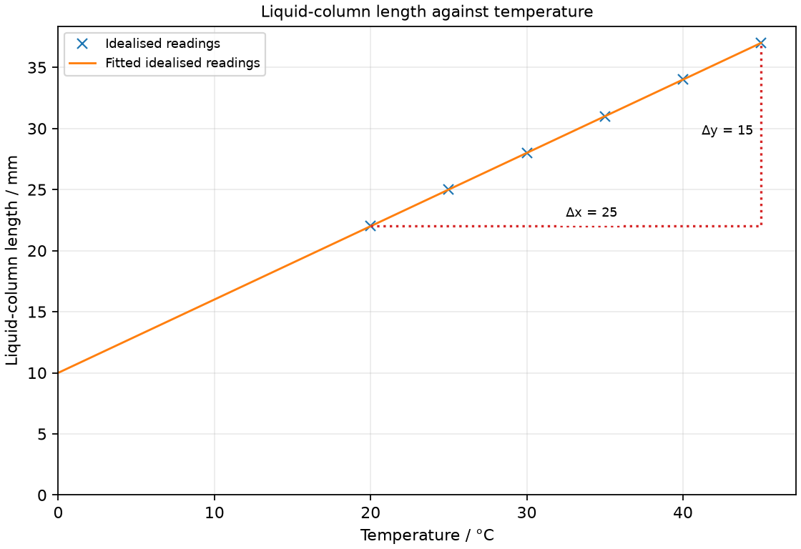

# 12 Particles, phases and gases

*nam-6118-nssco-2026. Offline study notes, rendered from the approved content units on 2026-10-31. Everything here is also what the flashcards are built from.*

---

## Particles, phases and gases — 3.1

### explain the kinetic particle model of matter as: - the particles and the space the particles occupy - the forces between particles - the constant state of motion of the particles - elastic collisions between particles - an increase in kinetic energy of the particles as temperature rises

The kinetic particle model describes matter using moving particles, spaces and interactions. Heating within a phase generally increases their mean kinetic energy rather than making individual particles larger.

The model connects invisible microscopic behaviour with observable shape, volume, pressure and temperature. Particles in a solid vibrate about positions; those in liquids move among close neighbours; gas particles move widely through the available volume. A drawing is a model, so particle sizes and gaps are not necessarily to scale. Use the different parts together rather than using motion alone to explain every property.

### Describe particles and the space between them

Matter consists of particles separated by spaces. Gases have much larger typical separations than solids and liquids.

The spaces are not filled by smaller pieces of the same gas in this model. When compressing a gas, the sample volume mainly decreases by reducing separation; individual particles are not squeezed appreciably smaller. Close particle spacing in liquids and solids helps explain their much smaller compressibility.

### Describe forces between particles

Interactions between particles help hold condensed matter together. Particle separation and motion affect how strongly these interactions influence the sample.

In a solid, particles remain near stable positions while vibrating. Liquid particles remain close but can change neighbours. Widely separated gas particles spend much of their travel with little intermolecular influence in the simple model. Heating does not switch off every interaction; it changes motion and can alter arrangement.

### Describe continual particle motion

Particles are in continual motion at ordinary temperatures. Solid particles vibrate; liquid and gas particles can move from place to place.

A stationary container does not imply stationary molecules inside it. Their random motions can cancel in an overall bulk velocity while individual particles continue moving. Heating generally increases the average kinetic energy rather than directing every molecule the same way.

### Describe elastic particle collisions qualitatively

The simple gas model treats particle encounters as conserving total kinetic energy during the encounter. Individual particles can exchange energy and change direction.

This microscopic model helps describe persistent random motion without requiring particles to slow after each mutual encounter. The energy of one particle need not stay fixed because it can transfer energy to another. The conservation statement concerns their combined kinetic energy in the model, not identical speeds before and after.

### Relate temperature rise to increased mean kinetic energy

Temperature is related to the mean kinetic energy of particles. A warmer sample has a larger average kinetic energy in the particle model.

Particles do not all have the same speed, and a temperature increase does not require every particle to have more energy at every instant. Distinguish the mean from one selected particle. A phase change can absorb energy without raising temperature because the energy affects interactions and arrangement rather than the mean kinetic energy.

### explain and analyse by means of the kinetic particle model of matter the processes of expansion and compressibility in solids, liquids and gases and diffusion in liquids and gases

Expansion, compression and diffusion describe different particle behaviours. Expansion commonly increases separation, compression reduces it and diffusion redistributes particles by random motion.

A warmed metal rod expands because mean spacing changes, not because new atoms appear. A gas compresses readily because of its large gaps. A dye spreads in still liquid because its particles and the liquid molecules move randomly. Avoid replacing diffusion with a bulk current: convection can mix substances too, but it is a different mechanism.

### Explain thermal expansion in solids

Most solids expand when heated over an ordinary temperature range. Increased vibration is associated with a larger mean separation of neighbouring particles.

A ball may fit through a ring when cool but fail after heating the ball. Its atoms are not individually enlarged in the model; their mean arrangement changes. Different materials expand by different amounts, so joints may need room for movement. The claim is limited because some materials have unusual behaviour over particular ranges.

### Explain thermal expansion in liquids and gases

Liquids and gases commonly expand when heated if the container permits expansion. The volume change is associated with altered average separation, rather than an increase in particle number.

A liquid column rises in a narrow tube because a small volume increase produces a visible length change. For a gas held at fixed volume, heating instead increases pressure. State the container constraint before predicting an observed change. Water near 4 °C is a known exception to a simple general expansion rule.

### Explain differences in compressibility

Gases are much more compressible than ordinary liquids or solids. The main difference is the much greater space between gas particles.

Closing a trapped-air syringe can reduce its sample volume markedly. A sealed water-filled syringe moves much less under a comparable pressure change because its particles are already close. Do not infer that a gas has no forces or that a liquid is mathematically incompressible; the comparison is qualitative.

### Explain diffusion in liquids and gases

Diffusion is spreading caused by random particle motion. The net redistribution tends to reduce concentration differences without requiring a directed bulk flow.

A smell can spread through air and dye can spread through water even without deliberate stirring. Individual particles move in varied directions, but initially more leave a concentrated region than enter it. Warmer conditions often speed this process because particle motion is more energetic. A draught or stirred current may also transport material and should be distinguished in an experiment.

### identify and explain some of the everyday applications and consequences of thermal expansion

Thermal expansion can be useful or can produce damage if constrained. Different expansion rates can bend a bonded bimetallic strip.

A bridge joint permits length changes rather than forcing a heated structure against a fixed boundary. A bimetallic strip uses different expansion amounts to bend and can operate a switch. Both involve expansion, but one design accommodates it while the other uses differential expansion as an action. Do not claim expansion gaps themselves generate motion or electricity.

### compare the differences between phases of matter in terms of differences in the behaviour and arrangement of particles

Phase properties follow from particle arrangement, mobility and interaction. A solid keeps shape, a liquid flows at nearly fixed volume and a gas fills its container.

A liquid takes the shape of its container’s lower region because particles can exchange neighbours while remaining close. A gas has no comparable fixed sample volume at ordinary pressure, because particles spread through the available space. Solid particles remain mobile through vibration, so fixed shape must not be explained by complete lack of particle motion.

### Compare particle arrangements in solid, liquid and gas

Solid and liquid particles are close together; gas particles are widely separated. Solids commonly have more ordered relative positions, while liquid positions can rearrange.

Show equal particle sizes in a simple diagram when comparing the same substance across phases. Change their spacing and arrangement, not the number of particles to represent a fixed sample. A solid drawing should show vibrations about positions; liquid arrows allow rearrangement; gas arrows show random travel in the available space.

### Compare particle motion and forces across phases

Solid particles mainly vibrate about positions, while liquid particles can move past neighbours. Gas particles travel freely between encounters in the simple model.

A flowing liquid is not evidence that it has no attractions; its cohesion and near-fixed volume show interactions remain important. A solid’s fixed shape likewise does not mean its particles are stationary. Compare motion and forces together to avoid those incomplete explanations.

### interpret the change from one phase of matter to another which involves an energy change (heat energy is either given out or taken in) and explain that the temperature of matter is constant during a phase change

During a pure substance’s phase change at fixed pressure, temperature can remain constant while energy transfers. The energy changes particle interactions and arrangement rather than mean kinetic energy.

A melting solid absorbs energy to loosen its ordered structure. Freezing releases energy as a more ordered condensed arrangement forms. On a heating curve, a plateau therefore does not mean no energy enters. Impurities, changing pressure and mixed observations can complicate the ideal plateau, so state the intended pure-substance model.

### describe the phases of matter and explain their inter-conversion in terms of the kinetic particle model in everyday life

Melting, freezing, boiling, condensation and sublimation are phase changes. Energy is absorbed when separation or freedom increases and released in the reverse changes under corresponding conditions.

Melting changes solid to liquid; freezing reverses it. Vaporisation changes liquid to gas and condensation reverses it. Sublimation goes directly from solid to gas, and deposition is the reverse. Water on the outside of a cold cup comes from condensation of atmospheric water vapour, rather than liquid leaking through an intact cup. Evaporation occurs when faster particles escape from a liquid’s surface; the remaining liquid can cool. This explains drying clothes and cooling by sweat without the whole liquid boiling.

### interpret the temperature of a gas in terms of the motion of its molecules

A gas’s temperature describes its molecular motion through mean kinetic energy. Bulk movement and random thermal movement are different.

A gas can have high temperature while its container is stationary. Blowing air in one direction gives a bulk velocity, but temperature concerns random motion rather than that overall flow alone. Compare samples using their mean kinetic energy, not simply the speed of one molecule selected at an instant.

### describe qualitatively the pressure of a gas in terms of the motion of its molecules

Gas pressure arises from particles transferring momentum to container walls. The many wall impacts produce an average force per area.

Each impact changes a particle’s momentum and exerts a force on the wall. More frequent or stronger momentum transfers per area increase pressure. Pressure is not the gas’s weight pressing solely on the bottom; a gas also acts on side walls and the lid. The random directions account for pressure throughout the enclosure.

### describe qualitatively the effect of a change of temperature on the pressure of a gas at constant volume (Pressure Law)

Heating a fixed amount of gas at constant volume increases its pressure in the simple model. The higher mean kinetic energy increases the rate of momentum transfer to the walls.

The amount of gas must remain fixed and the vessel must not expand substantially for this comparison. Faster particles reach walls more often and have larger typical momentum changes. The syllabus treatment here is qualitative; do not use a Celsius-temperature ratio as a proportional gas law.

### describe qualitatively the effect of a change of temperature on the volume of a gas at constant pressure (Charles’s Law)

Heating a fixed amount of gas at constant pressure increases its volume in the simple model. Expansion offsets the increased molecular motion so pressure can remain unchanged.

A movable piston under a fixed load can rise as the gas warms. The larger volume reduces the rate of wall impacts compared with the heated gas held in its original volume. State constant pressure rather than constant volume for this prediction. Only qualitative behaviour is required here.

### describe qualitatively the effect of a change of volume on the pressure of a gas at constant temperature (Boyle’s Law)

Reducing a fixed gas sample’s volume at constant temperature increases its pressure. The same mean kinetic energy is associated with more frequent impacts per wall area in the smaller space.

Compress slowly enough for heat exchange to maintain temperature in the intended comparison. Rapid compression can raise temperature and adds another effect. A pressure increase from bringing the particles closer does not require each particle to grow or acquire greater mean kinetic energy in this isothermal model.

### describe the random motion of particles in a suspension as evidence for the kinetic particle model of matter

Brownian motion is irregular random movement of small particles suspended in a fluid. It provides indirect evidence of molecular motion.

Observed smoke or pollen particles are much larger than the surrounding molecules. Their erratic zigzag motion differs from a common drift of the whole fluid. Use a microscope and suitable illumination to observe the suspended particles, recognising that individual fluid molecules are not what the ordinary school view shows.

### describe this random motion (sometimes known as Brownian motion) in terms of random molecular bombardment

Suspended particles undergo uneven bombardment by randomly moving fluid molecules. Changing imbalance of these impacts produces their erratic motion.

A particle can receive a temporarily larger push from one direction, then from another. The continually changing imbalance prevents a smooth directed path. A larger suspended body averages many impacts more evenly, making the visible jitter less pronounced. The suspended particle is evidence for molecular motion rather than itself being one gas molecule.

### Practice task with worked feedback

Choose one correct option for each original practice question.

1. Which phase is usually most compressible?
A. A contained gas
B. Each phase equally
C. A solid block
D. A liquid sample

2. How do solid particles move in the model?
A. Vibrate near fixed positions
B. Remain still until melting
C. Move freely throughout the solid
D. Travel only along its surface

3. What increases when a gas’s temperature rises?
A. Total molecules in sealed gas
B. Mean molecular physical size
C. Mean molecular kinetic energy
D. Total gas mass without added gas

4. What causes diffusion in a still fluid?
A. Growth of individual particles
B. Coherent flow of the liquid
C. Gravity-directed horizontal motion
D. Random motion of particles

5. Why can temperature remain fixed during pure melting?
A. Mean kinetic energy rises steadily
B. Energy supply falls to zero
C. All molecular motion stops
D. Energy changes particle arrangement

6. What is directly seen in a Brownian-motion demonstration?
A. Smoothly drifting bulk liquid
B. Larger suspended tracer particles
C. Individual surrounding molecules
D. Motion of the microscope stage

7. What produces gas pressure at a wall?
A. Attraction to the container base
B. Molecular impacts on the walls
C. Particle size without any motion
D. Weight acting only on the base

8. A fixed gas amount is heated in a rigid sealed vessel. What happens?
A. Pressure falls as particles slow down
B. Pressure falls as the volume expands
C. Pressure rises as particles speed up
D. Pressure stays fixed as particles enlarge

9. A gas is warmed at constant pressure under a movable piston. What happens?
A. Volume stays fixed; density falls
B. Volume rises; gas density falls
C. Volume rises; gas density rises
D. Volume falls; gas density rises

10. A fixed gas amount is compressed isothermally. What happens?
A. Pressure unchanged
B. Pressure decreases
C. Pressure increases
D. Particles grow

11. Why leave a gap between sections of a metal structure?
A. To create new metal
B. To make atoms expand individually
C. To prevent any particle motion
D. To accommodate thermal length changes

12. What forms on the outside of a sufficiently cold intact glass in humid air?
A. Water vapour from air condenses
B. Liquid leaks through glass
C. The glass itself evaporates
D. The glass surface melts

Worked feedback

1. Key A. A: Its widely separated particles allow large volume changes without changing particle size. B: Particle separation makes gases substantially more compressible. C: Close particles in a solid leave little compressible space. D: Liquids have much less compressible space than a gas.

2. Key A. A: This permits motion while preserving shape. B: Thermal vibration persists. C: A solid keeps relative positions. D: Particles also vibrate in the solid.

3. Key C. A: Heating changes kinetic energy, not molecular size. B: Speeds have a distribution. C: Temperature tracks this average. D: Temperature change alone does not add molecules.

4. Key D. A: Random motion is sufficient. B: Diffusion occurs in still fluid. C: Mixing changes distribution, not particle size. D: It redistributes particles.

5. Key D. A: Temperature would then rise. B: Latent energy is absorbed. C: Particles continue moving during phase change. D: The mean kinetic energy need not rise.

6. Key B. A: Observed motion is irregular. B: The fluid molecules bombard them. C: Ordinary demonstration sees the larger suspended particles. D: Uneven molecular impacts produce the random motion.

7. Key B. A: Impacts and momentum transfer matter. B: Impacts produce average force per area. C: Pressure acts on all walls. D: Molecular impacts create pressure on walls in every orientation.

8. Key C. A: Heating raises rather than lowers the mean molecular kinetic energy. B: The stated rigid vessel has fixed volume. C: At fixed volume, increased mean kinetic energy increases wall momentum transfer. D: Particles do not expand to absorb the temperature rise; their motion becomes more energetic.

9. Key B. A: Unchanged mass at fixed volume could not have falling density. B: The piston moves outward at fixed external pressure; unchanged mass occupies more volume. C: At fixed mass, increasing volume reduces density. D: Warming at the given fixed pressure moves the piston outward, not inward.

10. Key C. A: Constant temperature does not imply constant pressure when volume changes. B: A smaller volume gives greater rather than lower wall impact rate. C: At fixed temperature the smaller volume gives more frequent wall impacts. D: Compression reduces particle spacing, not individual particle size.

11. Key D. A: No new matter is required. B: That is not the spacing model. C: Thermal vibration remains. D: This reduces stress when it expands.

12. Key A. A: Vapour cools at the surface and changes to liquid. B: The glass is stated to be intact; surface condensation does not require leakage. C: Evaporation would remove material, not form the observed liquid-water droplets. D: The cold wall is not a layer of frozen water that melts.

### Practice task with worked feedback

Original structured practice. Answer the parts with working and units where needed.

(a) State the name for irregular motion of suspended particles. [1]

(b) State which phase has widely separated particles. [1]

(c) Explain molecular pressure on a wall. [2]

(d) Explain the pressure change when a fixed gas amount is heated at fixed volume. [2]

(e) Explain the pressure change when that sample is compressed while temperature stays fixed. [2]

Worked feedback

(a) Brownian motion.

(b) Gas.

(c) Impacts transfer momentum to the wall and exert force. The average force per area is pressure.

(d) Mean molecular kinetic energy rises. Greater momentum transfer to the walls per time raises pressure.

(e) Wall impacts become more frequent in the smaller volume. Pressure rises while mean molecular kinetic energy remains unchanged.

### Practice task with worked feedback

Investigation aim: measure a liquid column’s response to bath temperature. These are invented, idealised practice readings; real readings have scatter. 

| Temperature / °C | Liquid-column length / mm |
|---:|---:|
| 20 | 22 |
| 25 | 25 |
| 30 | 28 |
| 35 | 31 |
| 40 | 34 |
| 45 | 37 |

(a) Draw Liquid-column length / mm vertically against Temperature / °C horizontally. Plot the supplied readings and add a separate fitted line. [5]
(b) Show two widely separated points on your fitted line and calculate its gradient. State the gradient unit. [3]
(c) Plan how to measure a liquid column’s response to bath temperature. Name the equipment and arrangement, describe the measurements and repeats, state controls and a relevant precaution, design the results table and explain how the results answer the aim. [8]

Worked feedback

Graph: Liquid-column length / mm is vertical and Temperature / °C horizontal. Use the six readings, draw a separate best-fit line and show a wide gradient triangle; do not join scattered readings in a zigzag.

Gradient construction: choose the separated fitted-line points (20, 22) and (45, 37). Gradient = (37 − 22) / (45 − 20) = 0.6 mm/°C. The slope is liquid-column length change per temperature degree for this apparatus, 0.6 mm/°C. It is not a volume-expansion coefficient.

Arrangement: An open safe-liquid bulb and uniform narrow tube with a fixed length-reference mark, stirred water bath, reference thermometer and millimetre rule

Plan: 1. Mark a fixed zero-length reference beside the open liquid column. 2. Place the bulb in a stirred moderate-temperature water bath beside a reference thermometer. 3. Wait for steady thermometer and column readings and record temperature and length from the mark. 4. Change bath temperature in 5 °C steps over the stated 20–45 °C interval and repeat settled readings. 5. Take another set on cooling without changing the bulb, liquid amount or tube.
Control and accuracy: Keep tube geometry and liquid amount fixed, remove bubbles, avoid sealing a heated apparatus and handle warm water carefully.
Table: Temperature / °C; Liquid-column length / mm; repeat readings in separate columns. 
Graph and conclusion: The slope is liquid-column length change per temperature degree for this apparatus, 0.6 mm/°C. It is not a volume-expansion coefficient. Compare repeated readings and report the tested range rather than claiming an exact law from scattered observations.

