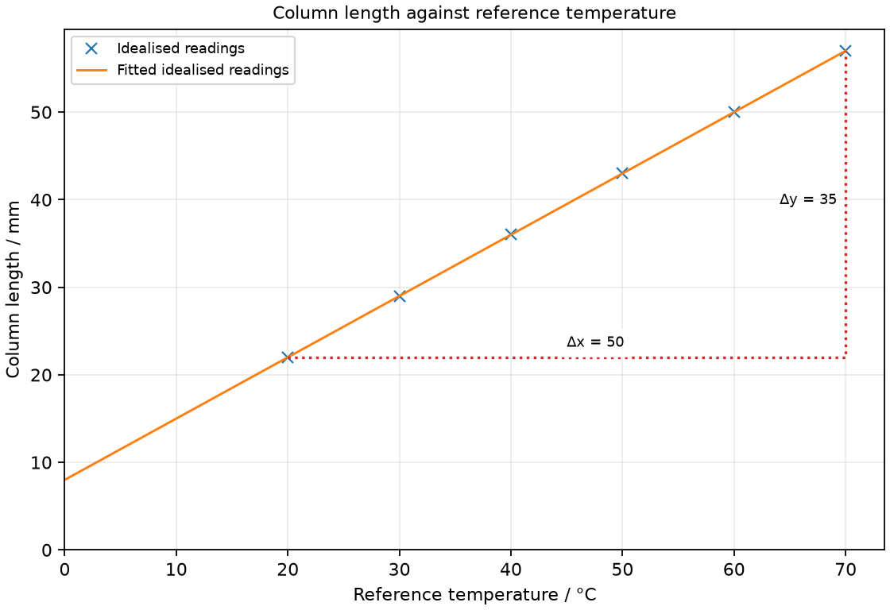

# 13 Temperature and thermometers

*nam-6118-nssco-2026. Offline study notes, rendered from the approved content units on 2026-10-31. Everything here is also what the flashcards are built from.*

---

## Temperature and thermometers — 3.2.1

### state the concept of absolute zero and the Kelvin scale of temperature

Absolute zero is 0 K, approximately −273 °C in the school conversion. The kelvin scale starts at absolute zero, with an interval equal in size to one Celsius degree.

Absolute zero is the lower limit of thermodynamic temperature. In the simple particle account, it corresponds to the limiting minimum thermal motion; do not claim that every form of microscopic motion can be removed. Write kelvin as K without a degree sign. A temperature of 0 °C is the freezing region of water at ordinary pressure, not absolute zero.

### recall and use the information that absolute temperature is given by T/K = T/ º C + 273 (example 20ºC is 20ºC + 273 = 293 K)

The school conversion is T/K = temperature/°C + 273. For the reverse conversion, subtract 273 from the kelvin value.

A temperature of 35 °C corresponds to 308 K using this approximation. An interval of 5 °C is an interval of 5 K because the scale steps have the same size; do not add 273 to a temperature difference. Distinguish a point on a scale from a rise between two points.

### state and apply examples, including calculations, of how a physical property which varies with temperature may be used for the measurement of temperature, e.g. volume of a liquid and resistance of a metal

A thermometer uses a measurable property that changes reproducibly with temperature. Calibration connects property values to known temperatures.

Liquid volume and electrical resistance are thermometric properties. Measure the property at known fixed points or against a calibrated reference, then construct the scale. An approximately linear property permits interpolation using the fraction of the calibration interval. If the response is nonlinear, equal property intervals cannot be assumed to mean equal temperature intervals.

### Use liquid volume as a thermometric property

A liquid-in-glass thermometer uses liquid expansion relative to its glass container. A narrow capillary turns a small volume change into a visible length change.

The liquid is held in a bulb connected to a fine tube. A temperature rise commonly increases liquid volume more than bulb volume, so the column rises. The scale must be calibrated, not simply marked with equal values without checking the response. Wait for thermal equilibrium before reading.

### Use metal resistance as a thermometric property

The electrical resistance of a suitable metal changes with temperature. A resistance thermometer infers temperature from a calibrated resistance measurement.

A small sensing element is brought into thermal contact with the sample. A measuring circuit records resistance, which is compared with its calibration. Over an appropriate limited range, a metal resistance can be approximated as increasing linearly. Avoid excessive measurement current because self-heating changes the sensor temperature.

### Calculate a temperature from a calibrated property

For a linear response, the fraction of a property’s calibration interval equals the fraction of its temperature interval. Between 0 and 100 °C, θ = 100(X − X0)/(X100 − X0).

Subtract the lower-point value before taking the ratio. A column of 15 mm at 0 °C and 115 mm at 100 °C gives 40 °C when its length is 55 mm. The full length is not proportional to Celsius temperature unless the lower-point reading is zero. Interpolate within the calibrated range; extrapolation requires further evidence.

### explain what is meant by the sensitivity, range and linearity of thermometers

Sensitivity, range and linearity describe different thermometer properties. A sensitive instrument need not have a wide range or a linear response.

Sensitivity is output change per temperature change, range is the usable temperature interval, and linearity describes whether equal temperature changes give equal output changes. Choose according to the task: a narrow clinical interval and a furnace measurement impose different needs. Response time is another property, distinct from sensitivity.

### Explain thermometer sensitivity

Sensitivity is the change in thermometric property per unit temperature change. For a given bulb and liquid, a narrower capillary gives more column movement per degree but a smaller temperature span on a fixed stem.

A column that moves 2 mm per degree is more sensitive than one moving 0.5 mm per degree. This can make small changes easier to distinguish, but accuracy also depends on calibration, reading and thermal contact. A very fine scale does not prove an accurate thermometer.

### Explain thermometer range

Thermometer range is the interval between its usable lower and upper temperatures. It differs from sensitivity, which concerns response per degree.

A liquid’s freezing and boiling behaviour, the tube length and the material’s durability constrain usable range. A high sensitivity on a fixed-length stem can limit how large a temperature interval fits. State the actual endpoints when comparing instruments rather than calling one range simply better.

### Explain thermometer linearity

A linear thermometer gives equal output increments for equal temperature increments. A nonlinear thermometer can still be calibrated, but requires an appropriate nonuniform scale or relation.

A straight calibration graph supports a constant sensitivity over the tested range. A curved graph has varying slope, so one constant mm-per-degree value does not apply throughout. A straight response does not establish that the zero mark is correct; linearity and calibration offset are different issues.

### state the need for and identify fixed points

Fixed points provide reproducible temperature references for calibration. The ice point and steam point of pure water at specified standard pressure are approximately 0 °C and 100 °C.

Pressure and purity matter for these references. Use a well-mixed ice-water equilibrium for the lower point rather than a random ice cube surface. The upper reference uses steam in the specified equilibrium conditions, not an arbitrary hot vessel. A comparison against a calibrated reference thermometer can establish additional points safely in moderate baths.

### describe the structure and action of liquid-in-glass thermometers and how the structure affects the range and sensitivity

A liquid-in-glass thermometer has a bulb, liquid and narrow capillary with a scale. A larger bulb or narrower bore generally increases column movement per degree, with other features fixed.

For a fixed stem length, greater sensitivity usually reduces the temperature interval that fits. A wider bore can offer greater range but smaller movement per degree. A uniform bore helps linearity when the liquid response is approximately uniform. Good thermal contact and sufficient waiting time are needed before reading the meniscus squarely.

### describe the advantages and disadvantages of different liquids in liquid-in-glass thermometers

Thermometric liquids differ in expansion, visibility, usable temperature range and hazards. An alcohol-based liquid can serve lower temperatures than mercury, while its lower boiling range limits high-temperature use.

Mercury is visible and does not wet clean glass strongly, but it is toxic and should not be handled in student experiments. Coloured alcohol is easier to see than a clear liquid and can have a large expansion response, but may wet glass. Material choice must match the intended interval rather than assuming one liquid is best for every measurement.

### describe the structure and action of a thermocouple and explain its use for measuring high temperatures and those which vary rapidly

A thermocouple uses two different conductors joined at a sensing junction and a reference junction or equivalent compensated reference. A temperature difference produces a small electrical output that can be calibrated.

A small junction has low thermal capacity and can respond rapidly. Appropriate metals permit high-temperature measurements beyond many liquid-in-glass instruments. The signal depends on the junction temperatures and requires calibration; it is not simply a resistance thermometer. Keep the measuring arrangement suitable for the temperature and environment. Suitable thermocouple metals tolerate high temperatures without a liquid column that can boil; a small junction needs little energy to change temperature and therefore responds rapidly.

### Distinguishing the ideas

Zero degrees Celsius is not absolute zero. The school conversion places 0 °C at 273 K and absolute zero at 0 K.

Both scales use equal interval sizes, but their origins differ. A claim that ice water has no thermal motion because its temperature is zero confuses a scale label with the thermodynamic lower limit. Use the conversion on the temperature point rather than treating a zero Celsius reading as zero energy.

### Practice task with worked feedback

Choose one correct option for each original practice question.

1. Which temperature is absolute zero?
A. 100 K
B. 0 °C
C. 273 °C
D. 0 K

2. Which property is used in a liquid-in-glass thermometer?
A. Liquid expansion
B. Glass expansion alone
C. Liquid mass change
D. Liquid boiling at every reading

3. What describes thermometer sensitivity?
A. The largest possible temperature
B. Lowest temperature alone
C. Output change per degree
D. Time until equilibrium

4. Which calibration graph indicates linear response?
A. A straight vertical line
B. A straight line
C. A smooth changing-slope curve
D. Any graph passing through the origin

5. Why are fixed points used?
A. To set response time
B. To make the capillary uniform
C. To establish known temperature references
D. To remove zero error at every temperature automatically

6. Why can a small thermocouple respond rapidly?
A. Its junction has large thermal capacity
B. Its signal requires no calibration
C. Its leads must be long
D. Its junction has low thermal capacity

7. Which issue makes mercury inappropriate for casual student handling?
A. Mercury is highly flammable at room temperature
B. Mercury expands too much to have a temperature scale
C. Mercury cannot wet any container
D. Toxicity

8. Using the school conversion, what is 27 °C?
A. 246 K
B. 327 K
C. 300 K
D. 27 K

9. A temperature rises by 8 °C. What is the rise in kelvin?
A. 8 K
B. 16 K
C. 265 K
D. 281 K

10. A linear sensor reads 20 at 0 °C and 120 at 100 °C. What is a reading of 45?
A. 25 °C
B. 45 °C
C. 75 °C
D. 65 °C

11. A capillary bore narrows with the bulb unchanged. What is expected?
A. More liquid mass created
B. Greater column rise per degree
C. No effect on movement
D. Smaller rise per degree

12. Sensor X changes 12 mm over 4 °C. What is its sensitivity?
A. 8 mm/°C
B. 3 mm/°C
C. 0.333 °C/mm
D. 48 mm/°C

Worked feedback

1. Key D. A: This is above 0 K. B: This is approximately 273 K. C: This is well above absolute zero. D: Kelvin starts at this lower limit.

2. Key A. A: It changes column length. B: Liquid expands relative to the glass. C: Mass is unchanged in the sealed thermometer. D: Thermometer operates within liquid range.

3. Key C. A: This is an upper limit. B: This is one range limit. C: This is response per temperature change. D: This is response time.

4. Key B. A: One property reading cannot represent many distinct temperatures in this calibration. B: It has constant slope. C: Sensitivity varies on a curve. D: Origin passage alone does not guarantee constant slope.

5. Key C. A: Fixed points calibrate temperature values. B: Calibration does not alter tube shape. C: They support calibration. D: Calibration needs an established relation across range.

6. Key D. A: This slows response. B: Temperature still needs calibrated output. C: Junction size, not lead length alone, controls thermal response. D: Less energy is needed for its temperature to change.

7. Key D. A: Its toxicity, not flammability, is the main handling issue here. B: Expansion is the measuring property. C: This does not account for its toxic spill risk. D: Hazard is a material-selection concern.

8. Key C. A: This subtracts from 273. B: This adds an incorrect offset. C: Add 273. D: This ignores the scale offset.

9. Key A. A: The interval sizes are equal. B: The Celsius and kelvin degree intervals have equal size, so no factor two is applied. C: Do not subtract an offset from a difference. D: Do not add the offset to a difference.

10. Key A. A: It is 25 units above the lower point. B: This ignores the offset. C: This uses the remaining interval. D: This adds the offset instead of subtracting.

11. Key B. A: Heating does not add material. B: The same extra volume occupies more length. C: Bore area affects length. D: This reverses the geometry effect.

12. Key B. A: This subtracts unlike quantities. B: Divide output change by temperature change. C: This is the reciprocal. D: This multiplies them.

### Practice task with worked feedback

Original structured practice. Answer the parts with working and units where needed.

(a) State the kelvin temperature at absolute zero. [1]

(b) State one fixed-point temperature for pure water at standard pressure. [1]

(c) Explain the effect of a narrower capillary on sensitivity. [2]

(d) Calculate the kelvin temperature of 42 °C using +273. [2]

(e) Calculate temperature for a linear column reading 70 mm, calibrated at 10 mm for 0 °C and 110 mm for 100 °C. [2]

Worked feedback

(a) 0 K.

(b) Ice point, 0 °C.

(c) The same liquid expansion occupies more length. The column therefore moves farther for each degree.

(d) T = 42 + 273 = 315 K.

(e) θ = 100(70 − 10)/(110 − 10) = 60 °C.

### Practice task with worked feedback

Investigation aim: calibrate a liquid-column thermometer against known reference temperatures. These are invented, idealised practice readings; real readings have scatter. 

| Reference temperature / °C | Column length / mm |
|---:|---:|
| 20 | 22 |
| 30 | 29 |
| 40 | 36 |
| 50 | 43 |
| 60 | 50 |
| 70 | 57 |

(a) Draw Column length / mm vertically against Reference temperature / °C horizontally. Plot the supplied readings and add a separate fitted line. [5]
(b) Show two widely separated points on your fitted line and calculate its gradient. State the gradient unit. [3]
(c) Plan how to calibrate a liquid-column thermometer against known reference temperatures. Name the equipment and arrangement, describe the measurements and repeats, state controls and a relevant precaution, design the results table and explain how the results answer the aim. [8]

Worked feedback

Graph: Column length / mm is vertical and Reference temperature / °C horizontal. Use the six readings, draw a separate best-fit line and show a wide gradient triangle; do not join scattered readings in a zigzag.

Gradient construction: choose the separated fitted-line points (20, 22) and (70, 57). Gradient = (57 − 22) / (70 − 20) = 0.7 mm/°C. The calibration slope is sensitivity, 0.7 mm/°C. The fitted line has a length offset; it need not pass through zero.

Arrangement: An uncalibrated liquid-column thermometer, calibrated reference thermometer, stirred water bath and millimetre scale

Plan: 1. Place both thermometer bulbs at the same depth in a stirred water bath without touching its wall. 2. Wait at a reference temperature until readings stop changing. 3. Record the reference temperature and uncalibrated column length from a fixed stem mark. 4. Change temperature over the given 20–70 °C interval and record settled pairs at several settings. 5. Repeat the pairs on cooling and use the calibration line to estimate an unknown bath temperature.
Control and accuracy: Keep immersion depth and reading geometry fixed, avoid contact with the vessel wall and handle warm water safely.
Table: Reference temperature / °C; Column length / mm; repeat readings in separate columns. 
Graph and conclusion: The calibration slope is sensitivity, 0.7 mm/°C. The fitted line has a length offset; it need not pass through zero. Compare repeated readings and report the tested range rather than claiming an exact law from scattered observations.

