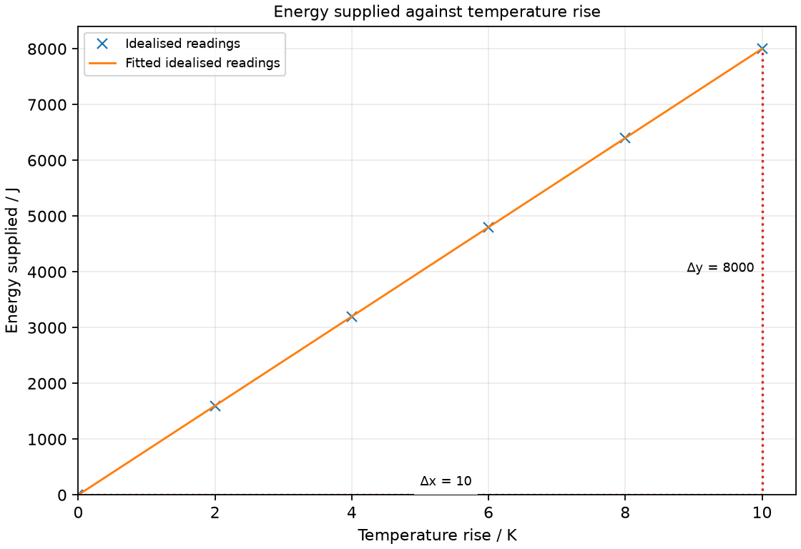
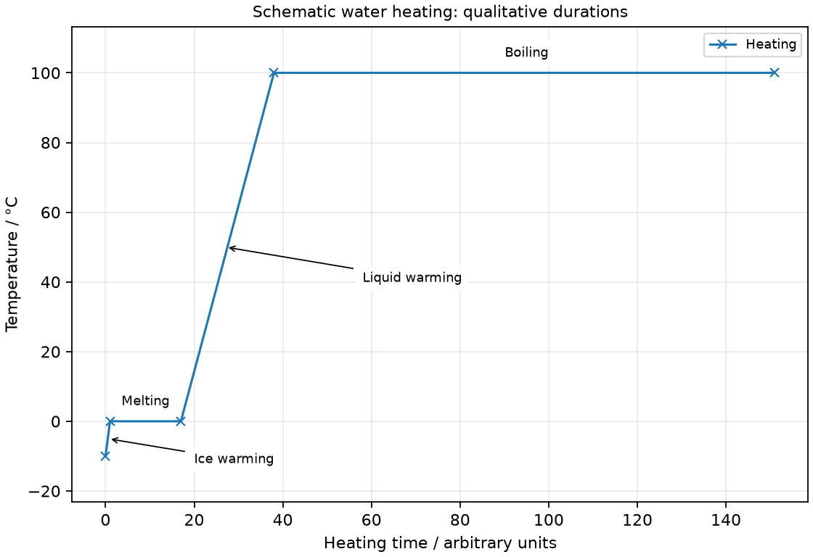

# 14 Heat capacity and changes of state

*nam-6118-nssco-2026. Offline study notes, rendered from the approved content units on 2026-10-31. Everything here is also what the flashcards are built from.*

---

## Heat capacity and changes of state — 3.2.2

### relate a rise in the temperature of a body to an increase in internal energy

Internal energy includes microscopic kinetic and interaction potential energies. A temperature rise within a phase is associated with an increase in mean particle kinetic energy.

Energy supplied to a sample can increase internal energy, but a temperature rise is not the sole possible outcome. During a phase change, interaction energy can change while temperature stays fixed. A large cooler sample may have more total internal energy than a small warmer sample because the number of particles also matters. Distinguish temperature, internal energy and energy transferred by heating.

### explain the term thermal capacity

Thermal capacity describes the energy needed for a specified temperature increase of a whole object. An object with greater heat capacity has a smaller temperature rise for the same absorbed energy.

The size and material of the body both matter. A large bucket of water needs more energy for a one-degree rise than a small cup of the same water. This is different from specific heat capacity, which is a property per unit mass. The relationship C = mc connects the two for a uniform material over an appropriate temperature interval.

### define heat capacity of an object [C] as the heat required [Q] to raise its temperature [∆𝑇] by one kelvin

Heat capacity is the energy required to raise a whole object’s temperature by one kelvin. Its unit is J/K, equivalent to J/°C for a temperature interval.

The quantity refers to the complete object, not one kilogram. It may vary with temperature, so a stated value often applies over a particular interval. When energy is lost to the surroundings, the heater’s total input is greater than the energy absorbed by the object alone.

### Use heat capacity C = Q/ΔT

Heat capacity is C = Q/ΔT for the absorbed energy and resulting temperature rise. Rearranging gives Q = CΔT.

A body absorbing 800 J while warming by 4 K has heat capacity 200 J/K. Use the change rather than the final temperature. If heating from 18 to 23 °C, the interval is 5 K, not 296 K. A kelvin offset must not be added to an interval.

### define specific heat capacity [c] as the heat required [Q] to raise the temperature of a 1 kg mass [m] of a substance by one kelvin

Specific heat capacity is the energy required per kilogram for a one-kelvin temperature rise. Its SI unit is J/(kg K).

This compares materials independently of sample mass under stated conditions. Water has a relatively large value, so a given mass can absorb substantial energy with a modest temperature rise. A material’s specific heat capacity is not the energy for melting it at constant temperature.

### Use specific heat capacity c = Q/(mΔT)

Specific heat capacity is c = Q/(mΔT). For heating within one phase, Q = mcΔT with the appropriate approximately constant c.

For 0.50 kg absorbing 2100 J and warming by 10 K, c = 420 J/(kg K). Convert grams to kilograms first. A heater input Pt can estimate Q when the relevant losses and apparatus heating are negligible or corrected. Do not apply this temperature-rise expression to a constant-temperature phase-change interval. For water take c = 4200 J/(kg °C) in the school model. Warming 0.50 kg by 12 °C requires Q = 0.50 × 4200 × 12 = 25 200 J, before allowing for losses. J/(kg K) and J/(kg °C) are equivalent for temperature changes.

### describe an experiment to measure the specific heat capacity [c] of a substance

A heating experiment can estimate c from measured energy, sample mass and temperature rise. Energy supplied to the apparatus and surroundings must be reduced or accounted for.

Measure the mass of a solid block, insert a low-voltage heater and thermometer in suitable close-contact holes, and insulate it. Record initial temperature, heater energy from a joulemeter or measured power and time, and final temperature. Calculate c from the energy absorbed by the block. Contact errors, thermal lag and heat loss affect the estimate. For liquids, include stirring and consider the vessel’s heat capacity.

### describe an investigation to establish that the temperature increase is proportional to the time of heating (for a constant mass) and inversely proportional to mass (for a constant time of heating)

At constant absorbed power and mass, temperature rise is proportional to heating time in the simple no-loss model. For a fixed absorbed energy and material, temperature rise is inversely proportional to mass.

Combining Q = Pt and Q = mcΔT gives ΔT = Pt/(mc). Test the time relation with one sample and repeated readings, then test mass using different measured masses heated for the same interval with the same power. Keep starting temperature, vessel and surroundings comparable. Longer heating or hotter samples can increase losses, bending the ideal relation.

### define latent heat [L] as the quantity of heat energy [Q] absorbed or released when a substance changes state without changing its temperature (L = Q)

Latent heat is the energy absorbed or released during a phase change without temperature change. For the whole stated sample it is an energy quantity measured in joules.

The syllabus uses L for total latent heat and l for specific latent heat. Keep the distinction visible because some books use different symbols. A melting sample absorbs energy; freezing releases it under corresponding conditions. A constant temperature does not mean a zero transfer.

### define specific latent heat [l]as the quantity of heat energy [Q] absorbed or released when a 1 kg mass [m] of a substance changes state without changing its temperature

Specific latent heat is phase-change energy per kilogram without temperature change. Its unit is J/kg, and the particular transition must be identified.

Specific latent heat of fusion describes melting or freezing, while vaporisation describes liquid-gas transition. Values differ by substance and conditions. The mass is the amount that changes phase, not automatically the total mass initially in a vessel. Compare the units with specific heat capacity: the latter includes an additional per-kelvin factor.

### use the term, and give a molecular interpretation of latent heat [L]

During an ideal constant-temperature phase change, energy changes molecular interaction potential energy. The mean kinetic energy does not rise while the temperature remains constant.

Boiling separates particles much more widely, requiring energy against attractions. Condensation reverses this and releases energy. Melting changes the ordered structure to a mobile liquid arrangement. Use microscopic interactions rather than saying energy is hidden or absent; latent describes an energy transfer not accompanied by the temperature rise expected within a single phase.

### Use specific latent heat l = Q/m

Specific latent heat is l = Q/m. The phase-change energy is Q = ml for the mass that actually changes phase.

If 0.040 kg melts after absorbing 12 000 J at constant temperature, l = 300 000 J/kg. Heating the material to its melting point is a separate energy contribution. A full process may therefore require a temperature-rise stage plus a phase-change stage rather than one formula for both.

### Distinguishing the ideas

Specific heat capacity and specific latent heat concern different changes. The first involves temperature rise per kilogram per kelvin; the second involves phase change per kilogram without temperature rise.

A sample warming within one phase uses Q = mcΔT. A sample melting at its fixed melting temperature uses Q = ml. If both occur, separate their energy contributions. The presence of heating alone does not determine which formula is appropriate; identify what happens to the sample.

### Distinguishing the ideas

Energy absorbed during a constant-temperature phase change changes interactions, not mean kinetic energy. A flat temperature trace does not mean zero energy input.

A heater can continuously transfer energy into a boiling sample while particles separate into vapour. The constant temperature indicates approximately unchanged mean kinetic energy. Saying the particles gain average speed throughout the plateau contradicts that temperature condition in this model.

### Practice task with worked feedback

Choose one correct option for each original practice question.

1. Which unit measures a whole object’s heat capacity?
A. J/K
B. W
C. J/kg
D. J/(kg K)

2. What does specific heat capacity refer to?
A. One kilogram warmed by one kelvin
B. Energy per second
C. One kilogram melted at fixed temperature
D. A whole object melted

3. Which unit fits specific latent heat?
A. K/J
B. Pa
C. J/(kg K)
D. J/kg

4. Where does evaporation occur?
A. Only in bubbles throughout the liquid
B. Only inside a solid
C. Only at the boiling point
D. At the liquid surface

5. A pure substance melts at fixed pressure. What can remain constant?
A. Mean particle speed must rise throughout melting
B. Temperature
C. Liquid fraction
D. Particle separation arrangement

6. Why insulate a heating block?
A. To stop heat exchange inside the block
B. To reduce energy loss to surroundings
C. To reduce useful energy entering the block
D. To make absorbed energy exactly equal to power without timing

7. Which is part of internal energy?
A. Microscopic particle kinetic energy
B. Whole-container rotational kinetic energy
C. Gravitational energy of whole object above floor
D. Whole-object translational kinetic energy

8. What is C when 900 J causes a 3 K rise?
A. 2700 J/K
B. 0.00333 J/K
C. 300 J/K
D. 903 J/K

9. For m = 0.5 kg, c = 400 J/(kg K) and ΔT = 5 K, what is Q?
A. 40 J
B. 4000 J
C. 200 J
D. 1000 J

10. What energy melts 0.10 kg when l = 300 000 J/kg?
A. 3 000 000 J
B. 300 J
C. 30 000 J
D. 300 000 J

11. With equal absorbed power and time, a doubled mass has what ideal temperature rise?
A. The same rise
B. Twice the rise
C. Half the rise
D. Four times the rise

12. On a temperature-time graph, a horizontal phase-change region indicates what?
A. Mean particle kinetic energy rises steadily
B. Constant temperature during energy transfer
C. The sample stays in a single phase throughout
D. No thermal energy is absorbed

Worked feedback

1. Key A. A: It is energy per temperature rise. B: This is power. C: This is a specific latent-heat unit. D: This is specific heat capacity.

2. Key A. A: Both mass and temperature interval are included. B: That is power. C: That concerns specific latent heat. D: That concerns total phase-change energy.

3. Key D. A: This is an inverse heat-capacity unit. B: This measures pressure. C: That includes a temperature-rise factor. D: It is phase-change energy per mass.

4. Key D. A: That describes boiling. B: A liquid surface is involved. C: It can occur below that point. D: Particles escape from the surface.

5. Key B. A: Constant temperature means unchanged mean kinetic energy during the ideal plateau. B: Energy can change arrangement without raising mean kinetic energy. C: Liquid fraction rises as solid melts. D: Arrangement changes through melting.

6. Key B. A: Internal transfer is needed for uniform temperature. B: More heater input then reaches the intended sample. C: Insulation aims to reduce outward losses. D: Energy still depends on time.

7. Key A. A: Random motion contributes. B: Bulk motion of the object is excluded from internal energy. C: This is an external macroscopic store. D: Bulk motion is not internal energy.

8. Key C. A: This multiplies them. B: This reverses the ratio. C: Divide energy by rise. D: This adds unlike quantities.

9. Key D. A: This uses a different operation. B: This divides by mass rather than multiplying. C: This omits the temperature rise. D: Use mcΔT.

10. Key C. A: This divides by mass. B: This misplaces two powers of ten. C: Use ml. D: This ignores the sample mass.

11. Key C. A: The heat capacity has changed. B: That reverses the mass dependence. C: ΔT is inversely proportional to mass. D: No square relation applies.

12. Key B. A: Mean kinetic energy tracks the constant temperature. B: It represents a phase change in the ideal model. C: A phase-change plateau contains changing phase proportions. D: Latent energy can enter at constant temperature.

### Practice task with worked feedback

Original structured practice. Answer the parts with working and units where needed.

(a) State the unit of specific heat capacity. [1]

(b) State the unit of specific latent heat. [1]

(c) Explain energy input during constant-temperature melting. [2]

(d) Calculate energy to warm 0.20 kg by 10 K when c = 400 J/(kg K). [2]

(e) Calculate energy for 0.030 kg to melt with l = 300 000 J/kg. [2]

Worked feedback

(a) J/(kg K).

(b) J/kg.

(c) Energy changes the arrangement and interaction potential energy. Mean kinetic energy remains approximately fixed, so temperature does not rise.

(d) Q = mcΔT = 800 J.

(e) Q = ml = 9000 J.

### Practice task with worked feedback

Investigation aim: find specific heat capacity from energy input and temperature rise of a 0.20 kg sample. These are invented, idealised practice readings; real readings have scatter. 

| Temperature rise / K | Energy supplied / J |
|---:|---:|
| 0 | 0 |
| 2 | 1600 |
| 4 | 3200 |
| 6 | 4800 |
| 8 | 6400 |
| 10 | 8000 |

(a) Draw Energy supplied / J vertically against Temperature rise / K horizontally. Plot the supplied readings and add a separate fitted line. [5]
(b) Show two widely separated points on your fitted line and calculate its gradient. State the gradient unit. [3]
(c) Plan how to find specific heat capacity from energy input and temperature rise of a 0.20 kg sample. Name the equipment and arrangement, describe the measurements and repeats, state controls and a relevant precaution, design the results table and explain how the results answer the aim. [8]

Worked feedback

Graph: Energy supplied / J is vertical and Temperature rise / K horizontal. Use the six readings, draw a separate best-fit line and show a wide gradient triangle; do not join scattered readings in a zigzag.

Gradient construction: choose the separated fitted-line points (0, 0) and (10, 8000). Gradient = (8000 − 0) / (10 − 0) = 800 J/K. For energy vertically against temperature rise, the slope is heat capacity C = mc = 800 J/K. With mass 0.20 kg, c = C/m = 4000 J/(kg K).

Arrangement: A 0.20 kg insulated sample with a fitted low-voltage heater, thermometer, balance, voltmeter, ammeter and stopwatch or joulemeter

Plan: 1. Weigh the 0.20 kg sample, fit heater and thermometer closely and add insulation. 2. Record initial temperature and zero the joulemeter, or measure steady voltage and current. 3. Switch on heating and record energy from the meter or VIt at timed intervals. 4. After gentle mixing where appropriate, record temperature and calculate rise above the initial value for each energy input. 5. Repeat from the same starting temperature and mass, noting any energy absorbed by the container.
Control and accuracy: Keep the phase unchanged, reduce heat losses, allow for container heating and keep the heater within its safe operating temperature.
Table: Temperature rise / K; Energy supplied / J; repeat readings in separate columns. Record sample mass / kg and initial/final temperature before calculating the rise.
Graph and conclusion: For energy vertically against temperature rise, the slope is heat capacity C = mc = 800 J/K. With mass 0.20 kg, c = C/m = 4000 J/(kg K). Compare repeated readings and report the tested range rather than claiming an exact law from scattered observations.

### Further practice: Calculate the energy needed to warm 0.50 kg of water from 18 to 30 °C, using c = 4200 J/(kg °C) and neglecting losses.

ΔT = 12 °C and Q = mcΔT = 25 200 J.

---

## Heat capacity and changes of state — 3.2.3

### describe melting and boiling in terms of energy input without a change in temperature

Melting and boiling of a pure substance at fixed pressure can proceed at constant temperature. Continued energy input changes the proportion in each phase.

At the melting plateau, solid and liquid coexist while energy changes the structure. At the boiling plateau, liquid and vapour coexist as energy separates particles. Once the phase change finishes, additional absorbed energy can raise the new phase’s temperature. A heater remaining on is therefore consistent with a horizontal part of a temperature-time graph.

### define melting point and boiling point as the temperature at which a change of state occurs

Melting point and boiling point identify different phase-change temperatures at a specified pressure. A pure substance’s characteristic values can support identification when conditions are controlled.

At approximately standard atmospheric pressure, pure water melts near 0 °C and boils near 100 °C. A change in pressure or impurities can change the observed behaviour, so these numbers are not unqualified values for every situation. On a heating curve, distinguish the two plateaux by the phases present and direction of energy transfer.

### Define melting point

Melting point is the temperature at which a solid changes to liquid at a specified pressure. At equilibrium the solid and liquid can coexist.

For pure water at standard atmospheric pressure this is near 0 °C. A temperature below that point does not mean a hot liquid is present simply because heating has started; the initial state and supplied energy must be considered.

### Define boiling point

Boiling point is the temperature at which liquid changes to vapour throughout the sample at a specified pressure. Bubbles of vapour form throughout the liquid at this condition.

At standard atmospheric pressure, pure water’s boiling point is near 100 °C. At lower external pressure it can boil at a lower temperature. Distinguish this from evaporation, which occurs at a surface over a range of temperatures.

### distinguish between boiling and evaporation

Boiling occurs throughout a liquid with vapour bubbles at the boiling condition. Evaporation occurs at its surface and can occur below boiling temperature.

Faster particles can escape from the surface of a liquid without bubbles forming throughout it. The remaining sample can cool as its mean particle kinetic energy decreases. A puddle can therefore disappear on a day when its temperature is far below 100 °C. Both changes produce vapour, but their locations and temperature conditions differ.

### plot and interpret heating and cooling curves of water

A heating or cooling curve plots temperature against time or transferred energy. Sloped regions represent temperature change within a phase; ideal plateaux represent phase change at fixed pressure.

The schematic curve starts with ice warming to 0 °C, pauses for melting, rises while liquid warms to 100 °C, then has a longer boiling plateau. The time scale is qualitative; actual durations depend on mass, heater power and energy losses. In a constant-power illustration, a much longer boiling plateau than melting plateau is physically appropriate for water.

### Schematic water heating: qualitative durations

Schematic water heating: qualitative durations. Draw a schematic water-heating curve from ice below 0 °C through melting, warming liquid and boiling at standard pressure. Label the phase changes; the time axis is qualitative.

