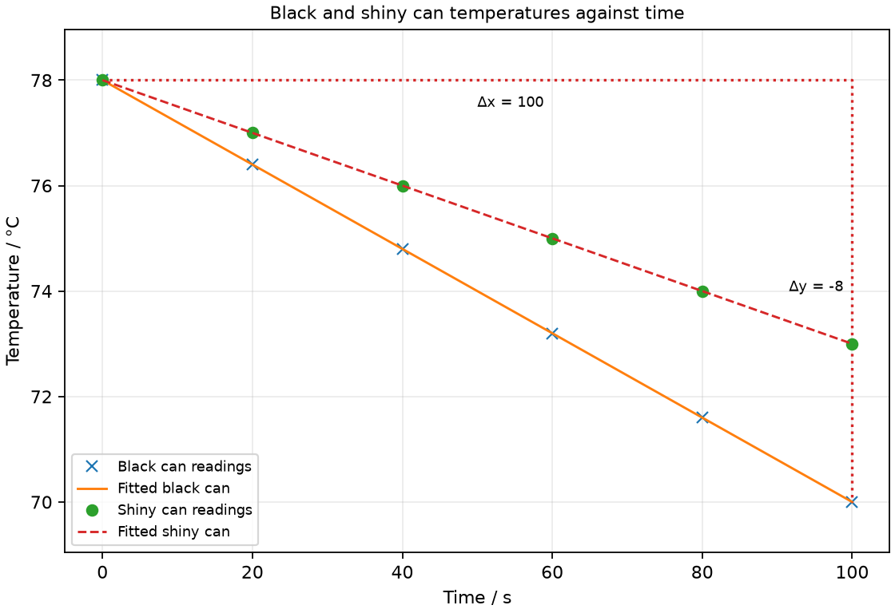

# 15 Thermal energy transfer

*nam-6118-nssco-2026. Offline study notes, rendered from the approved content units on 2026-10-31. Everything here is also what the flashcards are built from.*

---

## Thermal energy transfer — 3.3.1

### define conduction of heat as the flow of heat through a material without any flow of the material

Conduction transfers thermal energy through matter without bulk movement of that matter. Particles and, in metals, mobile electrons transfer energy through interactions.

A metal spoon can warm along its length while the spoon stays in place. The atoms need not travel from the hot end to the cold end. Energy transfer is driven by a temperature difference. A material with low thermal conductivity reduces this transfer but does not stop every transfer mechanism.

### describe experiments to demonstrate the properties of good and bad conductors of heat

A fair conduction comparison uses rods with matched dimensions and heating conditions. A faster temperature rise at the same distance can indicate more rapid conduction.

Heat one end of equal-length and equal-thickness rods of different materials using a common controlled source. Place temperature sensors at equal distances and record their changes over equal times. A wax indicator can show arrival of heating, but sensor readings give a more direct comparison. Keep the unheated surfaces exposed similarly and avoid touching hot ends.

### give a simple molecular account of the heat transfer in insulators and the migration of electrons in metals

In nonmetals, neighbouring particles transfer thermal energy through interactions. Metals also have mobile electrons that transfer energy through the material.

A hotter region has more energetic microscopic motion. Interactions pass energy toward cooler regions without the whole solid flowing. Mobile electrons contribute strongly to metals’ conductivity. Trapped air is useful insulation when its bulk movement is restricted, because it conducts poorly and cannot easily form large convection currents.

### Distinguishing the ideas

Conduction across a heater-fluid boundary and convection through the fluid describe different stages. Bulk water circulation is not conduction simply because a solid heater starts the transfer.

In a heated pot, energy first reaches adjacent water through the material boundary. Warmer water can then move upward and carry energy elsewhere in the fluid. A complete explanation can use both mechanisms without assigning the same name to every region.

### Practice task with worked feedback

Choose one correct option for each original practice question.

1. Which process needs no bulk flow of material?
A. A circulating water stream
B. Conduction
C. A warm-air current
D. Natural convection

2. Compared with an ordinary nonmetal, which additional mobile particles help transfer thermal energy through a metal?
A. Ions flowing through the metal
B. Whole atoms flowing from hot to cold
C. Mobile electrons
D. Neutrons migrating between nuclei

3. Which sample can sustain ordinary bulk convection within it?
A. An evacuated vessel
B. Liquid water
C. A rigid copper block
D. A solid rubber block

4. Which transfer can cross a vacuum?
A. Ordinary conduction
B. Water circulation
C. Radiation
D. Convection

5. Infrared belongs to which group?
A. Charged-particle beams
B. Electromagnetic waves
C. Mechanical longitudinal waves
D. Convection currents

6. What must match in an emission comparison?
A. Surface finish
B. Cooling rate
C. Detector response
D. Surface temperature

7. Which finish is a good absorber in the named school comparison?
A. Shiny aluminium
B. Polished steel
C. Matt black
D. Polished silver

8. Water is heated gently from below. Why can the warmed region rise?
A. Heat itself has an upward-only direction
B. Its particles become heavier
C. Water becomes a solid immediately
D. It becomes less dense and is displaced upward

9. Why are shiny walls useful across a flask’s vacuum gap?
A. They reduce radiation
B. They create heat
C. They stop a convection current in the vacuum
D. They add water to the vacuum

10. Two rods have different lengths and thicknesses. What is the issue in comparing conduction?
A. Units are unnecessary
B. They cannot have temperatures
C. It becomes an exact material-only test
D. Geometry confounds material effects

11. Why use an insulating handle on a hot pot?
A. To reduce conduction to the hand
B. To improve heat flow into the hand
C. To make the pot weightless
D. To prevent all radiation nearby

12. Water cools from 70 to 64 °C in 3 min. What is its gradient of its temperature-time graph?
A. −2 °C/min
B. −6 °C/min
C. 2 °C/min rising
D. −18 °C/min

Worked feedback

1. Key B. A: This transports matter. B: Energy passes through interactions. C: This involves moving material. D: The fluid moves.

2. Key C. A: Metal ions mainly vibrate near fixed positions; they do not flow through the solid. B: Bulk material flow is not ordinary conduction through the solid. C: They transfer energy through the metal. D: Neutrons are bound within nuclei and are not the mobile thermal carriers here.

3. Key B. A: A vacuum has no fluid to circulate. B: Its material can circulate, carrying thermal energy. C: A solid block does not circulate bodily inside itself. D: Solid material cannot form the ordinary circulating fluid current.

4. Key C. A: It needs material interactions across the path. B: Water must be present. C: Electromagnetic waves need no matter. D: It needs moving fluid.

5. Key B. A: Infrared photons are not a beam of charge. B: It shares their vacuum propagation. C: Infrared is electromagnetic. D: These require bulk fluid transport.

6. Key D. A: Finish is the compared variable. B: This is an outcome influenced by emission. C: Response is measured, not forced equal. D: Emission depends strongly on temperature.

7. Key C. A: This strongly reflects in the stated comparison. B: This is less absorbing than matt black in the comparison. C: It absorbs strongly compared with shiny metal. D: Shiny surfaces are poorer absorbers.

8. Key D. A: Energy can transfer in other directions. B: Heating does not add mass. C: That is not the stated effect. D: Expansion changes density.

9. Key A. A: Radiation can cross the gap. B: No energy is created. C: No fluid is there to circulate. D: That would reduce insulation.

10. Key D. A: Measurements still need units. B: Both can have temperature. C: Geometry influences the result. D: Matched dimensions are needed.

11. Key A. A: Its low conductivity limits that pathway. B: That is the opposite purpose. C: Mass and weight are not removed. D: The handle does not remove radiation.

12. Key A. A: The signed change is −6 °C over 3 min. B: This ignores division by time. C: The temperature falls. D: This multiplies by duration.

---

## Thermal energy transfer — 3.3.2

### define convection as the flow of liquid or gas caused by a change in density, in which the whole medium moves and carries heat energy with it

Natural convection is energy transfer by bulk fluid movement caused by density differences in a gravitational field. The moving liquid or gas carries internal energy.

Convection requires a fluid able to move. A heated region commonly expands and becomes less dense; surrounding denser fluid can displace it upward. Cooling regions sink and complete circulation where the arrangement permits it. A solid block cannot transfer energy by an internal convection current because its material does not flow in this way.

### explain the difference between conduction and convection in terms of the physical movement of the medium

Conduction occurs without bulk material flow, whereas convection carries material through the system. Both can operate in different regions of one heating arrangement.

At a hot metal-water boundary, conduction transfers energy into nearby water. The warmed water can then circulate by convection through the vessel. Naming the whole process simply heat rising misses the cause: fluid rises under buoyancy because of density differences, while thermal energy can also transfer downward by conduction.

### describe convection in fluids as due to density change

Heating can make a fluid region expand and become less dense than its surroundings. Buoyancy can then drive it upward while denser fluid moves into its place.

State expansion and density before the direction of flow. Warm fluid does not rise merely because its particles have an upward preference. If heating occurs from above, the warmer low-density region may remain at the top, reducing natural circulation. The arrangement and ability to move therefore matter.

### describe experiments to illustrate convection

A tracer can reveal bulk fluid circulation in a convection demonstration. Local heating should be arranged so the tracer shows the moving fluid rather than stirring by hand.

Place a small suitable dye tracer near the bottom of a transparent water vessel and heat gently beneath that side. Observe coloured water rising near the heated region and a return path elsewhere. Do not stir during the observation. Use a safe heat source and heat-resistant vessel; strong boiling would obscure the intended gentle circulation.

---

## Thermal energy transfer — 3.3.3

### define radiation as the transfer of heat by electromagnetic waves which do not require a medium

Thermal radiation transfers energy by electromagnetic waves. It does not require a material medium.

Energy from the Sun reaches Earth across space by radiation. A vacuum prevents ordinary conduction and convection across the gap, but does not prevent radiation. A body can emit and absorb radiation simultaneously; its net energy change depends on both processes and other transfers.

### identify infra-red radiation as the part of the electromagnetic spectrum

Infrared radiation is part of the electromagnetic spectrum. It is associated strongly with thermal emission from bodies at ordinary temperatures.

Infrared is not a moving hot gas and is not visible red light. It travels across a vacuum like other electromagnetic radiation. The detailed spectrum is taught in topic 19; here its role is energy transfer, absorption and emission.

### describe experiments to show the properties of good and bad emitters and good and bad absorbers of infra-red radiation

Surface finish affects infrared absorption and emission. Comparisons need controlled area, temperature and measurement geometry.

A matt dark surface is commonly a good absorber and emitter compared with a shiny metallic surface in the school model. An emission test starts with surfaces at the same temperature; an absorption test exposes matched surfaces to equal incident radiation. Cooling rates alone combine several transfer mechanisms, so use controlled conditions before attributing a difference solely to radiation.

### Investigate good and poor infrared emitters

An emission comparison measures radiation from differently finished surfaces at the same temperature. Equal detector distance and exposed area help make it fair.

A vessel with matt-black and shiny-metal faces can hold water at one common temperature. Measure infrared detector response facing each surface at the same distance and angle. A larger response indicates greater emission under those conditions. Avoid changing temperature during the sequence or warming the detector by contact.

### Investigate good and poor infrared absorbers

An absorption comparison exposes matched samples to equal incident radiation. A greater temperature rise can indicate greater absorption if other energy effects are controlled.

Use equal cans with different surface finishes, equal water masses and equal starting temperatures. Place them equal distances from the same source with equal exposed areas. Record temperature rises over the same time. Match draughts and insulation so conduction and convection differences do not dominate the inference.

### Practice task with worked feedback

Original structured practice. Answer the parts with working and units where needed.

(a) Name the transfer mechanism that crosses a vacuum. [1]

(b) Name the mobile charge carriers that aid conduction in metals. [1]

(c) Explain upward flow near the bottom heater in water. [2]

(d) Explain why a lid can slow a hot drink’s cooling. [2]

(e) Calculate the average temperature-time gradient when a sample falls from 68 to 60 °C in 4 min. [2]

Worked feedback

(a) Radiation.

(b) Electrons.

(c) The heated water expands and becomes less dense. Denser surrounding water displaces it upward.

(d) It reduces removal of warm air and limits evaporation from the liquid surface.

(e) Gradient = (60 − 68)/4 = −2 °C/min.

### Practice task with worked feedback

Investigation aim: compare initial cooling of identical black and shiny containers. These are invented, idealised practice readings; real readings have scatter. 

| Time / s | Black-can temperature / °C | Shiny-can temperature / °C |
|---:|---:|---:|
| 0 | 78 | 78 |
| 20 | 76.4 | 77 |
| 40 | 74.8 | 76 |
| 60 | 73.2 | 75 |
| 80 | 71.6 | 74 |
| 100 | 70 | 73 |

(a) Draw Temperature / °C vertically against Time / s horizontally. Plot both labelled cans and fit a separate line to each. [5]
(b) Show two widely separated points on your fitted line and calculate the black-can gradient. State the gradient unit. [3]
(c) Plan how to compare initial cooling of identical black and shiny containers. Name the equipment and arrangement, describe the measurements and repeats, state controls and a relevant precaution, design the results table and explain how the results answer the aim. [8]

Worked feedback

Graph: Time / s is horizontal and Temperature / °C vertical. Plot and label both cans separately; use a separate straight fit over this short supplied interval and show the black-can gradient triangle.

Gradient construction: choose the separated fitted-line points (0, 78) and (100, 70). Gradient = (70 − 78) / (100 − 0) = -0.08 °C/s. The black-can slope is (70 − 78)/(100 − 0) = −0.08 °C/s. The shiny-can slope is (73 − 78)/(100 − 0) = −0.05 °C/s. The black can has the steeper negative gradient and cools faster under the matched conditions.

Arrangement: Two light metal cans of the same dimensions with black and shiny finishes, each holding 0.025 kg of water, matching lids with thermometer/stirrer holes, a balance, thermometers and stopwatch

Plan: 1. Weigh 0.025 kg of water into each light can and bring both to the same initial temperature; record room temperature. 2. Fit equal lids with small holes for thermometers and stirrers and place cans away from draughts. 3. Record room temperature and start the stopwatch. 4. Stir gently through each lid hole and record both labelled temperatures every 20 s for 100 s, using thermometers at matched depth. 5. Repeat with fresh water and swap positions of the cans to check room-location effects.
Control and accuracy: Match can dimensions, water mass, lid, starting temperature and room conditions; keep the thermometer position fixed and shield from draughts. Handle warm water with a stable support.
Table: Time / s, black-can temperature / °C and shiny-can temperature / °C, with separate repeats and mean columns for each can.
Graph and conclusion: The black can has the steeper negative gradient (−0.08 rather than −0.05 °C/s), showing faster cooling in the matched short-interval comparison. Do not infer a surface effect unless water mass, can dimensions, lids and starting/room temperatures were matched.

### Small-sample cooling example

The two-can table is an invented short-interval example for matched light cans containing 0.025 kg water each. The water alone releases thermal energy at about 0.025×4200×0.08 = 8.4 W for the black-can slope; the can also cools. It does not imply a 67 W water-energy loss from a 0.20 kg sample. A real cooling curve usually changes slope as the water approaches room temperature.

---

## Thermal energy transfer — 3.3.4

### identify and explain some of the everyday applications and consequences of conduction, convection and radiation

Insulating designs often address conduction, convection and radiation together. A single surface treatment seldom removes every transfer pathway.

A vacuum flask uses low-conductivity supports and a stopper, a vacuum gap and reflective surfaces. The gap reduces conduction and convection; the shiny surfaces reduce radiation. A lid also limits warm-air movement and evaporation from the contents. Explain each feature by the pathway it affects rather than saying a flask stops heat completely.

### Explain an application of conduction

Low-conductivity handles reduce conduction from a hot vessel to the hand. A metal base can instead promote useful conduction into food or water.

The choice depends on the intended energy pathway. A good conductor is useful where rapid transfer is wanted, while an insulator is useful at a contact needing protection. A handle can still become hot by radiation or direct flame, so the mechanism explanation is conditional on its arrangement.

### Explain an application of convection

Natural convection can carry warm air upward from a room heater. Placement and air circulation affect how the room warms.

Air near the heater expands and becomes less dense, rises, and is replaced by cooler air. An opening high in a warm enclosure can permit warm air to escape; a lower opening can admit cooler replacement air. Blocking circulation can reduce this effect.

### Explain an application of thermal radiation

Shiny metallic surfaces can reduce infrared exchange compared with matt-black surfaces under comparable conditions. A dark absorber is useful where collecting incident radiation is the purpose.

A solar collector benefits from absorption, while a flask surface benefits from reduced radiative transfer. These choices have opposite purposes. Do not infer infrared behaviour from visible colour alone for every advanced material; the ordinary school comparison concerns the named surface finishes.
