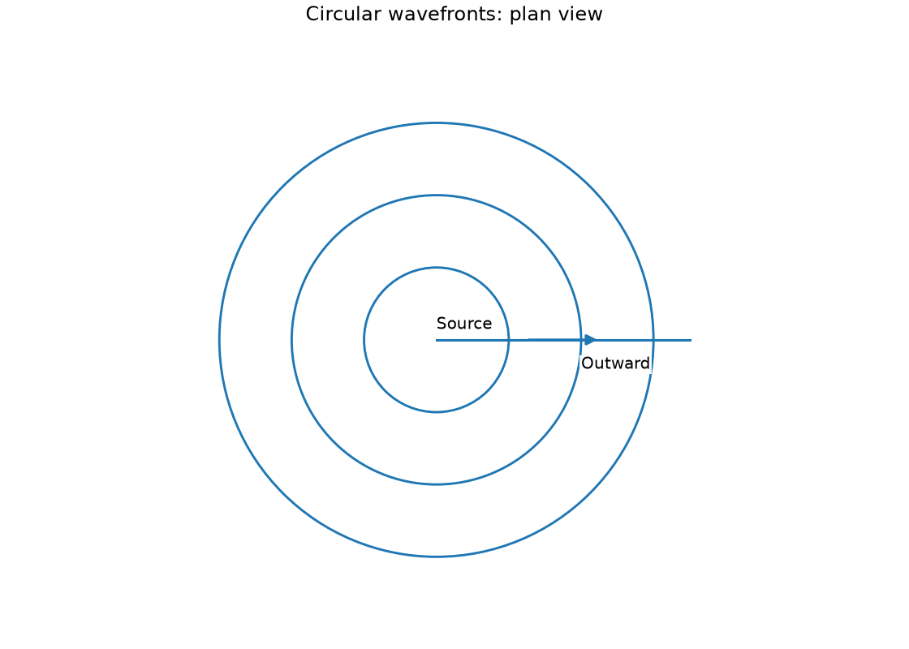
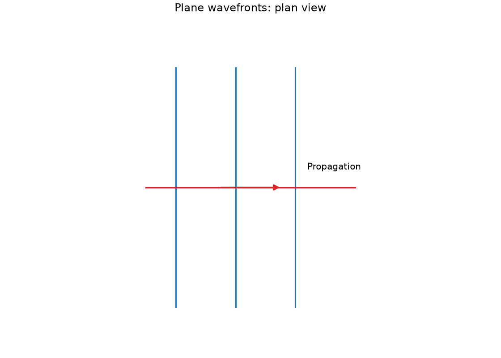
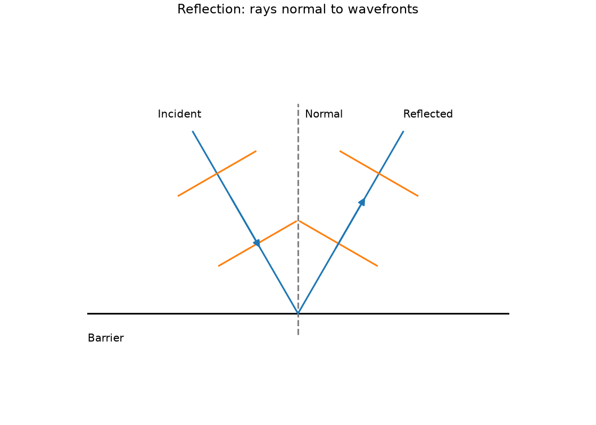
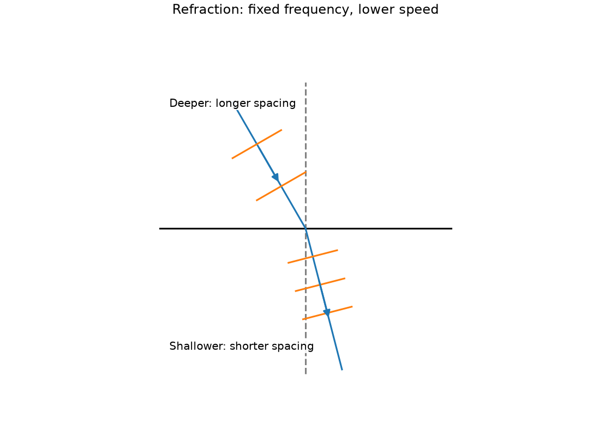
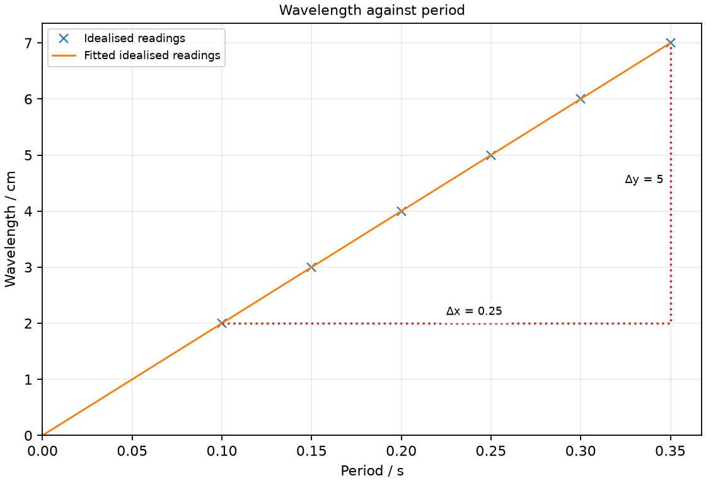

# 16 Wave motion and wavefronts

*nam-6118-nssco-2026. Offline study notes, rendered from the approved content units on 2026-10-31. Everything here is also what the flashcards are built from.*

---

## Wave motion and wavefronts — 4.1

### define a pulse as a single disturbance

A pulse is a single disturbance that propagates. It differs from a continuing periodic train of disturbances.

One quick movement of a rope end produces a pulse. Repeated movements produce a wave train. The disturbance transfers energy while the rope elements mainly move about their equilibrium positions rather than travelling with the pulse.

### define oscillations or simple harmonic motion as any repeated to-and-fro motion of a fluid or elastic solid, e.g. a tuning-fork, pendulum or stretched string

An oscillation is repeated motion to and fro about an equilibrium position. One complete cycle returns to the same state of position and direction.

A pendulum, tuning fork and stretched string can oscillate. The school syllabus groups simple oscillations here; the stricter term simple harmonic motion additionally requires a particular restoring-effect relation, so not every possible repeated motion has that special form. Count full cycles rather than one outward journey.

### describe what is meant by wave motion (propagation), an oscillation which transfers energy from one place to another without any net movement of the medium, as illustrated by vibration in ropes, springs and by experiments using water waves

Wave propagation transfers energy from place to place without net transport of the medium in the basic wave model. The disturbance travels while individual medium particles oscillate locally.

Mark a point on a rope: its motion can be up and down while the pulse travels horizontally. A floating marker can similarly reveal local surface motion in a water-wave demonstration. Real water can have currents as well, but bulk current is a separate effect from the ideal wave description.

### state typical values of the speed of sound and light in air, water and glass and the speed of light in a vacuum

Wave speeds depend on wave type and medium. Useful approximate values are sound: air 340 m/s, water 1500 m/s, glass 5000 m/s; light: vacuum or air 3.0 × 10⁸ m/s, water 2.25 × 10⁸ m/s, typical glass 2.0 × 10⁸ m/s.

These are representative school values, not exact constants for every sample. Temperature affects sound speed and glass composition affects both sound and light speeds. Use a supplied value in a calculation. Sound and light respond differently to the same medium, so their speed ordering must not be transferred from one type to the other.

### explain why sound travels faster in solids than in gases, using ideas about molecules

Sound often travels faster in solids than in gases because their mechanical response transmits disturbances more rapidly. Close spacing and strong particle interactions in a typical solid promote rapid transfer of a compression disturbance.

Spacing alone is not a complete speed law: stiffness and inertia both matter. The qualitative particle picture compares typical glass with air rather than claiming every solid has an identical speed. Particles do not themselves travel from source to listener at the quoted wave speed.

### Different arrival times of light and sound

Light travels much faster than sound in air. For a distant event, the visual signal generally arrives well before its sound.

A flash and thunder are produced during the same lightning event, but the sound takes appreciably longer to reach a distant observer. The delay estimates distance using sound speed when the light travel time is negligible at this scale. This is a propagation-time model, not an instruction to remain outside during a storm.

### distinguish between transverse and longitudinal waves (in terms of the direction of vibration of the particles and the direction of travel of the wave) and give examples of each

A transverse disturbance oscillates perpendicular to propagation; a longitudinal disturbance oscillates parallel to it. A rope wave is a transverse example and sound in air is longitudinal.

Longitudinal motion produces compressions and rarefactions rather than a literal up-and-down travelling shape. A displacement-distance sine graph can represent either type, so the graph shape alone does not establish particle direction. Compare the oscillation direction with the energy-transfer direction. Other transverse examples are light and the transverse model of a water surface wave; a compressional spring wave is longitudinal. For water surface waves the full particle path is more complex than the simple transverse sketch.

### give the meaning of speed c, frequency f, period T, wavelength  and amplitude

Speed, frequency, period, wavelength and amplitude describe different aspects of a wave. A displacement-distance graph gives spatial information, while a displacement-time graph gives temporal information.

Measure wavelength between neighbouring points in the same phase on a spatial snapshot; measure period between equivalent states at one position over time. Amplitude is measured from equilibrium, not from crest to trough. Keeping the horizontal-axis quantity clear prevents reading metres as seconds.

### Define wave speed

Wave speed is the distance a disturbance travels per time. Its SI unit is m/s.

Track a crest or pulse between two positions over a measured interval. Do not use the local up-down speed of a rope particle as the propagation speed.

### Define frequency

Frequency is the number of complete oscillations per second. Its unit is hertz, Hz.

Count complete cycles over a suitable time and divide by the duration. Ten cycles in two seconds gives 5 Hz. This is not the time for one cycle.

### Define period

Period is the time for one complete oscillation. Its SI unit is the second.

Timing several cycles and dividing by their number can reduce the relative effect of reaction-time uncertainty. Check that each count represents a full return to the same state.

### Define wavelength

Wavelength is the distance between adjacent points in the same phase. It can be measured between neighbouring crests or neighbouring compressions.

Crest to trough is half a wavelength for a simple sinusoidal wave, not a full wavelength. Measure along propagation, not along the curved length of a rope.

### Define amplitude

Amplitude is the maximum displacement from equilibrium. Crest-to-trough displacement is twice amplitude for a symmetric sinusoidal wave.

Amplitude describes the size of oscillation, not its period or wavelength. A wave can have small amplitude and high frequency independently. Label the undisturbed level before measuring it.

### Wave equations

Wave speed, frequency and wavelength are linked by c = fλ. Since f = 1/T, the same relation can be written c = λ/T.

One period advances a repeating wave pattern by one wavelength. This links a spatial interval with a time interval. A period in seconds cannot be inserted directly as though it were a frequency in hertz. Convert to a reciprocal or use the equivalent wavelength-over-period form.

### Use wave speed = frequency × wavelength

Wave speed is frequency multiplied by wavelength. Use hertz and metres for m/s.

A 5 Hz ripple with wavelength 0.040 m has speed 0.20 m/s. If wavelength is supplied in centimetres, convert first. For a fixed wave speed, a higher source frequency gives a shorter wavelength. This requires a medium and regime where the speed is effectively unchanged.

### Use frequency = 1/period

Frequency and period are reciprocals. f = 1/T when T is in seconds and f is in hertz.

A period of 0.25 s corresponds to 4 Hz. To find period from frequency, use T = 1/f. Shorter period means more cycles fit into a second. State the unit after taking the reciprocal because the new quantity is not a time.

### define the term wave front in wave motion, as the line containing adjacent points that are in the same phase

A wavefront joins adjacent points in the same phase. A ray indicates propagation normal to a wavefront in the simple uniform-medium model.

Successive crest fronts are separated by a wavelength. A wavefront is not the path of one water particle. In a plan view of a ripple tank, circular fronts indicate spreading from a point source and straight parallel fronts indicate plane waves.

### draw circular and plane wave fronts on the surface of water

A point source produces circular wavefronts in a uniform water region; a straight source can produce plane fronts. Propagation arrows are perpendicular to the local fronts.

Use a plan view and show several successive fronts at equal intervals for a steady source and speed. Circular fronts have increasing radii about one centre. Plane fronts are parallel straight lines. Their spacing represents wavelength, not amplitude; plan-view front drawings do not show vertical water height.

### Draw circular wavefronts

Circular water wavefronts are concentric curves about a point source. Equal radial spacing represents a constant wavelength in a uniform region.

Draw three circles of radii 1, 2 and 3 arbitrary length units about one marked source. Add radial outward arrows perpendicular to the curves. Do not show separate circles with unrelated centres or take circumference as wavelength.

### Draw plane wavefronts

Plane wavefronts are parallel straight lines. A constant wavelength is shown by equal perpendicular spacing.

A straight vibrating bar in a ripple tank can generate an approximately plane wave train. Show the propagation arrow normal to the lines, not along them. The length of each drawn line is chosen for visibility and is not the wavelength.

### use the term wave front to describe the observation of water waves in a ripple tank undergoing: - reflection at a plane surface (wave fronts reflect at the same angle to the surface) - refraction due to a change in depth, changing the speed, and the wavelength but not the frequency

Water-wave reflection changes propagation direction at a boundary. Refraction from a depth change can alter speed, wavelength and direction while source frequency stays fixed.

At a straight barrier, incident and reflected ray angles measured from the normal are equal. Into shallower water, the usual ripple-tank wave speed falls; at unchanged frequency its wavelength shortens. Oblique incidence bends the propagation toward the normal. At normal incidence the spacing changes without a direction change.

### Describe reflected wavefronts

Reflected plane wavefronts obey equal incidence and reflection angles. Ray directions are normal to fronts and are measured relative to the barrier normal.

Draw a horizontal barrier with a vertical normal at the reflection point. An incident ray travels down-right and the reflected ray up-right at equal normal angles. Place fronts perpendicular to each ray, keeping their spacing equal in the same water region. Arrows must show the incident ray toward the barrier and reflected ray away. The angle between a crest wavefront and the barrier equals the corresponding angle between its ray and the normal, because both pairs are perpendicular.

### Describe refracted wavefronts when water depth changes

Into shallower water, ripple wavefront spacing becomes smaller at fixed frequency. For oblique incidence, the ray bends toward the boundary normal.

Show closer front spacing on the shallow side and a smaller ray-normal angle. The fronts are perpendicular to their rays. A frequency label must stay unchanged across the boundary because the same source generates both trains. The direction change is absent for normal incidence, although the spacing still changes.

### Distinguishing the ideas

Period and frequency are reciprocals rather than interchangeable inputs. Wave speed can be calculated as wavelength divided by period.

For a wave with period 0.20 s and wavelength 0.060 m, frequency is 5 Hz and speed is 0.30 m/s. Multiplying 0.20 by 0.060 treats a time as a cycle rate and gives the wrong quantity and unit. Dimensional checks expose this conceptual mismatch.

### Circular wavefronts: plan view

Circular wavefronts: plan view. Draw three successive circular crest wavefronts from a point source in uniform water, showing propagation direction.

### Plane wavefronts: plan view

Plane wavefronts: plan view. Draw three plane crest wavefronts of equal wavelength, with a propagation arrow.

### Reflection: rays normal to wavefronts

Reflection: rays normal to wavefronts. Draw incident and reflected rays and short wavefronts at a straight water-wave barrier for an incidence angle of 30° to the normal.

### Refraction: fixed frequency, lower speed

Refraction: fixed frequency, lower speed. Draw wavefronts and ray directions for water waves entering shallower water obliquely, showing the wavelength change.

### Practice task with worked feedback

Choose one correct option for each original practice question.

1. What is a pulse?
A. One complete stationary vibration
B. A point's displacement from equilibrium
C. A single disturbance
D. A continuous periodic wave train

2. In a transverse wave, oscillations are oriented how?
A. Along the wave ray regardless of type
B. Along the direction of energy transfer
C. Parallel to propagation
D. Perpendicular to propagation

3. Which distance gives amplitude?
A. Source to observer
B. Crest to next crest
C. Crest to trough
D. Equilibrium to maximum displacement

4. What do points on a wavefront share?
A. Oscillation amplitude in every situation
B. Oscillation direction in every wave type
C. Phase
D. Displacement at every instant

5. Which is a typical vacuum light speed?
A. 1500 m/s
B. 5 m/s
C. 3.0 × 10⁸ m/s
D. 340 m/s

6. What does an ideal rope wave mainly transfer along the rope?
A. Energy
B. Rope material carried to destination
C. Net mass flow equal to wave speed
D. Only wavelength with no energy

7. Which remains unchanged at a stationary depth boundary?
A. Speed necessarily
B. Direction for every incidence
C. Wavelength necessarily
D. Source frequency

8. For f = 4 Hz and λ = 0.08 m, what is speed?
A. 50 m/s
B. 0.32 m/s
C. 3.2 m/s
D. 0.02 m/s

9. A period is 0.5 s. What is frequency?
A. 2 Hz
B. 0.25 Hz
C. 0.5 Hz
D. 5 Hz

10. With sound speed 340 m/s, what distance corresponds to an approximately 2 s light-sound delay?
A. 340 m
B. 680 m
C. 170 m
D. 0.006 m

11. Four complete wavelengths span 20 cm. What is one wavelength?
A. 20 cm
B. 5 cm
C. 4 cm
D. 80 cm

12. A ripple enters shallower water and slows at unchanged frequency. What happens to wavelength?
A. It decreases
B. It increases
C. It must stay fixed
D. It becomes amplitude

Worked feedback

1. Key C. A: A pulse travels. B: That is a position, not travelling disturbance. C: This distinguishes it from a repeated wave train. D: A pulse is a single disturbance.

2. Key D. A: Transverse motion is perpendicular to the ray. B: Transverse oscillation is perpendicular to this direction. C: That defines longitudinal waves. D: This defines transverse.

3. Key D. A: That is a travel distance. B: That is wavelength. C: That is twice amplitude for a symmetric wave. D: This is its definition.

4. Key C. A: Phase, not common amplitude, defines wavefront. B: Phase is shared across a front. C: The front joins adjacent equal-phase points. D: Different same-phase amplitudes can occur.

5. Key C. A: This is typical water sound speed. B: This is far too slow. C: This is the school approximation. D: This is typical air sound speed.

6. Key A. A: Rope elements oscillate locally. B: Rope segments oscillate locally. C: The rope does not flow with the disturbance. D: Waves transmit energy.

7. Key D. A: Depth can change it. B: Oblique refraction can bend the ray. C: It changes with speed. D: The same source drives both regions.

8. Key B. A: This divides f by wavelength. B: Multiply frequency and wavelength. C: This introduces a factor of ten. D: This divides wavelength by frequency.

9. Key A. A: Take the reciprocal. B: Squaring the period is inappropriate. C: Period and frequency differ. D: This misreads the decimal.

10. Key B. A: This ignores the 2 s interval. B: Sound distance is speed times delay. C: This divides by time. D: This reverses time and speed.

11. Key B. A: This ignores the number of intervals. B: Divide total distance by four. C: This substitutes the number of waves as a length. D: This multiplies instead.

12. Key A. A: λ = c/f. B: That reverses the speed dependence. C: Frequency alone does not fix wavelength. D: These are different measures.

### Practice task with worked feedback

Original structured practice. Answer the parts with working and units where needed.

(a) State the unit of frequency. [1]

(b) State the meaning of period. [1]

(c) Explain the motion of a marked rope point as a transverse wave passes. [2]

(d) Calculate speed for f = 8 Hz and λ = 0.025 m. [2]

(e) Calculate period at 8 Hz. [2]

Worked feedback

(a) Hz.

(b) Time for one complete oscillation.

(c) It oscillates across the propagation direction. The disturbance and energy travel along the rope without net transport of that marked element.

(d) c = fλ = 0.20 m/s.

(e) T = 1/f = 0.125 s.

### Practice task with worked feedback

Investigation aim: measure ripple speed from wavelength and period at fixed water depth. These are invented, idealised practice readings; real readings have scatter. 

| Period / s | Wavelength / cm |
|---:|---:|
| 0.1 | 2 |
| 0.15 | 3 |
| 0.2 | 4 |
| 0.25 | 5 |
| 0.3 | 6 |
| 0.35 | 7 |

(a) Draw Wavelength / cm vertically against Period / s horizontally. Plot the supplied readings and add a separate fitted line. [5]
(b) Show two widely separated points on your fitted line and calculate its gradient. State the gradient unit. [3]
(c) Plan how to measure ripple speed from wavelength and period at fixed water depth. Name the equipment and arrangement, describe the measurements and repeats, state controls and a relevant precaution, design the results table and explain how the results answer the aim. [8]

Worked feedback

Graph: Wavelength / cm is vertical and Period / s horizontal. Use the six readings, draw a separate best-fit line and show a wide gradient triangle; do not join scattered readings in a zigzag.

Gradient construction: choose the separated fitted-line points (0.1, 2) and (0.35, 7). Gradient = (7 − 2) / (0.35 − 0.1) = 20 cm/s. The wavelength-period slope is wave speed: 20 cm/s = 0.20 m/s because λ = cT and T = 1/f.

Arrangement: A ripple tank, straight vibrating bar with known frequency, depth gauge and calibrated projected ruler

Plan: 1. Set and measure a uniform water depth and place a calibrated ruler on the projected wave pattern. 2. Run the vibrating bar at a known frequency and wait for a steady pattern. 3. Measure a distance across several crest gaps in centimetres and divide by the number of gaps. 4. Record period in seconds from 1/f and repeat at several frequencies without changing depth. 5. Repeat each multi-wavelength measurement and calculate a representative wavelength.
Control and accuracy: Keep depth and geometry fixed, avoid reflections contaminating the reading and separate low-voltage equipment from spills.
Table: Period / s; Wavelength / cm; repeat readings in separate columns. Record frequency / Hz and use period T = 1/f / s.
Graph and conclusion: The wavelength-period slope is wave speed: 20 cm/s = 0.20 m/s because λ = cT and T = 1/f. Compare repeated readings and report the tested range rather than claiming an exact law from scattered observations.

