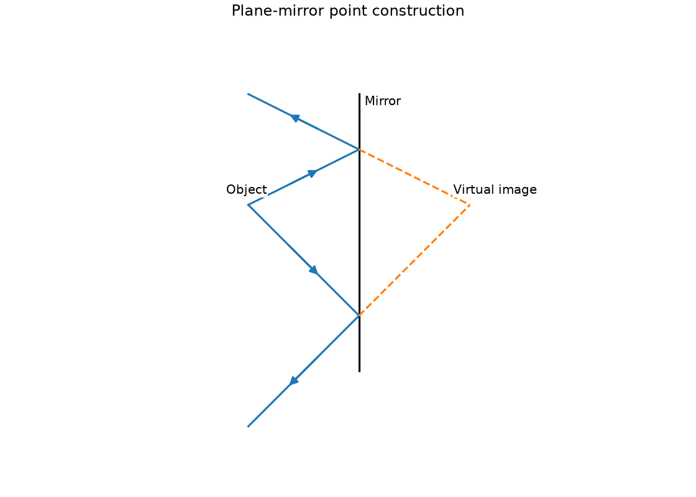
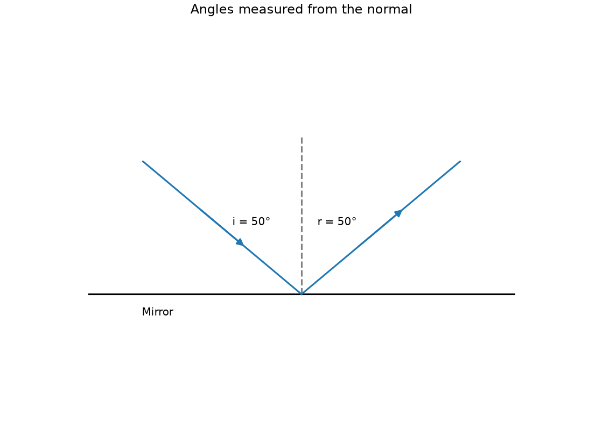
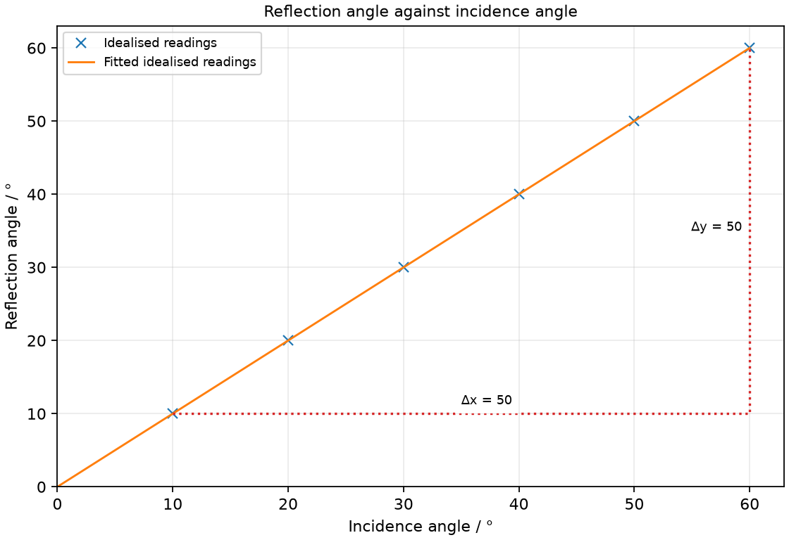

# 17 Light propagation and reflection

*nam-6118-nssco-2026. Offline study notes, rendered from the approved content units on 2026-10-31. Everything here is also what the flashcards are built from.*

---

## Light propagation and reflection — 4.2.1

### outline the difference between luminous and illuminated objects

A luminous object emits its own visible light. An illuminated object is seen by light received from another source and redirected toward the eye.

A switched-on lamp is luminous, while a book beside it is illuminated. The Moon is mainly seen by reflected sunlight rather than producing its own visible light. Light must enter the eye for either to be seen. Avoid describing ordinary vision as rays leaving the eye to touch the object.

### explain that light travels in straight lines and how this leads to the - formation of shadows - appearance of the image (pin-hole camera) - eclipses of the sun and moon, including the terms umbra and penumbra

In a uniform medium, the ray model represents light travelling along straight lines. Blocking or selecting these paths explains shadows, pinhole images and eclipses.

A ray traces a propagation direction rather than a physical thin rod. Use boundary rays from the source edges to identify the illuminated and shadow regions. Refraction and reflection change direction at interfaces; they do not contradict straight propagation between interactions.

### Explain shadows and straight-line propagation

An opaque object can block direct light paths to form a shadow. An extended source can form an umbra with no direct source light and a penumbra receiving light from part of the source.

Draw rays from both edges of the source past the edges of the obstacle. Where all direct source rays are blocked, the umbra forms. Where only some are blocked, the penumbra forms. A point-source approximation gives a sharper boundary than a broad source. Scattered room light can make a real shadow less dark without changing which direct paths are blocked.

### Explain image formation in a pinhole camera

A pinhole selects narrow straight-line paths from an object to a screen. The resulting image is inverted because rays from opposite object regions cross at the opening.

A ray from the object top passes through the hole to the lower screen; one from the bottom reaches the upper screen. A smaller hole reduces overlap and can sharpen the image, but also reduces brightness until other effects become important. A larger screen distance can enlarge the image while spreading the admitted light over more area.

### Explain solar and lunar eclipses using umbra and penumbra

A solar eclipse occurs when the Moon lies between Sun and Earth and its shadow reaches Earth. A lunar eclipse occurs when Earth lies between Sun and Moon and the Moon enters Earth’s shadow.

The umbra corresponds to complete blocking of direct sunlight and the penumbra to partial blocking. The required alignment does not happen at every lunar cycle because the orbital planes differ. In a diagram, place the light source first and trace the outermost rays. Direct observation of the Sun requires appropriate specialist protection; the model can be studied using safe lamps and balls.

### Practice task with worked feedback

Choose one correct option for each original practice question.

1. Which is normally seen mainly by reflected sunlight?
A. The Moon
B. A flame
C. A glowing lamp filament
D. The Sun

2. What is a penumbra?
A. Region where rays meet after reflection
B. Fully dark umbra
C. A partially illuminated shadow region
D. Fully illuminated region

3. What is the usual pinhole-image orientation?
A. Only laterally reversed with top unchanged
B. Inverted
C. Upright
D. Enlarged regardless of distances

4. Which description fits tracing paper?
A. Reflects all light with no transmission
B. Transmits a clear view like an ideal clear sheet
C. Transmits scattered light
D. Emits its own light necessarily

5. What is the nature of a plane-mirror image?
A. Larger than the object
B. Real on a screen behind the mirror
C. Necessarily inverted top to bottom
D. Virtual

6. What is the normal?
A. Surface tangent at incidence
B. A perpendicular to the surface at incidence
C. Mirror-to-image joining line in every arrangement
D. Incident ray itself

7. Which qualitative benefit can a convex viewing mirror provide?
A. A wider field of view
B. Real image on a screen
C. Elimination of blind areas in every setting
D. Larger image size at every position

8. Incidence is 28° to the normal. What is reflection angle?
A. 14°
B. 62°
C. 28°
D. 56°

9. An incident ray is 20° to a mirror surface. What is its angle to the normal?
A. 20°
B. 40°
C. 110°
D. 70°

10. An object is 12 cm in front of a plane mirror. Where is its image?
A. 24 cm behind
B. On the front surface
C. 6 cm behind
D. 12 cm behind

11. Which alignment gives a lunar eclipse?
A. Sun–Earth–Moon
B. Sun–Moon–Earth
C. Moon–Sun–Earth
D. Earth–Sun–Moon

12. Incidence is 35° to the normal. What angle lies between the incident and reflected ray lines in front of the mirror?
A. 140°
B. 70°
C. 55°
D. 35°

Worked feedback

1. Key A. A: It is illuminated by the Sun. B: It emits light. C: It emits light. D: It emits visible light.

2. Key C. A: That concerns an image, not this shadow. B: Umbra has all direct source paths blocked. C: Only part of the source is blocked. D: Penumbra has only partial illumination.

3. Key B. A: The image is inverted. B: Paths cross at the opening. C: Top and bottom paths cross at pinhole. D: Size depends on object/screen distances.

4. Key C. A: It can transmit light. B: Scattering obscures the view. C: It is a typical translucent material. D: Illumination does not imply emission.

5. Key D. A: Its ideal size equals the object. B: Rays do not converge there. C: The ordinary image is upright. D: Backward extensions meet, not actual reflected rays.

6. Key B. A: Normal is perpendicular. B: It sets angle references. C: Normal must pass through actual incidence point. D: Normal depends on surface geometry.

7. Key A. A: Its smaller images show a broader region. B: Convex viewing image is virtual. C: Coverage still depends on position. D: Convex mirror generally reduces image size.

8. Key C. A: There is no halving relation. B: That is the complementary surface angle. C: The two normal angles are equal. D: That is the ray separation in this geometry.

9. Key D. A: This repeats the surface angle. B: Doubling is not the conversion. C: This is 180−70, the obtuse supplement rather than the incidence angle between ray and normal. D: The normal is 90° to the surface.

10. Key D. A: That confuses separation with image distance. B: The virtual image lies behind. C: The distance does not halve. D: Perpendicular distances match.

11. Key A. A: Earth’s shadow falls on the Moon. B: This is the solar-eclipse alignment. C: The Moon is not in Earth’s shadow in this alignment. D: Earth does not lie between source and Moon.

12. Key B. A: This doubles the already combined angle. B: The two normal angles add. C: This gives one surface angle. D: This gives one normal angle only.

---

## Light propagation and reflection — 4.3.1

### explain the use of apparatus such as a ray-box, mirror, glass window, Perspex strips, protractor and rectangular block to investigate what happens when light falls on different objects that are translucent, transparent and opaque

Transparent, translucent and opaque describe different transmission behaviour. Reflection and absorption may accompany transmission at a surface.

A ray box, test sheet and screen let you compare how much light passes and whether it stays sufficiently directed to show a clear image. Use matched lighting and distances. A transparent sample transmits a clear view; a translucent sample scatters transmitted light; an opaque sample has negligible visible transmission in the stated thickness.

### Investigate transparent materials

A transparent material transmits light with enough direction preserved to see a clear image. Some reflection or absorption can still occur.

Place clear glass or Perspex in a narrow ray path and observe the transmitted ray and a target viewed through it. The ray may change direction at boundaries, so transparent does not mean no optical effect. Use safe low-intensity light and do not stare into a beam.

### Investigate translucent materials

A translucent material transmits light but scatters it strongly enough to obscure a clear view. Its transmitted screen patch can be broader or more diffuse than a clear sample’s.

Compare tracing paper with a clear sheet under the same illumination. A target may disappear as a distinct image even though light still passes. Do not classify it as opaque merely because a sharp ray cannot be followed through it.

### Investigate opaque materials

An opaque material transmits negligible visible light through its stated thickness. Incident light can instead be reflected or absorbed.

Put card in the ray path and compare the screen behind it with an unobstructed reference. A shadow indicates blocked direct transmission. A mirror is opaque despite reflecting strongly, so opacity is not the same as blackness or total absorption.

---

## Light propagation and reflection — 4.3.2

### draw a ray diagram to show the formation of the image of a point on an object produced by a plane mirror

A plane-mirror image is located where backward extensions of reflected rays meet. The light itself remains in front of the reflecting surface in this construction.

For a vertical mirror at x = 0 and a point at (−2, 1), the image is at (2, 1) in arbitrary length units. Draw rays to two separated mirror points, reflect them using equal normal angles, then extend the outgoing rays backward using dashed lines. Dashed extensions distinguish the virtual construction from real propagation.

### give the characteristics (position, nature, size and lateral inversion) of an optical image formed by a plane mirror

A plane mirror gives an upright virtual image of the same size as the object. Its image is the same perpendicular distance behind the mirror as the object is in front, with lateral inversion in the syllabus description.

Position is measured perpendicular to the mirror, not along a slanting eye-to-image line. The image is virtual because the reflected rays do not actually meet behind the mirror. The familiar left-right appearance arises from front-back reversal and how an object is compared with its reflected orientation. Lateral inversion is the familiar apparent left-right reversal: a word looks reversed in a mirror while its top remains at the top.

### Describe plane-mirror image position and nature

A plane-mirror image is virtual and lies as far behind the mirror as the object is in front. This is a perpendicular distance comparison.

An object 15 cm in front has an image 15 cm behind, giving an object-image separation of 30 cm. A screen behind an opaque mirror cannot collect that virtual image because the reflected rays do not converge there.

### Describe plane-mirror image size and lateral inversion

Lateral inversion means the object’s left appears on the image’s right in the ordinary facing-image comparison, while up and down remain unchanged. Writing therefore looks reversed; the image still has the same size.

A written symbol can reveal the changed orientation. The mirror does not magnify merely because it is larger; a larger mirror can admit rays from a greater field without changing the image-size ratio. Keep image size distinct from how much of the image is visible.

### identify and measure the angles of incidence and of reflection (angle of incidence is equal to angle of reflection) and the normal at the point a ray strikes the surface

The normal is perpendicular to the reflecting surface at the ray’s incidence point. Incidence and reflection angles are measured between their rays and this normal.

A ray 25° to the surface is 65° to the normal. Read a protractor from the correct baseline and mark the incidence point before drawing the normal. Confusing the surface with the normal can give complementary angles that are consistently wrong despite a neat diagram.

### describe advantages and disadvantages of reflection, including everyday applications of reflection such as the uses of different kinds of mirrors and the reflecting surfaces behind lights

Reflection can provide useful viewing or light direction but can also cause glare. Mirror shape affects whether rays remain spread, converge or diverge.

A plane mirror provides a familiar undistorted reflected view. A convex mirror offers a wider field with smaller images, useful for surveillance; a concave reflector can direct light when a source is suitably placed. These are qualitative applications, not a new curved-mirror calculation topic. Unwanted reflected light from a bright surface can reduce visibility. A simple periscope uses two parallel plane mirrors set at 45° to the viewing direction. Two reflections redirect the light around an obstacle; the resulting view is upright. A torch or headlamp uses a suitably shaped concave reflector to direct its light, while a shop viewing mirror can be convex for a wider field.

### recall and use the law: angle of incidence = angle of reflection

For reflection at a plane surface, angle of incidence equals angle of reflection. Both angles use the same normal.

If the incident ray is 38° to the normal, the reflected ray is also 38° to the normal. The angle between the two rays in front of the mirror is then 76°. A normal-incidence ray retraces its path; do not measure its 90° surface angle as the incidence angle.

### perform simple constructions, measurements and calculations on a ray diagram

Ray constructions require a labelled surface, incidence point, normal and directional rays. Geometry can relate surface angles, normal angles and the separation of rays.

For an incident ray 40° to a horizontal mirror surface, incidence is 50° to the vertical normal. Draw the reflected ray at the same 50° normal angle on the other side. Its surface angle is again 40° and the two rays enclose 100° in front of the surface. Arrowheads show propagation toward and away from the mirror.

### Plane-mirror point construction

Plane-mirror point construction. Draw a plane-mirror image construction for a point 2 cm in front of the mirror using two reflected rays.

### Angles measured from the normal

Angles measured from the normal. Draw a reflected-ray construction for an incident ray 40° to a horizontal mirror surface, marking the normal angles.

### Practice task with worked feedback

Original structured practice. Answer the parts with working and units where needed.

(a) Name the line perpendicular to a mirror at incidence. [1]

(b) State the nature of a plane-mirror image. [1]

(c) Explain inversion in a pinhole camera. [2]

(d) Calculate incidence angle for a ray 37° to a mirror surface. [2]

(e) Calculate the angle between incident and reflected ray lines in front of the mirror for i = 53°. [2]

Worked feedback

(a) Normal.

(b) Virtual.

(c) Top-object rays pass through the hole to the lower screen. Bottom-object rays reach the upper screen because the paths cross at the hole.

(d) i = 90 − 37 = 53°.

(e) r = 53°, so the angle is 106°.

### Practice task with worked feedback

Investigation aim: test the relation between incidence and reflection angles at a plane mirror. These are invented, idealised practice readings; real readings have scatter. 

| Incidence angle / ° | Reflection angle / ° |
|---:|---:|
| 10 | 10 |
| 20 | 20 |
| 30 | 30 |
| 40 | 40 |
| 50 | 50 |
| 60 | 60 |

(a) Draw Reflection angle / ° vertically against Incidence angle / ° horizontally. Plot the supplied readings and add a separate fitted line. [5]
(b) Show two widely separated points on your fitted line and calculate its gradient. Explain why this ratio has no unit. [3]
(c) Plan how to test the relation between incidence and reflection angles at a plane mirror. Name the equipment and arrangement, describe the measurements and repeats, state controls and a relevant precaution, design the results table and explain how the results answer the aim. [8]

Worked feedback

Graph: Reflection angle / ° is vertical and Incidence angle / ° horizontal. Use the six readings, draw a separate best-fit line and show a wide gradient triangle; do not join scattered readings in a zigzag.

Gradient construction: choose the separated fitted-line points (10, 10) and (60, 60). Gradient = (60 − 10) / (60 − 10) = 1 no unit. The angle ratio has no unit: the fitted slope is 1. Both axes use the same angle measure, and r = i.

Arrangement: A plane mirror, narrow-beam ray box, paper, ruler, pencil and protractor

Plan: 1. Trace the mirror line on paper and draw a perpendicular normal at the incidence point. 2. Set a narrow ray-box beam at a chosen incidence angle and mark two points on both incident and reflected paths. 3. Remove the mirror and join the marked paths with a ruler. 4. Measure i and r from the normal with a protractor and record the pair. 5. Repeat alignments at several incidence angles and repeat each pair.
Control and accuracy: Keep the mirror upright and on its line, use thin marks, avoid parallax and do not direct a beam into eyes.
Table: Incidence angle / °; Reflection angle / °; repeat readings in separate columns. 
Graph and conclusion: The angle ratio has no unit: the fitted slope is 1. Both axes use the same angle measure, and r = i. Compare repeated readings and report the tested range rather than claiming an exact law from scattered observations.

### Further practice: Explain how a simple two-mirror periscope lets a person see over an obstacle.

Two parallel plane mirrors at 45° redirect the incoming light down the tube and then toward the eye. Reflection at both mirrors gives a view along a path around the obstacle.
