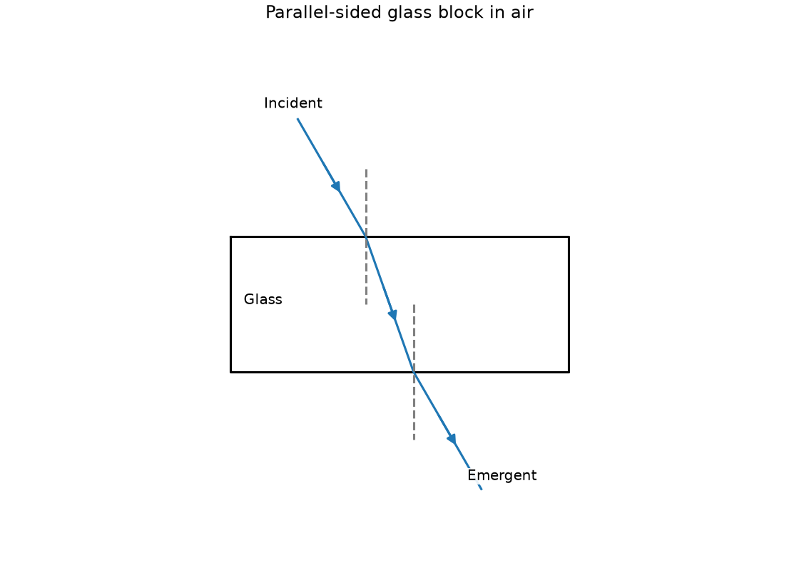
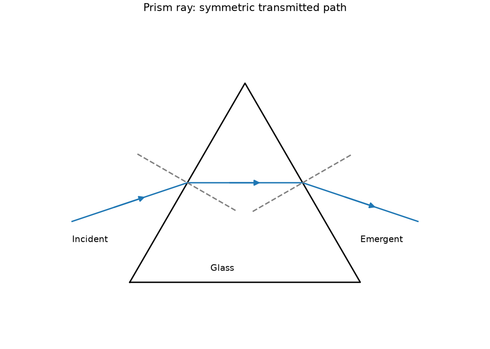
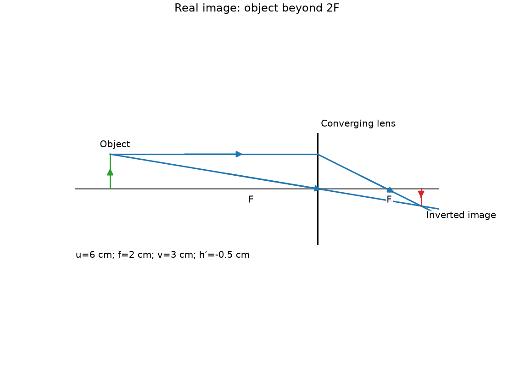
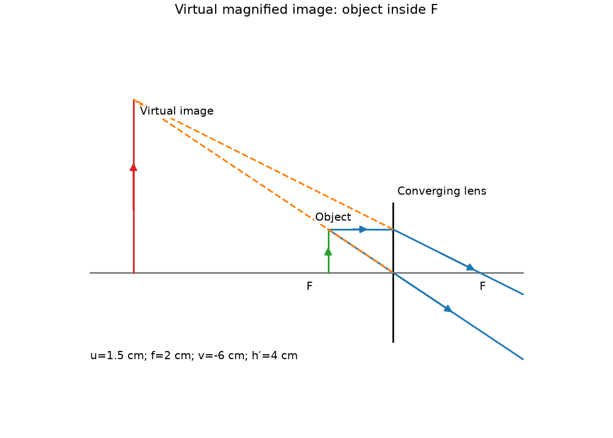
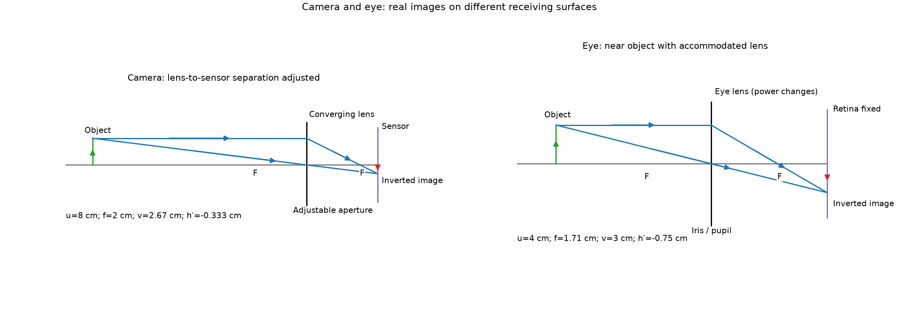
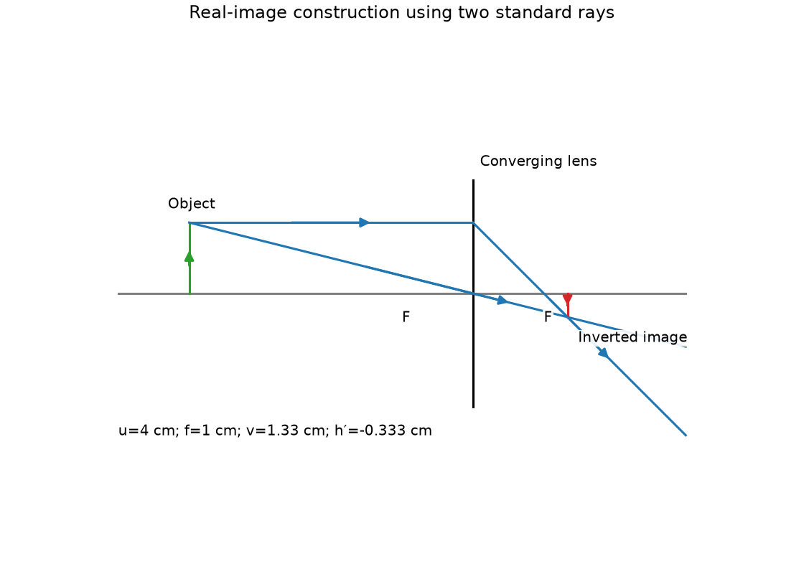
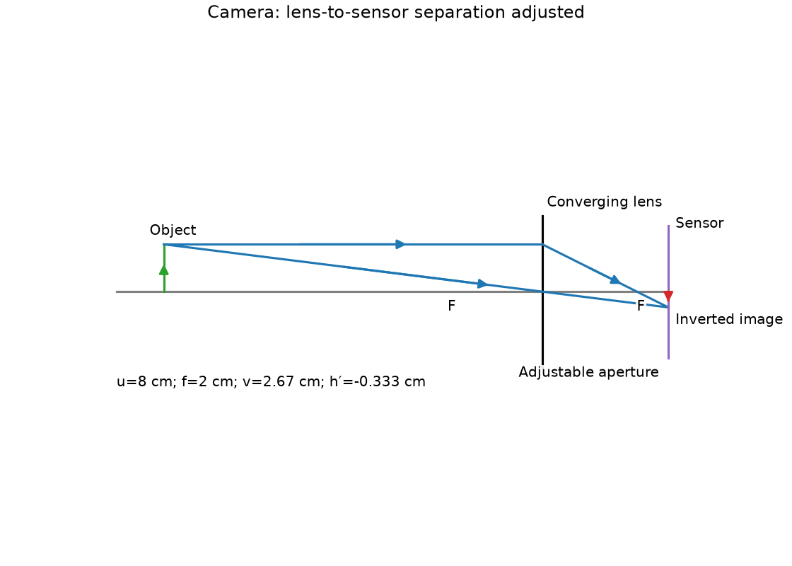
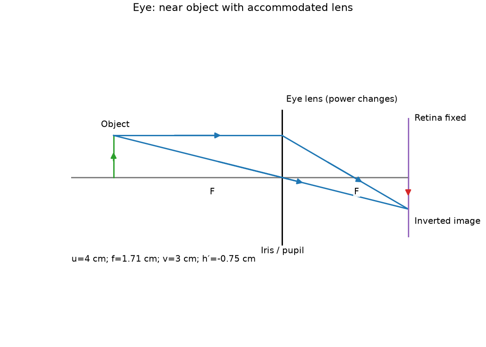
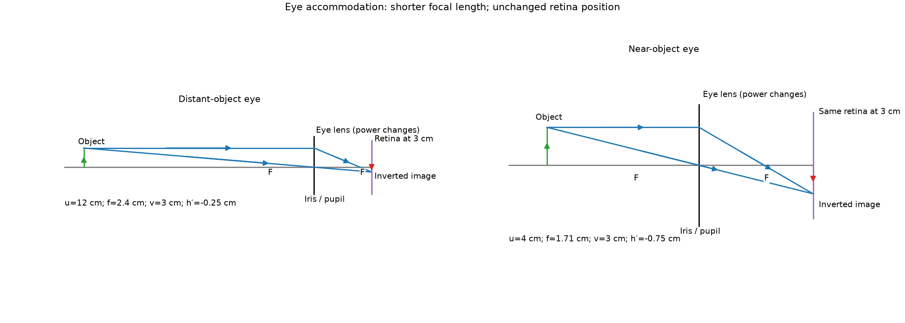
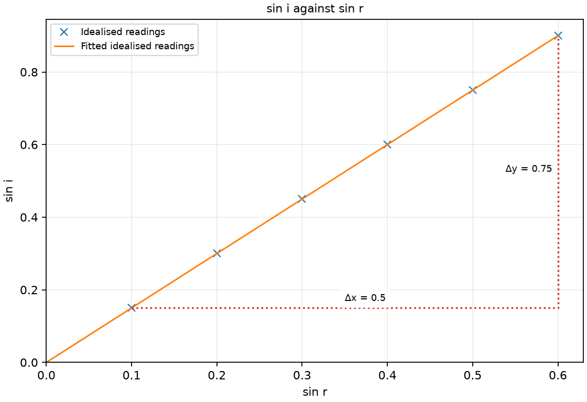

# 18 Refraction, lenses and vision

*nam-6118-nssco-2026. Offline study notes, rendered from the approved content units on 2026-10-31. Everything here is also what the flashcards are built from.*

---

## Refraction, lenses and vision — 4.3.3

### relate that light travels in straight lines to explain divergent, convergent and parallel rays or beams of light

Divergent rays spread apart, convergent rays approach a meeting point and parallel rays maintain separation. Each ray is locally straight in a uniform medium between optical interactions.

The beam describes a collection of propagation directions. A single ray has no widening width in the simple model. Follow arrowheads to decide whether a set approaches or leaves a point; the same drawn lines without direction can represent different propagation.

### Describe divergent rays

Divergent rays spread apart as they propagate. Their backward extensions may indicate a real source or a virtual image.

Light leaving a small source diverges through space. The growing beam does not mean each ray bends outward continually in uniform air; the rays leave with different directions. Mark outward arrowheads when constructing the beam.

### Describe convergent rays

Convergent rays approach one another along propagation. Actual convergence can form a real image.

A converging lens can redirect an incoming beam toward a point. After crossing, the same rays diverge again. Identify whether the crossing is of actual rays or merely backward extensions before calling an image real.

### Describe parallel rays

Parallel rays travel in the same direction with fixed separation in a uniform medium. A distant source can provide an approximately parallel bundle across a small optical instrument.

Parallel does not mean horizontal on every page: a tilted parallel bundle is still parallel. A converging lens focuses rays parallel to its principal axis at its principal focus in the thin-lens model.

### define refraction of light as the change in direction of light entering or leaving a medium with different optical density

Refraction is the change of propagation on entering a medium with a different light speed, usually including a direction change at oblique incidence. At normal incidence the speed and wavelength can change without bending.

Optical density describes a speed-related property, not simply mass density. Light entering typical glass from air slows and bends toward the normal if incidence is oblique. Source frequency remains unchanged across a stationary interface. Distinguish the transmitted refracted ray from the reflected ray that stays in the first medium.

### draw and describe the refraction of a ray of light as it passes through a rectangular block and a triangular prism

A rectangular block with parallel faces can produce a sideways-displaced emergent ray parallel to the incident ray. A triangular prism generally gives a net angular deviation.

At each face draw its own normal. Air-to-glass transmission bends toward the normal and glass-to-air transmission away when a refracted ray exists. The parallel faces of a rectangular block undo the angular change but leave displacement. Nonparallel prism faces do not undo it in that way.

### Trace refraction through a rectangular block

Refraction through a parallel-sided block has two boundary changes. For the same outside medium, the emergent ray is parallel to the incident ray but can be laterally displaced.

Trace the block outline, incidence point and ray directions. Draw normals perpendicular to both faces. The internal ray bends toward the first normal; the exiting ray bends away from the second. Compare the outside directions only after applying both interactions.

### Trace refraction through a triangular prism

A prism refracts light at its nonparallel faces. For a typical glass prism in air, the transmitted ray is deviated toward the prism’s base.

Draw normals at both points rather than using one common vertical line. At entry the ray bends toward the local normal; at exit it bends away if it transmits. An internal incidence above the critical angle would instead give total internal reflection, so not every chosen path can leave the intended face.

### measure the angle of refraction r as light enters and leaves a rectangular block

A refraction angle is measured from the transmitted ray to the normal in that ray’s medium. At the second face, construct a new normal at the new incidence point.

Mark two points on each visible ray, remove the block and join the marks to its traced boundary. Join the internal entry and exit points. Use a protractor centred on the interface point and aligned with the normal. Measure acute ray-normal angles, not angles from the surface.

### Use refractive index n = sin i / sin r, with both angles measured from the normal

For air-to-material transmission, relative refractive index is n = sin i/sin r. Both angles are measured from the normal using degree-mode trigonometry when angles are in degrees.

If i = 30° and r ≈ 19.5°, n is approximately 1.50. Do not divide the angles themselves; the relation uses their sines. A plot of sin i vertically against sin r horizontally has gradient n. Swapping these axes gives 1/n.

### give the meaning of critical angle

Critical angle is the incidence angle in the optically denser medium for which the refracted ray lies along the boundary. The refraction angle is then 90° to the normal in the less optically dense medium.

The definition concerns light going toward a lower-index medium, such as glass to air. Above this incidence angle, no propagating refracted ray leaves the surface in the school model and total internal reflection occurs. It is not the angle from the surface and not an air-to-glass threshold.

### describe internal and total internal reflection

Internal reflection can return part of incident light inside a medium. Total internal reflection requires travel toward a lower-index medium and incidence above the critical angle.

Below the threshold, both reflected and refracted rays can exist. At the threshold the refracted ray runs along the boundary. Above it the incident light is internally reflected in the ideal model. Optical fibres and suitable prisms can use this effect to guide or turn light without a metal mirror coating.

### recall and use the definition of refractive index in terms of speed or wavelength

Absolute refractive index is vacuum light speed divided by light speed in the material. For the same frequency, it is also vacuum wavelength divided by material wavelength.

Frequency remains fixed at a stationary interface, so c = fλ links reduced speed with reduced wavelength. For vacuum speed 3.0 × 10⁸ m/s and material speed 2.0 × 10⁸ m/s, n = 1.5. The index has no unit because it is a ratio of matching quantities.

### describe the action of a thin converging lens on a parallel beam of light

A thin converging lens brings an axis-parallel beam toward its principal focus. The simple construction applies to suitable near-axis rays.

The lens is thicker at its centre in the usual glass-in-air form. A ray through the optical centre is treated as undeviated in the thin-lens approximation. Real lenses have finite apertures and imperfections, so the ideal point is a model. Diverging lenses are mentioned later for sight correction without a separate image-calculation treatment.

### define the principal focus (focal point) of a converging lens

A converging lens’s principal focus is the point where axis-parallel incident rays converge after refraction. Focal length is the distance from the lens’s optical centre to that point.

A lens has a principal focus on each side for propagation from the corresponding direction. Label the principal axis and the relevant far-side focus before drawing a parallel ray. A focus is a property of the lens model; an object’s image is not necessarily at the focus.

### describe how to measure the focal length of a converging lens using a distant object

A distant object gives nearly parallel incident rays across a small lens. Its sharp real image forms approximately one focal length behind a converging lens.

Use a distant building or tree, never the Sun. Move a screen behind the lens until a sharp image appears, then measure optical-centre-to-screen distance. Repeat with another distant object or position and estimate uncertainty. The approximation improves when object distance greatly exceeds focal length.

### draw ray diagrams for the formation of real image and a virtual image by a single lens

A converging lens can form a real image for an object beyond its focus and a virtual image for an object inside it. Principal rays locate the image by actual intersection or backward extension.

Draw one ray from the object top parallel to the axis, refracted through the far focus. Draw another through the optical centre, undeviated in the thin-lens model. When they meet on the far side the image is real; when outgoing rays diverge, extend them backward to locate a virtual image on the object side.

### Construct a real image with a converging lens

For an object beyond a converging lens’s focal point, actual rays can form an inverted real image. The image may be reduced, equal-sized or enlarged depending on object distance.

With focal length 2 cm and an object 6 cm away, a principal-ray construction gives an image 3 cm on the far side, half as tall and inverted. These values are a diagram stimulus, not a requirement to derive an extra lens equation. Position the screen where actual rays meet.

### Construct a virtual image with a converging lens

An object inside a converging lens’s focal length forms an upright enlarged virtual image in the thin-lens model. The image lies on the object side, where backward extensions of outgoing rays meet.

For object distance 1.5 cm and focal length 2 cm, the outgoing rays diverge. Their backward extensions meet 6 cm before the lens at an upright virtual image 4 cm tall. This construction keeps the image distinct from the near focus.

### distinguish between a real and a virtual image

A real image is formed by actual convergence of light rays. A virtual image is located by backward extensions rather than actual convergence at that location.

A real image can be received on a screen placed at its image location. A virtual image can be seen by an eye receiving the diverging rays, but cannot be collected on a screen placed at the apparent location. Visibility alone does not establish that an image is real.

### give the characteristics of an optical image formed by a converging lens

A converging lens’s image characteristics depend on object distance relative to focal length. Beyond 2f the real image is reduced; at 2f equal-sized; between f and 2f enlarged; inside f the image is virtual and enlarged.

Real images in these basic cases are inverted. The inside-f virtual image is upright. At the focal position, ideal outgoing rays are parallel and no finite image position is obtained on a nearby screen. State the object condition before predicting image size or nature.

### describe the use of a single lens in a camera and the human eye, drawing ray diagrams to show how each forms an image and compare the functioning of the human eye with the functioning of the camera

A camera and eye use converging optics to form real inverted images on receiving surfaces. A camera sensor or film corresponds to the retina as the image-receiving surface.

Use the real-image ray construction with a receiving surface at the convergence point. For the same simplified geometry, the surface is 3 cm behind the lens in the 6 cm object, 2 cm focal-length model. The eye changes optical power by accommodation; a simple camera can instead change lens-to-sensor separation. Aperture control regulates admitted light, not the fundamental real-image criterion.

### Describe a camera lens and image

A simple camera forms a real inverted image on film or an electronic sensor. Focusing places the image plane at that receiving surface.

For a nearby object, the required lens-to-sensor separation differs from the distant-object setting. A simple camera moves the lens relative to the fixed sensor. The aperture controls light admission; a shutter controls exposure time. These roles should not be confused with focusing.

### Describe the eye lens and image

The eye forms a real inverted image on the retina. Accommodation changes the shape and optical power of the eye’s lens.

The cornea also contributes refraction, but the simplified syllabus comparison emphasises the lens and retina. The lens becomes more strongly converging for nearer objects in normal accommodation. The retina detects the image; the brain’s interpretation does not make the optical image upright on the retina.

### Compare camera and eye focusing

A simple camera can focus by moving its lens relative to its receiving surface. The eye mainly accommodates by changing lens power while retina position is approximately fixed.

Both require actual ray convergence at the receiving surface. Compare the changed feature rather than merely saying each has a lens. More complex cameras can have internal moving groups, but the elementary comparison concerns the simple model.

### describe short sight and long sight and describe the correction of these eye defects (diverging lenses are only mentioned at this stage)

Short sight and long sight are different failures to focus an intended object on the retina. The corrective lens type depends on whether the uncorrected convergence is too early or too late.

Short sight commonly blurs distant objects because their image would lie in front of the retina; a diverging correction reduces convergence. Long sight can blur near objects because the required image would lie behind the retina; a converging correction adds convergence. This is an educational optical model rather than an individual prescription. Short sight can result from an eyeball that is too long or optics that converge too strongly; nearby objects may remain clear while distant ones blur. Long sight can result from an eyeball that is too short or insufficient convergence, making near objects difficult to focus.

### Describe and correct short sight

In short sight, distant-object rays would focus in front of the retina without correction. A diverging corrective lens can reduce the incoming bundle’s convergence.

The correction lets the eye form its image farther back on the retina. Keep the ray account qualitative here; a separate treatment of diverging-lens formulae and image calculations is outside this topic’s intended depth. The defect concerns focus location, not a claim that the retina emits light.

### Describe and correct long sight

In long sight, near-object rays can be insufficiently converged to focus on the retina. A converging corrective lens supplies additional convergence.

Without suitable accommodation or correction, the ideal focus for those near rays would be behind the retina. The corrective lens shifts the focus toward the retinal surface. Describe the near-object condition; the optical defect is not simply inability to see any distant object.

### describe applications of the refraction of light in nature such as the rainbow, size and position of objects under water and mirages to explain: - the passage of light through a prism (dispersion) and identify the colours of the spectrum produced from white light - how rainbows can be formed by the internal reflection of light in water - how mirages are formed as an optical illusion that uses the phenomena of reflection and refraction

Refraction explains several natural apparent-position and colour effects. Dispersion, internal reflection and changing air index add specific features to different examples.

A prism separates white light because its index depends on wavelength. Water droplets combine refraction and internal reflection to form a rainbow. A submerged object can appear shallower because emerging rays bend, while a mirage involves direction changes through air layers of different refractive index. Use the mechanism appropriate to each case rather than attributing all to reflection alone.

### Explain prism dispersion and the visible colour order

Dispersion separates white light because a material’s refractive index varies with wavelength. The visible sequence from red to violet is red, orange, yellow, green, blue, indigo, violet.

In the usual glass-prism case, violet deviates more than red. White light already contains the different colour components; the prism separates their directions rather than manufacturing the colours. A narrow incident slit makes the separated spectrum easier to distinguish on a screen.

### Explain rainbow formation

A primary rainbow involves refraction into droplets, one internal reflection and refraction out. Dispersion directs different colours toward the observer at different angles.

Many droplets at suitable viewing directions contribute light. The observer normally has the Sun behind and droplets ahead. Red appears on the outer edge and violet on the inner edge of the primary bow. The internally reflected part need not be described as total internal reflection for the usual primary-rainbow path.

### Explain apparent underwater position and size

Light from an underwater object bends away from the normal on entering air. An observer traces the emerging directions backward and sees an apparent position closer to the surface in the usual near-normal view.

The apparent depth differs from actual depth. Refraction can also change apparent size because ray directions and angular extent change, but the result depends on viewing geometry. Do not use a blanket claim that every underwater object is enlarged by one fixed factor. A ray sketch should show dashed backward extensions to the apparent point. In the usual near-normal water-to-air view, a submerged object appears shallower; for the usual classroom comparison it can also appear enlarged because the emerging rays change its apparent angular size. The size effect depends on viewing geometry, not one fixed magnification for all underwater objects.

### Explain mirage formation qualitatively

A mirage can result when air temperature layers create a refractive-index gradient. Rays can curve through successive small refractions and reach the eye from an unexpected direction.

Above a hot road, lower warmer air commonly has a lower index. A ray from the sky can bend upward through this gradient and enter an observer’s eye, giving an apparent sky-like patch on the road. The layered model can include limiting internal-reflection behaviour; a literal pool of water is not needed.

### Distinguishing the ideas

Reflection returns light into the incident region, while refraction concerns transmission with changed propagation in another medium. Both processes can occur at the same interface.

At an air-glass boundary, some light can reflect in air and some can enter glass with changed speed. Calling the transmitted bent ray reflected mixes up the side of the interface on which it propagates. Track the ray and the medium instead of naming any direction change reflection.

### Distinguishing the ideas

Optical incidence and refraction angles use the normal, not the surface. A stated surface angle must be complemented to 90° before use as a normal angle.

A transmitted ray 60° to a flat surface is 30° to its normal. Substituting 60° as the refraction angle into the index relation changes the sine ratio. A diagram with its normal drawn explicitly prevents mixing the two references.

### Distinguishing the ideas

An image can be visible even if no actual rays meet at its apparent position. Virtual images are located by extensions, whereas real images use actual convergence.

A magnifying-glass virtual image can be seen through the lens, but a screen placed at its apparent location does not collect it. Visibility means rays enter the eye; it does not mean those rays originated or met at the apparent point.

### Parallel-sided glass block in air

Parallel-sided glass block in air. Draw an oblique ray through a rectangular glass block in air, labelling normals and the emergent ray.

### Prism ray: symmetric transmitted path

Prism ray: symmetric transmitted path. Draw a ray passing through two sloping faces of a triangular glass prism in air.

### Real image: object beyond 2F

Real image: object beyond 2F. Draw the real image for a 1 cm tall object 6 cm before a converging lens with focal length 2 cm.

### Virtual magnified image: object inside F

Virtual magnified image: object inside F. Draw the image of a 1 cm tall object 1.5 cm before a converging lens with focal length 2 cm.

### Camera and eye: real images on different receiving surfaces

Camera and eye: real images on different receiving surfaces. Explain using a ray diagram how a camera and eye form images on their receiving surfaces.

### Real-image construction using two standard rays

Real-image construction using two standard rays. Explain using a ray diagram how a converging lens forms a real image for an object beyond its focal point.

### Camera: lens-to-sensor separation adjusted

Camera: lens-to-sensor separation adjusted. Describe focusing in a simple camera using a ray diagram with the sensor at the image plane.

### Eye: near object with accommodated lens

Eye: near object with accommodated lens. Describe using a ray diagram how the eye forms an image on the retina after focusing on a nearer object.

### Eye accommodation: shorter focal length; unchanged retina position

Eye accommodation: shorter focal length; unchanged retina position. Describe the focusing difference between a simple camera and the human eye using a labelled ray diagram to locate the receiving surface.

### Practice task with worked feedback

Choose one correct option for each original practice question.

1. At normal incidence into glass, what can change?
A. Frequency changes while speed stays fixed
B. Direction bends despite exactly normal incidence
C. Speed and wavelength
D. Frequency and wavelength both change

2. Critical angle concerns which direction?
A. Higher index toward lower index
B. Low to high index
C. Same-index media
D. Either direction when i=0

3. What locates a virtual image?
A. Backward extensions of outgoing rays
B. Actual ray meeting
C. Visibility alone
D. A screen placed at that point

4. Which corrects short sight in the basic model?
A. Plane glass plate alone
B. A lens of zero optical power
C. Converging lens
D. A diverging lens

5. Which colour deviates more in a usual glass prism?
A. All colours equally
B. Green
C. Red
D. Violet

6. Where does the eye form its optical image?
A. Pupil
B. Retina
C. Cornea surface
D. Eye lens

7. Which distant object is suitable for a classroom focal-length estimate?
A. An illuminated object at twice focal length
B. A distant building
C. A nearby object just beyond focal point
D. An object just outside the focal point

8. What is n for sin i = 0.75 and sin r = 0.50?
A. 1.5
B. 1.25
C. 0.25
D. 0.667

9. Vacuum speed is 3 × 10⁸ m/s and material speed 2.4 × 10⁸ m/s. What is n?
A. 0.6
B. 0.8
C. 5.4
D. 1.25

10. A ray is 25° to the surface. What is its angle to the normal?
A. 25°
B. 65°
C. 50°
D. 115°

11. An object lies inside a converging lens’s focal length. What image results?
A. Reduced inverted real
B. A real image on the opposite-side screen
C. Upright enlarged virtual
D. Equal-sized real

12. Glass-to-air incidence exceeds its critical angle. What occurs in the ideal model?
A. Refraction away from normal into air
B. Partial reflection with unchanged transmitted direction
C. Total internal reflection
D. Refraction along the boundary

Worked feedback

1. Key C. A: Speed changes at boundary. B: Normal incidence has no directional bending. C: Frequency remains fixed and no bending is required. D: Source-set frequency stays unchanged.

2. Key A. A: That permits the limiting 90° refracted ray. B: No critical-angle TIR condition in that direction. C: There is no critical-angle boundary there. D: Critical refraction is at nonzero grazing condition.

3. Key A. A: Actual rays do not meet there. B: That locates a real image. C: Virtual images are visible too. D: Virtual image cannot be caught directly on a screen there.

4. Key D. A: Does not provide required diverging power. B: No required change in convergence. C: This is long-sight correction in basic model. D: It reduces premature convergence.

5. Key D. A: Dispersion means unequal deviations. B: Violet is more deviated. C: Red deviates less than violet. D: Its refractive index is larger than red’s in this case.

6. Key B. A: Pupil is an aperture. B: This is its receiving surface. C: Light enters through it but image forms on retina. D: Lens bends rays toward retina rather than being image surface.

7. Key B. A: Image distance then approximately 2f. B: Its approximately parallel rays can form a safe screen image. C: Its image distance is not approximately f. D: Its screen image is much farther than f, so lens-screen distance does not approximate focal length.

8. Key A. A: Divide the sines. B: This adds them. C: This subtracts them. D: This reverses the ratio.

9. Key D. A: A speed difference is not the index. B: This reverses the ratio. C: Adding speeds does not give index. D: Use vacuum speed over material speed.

10. Key B. A: This uses the wrong reference. B: Use the complementary angle. C: Doubling is not the conversion. D: This adds 90+25 rather than taking the acute complement 90−25.

11. Key C. A: That fits an object beyond 2f. B: Actual rays do not converge there. C: Outgoing rays diverge and extensions meet. D: That fits the 2f case.

12. Key C. A: Above critical angle there is no transmitted refracted ray in this ideal model. B: Above critical incidence the ideal reflected fraction is total. C: The transmission condition is exceeded. D: Grazing refraction is at the critical angle, not above it.

### Practice task with worked feedback

Original structured practice. Answer the parts with working and units where needed.

(a) State the name of the point where axis-parallel rays meet after a converging lens. [1]

(b) State whether an image formed by actual ray convergence is real or virtual. [1]

(c) Explain the conditions for total internal reflection. [2]

(d) Calculate n for sin i = 0.66 and sin r = 0.44. [2]

(e) Calculate light speed in a material of n = 1.5 when vacuum speed is 3.0 × 10⁸ m/s. [2]

Worked feedback

(a) Principal focus.

(b) Real.

(c) Light travels from higher to lower index and its internal incidence exceeds the critical angle.

(d) n = 0.66/0.44 = 1.5.

(e) v = c0/n = 2.0 × 10⁸ m/s.

### Practice task with worked feedback

Investigation aim: find refractive index from entry angles in a rectangular block. These are invented, idealised practice readings; real readings have scatter. 

| sin r | sin i |
|---:|---:|
| 0.1 | 0.15 |
| 0.2 | 0.3 |
| 0.3 | 0.45 |
| 0.4 | 0.6 |
| 0.5 | 0.75 |
| 0.6 | 0.9 |

(a) Draw sin i vertically against sin r horizontally. Plot the supplied readings and add a separate fitted line. [5]
(b) Show two widely separated points on your fitted line and calculate its gradient. Explain why this ratio has no unit. [3]
(c) Plan how to find refractive index from entry angles in a rectangular block. Name the equipment and arrangement, describe the measurements and repeats, state controls and a relevant precaution, design the results table and explain how the results answer the aim. [8]

Worked feedback

Graph: sin i is vertical and sin r horizontal. Use the six readings, draw a separate best-fit line and show a wide gradient triangle; do not join scattered readings in a zigzag.

Gradient construction: choose the separated fitted-line points (0.1, 0.15) and (0.6, 0.9). Gradient = (0.9 − 0.15) / (0.6 − 0.1) = 1.5 no unit. The sine quantities and their ratio have no unit. The slope is refractive index 1.5 for sin i vertically against sin r.

Arrangement: A transparent rectangular block, narrow-beam ray box, paper, pencil, ruler, protractor and degree-mode calculator

Plan: 1. Trace the block on paper and direct a narrow ray obliquely at its face. 2. Mark two points on incident and emergent rays and the entry and exit positions. 3. Remove the block, join the internal path and draw a normal perpendicular to the entry face. 4. Measure i and r from the normal, record them and calculate their sines in degree mode. 5. Repeat at several incidence angles using the same block and source.
Control and accuracy: Keep the same wavelength or source and block, use thin lines, separate marking points well and avoid eye exposure to intense beams.
Table: sin r; sin i; repeat readings in separate columns. Record i and r / degree before calculating the dimensionless sines.
Graph and conclusion: The sine quantities and their ratio have no unit. The slope is refractive index 1.5 for sin i vertically against sin r. Compare repeated readings and report the tested range rather than claiming an exact law from scattered observations.

### Eye and camera parts compared

The eye’s iris changes pupil size and so controls the amount of light entering. A camera’s adjustable aperture/diaphragm performs the corresponding function. The retina is the eye’s light-sensitive receiving surface; film or an electronic sensor is the camera equivalent. Both receive a real inverted image. A camera shutter controls exposure duration, whereas the iris chiefly changes the opening. Focusing is separate: a simple camera changes lens-to-film/sensor distance; the eye changes lens shape and power while the retina stays nearly fixed.

### Further practice: Explain the corresponding functions of iris/aperture and retina/film in an eye and camera.

The iris varies the pupil opening as a camera aperture controls the light entering. The retina receives the eye’s image as film or a sensor receives the camera’s real inverted image.
