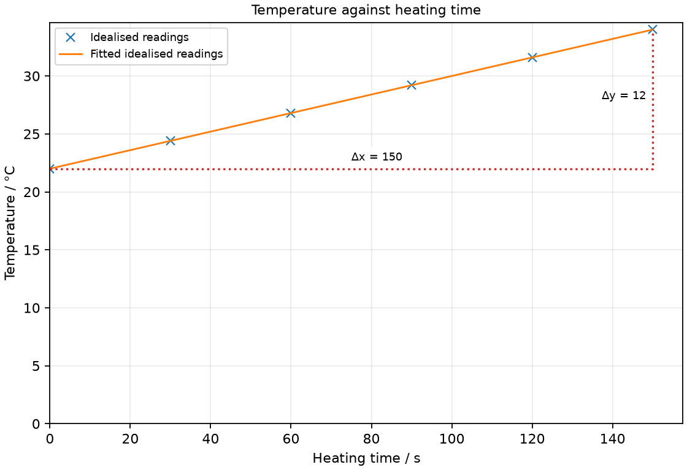

# 2 Planning investigations and recording results

*nam-6118-nssco-2026. Offline study notes, rendered from the approved content units on 2026-10-31. Everything here is also what the flashcards are built from.*

---

## Planning investigations and recording results — 1.2.1

### make observations accurately; use appropriate techniques; handle apparatus/ material competently and have due regard to safety

A useful experiment combines suitable apparatus, accurate observations and a controlled safe procedure. The numerical reading is affected by how the apparatus is selected, arranged and used.

Before collecting results, identify the physical quantity to be measured and the range of values expected. Select an instrument whose scale and sensitivity can distinguish the changes of interest. Check its zero and the way the reading is viewed. A thermometer touching a hot vessel wall can describe the wall rather than the bulk liquid; a tilted ruler can describe a longer diagonal distance. Record what was actually observed instead of changing readings to fit a predicted result. Practical safety should be built into the method, not added as a vague final sentence.

### Make accurate observations

An observation should describe the measured quantity as faithfully as the instrument permits. Correct alignment, a checked zero and a clearly identified scale reduce avoidable reading errors.

For a liquid-in-glass thermometer, view the top of the liquid column straight on and wait for the reading to settle. For a measuring cylinder, place it upright on a level surface and read the appropriate meniscus at eye level. The instruction depends on the instrument: a thermometer column is not read by looking for the bottom of a water meniscus. Distinguish a genuine measured change from a change caused by moving the eye or the instrument. Use the scale divisions to decide what precision can reasonably be recorded.

### Select and handle apparatus appropriately

Appropriate apparatus matches the physical quantity, its expected range and the required resolution. Its arrangement must let the instrument respond to the intended quantity.

A ruler may be suitable for a long strip, while a micrometer is better for a very small thickness. A stopwatch measures a time interval rather than a length. In electrical work, an ammeter belongs in the current path and a voltmeter compares two circuit points. Do not assume that a digital display removes all possible errors; an incorrect range, connection or zero can still produce misleading values. In a plan, name the instrument alongside the quantity and describe how it is connected or positioned.

### Apply practical safety precautions

A safety precaution addresses a specific hazard in the proposed experiment. The precaution must reduce that hazard while still permitting the required measurement.

Hot water can burn skin, suspended loads can fall, and an unstable stand can tip. For a heating experiment, place the container securely and handle hot apparatus with suitable protection. Use a low-voltage supply for school circuit investigations and follow the teacher’s equipment instructions. A statement such as be careful does not explain which action prevents injury. Choose a precaution appropriate to the actual setup rather than listing unrelated equipment. Safe working does not by itself guarantee accurate results; the two requirements should both be considered.

### distinguish between dependent, independent, and control variables

The independent variable is deliberately changed, the dependent variable is measured, and relevant controls are kept fixed. These roles are defined by the investigation aim rather than by the name of a physical quantity.

In a test of how the amount of water affects cooling, water volume is changed and temperature change during a stated interval is measured. Initial temperature and the type of container may need to be controlled. In another experiment, water volume could instead be the measured response. Identify the roles in a sentence that connects the aim to the procedure. Changing several influential quantities together makes it difficult to decide which produced the observed effect. Controls should therefore be chosen for a physical reason, not merely because they appear in an apparatus list.

### Identify the independent variable

The independent variable is the quantity deliberately changed in the investigation. It is distinguished from a measured response by the role assigned in the method.

If the aim is to test how heating duration affects water temperature, choose several durations and take a temperature reading at each. Heating duration is then independent even though time can also be measured with a stopwatch. The fact that an instrument measures a quantity does not by itself decide its variable role. Use the aim and the planned intervention. A suitable range of settings should be wide enough to reveal a trend without creating unsafe conditions or changing the experiment into a different physical situation.

### Identify the dependent variable

The dependent variable is the quantity measured as the response to the deliberate change. Its measurement method should be stated clearly enough for another person to obtain comparable readings.

In a spring-loading test, the load may be deliberately changed while extension is measured. The response is extension, not simply the loaded length: subtract the initial length from each loaded length. The same basic investigation could record a different quantity if the aim were changed, so identify what the result must reveal. State the instrument, reference points and unit. A table should reserve a separate column for a calculated response when it is obtained from more than one raw reading.

### Select a relevant control variable

A control variable is an influential quantity held fixed for a fair comparison. Naming a control should be accompanied by a practicable way of maintaining it.

When comparing two container surfaces during cooling, use equal water volumes and similar starting temperatures, with the container shape and material matched as far as possible. Merely saying keep everything the same is too vague. Some factors, such as room temperature, can be monitored even when not perfectly controlled. Explain how a change in the suggested control could affect the response. Holding the independent variable fixed throughout would defeat the aim, so do not accidentally label the quantity being tested as a control.

### predict the hypothesis or aim of the investigation in relation to dependent, independent and control variables

An investigation aim states the relationship that the measurements are intended to test. A hypothesis predicts a possible outcome and must remain open to comparison with the results.

An aim can ask how heating duration affects water temperature at fixed heater power and fixed water mass. A hypothesis might predict a rising temperature, but that prediction is not a conclusion already established by the experiment. Write the dependent quantity and the independent quantity into the aim so that the required table is clear. Specify important fixed conditions. A method should lead to evidence that could support, qualify or contradict the prediction, rather than simply repeating the expected relationship as though it were a measured result.

### Practice task with worked feedback

Investigation aim: test water temperature as heating time increases at a fixed heater setting. These are invented, idealised practice readings; real readings have scatter. 

| Heating time / s | Temperature / °C |
|---:|---:|
| 0 | 22 |
| 30 | 24.4 |
| 60 | 26.8 |
| 90 | 29.2 |
| 120 | 31.6 |
| 150 | 34 |

(a) Draw Temperature / °C vertically against Heating time / s horizontally. Plot the supplied readings and add a separate fitted line. [5]
(b) Show two widely separated points on your fitted line and calculate its gradient. State the gradient unit. [3]
(c) Plan how to test water temperature as heating time increases at a fixed heater setting. Name the equipment and arrangement, describe the measurements and repeats, state controls and a relevant precaution, design the results table and explain how the results answer the aim. [8]

Worked feedback

Graph: Temperature / °C is vertical and Heating time / s horizontal. Use the six readings, draw a separate best-fit line and show a wide gradient triangle; do not join scattered readings in a zigzag.

Gradient construction: choose the separated fitted-line points (0, 22) and (150, 34). Gradient = (34 − 22) / (150 − 0) = 0.08 °C/s. The slope is temperature rise per second, 0.08 °C/s. For 0.100 kg of water with c = 4200 J/(kg K), the water gains energy at mc(dT/dt) = 33.6 W. A roughly 35 W heater allows about 1.4 W for losses in this idealised example; voltage alone does not set its power.

Arrangement: A 6 V immersion heater rated about 35 W, a suitably rated current-limited 6 V supply and leads, 0.100 kg water in an insulated beaker, thermometer, stirrer and stopwatch

Plan: 1. Weigh 0.100 kg of water into the insulated beaker and immerse the 6 V, approximately 35 W heater before switching it on. 2. Place the thermometer in the water away from the heater and beaker wall and record initial temperature. 3. Start the stopwatch with heating and maintain the same supply voltage and heater setting. 4. Stir gently and record temperature every 30 s for 150 s without removing the thermometer. 5. Repeat with fresh water at the same starting temperature and record all repeats.
Control and accuracy: Keep heater power and water mass fixed; stir gently for a representative water temperature and handle hot apparatus safely.
Table: Heating time / s; Temperature / °C; repeat readings in separate columns. 
Graph and conclusion: The temperature-time gradient gives the warming rate. Convert to power only when water mass and specific heat capacity are included and heat losses/container heating are allowed for.

---

## Planning investigations and recording results — 1.2.2

### locate, select and organise information from a variety of sources

Experimental planning may require relevant information from several sources. The selected information should be organised by the quantities and conditions needed for the investigation.

An apparatus diagram may identify connections, a label may give an instrument range, and a results table may provide measured values. Read each source for its particular role. Copy a number with its unit and any condition that limits its use. A voltage rating is not a current reading, and a table value from a different temperature may not describe the present experiment. Keep calculated values separate from measured ones. When several sources disagree, inspect the definitions and conditions before assuming that one should simply replace the other.

### record results of experimental investigations in a logical manner (tables or graphs) and explain the importance of units and recording results of experimental investigations

A results record should preserve readings in a logical order with identified quantities and units. Tables organise numerical relationships, while graphs make patterns easier to examine.

Arrange rows by the independent variable rather than by an accidental order of loose notes. Keep each set of repeated readings alongside the setting that produced it. If a mean or an extension is calculated, show it in a separate labelled column rather than overwriting raw data. A graph can then be constructed from the appropriate columns. Record readings during the experiment so that units, unusual events and apparent anomalies are not reconstructed from memory later. A neat table is useful only if its entries remain traceable to the actual measurements.

### present each column of a table by heading it with the physical quantity and the appropriate unit, e.g. time/s (units should be in the heading of the column and not in the measurements in the column)

A table heading identifies the physical quantity and the unit used for that column. Numerical entries can then be written without repeating the unit in every cell.

A heading such as Temperature / °C means that each numerical entry is a temperature expressed in degrees Celsius. A heading of Time / s distinguishes an elapsed time from a temperature even if the two columns contain similar numbers. State the quantity, not a unit by itself. If the unit changes, the numerical values must be converted consistently rather than leaving the old numbers under a new label. Keep raw quantities and their derived combinations in distinct columns so that their units can be checked separately.

### use column headings of the table to be directly transferred to the axes of a constructed graph

Graph axis labels should carry the same physical quantity and unit as the table column being plotted. The usual experimental arrangement puts the independent variable horizontally and the dependent response vertically.

For a table of heating time and temperature, transfer Heating time / s to the horizontal axis and Temperature / °C to the vertical axis. Do not transfer numerical table entries into the axis labels. Select scales that include the range of readings and allow values between major divisions to be located. If the graph instruction specifies a different orientation, follow that orientation and use the resulting axis ratio when interpreting its gradient. The title describes the dependent quantity against the independent quantity.

### Heater rating and the practice readings

The slope is temperature rise per second, 0.08 °C/s. For 0.100 kg of water with c = 4200 J/(kg K), the water gains energy at mc(dT/dt) = 33.6 W. A roughly 35 W heater allows about 1.4 W for losses in this idealised example; voltage alone does not set its power.
