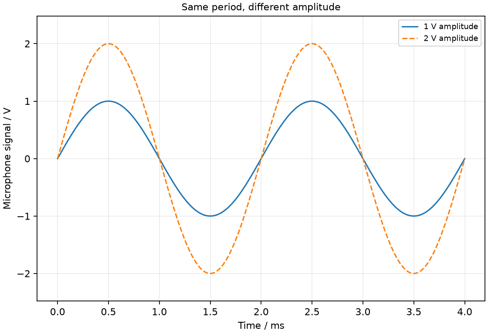
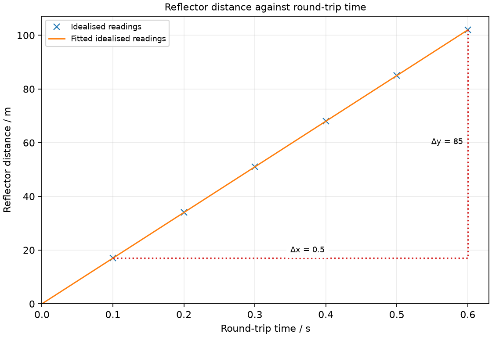

# 20 Sound and echoes

*nam-6118-nssco-2026. Offline study notes, rendered from the approved content units on 2026-10-31. Everything here is also what the flashcards are built from.*

---

## Sound and echoes — 4.4

### describe the production of sound by vibrating sources, how sound moves through the air and how the ear receives sound waves

Sound links a vibrating source, a mechanical disturbance in a medium and a receiver. In air, the disturbance is a longitudinal pattern of pressure variations.

A loudspeaker cone pushes and pulls nearby air, forming alternating compressions and rarefactions. Neighbouring regions pass the disturbance onward while molecules oscillate locally. At the ear, pressure variations cause the eardrum to vibrate. This connects source and receiver without requiring the source’s original air molecules to travel the whole distance.

### Describe a vibrating sound source

A vibrating body can act as a sound source by disturbing its surroundings. Examples include a tuning fork, string and loudspeaker cone.

Motion must couple to a medium to produce the corresponding travelling sound. A tuning fork has alternating prong motion; a string can transfer vibration to an instrument body that moves a larger air region. The source’s frequency is linked to the emitted sound’s frequency in a stationary simple arrangement.

### Explain sound propagation in air

Sound in air propagates through successive compressions and rarefactions. Air molecules oscillate approximately parallel to propagation.

A compression is a relatively high-pressure, high-density region; a rarefaction is lower pressure and density. They are features travelling through the air rather than separate permanent groups of molecules. Random thermal motion continues alongside the small organised acoustic oscillation.

### Describe reception of sound by the ear

Incoming pressure variations can vibrate the eardrum. The ear transfers that motion through internal structures and converts it into nerve signals.

The outer ear guides sound toward the eardrum. The middle-ear bones help transmit vibration to the inner ear, where sensory structures respond. The optical idea of light entering the eye must not be substituted for this mechanical pressure pathway.

### suggest the approximate range of audible frequencies for the healthy human ear (20 Hz to 20 000 Hz)

A commonly quoted healthy-young-human hearing range is approximately 20 Hz to 20 000 Hz. Actual limits vary with age, exposure and the individual.

Below the lower reference is infrasound; above the upper reference is ultrasound. A frequency being outside human hearing does not mean no wave exists or that another animal cannot detect it. These are approximate physiological reference values, not exact limits for every listener.

### discuss the effect of noise levels on human hearing

High sound exposure can damage hearing. Risk depends on sound level and exposure duration.

Noise can interfere with communication and sustained or intense exposure can harm the ear’s sensory structures. Increasing amplitude is not merely a change in pitch. The syllabus principle is to reduce harmful exposure through source control, distance, reduced duration and appropriate protection, rather than assuming discomfort is the sole sign of damage.

### discuss the frequency of vibration in relation to the pitch of the sound

Higher sound frequency is associated with higher perceived pitch. Changing amplitude alone does not set the pitch.

With the same oscilloscope time scale, more complete cycles across the screen mean a higher frequency. A shorter period corresponds to higher pitch for comparable simple tones. Complex sounds can contain several frequency components, so the simple comparison concerns otherwise similar tones.

### discuss the amplitude of vibration in relation to the loudness of the sound

For comparable sounds and listening conditions, greater vibration amplitude is associated with greater loudness. Pitch is mainly related to frequency rather than amplitude.

A taller oscilloscope trace on unchanged gain indicates a larger signal amplitude. To compare loudness from traces, keep microphone position and amplifier settings fixed. Perceived loudness also depends on frequency and the listener, so amplitude is the intended controlled-variable comparison rather than a complete hearing law.

### describe displayed waveforms on a cathode-ray or a PC oscilloscope

An oscilloscope displays a signal against time, with vertical deflection linked to microphone output. At fixed settings, trace height compares amplitude and cycle spacing compares period.

For a model trace at times 0 to 4 ms, draw two complete cycles of amplitude 1 V and another of amplitude 2 V with the same 2 ms period. The second is louder under matched recording conditions but has the same pitch. Time-base units are essential: 2 ms corresponds to 0.002 s and a frequency of 500 Hz. Voltage is a microphone signal, not particle displacement in metres.

### explain that a medium (solid, liquid and gas) is required in order to transmit sound waves

Sound is a mechanical wave that needs matter to carry its disturbance. Solids, liquids and gases can transmit sound; an ideal vacuum has no material particles to pass on the vibration.

A bell may continue vibrating inside an evacuated enclosure while its airborne sound becomes much weaker as air is removed. Residual sound can travel through supports, so the demonstration needs isolation and does not imply the bell stops moving. Light from it can still cross the vacuum because light is electromagnetic. Sound can travel through solids, liquids and gases because their particles pass on mechanical vibrations. It cannot travel through a vacuum. A typical air speed is about 340 m/s under ordinary room conditions, with temperature affecting the value. In a solid the interactions between neighbouring particles transmit vibration; liquid and gas particles also pass on sound disturbances. A vacuum does not provide this medium.

### design and conduct an experiment to show how sound is reflected and how echoes are produced

Sound can reflect from a boundary and return as an echo. A distinct echo needs sufficient delay and suitable strength relative to the original sound.

Use a brief pulse near a large flat reflecting wall and record the direct and returned signals. Change distance to show the delay changing. Absorbing surfaces can reduce the return. A reflected sound arriving too soon may blend with the original rather than being heard as a separate echo. Keep sound levels moderate and choose a quiet safe space.

### discuss how humans and animals make use of echoes

Echo timing can locate reflecting boundaries or objects. Animals such as bats and dolphins use reflected sound to gain information about their surroundings.

Human applications include sonar and distance sensing. A time delay gives a travel distance if speed is known, while return strength can add information about the target. The outward and return paths must both be included in the simple ranging model.

### describe a measurement of the speed of sound in air using an echo from a vertical flat surface

For a source and receiver together a distance d from a flat wall, the echo path is approximately 2d. Sound speed is c = 2d/t for the measured outward-and-return delay.

Measure the perpendicular wall distance and use a recorder or electronic timing to distinguish direct and echoed pulses. At 34 m with a 0.20 s delay, the estimate is 340 m/s. Repeat at several distances; a plot of echo delay against one-way distance has slope 2/c, so speed is twice the reciprocal gradient. Correct for an electronic timing offset if present.

### Distinguishing the ideas

Loudness is associated with amplitude under comparable conditions, not wavelength alone. Wavelength and frequency are linked through wave speed and chiefly support the pitch comparison.

Two tones in the same air can have equal wavelength and frequency yet different amplitudes. The larger-amplitude one is generally louder with matched observation conditions. Saying a longer wavelength makes a sound louder confuses two independent descriptors.

### Same period, different amplitude

Same period, different amplitude. Draw two sinusoidal microphone traces over 0–4 ms with equal 2 ms periods but amplitudes 1 V and 2 V.

### Practice task with worked feedback

Choose one correct option for each original practice question.

1. What produces ordinary sound at a source?
A. Uniform motion without a disturbance
B. Static displacement after motion ends
C. Vibration
D. Steady pressure with no variation

2. How are air-sound oscillations oriented?
A. Particles move all the way from speaker to ear
B. Parallel to propagation
C. Perpendicular to propagation
D. Oscillations have no preferred relation to propagation

3. Which is the usual approximate human hearing range?
A. 2–200 Hz
B. 20000–200000 Hz
C. 20 Hz–20 000 Hz
D. 200–2000 Hz

4. Which mainly determines simple-tone pitch?
A. Wavelength alone regardless of medium
B. Propagation speed alone
C. Amplitude
D. Frequency

5. Which mainly changes loudness at fixed frequency and conditions?
A. Amplitude
B. Period
C. Speed of travel in same medium
D. Frequency

6. Why is a medium required for sound?
A. Material interactions transmit the disturbance
B. Sound is electromagnetic
C. Source cannot vibrate in vacuum
D. A vacuum contains fewer but faster sound particles

7. Which observation specifically demonstrates a bat’s echolocation?
A. Detecting ground vibrations through feet only
B. Detecting prey solely by visible reflected light
C. Prey is detected from heat radiation alone
D. An obstacle is located using delayed returning ultrasound

8. A wall is 17 m away. What is the outward-and-return path?
A. 17 m
B. 34 m
C. 51 m
D. 8.5 m

9. For a 0.40 s echo delay and c = 340 m/s, how far away is the wall?
A. 850 m
B. 136 m
C. 68 m
D. 34 m

10. A trace has period 2 ms. What is frequency?
A. 2000 Hz
B. 2 Hz
C. 0.5 Hz
D. 500 Hz

11. At unchanged microphone settings, one trace is twice as tall with the same period. What is supported?
A. Same amplitude and same frequency
B. Greater amplitude and same frequency
C. Greater amplitude and lower frequency
D. Greater amplitude and greater frequency

12. Moving farther from a reflecting wall has what effect on echo delay?
A. It increases
B. It depends only on sound frequency
C. It stays the same
D. It decreases

Worked feedback

1. Key C. A: A sound source oscillates. B: No ongoing travelling pressure oscillation is generated. C: It disturbs the surrounding medium. D: Sound needs changing pressure.

2. Key B. A: Particles oscillate locally. B: The wave is longitudinal. C: That is transverse. D: Ordinary sound in air is longitudinal.

3. Key C. A: Upper limit much too low. B: Mostly ultrasound. C: This is the school reference for a healthy young ear. D: Excludes much audible range.

4. Key D. A: Frequency is the direct pitch quantity. B: Pitch follows frequency. C: Chiefly affects loudness. D: Higher frequency gives higher pitch.

5. Key A. A: Larger variations generally sound louder. B: Period fixes frequency and pitch. C: Does not provide the amplitude change. D: This chiefly changes pitch.

6. Key A. A: It is a mechanical wave. B: Sound is mechanical. C: Source may vibrate but no surrounding medium carries sound. D: Ideal vacuum has no particles to transmit sound.

7. Key D. A: This is not airborne-echo sensing. B: This is vision. C: Thermal sensing is not sound-echo detection. D: The outgoing sound reflects and its delay/direction reveal the obstacle.

8. Key B. A: This counts only one leg. B: The sound travels there and back. C: This counts three one-way legs instead of the outward and return pair. D: This halves an already one-way distance.

9. Key C. A: This divides speed by time. B: This is the round-trip distance. C: Use d = ct/2. D: This halves the correct distance again.

10. Key D. A: This reverses the intended arithmetic. B: This confuses period and frequency. C: This treats milliseconds as seconds. D: Convert to 0.002 s, then take reciprocal.

11. Key B. A: The trace height doubled, so amplitude did not stay fixed. B: Height and timing measure different features. C: The unchanged period means unchanged frequency. D: The unchanged period means unchanged frequency.

12. Key A. A: The path becomes longer. B: For the stated fixed-speed path, delay is path length divided by speed. C: The reflection path becomes longer. D: Greater path length takes more time at the same speed.

### Practice task with worked feedback

Original structured practice. Answer the parts with working and units where needed.

(a) State whether air sound is transverse or longitudinal. [1]

(b) State the sound property associated chiefly with pitch. [1]

(c) Explain why sound cannot cross an empty vacuum gap. [2]

(d) Calculate the return delay for a wall 51 m away when c = 340 m/s. [2]

(e) Calculate wall distance for a 0.50 s return delay at 340 m/s. [2]

Worked feedback

(a) Longitudinal.

(b) Frequency.

(c) It needs particles to transmit a mechanical disturbance. The vacuum contains no such medium.

(d) t = 2d/c = 0.30 s.

(e) d = ct/2 = 85 m.

### Practice task with worked feedback

Investigation aim: determine sound speed from wall-echo timing. These are invented, idealised practice readings; real readings have scatter. 

| Round-trip time / s | Reflector distance / m |
|---:|---:|
| 0.1 | 17 |
| 0.2 | 34 |
| 0.3 | 51 |
| 0.4 | 68 |
| 0.5 | 85 |
| 0.6 | 102 |

(a) Draw Reflector distance / m vertically against Round-trip time / s horizontally. Plot the supplied readings and add a separate fitted line. [5]
(b) Show two widely separated points on your fitted line and calculate its gradient. State the gradient unit. [3]
(c) Plan how to determine sound speed from wall-echo timing. Name the equipment and arrangement, describe the measurements and repeats, state controls and a relevant precaution, design the results table and explain how the results answer the aim. [8]

Worked feedback

Graph: Reflector distance / m is vertical and Round-trip time / s horizontal. Use the six readings, draw a separate best-fit line and show a wide gradient triangle; do not join scattered readings in a zigzag.

Gradient construction: choose the separated fitted-line points (0.1, 17) and (0.6, 102). Gradient = (102 − 17) / (0.6 − 0.1) = 170 m/s. The one-way reflector distance versus round-trip time slope is c/2 = 170 m/s. Therefore sound speed c = 340 m/s.

Arrangement: A large flat wall, measuring tape and a microphone with audio recorder or timing display; a long-distance repeated-clap stopwatch method is an alternative

Plan: 1. Measure the perpendicular source-to-wall distance with a tape and place the microphone beside the source. 2. Make a short moderate click and record direct and echo pulses on the audio timing display. 3. Read the time separation of the pulse peaks, not the total recording length. 4. Repeat several times at the same distance and record the delays. 5. Repeat at several distances; alternatively time many clap–echo cycles with a stopwatch at a large known distance and divide by the cycle count.
Control and accuracy: Keep air conditions similar, avoid competing reflectors, do not use harmful sound levels and account for electronic timing offsets.
Table: Round-trip time / s; Reflector distance / m; repeat readings in separate columns. 
Graph and conclusion: The one-way reflector distance versus round-trip time slope is c/2 = 170 m/s. Therefore sound speed c = 340 m/s. Compare repeated readings and report the tested range rather than claiming an exact law from scattered observations.

### Further practice: A boat receives a sound echo from the seabed after 0.20 s. Calculate depth using water sound speed 1500 m/s and a vertical outward-and-return path.

Depth = ct/2 = 150 m.
