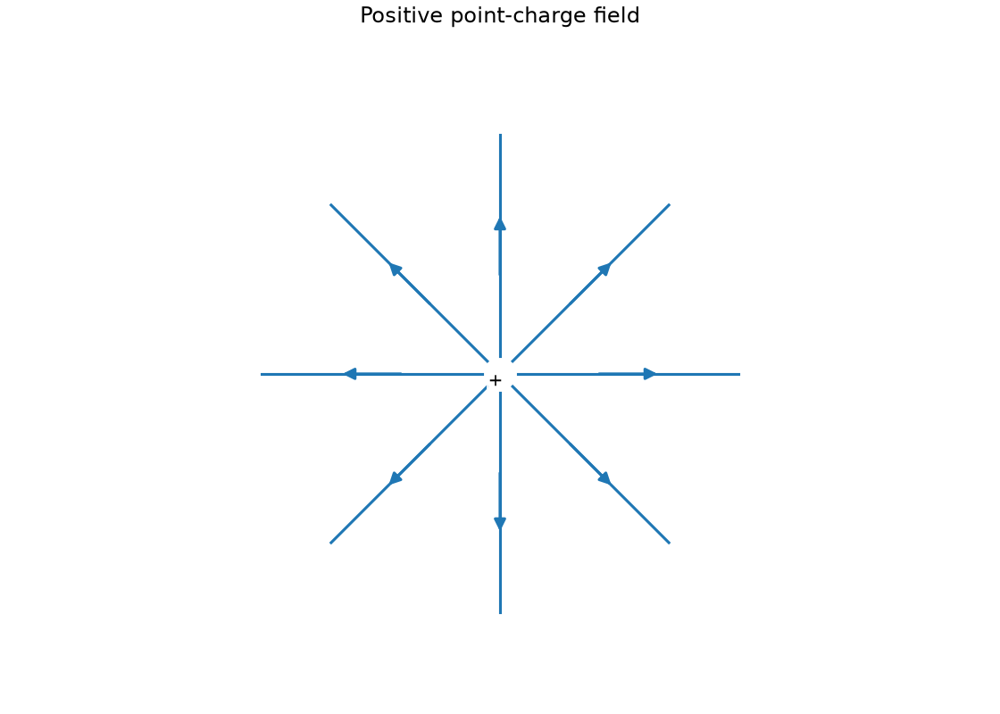
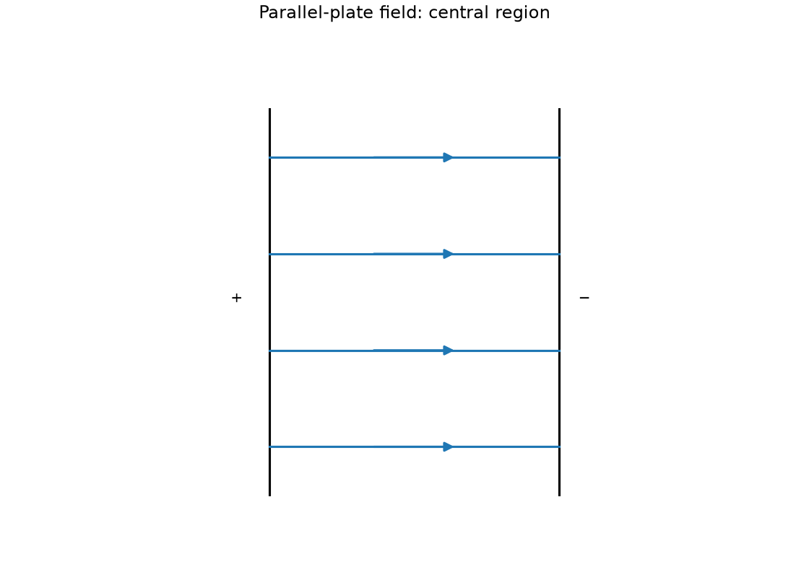
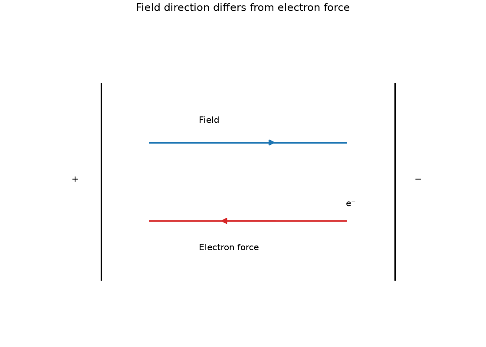

# 21 Electrostatics

*nam-6118-nssco-2026. Offline study notes, rendered from the approved content units on 2026-10-31. Everything here is also what the flashcards are built from.*

---

## Electrostatics — 5.1

### describe simple experiments to show the production of charges by friction and detection of electrostatic charges (using an electroscope)

Rubbing suitable materials can transfer electrons between them. An electroscope detects effects of charge redistribution through leaf or pointer deflection.

Charge is separated, not created from nothing. One body can gain electrons and become negative while the other loses electrons and becomes positive. A neutral electroscope can deflect when a charged object approaches because its charges redistribute; this does not by itself identify the approaching sign. A known initial charge can support a carefully interpreted sign comparison.

### Show frictional charging

Frictional charging involves electron transfer between suitable contacted materials. The paired system retains its total charge if no charge enters or leaves elsewhere.

Rub a suitable dry plastic rod with cloth and test its interaction with small neutral paper pieces. Attraction demonstrates an electric effect but does not prove the paper initially has opposite net charge: polarisation can attract a neutral object. Avoid humid conditions that allow charge to leak away rapidly.

### Detect charge using an electroscope

An electroscope’s conducting parts allow mobile charge to redistribute. Like charges on the movable leaf and stem can produce repulsion and deflection.

Bring a charged rod near the cap without contact and observe deflection. Remove it and note whether the initial state returns. Contact can leave net charge on the instrument, unlike simple temporary induction in an isolated neutral electroscope. Keep the instrument dry and discharge it between neutral-start trials. With a small known charge already on the electroscope, a nearby like charge increases leaf separation; an opposite charge initially reduces it. Bring the test object near gradually, since very strong induction can reverse this simple response.

### state that there are positive and negative charges

Electric charge has positive and negative signs. A neutral object has balanced total positive and negative charge, not an absence of charged particles.

Protons carry positive charge and electrons negative charge. Ordinary charging changes the electron balance in this model; the positive nuclei remain within the material. Neutrality concerns the total, so a neutral conductor can still have locally separated induced charges.

### state that charge is measured in coulomb

Electric charge is measured in coulombs. The SI symbol for coulomb is C.

Charge is a quantity, while current is its flow rate. A transferred charge of 2 C is not a current of 2 A unless the time relation is specified. Keep the charge unit separate from the letter C sometimes used for heat capacity in a different topic.

### state that unlike charges attract and that like charges repel

Like net charges repel and unlike charges attract. A charged body can also attract a neutral polarisable body.

Repulsion between two tested objects is strong evidence that both have like charges in the simple electrostatic test. Attraction alone does not identify opposite signs because induced charge separation can bring the nearer opposite charge closer. Explain the relative distances when using this neutral-attraction mechanism.

### state that electrostatics is used in. photocopying, electrostatic precipitator and ink-jet printing

Electrostatic forces can position toner, remove airborne particles or steer charged ink droplets. Each application requires charge and an electric field arranged for the desired motion.

A photocopier attracts toner to a patterned surface. A precipitator charges particles and collects them on suitable electrodes. A continuous ink-jet design can deflect charged droplets between plates. Not every printer uses the same mechanism, so the last example concerns that specified design.

### Describe electrostatic photocopying

Electrostatic photocopying uses a charge pattern to attract toner selectively. The toner is then transferred and fixed to paper.

Illumination changes the charge pattern on a suitable drum so toner marks the intended regions. Transfer moves the pattern to the paper, and fixing makes it persist. The electric role is selective attraction, not merely warming every part of the sheet. The drum is charged, and light reflected from the original discharges exposed areas. Toner is attracted to the remaining charged pattern, transferred onto paper and fixed by heating.

### Describe electrostatic precipitation

An electrostatic precipitator charges suspended particles and attracts them to collecting surfaces. This can remove particulate matter from a gas stream.

The gas flows through a controlled field region, particles acquire charge and then move toward a suitable electrode. Collected material must be removed so it does not simply accumulate indefinitely. This removes particles rather than guaranteeing removal of every gaseous pollutant.

### Describe ink-jet printing

In a charged-droplet ink-jet system, an electric field deflects charged droplets. Changing charge or the field changes the droplet path in the intended design.

Droplets enter a region between charged plates and experience a force depending on sign. Neutral droplets are not deflected by the same simple qE mechanism. The example concerns electrostatic steering rather than every possible commercial ink-jet mechanism.

### explain lightning as discharge from a cloud

Lightning is a large electrical discharge associated with charge separation in clouds and their surroundings. A sufficiently strong field can ionise air and create a conducting path.

Before the discharge, the air is a poor conductor under ordinary conditions. Once ionised, charge can move rapidly along a channel, transferring energy and heating the air. The resulting rapid expansion contributes to thunder. The event does not mean protons leave every object and fly upward as the usual charging mechanism. Collisions between ice and water particles in a storm cloud separate charge, producing a large potential difference between charged regions or ground. A sufficiently strong field ionises air and opens a conducting discharge path.

### describe an electric field as a region in which an electric charge experiences a force due to its charge

An electric field is a region where a charge experiences an electric force due to its charge. Field direction is defined by the force on a positive test charge.

The test charge should be small enough not to disturb the source arrangement appreciably. A negative charge experiences force opposite to the defined field direction. A field can exist before the test charge is introduced; the test reveals it rather than creating the source field.

### distinguish between electrical conductors and insulators using the simple electron model and give typical examples

Conductors have charges able to move through the material relatively readily. In ordinary solid-metal conductors, mobile electrons carry charge; an insulator lacks comparable free movement.

Copper is a conductor; dry plastic and glass are typical insulators under ordinary conditions. An insulator can still polarise, meaning its charges shift slightly within bound structures. Insulation is conditional: a sufficiently strong electric field can cause breakdown. This does not remove the usefulness of the ordinary classification.

### state the direction of the electric lines of force and describe simple electric field patterns, including the electric field around a point charge and between two parallel plates with opposite charges

Electric field lines indicate the force direction on a positive test charge. They point away from positive sources and toward negative sources.

A point source gives a radial pattern. Far from plate edges, oppositely charged parallel plates give an approximately uniform field with straight parallel equally spaced lines. Curving near edges is a limitation of the ideal central-region drawing. Lines do not cross because the field cannot have two directions at one point.

### Draw the electric field around a point charge

A positive point charge has radially outward electric field lines. A negative point charge has the same radial geometry with inward arrowheads.

Draw several evenly distributed rays about the charge and label its sign. Line spacing increases farther away, representing weaker field in a qualitative diagram. Do not draw closed circles, which would indicate tangential rather than radial field direction.

### Draw the field between oppositely charged parallel plates

The central field between opposite parallel plates is approximately uniform. Its direction is from the positive plate toward the negative plate.

Draw equal-length parallel plates, label their signs and show straight parallel equally spaced lines between central regions. Use arrows across the gap rather than along the metal. Near edges the real field curves, so the simple construction is a central-region approximation.

### State electric field direction

Field direction follows positive-test-charge force. Electron force is opposite to the field direction.

For plates with positive on the left and negative on the right, the field arrow points right, while a free electron accelerates left if other forces are negligible. Do not reverse the definition merely because electron motion is being discussed.

### describe and explain charging by induction

Charging a conductor by induction uses an external field, charge redistribution and a controlled connection to Earth. The order of removing the earth connection and inducing object determines the final state.

Bring a negative rod near an isolated conductor without touching. Electrons are repelled; connect the conductor to Earth so some electrons leave. Disconnect Earth while the rod remains, then remove the rod. The conductor is left positive and its charge redistributes. Removing the rod before disconnecting Earth can allow charge to return and defeats the intended result. The conductor starts on an insulating stand. A nearby negative rod pushes its electrons toward the far side before the earth connection is made; this connection is removed before the rod.

### Distinguishing the ideas

Positive frictional charging ordinarily means loss of electrons. The simple rubbing model does not transfer protons between the materials.

The nuclei remain bound in the materials while electrons are exchanged. Removing some negative charge leaves the pre-existing positive charge in excess. Describing the outcome as proton gain confuses a net charge imbalance with the mobile particle responsible.

### Positive point-charge field

Positive point-charge field. Draw the electric field around an isolated positive point charge.

### Parallel-plate field: central region

Parallel-plate field: central region. Draw the central electric field between a positive plate on the left and a negative plate on the right.

### Field direction differs from electron force

Field direction differs from electron force. Draw the electric-field arrow and electron-force arrow between a positive left plate and negative right plate.

### Practice task with worked feedback

Choose one correct option for each original practice question.

1. A rod loses electrons while rubbed with a cloth. Which pair describes their net charges?
A. Rod positive, cloth negative
B. Both neutral
C. Rod negative, cloth positive
D. Both positive

2. What unit measures charge?
A. V
B. C
C. A
D. W

3. What do two negative charges do?
A. Exert no force without contact
B. Attract because signs match
C. Lose their charge automatically
D. Repel

4. Which is a typical conductor?
A. Copper
B. Dry wood
C. Dry glass
D. Dry rubber

5. What does a precipitator collect?
A. Charged particles from a gas
B. Uncharged dust without first charging it
C. Neutral pollutant gas by simple mechanical sieving
D. Water vapour by cooling alone

6. Field direction is defined using which test charge?
A. No specified sign
B. Positive
C. Negative
D. Neutral only

7. Can a neutral electroscope deflect when a charged rod approaches without contact?
A. Yes, because electrons are created at the leaf
B. Yes, by redistribution
C. Yes, because the rod must touch it
D. No, a neutral conductor cannot separate charge internally

8. An initially neutral material gains electrons and no other charge is transferred. What is its resulting net charge?
A. It depends only on the rod mass
B. Positive
C. Negative
D. Neutral regardless of the gain

9. A charged rod attracts neutral paper. What is supported?
A. The rod must be neutral
B. The paper must already have opposite net charge
C. Charge has been created without transfer
D. Polarisation can account for attraction

10. A field points right. Which way is electric force on an electron?
A. Upward
B. Right by the positive convention
C. Left
D. Zero due to electron charge

11. An initially neutral conductor on an insulating stand is earthed while a negative rod is held nearby. Which sequence leaves the conductor positively charged?
A. Disconnect Earth before bringing the rod nearby
B. Remove the rod, then disconnect Earth
C. Remove the rod and keep Earth connected
D. Disconnect Earth, then remove the rod

12. Where is the simple uniform-plate-field model most appropriate?
A. Next to an isolated point charge
B. At a plate edge
C. Near the central region between broad plates
D. Far outside the plates

Worked feedback

1. Key A. A: Electrons moved from rod to cloth, leaving equal opposite net charges. B: Electron transfer changes the net balance on each object. C: This reverses the stated electron-transfer direction. D: Transfer leaves one electron deficit and one excess.

2. Key B. A: Volt measures energy per charge. B: Coulomb is the charge unit. C: Ampere measures current. D: Watt measures power.

3. Key D. A: Electrostatic force acts at a distance. B: Like signs repel. C: Approach alone does not neutralise equal-sign charges. D: Like signs repel.

4. Key A. A: It has mobile electrons. B: Typically insulating in this comparison. C: Ordinary glass is an insulator. D: Electrons not freely mobile in bulk.

5. Key A. A: An electric force moves them to collectors. B: Charging and electric force are essential stages. C: Electrostatic precipitator targets charged suspended particles. D: That is condensation.

6. Key B. A: A direction convention requires one. B: This is the direction convention. C: Its force is opposite the defined direction. D: It has no simple qE force.

7. Key B. A: Charges move rather than being created. B: Electrons shift so leaf and stem acquire like charge and repel, while total electroscope charge may remain zero. C: Stem explicitly excludes contact. D: Its electrons can redistribute.

8. Key C. A: Charge balance depends on electrons and protons, not mass alone. B: Gaining negative electrons makes net charge more negative. C: Electrons add negative charge. D: A net added electron imbalance changes charge.

9. Key D. A: A charged rod can attract neutral material. B: Attraction alone does not prove that. C: The observation does not require that. D: Opposite nearer induced charge can dominate.

10. Key C. A: Electric force is along or opposite the field, not at right angles to it. B: That convention applies to positive test charge. C: Its charge is negative. D: An electron is charged.

11. Key D. A: Without an earth path while the rod is present, electrons cannot leave to create the intended net positive charge. B: Electrons can return through the earth path before it is removed. C: The remaining earth path permits neutralisation. D: The rod is still repelling electrons when the earth path is removed, so an electron deficit remains.

12. Key C. A: Its field is radial rather than uniform. B: Field lines curve near edges. C: Edge effects are smaller there. D: The simple uniform central pattern is not applicable.

### Practice task with worked feedback

Original structured practice. Answer the parts with working and units where needed.

(a) State the unit of charge. [1]

(b) State the interaction between like charges. [1]

(c) Explain the conducting behaviour of a metal. [2]

(d) Explain positive charging of a rubbed insulating sample in the simple model. [2]

(e) Explain why the earth connection is removed before the inducing rod. [2]

Worked feedback

(a) Coulomb.

(b) Repulsion.

(c) It has mobile electrons that can move through the material and carry charge.

(d) Electrons leave the sample. Its remaining positive and negative charges are unbalanced with a positive excess.

(e) It traps the intended net charge on the isolated conductor. If the rod is removed first, electrons can return through the earth connection and restore neutrality.

### Further practice: State the electrostatic interaction between unlike charges.

They attract.
