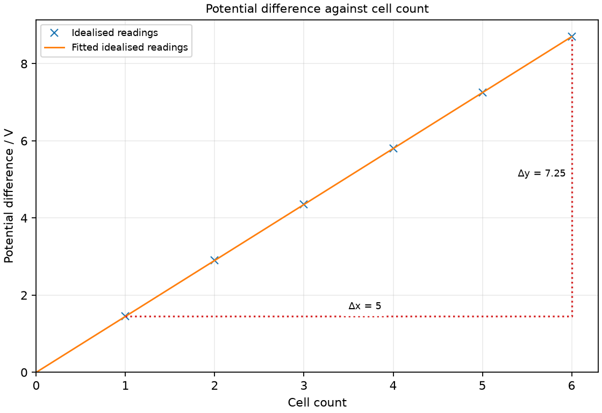

# 22 Current, electromotive force and potential difference

*nam-6118-nssco-2026. Offline study notes, rendered from the approved content units on 2026-10-31. Everything here is also what the flashcards are built from.*

---

## Current, electromotive force and potential difference — 5.2.1

### state that a current is a flow of charge and that current is measured in amperes [A] using an ammeter

Electric current is the rate of flow of charge. It is measured in amperes using an ammeter; 1 A = 1 C/s.

A current is not the total amount of charge stored on an object. The same charge crossing a section over a shorter interval corresponds to greater average current. In a metal, electrons provide the mobile charge carriers; the conventional current direction is defined using positive-charge motion.

### state and use the correct way to connect an ammeter

An ammeter measures the current passing through it. It is connected in series with the branch whose current is measured.

Open the low-voltage circuit and insert the meter so branch charge passes through it. Choose an appropriate range and polarity for DC measurement. An ideal ammeter has negligible resistance; connecting it directly across a source can create a damaging large-current path. Use a current-limited classroom supply and switch off before changing connections.

### Use current I = charge Q / time t

Average current is I = Q/t. Charge is Q = It when a constant current flows for time t.

A 0.30 A current for 20 s transfers 6 C across a section. Use seconds rather than unconverted minutes and amperes rather than unconverted milliamperes for the SI calculation. A current need not consume charge as it passes through a resistor; the energy transfer and charge flow are different descriptions.

### distinguish between static electricity and current electricity

Electrostatics concerns charge distributions approximately at rest. Current electricity concerns charge flow through a path.

A rubbed insulating rod can retain a net charge locally, while a complete conducting circuit can support sustained current from a source. An electrostatic discharge is itself a brief current, so the two descriptions are connected rather than unrelated forms of substance. Charge is conserved in both.

### explain and distinguish between - alternating current (a.c) and direct current (d.c) - the direction of the electron flow and the direction of the conventional current

AC reverses direction periodically, while DC flows in one direction. In a metal, electron drift is opposite to conventional current.

Two different comparisons are involved. AC versus DC describes whether the current’s direction changes with time. Electron versus conventional direction describes the carrier’s sign relative to a defined positive-current direction. A varying one-direction current is still DC, so constant magnitude is not the defining requirement.

### Distinguish alternating and direct current

Alternating current reverses direction periodically. Direct current keeps one direction, although its magnitude can vary.

On a signed current-time graph, a typical AC trace crosses zero into opposite signs. A pulsed trace that stays on one side is one-direction current despite changing size. A cell is a common classroom DC source. Do not assume that any changing current must be alternating.

### Distinguish electron flow and conventional current

Conventional current follows the defined direction of positive-charge flow. In a metal circuit, negative electrons drift in the opposite direction.

In the external circuit of a discharging cell, conventional current goes from positive toward negative through the load; electrons drift from negative toward positive. The microscopic random electron motion is superimposed on a much smaller drift. This drift direction is distinct from the speed at which circuit changes propagate.

### Practice task with worked feedback

Choose one correct option for each original practice question.

1. What does current measure?
A. Charge accumulated without a time interval
B. Energy per time
C. Charge flow per time
D. Energy per charge

2. Where is an ammeter placed to measure branch current?
A. Across the cell terminals
B. Across the whole lamp branch
C. In series in a different branch
D. In series in that branch

3. How is a voltmeter connected across a resistor?
A. In series only
B. To one terminal only
C. As a zero-resistance short
D. In parallel

4. Which feature defines AC?
A. Electron motion opposite conventional direction
B. Periodic direction reversal
C. Unidirectional pulsating flow
D. Constant-magnitude flow in one direction

5. In a metal, electron drift compared with conventional current is what?
A. Same direction only when current is steady
B. Opposite
C. Right angles
D. Same direction

6. Which quantity is source energy per charge?
A. Current
B. Power
C. Potential energy of all charges added together
D. E.m.f.

7. What does 1 V equal?
A. 1 J/C
B. 1 C/s
C. 1 J/s
D. 1 N/m²

8. What current transfers 10 C in 5 s?
A. 0.5 A
B. 50 A
C. 2 A
D. 10 A

9. A current of 0.4 A flows for 20 s. What charge passes?
A. 8 C
B. 50 C
C. 0.4 C
D. 0.02 C

10. A component transfers 12 J per 3 C. What is V?
A. 0.25 V
B. 4 V
C. 12 V
D. 36 V

11. Three identical 1.2 V cells are connected in series with each positive terminal joined to the next negative terminal. What voltage is measured with no external load?
A. 0.4 V
B. 1.2 V
C. 3.6 V
D. 0 V

12. A pulsed current varies but never reverses. How is it classified?
A. DC
B. AC because its size varies
C. AC only during the pulse maximum
D. Neither AC nor DC because it is not constant

Worked feedback

1. Key C. A: Current is rate of flow. B: This is power. C: This gives C/s or A. D: This is voltage.

2. Key D. A: Ammeter must not short a source. B: That parallel meter path can short it. C: This does not measure the specified branch. D: The measured charge flows through it.

3. Key D. A: That would alter the circuit strongly. B: A two-point difference needs both connections. C: It should have high resistance. D: Its terminals compare the resistor’s endpoints.

4. Key B. A: This occurs in metals for AC and DC. B: Alternating current repeatedly reverses direction; variation in magnitude alone is insufficient. C: This is pulsating DC. D: This is DC.

5. Key B. A: Negative sign still applies in steady current. B: Electrons carry negative charge. C: Charge sign reverses direction, not rotates 90°. D: Negative carriers drift opposite convention.

6. Key D. A: Charge per time. B: Energy divided by time, not charge. C: Emf is per unit charge, not total energy. D: It describes the source contribution.

7. Key A. A: Voltage is energy per charge. B: That is 1 A. C: That is 1 W. D: That is 1 Pa.

8. Key C. A: This reverses the ratio. B: This multiplies them. C: Divide charge by time. D: This ignores duration.

9. Key A. A: Use It. B: This divides time by current. C: This ignores duration. D: This divides current by time.

10. Key B. A: This reverses the ratio. B: Divide energy by charge. C: This ignores the amount of charge. D: This multiplies energy and charge.

11. Key C. A: This divides by the number. B: That ignores series addition. C: Their energy-per-charge contributions add. D: They are not opposing one another.

12. Key A. A: One-direction flow is the defining feature. B: AC requires direction reversal. C: Classification follows reversal, not instantaneous size. D: Unidirectional pulsating current is DC.

### Practice task with worked feedback

Original structured practice. Answer the parts with working and units where needed.

(a) State the unit of current. [1]

(b) State the unit of e.m.f. [1]

(c) Explain e.m.f. versus load potential difference. [2]

(d) Calculate current for 18 C transferred in 60 s. [2]

(e) Calculate potential difference for 45 J transferred per 9 C. [2]

Worked feedback

(a) Ampere.

(b) Volt.

(c) E.m.f. is source energy supplied per charge. Load potential difference is energy transferred per charge at the load.

(d) I = Q/t = 0.30 A.

(e) V = W/Q = 5 V.

### Practice task with worked feedback

Investigation aim: test how voltage depends on the number of identical cells in series. These are invented, idealised practice readings; real readings have scatter. 

| Cell count | Potential difference / V |
|---:|---:|
| 1 | 1.45 |
| 2 | 2.9 |
| 3 | 4.35 |
| 4 | 5.8 |
| 5 | 7.25 |
| 6 | 8.7 |

(a) Draw Potential difference / V vertically against Cell count horizontally. Plot the supplied readings and add a separate fitted line. [5]
(b) Show two widely separated points on your fitted line and calculate its gradient. State the gradient unit. [3]
(c) Plan how to test how voltage depends on the number of identical cells in series. Name the equipment and arrangement, describe the measurements and repeats, state controls and a relevant precaution, design the results table and explain how the results answer the aim. [8]

Worked feedback

Graph: Potential difference / V is vertical and Cell count horizontal. Use the six readings, draw a separate best-fit line and show a wide gradient triangle; do not join scattered readings in a zigzag.

Gradient construction: choose the separated fitted-line points (1, 1.45) and (6, 8.7). Gradient = (8.7 − 1.45) / (6 − 1) = 1.45 V per cell. The slope is open-circuit voltage per series-aiding cell, 1.45 V per cell. Cell count has no physical unit.

Arrangement: Six matched low-voltage cells, holders, connecting leads and a high-resistance DC voltmeter

Plan: 1. Check voltmeter zero and choose a suitable DC range. 2. Put one cell in its holder and connect only the voltmeter across it. 3. Record open-circuit voltage, keeping fingers clear of exposed contacts. 4. Add matched cells series-aiding one at a time up to six and record total voltage at each count. 5. Repeat the count sequence and measure individual cells to check that their voltages are similar.
Control and accuracy: Use similar cells in similar condition, avoid short circuits, keep total voltage within safe classroom limits and do not connect a measuring ammeter across the cells.
Table: Cell count; Potential difference / V; repeat readings in separate columns. 
Graph and conclusion: The slope is open-circuit voltage per series-aiding cell, 1.45 V per cell. Cell count has no physical unit. Compare repeated readings and report the tested range rather than claiming an exact law from scattered observations.

---

## Current, electromotive force and potential difference — 5.2.2

### state that electromotive force (e.m.f) is measured by the energy dissipated (supplied) by a source in driving unit charge round a complete circuit

Electromotive force is source energy contribution to each coulomb. Despite its name, e.m.f. is not a force measured in newtons.

A 1.5 V cell supplies about 1.5 J per coulomb in the specified model. It converts energy from a store such as chemical energy into the circuit’s electrical transfer pathway. For identical series-aiding cells under open-circuit conditions, their voltages add because each contributes energy per charge; a high-resistance voltmeter measures this approximately without substantial load current.

### Use electromotive force = source energy transferred per charge, V = E/Q

Source e.m.f. is ε = E/Q for the source’s supplied energy. One volt is one joule per coulomb.

A source supplying 18 J to 6 C has e.m.f. 3 V. The denominator is charge, not time. If the source has internal resistance and a load draws current, terminal potential difference can differ from e.m.f.; the basic energy-per-charge definition remains. No internal-resistance calculation is required for this task.

### Use potential difference = component work per charge, V = W/Q

Potential difference is energy transferred per charge between two points. Across a component, V = W/Q.

If 15 J transfers as 5 C passes a lamp, the potential difference is 3 V. The charge need not disappear after giving energy to the lamp. An analogy can compare the same amount of circulating charge at different energy levels, but it must not imply charge is fuel consumed by the component.

### state that both e.m.f and p.d across a circuit component are measured in volts [V]

Both e.m.f. and potential difference use volts. They describe energy-per-charge changes with different roles.

The same unit does not make a source and a load identical. A source supplies energy per charge; a component can transfer it to light, internal energy or mechanical output. Label which pair of points or which source is being considered.

### state the correct way to connect a voltmeter

A voltmeter measures potential difference between its two terminals. It is connected in parallel across the chosen component or pair of points.

An ideal voltmeter has very high resistance so it draws negligible current and disturbs the circuit little. Use a suitable DC range and correct polarity in a cell circuit. Putting it in series would substantially alter the current rather than simply measuring the intended component voltage.

### state that the potential difference between the terminals of a cell enables current to flow around a circuit

A cell’s terminal potential difference can drive current through a complete conducting path. A broken circuit prevents steady ordinary current around that path.

The voltage can exist across open terminals even when current is negligible. Closing a suitable path allows a field to establish charge drift through its components. A source voltage alone therefore does not prove current is flowing: the path and its properties also matter.

### state the difference between e.m.f. as the total energy per charge and p.d as the work per charge in a part of the circuit and that the e.m.f. and p.d. involve different energy changes

E.m.f. describes source energy supplied per charge, while a load’s potential difference describes energy transferred per charge there. Both quantities use V or J/C.

A complete circuit’s energy accounting compares source input with transfers across its components. In a simple ideal source and one-load model, their numerical values can match, but their physical roles remain distinct. With several series components, their potential differences share the source contribution.

### Distinguishing the ideas

Energy per charge is potential difference, while energy per time is power. The different denominators give different physical quantities and units.

A component transferring 18 J while 6 C passes has 3 V across it. If the event takes 2 s, its average power is 9 W. Both descriptions can apply to the same event, but one cannot replace charge with time merely because both values appear in a question.
