# 23 Resistance and electric circuits

*nam-6118-nssco-2026. Offline study notes, rendered from the approved content units on 2026-10-31. Everything here is also what the flashcards are built from.*

---

## Resistance and electric circuits — 5.2.3

### state that resistance [R] is the tendency of a conductor to oppose the flow of charges, measured in ohms [Ω], using an ohmmeter

Resistance measures opposition to charge flow and is quantified as potential difference divided by current. Its unit is the ohm, Ω; an ohmmeter can measure it in an appropriate isolated unpowered component.

A larger resistance gives less current for the same applied potential difference. Do not connect an ordinary resistance-meter mode to a powered circuit. A resistor transfers electrical energy; it does not consume charge. The relation R = V/I can describe an measurement condition even when the component is not ohmic.

### state that: - resistance is directly proportional to the length of a wire - resistance is inversely proportional to the cross-sectional area of a wire - as the temperature of a wire increases, the resistance also increases

Wire resistance depends on material, length, cross-sectional area and temperature. For the same material and temperature, R is proportional to length and inversely proportional to cross-sectional area.

Compare like materials and avoid changing temperature while testing geometry. A longer wire gives a longer interaction path, while a thicker wire provides more conducting paths. Typical metal resistance rises with temperature. Semiconductor components can behave differently, so the temperature statement here is conditioned on metal wire.

### Relate resistance to wire length

For a uniform wire at fixed material, area and temperature, resistance is proportional to length. Doubling the length doubles resistance under those conditions.

A fair experiment varies the distance between contacts on the same uniform wire. Short readings and small currents reduce warming. Measure the conducting length between contacts rather than the whole spool. Contact resistance can create an offset, especially for short wire lengths.

### Relate resistance to cross-sectional area

For fixed material, length and temperature, wire resistance is inversely proportional to cross-sectional area. Doubling diameter quadruples circular area and reduces resistance to one quarter in this model.

The diameter-area distinction matters because A = πd²/4. A twofold diameter change is not merely twofold area. A thicker conductor provides more parallel conducting paths through the same length, explaining the lower resistance qualitatively.

### Relate metal-wire resistance to temperature

A typical metal wire’s resistance increases as its temperature rises. Greater vibration of the metal ions increases electron scattering in the simple account.

A filament lamp warms substantially as current increases, so its resistance is not constant across its full operating range. This does not mean every semiconductor has the same temperature trend. Temperature control is required when testing a fixed metal’s simple proportional current-voltage relation.

### Practice task with worked feedback

Choose one correct option for each original practice question.

1. Which unit measures resistance?
A. A
B. V
C. Ω
D. C

2. Under what condition is current proportional to voltage for an ohmic metal conductor?
A. A different material at every reading
B. No current measurement
C. Fixed temperature and physical conditions
D. A steadily heating filament

3. Parallel branches share what?
A. A series-only path
B. Potential difference
C. Equal resistance by definition
D. Equal current regardless of components

4. What does a relay use to operate contacts?
A. A permanent magnet with no current-operated coil
B. A resistor heating contacts to open them
C. A fuse link melting during every operation
D. An electromagnet

5. Why does a filament lamp’s current cease to be proportional to voltage as the voltage is increased?
A. Its temperature and resistance change
B. Its resistance stays fixed while it heats
C. Current uses up charge in the filament
D. The supply voltage must stay zero

6. Which symbol identifies an ammeter?
A. A in a circle
B. A circle with a cross
C. Unequal parallel plates
D. V in a circle

7. What is a diode’s rectifying behaviour?
A. Blocks both directions at all voltages
B. Reverses current periodically by itself
C. Conducts equally in both directions
D. Strongly favours one direction

8. What resistance gives 6 V at 0.5 A?
A. 12 Ω
B. 3 Ω
C. 0.083 Ω
D. 6 Ω

9. What is 5 Ω in series with 8 Ω?
A. 3.08 Ω
B. 13 Ω
C. 40 Ω
D. 3 Ω

10. What is 4 Ω in parallel with 4 Ω?
A. 16 Ω
B. 2 Ω
C. 4 Ω
D. 8 Ω

11. Two branches carry 0.2 A and 0.6 A. What source current feeds them?
A. 0.4 A
B. 0.12 A
C. 0.8 A
D. 3 A

12. A wire’s diameter doubles at unchanged length, material and temperature. What is its resistance factor?
A. One half
B. Four
C. Two
D. One quarter

Worked feedback

1. Key C. A: Ampere is current. B: Volt is potential difference. C: Ohm is V/A. D: Coulomb is charge.

2. Key C. A: That changes the conductor. B: The relation involves current. C: Resistance must remain constant in the comparison. D: Its resistance changes.

3. Key B. A: Parallel creates separate paths. B: They span the same two nodes. C: Components need not match. D: Branch resistances can differ.

4. Key D. A: No switched magnetic actuator for the stated relay. B: Not its electromagnetic control mechanism. C: Relay uses reversible magnetic switching. D: Its coil attracts an armature.

5. Key A. A: Heating changes the current-voltage ratio. B: Temperature changes metal resistance. C: Charge is conserved. D: A lit filament has nonzero voltage.

6. Key A. A: It is the current-measuring instrument. B: That is a lamp. C: That is a cell. D: That is a voltmeter.

7. Key D. A: Forward conduction occurs after knee. B: Rectification follows the applied input, not autonomous generation. C: Ordinary diode characteristic is asymmetric. D: Its characteristic is asymmetric.

8. Key A. A: Use V/I. B: This multiplies V and I. C: This reverses the ratio. D: This ignores current.

9. Key B. A: This is their parallel combination. B: Series resistances add. C: This multiplies without dividing. D: This subtracts.

10. Key B. A: This multiplies branch values. B: Equal parallel branches halve resistance. C: The second path increases ease of current flow. D: That is series addition.

11. Key C. A: This subtracts rather than adds. B: This multiplies currents. C: Branch currents add. D: This divides them.

12. Key D. A: This mistakes diameter for area. B: This reverses the area dependence. C: A thicker wire has lower resistance. D: Area rises by four.

### Practice task with worked feedback

Original structured practice. Answer the parts with working and units where needed.

(a) State the SI resistance unit. [1]

(b) State the voltage relation between parallel branches at the same two nodes. [1]

(c) Explain temperature control in an Ohm’s-law test. [2]

(d) Calculate resistance for V = 4 V and I = 0.20 A. [2]

(e) Calculate the total of 12 Ω and 6 Ω in parallel. [2]

Worked feedback

(a) Ohm.

(b) Their potential differences are equal.

(c) The relation requires unchanged temperature. Heating can change resistance and the current-to-voltage ratio.

(d) R = V/I = 20 Ω.

(e) 1/RT = 1/12 + 1/6 = 0.25, so RT = 4 Ω.

---

## Resistance and electric circuits — 5.2.4

### sketch and interpret graphically and by calculation the relationship between current and voltage in an electrical conductor at a fixed temperature

An ohmic conductor at fixed temperature has current proportional to voltage. Its current-voltage graph is a straight line through the origin.

Use voltage on the horizontal axis and current on the vertical axis. Points (0 V, 0 A), (1 V, 0.1 A), (2 V, 0.2 A) and (3 V, 0.3 A) describe a 10 Ω resistor. On these axes the gradient is 1/R, not R. If voltage is plotted vertically against current, gradient instead gives R.

### state Ohm’s Law and discuss the temperature limitation on Ohm’s Law

Ohm’s law states that current is proportional to potential difference for an ohmic conductor when temperature and other physical conditions remain constant. A temperature change can alter the resistance and invalidate one constant proportionality across the readings.

A metal wire can show a straight low-current graph while remaining cool, then depart from it when heating matters. State the fixed conditions alongside the proportionality. The equation R = V/I defines an measured-condition resistance more widely; using it alone does not prove the component obeys Ohm’s law.

### Define electrical resistance as potential difference divided by current

Resistance is potential difference across a component divided by current through it. One ohm equals one volt per ampere.

The voltage and current must refer to the same component and measurement condition. For a lamp, the ratio can change as it heats. A graph gradient equals resistance only with the appropriate axes and a suitable linear relation; it is not a substitute for checking what is plotted.

### Use resistance R = V/I

An measured-condition resistance is R = V/I. Use volts and amperes for ohms.

A 2.4 V drop with a 0.20 A current gives 12 Ω. Convert milliamperes first: 200 mA is 0.20 A. Rearranging gives V = IR and I = V/R when using the appropriate resistance at that condition.

### describe an experiment to measure the resistance of a metallic conductor using a voltmeter and an ammeter and make the necessary calculations

A voltmeter across a conductor and ammeter in series provide the V and I needed for R = V/I. Low currents and short measurement intervals help keep metal temperature approximately fixed.

Use a current-limited low-voltage source, switch and variable resistor. Set a modest current, record the two readings, then vary the setting and repeat. Open the switch between readings if heating is a concern. Plot the selected characteristic with labelled axes and use its slope consistently. The instruments ideally disturb the circuit little, but real meter effects contribute uncertainty.

### distinguish between ohmic (e.g. fixed resistors) and non-ohmic (e.g. light bulbs and semi-conductors) conductors and sketch their V/I characteristic graphs

Ohmic and non-ohmic components have different current-voltage characteristics. A fixed-temperature ohmic resistor gives a straight origin line, while lamp heating and diode directionality produce different curves.

Keep the axes consistent when comparing. A lamp current-versus-voltage curve becomes shallower as its hot resistance increases. A diode has little reverse current in the intended safe range and a strongly increasing forward current. This course uses observed semiconductor behaviour without junction theory.

### Describe an ohmic current-voltage characteristic

An ohmic current-voltage characteristic is linear through the origin at fixed temperature. A non-ohmic characteristic does not maintain one constant current-to-voltage ratio over the stated range.

A larger current-versus-voltage slope indicates lower resistance for two straight ohmic lines on identical axes. The opposite comparison applies if voltage is vertical. Specify axes before interpreting steepness.

### Describe a filament-lamp characteristic

A filament lamp heats as its operating current increases. Its increasing resistance makes the current-versus-voltage curve flatten compared with a fixed-resistance line.

For positive voltage, the slope becomes smaller at larger voltage in the illustrative characteristic. A similar symmetric behaviour occurs for reversed polarity in the simple filament model. Unlike an ideal fixed-temperature resistor, the lamp’s physical temperature is changing during the sweep.

### Describe a semiconductor characteristic within the stated syllabus scope

A diode’s observed characteristic favours current in one direction. A resistor can conduct in either direction without the same strong rectifying asymmetry.

Use a safe limited-current model and keep reverse voltage within the component’s intended range. The forward curve rises steeply after its transition region, while reverse current is small in the depicted range. A zero reverse current is an ideal approximation rather than a universal exact claim. No junction or doping theory is required here.

### Ohmic resistor at fixed temperature

Ohmic resistor at fixed temperature. Draw current vertically against voltage for a 10 Ω ohmic resistor at fixed temperature over 0–3 V.

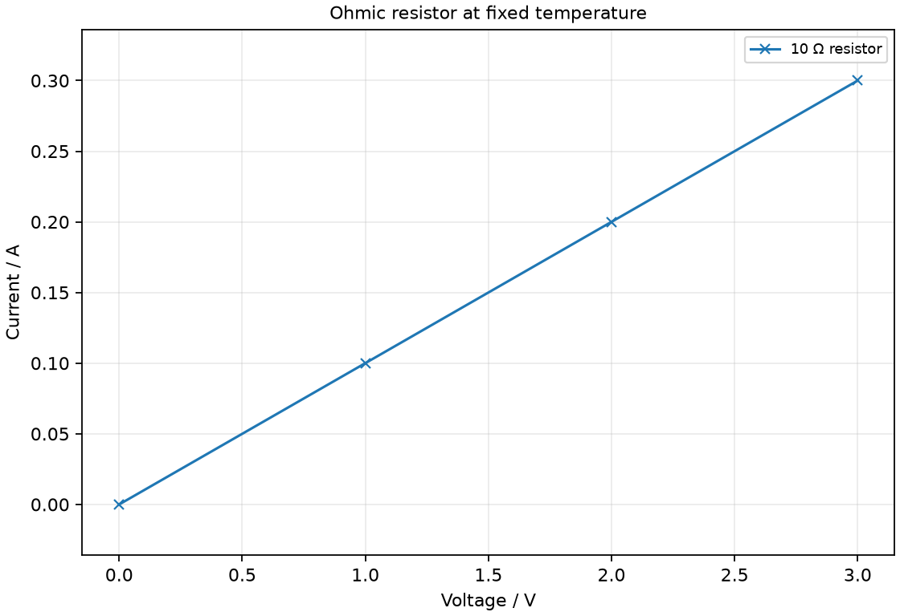

### Three characteristics: fixed T, heating and directional conduction

Three characteristics: fixed T, heating and directional conduction. Explain using current-voltage graphs how an ohmic resistor differs from a filament lamp and a diode.

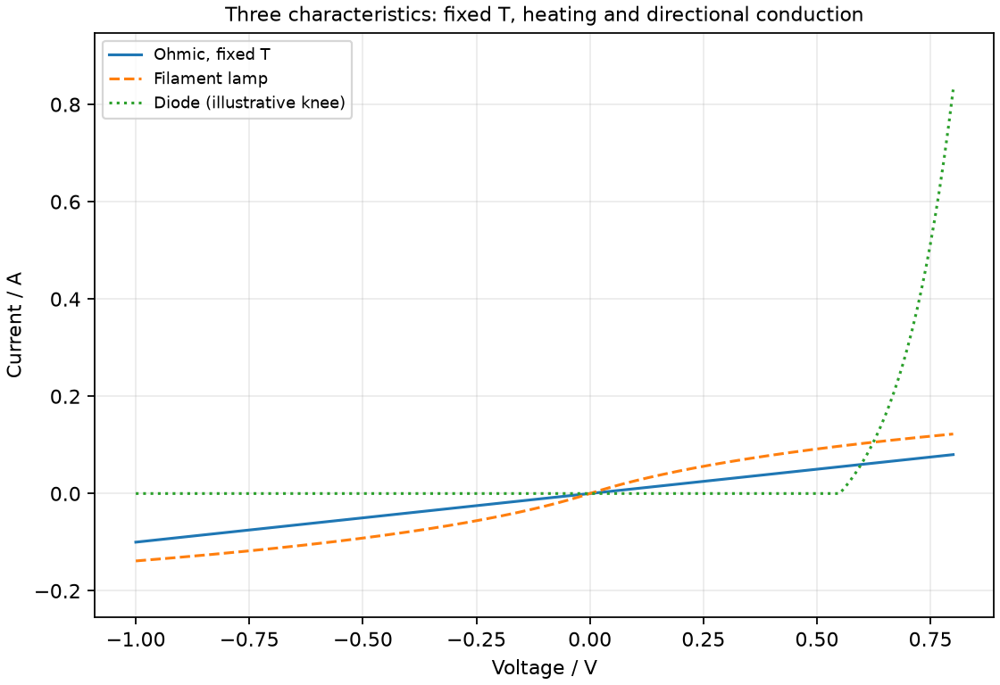

### Ohmic comparison: straight origin line

Ohmic comparison: straight origin line. Explain using a current-voltage graph how an ohmic characteristic differs from a non-ohmic one.

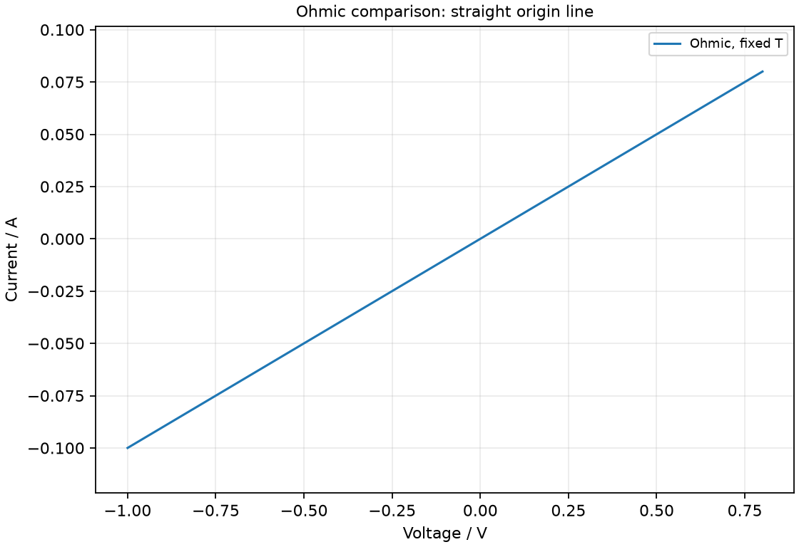

### Filament heating reduces I–V slope

Filament heating reduces I–V slope. Explain using a current-voltage graph why a filament lamp differs from a fixed-temperature ohmic resistor.

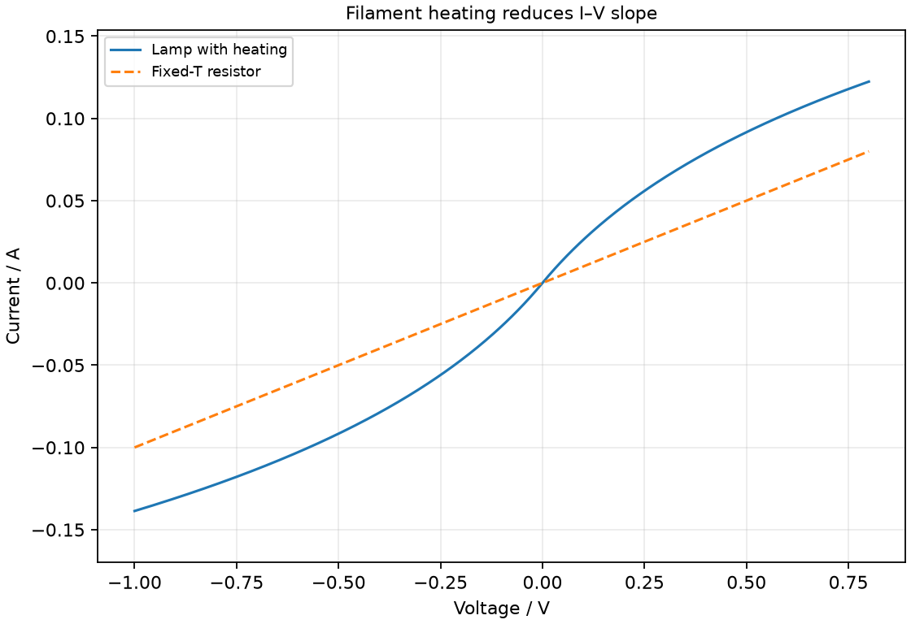

### Diode knee and reverse blocking (illustrative)

Diode knee and reverse blocking (illustrative). Explain using a current-voltage graph how a diode differs from a resistor.

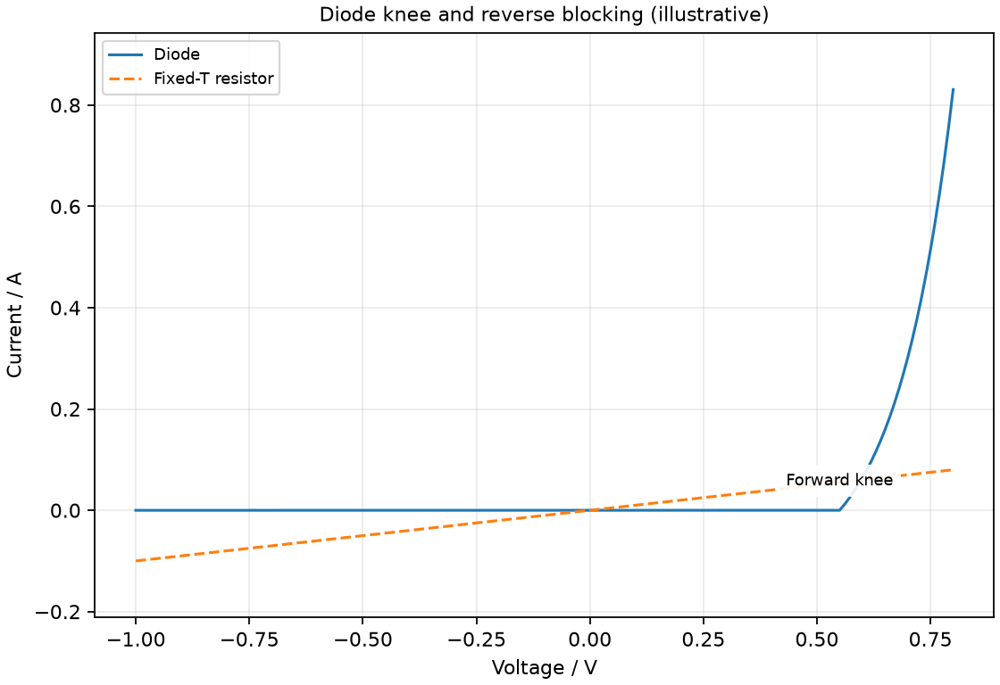

### Practice task with worked feedback

Investigation aim: measure a metal resistor’s resistance at approximately fixed temperature. These are invented, idealised practice readings; real readings have scatter. 

| Current / A | Potential difference / V |
|---:|---:|
| 0.05 | 0.6 |
| 0.1 | 1.2 |
| 0.15 | 1.8 |
| 0.2 | 2.4 |
| 0.25 | 3 |
| 0.3 | 3.6 |

(a) Draw Potential difference / V vertically against Current / A horizontally. Plot the supplied readings and add a separate fitted line. [5]
(b) Show two widely separated points on your fitted line and calculate its gradient. State the gradient unit. [3]
(c) Plan how to measure a metal resistor’s resistance at approximately fixed temperature. Name the equipment and arrangement, describe the measurements and repeats, state controls and a relevant precaution, design the results table and explain how the results answer the aim. [8]

Worked feedback

Graph: Potential difference / V is vertical and Current / A horizontal. Use the six readings, draw a separate best-fit line and show a wide gradient triangle; do not join scattered readings in a zigzag.

Gradient construction: choose the separated fitted-line points (0.05, 0.6) and (0.3, 3.6). Gradient = (3.6 − 0.6) / (0.3 − 0.05) = 12 V/A or Ω. With potential difference vertically against current, the slope is resistance, 12 Ω, at approximately fixed temperature.

Arrangement: A 12 Ω resistor rated at least 5 W, current-limited low-voltage DC supply, series ammeter, parallel voltmeter, rheostat and switch

Plan: 1. Connect the 5 W or higher-rated resistor, ammeter, rheostat and switch in series with a low-voltage supply. 2. Connect a high-resistance voltmeter across the test resistor. 3. Set 0.05 A, close the switch briefly and record paired current and voltage. 4. Repeat at 0.10–0.30 A in suitable steps, opening the switch between readings to limit temperature change. 5. Repeat each pair after cooling; use the same resistor and compare V-I slopes.
Control and accuracy: Keep the resistor temperature approximately fixed, use suitable meter ranges and never connect an ammeter directly across the supply.
Table: Current / A; Potential difference / V; repeat readings in separate columns. 
Graph and conclusion: With potential difference vertically against current, the slope is resistance, 12 Ω, at approximately fixed temperature. Compare repeated readings and report the tested range rather than claiming an exact law from scattered observations.

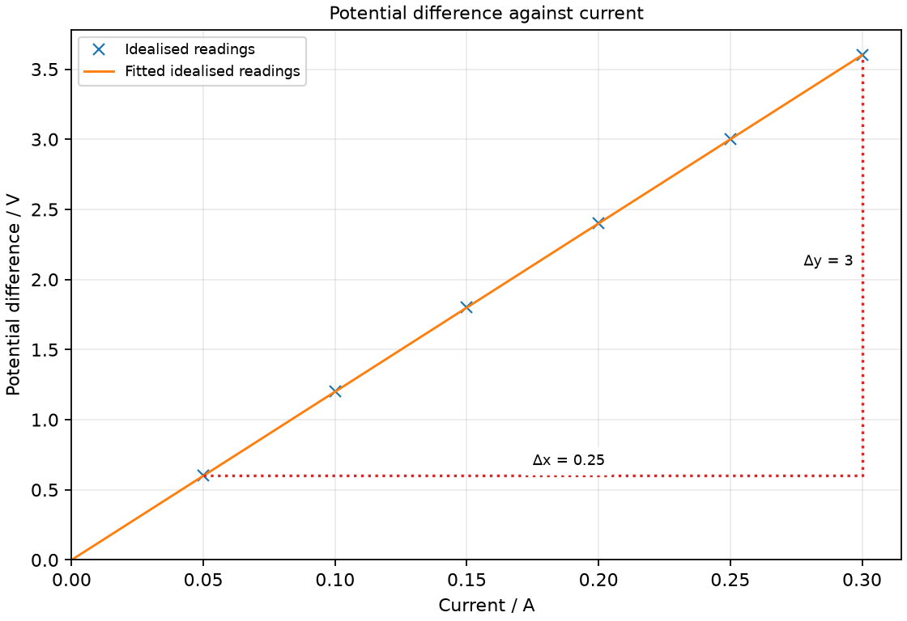

### Further practice: Define Ohm’s law with the physical condition that makes it applicable.

For an ohmic conductor at constant temperature, current changes in direct proportion to potential difference.

---

## Resistance and electric circuits — 5.3

### draw circuit diagrams with power sources (cell, battery or a.c. mains), switches (closed and open), resistors (fixed and variable), bulbs/lamps, ammeters, voltmeters, fuses, and relays

Circuit diagrams use standard symbols joined by lines representing conducting connections. A diagram shows electrical connections rather than the physical shape of wires.

A cell, switch and lamp can form a series loop, with an ammeter inserted in that loop and a voltmeter connected across the lamp. Crossing wires need a clear connection convention; show a dot when a junction is intended. The symbol constructions below cover the listed components. Actual mains wiring is not a classroom construction exercise.

### Draw cell and battery symbols

A cell symbol has one long and one short parallel line. A battery symbol repeats paired lines; the long line marks the positive terminal.

Connecting leads extend away from the two plates in the symbol. Draw the plates with unequal lengths so polarity is clear. A rectangle is a resistor symbol, not a substitute for a cell. For series-aiding batteries, connect the negative end of one cell to the positive end of the next.

### Draw an alternating supply and switching symbols

An AC source can be shown by a circle containing a wave mark. An open switch has a gap; a closed switch joins its contacts.

Draw a switch as two contacts and a movable arm. Its open position breaks the path, whereas the closed arm completes it. The AC symbol indicates alternating output rather than an ordinary positive-negative cell pair. Use labelled circuit models rather than connecting a classroom drawing to a mains supply.

### Draw fixed and variable resistors

A fixed resistor can be drawn as a rectangle with a lead at each end. A diagonal arrow across the resistor indicates a variable resistance.

The arrow is a control indicator, not a current arrow through a wire. In rheostat use, a selected portion of a resistance track is included in the circuit. Symbols must show where wires connect so the variable control is not mistaken for a disconnected annotation.

### Draw lamp symbols

A lamp symbol is a circle containing a cross. Its two leads connect into the circuit path.

Do not confuse the cross with an unconnected crossing of wires: it is inside the lamp’s circle and identifies the component. A lamp has a current-voltage behaviour that can differ from a fixed-temperature resistor because its filament heats.

### Draw ammeter and voltmeter symbols

An ammeter symbol is a circle containing A; a voltmeter is a circle containing V. Their connection positions differ even though their circle forms look similar.

Ammeter in series measures the branch current. Voltmeter in parallel measures a difference between two connection points. Label the letters clearly and connect both leads. The symbol alone does not show that the ammeter has low resistance or the voltmeter high resistance, but the circuit interpretation uses those ideal properties.

### Draw fuse and relay symbols

A fuse symbol identifies a sacrificial overcurrent link in its circuit path. A relay symbol shows a coil controlling a mechanically linked switch in a separate path.

Draw the fuse as a small rectangle with its link line through it in the chosen school convention. For a relay, keep the coil circuit electrically distinct from the contacts and use a dashed mechanical link. Energising the coil changes the switch position; it does not imply a direct electrical junction between the two circuits.

### state that the current at every point in a series circuit is the same and use this in calculations

A steady series circuit has the same current through each component. Charge is conserved rather than used up in successive components.

If two lamps in one unbranched loop carry 0.30 A, both have that current, although their energy transfers may differ. A resistor can reduce the whole circuit current, not remove some current permanently between its two ends. This statement assumes the steady circuit rather than a transient charge build-up.

### state that the current from the source is the sum of the currents in the separate branches of a parallel circuit

At a steady junction, total entering current equals total leaving current. For two parallel load branches, source current is I1 + I2.

Draw arrows before writing the sum. If 0.20 A and 0.35 A flow outward through two branches, the incoming source supplies 0.55 A. Branch current is not necessarily equal unless branch properties make it so. Recombining the branches restores the same total return current in the simple loop.

### state that sum of the potential difference (p.d.) across the components in a series circuit is equal to the potential difference (p.d) across the power supply and use this in calculations

Series potential differences add to the supply potential difference around the simple load loop. This expresses energy-per-charge accounting.

With a 9 V ideal supply and two series loads having drops of 4 V and 5 V, the total transfer per coulomb equals the source’s 9 J/C contribution. Equal current does not require equal voltage drops. Ideal connecting wires have negligible drops in this model.

### state that, for a parallel circuit, the potential difference (p.d) is the same across each branch

Parallel branches connected to the same two connection points share the same potential difference. Their currents can differ because their component properties differ.

A 6 V ideal supply directly across two resistor branches provides 6 V to each. It is not divided into 3 V per branch. Trace both endpoints: branches share voltage when they genuinely span the same two connection points, not merely because they look side by side on paper.

### state that the combined resistance of two or more resistors in parallel is less than that of each resistor by itself

For positive resistances in parallel, total resistance is smaller than each individual branch resistance. Additional paths increase total current at the same applied voltage.

Two 8 Ω resistors in parallel give 4 Ω. The supply drives twice the current compared with one alone. This is a different rule from series addition; the connections determines which calculation is valid. A short-circuit idealisation is a special limiting case, not an ordinary positive-resistance branch.

### Use series resistance RT = R1 + R2 + … and parallel resistance 1/RT = 1/R1 + 1/R2 + …

Series resistances add directly, while reciprocal resistances are added. The parallel rule is 1/RT = 1/R1 + 1/R2 + … for positive-resistance branches.

Identify whether components share the same current path or the same two endpoints. In mixed circuits, simplify a genuine series or parallel subnetwork before combining the next stage. Do not apply a rule based solely on how close two symbols appear on a diagram.

### Combine series resistances

Resistances in one series path add. RT = R1 + R2 for two ideal resistors.

The same current passes through both and their voltage drops add: V = IR1 + IR2 = I(R1 + R2). This explains the rule rather than treating it as a disconnected memory fact. Adding another positive series resistance reduces current from an unchanged ideal voltage source.

### Combine parallel resistances

Parallel resistances combine through the reciprocal rule. For two resistors, RT = R1R2/(R1 + R2).

For 6 Ω and 3 Ω, 1/RT = 1/6 + 1/3 = 0.5, so RT = 2 Ω. Invert the final reciprocal sum; 0.5 is the reciprocal sum, which must be inverted to obtain resistance. The total smaller than the smallest branch is a useful magnitude check.

### discuss the advantage of making a battery from several identical sources of e.m.f. arranged in parallel

Matched ideal cells connected parallel-aiding have the same voltage as one cell. They can share the load current and provide greater charge capacity in the simple model.

This differs from series-aiding connection, which adds source voltages. Real cells must be appropriately matched and designed for parallel use; mismatched voltages can drive unwanted currents between them. The lesson uses ideal identical sources rather than instructing learners to combine arbitrary batteries.

### explain that increasing the number of cells in series in a circuit increases the current flowing around the circuit and increases the potential difference across components in the circuit

Adding series-aiding identical cells increases ideal source voltage. For a fixed ohmic external resistance and negligible internal effects, greater voltage gives greater current.

Two ideal 1.5 V cells provide 3 V, compared with 1.5 V for one. At fixed R, I = V/R doubles. A lamp may heat and change resistance, so its actual current need not double exactly. Extra cells also must not exceed component ratings.

### state the use of variable resistors (rheostat), fuses and relays

A variable resistor controls current, a fuse interrupts excessive current and a relay provides electrically operated switching. Their circuit functions differ even when each appears as a two-terminal part in a simplified path.

Use a rheostat to vary resistance, a correctly rated fuse for the intended overcurrent protection and a relay when one circuit needs to operate a separate contact path. A fuse is not a reusable variable resistor. A relay’s coil and contacts perform different roles and may have different ratings.

### Explain variable-resistor use

A rheostat varies the resistance included in a circuit. With other conditions fixed, a greater series resistance reduces current.

Choose a suitable current rating and start with a limiting setting. In a classroom circuit it allows several V-I readings without replacing the test conductor.

### Explain fuse use

A fuse is intended to melt and break its path if excessive current persists. Its rating must match the protected circuit and expected normal operation.

The protection depends on heating of the link and its time-current response. Replacing it with a wire defeats the designed protection.

### Explain relay use

A relay uses an electromagnet to operate switch contacts. A control circuit can operate a separate load circuit.

Coil current produces magnetic attraction that moves an armature and changes the contact state. Removing current lets a spring restore the normal state in a basic relay.

### Distinguishing the ideas

Parallel resistors do not combine by direct series addition. Their shared voltage and added branch currents require the reciprocal rule.

Two 6 Ω branches across 6 V each carry 1 A, so total current is 2 A and total resistance is 3 Ω. Directly adding them would give 12 Ω and contradict the two-path current. The smaller-than-each-branch check helps reveal the connections confusion.

### Cell and two-cell battery

Cell and two-cell battery. Draw a cell symbol and a battery of two cells, indicating positive terminals.

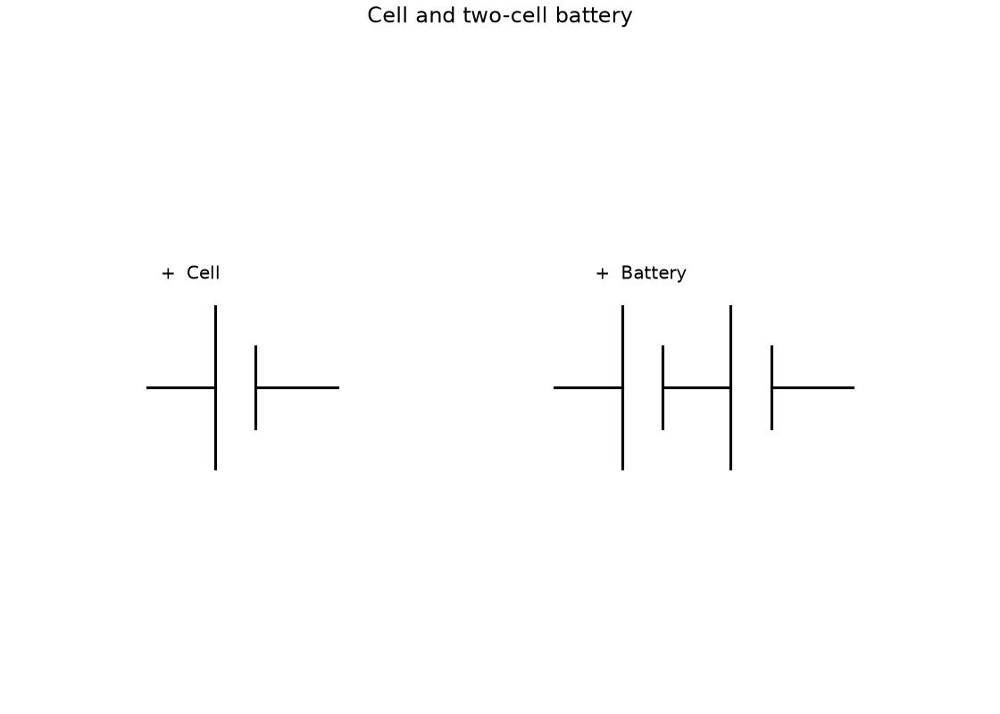

### Syllabus AC mark and open/closed switches

Syllabus AC mark and open/closed switches. Draw symbols for an AC source, an open switch and a closed switch.

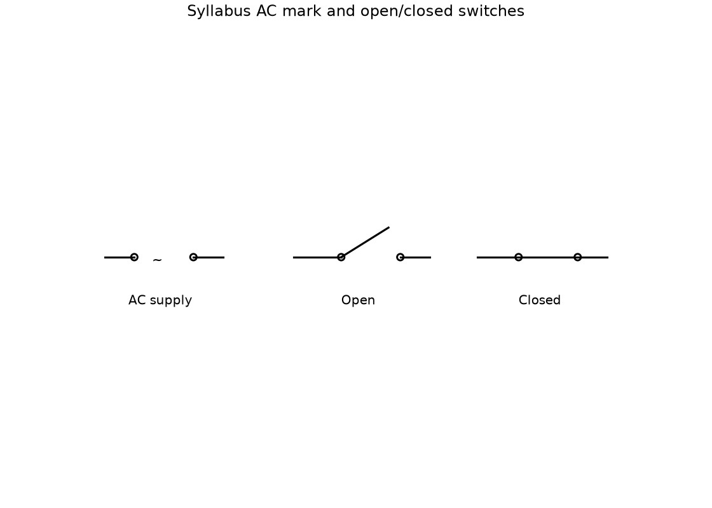

### Resistor symbols

Resistor symbols. Draw fixed and variable resistor symbols.

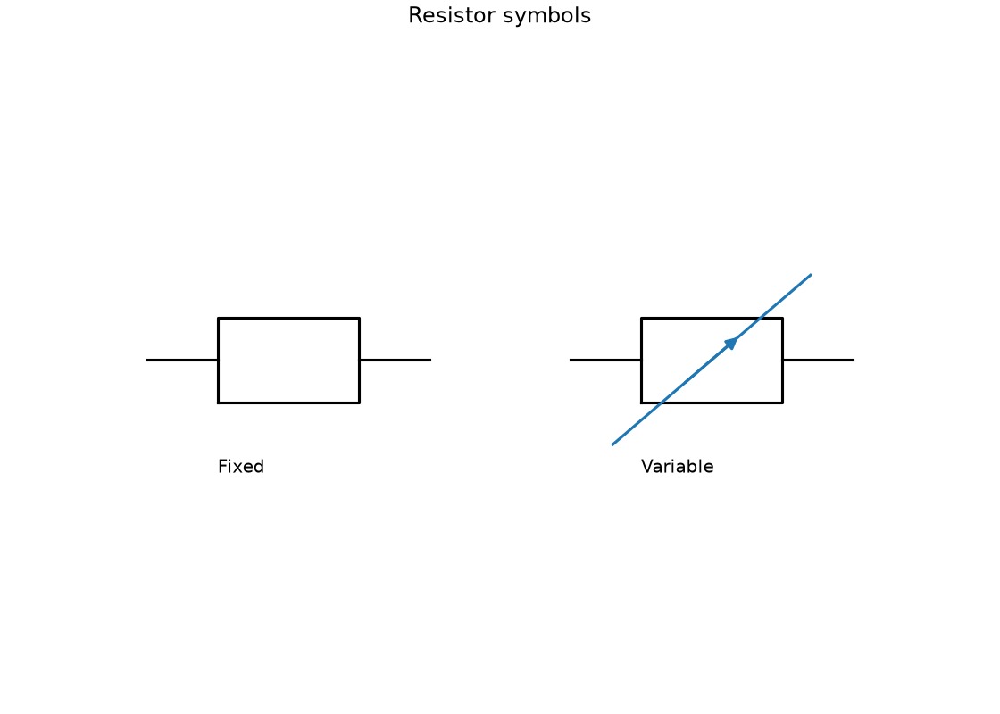

### Lamp

Lamp. Draw a lamp symbol with two connecting leads.

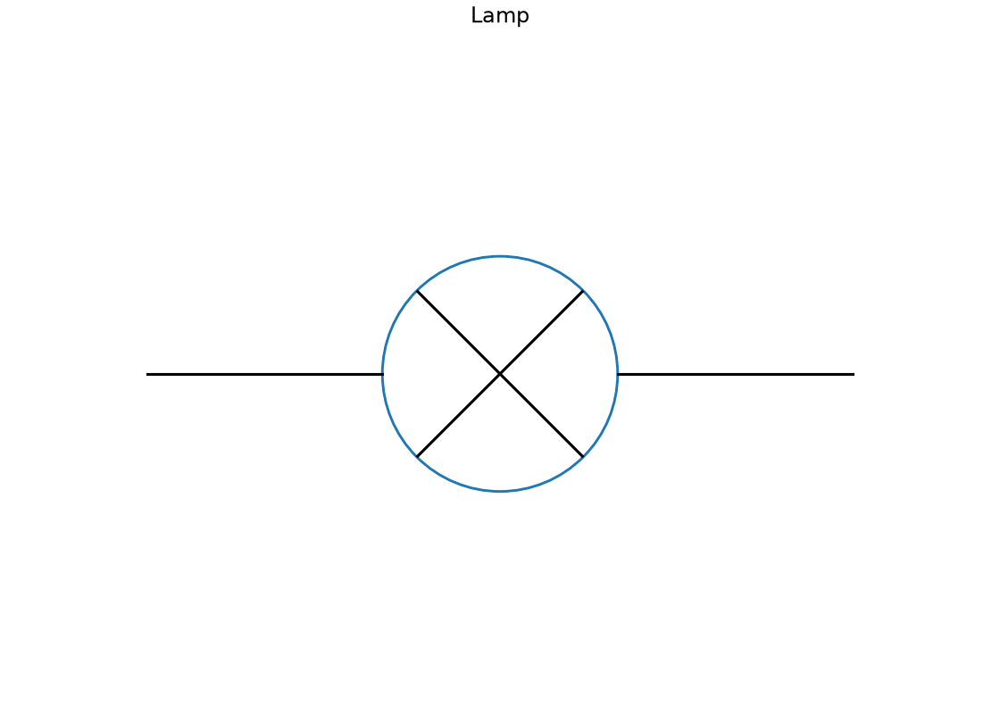

### Measuring instruments

Measuring instruments. Draw ammeter and voltmeter symbols with their identifying letters.

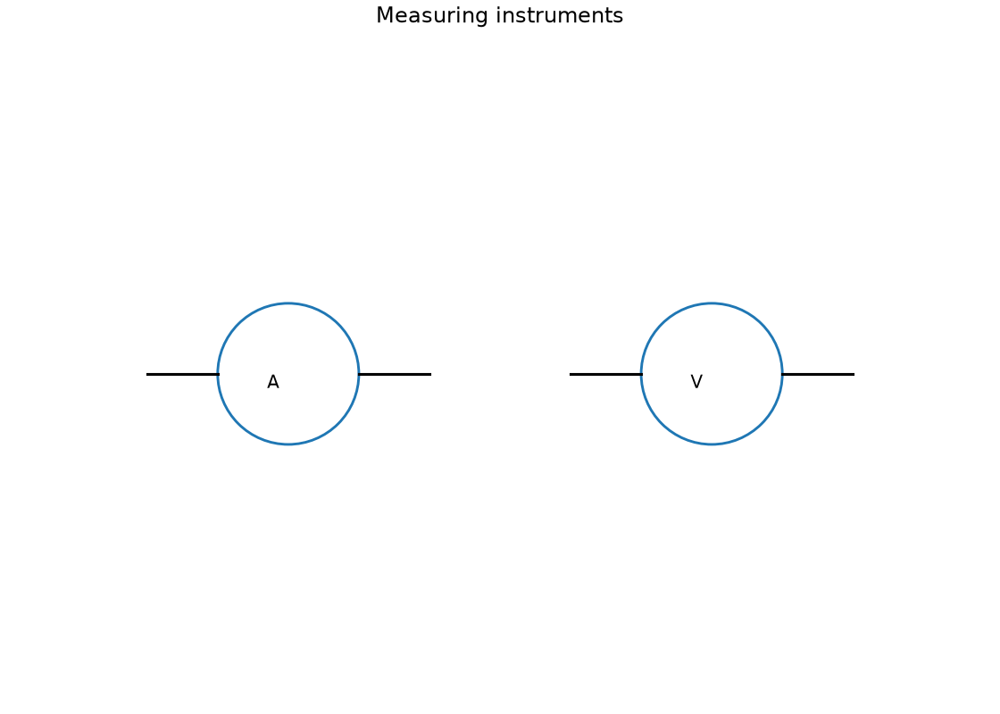

### Fuse and relay: rectangular coil, vertical leads, separate switch

Fuse and relay: rectangular coil, vertical leads, separate switch. Draw a fuse symbol and a relay showing its coil and separate switch contacts.

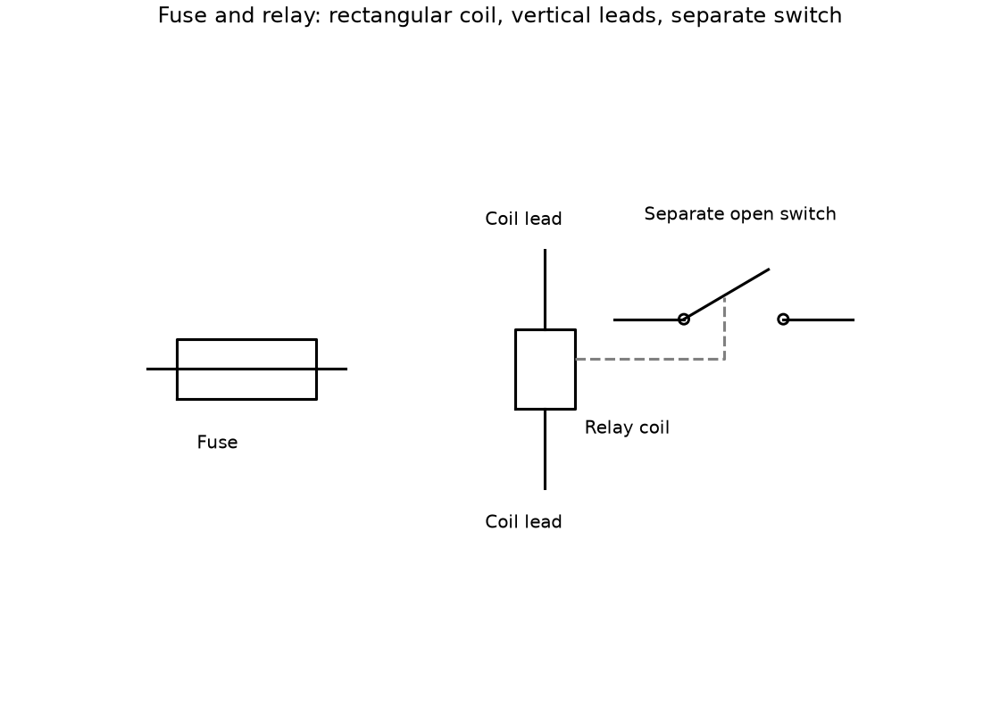

### Series ammeter, parallel voltmeter: topology model

Series ammeter, parallel voltmeter: topology model. Explain using a circuit diagram why an ammeter is in series and a voltmeter in parallel with a resistor load.

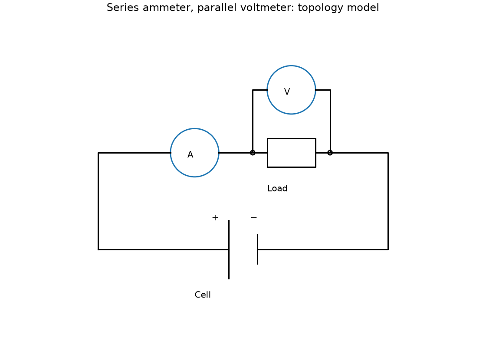

---

## Resistance and electric circuits — ANNEX.D

### Recognise a diode symbol and its observed one-direction rectification context; no semiconductor-junction theory

A diode symbol has a directed triangular element facing a bar representing the cathode side in the chosen school convention. In its observed rectification role it conducts much more readily forward than reverse in the intended range.

Conventional forward current goes from the anode side toward the cathode bar. Recognise the symbol and one-direction use; no semiconductor-junction theory is required. This limited annex supports the observed characteristic taught above.
