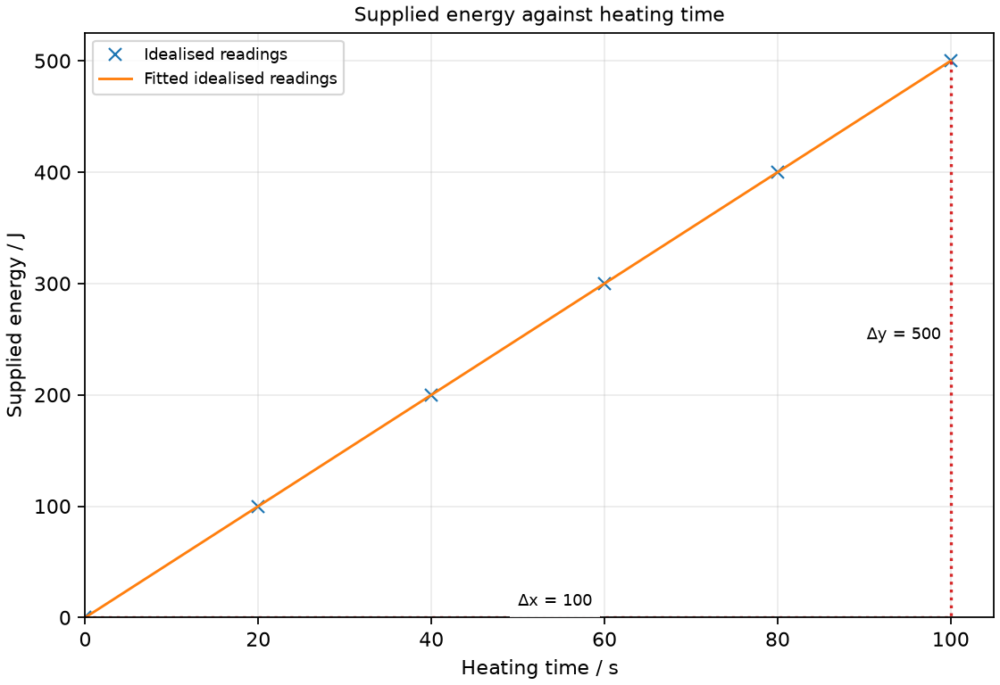

# 24 Electrical energy and safety

*nam-6118-nssco-2026. Offline study notes, rendered from the approved content units on 2026-10-31. Everything here is also what the flashcards are built from.*

---

## Electrical energy and safety — 5.4

### define electric power as the rate at which electrical energy is transferred to other sources of energy by an electric circuit, and is measured in watt [W]

Electrical power is the rate of electrical energy transfer. It is measured in watts, with 1 W = 1 J/s.

An appliance’s power describes transfer rate rather than energy used over its whole operating period. A 20 W lamp transfers 20 J each second at its rated operating condition. Total energy also depends on duration. Energy transferred to light, motion or heating must still be accounted for as energy rather than new energy creation.

### recall and use the equations power = voltage × current [P=VI], and energy = voltage × current × time [E=VIt] and energy = power x time [E=Pt]

For steady DC quantities, P = VI and E = Pt = VIt. The relations connect energy per charge with charge flow per time.

Multiplying V in J/C by I in C/s gives J/s, or watts. Multiplying by seconds gives energy in joules. Use the stated school DC model; an AC appliance rating cannot generally be analysed by multiplying arbitrary instantaneous or peak values without considering the appropriate quantities. Here rated power supplies the mains energy calculation directly.

### Use electrical power P = VI

Steady electrical power is P = VI. Use volts and amperes for watts.

A low-voltage motor at 6 V carrying 0.50 A has electrical input power 3 W. Its useful mechanical output can be smaller because other energy transfers occur. Identify input or output when discussing efficiency.

### Use electrical energy E = VIt

For constant V and I over time t, E = VIt. Use seconds for joules when voltage and current are in SI units.

A 6 V heater carrying 2 A for 30 s receives 360 J. If the readings vary appreciably, one simple product of the starting values does not represent the whole interval accurately. A joulemeter or correctly averaged measurement is then preferable.

### Use electrical energy E = Pt

At constant power, energy is E = Pt. Watts times seconds gives joules; kilowatts times hours gives kilowatt-hours.

A 0.80 kW appliance running for 2 h uses 1.6 kWh. A kilowatt-hour is energy, not power or power per hour. One kWh equals 3.6 × 10⁶ J because it represents 1000 J/s for 3600 s. Keep the chosen unit path consistent.

### interpret the power rating of bulb/lamps and other electrical appliances and the energy consumption in kilowatt hours

A rated power describes an appliance’s energy-transfer rate at its stated operating conditions. A kilowatt-hour is the energy transferred by 1 kW operating for 1 h.

A 60 W lamp does not use 60 J in total regardless of duration. It transfers about 60 J each second at its rating. Actual energy use can vary with duty cycle, control setting and operating condition, so a refrigerator’s compressor rating is not proof that it runs continuously for a whole day.

### calculate the cost of using electrical appliances where the unit is the kWh

Energy cost is energy used in kWh multiplied by the stated price per kWh. A tariff used in a practice problem is an invented given, not a current electricity price.

At an invented N$2.40 per kWh, 1.5 kWh costs N$3.60 before any other charges. Convert watts to kilowatts and minutes to hours before forming kWh. A bill can include fixed charges, but include those only when the problem specifies them.

### Practice task with worked feedback

Choose one correct option for each original practice question.

1. What is power?
A. Energy per charge
B. Energy transfer per time
C. Charge per time
D. Total energy regardless of time

2. What does kWh measure?
A. Power per hour
B. Current
C. Resistance
D. Energy

3. Why use parallel lamps for independent lighting?
A. Each must receive half the voltage
B. Current is consumed before the second lamp
C. Each branch can be switched separately
D. One broken branch must stop every other

4. Where is the single-pole switch placed in the model?
A. Neutral conductor only
B. Both ends of a short bypass around the lamp
C. Live conductor
D. Protective earth conductor

5. Which marking commonly identifies double insulation?
A. One square alone
B. Earth terminal symbol
C. Class I earthed-case mark
D. A square within a square

6. In the IEC-colour classroom plug model, which colour identifies protective earth?
A. Brown
B. Green/yellow
C. Blue
D. Black

7. Why can damp conditions worsen shock risk?
A. They can lower path resistance
B. Dampness increases body resistance
C. Dampness makes a fuse trip before a shock
D. Dampness reduces all source voltages to zero

8. What power is 10 V at 0.3 A?
A. 10.3 W
B. 33.3 W
C. 0.03 W
D. 3 W

9. What energy is 0.8 kW for 2 h?
A. 1.6 kWh
B. 0.0008 kWh
C. 0.4 kWh
D. 2.8 kWh

10. At an invented N$3 per kWh, what does 2 kWh cost in energy charges?
A. N$6
B. N$5
C. N$1.50
D. N$2

11. A 6 V, 1 A heater runs for 10 s. What energy is transferred?
A. 0.6 J
B. 600 J
C. 60 J
D. 6 J

12. A 440 W training appliance operates at 220 V. For this steady-load exercise choose the smallest listed fuse rating above its normal current: 1 A, 3 A, 10 A or 13 A.
A. 13 A
B. 3 A
C. 1 A
D. 10 A

Worked feedback

1. Key B. A: That is voltage. B: It is measured in watts. C: That is current. D: Duration matters for power.

2. Key D. A: That is not its meaning. B: Current uses amperes. C: Resistance uses ohms. D: It is power multiplied by time.

3. Key C. A: The branches span the same two nodes and therefore have equal voltage. B: Charge is conserved. C: An open branch need not break the others. D: That is a series-path problem.

4. Key C. A: Load may remain connected to live. B: This bypasses the load instead of isolating live. C: It disconnects the load from live. D: Must not interrupt the protective path.

5. Key D. A: The recognised mark uses nested squares. B: Identifies protective earth, not double insulation. C: Double-insulated equipment uses different protection. D: It denotes the protective design.

6. Key B. A: Live in that convention. B: This identifies the protective conductor. C: Neutral in the specified colour convention. D: Not green/yellow protective-earth identification.

7. Key A. A: At the same voltage this can allow more current. B: It can lower path resistance. C: Fuse does not guarantee shock prevention. D: Supply may remain hazardous.

8. Key D. A: This adds unlike quantities. B: This divides V by I. C: This divides I by V. D: Use VI.

9. Key A. A: Multiply power by time. B: This mishandles both the time multiplication and the kW-to-kWh use; 0.8×2 is required. C: This divides by time. D: This adds unlike quantities.

10. Key A. A: Multiply energy by the given tariff. B: This adds values with unlike units. C: This divides tariff by energy. D: This ignores tariff.

11. Key C. A: This divides by duration. B: This adds an extra factor of ten. C: Use VIt. D: This omits duration.

12. Key B. A: It is not the smallest suitable given option. B: Normal current is 440/220 = 2 A; 3 A is the smallest listed rating above 2 A. C: It is below normal current. D: A smaller suitable option is given.

### Practice task with worked feedback

Original structured practice. Answer the parts with working and units where needed.

(a) State the unit of power. [1]

(b) State whether kWh measures energy or power. [1]

(c) Explain why a neutral-only switch is not equivalent to the live-side switch in the model. [2]

(d) Calculate energy used by a 1.5 kW heater for 2 h. [2]

(e) Calculate energy-only cost for 3 kWh at an invented N$2.20 per kWh. [2]

Worked feedback

(a) Watt.

(b) Energy.

(c) It can stop current but leave the appliance connected to live. The live-side switch separates the load from that live connection.

(d) E = Pt = 3 kWh.

(e) Cost = 3 × 2.20 = N$6.60.

### Practice task with worked feedback

Investigation aim: measure the electrical energy supplied to a low-voltage heater over time. These are invented, idealised practice readings; real readings have scatter. 

| Heating time / s | Supplied energy / J |
|---:|---:|
| 0 | 0 |
| 20 | 100 |
| 40 | 200 |
| 60 | 300 |
| 80 | 400 |
| 100 | 500 |

(a) Draw Supplied energy / J vertically against Heating time / s horizontally. Plot the supplied readings and add a separate fitted line. [5]
(b) Show two widely separated points on your fitted line and calculate its gradient. State the gradient unit. [3]
(c) Plan how to measure the electrical energy supplied to a low-voltage heater over time. Name the equipment and arrangement, describe the measurements and repeats, state controls and a relevant precaution, design the results table and explain how the results answer the aim. [8]

Worked feedback

Graph: Supplied energy / J is vertical and Heating time / s horizontal. Use the six readings, draw a separate best-fit line and show a wide gradient triangle; do not join scattered readings in a zigzag.

Gradient construction: choose the separated fitted-line points (0, 0) and (100, 500). Gradient = (500 − 0) / (100 − 0) = 5 J/s or W. The energy-time slope is electrical input power, 5 W. For comparison, a steady 5 V and 1 A input would give VI = 5 W.

Arrangement: A heater rated for 5 V and 1 A, suitable current-limited supply, voltmeter, ammeter, stopwatch and optional joulemeter

Plan: 1. Place the rated heater in its intended load before connecting the low-voltage circuit. 2. Connect ammeter in series and voltmeter across the heater; verify steady 5 V and 1 A in the example model. 3. Start the stopwatch and record energy using a joulemeter or calculate VIt at each recorded time. 4. Record energy at 20 s intervals over 100 s and monitor V and I for stability. 5. Repeat with the same heater and supply settings, subtracting the initial meter reading if present.
Control and accuracy: Keep supply and heater conditions stable, avoid exposed hot elements, keep electrical connections dry and use no mains construction.
Table: Heating time / s; Supplied energy / J; repeat readings in separate columns. 
Graph and conclusion: The energy-time slope is electrical input power, 5 W. For comparison, a steady 5 V and 1 A input would give VI = 5 W. Compare repeated readings and report the tested range rather than claiming an exact law from scattered observations.

---

## Electrical energy and safety — 5.5

### Mains and battery supply models

The syllabus compares mains as a 220 V AC model with low-voltage DC from classroom batteries. The 220 V value here is the syllabus’s given model, not a new specification of local supply conditions.

AC reverses direction while battery DC has one direction. Mains can deliver dangerous current and is not used for the classroom experiments in these notes. The low-voltage investigations use suitable current-limited supplies; a battery can still overheat or damage equipment if short-circuited.

### describe the uses of electricity in heating, lighting (including bulb/lamps in parallel), motors, bell and relay

Electrical devices transfer energy into heating, lighting or motion and can use magnetic switching. The desired service determines which output is useful.

A heater primarily raises internal energy, a lamp supplies useful light, and a motor supplies mechanical work. An electric bell uses repeated magnetic attraction and release, while a relay changes a contact state. Device diagrams should distinguish the energy path from the control path.

### Describe electrical heating

A resistive heater transfers electrical energy to internal energy. Its useful role is heating the intended material or surroundings.

A heating element is chosen to tolerate its operating temperature and power. Heat must be transferred to the intended load without overheating the element or nearby material. A classroom demonstration uses a rated low-voltage heater rather than exposed mains conductors.

### Describe parallel domestic lighting

Parallel lighting puts each lamp branch across the same supply potential difference. Each branch can have its own switch and one open branch need not interrupt the others.

In a series chain, a break stops the shared path and lamps share voltage according to their properties. Parallel connection avoids that dependence for ordinary separately controlled lighting. Trace the connection points to recognise branches rather than relying on the physical spacing of lamps.

### Describe motor use

An electric motor converts electrical input into mechanical output. Magnetic forces on current-carrying conductors provide its turning effect.

Useful applications include fans and pumps. Heating in wires, friction and sound can reduce the useful fraction of input energy. A fan’s moving air is a useful mechanical output, not a direct creation of coldness.

### Describe electric bell and relay use

A basic electric bell uses an electromagnet and a make-break contact to sustain repeated impacts. A relay uses an electromagnet to operate separate switch contacts.

In a bell, attraction moves an armature and hammer, breaks the coil circuit, and lets a spring return the armature and reconnect it. A relay need not oscillate: its contacts can remain operated while coil current is present. Distinguish a repeated bell action from the general switching purpose.

### state the dangers of electricity caused by damaged insulation, overheating of electric cables, overloading of sockets (multiple plugs on one socket) and damp conditions

Damaged insulation, excessive current and damp conditions create different electrical hazards. Protection must address contact, overheating and fault paths rather than relying on one device for every risk.

Exposed live metal can provide a path through a person. An overloaded cable can heat beyond its intended limit, damaging insulation or causing fire. Moisture can lower the resistance of unintended paths. Use these mechanisms to explain hazards in diagrams; learners do not need to create an unsafe circuit to demonstrate them.

### Recognise damaged-insulation hazards

Damaged insulation can expose a live conductor. Contact can allow current through an unintended path including a person.

Recognise exposed wire, cracked casing and frayed cable as reasons to remove equipment from use and obtain appropriate repair. A normal operating appliance can still be unsafe if its insulation is damaged.

### Recognise cable overheating and socket overload

Excessive current can overheat cables, connections or sockets. Several loads on one supply path add their current demands.

A socket count alone is not the physical cause: total load and the ratings of the common path matter. A loose connection can also heat locally. A protective rating should not be increased to hide repeated tripping.

### Recognise damp-condition hazards

Damp conditions can increase electrical-shock risk. Moisture can lower resistance along unintended paths.

The same voltage can drive a larger current through a lower-resistance path. Keep the physics explanation tied to altered conduction rather than saying water simply attracts electricity.

### discuss the importance of safety devices, including earthing, circuit breakers, placing switches in the live wire, circuit breaker settings, double insulation, fuses and fuse ratings

Earthing, insulation and overcurrent interruption serve complementary protective roles. Correct placement and rating are necessary for a protective device to act as intended.

An earth connection provides a low-resistance fault path from suitable exposed metal. A fuse or overcurrent breaker can interrupt excessive current; a residual-current protective device responds to imbalance and is a different device. Double insulation instead prevents accessible conductive parts becoming live without relying on a protective earth in that design. The syllabus discussion is a circuit model, not a complete installation standard.

### Explain earthing

Protective earthing connects suitable exposed metal to a low-resistance protective path. A live-to-case fault can then produce a fault current that operates suitable protection.

The earth conductor is not intended to carry the normal load current. It helps keep accessible metal near earth potential and supports automatic disconnection in the model. It does not replace intact insulation or prove a damaged appliance is safe to touch.

### Explain circuit-breaker operation and settings

An overcurrent circuit breaker opens a circuit when its designed current-time limit is exceeded. Its setting must protect the relevant cable and equipment while allowing intended operation.

Unlike a melted fuse link, many breakers can be reset after the fault is dealt with. A higher setting is not automatically better because it may permit dangerous heating. Do not treat every breaker as a residual-current detector; the response depends on the device type.

### Explain switches in the live wire

A single-pole switch is placed in the live conductor in the syllabus safety model. Opening it then separates the appliance’s internal load from the live supply side.

A switch only in neutral could stop normal current yet leave internal parts connected to live. Therefore no current and safe isolation are different conditions. Real work requires proper isolation and verification by a competent person, not merely seeing an appliance stop.

### Explain double insulation

Double insulation provides two effective insulating barriers or an equivalent protective design. It does not rely on an exposed-metal protective-earth path in the intended appliance design.

The commonly used identification is a square within a square. A plastic outer case alone does not prove a device meets the double-insulation design. Compare its protective method with an earthed metal case rather than claiming one visible feature removes every risk.

### Explain fuse operation and rating

A fuse melts to interrupt an excessive-current path according to its rated behaviour. Choose a specified suitable rating above normal operating current while protecting the cable and equipment.

A school selection question may give available fuse ratings and normal current, then ask for the smallest suitable rating. Real selection must also account for start-up current and device characteristics. A fuse limits overcurrent consequences; it does not make direct live contact safe or protect against every shock current.

### describe how to wire a mains plug safely, state the meaning of the terms live, neutral and earth and be able to identify the wires by colour code

In the learning model, live supplies energy, neutral forms the normal return and protective earth serves fault protection. Wire identity must be checked against labelled terminals and the specified colour convention.

For the convention used here, live is brown, neutral blue and earth green/yellow. Older or nonstandard wiring may differ, so colour alone cannot establish real-world safety. Plug diagrams are studied with an unplugged training model; work on actual mains equipment requires competent supervision and verified isolation. A cord grip holds the outer sheath rather than bare inner conductors.

### Wire a mains plug safely

A safe training-plug assembly uses correct labelled terminals, secure insulation and an effective cord grip. The outer cable sheath is held by the grip, with no exposed stray strands.

With the model disconnected from any supply, match each conductor to its labelled terminal using the stated convention, secure the connections, check no bare wire lies outside terminals, clamp the outer sheath and replace the cover. Any fuse must be the specified suitable type and rating. This is an inspection sequence for a supervised training model. The correct specified fuse goes in the live-side path in the fused training-plug model. The outer sheath is secured by the cable grip; no bare strand is left exposed outside a terminal.

### Identify live, neutral and earth by function and colour

The colour convention used here is brown live, blue neutral and green/yellow protective earth. The three functions remain distinct even when a load is switched off.

Live is the conductor disconnected by the model’s single-pole switch; neutral carries the normal return current; earth is protective. These descriptions refer to the stated model and do not certify a real cable by appearance. Label the function as well as the colour in a revision diagram.

### discuss how electrical energy in the home can be conserved

Reducing unnecessary operating time and using efficient devices can reduce electrical energy use for the same intended service. Energy savings follow E = Pt and the useful-output efficiency.

Switch off an unused light, use suitable efficient lighting, and limit unnecessary heating or cooling. Compare devices providing the same service rather than assuming a lower power always meets the same need. A lower-power heater taking much longer may not save the energy expected from power alone.

### Further practice: A training appliance is rated 440 W at the syllabus-model 220 V. Calculate its normal current and choose the smallest suitable fuse from 1 A, 3 A and 13 A for this simple steady-load exercise.

I = P/V = 2 A; the suitable given fuse is 3 A.
