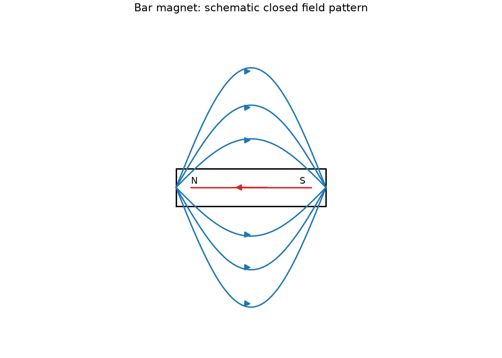
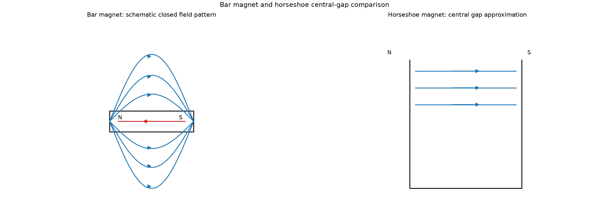
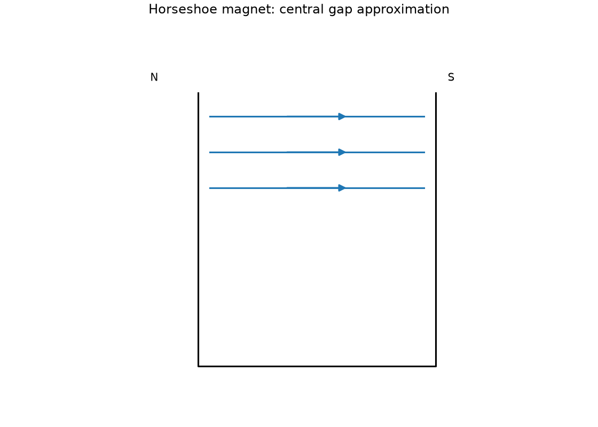
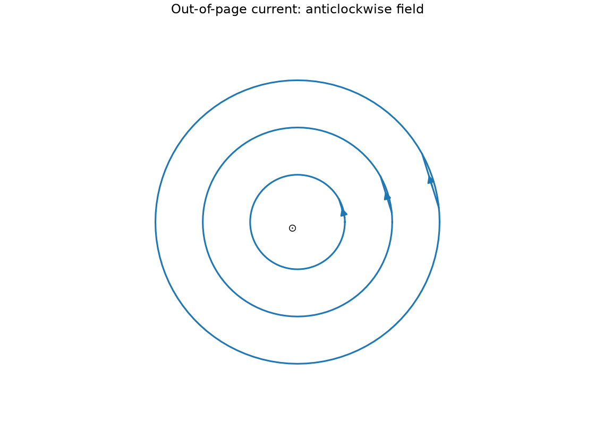
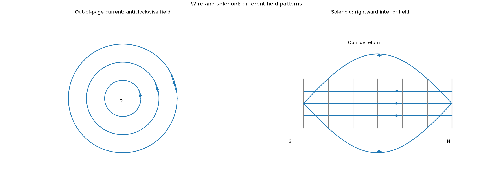
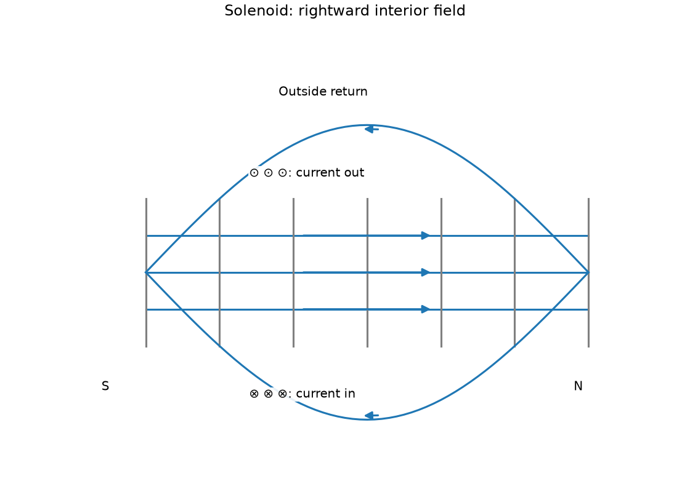
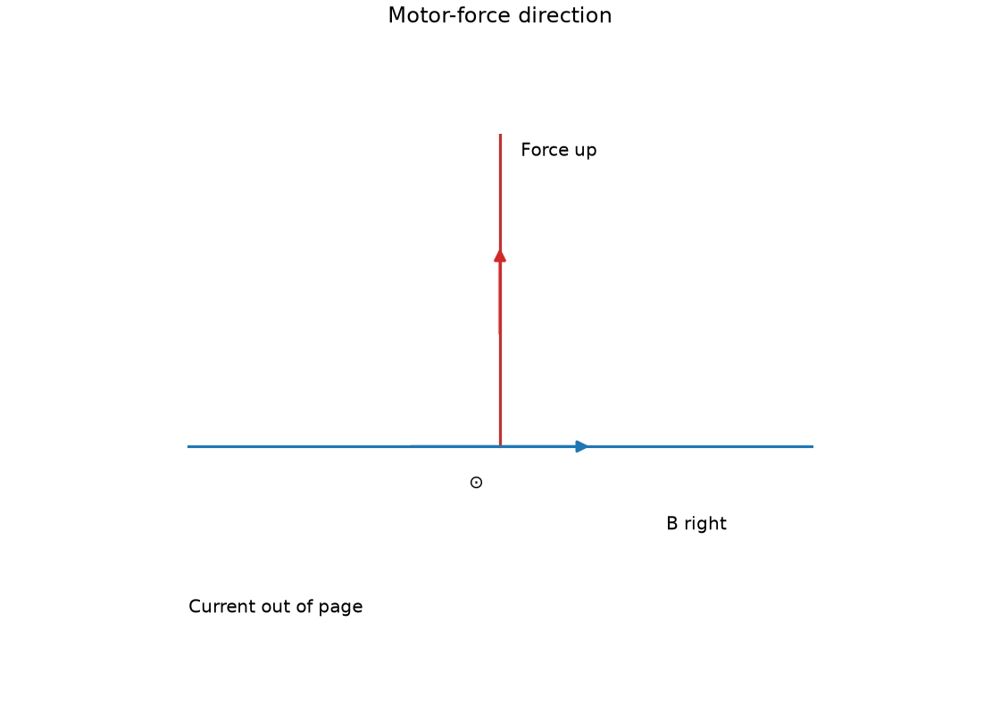
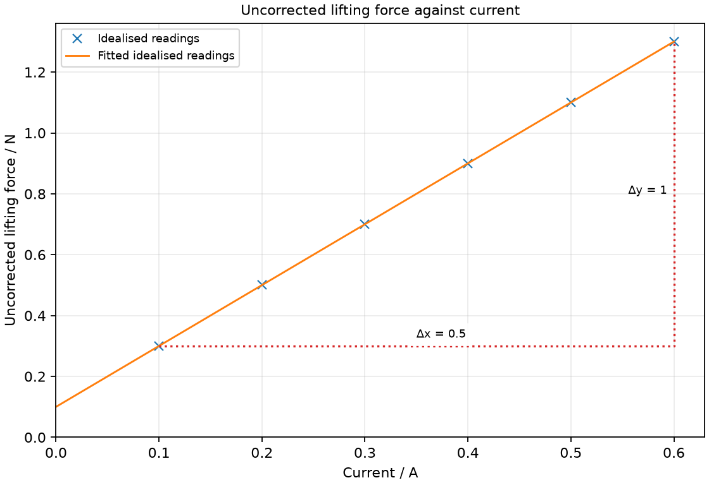

# 25 Magnets, electromagnets and motors

*nam-6118-nssco-2026. Offline study notes, rendered from the approved content units on 2026-10-31. Everything here is also what the flashcards are built from.*

---

## Magnets, electromagnets and motors — 5.6

### state the properties of magnets

Magnets have north and south poles; like poles repel and unlike poles attract. They can attract suitable ferromagnetic material without that material initially being a permanent magnet.

Magnetic effects are often strongest near the poles. Cutting a bar magnet does not isolate an ordinary single pole: the pieces form smaller magnets with both poles in the school account. Attraction alone is therefore not sufficient evidence that an unknown object is a permanent magnet. Distinguish a magnetic pole from an electric charge sign.

### explain magnetism and induced magnetism in terms of alignment of magnetic dipoles (molecular magnets)

Magnetisation can be modelled as increased alignment of microscopic magnetic dipoles. In an unmagnetised ferromagnetic sample, differently oriented regions largely cancel their effects.

An external magnetic field can align dipoles more strongly, producing induced magnetism. Soft iron loses much of its induced magnetisation when the field is removed, while a suitable permanent-magnet material retains more. The dipoles are not separated electric charges moving from one end to the other.

### state that the Earth has bar-magnet like properties and that a magnet freely suspended will align itself with the Earth’s magnetic field (convention: the north-seeking pole will be termed the “north pole” of the magnet)

A freely suspended magnet tends to align with the local magnetic field, including Earth’s field. The end pointing toward magnetic north in this convention is called the north-seeking or north pole.

Keep strong nearby magnets, currents and magnetic objects away when demonstrating this alignment. Earth’s field is approximately bar-magnet-like for this school model, but magnetic and geographic directions are not identical everywhere. No current local compass correction is assumed here.

### distinguish between ferrous and non-ferrous materials

Ferrous materials contain iron; non-ferrous materials do not have iron as their defining base. This composition classification is not identical to whether a sample is strongly magnetic.

Copper and aluminium are typical non-ferrous metals. Iron-based steels are ferrous, but alloy composition and structure influence their magnetic response. Nickel and cobalt can be ferromagnetic without being iron-based. Do not use the word ferrous as a complete synonym for every magnetic substance.

### state that iron, nickel, cobalt and their alloys are ferromagnetic materials

Iron, nickel and cobalt are important examples of ferromagnetic elements under ordinary conditions. Many suitable alloys of these elements are also ferromagnetic, though alloy behaviour depends on composition and structure.

Ferromagnetic materials can show strong magnetic response and dipole alignment. Some alloys do not retain the same response as their ingredients, so the example does not imply that every mixture containing any iron must behave identically. Steel is useful in permanent-magnet comparisons, while soft iron is useful in switched electromagnets.

### describe an experiment to show the magnetic field around a bar magnet

A plotting compass can map magnetic-field direction around a bar magnet. Iron filings can reveal pattern shape but do not by themselves mark arrow direction.

Place the magnet under paper, mark its outline and poles, and use a small compass at successive positions to trace the north-tip direction. Repeat from different starting positions. Alternatively sprinkle filings lightly and tap the sheet gently to reveal alignment. Keep the compass sufficiently far from the magnet to rotate freely rather than being pulled into contact.

### draw and explain the pattern of field lines around a bar magnet and a horseshoe magnet

External magnetic field lines run from a magnet’s north pole toward its south pole. A horseshoe arrangement can produce an approximately uniform field in a narrow central gap.

Field lines form closed patterns including their continuation through the magnet. Denser line spacing represents stronger field qualitatively; it is not a literal collection of strings. Compare the curved external bar pattern with the more nearly parallel lines between nearby opposed pole faces.

### Draw a bar-magnet field

A bar magnet has curved external field lines from N to S. The field continues through the magnet from S to N in a closed pattern.

Draw several smooth noncrossing loops and add outside arrowheads from N to S. Lines emerge from different regions near the north pole and enter near the south. Close spacing near the ends indicates stronger field there; do not draw lines with two directions at the same point.

### Draw a horseshoe-magnet field

Opposed nearby horseshoe pole faces can produce an approximately uniform central-gap field. The field points from the N face to the S face.

Draw the U-shaped magnet with labelled faces and straight parallel evenly spaced lines across its central gap. Real edge regions curve, so do not extend the uniform assumption indefinitely outside the pole faces. Larger gap or irregular faces can make the simple model less accurate.

### describe and explain the difference between the design and use of permanent magnets and electromagnets (as used in e.g. a bell and a d.c. motor)

A permanent magnet retains a substantial magnetic effect without a continuous electrical input. An electromagnet uses current in a coil and can be switched or adjusted.

A soft-iron core strengthens a coil’s field and loses much of its induced effect after current stops. A bell needs repeated switching, making an electromagnet useful. A simple motor can combine a permanent field magnet with a current-carrying rotating coil. Neither device creates energy: a motor needs an input supply. In a bell the armature is the movable iron strip. Current magnetises the coil core, attracting the strip so the hammer hits the gong and opens the contact. Current then stops, the iron largely demagnetises, and a spring returns the strip and closes the contact. This cycle repeats while the switch is held.

### Distinguishing the ideas

Attraction to a magnet alone does not establish that an unknown object is a permanent magnet. An initially unmagnetised ferromagnetic object can be attracted by induced magnetism.

Test both ends of the object against a known pole while keeping other influences controlled. Repulsion supports the presence of a like pole on a magnetised object. It shows magnetisation at the time of the test; demonstrating long-term permanence also requires checking retention after other inducing influences are removed.

### Bar magnet: schematic closed field pattern

Bar magnet: schematic closed field pattern. Draw the magnetic field around a horizontal bar magnet with N on the left and S on the right.

### Bar magnet and horseshoe central-gap comparison

Bar magnet and horseshoe central-gap comparison. Explain using a field diagram how a bar magnet’s external field differs from a horseshoe magnet’s central gap field.

### Horseshoe magnet: central gap approximation

Horseshoe magnet: central gap approximation. Draw the central field in a horseshoe magnet’s gap with its north face on the left and south face on the right.

### Practice task with worked feedback

Choose one correct option for each original practice question.

1. What do unlike magnetic poles do?
A. Attract
B. Attract only if one magnet is unmagnetised
C. Repel
D. No interaction at any separation

2. What changes during magnetisation in the dipole model?
A. New magnetic atoms created
B. Alignment decreases
C. Alignment increases
D. All negative charge moves to N pole

3. Which pair is ferromagnetic under ordinary conditions?
A. Nickel and cobalt
B. Copper and aluminium
C. Iron and copper
D. Cobalt and aluminium

4. Why is soft iron useful for a switched electromagnet?
A. It retains strong magnetism after switch-off
B. It magnetises and demagnetises readily
C. It must be mechanically rotated to magnetise
D. It blocks the coil current

5. What shape is the field around a long straight wire?
A. Radial lines from wire
B. Concentric circles
C. Axial lines only inside wire
D. Straight parallel lines normal to wire

6. What does a split-ring commutator do in the simple motor?
A. Reverses coil current each half-turn
B. Maintains unchanging connection of each end
C. Increases field strength each half-turn
D. Reverses supply polarity outside the motor

7. What input does a generator require?
A. Electrical work into the coil as a motor
B. Chemical energy from consuming magnet
C. Mechanical work
D. Thermal input directly without motion

8. An object is attracted to a magnet. What can be concluded?
A. It must be non-ferrous copper
B. It must repel the other pole
C. It may be magnetised or merely magnetisable
D. It must be a permanent magnet

9. Current is out of the page and field rightward. Which way is force?
A. Along the current
B. Downward
C. Along the field
D. Upward

10. Reverse a straight wire’s current. What happens to its magnetic field?
A. It disappears despite current
B. Circles become straight radial lines
C. Circle radius alone reverses while direction stays fixed
D. Circular direction reverses

11. More turns are added but current falls. What is needed for the simple turns comparison?
A. Assume torque must increase by any amount
B. Hold current and other relevant conditions fixed
C. Keep supply voltage fixed and assume current unchanged
D. Ignore winding resistance

12. A short empirical test gives lifting force 0.4 N at 0.2 A and 0.8 N at 0.4 A. What is the secant gradient?
A. 0.5 A/N
B. 0.4 N/A
C. 0.08 N/A
D. 2 N/A

Worked feedback

1. Key A. A: N and S attract. B: Unlike existing poles attract. C: Like poles repel, unlike attract. D: Fields exert force at suitable separation.

2. Key C. A: Existing atomic effects align. B: Magnetisation increases net alignment. C: Net cancellation decreases. D: Magnetic poles are not separated electric charge.

3. Key A. A: These are standard examples. B: Not ferromagnetic in this ordinary comparison. C: Copper is not the required ferromagnetic partner. D: Aluminium is not the required partner.

4. Key B. A: That makes release harder. B: This suits on-off action. C: Coil field magnetises it. D: Core is not selected to block current.

5. Key B. A: Magnetic field circles the current. B: They surround the current axis. C: Field exists outside too. D: Not a long-wire field pattern.

6. Key A. A: This preserves the rotational torque sense. B: That describes slip rings. C: Its main function is current reversal. D: Split ring switches coil connections internally.

7. Key C. A: Generator output comes from mechanical input. B: Magnet is not fuel. C: This supplies its electrical output energy. D: Stated generator needs changing field linkage through motion.

8. Key C. A: That is not supported. B: Unmagnetised iron can be attracted to either. C: Attraction alone cannot distinguish these. D: Induced attraction is an alternative.

9. Key D. A: Force is perpendicular in this setup. B: That reverses one required direction. C: It is perpendicular to the field. D: The left-hand rule gives this direction.

10. Key D. A: A field remains with reversed direction. B: Shape remains circular. C: Reversing current reverses field direction; radius is a location, not a signed direction. D: The right-hand rule changes sense.

11. Key B. A: Current reduction can matter. B: Otherwise two effects change together. C: Extra winding resistance can change current even at fixed voltage. D: It can alter current.

12. Key D. A: This is the reciprocal. B: This omits the current interval. C: This multiplies changes. D: Force change 0.4 N divided by current change 0.2 A.

### Practice task with worked feedback

Original structured practice. Answer the parts with working and units where needed.

(a) State the interaction of like poles. [1]

(b) Name a ferromagnetic element other than iron. [1]

(c) Explain magnetisation in the dipole model. [2]

(d) Explain why the coil current reverses each half-turn in a simple DC motor. [2]

(e) Explain the expected effect of increased current at fixed coil geometry and external field. [2]

Worked feedback

(a) Repulsion.

(b) Nickel.

(c) More atomic magnetic effects align. Their fields cancel less and give a net magnetic effect.

(d) The coil sides exchange positions. Reversing current keeps the torque in the same rotational sense.

(e) Magnetic side forces increase. Their couple produces a larger turning effect within the operating range.

---

## Magnets, electromagnets and motors — 5.7.1

### describe an experiment to demonstrate that a current carrying conductor (a straight conductor and a solenoid) has an induced magnetic field around it

A current-carrying straight wire and a solenoid produce magnetic fields. Compass deflection near them can reveal the field and its reversal when current reverses.

Compare a compass with current off and then on in a low-voltage circuit. Keep the wire fixed and reverse connections to see a direction change. A solenoid gives a stronger organised pattern along its interior. Use brief currents to avoid heating and do not short the supply.

### sketch the magnetic field around a current carrying solenoid and around a current- carrying wire (both shape and direction of magnetic field lines are required, the direction can be found from the right-hand grip rule)

A straight wire gives circular field lines around its axis. A solenoid gives an approximately uniform internal axial field and an external bar-like return pattern.

Use the right-hand grip rule with conventional current: thumb along wire current and fingers around the field. For a coil, curl fingers in the turn-current direction and the thumb points toward the north end. The two forms of the same rule connect current geometry to magnetic direction.

### Draw the field of a straight current-carrying wire

A straight current-carrying wire has concentric circular field lines in a perpendicular cross-section. Viewed with conventional current coming out of the page, the field is anticlockwise.

A dot indicates motion toward the viewer, like an arrow tip; a cross indicates away, like arrow feathers. Apply the right hand rather than the left-hand motor rule. Reversing current reverses circulation but not the circular shape.

### Draw the field of a solenoid

A long solenoid has an approximately uniform field through its central interior. Its field returns outside from the north end to the south end.

Viewed from a north end, conventional current around that end is anticlockwise. For a rightward internal field, label the right end N and left end S. A compass detects the field rather than the electron drift in each wire segment. Show exterior return curves to avoid implying the field stops at an end.

### describe how to build an electromagnet and outline its uses

An electromagnet uses insulated wire wound around a suitable core. Increasing current or suitable turn density can strengthen its field within the relevant operating range.

Wind a coil around soft iron and connect it to a rated low-voltage current-limited supply through a switch. Test attraction using the same target and contact geometry. Soft iron gives a switchable response; use insulation so adjacent turns do not short. Applications include relays, bells and lifting magnets.

### describe an experiment that shows the difference between the electromagnetic properties of iron and steel

Soft iron magnetises and demagnetises relatively easily. Steel generally retains more magnetisation after an applied field is removed in the intended comparison.

Use equal core shapes and the same coil current and turns. Compare attraction with current on, then after switching it off. A retained attraction in the steel sample contrasts with the soft iron’s reduced effect. Initial magnetisation, target contact and retained magnetism matter, so repeat the sequence consistently.

### describe and use the relative directions of the force, current and magnetic field for a wire carrying a current in the field using Fleming’s left-hand rule

A current-carrying wire can experience a force in a magnetic field. Fleming’s left-hand rule relates field, conventional current and force for perpendicular directions.

First finger points along field from N to S, second finger along conventional current, and thumb along force. With field rightward and current out of the page, force is upward. Reversing either current or field reverses force; reversing both preserves it. A parallel current-field arrangement has no such perpendicular motor force in the elementary model.

### describe an experiment to show the corresponding force on beams of charged particles

A moving charged-particle beam can be deflected by a magnetic field. The force direction depends on charge sign, velocity direction and field direction.

In a teacher-operated enclosed electron-beam demonstration, compare the visible path with a magnetic field absent and present. Reversing the field reverses the deflection. An electron’s conventional-current direction is opposite its motion, so use that reversal with the left-hand rule. The apparatus can involve high voltage and is not constructed by learners.

### explain how a current-carrying coil in a magnetic field experiences a turning effect and that the turning effect is increased by increasing (1) the number of turns on the coil, (2) the current and (3) the strength of the magnetic field

Opposite forces on the two active sides of a current-carrying coil can create a turning effect. More turns, greater current or a stronger field can increase that effect with geometry and orientation fixed.

The forces form separated equal opposite forces rather than simply translating the whole coil. Coil orientation also matters, so comparisons must use the same angle and dimensions. The syllabus account is qualitative; no new force or torque equation is required. Connect each proposed change to increased total side forces rather than asserting an unlimited improvement.

### Explain the turning effect on a current-carrying coil

Opposite currents on opposite coil sides produce forces in opposite directions in a suitable field. Their separated lines of action can form a turning effect of opposite forces at separate positions.

Use the left-hand rule separately on each side. One side can be forced up while the other is forced down, giving a common sense of rotation about the axis. In some orientations the turning effect becomes small or zero; continuous rotation needs a suitable commutation arrangement and inertia.

### Explain how turns affect coil torque

Adding coil turns can increase the total turning effect at fixed current and field. The contribution of multiple suitably aligned turns combines.

The comparison assumes the current is actually held fixed. Adding wire to a coil can increase resistance and reduce current from a fixed-voltage source, so turns alone do not guarantee the same measured change unless the conditions are controlled.

### Explain how current affects coil torque

Increasing coil current can increase magnetic side forces and turning effect. The comparison holds field, geometry and orientation fixed within safe operating limits.

More current also increases heating, which can change resistance or damage the coil. A stronger measured turning tendency is therefore compared over a controlled range rather than extrapolated indefinitely. A current-limited supply supports a fair classroom test.

### Explain how field strength affects coil torque

A stronger external magnetic field can increase the force on a given current-carrying coil. At fixed orientation and geometry, this increases its turning effect.

A suitable core can concentrate the field, but comparisons must keep current and coil arrangement matched. Saturation and heating can limit a real system. The elementary qualitative relation does not mean the practical lifting-force data in this topic establish a universal force-current law.

### discuss how this turning effect is used to make a simple electric motor

A simple DC motor uses the coil’s magnetic turning effect to convert electrical input into rotation. A split-ring commutator reverses coil current each half-turn in the basic single-coil arrangement.

Brushes connect the external DC supply to the rotating commutator halves. As the coil passes the appropriate orientation, the contacts swap the coil connections, preserving the torque’s rotational sense. Mechanical inertia helps carry the coil through a weak-torque position.

### suggest how to convert an electric motor into a generator

A suitable motor mechanism can operate as a generator when mechanical work rotates it. The electrical supply is replaced by an output measurement or load in the intended demonstration.

Rotating conductors in the magnetic field induces an output; the mechanical input supplies the transferred energy. Merely disconnecting the supply does not produce sustained generation without driving the shaft. The output form depends on the collecting arrangement and is developed in the next topic.

### describe the action of a split-ring commutator in a two-pole, single-coil motor and the effect of winding the coil onto a soft-iron cylinder

A split-ring commutator changes the coil’s connection to the DC supply every half-turn. A soft-iron core strengthens the magnetic response of the coil arrangement.

The ring has separate conducting halves rather than two continuous slip rings. Brushes remain stationary while contacts rotate. Distinguish the connection-changing component from the core: the core does not reverse current, and the commutator does not create a stronger permanent field by itself.

### Explain split-ring commutation

Split-ring commutation reverses coil current at the appropriate half-turn positions. This keeps a simple DC motor’s torque in the intended rotational sense.

Without reversal, after the coil passes the relevant alignment the forces can tend to turn it back. Continuous slip rings preserve the connection to each coil end and therefore do not provide the same DC-motor commutation action. Explain using changing side positions rather than saying the supply itself becomes AC.

### Explain the soft-iron coil core

A suitable soft-iron core strengthens the coil’s magnetic field interaction. Its easy magnetisation supports a stronger turning effect for the same basic supply conditions.

A cylindrical core also provides a practical winding support, but its magnetic role is the main explanation here. Do not confuse soft magnetic behaviour with physical softness or with a permanent magnet that remains strongly magnetised without the coil current.

### Out-of-page current: anticlockwise field

Out-of-page current: anticlockwise field. Draw the field around a straight wire carrying conventional current out of the page.

### Wire and solenoid: different field patterns

Wire and solenoid: different field patterns. Explain using a field diagram how straight-wire and solenoid field patterns differ.

### Solenoid: rightward interior field

Solenoid: rightward interior field. Draw a solenoid’s field with its north end on the right, showing interior and exterior directions.

### Motor-force direction

Motor-force direction. Draw the force direction for a wire carrying conventional current out of the page in a rightward magnetic field.

### Practice task with worked feedback

Investigation aim: test electromagnet pull as current changes at fixed geometry. These are invented, idealised practice readings; real readings have scatter. The supplied lifting-force values are uncorrected readings. The 0.1 N intercept may include a force-gauge zero offset; record the offset before applying a correction.

| Current / A | Uncorrected lifting force / N |
|---:|---:|
| 0.1 | 0.3 |
| 0.2 | 0.5 |
| 0.3 | 0.7 |
| 0.4 | 0.9 |
| 0.5 | 1.1 |
| 0.6 | 1.3 |

(a) Draw Uncorrected lifting force / N vertically against Current / A horizontally. Plot the supplied readings and add a separate fitted line. [5]
(b) Show two widely separated points on your fitted line and calculate its gradient. State the gradient unit. [3]
(c) Plan how to test electromagnet pull as current changes at fixed geometry. Name the equipment and arrangement, describe the measurements and repeats, state controls and a relevant precaution, design the results table and explain how the results answer the aim. [8]

Worked feedback

Graph: Lifting force / N is vertical and Current / A horizontal. Use the six readings, draw a separate best-fit line and show a wide gradient triangle; do not join scattered readings in a zigzag.

Gradient construction: choose the separated fitted-line points (0.1, 0.3) and (0.6, 1.3). Gradient = (1.3 − 0.3) / (0.6 − 0.1) = 2 N/A. The slope is the measured change in pull per current over this limited illustrative range, 2 N/A. The 0.1 N intercept can include a force-gauge zero offset; it is not a universal force law.

Arrangement: An insulated coil on a soft-iron core, current-limited low-voltage supply, ammeter, force gauge and the same steel target

Plan: 1. Clamp the insulated coil and soft-iron core and position the same steel target at a marked gap. 2. Check the force gauge zero, record any offset and connect a current-limited supply through the coil and ammeter. 3. Set 0.10 A and pull the target using the gauge in the same direction until it detaches; record the peak force. 4. Repeat at several currents to 0.60 A, switching off between readings to reduce heating. 5. Repeat each pull at the same contact position and retain the raw readings before applying any zero correction.
Control and accuracy: Keep turns, core, gap, target and alignment fixed; limit heating and prevent the target falling onto hands or feet.
Table: Current / A; Lifting force / N; repeat readings in separate columns. 
Graph and conclusion: The slope is the measured change in pull per current over this limited illustrative range, 2 N/A. The 0.1 N intercept can include a force-gauge zero offset; it is not a universal force law. Compare repeated readings and report the tested range rather than claiming an exact law from scattered observations.

