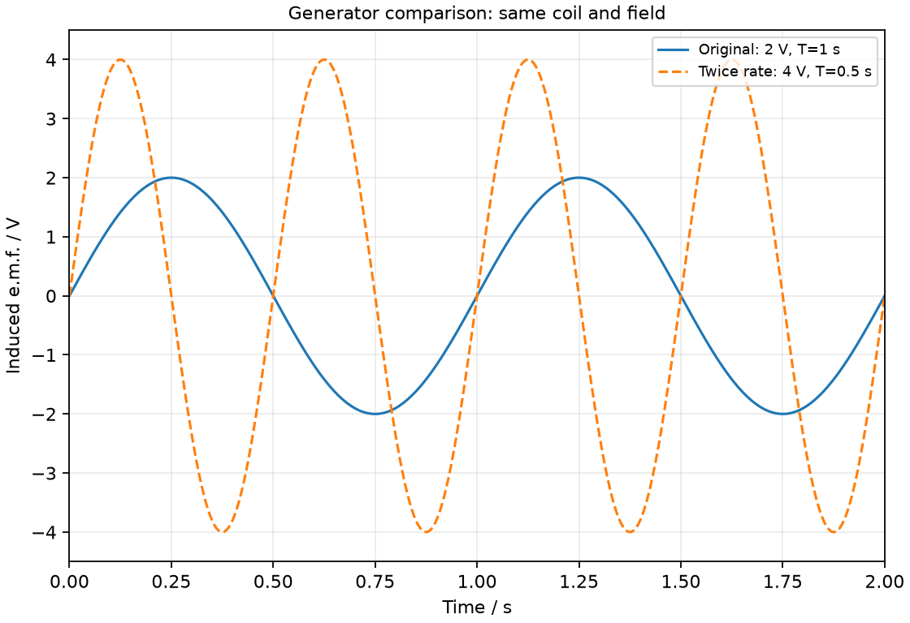
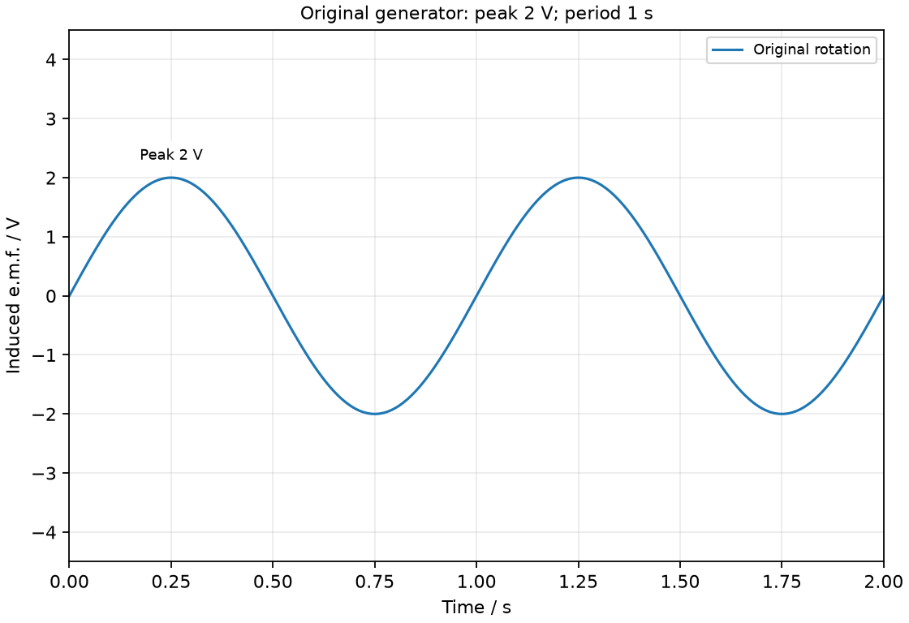
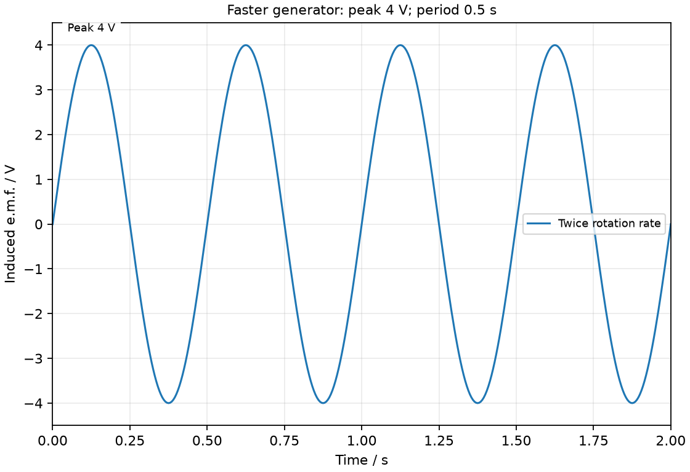
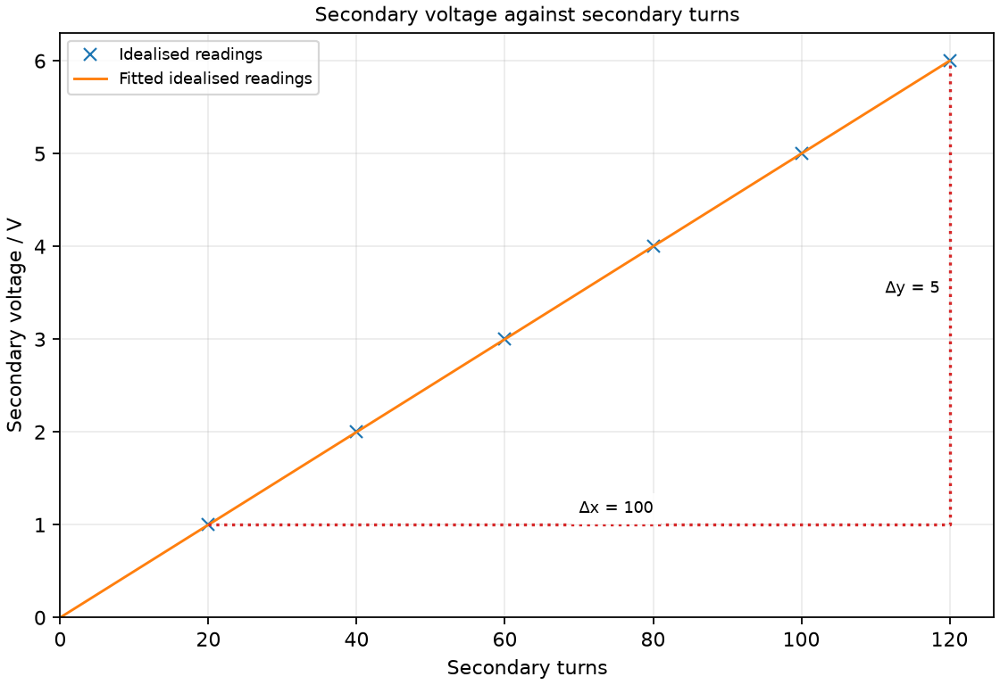

# 26 Induction, generators and transformers

*nam-6118-nssco-2026. Offline study notes, rendered from the approved content units on 2026-10-31. Everything here is also what the flashcards are built from.*

---

## Induction, generators and transformers — 5.7.2

### describe an experiment which shows that a changing magnetic field in a circuit or a magnetic field moves across a wire can induce an e.m.f

A changing magnetic field through the coil can induce an e.m.f. in a coil. Current follows only when a suitable conducting path is complete.

Connect a coil to a sensitive centre-zero meter and move a magnet into it. The meter deflects during motion; holding the magnet stationary gives no sustained induction from that unchanged arrangement. Withdraw it and the deflection reverses. Moving the coil instead can give a similar relative-change effect. Use a low-energy classroom apparatus with no external supply connected to the sensing coil.

### state the factors affecting the magnitude of the induced e.m.f

A greater rate of change of magnetic field through the coil gives a greater induced e.m.f. in the qualitative model. Faster motion, stronger magnetic field or more linked coil turns can increase the effect in a suitable comparison.

Hold the other factors fixed when testing one. Moving a magnet faster can increase the meter pulse, but a continuously stationary strong magnet does not provide a sustained induced output by strength alone. Coil orientation and the part of the field crossed also matter.

### state that the direction of induced current is such as to oppose the change causing it (Lenz’s Law)

Lenz’s law gives an induced current direction that opposes the change producing it. The opposing effect is consistent with the need for energy input during generation.

If a north pole approaches a coil, the induced current can make the near face north and oppose approach. When the pole withdraws, the induced face changes so it opposes withdrawal. The current does not oppose an unchanged field by automatically cancelling all of it; it opposes the change.

### describe a simple form of a.c. generator (rotating coil or rotating magnet) and the use of slip rings where needed

An alternating generator uses changing magnetic field through the coil caused by mechanical rotation. Either a coil rotates in a field or a magnet rotates relative to stationary coils.

The output polarity changes as the relative orientation changes. A rotating-coil arrangement can use continuous slip rings to connect each coil end to stationary brushes. A rotating-magnet arrangement can leave output coils stationary and avoid that particular output contact requirement. Mechanical input is the energy source for the electrical transfer.

### Describe a rotating-coil alternating generator

A rotating-coil AC generator has a coil driven mechanically in a magnetic field. Its two ends connect to separate continuous slip rings and brushes in the simple model.

As the coil turns, its linked magnetic field changes and an e.m.f. is induced. The direction reverses each half-turn in the basic two-pole design. A complete external circuit allows current; an open circuit can have voltage without appreciable load current.

### Describe a rotating-magnet alternating generator

A rotating-magnet generator changes the field through stationary coils. The output can be taken directly from the stationary winding connections.

A north and south pole moving past a coil change the direction and size of its magnetic field through the coil. Continued rotation gives periodic output. The number of poles affects cycles per mechanical turn, so the one-cycle-per-turn graph here belongs to the simple two-pole model.

### Explain slip-ring contact where required

Each continuous slip ring maintains connection to the same rotating coil end. Unlike a split-ring commutator, this arrangement does not interchange the coil connections every half-turn.

Stationary brushes rub on the rings and pass the coil’s alternating polarity to the outside circuit. The rings are separate conductors attached to the two ends, not one shared shorted contact. Compare their connection role with the DC motor’s split-ring commutation rather than memorising only the names.

### sketch a graph of voltage output against time for a simple a.c. generator and the effect on the graph of increasing the frequency of rotation

A simple uniformly rotating two-pole generator can produce an approximately sinusoidal voltage-time output. Faster rotation at unchanged field and coil raises peak voltage and reduces period in the ideal comparison.

A positive half-cycle is followed by a negative one. Doubling rotation frequency doubles electrical frequency in the simple two-pole model; the period halves. The faster magnetic-linkage change also raises e.m.f. amplitude. This is a voltage graph: its vertical values are not the angular speed of the coil.

### Sketch the alternating output voltage

An AC generator’s voltage alternates positive and negative relative to a chosen terminal convention. A full cycle includes both signs and returns to the same phase.

Use an invented model with peak 2 V and period 1 s over 0–2 s. Draw two complete smooth cycles about a zero-voltage axis. A plot staying positive is not the same alternating waveform, even if its size varies. Mark both axes and the negative part of the scale.

### Show the effect of faster rotation on amplitude and period

In the ideal fixed-field two-pole model, doubling rotation rate halves period and increases output amplitude. The comparison must keep coil geometry, turns and field unchanged.

Compare the 2 V, 1 s waveform with an illustrative 4 V, 0.5 s waveform. In the same time interval the second has twice as many complete cycles. Load and resistance can alter real terminal behaviour, so these are unloaded idealised traces for the stated comparison.

### discuss the generation of current using a simple generator

A generator supplies current when its induced e.m.f. acts through a complete external circuit. Mechanical work supplies the energy transferred electrically.

Turning a loaded generator commonly requires greater input effort because the induced current’s magnetic effect opposes the producing change. The output does not come from consuming the permanent magnet’s material. Disconnecting a load can reduce current while the rotating generator still has an open-circuit e.m.f.

### describe the structure and principle of operation of a simple iron-cored transformer

A transformer has primary and secondary coils linked by a magnetic core. Changing primary current produces a changing core field that induces secondary e.m.f.

The iron core carries the changing field between the coils. A steady DC input gives no sustained secondary output after the switching transient in this simple transformer. The two windings need not be electrically joined for energy transfer, because their link is the changing field.

### Use the ideal turns-voltage ratio Vp/Vs = Np/Ns

For an ideal transformer, Vs/Vp = Ns/Np. A secondary with more turns steps voltage up; fewer turns steps it down.

For primary 100 turns at 6 V and secondary 50 turns, the ideal output is 3 V. The ratios use corresponding primary and secondary positions. The practical graph of secondary voltage against secondary turns has slope Vp/Np when primary conditions are fixed.

### state the advantages of high voltage transmission

Higher transmission voltage permits lower current for the same transferred power in the simple comparison. Lower current reduces resistive line heating for the same line resistance.

The familiar line-loss relation varies with the square of current, so reducing current can substantially reduce unwanted transfer to the wires. A step-up transformer is used near an AC generation source and step-down stages near consumers. High voltage also requires appropriate insulation and clearances; a lower loss does not make it safe for direct use.

### discuss the environmental and cost implications of underground power transmission compared to overhead lines

Underground cables reduce visual impact and some exposure to weather compared with overhead lines. They commonly cost more to install and can make fault location, repair and heat removal more difficult.

Overhead routes need towers and clearances and affect landscape and land use. Underground routes require excavation and can disturb soil and habitats during construction. Compare the named route, terrain and maintenance requirements rather than making a universal cost statement for every project.

### Use VpIp = VsIs for a transformer with 100% efficiency

An ideal 100%-efficient transformer has equal input and output power. For the stated model VpIp = VsIs, so voltage increase is accompanied by current decrease for the same power.

A 12 V, 0.50 A primary input is 6 W. At an ideal 3 V secondary output, current is 2 A. Real transformers have losses, so output power is smaller and the ideal equality must not be applied as an exact measured fact. Transformer voltage multiplication is not power creation.

### Generation, transmission and distribution stages

An AC generation-to-consumer pathway uses transformers at transmission and distribution stages. A step-up transformer raises voltage for transmission, while step-down transformers provide lower distribution and consumer voltages.

An AC generator feeds a step-up transformer before long-distance lines. Higher transmission voltage permits lower current for the same power, reducing line heating. Step-down transformers later supply the lower voltages needed by consumers.

### Generator comparison: same coil and field

Generator comparison: same coil and field. Explain using a voltage-time graph the effect of faster rotation in a simple generator.

### Original generator: peak 2 V; period 1 s

Original generator: peak 2 V; period 1 s. Draw an idealised generator output with peak 2 V and period 1 s over 0–2 s.

### Faster generator: peak 4 V; period 0.5 s

Faster generator: peak 4 V; period 0.5 s. Draw the comparison output when the ideal 2 V peak, 1 s period generator doubles rotation rate with other conditions fixed.

### Practice task with worked feedback

Choose one correct option for each original practice question.

1. A magnet is held stationary inside a stationary coil. What is expected after transients?
A. Alternating output with no motion
B. No sustained induced e.m.f. from the unchanged field
C. Constant induced emf from constant field
D. A pulse every second without a changing field

2. What does Lenz’s law oppose?
A. All movement even when no circuit current flows
B. The change causing induction
C. The direction of the existing current for that interaction
D. The inducing field for that interaction

3. What preserves connection to each rotating AC coil end?
A. Short circuit joining both ends
B. Two brushes on one shared ring
C. Split-ring commutator
D. Separate continuous slip rings

4. What supplies the changing core field in a simple transformer?
A. Alternating primary current
B. Permanent magnet stationary in core
C. Steady primary DC after switch-on
D. Secondary load current alone without input

5. At fixed power, why raise transmission voltage?
A. To lower current and line heating
B. To raise line resistance
C. To increase transmitted power without input
D. To raise line current

6. Which is a common underground-cable advantage?
A. Lower initial installation cost for a typical route
B. Less visual impact
C. Easier visual location of every fault
D. Better heat removal than open air in every soil

7. What energy input drives a generator?
A. Electrical input without motion
B. Energy from slip-ring friction
C. Stored magnet energy consumed as fuel
D. Mechanical input

8. Np = 200, Ns = 100 and Vp = 8 V. What is ideal Vs?
A. 8 V
B. 0.5 V
C. 16 V
D. 4 V

9. An ideal transformer supplies 12 W at 3 V. What output current flows?
A. 12 A
B. 0.25 A
C. 4 A
D. 36 A

10. Rotation rate doubles in the fixed-field two-pole model. What happens to period?
A. It becomes one quarter
B. It doubles
C. It halves
D. It stays fixed

11. The magnet’s motion through a closed coil is reversed. What changes?
A. Induced polarity reverses
B. Current becomes DC in one direction through both strokes
C. Polarity stays fixed
D. Induced emf stays zero despite moving through a changing field

12. At fixed primary conditions, secondary turns double. What is ideal output voltage?
A. Unchanged
B. Half as large
C. Twice as large
D. Four times as large

Worked feedback

1. Key B. A: No periodic change is present. B: Induction requires changing linkage. C: Induction needs changing linkage. D: Unchanged field does not time periodic pulses.

2. Key B. A: Mechanical opposition depends on the induced response. B: This is its directional rule. C: Opposition concerns change, not all current. D: Induced field can reinforce a field that is decreasing.

3. Key D. A: Prevents separate output collection. B: Shorts the two ends rather than keeping separate contacts. C: Swaps connections every half-turn. D: They do not interchange coil ends.

4. Key A. A: It creates changing linkage. B: Unchanging field does not sustain induction. C: Steady field gives no continued secondary emf. D: Does not provide source energy.

5. Key A. A: The reduced current reduces resistive loss. B: That increases losses for a given I. C: Transformers do not create power. D: At fixed P increasing V lowers I.

6. Key B. A: Underground installation commonly costs more. B: Large overhead structures are avoided along the cable route. C: Buried faults are less accessible. D: Thermal conditions depend on burial environment.

7. Key D. A: That is motor operation. B: Friction is a loss, not useful source. C: Magnets are not the ongoing input fuel. D: Rotation requires work.

8. Key D. A: Turns differ. B: That is the turns fraction without applying voltage. C: This reverses the ratio. D: The secondary has half the turns.

9. Key C. A: This ignores voltage. B: This reverses the ratio. C: Use I = P/V. D: This multiplies power and voltage.

10. Key C. A: A factor-two frequency increase gives factor-two, not factor-four, period decrease. B: This reverses the frequency relation. C: Rotation frequency doubles, so period T=1/f halves. D: The repetition rate changed.

11. Key A. A: The linkage change has the opposite sense. B: Reversed magnet motion reverses polarity and current direction in the same closed circuit. C: The direction of field change has reversed. D: The moving magnet can produce a nonzero induced emf.

12. Key C. A: The turns ratio changed. B: That reverses the turns effect. C: Vs scales directly with Ns under the fixed primary conditions. D: The ideal relation is linear.

### Practice task with worked feedback

Original structured practice. Answer the parts with working and units where needed.

(a) Name the rotating contact arrangement in the simple AC coil generator. [1]

(b) State why steady DC is unsuitable for sustained output from the simple transformer. [1]

(c) Explain the loss advantage of higher transmission voltage at fixed power. [2]

(d) Calculate Vs for Vp = 10 V, Np = 200 and Ns = 80. [2]

(e) Calculate secondary current when ideal input power is 8 W and Vs = 4 V. [2]

Worked feedback

(a) Slip rings.

(b) It gives no continuing change of core field after the transient.

(c) Current is lower. Resistive heating in the same line is reduced.

(d) Vs = 10 × 80/200 = 4 V.

(e) Is = P/Vs = 2 A.

### Practice task with worked feedback

Investigation aim: test secondary voltage against turn count with fixed primary conditions. These are invented, idealised practice readings; real readings have scatter. 

| Secondary turns | Secondary voltage / V |
|---:|---:|
| 20 | 1 |
| 40 | 2 |
| 60 | 3 |
| 80 | 4 |
| 100 | 5 |
| 120 | 6 |

(a) Draw Secondary voltage / V vertically against Secondary turns horizontally. Plot the supplied readings and add a separate fitted line. [5]
(b) Show two widely separated points on your fitted line and calculate its gradient. State the gradient unit. [3]
(c) Plan how to test secondary voltage against turn count with fixed primary conditions. Name the equipment and arrangement, describe the measurements and repeats, state controls and a relevant precaution, design the results table and explain how the results answer the aim. [8]

Worked feedback

Graph: Secondary voltage / V is vertical and Secondary turns horizontal. Use the six readings, draw a separate best-fit line and show a wide gradient triangle; do not join scattered readings in a zigzag.

Gradient construction: choose the separated fitted-line points (20, 1) and (120, 6). Gradient = (6 − 1) / (120 − 20) = 0.05 V per turn. The slope is secondary voltage per turn, 0.05 V per turn, equal to Vp/Np in the ideal model. These open-circuit readings do not measure efficiency.

Arrangement: A purpose-built low-voltage AC transformer kit, fixed primary winding and core, selectable secondary turns and AC voltmeters

Plan: 1. Set up the fixed primary and iron core of the low-voltage AC transformer kit with the supply off. 2. Select a known secondary turn count and connect an AC voltmeter across that winding. 3. Switch on the rated low AC supply and record both primary and secondary voltages. 4. Switch off, change the secondary turns and repeat with the same core and primary settings. 5. Repeat each setting and check that primary voltage remains constant.
Control and accuracy: Use rated insulated classroom equipment, keep the core assembly consistent, avoid shorted turns and switch off before changing windings.
Table: Secondary turns; Secondary voltage / V; repeat readings in separate columns. 
Graph and conclusion: The slope is secondary voltage per turn, 0.05 V per turn, equal to Vp/Np in the ideal model. These open-circuit readings do not measure efficiency. Compare repeated readings and report the tested range rather than claiming an exact law from scattered observations.

