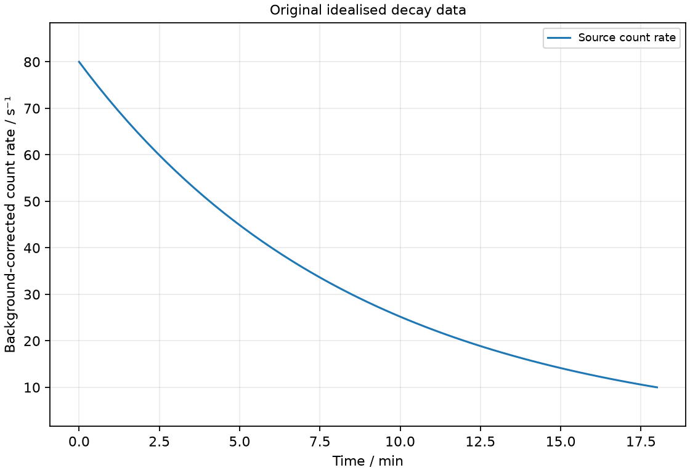

# 28 Radioactivity and half-life

*nam-6118-nssco-2026. Offline study notes, rendered from the approved content units on 2026-10-31. Everything here is also what the flashcards are built from.*

---

## Radioactivity and half-life — 6.2.1

### describe how radioactive materials are handled, used and stored in a safe way

Radioactive-source work minimises exposure time, increases appropriate distance and uses suitable shielding and containment. Sources require controlled, labelled storage and authorised handling.

In a supervised school demonstration, the teacher uses the approved source holder and handling tools, keeps sources away from the body and returns them to secure designated storage. Do not touch, open or ingest source material. Shielding choice depends on radiation type and the source arrangement, so an unspecified thick object is not a complete safety plan. Learners can study supplied readings and simulations without handling sources. An approved school source is kept in its specified shielded labelled container in locked storage, handled by the authorised teacher with a holder or tongs, kept directed away from people and returned promptly. Shielding must suit the radiation and source, not an arbitrary material.

---

## Radioactivity and half-life — 6.2.2

### describe the existence and major causes of background radioactivity

Background radiation is detected even without a nearby deliberate laboratory source. Contributors include cosmic radiation, radioactive rocks and soil, radon and naturally occurring isotopes in living matter.

A counter reading with the test source removed estimates background for that setup. Random variation means one short reading is not an exact fixed value. Measure over a suitable interval and convert to a rate before subtracting it from a source-plus-background rate. Compare rates in matching units. Medical exposures and fallout are additional human-related contributors to radiation exposure; their contribution depends on location and circumstances.

### describe the detection of alpha-particles (α), beta-particles (β) and gamma-rays (γ), (cloud chamber, Geiger Mῢller (G-M) counter and photographic film)

Radiation detectors reveal interactions rather than showing radioactive nuclei directly. Cloud chambers, G-M counters and photographic film provide different observable responses.

A cloud chamber makes tracks through condensation on ions, a counter records pulses associated with ionisation, and film records chemical changes after development. No one displayed count automatically identifies alpha, beta or gamma; detector design, absorption tests and controlled geometry help distinguish them.

### Detect radiation with a cloud chamber

A cloud chamber reveals charged-particle tracks through condensation around ions. Track appearance can support interpretation but is not a direct photograph of the particle itself.

An alpha track is commonly short, thick and relatively straight in the intended comparison, while an electron track can be thinner and irregular. Gamma photons can produce secondary charged particles whose tracks are observed. Use teacher-prepared observations rather than constructing a cold or hazardous apparatus without appropriate supervision.

### Detect radiation with a Geiger–Müller counter

A G-M tube produces electrical pulses when radiation interactions ionise its gas and trigger a discharge. A scaler counts pulses or an instrument reports a count rate.

A thin window helps some charged particles enter, while gamma detection efficiency can be lower and depends on geometry and construction. Background must be measured separately. A count rate is an instrument response, not necessarily equal to total source activity because only some emissions reach and trigger the detector.

### Detect radiation with photographic film

Photographic film can record radiation exposure through a chemical change. After controlled development, darkening indicates interaction with the sensitive material.

A film badge can accumulate exposure information over time, while filters can help interpret the radiation reaching it. Unlike an electronic counter, it does not ordinarily give a live pulse display during exposure. Appropriate calibration is needed before converting a response into an exposure estimate.

### Practice task with worked feedback

Choose one correct option for each original practice question.

1. Which can contribute to background radiation?
A. Stable atoms in pure nonradioactive sample as the sole cause
B. Only laboratory sources
C. Visible light from lamp as radioactive background
D. Rocks and cosmic radiation

2. What does a G-M counter record?
A. Source mass without calibration
B. Pulses triggered by radiation interactions
C. Each undecayed nucleus directly
D. All emitted radiation with 100 percent efficiency

3. What is alpha radiation?
A. Photons
B. Helium nuclei
C. Single protons
D. Electrons

4. Which emission is neutral electromagnetic radiation?
A. Gamma
B. Beta-minus
C. Alpha
D. A proton beam

5. Which statement correctly describes the decay time of one unstable nucleus?
A. It cannot be predicted exactly
B. It cannot decay before one half-life
C. Its exact decay second from its age alone
D. It must decay at one half-life

6. After one half-life, what expected fraction remains?
A. Three quarters
B. All nuclei
C. One half
D. One quarter

7. Which is an exposure-reduction principle?
A. Thinner shielding
B. Longer handling time
C. Move closer to the source
D. Reduce time near the source

8. Background-corrected count rate falls from 120 to 30 counts/s. How many half-lives?
A. Two
B. Three
C. One
D. Four

9. Total rate is 55 counts/s and background 5 counts/s. What source rate is used?
A. 60 counts/s
B. 50 counts/s
C. 11 counts/s
D. 55 counts/s

10. With positive plate above and negative below, which way does beta-minus deflect?
A. Downward
B. Toward whichever plate is closer regardless of charge
C. Upward
D. Straight through with no deflection

11. Alpha emission begins at A = 230, Z = 90. What daughter numbers result?
A. A = 226, Z = 92
B. A = 234, Z = 92
C. A = 230, Z = 91
D. A = 226, Z = 88

12. Half-life is 4 h. What fraction remains after 12 h?
A. One quarter
B. One third
C. One eighth
D. One twelfth

Worked feedback

1. Key D. A: Background includes external natural sources. B: Natural background exists. C: Visible photons are not this ionising background. D: Both are natural contributors.

2. Key B. A: Counts are not a direct mass reading. B: Ionisation initiates detection. C: Counter registers detected interactions. D: Geometry and efficiency limit counts.

3. Key B. A: These form gamma radiation. B: Two protons and two neutrons. C: Alpha contains two protons and two neutrons. D: These are beta-minus particles.

4. Key A. A: It consists of photons. B: It has negative charge. C: It has positive charge. D: Protons are positively charged.

5. Key A. A: Population probabilities are predictable but the individual nucleus has no scheduled decay time. B: Events can occur earlier. C: That is not predictable. D: Half-life is a population measure.

6. Key C. A: One half is expected to survive. B: Decay reduces the expected population. C: This defines the interval. D: Two half-lives give this fraction.

7. Key D. A: Usually less protective for radiation it attenuates. B: Increases exposure. C: Closer proximity increases exposure under the same other conditions. D: Time affects accumulated exposure.

8. Key A. A: 120 to 60 to 30. B: That leaves 15. C: That leaves 60. D: That leaves 7.5.

9. Key B. A: This adds background. B: Subtract background. C: This divides instead. D: This leaves the background included.

10. Key C. A: This is the positive-particle direction, not negative beta. B: Distance to a plate does not set the force direction: beta-minus has negative charge and is attracted toward the upper positive plate. C: The negative particle force opposes the downward field. D: Beta-minus has charge and experiences an electric force.

11. Key D. A: The Z direction is incorrect. B: This adds the emitted alpha. C: That is beta-minus change. D: Remove four nucleons and two protons.

12. Key C. A: That is two intervals. B: The decrease is not linear in time. C: Three halving intervals elapsed. D: Decay fraction is (1/2)³, not reciprocal elapsed hours.

---

## Radioactivity and half-life — 6.2.3

### state that radioactive emissions occur randomly over space and time

Radioactive decay is random for individual unstable nuclei. A large collection has statistically predictable average decay behaviour.

The exact decay time of one nucleus cannot be predicted from its age alone. Equal counting intervals can give different counts even when the expected rate is almost unchanged. Random emission direction also means a small detector intercepts only part of the total output. These fluctuations do not invalidate the repeatable half-life model for a large sample.

### describe radioactive emission: - their nature (e.g. its composition, relative charge, mass) - their relative ionising effects - their relative penetrating abilities

Alpha, beta-minus and gamma emissions differ in nature, charge and interaction. The school comparison is alpha strongly ionising with low penetration, beta intermediate and gamma more penetrating with lower direct ionisation density.

An alpha is a helium nucleus with charge +2e and relative mass about 4. A beta-minus particle is an electron with charge −e and a mass much smaller than a nucleon. Gamma is a neutral electromagnetic photon with no rest mass. The comparison is qualitative and depends on energy and material; sufficient shielding attenuates rather than giving a magic absolute stopping thickness for every source. Relative charge/mass in the school comparison are alpha +2/about 4, beta-minus −1/about 1/1840 and gamma 0/zero. For the usual comparable beam illustration, beta bends more strongly than alpha because its mass is much smaller; exact curvature also depends on energy.

### Describe alpha-particle nature, ionisation and penetration

An alpha particle contains two protons and two neutrons and has charge +2e. Its strong interactions give high ionisation density and a short range in ordinary materials.

Paper or the outer surface layer of skin can stop typical alpha particles in the school comparison, but an alpha emitter inside the body can be hazardous because it deposits energy nearby. Low external penetration therefore must not be called harmlessness.

### Describe beta-particle nature, ionisation and penetration

Beta-minus radiation consists of fast electrons with charge −e. It generally has intermediate penetration and ionisation in the named school comparison.

Thin metal or suitable plastic can substantially attenuate beta radiation depending on energy. Electrons have much smaller mass than alpha particles and can show strong deflection in fields. The beta electron originates in nuclear decay rather than being a pre-existing electron stored inside a neutron as a tiny planetary object.

### Describe gamma-ray nature, ionisation and penetration

Gamma radiation consists of electromagnetic photons with no net electric charge. It is typically highly penetrating and requires substantial attenuation shielding compared with alpha and beta.

Gamma can ionise indirectly when interactions create energetic charged particles. Lead or concrete can reduce the transmitted intensity, with effectiveness depending on thickness and photon energy. Neutrality means an ordinary electric or magnetic field does not bend its path in the school model; it does not mean gamma cannot transfer energy.

### describe their deflection in electric fields and magnetic fields

Electric and magnetic fields distinguish charged radiation from neutral gamma in the basic deflection model. Alpha and beta-minus deflect oppositely when launched in the same direction through the same field arrangement.

For an electric field, force follows the positive-charge direction for alpha and the opposite direction for beta-minus. For a magnetic field, charge sign and velocity direction both matter. Gamma continues straight in the intended field-only model. Relative curvature also depends on speed and momentum, so charge alone does not set an exact radius.

### Describe deflection of alpha, beta and gamma in an electric field

In a uniform electric field, alpha force is along the field and beta-minus force is opposite it. Gamma has no electric deflection in this model.

If a beam travels rightward between an upper positive plate and lower negative plate, the field points downward. Alpha curves downward toward the negative plate, beta-minus upward toward the positive plate, and gamma continues straight. Draw the plate signs before choosing curvature.

### Describe deflection of alpha, beta and gamma in a magnetic field

Magnetic force on charged moving radiation is perpendicular to its motion and the field. Opposite charge signs produce opposite deflections for the same initial velocity and field.

For a rightward beam and field into the page, positive alpha curves upward. Beta-minus curves downward because its charge is negative, and gamma is undeflected. Use conventional-current direction or reverse the positive-charge result for electrons. The curved trajectory does not mean the magnetic field is doing work through a force along the velocity in this ideal account.

### interpret their relative ionising effects

Ionisation removes or adds electrons to produce charged atoms or molecules. Different radiation types deposit energy with different spatial densities in the school comparison.

An alpha particle can create many ions along a short path, explaining its thick cloud-chamber trace and strong local biological effect when internal. Gamma can travel farther between interactions but still produce ionisation through secondary particles. Distinguish ionising effect from penetration rather than assuming the most penetrating radiation must create the densest short track.

### Practice task with worked feedback

Original structured practice. Answer the parts with working and units where needed.

(a) State the charge sign of beta-minus radiation. [1]

(b) State whether gamma is deflected by the simple electric-field arrangement. [1]

(c) Explain why equal short counting intervals can give different counts from the same source. [2]

(d) Calculate the half-life when corrected rate falls from 96 to 24 counts/s over 10 min. [2]

(e) Calculate corrected source count rate for 42 counts/s measured with 6 counts/s background. [2]

Worked feedback

(a) Negative.

(b) It is undeflected.

(c) Individual decays occur randomly. The observed count therefore fluctuates about its expected rate.

(d) Two halvings occur, so half-life = 10/2 = 5 min.

(e) Source rate = 42 − 6 = 36 counts/s.

---

## Radioactivity and half-life — 6.2.4

### state the meaning of radioactive decay and give appropriate nuclide equations to represent changes in the composition of the nucleus when particles are emitted

Radioactive decay is spontaneous change of an unstable nucleus with emission. Nuclear-number balances identify the resulting nuclide change.

Alpha reduces A by four and Z by two; beta-minus keeps A and raises Z by one; gamma emission leaves both unchanged while reducing nuclear excitation energy. As examples, ²³⁸₉₂U → ²³⁴₉₀Th + ⁴₂He and ¹⁴₆C → ¹⁴₇N + ⁰₋₁e show the school number balances.

### Define radioactive decay

Radioactive decay is spontaneous transformation of an unstable nucleus with emission of particles or radiation. It is a nuclear process rather than ordinary electron-shell chemistry.

A nucleus can move toward a more stable configuration without an external trigger for that individual event. The event is random, while the population follows statistical patterns. Ordinary school changes of temperature or pressure do not provide a practical on-off switch for the decay.

### Represent nuclear changes during decay

Nucleon-number and charge conservation determine daughter nuclear numbers. Alpha removes (A,Z) = (4,2), beta-minus adds one to daughter Z at unchanged A, and gamma changes neither.

Starting with A = 222 and Z = 86, alpha leaves A = 218 and Z = 84. Check the emitted particle on the same side of the equation as the daughter so both sums match the parent. Do not subtract four from Z or add two to A by confusing their notation positions.

---

## Radioactivity and half-life — 6.2.5

### define half-life as the time taken for half of the radioactive nuclei to decay

Half-life is the time for half the unstable nuclei in a large sample to decay on average. The same interval halves the expected activity of a single-isotope sample under the simple model.

The next half-life removes half of the remaining nuclei rather than the same absolute number as before. After two half-lives one quarter remains, and after three one eighth. An individual nucleus does not have a scheduled appointment to decay exactly one half-life after it was formed.

### use the term half-life in simple calculations which might involve information in tables or decay curves

Repeated half-lives give a geometric decrease of remaining nuclei or source activity. Measured count rate must be corrected for background before using a simple source-halving model.

Original curve data give background-corrected source rates of 80, 40, 20 and 10 counts/s at 0, 6, 12 and 18 min. The half-life is 6 min. If a constant background of 5 counts/s were added, the measured sequence would be 85, 45, 25 and 15 counts/s; halving those totals would be wrong. Read several halving intervals on a smooth curve and compare them.

### Original idealised decay data

Original idealised decay data. Calculate the half-life using a decay curve with background-corrected rates 80, 40, 20 and 10 counts/s at 0, 6, 12 and 18 min.

### Practice task with worked feedback

Plan a safe coin investigation modelling radioactive half-life. Include equipment, survivor-count measurements, repeats, fixed rules, a results table and the expected graph.

Worked feedback

A tray and at least 100 identical coins form the model. The initial count is recorded. The remaining coins are shaken and tossed each round; heads are removed and tails counted. Repeating with the survivors gives a decreasing count. The whole experiment is repeated with the full initial set using the same head-removal rule and tossing method. A table records round number and survivors for each run. Mean survivors plotted against round number should fall by about one half per round, with random variation; one round models the half-life, not a measured time in seconds.

### Coin model of half-life

Equipment: at least 100 identical coins, a tray and a results table. Count the initial coins. Shake and toss the whole remaining set; remove coins showing heads and record tails remaining. Repeat with the remaining coins for several rounds. Repeat the entire investigation with a fresh full set, keeping the removal rule and tossing method fixed. Plot mean survivors against round number. About half survive each round, so the model half-life is about one round; real runs fluctuate. No individual coin has a scheduled removal round. This models random decay and exponential decrease; it does not measure a radioactive material’s half-life in seconds. A six-sided die with one chosen face removed instead has survival probability 5/6 per round, so its half-life is longer than one round.

### Further practice: Plan a safe coin investigation modelling radioactive half-life. Include equipment, survivor-count measurements, repeats, fixed rules, a results table and the expected graph.

A tray and at least 100 identical coins form the model. The initial count is recorded. The remaining coins are shaken and tossed each round; heads are removed and tails counted. Repeating with the survivors gives a decreasing count. The whole experiment is repeated with the full initial set using the same head-removal rule and tossing method. A table records round number and survivors for each run. Mean survivors plotted against round number should fall by about one half per round, with random variation; one round models the half-life, not a measured time in seconds.
