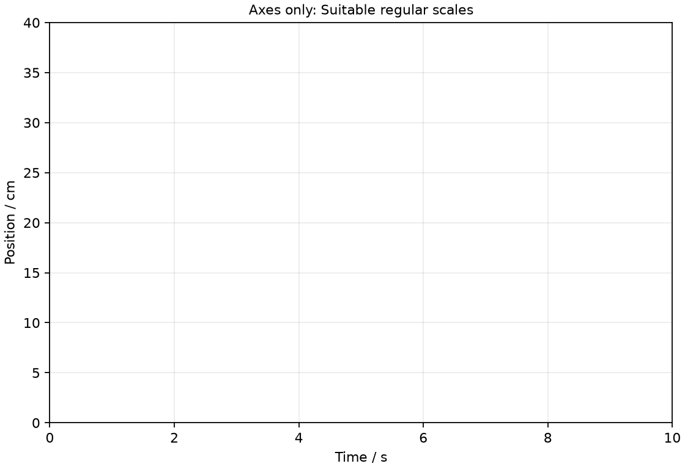
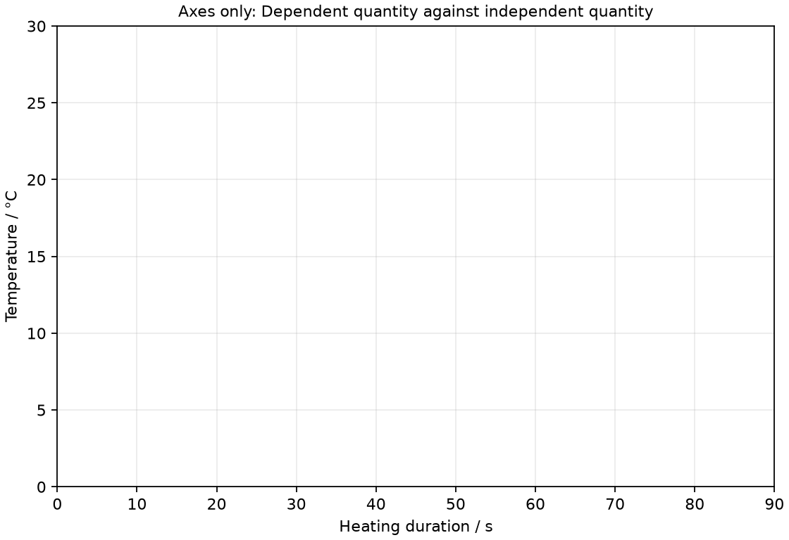
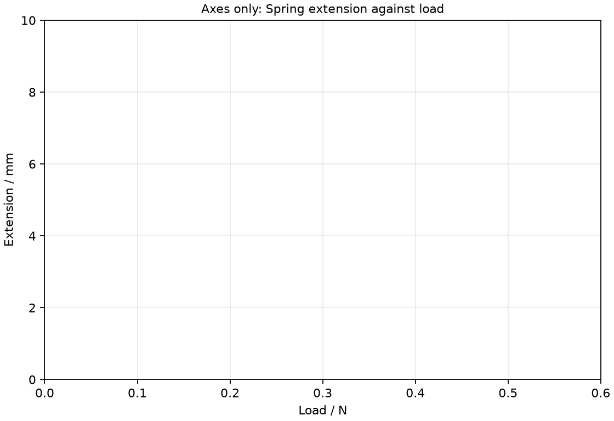
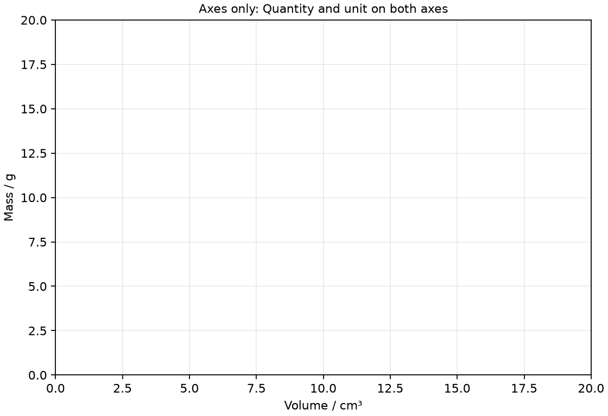
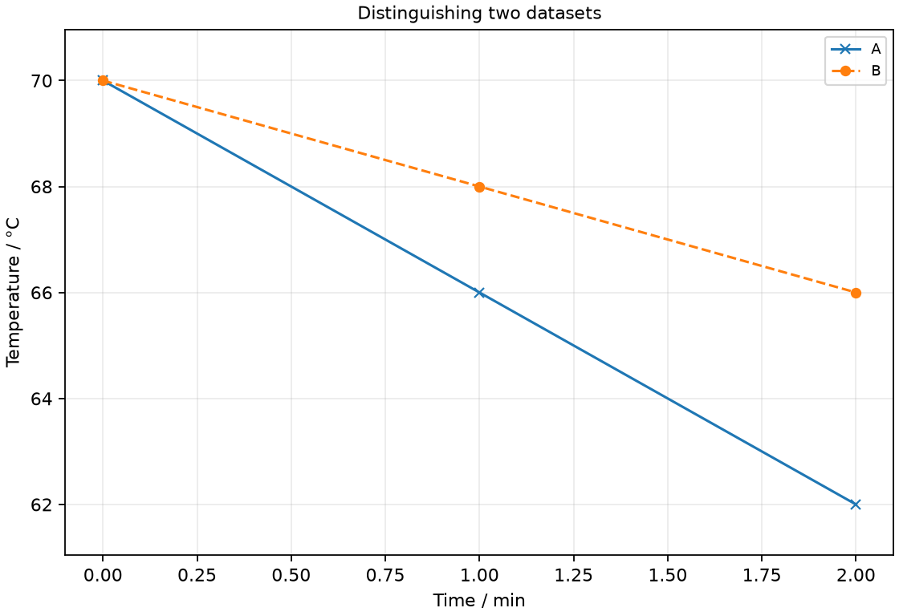
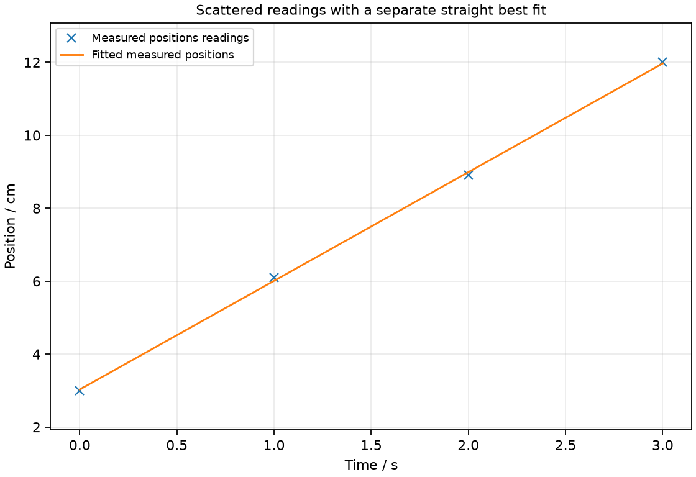
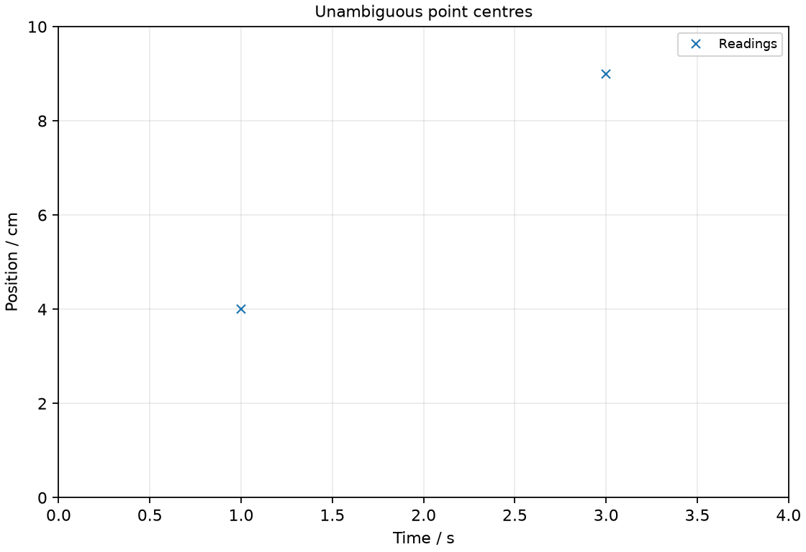
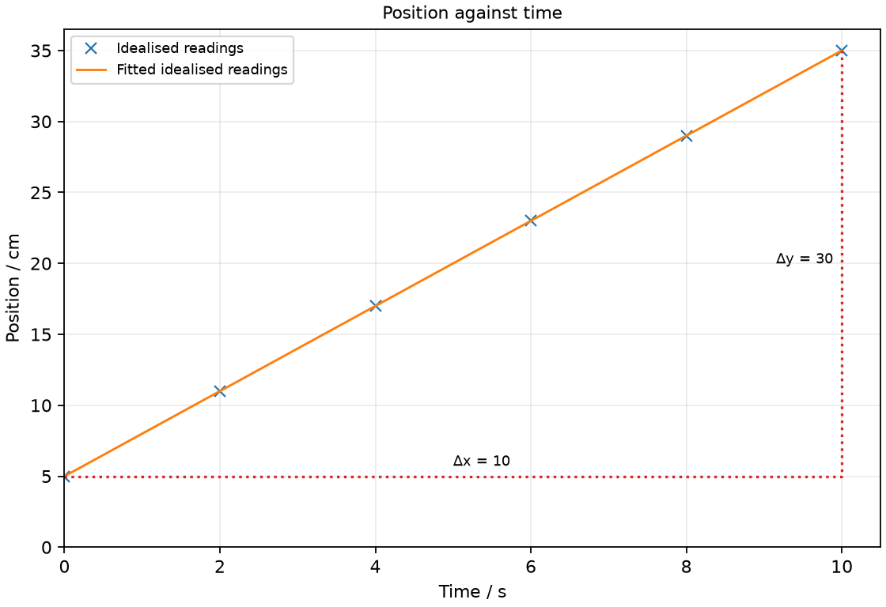

# 3 Graphs, uncertainty and experimental conclusions

*nam-6118-nssco-2026. Offline study notes, rendered from the approved content units on 2026-10-31. Everything here is also what the flashcards are built from.*

---

## Graphs, uncertainty and experimental conclusions — 1.2.3

### record entries in tables with constancy in terms of decimal places for initial readings and significant figures for calculations

A results column should use a consistent precision appropriate to the instrument or calculation. Raw readings are commonly recorded to consistent decimal places, while derived values are rounded to a justified number of significant figures.

If a ruler reading is recorded in centimetres to one decimal place, write 4.0 cm as 4.0 rather than changing to 4 in the same column. The zero communicates how the measurement was reported. A calculated column is different: values obtained from several measurements should not simply copy every calculator digit. Keep raw readings available and round derived results consistently at the end of the calculation. Precision does not improve merely because more decimal places are typed into a table. The instrument and the quality of the input data set the sensible limit.

### select suitable scales and axes for graphs

Graph scales should place the data clearly across a useful part of the grid. Equal intervals along an axis must represent equal changes in the quantity.

Choose a simple sequence such as 0, 2, 4, 6 rather than squeezing most points into a corner. The scale need not begin at zero if the measured range is narrow, but show any offset clearly. A large usable scale makes a small difference easier to read. The horizontal and vertical scales can be different because the quantities and units are different. Before plotting, test the largest and smallest readings against both axis ranges. A line that appears steep under one scale may look shallow under another, so physical comparisons should use gradients with their units.

### plot the independent variable on the x-axis (horizontal axis) and plot the dependent variable on the y-axis (vertical axis)

The deliberately changed independent quantity is usually plotted horizontally. The measured dependent response is usually plotted vertically unless a graph instruction states otherwise.

In a heating experiment, time may be the chosen independent setting and temperature the response. For that arrangement, time belongs on the x-axis and temperature on the y-axis. Swapping the axes changes the gradient and its units; it is not a harmless redrawing when a gradient is later used to obtain a physical quantity. Identify the variable roles from the investigation aim, not from a rule that time must be horizontal in every possible graph. The plotted orientation must match the stated problem.

### Graph headings and orientation

A graph heading identifies the dependent quantity plotted against the independent quantity. A useful heading describes the relationship shown rather than merely saying graph.

For water-heating results, a heading such as Water temperature against heating duration tells the reader how the axes are related. The heading does not replace axis labels: each axis still needs its own quantity and unit. If two datasets share a graph, distinguish the conditions that produced them, such as insulated and uninsulated containers. Do not use a title that asserts a conclusion unsupported by the readings. A clear heading helps someone interpret the graph even when it is separated from the original table.

### label each axis with the physical quantity and the appropriate unit, e.g. time/s

An axis label identifies the physical quantity and its unit. A numerical scale without a quantity cannot by itself communicate a physical measurement.

Write Time / s rather than just s, because the quantity is elapsed time and the unit is seconds. Write Mass / g rather than merely mass if the numbers are in grams. Transfer these labels from the table without silently changing the units. A current recorded in milliamperes must either retain an mA label or be converted before an A label is used. A gradient then carries the vertical unit divided by the horizontal unit, so accurate labels are part of interpreting the result.

### draw the graph as the whole diagrammatic presentation. It may have one or several curves plotted on it, which should be labelled

A graph includes axes, numerical scales, plotted data and the lines or curves representing the trend. Different datasets on the same axes should be distinguishable by labels or a clear key.

Two cooling curves can share time and temperature axes when they use the same units and comparable ranges. Label each curve by its container condition, rather than relying on colour alone. Where points overlap, use a second plotting symbol that remains visible. Draw the fitted line or curve separately from the data marks so that the observations can still be checked. A collection of unlabelled lines is not enough to compare the experiments or identify which condition produced the faster change.

### draw appropriate lines through relevant points being a straight line or smooth curve

A fitted line or curve represents the overall data trend. Its form should be chosen from the observed pattern and the physical relationship, not by joining every neighbouring point.

If readings are scattered around an approximately straight trend, draw a straight line passing through their central pattern with a reasonable balance on either side. It need not pass through every point. If the trend bends smoothly, a suitable smooth curve is more informative than a zigzag. A theoretical expectation that a quantity is zero should not force a line through the origin when the actual readings show an offset. Investigate possible offsets or limitations and describe what the evidence supports.

### present points on the curve as crosses (x) or encircled dots (). If a further curve is included, vertical crosses (+) may be used to mark the points

Small crosses or clear encircled dots show the intended coordinates of plotted readings. Thick blobs make the centre and accuracy of a plotted value difficult to judge.

Plot the coordinate where the horizontal and vertical scale values meet. A fine cross gives two intersecting strokes whose centre can be read clearly. The fitted line should not hide every observation. For a second dataset, use a distinguishable symbol and state its meaning in the key. Accuracy depends on the numerical scale as well as the neatness of the mark: a carefully drawn cross in the wrong square is still a wrong point. Read subdivisions before plotting values between large labelled intervals.

### Calculate straight-line gradient as change in vertical quantity divided by change in horizontal quantity; retain sign and axis-ratio units

A straight-line gradient is the change in vertical quantity divided by the change in horizontal quantity. The sign and unit follow from the plotted coordinates and must be retained.

Choose widely separated points on the fitted line and mark the triangle used. Subtract vertical coordinates in the same order as the horizontal coordinates. If temperature decreases from 75 °C to 63 °C while time increases from 20 s to 80 s, the changes are −12 °C and 60 s, giving a gradient of −0.20 °C/s. The negative sign describes a fall as time increases. Do not call a slope a familiar constant without examining its axes: volume against mass gives volume per mass, which is reciprocal density.

### Axes only: Suitable regular scales

Axes only: Suitable regular scales. Draw labelled axes suitable for times from 0 to 10 s and positions from 5 to 35 cm, using regular numerical intervals.

### Axes only: Dependent quantity against independent quantity

Axes only: Dependent quantity against independent quantity. Draw the axes for temperature measured after chosen heating durations. Label the independent and dependent quantities.

### Axes only: Spring extension against load

Axes only: Spring extension against load. Draw a graph frame with a suitable heading for extension measured at different spring loads.

### Axes only: Quantity and unit on both axes

Axes only: Quantity and unit on both axes. Draw labelled graph axes for mass in grams measured at different volumes in cubic centimetres.

### Distinguishing two datasets

Distinguishing two datasets. Draw a small graph showing cooling data for container A and container B. Use time values 0, 1, 2 min; A temperatures 70, 66, 62 °C; B temperatures 70, 68, 66 °C.

### Scattered readings with a separate straight best fit

Scattered readings with a separate straight best fit. Draw a suitable fitted trend for time values 0, 1, 2, 3 s and position readings 3.0, 6.1, 8.9, 12.0 cm.

### Unambiguous point centres

Unambiguous point centres. Draw the data points (1 s, 4 cm) and (3 s, 9 cm) on labelled axes, using a fine cross for each.

### Practice task with worked feedback

Investigation aim: measure a model vehicle’s speed from position and time. These are invented, idealised practice readings; real readings have scatter. 

| Time / s | Position / cm |
|---:|---:|
| 0 | 5 |
| 2 | 11 |
| 4 | 17 |
| 6 | 23 |
| 8 | 29 |
| 10 | 35 |

(a) Draw Position / cm vertically against Time / s horizontally. Plot the supplied readings and add a separate fitted line. [5]
(b) Show two widely separated points on your fitted line and calculate its gradient. State the gradient unit. [3]
(c) Plan how to measure a model vehicle’s speed from position and time. Name the equipment and arrangement, describe the measurements and repeats, state controls and a relevant precaution, design the results table and explain how the results answer the aim. [8]

Worked feedback

Graph: Position / cm is vertical and Time / s horizontal. Use the six readings, draw a separate best-fit line and show a wide gradient triangle; do not join scattered readings in a zigzag.

Gradient construction: choose the separated fitted-line points (0, 5) and (10, 35). Gradient = (35 − 5) / (10 − 0) = 3 cm/s. The slope is speed, 3 cm/s. The 5 cm position intercept does not change speed.

Arrangement: A low-speed trolley on a level track with a metre rule and a phone or camera recording the scale and a visible timer

Plan: 1. Set the camera square to a visible centimetre scale along the level track. 2. Record the trolley moving at a fixed low drive setting with the timer or frame rate known. 3. Choose a starting frame as t = 0 and record the trolley reference point position. 4. Read positions at 2 s intervals from the recording using the same reference point. 5. Repeat the run at the same setting and record the corresponding positions in repeat columns.
Control and accuracy: Keep the track arrangement, drive setting and starting position matched; reduce parallax by reading the scale consistently.
Table: Time / s; Position / cm; repeat readings in separate columns. 
Graph and conclusion: The slope is speed, 3 cm/s. The 5 cm position intercept does not change speed. Compare repeated readings and report the tested range rather than claiming an exact law from scattered observations.

---

## Graphs, uncertainty and experimental conclusions — 1.2.5

### explain that precise measurements are all close to one another and that accurate measurements have an average close to the true value

Accuracy is closeness of a measurement to the accepted true value. Precision is how closely repeated measurements agree.

A balance could repeatedly give 21.4 g for an object whose accepted mass is 20.0 g. Its readings might be precise but inaccurate because they share a bias. A more scattered group centred near 20.0 g describes another situation: individual readings vary but their mean may be closer to the accepted value. These ideas are not interchangeable. Repeating and averaging may reduce the influence of random scatter; it does not identify or remove a persistent balance offset. Compare both the spread and the reference value when judging the quality of a dataset.

### explain that any measurement may involve error, which is the difference between the measurement and the true value

A measurement error is the difference between a measured value and the true value. An individual error is often not known exactly because the true value itself is not available.

If a reference object is known to be 10.0 cm long but a measurement gives 10.3 cm, the signed measurement error is +0.3 cm. That is a known comparison with a reference. In an ordinary experiment, an uncertainty estimate is used instead of pretending to know the exact error. Do not interpret the word error as evidence of carelessness alone. Instrument limitations, fluctuations and the measurement method can introduce deviations even when the procedure is performed carefully.

### explain uncertainty as the interval on either side of a measured value within which the true value is expected to lie

Uncertainty is a stated interval around a measured value within which the true value is expected. It communicates a plausible range rather than an exact correction to add or subtract.

A length recorded as 24.0 ± 0.2 cm suggests values from 23.8 cm to 24.2 cm within the stated estimate. It does not say that the true length is definitely 24.2 cm. The estimate depends on resolution, repeatability and the method; the smallest scale division is not a universal complete account of uncertainty. Compare a proposed difference with the relevant uncertainties before treating it as physically meaningful. Reporting many more digits than the uncertainty supports gives a misleading impression of precision.

### handle and process experimental observations and data, including dealing with anomalous or inconsistent results

An anomalous reading is inconsistent with the surrounding pattern and should be investigated. A result should not be discarded merely because it disagrees with a preferred theory.

Suppose repeated timings are 7.3, 7.4, 11.8 and 7.2 s for an unchanged motion. The 11.8 s reading deserves investigation because it is far from the other repeats. Check whether a counting interruption, transcription mistake or changed condition occurred. Repeat the measurement if possible and keep a record of the original value and the reason for excluding it from a mean. A genuine unexpected physical effect can also create unusual data, so an unexplained disagreement is not permission to edit the evidence.

### evaluate presented results or experimental data by applying scientific knowledge and interpret and draw appropriate conclusions from practical observations and data in relation to the hypotheses

A conclusion answers the investigation aim using the measured pattern or numerical evidence. It should distinguish an observed relationship from a theoretical prediction or a claim of exact proportionality.

If a quantity rises steadily while another is increased, first state that trend. Direct proportionality requires more: the ratio must remain constant within the quality of the measurements, or the fitted straight line should be consistent with the origin. A nonzero intercept can rule out direct proportionality between the plotted quantities even when the line is straight. Quote an appropriate comparison, such as similar increments or ratios, instead of simply saying the values prove the hypothesis. Consider anomalies, scatter and the range tested when stating how strong the evidence is.

### discuss trends in results and suggest sources of error (random and systematic errors)

A data trend describes how the response changes as the other quantity changes. Random scatter and systematic bias affect the strength or position of that trend in different ways.

State whether the response increases, decreases, stays similar or changes at a varying rate, using the plotted range. Then identify limitations that could affect the conclusion. A noisy set may still show a clear overall trend, while a precise-looking line can be shifted by an instrument zero error. Avoid calling every difference random or every straight trend correct. A useful evaluation links a possible error to the particular reading it affects and explains its consequence for a ratio, intercept, gradient or comparison.

### Describe a data trend

A trend describes the direction and pattern of change in a dataset. Increasing does not automatically mean directly proportional.

For values x = 1, 2, 3 and y = 2, 5, 10, the response increases but its increments and ratios are not constant. A steeper part of a graph indicates a larger change in the vertical quantity per change in the horizontal quantity, provided the same axes are being compared. Use comparative language that names the quantities. Saying the line goes up gives less information than saying temperature rises more rapidly during the first interval than during the last. Restrict the conclusion to the measured range unless a justified model supports extrapolation.

### Identify a random error

A random error produces unpredictable variation between repeated readings. Taking repeats and calculating a mean can reduce its effect on an estimate.

Human reaction-time variation in stopwatch measurements can make some durations a little high and others a little low. Repeating an unchanged event reveals some of that spread. Timing several cycles rather than one may also reduce the relative influence of the starting and stopping delay. A mean does not guarantee the exact true value, and it does not remove an offset shared by all measurements. Explain the physical source of the variation rather than using random error as a general label for any discrepancy.

### Identify a systematic error

A systematic error introduces a consistent bias through the instrument or method. An unchanged zero offset is not removed by simply repeating and averaging the biased readings.

An ammeter that reads +0.03 A before current flows will over-read subsequent indications if the offset is not corrected. More repeats under the same biased condition can produce a very consistent but displaced mean. Inspect the zero, compare with a suitable reference or correct the known offset where justified. Some biases depend on scale or conditions rather than being a fixed addition, so identify the actual source. Do not change the sign of a correction without thinking about whether the instrument is reading too high or too low.

### suggest possible improvements to reduce errors

An improvement should address a specified limitation of the measurement. Its purpose is to reduce that limitation’s effect, not merely to make the apparatus sound more sophisticated.

If reaction-time variation is important, time several oscillations and repeat the interval. If parallax affects a ruler reading, use a suitable alignment aid and view squarely. If thermal contact with a vessel wall biases a water-temperature reading, reposition the thermometer and ensure a representative liquid temperature. Link the change to its expected effect. Replacing the instrument may be reasonable only if its range or resolution is the actual difficulty. A source of uncertainty can remain even after careful technique, so avoid blaming every variation on poor handling.
