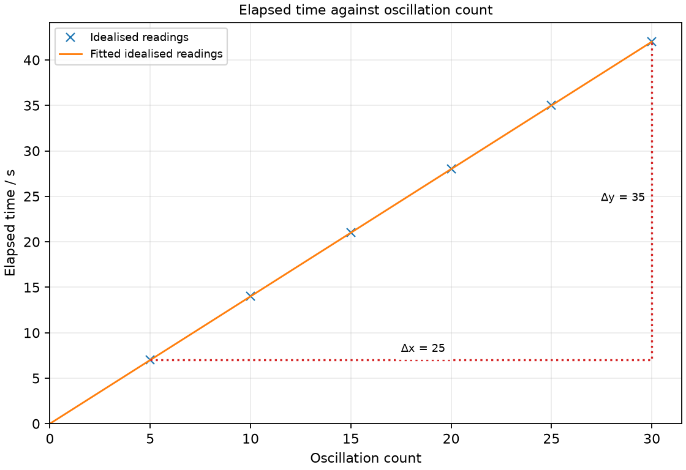
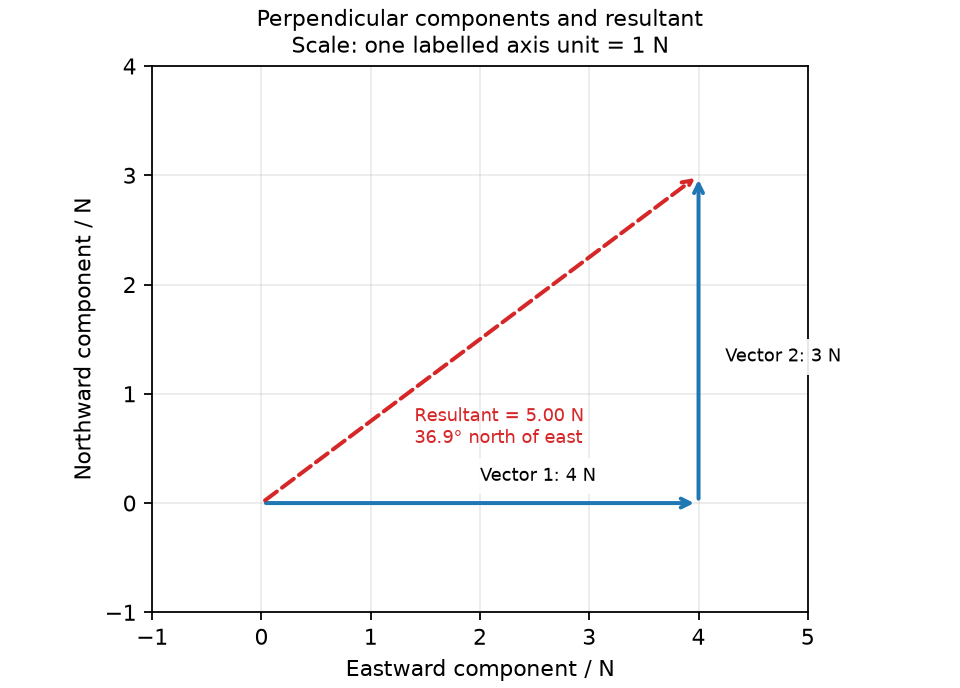
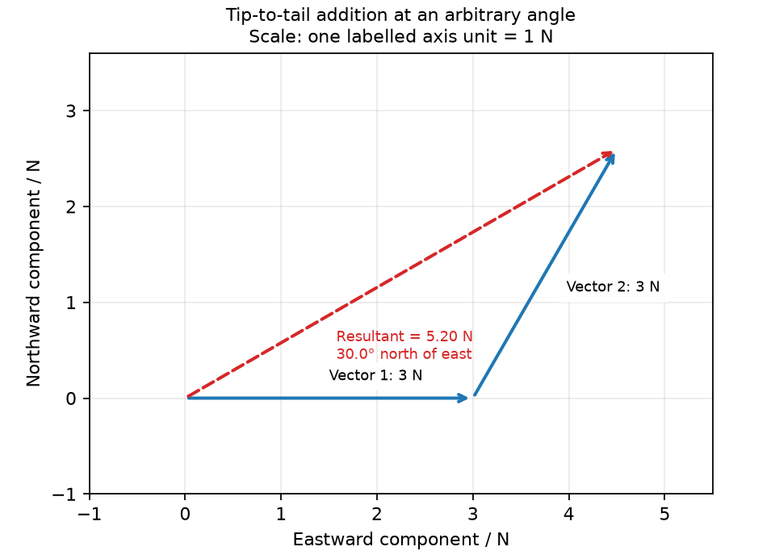

# 4 Measurement, scalars and vectors

*nam-6118-nssco-2026. Offline study notes, rendered from the approved content units on 2026-10-31. Everything here is also what the flashcards are built from.*

---

## Measurement, scalars and vectors — 2.1

### use and describe the use of a metre rule, a ruler and measuring tape to determine length, and measuring cylinders to determine volume

A rule or tape measures length, while a graduated cylinder measures liquid volume. Instrument choice depends on the quantity, its size and the resolution needed.

A long flexible distance is more conveniently measured with a tape than with repeated short ruler placements. A small liquid volume needs a suitably graduated vessel rather than a length scale alone. Read the graduation unit before recording a value and check the zero or reference point. A cylinder can have a large capacity yet still be unsuitable for a small change if its divisions are too wide. Name both instrument and technique in a measurement plan.

### Measure length with a ruler, metre rule or tape

A measured length is the difference between the scale positions of its ends. The scale should be aligned with the intended length and viewed without avoidable parallax.

An object beginning at 3.0 cm and ending at 11.6 cm is 8.6 cm long. Its length is not 11.6 cm unless its first end is at zero. Use a tape for longer distances and keep it appropriately straight without stretching it. For a curved perimeter, a flexible thread can transfer the path length to a straight rule, with additional uncertainty from following and transferring the curve.

### Measure liquid volume with a measuring cylinder

A measuring cylinder reports liquid volume from the level of its surface. For water in a clean cylinder, the bottom of the curved meniscus is read at eye level.

Place the cylinder vertically on a level surface and allow the liquid to settle. Read the appropriate scale division with the eye level with the meniscus, rather than viewing from above. Record a value consistent with the scale resolution. For displacement measurements, subtract the original water volume from the volume after the object is immersed. Avoid trapped bubbles and ensure the object is fully submerged when that method is intended.

### use and describe the use of mechanical methods for the measurement of a small distance (ruler, caliper (vernier or dial) and micrometer screw gauge)

A small dimension may require greater resolution than an ordinary ruler provides. Vernier calipers and a micrometer use mechanical scales to resolve smaller changes, but their measuring faces suit different tasks.

Caliper outside jaws measure external widths, inside jaws can measure an opening and a depth probe can measure a recess. A conventional external micrometer encloses an object between an anvil and spindle; it is not a suitable instrument for an inside diameter. Check range and zero before measurement. Resolution describes the scale increment, not a guarantee that each measurement is accurate. Poor alignment or excessive measuring force can defeat the apparent precision.

### Measure a small distance with a ruler

Repeated layers can magnify a thickness too small for a single ruler reading. Dividing the total thickness by the number of similar layers estimates the thickness of one layer.

A stack of 80 similar sheets measuring 8.0 mm gives an average sheet thickness of 0.10 mm. Check that the sheets are similar and pressed together consistently without large gaps or excessive compression. Measuring a stack reduces the fractional influence of the ruler reading uncertainty compared with measuring one thin sheet. The result is an average, so it does not establish that every sheet has precisely the same thickness.

### Use vernier or dial calipers

A vernier reading combines the main-scale position with the aligned vernier division. The vernier resolution and zero correction must be known for the particular instrument.

For an instrument with 0.1 mm vernier resolution, a main-scale reading of 18 mm and an aligned sixth division gives 18.6 mm before a zero correction. Do not assume the same resolution for every vernier. Close the appropriate jaws gently and check that the measured surfaces are properly contacted. Read inside and outside dimensions using the correct jaw faces. Record a known zero error and apply the correction with the sign that removes its bias.

### Use a micrometer screw gauge

A micrometer reading combines the sleeve reading with the thimble contribution. For a 0.5 mm screw pitch divided into 50 thimble divisions, each division represents 0.01 mm.

If the sleeve shows 5.5 mm and the thimble contributes 0.23 mm, the reading is 5.73 mm before correction. Look for a visible half-millimetre sleeve mark; overlooking it produces a substantial error. Use the ratchet or suitable light measuring force rather than tightening hard against the object. Check the zero with the faces closed cleanly. A very thin or compressible sample can change thickness under measuring pressure, so technique remains important.

### use and describe the use of clocks and devices for measuring an interval of time (wrist watch and stop watch)

A time interval is the elapsed duration between a defined start and finish. A clock provides time readings, while a stopwatch can directly display elapsed time.

When two clock readings are used, subtract the starting time from the finishing time, accounting for a change of minute or hour. A stopwatch still needs a clearly defined event for starting and stopping. Choose a device with a resolution appropriate to the duration; the display’s last digit does not eliminate reaction-time uncertainty. For repeated motion, specify what counts as one complete cycle before timing it.

### Measure a clock time interval

An elapsed interval from a clock is found by subtracting the starting reading from the finishing reading. Time notation must be handled as minutes and seconds rather than as a decimal fraction.

From 10:14:45 to 10:15:20 the interval is 35 s. The minute boundary does not mean that only the final seconds should be subtracted. Converting both readings to a common seconds count can make the subtraction clearer. A wristwatch may be sufficient for a long duration but unsuitable for a very short event. Define the start and end events so that the time being measured is reproducible.

### Measure elapsed time with a stopwatch

A stopwatch measures elapsed time between its start and stop actions. Human reaction-time variation can be important when the physical event is short.

Check that the stopwatch is reset or note its starting indication before a run. Use an observable event such as a bob crossing a reference line in a specified direction. When several repeats are possible, record each rather than replacing them by a remembered average. Timing a longer repeated sequence can reduce the relative effect of starting and stopping delays. Repeats assess variation but do not automatically remove a consistent delay in the chosen technique.

### evaluate the advantages and disadvantages of the above devices

Instrument choice involves trade-offs in resolution, range and the physical access needed. A smaller scale increment is useful only when the instrument can correctly measure the intended surfaces or interval.

A measuring tape covers a long distance conveniently but may sag. A micrometer gives fine external readings but has a limited opening and cannot replace internal caliper jaws. A stopwatch provides fine displayed increments, yet reaction timing may dominate a short event. Explain an advantage or limitation in relation to the actual measurement. A tool is not best simply because it displays more digits; suitability depends on the experiment.

### measure and describe how to measure a short interval of time including the period of a pendulum

A period is the time for one complete repeated cycle. Timing several cycles and dividing by their count estimates the period while reducing the relative influence of start/stop delays.

For a pendulum, a complete oscillation returns to the same position and direction. A crossing in the opposite direction after half a cycle should not be counted as a full cycle. If 15 oscillations take 24.0 s, the estimated period is 1.60 s. Repeat the measurement under the same conditions to judge variation. Keep the length and release conditions fixed when the aim is to estimate one period rather than investigate how it changes.

### describe a simple experiment to establish that the only variable that affects the period of a pendulum is the length

For a simple pendulum under small-angle school conditions at one location, its period depends on its length rather than its bob mass. A controlled test changes one candidate factor while keeping the others appropriately fixed.

To test length, measure from the pivot to the bob’s centre, choose several lengths and obtain a mean period at each. Keep bob mass and a small release angle matched. To test mass separately, change mass while retaining length and release angle. A large amplitude or changed gravitational field would invalidate the simple statement that length is the sole relevant factor. Within the stated conditions, compare periods using the measurement quality rather than declaring an effect from tiny inconsistent differences.

### Practice task with worked feedback

Choose one correct option for each original practice question.

1. Which vessel gives a range of contained liquid-volume readings from graduations along its cylindrical open body?
A. Burette
B. Volumetric flask
C. Pipette
D. Measuring cylinder

2. Which caliper feature measures the inside width of an opening?
A. External jaws
B. Depth rod
C. Internal jaws
D. Main scale alone

3. Why is a micrometer ratchet useful?
A. It helps limit measuring force
B. It prevents all thermal expansion
C. It increases scale resolution
D. It corrects zero error

4. What counts as one full pendulum oscillation?
A. Return to the same position and direction
B. Travel from one extreme to the other
C. Any crossing of the centre
D. Any visible movement

5. Which quantity is scalar?
A. Force
B. Velocity
C. Displacement
D. Energy

6. What additional information distinguishes a vector from a scalar magnitude?
A. Whether it is measured experimentally
B. Whether it changes
C. Direction
D. Whether a unit exists

7. In a tip-to-tail construction, where does the resultant begin?
A. At the first tip along the second vector
B. At the first vector’s original tail
C. From first tail to second tail
D. At the final tip toward the first tail

8. A rod extends from 2.0 cm to 10.7 cm on a ruler. What is its length?
A. 12.7 cm
B. 5.35 cm
C. 10.7 cm
D. 8.7 cm

9. A 0.1 mm vernier gives 12 mm on the main scale and alignment at division 4. With no zero error, what is the reading?
A. 12.4 mm
B. 11.6 mm
C. 16 mm
D. 12.04 mm

10. A micrometer sleeve shows 4.5 mm and the thimble adds 0.18 mm. With no zero error, what is the result?
A. 18.45 mm
B. 4.18 mm
C. 4.68 mm
D. 4.32 mm

11. Twenty complete cycles take 32.0 s. What is the period?
A. 0.625 s
B. 1.60 s
C. 640 s
D. 32.0 s

12. Two perpendicular forces have magnitudes 5 N and 12 N. What is the resultant magnitude?
A. 17 N
B. 13 N
C. 7 N
D. 169 N

Worked feedback

1. Key D. A: Measures delivered rather than contained volume, and the stem specifies a volume contained in an open graduated vessel. B: Calibrated for a single mark rather than a range of readings. C: Delivers one set volume rather than the stated graduated-vessel reading. D: Its graduations report volume.

2. Key C. A: Touch outside surfaces. B: Measures depth rather than internal width. C: They contact the inner surfaces. D: Displays a reading but does not contact the inside faces.

3. Key A. A: This reduces excessive squeezing of the sample. B: Temperature still affects dimensions. C: Resolution comes from screw pitch and scale. D: Zero correction needs a separate zero check.

4. Key A. A: Both position and direction identify a completed cycle. B: This is half a cycle. C: The opposite-direction crossing occurs after half a cycle. D: The interval must be defined.

5. Key D. A: Force is a vector. B: Velocity includes direction. C: Displacement includes direction. D: It has magnitude without a direction.

6. Key C. A: Both kinds can be measured. B: Either kind can change. C: Direction is part of the vector specification. D: Scalars can have units too.

7. Key B. A: This is the second component rather than the resultant. B: It connects the overall start to the final tip. C: This omits the second vector's displacement. D: This reverses the resultant.

8. Key D. A: This adds the endpoint positions. B: Halving one endpoint has no measurement basis. C: This assumes a zero start. D: Subtract the starting position.

9. Key A. A: Add four times 0.1 mm to 12 mm. B: There is no stated correction requiring subtraction. C: This treats divisions as millimetres. D: This assumes a 0.01 mm resolution.

10. Key C. A: This misreads the scales as decimal strings. B: This misses the half-millimetre sleeve value. C: Add the two scale contributions. D: This subtracts instead of adding.

11. Key B. A: This reverses the quotient. B: Divide the elapsed time by twenty. C: This multiplies instead of dividing. D: This is the time of the whole sequence.

12. Key B. A: This would add collinear same-direction magnitudes. B: Pythagoras gives the right-triangle resultant. C: This subtracts magnitudes without the stated directions. D: This omits the square root and has the wrong dimensional interpretation.

### Practice task with worked feedback

Investigation aim: measure pendulum period and compare it at different string lengths. These are invented, idealised practice readings; real readings have scatter. 

| Oscillation count | Elapsed time / s |
|---:|---:|
| 5 | 7 |
| 10 | 14 |
| 15 | 21 |
| 20 | 28 |
| 25 | 35 |
| 30 | 42 |

(a) Draw Elapsed time / s vertically against Oscillation count horizontally. Plot the supplied readings and add a separate fitted line. [5]
(b) Show two widely separated points on your fitted line and calculate its gradient. State the gradient unit. [3]
(c) Plan how to measure pendulum period and compare it at different string lengths. Name the equipment and arrangement, describe the measurements and repeats, state controls and a relevant precaution, design the results table and explain how the results answer the aim. [8]

Worked feedback

Graph: Elapsed time / s is vertical and Oscillation count horizontal. Use the six readings, draw a separate best-fit line and show a wide gradient triangle; do not join scattered readings in a zigzag.

Gradient construction: choose the separated fitted-line points (5, 7) and (30, 42). Gradient = (42 − 7) / (30 − 5) = 1.4 s per oscillation. The slope is period, 1.4 s; use the same timing procedure at other lengths to test length dependence.

Arrangement: A clamp stand, thread, bob, metre rule, stopwatch and a fixed reference mark

Plan: 1. Measure length from pivot to bob centre and record it. 2. Release the bob from a small measured angle without pushing. 3. Start and stop the stopwatch at the same mark and direction after a counted set of full oscillations. 4. For each selected oscillation count, repeat the timing at least three times, retain all raw values and calculate the mean elapsed time. 5. Use several counts at each length, then compare period estimates at new lengths; keep bob mass and small release angle matched.
Control and accuracy: Keep pivot-to-centre length and small release angle fixed; avoid pushing the bob and keep its swing clear of people.
Table: Oscillation count; Elapsed time / s; repeat readings in separate columns. 
Graph and conclusion: The slope is period, 1.4 s; use the same timing procedure at other lengths to test length dependence. Compare repeated readings and report the tested range rather than claiming an exact law from scattered observations.

---

## Measurement, scalars and vectors — 2.2

### define a scalar as a quantity which has a magnitude, but no direction (e.g. mass)

A scalar is a quantity described by magnitude without direction. Mass, distance, speed, energy and time are scalar quantities.

A mass of 2 kg does not need a compass direction to specify it. A scalar can still have a unit, uncertainty or a value that changes with time. Calling it scalar does not mean it is constant. When comparing distance with displacement, remember that distance describes the path length and remains a scalar even when the path bends. Magnitude gives the amount; it does not by itself say that a quantity is a vector.

### define a vector as a quantity which has both magnitude and direction (e.g. velocity)

A vector is a quantity requiring magnitude and direction. Force, displacement, velocity and acceleration are vector quantities.

A force of 5 N east differs from a force of 5 N west even though their magnitudes match. An arrow can represent the vector: a chosen scale gives its magnitude and the arrowhead shows direction. Reversing the arrow reverses the vector, rather than making its magnitude a different size. In one-dimensional calculations, a sign convention can encode direction, but the positive direction must first be stated.

### explain the difference between scalars and vectors and give common examples

The scalar/vector distinction concerns whether direction is part of the quantity. Speed is scalar whereas velocity includes direction; distance is scalar whereas displacement includes the start-to-finish direction.

Two vehicles can have equal speeds while travelling in opposite directions, so their velocities differ. Similarly, an object that returns to its start can travel a nonzero distance but have zero net displacement. A vector addition therefore cannot generally be replaced by adding magnitudes. Specify examples with enough information to reveal the distinction. A unit such as m/s can be shared by speed and velocity without removing the need to state velocity direction.

### add two vectors at right angles by calculation to determine a resultant in magnitude and direction

Perpendicular vector components form a right-angled triangle with their resultant. Pythagoras gives the resultant magnitude and a trigonometric ratio gives its direction.

For components 4 N east and 3 N north, the resultant magnitude is 10 N. Its direction is approximately 36.9° north of east because tan θ is northward component divided by eastward component. Identify the reference direction in the answer: the complementary angle would be measured from north. Adding 8 and 6 to obtain 14 N would ignore the perpendicular directions. Keep the units and the arrow direction when drawing the corresponding triangle.

### add two vectors that are not at right angles by a graphical method to determine a resultant in magnitude and direction

Vectors at an arbitrary angle can be added with a scale drawing using a tip-to-tail triangle or a parallelogram. The resultant runs from the starting tail to the final tip, not along the remaining side in the reverse direction.

Choose and state a length scale, such as 1 cm for 1 N. Draw the first vector at its direction, then move the second vector parallel to itself so that its tail meets the first tip. Its size and direction are unchanged by this translation. Join the original start to the final tip with an arrow and measure the resultant’s scaled length and direction. In a parallelogram construction, both component tails share an origin and the resultant is the diagonal to the opposite corner.

### Perpendicular components and resultant

Perpendicular components and resultant. Calculate the magnitude and direction of the resultant of 4 N east and 3 N north. Give the angle north of east.

### Tip-to-tail addition at an arbitrary angle

Tip-to-tail addition at an arbitrary angle. Draw a tip-to-tail scale diagram adding 3 N east to 3 N at 60° north of east. Indicate the resultant.

### Practice task with worked feedback

Original structured practice. Answer the parts with working and units where needed.

(a) State whether mass is a scalar or a vector. [1]

(b) State what is meant by one complete oscillation. [1]

(c) Explain why timing 25 oscillations can give a better period estimate than timing one. [2]

(d) Calculate the period if 25 oscillations take 37.5 s. [2]

(e) Calculate the resultant magnitude of perpendicular displacements 9 m east and 12 m north. [2]

Worked feedback

(a) Mass is a scalar.

(b) A return to the same position and direction in the repeated motion.

(c) Starting and stopping delays contribute a smaller fraction of the longer timed interval; dividing by 25 estimates one period.

(d) The period is 37.5/25 = 1.50 s.

(e) The magnitude is √(9² + 12²) = 15 m.
