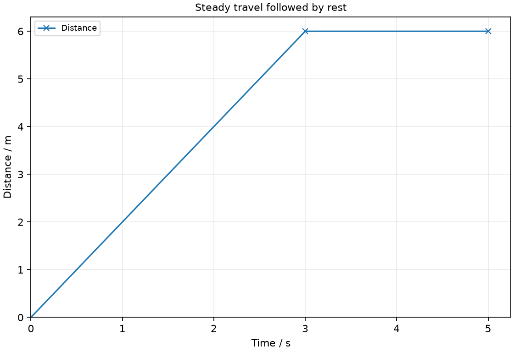
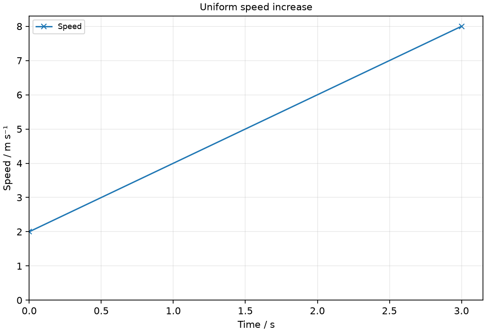
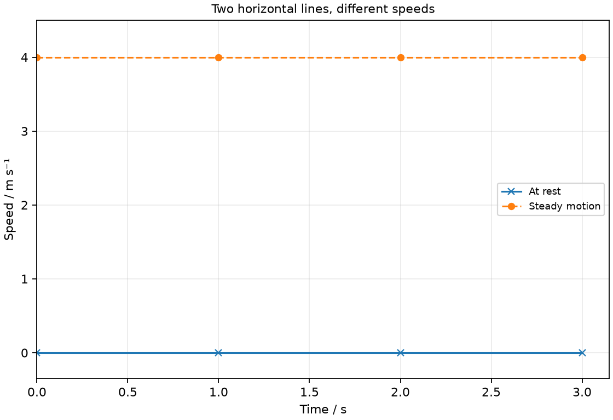
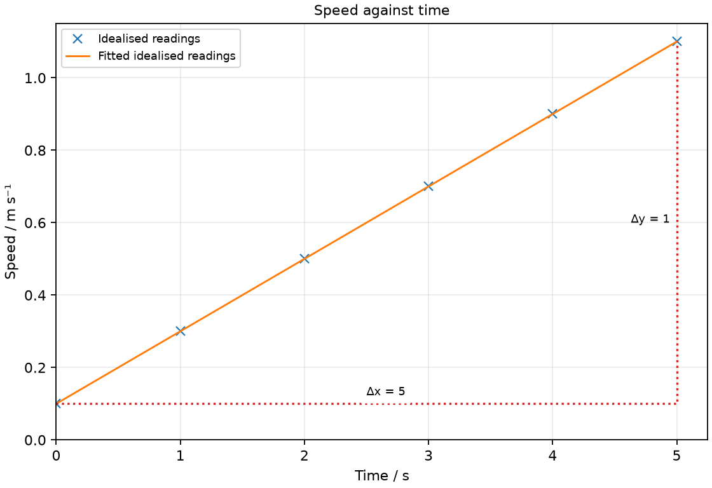
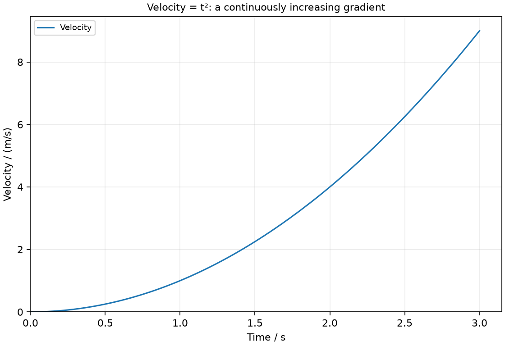

# 5 Position, speed and acceleration

*nam-6118-nssco-2026. Offline study notes, rendered from the approved content units on 2026-10-31. Everything here is also what the flashcards are built from.*

---

## Position, speed and acceleration — 2.3.1

### recognise and state that the concepts ‘position’ and ‘reference point’ (can be represented as x, y or z) are fundamental in the study of speed, velocity and acceleration

Position describes where an object is relative to a chosen reference point. A coordinate and a positive direction make one-dimensional positions unambiguous.

A mark on a straight track can be chosen as x = 0, with east defined as positive. A trolley at x = 2 m is then two metres east of that mark. Choosing a different reference changes the coordinate assigned to the same physical place. It does not by itself move the trolley. State the reference and direction before comparing positions or using their changes to calculate velocity. In two or three dimensions, more than one coordinate is needed to locate an object.

### recognise that position, relative to a reference point, can be either positive or negative

A position can be positive, zero or negative relative to a chosen origin. A negative position identifies one side of the origin; it does not by itself say how the object is moving.

With east positive, x = −4 m locates an object four metres west of the origin. It could be stationary, travelling east or travelling west at that instant. Position and velocity are different quantities. If the origin is moved, the coordinate changes even though the object may stay still. To find displacement, subtract initial position from final position using the same origin and sign convention for both readings.

### define distance as a measure of how far an object travels along a particular path (without considering direction)

Distance is the length of the path travelled. It is a scalar and does not encode the direction between the starting and finishing positions.

Walking 7 m east and then 2 m west gives a travelled distance of 9 m. The return section adds to the path length even though it partly reverses the earlier movement. A route with several bends can have a long distance while the finishing position is close to the start. Keep total path length separate from a coordinate measured from an origin. Units of metres do not distinguish them by themselves; the physical definition does.

### define displacement as a vector which has a magnitude equal to the shortest distance between the initial and final points and a direction from the initial to the final point

Displacement is the directed change in position from start to finish. Its magnitude is the straight-line separation of those positions, with a direction from initial to final position.

For motion on a straight east-positive line, a change from x = −2 m to x = +5 m gives displacement +7 m. An object that returns to its starting point has zero net displacement even if it has travelled a substantial distance. Draw a start-to-finish arrow to separate net displacement from the intermediate route. A negative component is a direction relative to the stated convention, not a negative path length.

### Practice task with worked feedback

Choose one correct option for each original practice question.

1. Which quantity is the full length of a travelled path?
A. Displacement
B. Distance
C. Velocity
D. Acceleration

2. With east positive, what does position −6 m indicate?
A. Six metres west of the origin
B. That the object is slowing
C. A speed of 6 m/s west
D. A negative path distance

3. Which expression gives average velocity?
A. Time / displacement
B. Velocity change / time
C. Total distance / total time
D. Net displacement / total time

4. What does a horizontal speed-time line above zero show?
A. Rest
B. Steady nonzero speed
C. Uniform deceleration
D. Uniform positive acceleration

5. Which unit measures acceleration?
A. m/s²
B. N
C. m/s³
D. m/s

6. What does negative acceleration alone identify?
A. Speed must rise
B. Its direction under the chosen sign convention
C. Motion must be westward
D. Speed must fall

7. When can v = u + at and s = ut + ½at² describe a straight-line journey?
A. For any varying acceleration without modification
B. Only when the object starts from rest
C. Only when all signs are positive
D. When acceleration is constant

8. A learner walks 10 m east then 4 m west. What is the net displacement?
A. 14 m east
B. 0 m
C. 6 m east
D. 6 m west

9. An object travels 36 m in 6 s then 12 m in 6 s. What is its average speed?
A. 6 m/s
B. 2 m/s
C. 8 m/s
D. 4 m/s

10. Velocity changes from 4 m/s to 10 m/s in 3 s. What is the average acceleration?
A. 2 m/s²
B. 14 m/s²
C. 3.33 m/s²
D. 18 m/s²

11. Speed is 5 m/s for 4 s. What distance is represented by that speed-time rectangle?
A. 1.25 m
B. 10 m
C. 20 m
D. 9 m

12. From rest, an object has constant acceleration 1.5 m/s² for 4 s. What is its displacement?
A. 24 m
B. 3 m
C. 12 m
D. 6 m

Worked feedback

1. Key B. A: This measures the directed start-to-finish change. B: Distance adds the path lengths. C: This is a rate, not a path length. D: This describes velocity change per time.

2. Key A. A: The negative coordinate locates the position west of the reference. B: A position coordinate does not determine acceleration. C: Position is not a velocity. D: Path length is a different quantity.

3. Key D. A: This reverses the physical ratio. B: This is average acceleration. C: This is average speed. D: Both direction and the complete interval matter.

4. Key B. A: Rest has zero speed. B: The vertical value is a speed that is not changing. C: This gives a falling speed-time line. D: This gives a rising speed-time line.

5. Key A. A: Velocity changes by metres per second during each second. B: This is force. C: This is rate of acceleration change, not acceleration. D: This is velocity.

6. Key B. A: Acceleration can instead oppose velocity. B: The effect on speed also depends on velocity direction. C: Acceleration sign does not determine current velocity. D: Speed falls only when acceleration opposes velocity.

7. Key D. A: That violates their condition. B: They allow a nonzero u. C: Consistent signed components are permitted. D: Both equations assume acceleration remains unchanged during the interval.

8. Key C. A: This is the total path length with a direction incorrectly attached. B: The learner has not returned to the starting point. C: Subtract the opposing displacement components. D: This reverses the net direction.

9. Key D. A: This uses the first stage alone. B: This uses the second stage alone. C: This adds stage speeds instead of averaging the full journey. D: The total is 48 m in 12 s.

10. Key A. A: The change is 6 m/s over 3 s. B: This adds the velocities without a time ratio. C: This divides final velocity by time and omits u. D: This multiplies the velocity change by time.

11. Key C. A: This divides speed by time instead of using area. B: This adds an unjustified half factor to a rectangle representing steady speed. C: Speed multiplied by duration gives the rectangular area. D: This adds unlike quantities.

12. Key C. A: This omits the factor one half. B: This does not account for the time-squared factor. C: Use one half times acceleration times time squared. D: This is the final speed value with the wrong dimension.

### Practice task with worked feedback

Original structured practice. Answer the parts with working and units where needed.

(a) State whether displacement is scalar or vector. [1]

(b) State the SI unit of acceleration. [1]

(c) Explain why a horizontal distance-time line indicates rest whereas a horizontal speed-time line at 2 m/s does not. [2]

(d) Calculate the constant acceleration for a speed increase from 1 to 7 m/s in 3 s without changing direction. [2]

(e) Calculate the travelled distance for that uniform speed increase from 1 to 7 m/s during 3 s. [2]

Worked feedback

(a) Displacement is a vector.

(b) m/s²

(c) The distance-time line has zero gradient and hence zero speed. A horizontal nonzero speed-time line directly states steady motion.

(d) The acceleration is (7 − 1)/3 = 2 m/s² in the direction of motion.

(e) The trapezium area is ½ × (1 + 7) × 3 = 12 m.

---

## Position, speed and acceleration — 2.3.2

### define speed as a rate of change of distance

Speed is distance travelled per elapsed time. Instantaneous speed describes how rapidly distance is changing at a particular instant.

A vehicle speedometer indicates an instantaneous speed rather than necessarily the average over a whole journey. Average speed uses the total path length and the complete elapsed time being considered. A speed of 6 m/s means six metres of path are covered per second if that speed remains steady. Speed carries no direction, so two objects moving oppositely can have equal speeds. Use a velocity when the direction matters.

### define instantaneous velocity as a ‘rate of change of displacement’ or speed in a given direction

Instantaneous velocity is the rate of change of displacement at an instant. It includes direction as well as the magnitude of motion.

With east positive, velocities +4 m/s and −4 m/s have the same speed but opposite directions. A velocity can change because the speed changes, the direction changes or both change. At this level a straight-line sign convention represents direction clearly. Do not infer direction from a speed-time graph alone unless the motion’s direction is supplied. The unit m/s is shared with speed, so the definition and sign convention must distinguish the two quantities.

### Define average velocity as total displacement divided by total elapsed time

Average velocity is total displacement divided by total elapsed time. It can be zero for a return journey whose average speed is not zero.

If a learner travels 12 m away and then returns to the start in 8 s, the net displacement is zero and the average velocity is zero. The path distance is 24 m, so the average speed is 3 m/s. Stops count in the elapsed time if the requested average covers the full journey. A nonzero average velocity must be given with a direction or a signed component under a stated convention.

### explain what positive and negative values of velocity mean

Positive and negative velocities identify opposite directions under the chosen sign convention. The sign of velocity is independent of whether the speed is increasing or decreasing.

A trolley moving west at a steady 2 m/s has velocity −2 m/s if east is positive. Its negative sign does not mean it is slowing. If it changes from −2 to −5 m/s, its speed grows from 2 to 5 m/s even though the signed velocity decreases. State the chosen positive direction before describing the change. On a position-time graph, a negative gradient indicates motion in the negative coordinate direction.

### Use average speed = total distance / total time, and speed = distance / time

Average speed is total distance divided by total elapsed time. An average over unequal-duration stages cannot generally be found by an unweighted mean of their speeds.

A journey covers 24 m in 6 s and a further 12 m in 6 s. Total distance is 36 m and total time is 12 s, giving 3 m/s. If either stage included a stop, include that stopped interval when calculating a full-journey average. Identify the boundary of the journey before adding distances and times. A simple average of two stage speeds is valid for equal durations, but it should not replace the total-distance method when durations differ.

### plot readings for and interpret a distance-time graph

The gradient of a distance-time graph represents speed. A horizontal section means that travelled distance is not increasing during that interval.

Plot accumulated path distance vertically and elapsed time horizontally. A straight rising segment indicates steady speed; a steeper segment on the same scales indicates a higher speed. A horizontal part indicates rest over the interval. If speed changes smoothly, the graph bends and a local gradient describes the instantaneous speed. A path-distance graph does not decrease when an object turns back: accumulated distance continues to grow. A signed position-time graph can decrease, because its vertical quantity is different.

### plot readings for and interpret a speed-time graph

The gradient of a speed-time graph represents the rate of speed change during straight-line motion of unchanged direction. Area between the speed-time line and the time axis gives travelled distance.

A horizontal line at a positive speed represents steady motion, not rest. A line on the time axis represents zero speed. A straight sloping segment gives uniform speed change, while a curved segment gives a changing rate. Read the vertical quantity before interpreting the shape. For motion whose direction changes, use signed velocity information to determine acceleration direction; a speed graph alone omits that direction. Distance can be found by dividing the area into simple rectangles, triangles or trapezia.

### identify from the shape of a distance-time or speed-time graph when a body is - at rest - moving with constant speed - moving with changing speed

Graph shape must be interpreted using the quantity on the vertical axis. Rest, steady motion and changing motion can look different on distance-time and speed-time graphs.

A horizontal distance-time line means that the accumulated distance does not grow, so the object is at rest. A horizontal speed-time line at 4 m/s describes an object continuing to travel at that speed. A straight rising distance-time line represents steady speed, while a straight rising speed-time line represents increasing speed. State the axis labels before describing any segment. If a line bends, examine how its gradient changes rather than attaching one memorised motion label to every curved line.

### distinguish between speed and velocity by means of similarities and differences

Speed describes the rate of distance travelled without direction. Velocity describes the rate of displacement change and includes direction.

An object moving around a bend at steady speed can still have changing velocity because its direction changes. For straight-line examples, two objects at 5 m/s in opposite directions have equal speeds but different velocities. Whole-journey averages also differ when path distance is greater than the net displacement. A numerical answer expressed in m/s is incomplete as a velocity specification unless the direction is given or implied by a clear sign convention.

### Distinguishing the ideas

Whole-journey average speed uses total path distance and total elapsed time. An arithmetic mean of stage speeds requires equal durations to represent this average.

For 2 m/s during 6 s followed by 5 m/s during 2 s, the distances are 12 m and 10 m. The total is 22 m in 8 s, giving 2.75 m/s. The unweighted mean of the two speeds is 3.5 m/s and would give the shorter fast stage too much influence. Multiplying each stage speed by its duration first preserves how far the object actually travelled. Include any rest interval in a complete-journey time.

### Distinguishing the ideas

A positive horizontal speed-time segment represents steady motion. A horizontal distance-time segment represents no additional path distance and therefore rest over the interval.

Consider graph A at a constant speed of 3 m/s and graph B at a constant accumulated distance of 12 m. During the next two seconds, A adds 6 m to its path, while B adds none. Both lines are horizontal, but they plot different vertical quantities. The error is treating the shape as a motion label without reading the axis. Use the quantity and its unit to decide whether the line directly states a speed or instead requires a gradient to obtain it.

### Steady travel followed by rest

Steady travel followed by rest. Draw a distance-time graph for an object travelling 6 m in the first 3 s at steady speed, then resting for 2 s.

### Uniform speed increase

Uniform speed increase. Draw a speed-time graph for uniform acceleration from 2 m/s at time zero to 8 m/s at 3 s.

### Two horizontal lines, different speeds

Two horizontal lines, different speeds. Draw speed-time lines for an object at rest and an object moving steadily at 4 m/s over 3 s. Label the two cases.

### Practice task with worked feedback

Investigation aim: test whether a model trolley has constant acceleration. These are invented, idealised practice readings; real readings have scatter. 

| Time / s | Speed / m s⁻¹ |
|---:|---:|
| 0 | 0.1 |
| 1 | 0.3 |
| 2 | 0.5 |
| 3 | 0.7 |
| 4 | 0.9 |
| 5 | 1.1 |

(a) Draw Speed / m s⁻¹ vertically against Time / s horizontally. Plot the supplied readings and add a separate fitted line. [5]
(b) Show two widely separated points on your fitted line and calculate its gradient. State the gradient unit. [3]
(c) Plan how to test whether a model trolley has constant acceleration. Name the equipment and arrangement, describe the measurements and repeats, state controls and a relevant precaution, design the results table and explain how the results answer the aim. [8]

Worked feedback

Graph: Speed / m s⁻¹ is vertical and Time / s horizontal. Use the six readings, draw a separate best-fit line and show a wide gradient triangle; do not join scattered readings in a zigzag.

Gradient construction: choose the separated fitted-line points (0, 0.1) and (5, 1.1). Gradient = (1.1 − 0.1) / (5 − 0) = 0.2 m/s². The speed-time gradient is acceleration, 0.20 m/s².

Arrangement: A trolley on a fixed shallow ramp, metre scale and fixed camera with a known frame rate

Plan: 1. Fix a metre scale beside the ramp and a camera square to the trolley path. 2. Record a trolley run with the frame rate known and identify a reproducible starting frame. 3. Read trolley positions at equal frame intervals and record both positions and times. 4. Calculate each interval speed as distance change divided by interval time and assign it to the interval midpoint. 5. Repeat the release and readings with the same ramp slope and trolley.
Control and accuracy: Keep the track slope and drive setting matched between repeats; secure the track and keep the run clear.
Table: Time / s; Speed / m s⁻¹; repeat readings in separate columns. 
Graph and conclusion: A straight speed-time line of constant gradient shows constant acceleration within the measurement uncertainty. Here that gradient is 0.20 m/s²; a changing gradient would indicate changing acceleration.

---

## Position, speed and acceleration — 2.3.3

### define acceleration as the rate of change of velocity

Acceleration is the rate of change of velocity. It has direction and a unit of metres per second per second, written m/s² or m s⁻².

If velocity changes by 6 m/s during 3 s, the average acceleration is 2 m/s² in the direction of that velocity change. For a constant acceleration the same change occurs during each equal time interval. Acceleration need not increase speed: it can oppose the current velocity and reduce the speed. A direction change can also be acceleration even when the speed stays the same. Straight-line examples require a stated positive direction to interpret the signs.

### explain what positive and negative values of acceleration mean

The sign of an acceleration component gives its direction under the chosen coordinate convention. Whether speed increases depends on how the acceleration direction compares with the velocity direction.

For east-positive motion, changing from +7 to +3 m/s gives negative acceleration and a speed decrease. Changing from −3 to −7 m/s also gives negative acceleration, but the speed increases. The word negative therefore cannot be used as a universal synonym for slowing down. Compare initial velocity, final velocity and the chosen positive direction. If velocity and acceleration are oppositely directed, speed decreases while that direction relationship holds.

### identify linear motion for which the acceleration is constant and calculate the acceleration

Constant acceleration gives equal velocity changes during equal time intervals. For uniform straight-line acceleration, a = (v − u)/t.

A model vehicle changing from 1 m/s to 5 m/s in 2 s has acceleration 2 m/s². The velocity-time plot is straight because its gradient stays constant. Identify both ends of the time interval; using the final velocity alone would be valid only if the initial velocity were zero. Include the sign in the velocity difference. The average acceleration formula still gives an interval average for nonuniform motion, but it does not establish that the acceleration was constant throughout.

### identify motion for which the acceleration is not constant

Nonuniform acceleration means that the rate of velocity change varies during the motion. A curved velocity-time graph can show a changing gradient and therefore changing acceleration.

Velocities of 0, 1, 4 and 9 m/s at one-second intervals have successive increases of 1, 3 and 5 m/s. These changes are not equal, so one constant acceleration does not describe the sequence. A secant gradient between distant points gives an average over that interval, while the curve’s local slope describes the instantaneous change. When sketching such motion, choose a smooth changing gradient rather than a straight line simply because the velocity is increasing.

### calculate the area under a speed-time graph to determine the distance travelled for motion with constant acceleration

Distance travelled is the area beneath a speed-time graph over the chosen interval. The graph’s area has units of speed multiplied by time, which reduces to a length.

For a speed rising uniformly from 2 to 6 m/s during 4 s, the trapezium area is one half of the sum of the parallel speed values multiplied by the time width. The distance is 16 m. The gradient of the same line is instead 1 m/s², which is an acceleration. Splitting the area into a rectangle and a triangle gives the same physical distance. With a signed velocity-time graph, signed area gives displacement; adding magnitudes of the appropriate areas is needed for total path distance.

### state that the acceleration of free fall for a body near the Earth’s surface is constant and has a value of approximately 10 m/s 2

Near Earth’s surface, freely falling motion has a gravitational acceleration of approximately 10 m/s² when air resistance is negligible. The acceleration is directed downward and is not the same quantity as the object’s current speed.

A released object begins with an initial speed that may be zero but has a downward acceleration immediately. In the simple model its downward speed then increases by approximately 10 m/s during each second. A thrown object is still accelerated downward while rising, at its highest point and while falling. The sign assigned to this acceleration depends on the chosen positive direction. Air resistance can change the resultant acceleration, so the simple value should not be applied without considering the stated model.

### Use the constant-acceleration equations v = u + at, s = ut + ½at², v² = u² + 2as, a = (v − u)/t and s = (u + v)t/2

Constant-acceleration equations connect u, v, a, t and displacement s for straight-line motion under fixed acceleration. Use v = u + at, s = ut + ½at², v² = u² + 2as and s = (u + v)t/2 only when their constant-acceleration condition applies.

Choose an equation containing the known quantities and the unknown required. To find final velocity from initial velocity, acceleration and time, use v = u + at. To find displacement without a time value, v² = u² + 2as may be appropriate. Use one sign convention for every vector component; displacement can be negative under that convention. An object may reverse direction during an interval, in which case displacement and total path distance differ. Do not replace a changing acceleration with a constant one merely to make an equation convenient. With u = 2 m/s, a = 3 m/s² and t = 4 s, v = u + at = 14 m/s and s = ut + ½at² = 32 m. The same displacement is (u + v)t/2 = 32 m. For a drop from rest through 20 m with constant g = 10 m/s² and negligible drag, v² = u² + 2as = 400 m²/s², so v = 20 m/s downward and t = v/g = 2 s. Each equation requires straight-line constant acceleration.

### Distinguishing the ideas

Speed-time area gives distance, whereas speed-time gradient gives a rate of speed change. Their different units distinguish the two operations.

A straight line rising from 1 to 5 m/s over 2 s has area 6 m and gradient 2 m/s². The first result combines speed with time; the second divides a speed change by a time change. Calling the slope the distance is not a small numerical slip: it uses the wrong relationship between the plotted quantities. Identify the requested quantity before selecting the graphical operation.

### Velocity = t²: a continuously increasing gradient

Velocity = t²: a continuously increasing gradient. Draw a velocity-time trend through readings 0, 1, 4 and 9 m/s at times 0, 1, 2 and 3 s to show increasing acceleration.

### Further practice: Calculate displacement for straight-line motion with u = 2 m/s, constant a = 3 m/s² and t = 4 s.

s = ut + ½at² = 2 × 4 + 0.5 × 3 × 16 = 32 m.

### Further practice: Calculate final speed after a body starts from rest and moves 20 m downward with constant acceleration 10 m/s²; ignore air resistance.

v² = u² + 2as = 400 m²/s², so v = 20 m/s downward.
