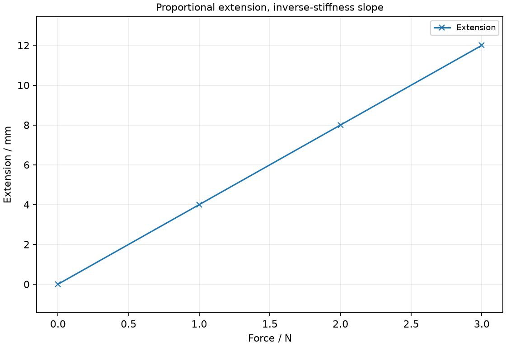
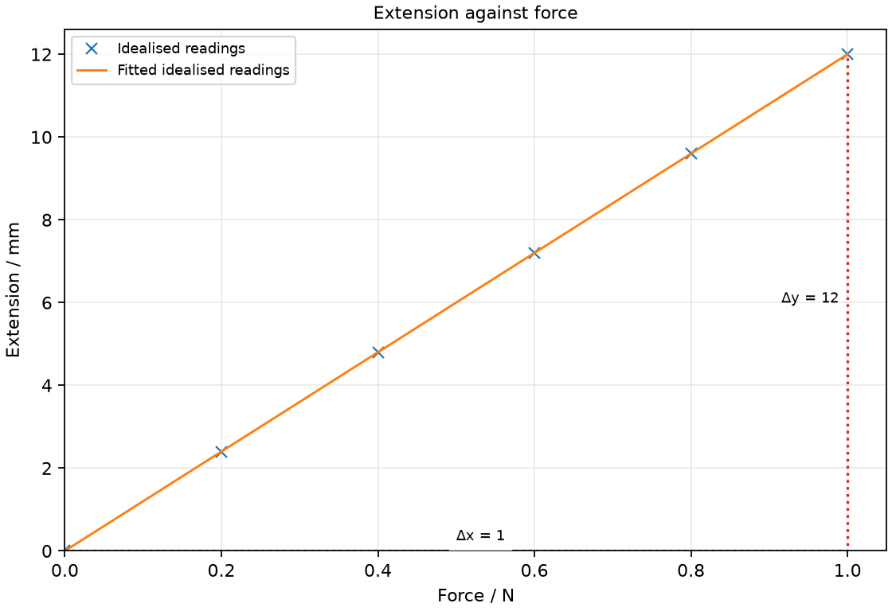

# 6 Forces, springs and momentum

*nam-6118-nssco-2026. Offline study notes, rendered from the approved content units on 2026-10-31. Everything here is also what the flashcards are built from.*

---

## Forces, springs and momentum — 2.4

### state that a force, measured in newtons, may produce a change in size, shape or velocity of a body and relate these ideas to Newton’s first and second laws of motion

A force can deform a body or contribute to a change in its velocity. For constant mass, the resultant force determines acceleration through F = ma; zero resultant allows rest or constant velocity.

A force is an interaction between objects, measured in newtons. Newton’s first law states that an object keeps its velocity unless a resultant force changes it. A nonzero driving force can be balanced by resistance, so the presence of a force does not alone establish acceleration. Newton’s second law relates acceleration to the vector sum of the forces, not to one selected force when others also act. A force can also change size or shape when a body deforms.

### describe the ways in which a force may change the motion of a body

A resultant force can change speed, direction or both. A change of velocity can occur even when the speed itself stays unchanged.

A ball speeding up along a straight line changes velocity through its magnitude. A ball slowing down has a velocity change opposing its motion. A moving object that turns also changes velocity because direction is part of a vector. In each case identify the resultant force rather than assuming that the direction of motion is the direction of the force. A force can act on a moving body without increasing its speed.

### identify in everyday life:  different forces (e.g. contact, electrical, magnetic, gravitational, weight, tension, friction and air resistance)  the agent applying the force  the object the force is applied to

A force description should identify its type, the object exerting it and the object receiving it. Several different interactions can act on the same body at the same time.

A book on a table experiences gravitational attraction from Earth and a contact force from the table. These forces act on the book, but come from different agents. A rope can add a tension, and sliding can introduce friction. A force diagram should show the forces on the chosen body, not a mixture of forces on several unrelated objects. Labelling the interaction clarifies which forces must be combined when finding that body’s resultant.

### Identify contact and normal forces

A normal contact force acts perpendicular to the contact surface. Its direction follows the surface orientation rather than a fixed upward direction.

For a book on a horizontal desk the support force is upward, but a wall’s normal force is horizontal. Other contact components, such as friction, can act along the surface. Identify the relevant contact before choosing an arrow direction. A support force need not equal weight if other forces or vertical acceleration affect the body.

### Identify an electrical force

Electrical forces arise from interactions involving electric charge. They can attract or repel depending on the charge arrangement.

A charged rod can exert a force without touching another charged object. In simple charge comparisons, like charges repel and unlike charges attract. Attraction can also occur through induced charge redistribution, so attraction by itself does not establish that an initially neutral object carried the opposite net charge. Distinguish electrical interactions from the magnetic action of a magnet.

### Identify a magnetic force

Magnetic forces act in interactions involving magnets, magnetic materials or suitable moving charges and currents. Two magnetic poles can attract or repel according to their orientation.

A bar magnet can pull an iron object without direct contact. Two magnets can repel, whereas attraction alone does not prove that a piece of iron is itself a permanent magnet. Magnetic force direction should be inferred from the actual pole or field arrangement. A magnet does not attract every material simply because it is a solid.

### Identify gravitational force and weight

Weight is the gravitational force on a body. Near Earth, its direction is toward Earth’s centre rather than away from the supporting surface.

A suspended load still has weight even when a rope prevents it falling. Its mass is a property measured in kilograms, whereas weight is a force measured in newtons. A surface or rope may balance that weight, but balance does not remove the gravitational interaction. The mass–weight calculation is developed in topic 7.

### Identify tension

Tension is the pulling force transmitted by a taut rope, string or cable. At the attachment it acts along the rope away from the object being pulled.

A simple rope can pull a load but does not push it along its length in the same way. Draw the tension direction from the actual rope segment attached to the chosen body. A slack rope may transmit no appreciable tension. Do not automatically set tension equal to weight when the load accelerates or when the rope is inclined.

### Identify friction and air resistance

Friction opposes relative sliding or its tendency at a contact; air resistance opposes relative motion through air. These resistive forces are distinct from the weight of the object.

A sliding block can slow because of surface friction, while a falling object can experience upward air resistance. The size depends on the interaction and conditions. Friction is not necessarily backward relative to the overall motion of a vehicle: it can provide the forward force from a driven tyre. Specify the bodies or medium when identifying which relative motion is opposed.

### Identify the force agent and the object acted on

The force agent is the body or field source exerting the interaction on the chosen object. Naming the receiving object prevents forces on different bodies from being mixed in one resultant.

For a magnet pulling a steel pin, the magnet is the agent and the pin receives the described force. For a hand pulling a rope, identify whether the question concerns the rope or an attached load before labelling its force. A complete statement such as the rope pulls the load upward communicates more than the word tension by itself.

### find the resultant of two or more forces acting along the same line

Collinear forces can be combined using signed components along a chosen positive direction. Opposing directions use opposite signs, so the resultant may be smaller than either of the competing force totals.

With east positive, a pull of +18 N and resistance of −7 N give a resultant of +11 N. If the values become +7 N and −18 N, the resultant is −11 N, meaning west. Do not add magnitudes when arrows oppose. A zero resultant can occur with several nonzero forces acting. Combine forces on the same body when applying the result to its acceleration.

### plot and interpret extension-load graphs, describe the associated experimental procedure and use proportionality in simple calculations

Spring extension is loaded length minus unloaded length. Within a proportional range, extension is directly proportional to the applied load.

Measure the unloaded spring length before adding loads. At each known load, record the new length and subtract the original length. Plot extension against force to see whether the trend is a straight line through the origin. If force is vertical and extension horizontal, the slope is stiffness k; reversing these axes gives reciprocal stiffness. Increase loads gently, avoid overloading and let the spring settle before reading. The loaded length itself is not the extension unless the original length were zero.

### state Hooke's law and recall and use the expression F = kx where F is the force applied, k is the spring constant and x is the extension of the spring

Within its limit of proportionality, a spring obeys F = kx, where x is extension and k is stiffness. In SI units F is in newtons, x in metres and k in newtons per metre.

If 3 N extends a spring by 0.015 m within its proportional range, k is 200 N/m. Use extension rather than total length and convert millimetres to metres before obtaining k in N/m. A larger k means more force is required for the same extension. Do not assume the relation remains valid after the extension-load trend curves away from proportionality. The graph orientation determines whether the measured slope is k or its reciprocal. Hooke’s law states that extension grows in direct proportion to the applied force up to the limit of proportionality; F = kx. Newton’s first law says that an object remains at rest or at constant velocity if its resultant force is zero. Friction opposes relative slipping or the tendency to slip at contacting surfaces.

### identify the 'limit of proportionality' for an extension-load graph

The limit of proportionality marks where force and extension cease to follow a proportional straight-line relationship. Beyond that point, F/x is not represented by one unchanged proportional stiffness.

Look for departure from the initial straight trend in an extension-load graph. This limit is not automatically the same as the point at which the spring breaks or remains permanently stretched; those are different observations. If the data extend beyond the proportional region, do not use a single earlier k value to predict the entire response. In practical work use a suitable load range and stop before damage or unsafe loads occur.

### Relate resultant force, mass and acceleration using F = ma, including their directions

For constant mass, resultant force equals mass multiplied by acceleration. The acceleration direction is the direction of the resultant force, expressed using a consistent sign convention.

A 2 kg trolley with a resultant force of 6 N has acceleration 3 m/s². If 6 N is only the driving force and a resistance also acts, first calculate the resultant before using F = ma. Convert grams to kilograms when using newtons and m/s². A body can move steadily with a nonzero driving force if another force balances it. Its present velocity is not itself a measurement of acceleration.

### recall and use the formula momentum = mass × velocity

Momentum is mass multiplied by velocity. It is a vector, so its direction or signed component follows the velocity direction.

A 0.50 kg object moving west at 4 m/s has momentum 2 kg m/s west. With east chosen positive, the component is −2 kg m/s. A stationary object has zero momentum even though its mass is not zero. When several objects are considered, add signed momentum components rather than adding speed magnitudes indiscriminately. The unit kg m/s is equivalent to N s, linking momentum change with a force acting over time.

### recall and use the change in momentum = force × time of action

A resultant force acting over a time interval changes momentum. For a constant or appropriate average resultant force, Δp = FΔt.

If a 10 N average resultant acts for 0.20 s, the momentum change is 2.0 N s in the force direction. The change is final momentum minus initial momentum. If an object stops, its final momentum is zero and the change opposes its initial motion. For the same required momentum change, increasing the stopping time reduces the average force. That is why cushioning can reduce a stopping force without changing the original momentum that must be removed.

### define the principle of conservation of momentum as when two or more objects interact, their total momentum remains constant, provided that no external resultant force is acting on them

A system’s total momentum is conserved when no external resultant force acts on that system. Momentum can transfer between its interacting bodies while the system total stays unchanged under that external-force condition.

Choose the system boundary before applying the principle. Forces between two colliding trolleys are internal to the combined two-trolley system, but a push from a person outside it is external. Individual trolley momenta need not stay constant during their interaction. If the external resultant is negligible during a short collision, comparing the total immediately before and after is a useful model. Do not extend the conclusion to a system receiving a significant external impulse.

### apply the conservation of momentum in simple applications, including elastic and inelastic collisions between two bodies in one dimension (definitions of an elastic and inelastic collision are not required)

In a one-dimensional collision model with no external resultant force, total signed momentum before equals total signed momentum after. For objects that remain together, their shared final momentum is their combined mass multiplied by their common velocity.

Two trolleys of masses 0.30 kg and 0.20 kg initially moving at +2 m/s and zero have total momentum +0.60 kg m/s. If they remain together and the external resultant is negligible, their common velocity is +1.2 m/s. Opposite initial directions require opposite signs. For a rebound, retain the final velocity sign as well. The supplied masses and directions, rather than a memorised all-positive formula, determine each term. Only the one-dimensional momentum application is needed here.

### Distinguishing the ideas

Constant velocity means zero acceleration and therefore zero resultant force for constant mass. Individual forces can still be present and balanced.

A powered cart can travel steadily while a motor drives it forward and resistance acts backward. If the forward force is 14 N and the motion has constant velocity, the opposing total is also 14 N in the simple collinear model. The resultant is zero, not 14 N. Removing the drive while resistance remains changes the balance and can slow the cart. The error is confusing a named applied force with the total force on the body.

### Distinguishing the ideas

Total momentum conservation requires no external resultant force on the chosen system. An external impulse can change the momentum of that system.

Compare two coasting trolleys interacting with each other and a trolley being pushed by a person outside the selected system. Internal transfers can preserve the combined trolley momentum when the external resultant is negligible. The outside push supplies a momentum change, so the same unchanged-total statement is not justified. Naming the system and its external forces matters more than simply recognising that a collision or movement occurs.

### Distinguishing the ideas

Opposing velocities use opposite signs in a one-dimensional momentum sum. With no external resultant force, that signed sum is the quantity conserved through the interaction.

Choose east as positive. A 2 kg object moving east at 3 m/s contributes +6 kg m/s, while a 1 kg object moving west at 2 m/s contributes −2 kg m/s. The total is +4 kg m/s, not the sum of the speed magnitudes. If the objects remain together with negligible external resultant, divide that signed total by the combined mass. A negative answer in another example would mean common motion west under the same convention.

### Proportional extension, inverse-stiffness slope

Proportional extension, inverse-stiffness slope. Draw an extension-versus-load graph for forces 0, 1, 2, 3 N producing extensions 0, 4, 8, 12 mm.

### Practice task with worked feedback

Choose one correct option for each original practice question.

1. What is the direction of a normal contact force?
A. Parallel to surface
B. Perpendicular to the contact surface
C. Opposite weight for that interaction
D. Along resultant force

2. Which interaction is tension?
A. A taut string pulling a load
B. Earth attracting a stone
C. A table pressing perpendicular to a book
D. Air slowing a falling object

3. A cart moves with constant velocity. What is its resultant force in a constant-mass model?
A. Downward weight
B. Sum of force magnitudes
C. Forward driving force
D. Zero

4. What is spring extension?
A. Loaded length
B. Loaded plus unloaded length
C. Unloaded minus loaded length
D. Loaded length minus unloaded length

5. Where does the limit of proportionality occur?
A. Where elastic return first becomes imperfect
B. At the largest measured force regardless of shape
C. Where the initial proportional graph trend ends
D. Where spring finally breaks

6. What condition permits a system’s total momentum to be conserved?
A. No external resultant force
B. Equal masses of colliding bodies
C. No kinetic energy loss
D. Zero total momentum initially

7. Which unit represents momentum?
A. kg m/s²
B. J/s
C. kg m/s
D. N/m

8. Forces of 17 N east and 5 N west act on one body. What is their resultant?
A. 22 N east
B. 12 N east
C. 0 N
D. 12 N west

9. A spring within its proportional range has k = 80 N/m and extension 0.025 m. What is the force?
A. 2.0 N
B. 0.0003125 N
C. 80.025 N
D. 3200 N

10. A 4 kg object has a 10 N resultant force. What is its acceleration?
A. 0.4 m/s²
B. 2.5 m/s²
C. 40 m/s²
D. 10 m/s²

11. A 0.30 kg trolley moves at 4 m/s east. What is its momentum?
A. 1.2 kg m/s west
B. 0.075 kg m/s east
C. 1.2 kg m/s east
D. 13.3 kg m/s east

12. An average resultant of 8 N acts east for 0.25 s. What momentum change does it cause?
A. 8.25 N s east
B. 0 N s
C. 32 N s east
D. 2 N s east

Worked feedback

1. Key B. A: That is a tangential force. B: The normal direction is defined by the surface. C: Normal follows surface geometry, not always vertical. D: The resultant may combine several directions.

2. Key A. A: The string transmits a pull along itself. B: That is gravitational force. C: That is normal contact. D: That is drag.

3. Key D. A: Support balances weight. B: Resultant is a signed/vector sum. C: Resistive forces balance it. D: Zero acceleration implies zero resultant.

4. Key D. A: Unloaded length must be subtracted. B: Sum includes the original length twice. C: This gives the wrong sign for extension. D: It is the increase in length.

5. Key C. A: Elastic limit and proportional limit are distinct. B: Departure from straight proportional trend is the criterion. C: The force/extension ratio ceases to be constant. D: Breakage is a later condition.

6. Key A. A: This excludes a net external momentum transfer. B: Unequal masses can also conserve momentum. C: Momentum can be conserved in an inelastic collision. D: A system may conserve nonzero momentum.

7. Key C. A: This is a force unit. B: This is power. C: Momentum is mass times velocity. D: This can represent spring stiffness.

8. Key B. A: This adds opposing magnitudes. B: The opposing components subtract. C: The forces are unequal. D: This reverses the stronger direction.

9. Key A. A: Use F = kx. B: This reverses the ratio. C: This adds quantities with different units. D: This divides instead of multiplying.

10. Key B. A: This reverses the quotient. B: Divide resultant force by mass. C: This multiplies force and mass. D: This ignores the stated mass.

11. Key C. A: This reverses the momentum direction. B: This divides mass by velocity. C: Multiply mass by velocity and retain direction. D: This divides velocity by mass.

12. Key D. A: This adds incompatible quantities. B: A nonzero external resultant over time changes momentum. C: This divides by time. D: Multiply force by its duration.

### Practice task with worked feedback

Original structured practice. Answer the parts with working and units where needed.

(a) State the name of the pulling force in a taut rope. [1]

(b) State the graph feature indicating the end of spring proportionality. [1]

(c) Explain why balanced forces can act on a cart moving steadily along a straight track. [2]

(d) Calculate k for a spring extended by 0.030 m under 6 N within its proportional range. [2]

(e) Calculate the acceleration of a 2.5 kg body under a resultant force of 15 N west. [2]

Worked feedback

(a) Tension.

(b) The trend departs from its initial proportional straight line.

(c) Steady velocity means zero acceleration and zero resultant; a forward drive can be matched by the opposing resistance.

(d) k = F/x = 6/0.030 = 200 N/m.

(e) a = F/m = 15/2.5 = 6.0 m/s² west.

### Practice task with worked feedback

Investigation aim: test spring extension as applied force increases within its elastic range. These are invented, idealised practice readings; real readings have scatter. 

| Force / N | Extension / mm |
|---:|---:|
| 0 | 0 |
| 0.2 | 2.4 |
| 0.4 | 4.8 |
| 0.6 | 7.2 |
| 0.8 | 9.6 |
| 1 | 12 |

(a) Draw Extension / mm vertically against Force / N horizontally. Plot the supplied readings and add a separate fitted line. [5]
(b) Show two widely separated points on your fitted line and calculate its gradient. State the gradient unit. [3]
(c) Plan how to test spring extension as applied force increases within its elastic range. Name the equipment and arrangement, describe the measurements and repeats, state controls and a relevant precaution, design the results table and explain how the results answer the aim. [8]

Worked feedback

Graph: Extension / mm is vertical and Force / N horizontal. Use the six readings, draw a separate best-fit line and show a wide gradient triangle; do not join scattered readings in a zigzag.

Gradient construction: choose the separated fitted-line points (0, 0) and (1, 12). Gradient = (12 − 0) / (1 − 0) = 12 mm/N. The slope is extension per force, 12 mm/N. Stiffness is its reciprocal: 1/0.012 = about 83 N/m.

Arrangement: A clamped spring, pointer, millimetre ruler, mass hanger and slotted masses with a stated g

Plan: 1. Clamp the spring securely and align a millimetre ruler with its pointer. 2. Record unloaded pointer length. 3. Add 20 g masses in steps up to 100 g including the hanger as appropriate, using the stated g = 10 N/kg to calculate force. 4. Wait for oscillations to settle at each force, read pointer length squarely and subtract unloaded length. 5. Unload in the same steps and record repeat lengths to check return to the original position.
Control and accuracy: Use the same spring and reference point, read the scale perpendicularly and protect against falling loads or overload.
Table: Force / N; Extension / mm; repeat readings in separate columns. 
Graph and conclusion: The slope is extension per force, 12 mm/N. Stiffness is its reciprocal: 1/0.012 = about 83 N/m. Compare repeated readings and report the tested range rather than claiming an exact law from scattered observations.

### Further practice: Define Hooke’s law, including its limit.

Spring extension changes in proportion to applied force while the limit of proportionality is not exceeded.

### Further practice: State Newton’s first law, including the force condition.

With zero resultant force, an object stays at rest or continues moving at the same velocity.

### Further practice: State what friction opposes between two touching surfaces.

Friction opposes their relative sliding or tendency to slide.

### Friction at a contact

Friction is a contact force opposing relative sliding or the tendency to slide at touching surfaces. Static friction provides grip before slip, while sliding friction resists existing slip. For a shoe on the ground, the ground is the agent and the shoe receives the friction force.
