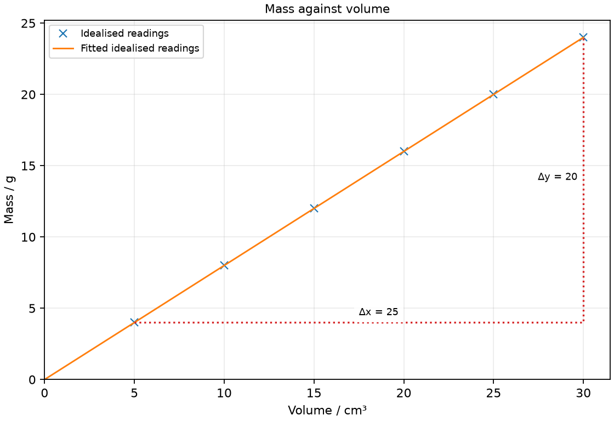

# 7 Mass, weight and density

*nam-6118-nssco-2026. Offline study notes, rendered from the approved content units on 2026-10-31. Everything here is also what the flashcards are built from.*

---

## Mass, weight and density — 2.5

### define the mass of a body as a measure of the matter in it and that mass depends on the number of particles the body contains and the mass of those atoms

Mass is a measure of the matter in an object. It depends on the particles present and their masses, rather than being the gravitational force on them.

An object can be moved to a different gravitational field without losing material. Its mass then stays the same in the ordinary school model, even though its weight changes. Record mass in kilograms or a clearly stated compatible unit such as grams. A balance compares masses or infers mass from a calibrated force measurement, so its operating principle matters when discussing another location. Distinguish an object’s mass from its apparent support or scale force in a changing-motion situation.

### define inertia as the property of mass which 'resists' change in motion (Newton’s first law of motion)

Inertia is the resistance of an object’s motion to change, associated with its mass. For the same resultant force, a greater mass produces a smaller acceleration.

A loaded trolley needs a larger resultant force than an otherwise similar empty trolley to obtain the same acceleration. This is not because an additional force called inertia pushes backward. The relationship F = ma already connects the mass with the required force and acceleration. An object continues with its existing velocity when its resultant force is zero. In everyday motion, friction can hide that behaviour by providing a real opposing interaction.

### define gravitational field strength (g) as the gravitational force or weight per unit mass

Gravitational field strength is gravitational force per unit mass. It can be written g = W/m and has units N/kg.

If a 2 kg object has weight 20 N at a location, the gravitational field strength there is 10 N/kg. A different test mass gives the same field value in the same approximately uniform region. The field strength is not the weight of every object; the weight also depends on mass. State the location or supplied model when using a numerical g value. The familiar near-Earth approximation is useful for school calculations but is not a claim that gravitational fields have equal strengths everywhere.

### state that gravitational field strength (g) is equal to the gravitational acceleration (a)

Gravitational field strength in N/kg has the same numerical value as free-fall acceleration in m/s² for the local field. This follows by combining W = mg with resultant force = ma when gravity is the relevant resultant.

If air resistance is negligible, a falling object is accelerated by its weight, so ma = mg and its downward acceleration is g. The two forms of unit describe different definitions of the same local gravitational effect. A value near 10 N/kg corresponds to approximately 10 m/s². Do not apply the free-fall acceleration directly to a falling object whose air resistance is substantial; the gravitational field remains present but the resultant force is then smaller than weight.

### describe qualitatively the motion of bodies falling in a uniform gravitational field with and without air resistance, including reference to terminal velocity

Without appreciable air resistance, an object falls with the local gravitational acceleration. With resistance, increasing drag can reduce the downward resultant until weight and drag balance at terminal velocity.

Just after release from rest, drag may be small, so the downward acceleration is close to g. As speed grows, drag increases and the downward acceleration becomes smaller. At terminal velocity, the resultant is zero because drag balances weight; the object continues downward at a steady speed. Its weight has not vanished. Opening a parachute increases drag and can produce an upward resultant while the person is still moving downward, reducing that speed toward a new terminal value.

### recall and use the equation weight = mass × gravitational field strength and know that near the Earth’s surface g is approximately 10 N/kg

Weight is the gravitational force on an object, given by W = mg. Use kilograms with g in N/kg to obtain weight in newtons.

A 0.75 kg object has weight 7.5 N in a field of 10 N/kg. An object of the same mass would have a different weight where g differs. Convert a mass given in grams before multiplying by an SI field strength. A force measured in newtons must not be reported as a mass in kilograms without using the field relation. Near Earth’s surface, g ≈ 10 N/kg is the stated school approximation unless another value is supplied.

### determine the mass of an object from its weight (using a balance or a spring)

A known weight can be used to infer mass by dividing by the local gravitational field strength. A spring balance responds to force and must be interpreted using its calibration.

If a force instrument reports a weight of 3.2 N and the field strength is 10 N/kg, the inferred mass is 0.32 kg. Check the instrument zero and use an appropriate range. An electronic balance often displays grams or kilograms directly after calibration, but this does not make mass and force the same quantity. When comparing measurements between different gravitational environments, distinguish a true comparison of masses from a force-based device calibrated for a particular field.

### Distinguishing the ideas

Mass and weight are different quantities, so changing gravitational field strength changes weight without necessarily changing mass. For the same unchanged object, W = mg links the changed field to the changed force.

A sealed object of mass 3 kg moved from a field of 10 N/kg to one of 2 N/kg retains 3 kg of mass in this model. Its weight changes from 30 N to 6 N. Reporting the new weight as 6 kg confuses a force with matter quantity. The mass could change if material were added or removed, but that is a separate physical change, not the effect of the field alone.

### Practice task with worked feedback

Choose one correct option for each original practice question.

1. Which unit represents mass?
A. N
B. Pa
C. kg
D. N/kg

2. Which property is associated with resistance to a change of motion?
A. Density
B. Momentum
C. Weight
D. Inertia

3. What is gravitational field strength?
A. Weight per mass
B. Weight per volume
C. Mass divided by weight
D. Weight times mass

4. At downward terminal velocity, what is the resultant on the falling body?
A. Weight downward
B. Zero
C. Weight plus drag magnitudes
D. Drag upward

5. Which expression gives density?
A. Mass times volume
B. Weight divided by volume
C. Volume divided by mass
D. Mass / volume

6. Which defect makes the displacement volume of a fully submerged solid too large?
A. Reading initial level too high
B. Losing liquid while lowering the object
C. Failing to immerse the object fully
D. Trapped bubbles on the submerged object

7. At approximately what temperature is liquid water densest?
A. 10 °C
B. 20 °C
C. 4 °C
D. 0 °C

8. What is the weight of a 0.60 kg sample where g = 10 N/kg?
A. 6.0 N
B. 6.0 kg
C. 0.060 N
D. 600 N

9. A sample weighs 4.5 N in a 10 N/kg field. What is its mass?
A. 4.5 kg
B. 45 kg
C. 0.45 kg
D. 0.45 N

10. A mass of 36 g occupies 12 cm³. What is its density?
A. 0.333 cm³/g
B. 3 g/cm³
C. 24 g/cm³
D. 432 g/cm³

11. A vessel is 22 g empty and 70 g with liquid. What is the liquid mass?
A. 70 g
B. 48 g
C. 22 g
D. 92 g

12. An immersed solid raises water from 28 to 37 cm³. What is its volume?
A. 9 cm³
B. 65 cm³
C. 28 cm³
D. 37 cm³

Worked feedback

1. Key C. A: Newtons measure force. B: This measures pressure. C: Mass is measured in kilograms. D: This is gravitational field strength.

2. Key D. A: This is mass per volume. B: This depends on velocity as well as mass. C: This is gravitational force. D: Mass is associated with inertia.

3. Key A. A: This gives g = W/m. B: That is not force per mass. C: This is reciprocal field strength. D: The correct ratio is W/m.

4. Key B. A: Drag balances it at terminal speed. B: Drag and weight balance. C: Opposite forces must be subtracted. D: Weight balances this force.

5. Key D. A: Density is a ratio. B: Weight is not mass. C: This is reciprocal density. D: It compares the mass with occupied volume.

6. Key D. A: This subtracts too much and underestimates the displacement. B: This reduces the final level, underestimating displacement. C: This displaces too little liquid. D: They can increase the apparent displaced volume.

7. Key C. A: Warming above 4 °C lowers its density. B: This is not the density maximum. C: This is the maximum-density region. D: Water's liquid density maximum is near 4 °C.

8. Key A. A: Multiply mass by field strength. B: This reports force as a mass. C: This divides by g. D: This mishandles the mass scale.

9. Key C. A: This equates the numerical force and mass. B: This multiplies instead of dividing. C: Divide weight by g. D: This retains a force unit for a mass result.

10. Key B. A: This is reciprocal density. B: Divide 36 by 12. C: This subtracts unlike quantities. D: This multiplies mass and volume.

11. Key B. A: This includes the vessel. B: Subtract the empty-vessel mass. C: This is the empty-vessel mass alone. D: This adds the two measured masses.

12. Key A. A: Use the volume increase. B: This adds the levels. C: This is the starting water volume. D: This includes the original water.

### Practice task with worked feedback

Original structured practice. Answer the parts with working and units where needed.

(a) State the SI unit of mass. [1]

(b) State a suitable unit for density when mass is in grams and volume in cubic centimetres. [1]

(c) Explain why the mass of an empty vessel must be subtracted when finding liquid density. [2]

(d) Calculate the density of 28 g of liquid occupying 35 cm³. [2]

(e) Calculate the weight of a 1.8 kg sample where g = 10 N/kg. [2]

Worked feedback

(a) kg

(b) g/cm³

(c) The combined mass includes material that is not part of the liquid volume. Subtraction isolates the mass of the sample whose volume is measured.

(d) The density is 28/35 = 0.80 g/cm³.

(e) W = mg = 18 N.

---

## Mass, weight and density — 2.6

### Relate density to mass and volume using density = mass / volume

Density is mass per volume, ρ = m/V. The chosen mass and volume must refer to the same material sample.

A sample of mass 54 g and volume 20 cm³ has density 2.7 g/cm³. A larger piece of the same uniform material has a greater mass and volume in the same ratio under the same conditions. Density is not total mass alone: a small dense object can have less mass than a large low-density object. Common units are kg/m³ and g/cm³; one g/cm³ is 1000 kg/m³. In a mass-versus-volume graph, the gradient can give density; swapping the axes gives its reciprocal.

### describe an experiment to determine the density of a liquid and of a regularly shaped solid

Density determination requires separate measurements of a sample’s mass and volume. For a liquid, subtract the empty-container mass; for a regular solid, calculate volume from measured dimensions.

For a liquid, weigh the empty dry vessel, then the vessel with the measured liquid. Their mass difference is the liquid mass. Read the liquid volume using a suitably graduated cylinder. For a cuboid solid, measure length, width and height with an appropriate instrument and multiply them. A cylinder instead requires its radius and height. Check that the volume is the material volume of interest rather than an unrelated container capacity. Divide the sample mass by that volume and state the resulting unit.

### describe the determination of the density of an irregularly shaped solid by the method of displacement

An irregular solid’s volume can be measured by displacement of a suitable liquid. The liquid-volume increase equals the volume immersed when the object is fully submerged without trapped bubbles or significant liquid absorption.

Read the initial volume, lower the object carefully and read the new level. A change from 35 cm³ to 43 cm³ corresponds to an immersed volume of 8 cm³. Measure the object’s mass separately and divide by that displaced volume. Choose a liquid that does not dissolve or react with the sample in the intended experiment. If the object floats or absorbs the liquid, the simple fully submerged nonabsorbing method needs modification rather than an uncritical subtraction.

### describe floating and sinking in terms of different densities

An object’s average density relative to a fluid helps predict floating or sinking. For a simple fully immersed comparison, an object denser than the fluid tends to sink, while a lower-average-density object can float partly immersed.

A hollow boat can float even though some of its construction material is denser than water, because its overall volume includes enclosed air. Use the average density of the whole floating object rather than the density of one piece of its material. An object of approximately equal density can remain suspended when other effects are small. The amount immersed at equilibrium adjusts until the fluid’s support balances the object’s weight.

### state that the density of water around 4  C is a maximum and explain how this is an advantage to aquatic life

Liquid water has its maximum density at approximately 4 °C. Cooling below that region makes it less dense, and ice is also less dense than liquid water.

As surface water cools toward 4 °C, its increased density can make it sink and promote mixing. Water cooled below 4 °C can remain nearer the surface, and ice forms there rather than sinking as a dense solid. A surface ice layer can reduce further heat loss from the liquid underneath. This helps explain how aquatic organisms may remain in liquid water below an icy surface. Do not claim the whole lake must be at exactly 4 °C; actual temperatures depend on mixing and conditions. In a simple quiet freshwater winter model the deep liquid can remain near 4 °C; actual temperature profiles depend on mixing and weather, so this is not a fixed temperature for every lake.

### Practice task with worked feedback

Investigation aim: measure the density of a light mineral-oil sample. These are invented, idealised practice readings; real readings have scatter. 

| Volume / cm³ | Mass / g |
|---:|---:|
| 5 | 4 |
| 10 | 8 |
| 15 | 12 |
| 20 | 16 |
| 25 | 20 |
| 30 | 24 |

(a) Draw Mass / g vertically against Volume / cm³ horizontally. Plot the supplied readings and add a separate fitted line. [5]
(b) Show two widely separated points on your fitted line and calculate its gradient. State the gradient unit. [3]
(c) Plan how to measure the density of a light mineral-oil sample. Name the equipment and arrangement, describe the measurements and repeats, state controls and a relevant precaution, design the results table and explain how the results answer the aim. [8]

Worked feedback

Graph: Mass / g is vertical and Volume / cm³ horizontal. Use the six readings, draw a separate best-fit line and show a wide gradient triangle; do not join scattered readings in a zigzag.

Gradient construction: choose the separated fitted-line points (5, 4) and (30, 24). Gradient = (24 − 4) / (30 − 5) = 0.8 g/cm³. The mass-versus-volume gradient is density, 0.80 g/cm³ = 800 kg/m³. Total container-plus-liquid mass would instead have a container-mass intercept.

Arrangement: A balance, dry beaker, measuring cylinder and a room-temperature light mineral-oil sample; keep away from ignition sources

Plan: 1. Check the balance zero and weigh the dry empty beaker. 2. Measure 5 cm³ of the mineral oil in the cylinder, reading its meniscus squarely. 3. Transfer to the beaker, weigh beaker plus oil and subtract empty-beaker mass. 4. Repeat for 10, 15, 20, 25 and 30 cm³ total volumes, recording the oil mass for each. 5. Repeat volume and mass measurements with a dry container and record the repeated results.
Control and accuracy: Use the same liquid at a similar temperature and the same dry container; correct tare and avoid bubbles or spills.
Table: Volume / cm³; Mass / g; repeat readings in separate columns. 
Graph and conclusion: The mass-versus-volume gradient is density, 0.80 g/cm³ = 800 kg/m³. Total container-plus-liquid mass would instead have a container-mass intercept. Compare repeated readings and report the tested range rather than claiming an exact law from scattered observations.

