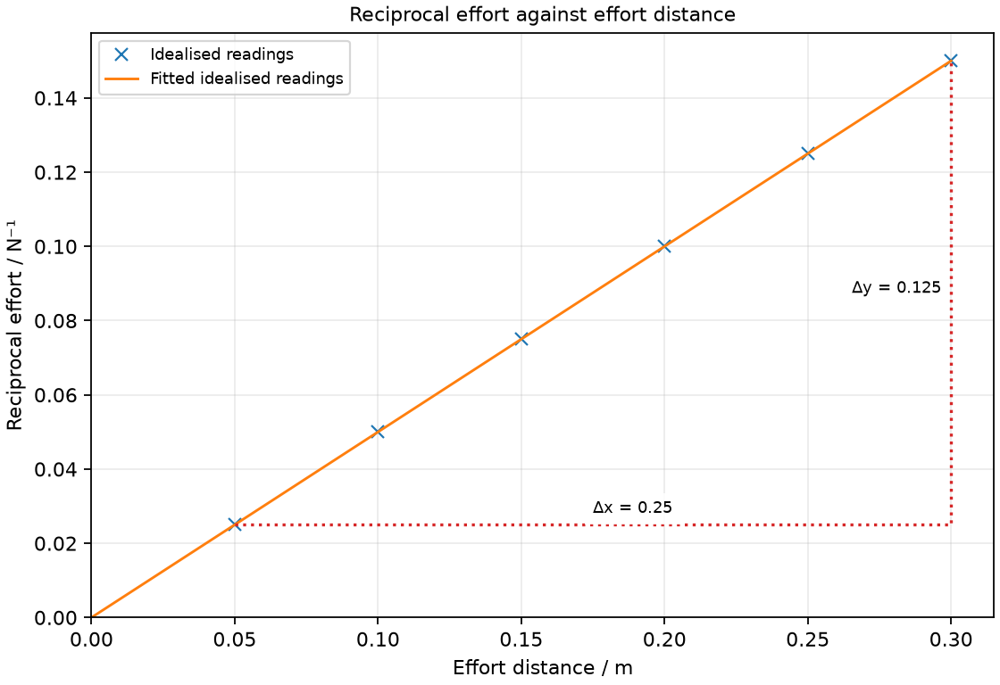

# 8 Moments, equilibrium, stability and friction

*nam-6118-nssco-2026. Offline study notes, rendered from the approved content units on 2026-10-31. Everything here is also what the flashcards are built from.*

---

## Moments, equilibrium, stability and friction — 2.7

### describe the moment of a force as a measure of its turning effect and give everyday examples (such as crowbar, wheelbarrow, pliers, scissors, tweezers or tongs)

A moment measures a force’s turning effect about a pivot. Its size increases with force and with the perpendicular distance from the pivot to the force’s line of action.

A spanner turns a nut because the hand’s force acts at a distance from the nut’s axis. Pushing near the end gives a larger turning effect than pushing near the nut with the same perpendicular force. The effect also depends on direction: pushing along the spanner toward the nut gives little turning effect. A crowbar turns about its contact point; scissors turn about their joint. Name the pivot before identifying a moment, and state clockwise or anticlockwise relative to the view used.

### describe the difference between moment and work (moment is a vector, work is a scalar; and that the distance involved in moment is perpendicular to the force whilst the distance involved in work is in the same direction as the applied force)

Moment and work can both be expressed using force times a distance, but their distances describe different things. Moment uses perpendicular distance to a pivot; work uses displacement along the force and is an energy transfer.

Moment has a rotational direction and is a vector quantity in the syllabus treatment; work is a scalar. Report a moment in N m and work in joules even though the units have equivalent dimensions. A person holding a stationary spanner may exert a moment without doing mechanical work on the stationary nut. If the nut rotates, a point of application moves and energy can be transferred. The existence of a lever arm does not itself establish a displacement.

### identify load, effort and fulcrum in everyday examples of common machines (e.g. spanner, wheelbarrow)

The fulcrum is a lever’s pivot, the effort is the applied driving force and the load is the resistance being moved. These names describe roles in the stated arrangement rather than fixed parts of every machine.

In a wheelbarrow the wheel axle acts as fulcrum, the contents provide much of the load, and the hands provide effort at the handles. A spanner has a turning axis at the nut and effort at the hand; the nut resists the rotation. On scissors the pivot is the joint, the fingers supply effort and the material resists cutting at the blades. Locate forces and their lines before measuring distances; the full length of a tool need not equal a particular moment arm.

### recall and use the formula moment = force × perpendicular distance

The size of a moment is M = Fd, where d is the perpendicular moment arm. With force in newtons and distance in metres, moment is in N m.

Convert centimetres to metres before substitution. A 15 N force with a perpendicular arm of 0.20 m produces 3.0 N m. If the force line passes through the pivot, its moment about that pivot is zero even when the force is large. For a sloping force, measure the shortest perpendicular distance from pivot to line of action rather than simply the length of the lever. Assign a clockwise or anticlockwise direction separately from the size.

### state that, when there is no resultant force and no resultant turning effect, a system is in equilibrium

Equilibrium requires both zero resultant force and zero resultant moment. Balancing clockwise and anticlockwise moments alone does not establish translational equilibrium.

A stationary balanced beam has no tendency to accelerate in translation or rotation. Its support force must balance its downward loads, and its moments about a chosen pivot must balance. Two equal opposite forces whose lines do not coincide have zero resultant force but can produce a turning effect. Conversely, a force through the centre can accelerate an object without creating a moment about that centre. Test the two conditions independently; neither replaces the other.

### describe an experiment (involving vertical forces) to verify that there is no net moment on a body in equilibrium

A balanced beam can test equality of clockwise and anticlockwise moments from vertical forces. Perpendicular distances must be measured from the pivot to the vertical force lines.

First balance a uniform ruler on a pivot near its centre so that its own weight has negligible moment, or include that moment explicitly. Suspend known weights on opposite sides and adjust positions until the ruler rests horizontally. Measure each distance from the pivot, not from the ruler’s end. Calculate the moments in each direction and compare their sums. Repeat with different forces and positions. Keep the support stable, catch falling masses safely and do not use a hand to hold the beam in apparent balance while measuring.

### use the conditions of equilibrium in simple calculations

A body in equilibrium has equal total clockwise and anticlockwise moments about a chosen pivot. A suitable pivot eliminates the moment of a force acting through it.

For a light beam, a 6 N load 0.40 m to the left has an anticlockwise moment of 2.4 N m. A downward force 0.30 m to the right must therefore be 8 N for rotational equilibrium. The upward support force must also equal the total 14 N downward force. A heavy beam’s own weight must be included at its centre of mass when its force line does not pass through the pivot. Draw the force positions before substituting numbers.

### Distinguishing the ideas

A lever arm is not the displacement used to calculate work. A force can have a moment about a pivot even when its point of application remains stationary.

A hand holds a horizontal bar at rest by pushing upward 0.50 m from its pivot. The hand force has a moment about the pivot, but the stationary point has no displacement, so no mechanical work is done on the bar by that force during the hold. Muscles can still consume chemical energy internally. Separating the body being studied from the person avoids treating effort felt by a person as proof of work on a stationary object.

### Practice task with worked feedback

Choose one correct option for each original practice question.

1. Which change increases the moment for the same perpendicular force?
A. Smaller perpendicular arm
B. A larger pivot-to-force-line distance
C. Same arm and reversed force
D. Same arm with a different force direction closer to the arm

2. Which quantity has magnitude but no direction?
A. Momentum
B. Force
C. Velocity
D. Work

3. In scissors, which part serves as fulcrum?
A. The joint
B. The material
C. The fingers
D. The blade tip

4. Which pair of conditions establishes equilibrium?
A. Zero force alone
B. Zero resultant force and moment
C. Zero moment alone
D. A large support force alone

5. Where is the centre of mass of a freely suspended stationary lamina?
A. On the vertical below the suspension point
B. At the lowest corner
C. At the suspension hole
D. At the largest visible edge

6. Which change usually improves resistance to toppling?
A. Moving load toward edge
B. Widening the support base
C. Raising centre of mass
D. Narrowing base

7. A cyclist applies a rim brake. Which interaction directly provides the intended frictional braking torque on the wheel?
A. Air resistance on the rider
B. Chain tension driving the rear wheel
C. Normal support from the level road
D. Brake pad rubbing on the wheel rim

8. What moment does 8 N produce with a 0.15 m perpendicular arm?
A. 120 N m
B. 53.3 N m
C. 1.2 N m
D. 0.01875 N m

9. A 4 N load has a 0.30 m arm. What load balances it on a 0.20 m opposing arm?
A. 6 N
B. 2.67 N
C. 12 N
D. 4 N

10. A force line passes through a pivot. What is its moment about that pivot?
A. Equal clockwise and anticlockwise nonzero moments from this one force
B. Force × distance along the beam
C. Force × distance to the nearest end
D. Zero

11. A light beam supports 3 N and 5 N downward and is stationary. What upward support is required?
A. 2 N
B. 10 N
C. 8 N
D. Zero

12. A force holds a stationary lever. What is its work on the lever during the hold?
A. Equal to its moment in joules
B. Force times lever length
C. Zero
D. Its gravitational energy increase

Worked feedback

1. Key B. A: Moment decreases at fixed force. B: Moment equals force times perpendicular arm. C: The moment reverses but its magnitude does not grow. D: The perpendicular component decreases.

2. Key D. A: Momentum includes direction. B: Force includes direction. C: Velocity includes direction. D: It is an energy transfer.

3. Key A. A: The blades rotate about this pivot. B: It supplies the cutting resistance. C: They provide effort. D: It is away from the pivot.

4. Key B. A: Equal opposite forces along separate lines can still turn the body. B: Both translation and rotation are balanced. C: Translation can still accelerate. D: Its balance with other forces is unspecified.

5. Key A. A: Its weight line passes through the support. B: The lowest point need not be the centre of mass. C: The body generally hangs below that point. D: Edge length does not locate it.

6. Key B. A: Weight line is closer to the tipping boundary. B: A larger tilt is then needed to move weight beyond it. C: Weight line leaves base after a smaller tilt. D: Support boundary is reached sooner.

7. Key D. A: This retards the bicycle but is not the intended pad-on-wheel braking torque. B: Driving tension supplies a driving torque rather than the stated brake interaction. C: This support is perpendicular to the road, not the pad’s tangential friction force. D: The pad’s tangential friction force on the rim produces the braking moment.

8. Key C. A: This uses centimetres as metres. B: This divides by distance. C: Multiply 8 by 0.15. D: This reverses the ratio.

9. Key A. A: The required moment is 1.2 N m. B: This reverses the distance ratio. C: This doubles the required balancing force. D: Equal loads need equal arms.

10. Key D. A: The one force has zero moment when its line passes through the pivot. B: Only the perpendicular distance to the force line belongs in a moment. C: The specified pivot, not an arbitrary end, sets the arm. D: The perpendicular arm is zero.

11. Key C. A: The downward loads add rather than subtract. B: This exceeds the 3+5 N downward total and would give an upward resultant. C: Vertical forces balance. D: That would leave a downward resultant.

12. Key C. A: Moment and work are different quantities. B: That length is not a movement. C: The application point has no displacement. D: The stationary lever has no height change during the hold.

### Practice task with worked feedback

Original structured practice. Answer the parts with working and units where needed.

(a) State the meaning of fulcrum. [1]

(b) State the rotational condition for equilibrium. [1]

(c) Explain why a moment of 6 N m is not necessarily a transfer of 6 J. [2]

(d) Calculate the moment of 9 N with a perpendicular arm of 0.40 m. [2]

(e) Calculate the force at a 0.60 m arm that balances 12 N at a 0.20 m opposing arm. [2]

Worked feedback

(a) The pivot about which a lever turns.

(b) The resultant moment is zero.

(c) Moment uses a lever arm; work requires displacement along force. The body may remain stationary despite the moment.

(d) M = Fd = 3.6 N m.

(e) F = (12 × 0.20)/0.60 = 4 N.

### Practice task with worked feedback

Investigation aim: test the balance of moments using reciprocal effort against effort arm. These are invented, idealised practice readings; real readings have scatter. 

| Effort distance / m | Reciprocal effort / N⁻¹ |
|---:|---:|
| 0.05 | 0.025 |
| 0.1 | 0.05 |
| 0.15 | 0.075 |
| 0.2 | 0.1 |
| 0.25 | 0.125 |
| 0.3 | 0.15 |

(a) Draw Reciprocal effort / N⁻¹ vertically against Effort distance / m horizontally. Plot the supplied readings and add a separate fitted line. [5]
(b) Show two widely separated points on your fitted line and calculate its gradient. State the gradient unit. [3]
(c) Plan how to test the balance of moments using reciprocal effort against effort arm. Name the equipment and arrangement, describe the measurements and repeats, state controls and a relevant precaution, design the results table and explain how the results answer the aim. [8]

Worked feedback

Graph: Reciprocal effort / N⁻¹ is vertical and Effort distance / m horizontal. Use the six readings, draw a separate best-fit line and show a wide gradient triangle; do not join scattered readings in a zigzag.

Gradient construction: choose the separated fitted-line points (0.05, 0.025) and (0.3, 0.15). Gradient = (0.15 − 0.025) / (0.3 − 0.05) = 0.5 N⁻¹ m⁻¹. The plotted relation is 1/F = d/M. Gradient = 1/M = 0.50 N⁻¹ m⁻¹, so the fixed moment M = 2.0 N m.

Arrangement: A rigid rated beam on a secured pivot, a fixed 10 N load at 0.20 m and a calibrated 0–50 N force gauge; this is not a lightly supported metre rule

Plan: 1. Balance the unloaded rigid beam on its secured pivot and account for its weight. 2. Fix a 10 N load with a 0.20 m perpendicular arm on one side. 3. On the other side attach the 0–50 N force gauge at a measured arm between 0.05 and 0.30 m. 4. Pull vertically and adjust force until the beam is horizontal; record force and arm without hand support elsewhere. 5. Repeat at each arm, recording gauge readings and their reciprocals; restore the same load position each time.
Control and accuracy: Use a beam, support and gauge rated for at least 50 N; secure the fixed load, keep forces vertical and the opposing arm fixed, and keep hands clear of falling loads.
Table: Effort distance / m; Reciprocal effort / N⁻¹; repeat readings in separate columns. Also record raw effort F / N before calculating 1/F / N⁻¹.
Graph and conclusion: The plotted relation is 1/F = d/M. Gradient = 1/M = 0.50 N⁻¹ m⁻¹, so the fixed moment M = 2.0 N m. Compare repeated readings and report the tested range rather than claiming an exact law from scattered observations.

---

## Moments, equilibrium, stability and friction — 2.8

### describe an experiment to determine the position of the centre of mass of a plane lamina

The centre of mass of a suspended lamina lies vertically below its suspension point at rest. Two suspension directions locate it at the intersection of the corresponding vertical lines.

Make a small hole near an edge of a thin irregular card and suspend it freely from a pin. Hang a plumb line from the same pin and mark its vertical line on the settled card. Suspend the card from another edge point and repeat. Their intersection locates the centre of mass; a third line is a useful check. The card must turn freely, not be clamped at an angle. For an irregular shape the intersection need not be at the visual centre and may even fall outside the material.

### describe qualitatively the effect of the position of the centre of mass on the stability of simple objects

An object tends to topple when its weight’s line of action passes outside its support base. A lower centre of mass or wider base generally permits a greater tilt before this occurs.

Consider a tall loaded trolley turning or standing on a slope. If its weight acts inside the base, a small tilt can produce a restoring moment; outside the edge, weight produces a toppling moment. Lowering a load reduces the horizontal shift of its centre of mass during a given tilt. Widening the base moves the supporting edge farther from the original weight line. Compare like arrangements and distinguish resistance to toppling from resistance to sliding: surface friction also influences what actually happens.

---

## Moments, equilibrium, stability and friction — 2.9

### describe the effect of friction on objects and how friction depends on the surfaces

Friction opposes relative sliding, or the tendency to slide, between contacting surfaces. Its magnitude depends on the contacting materials, surface condition and normal contact force.

A stationary shoe can experience friction that prevents slipping even without sliding. Friction on a walking person may act forward because it opposes the shoe’s backward tendency relative to the ground. Sliding friction often transfers mechanical energy into internal energy of the surfaces. Roughness can matter, but avoid treating visible roughness as a complete quantitative law for every pair of materials. Compare the same surfaces under controlled load when investigating their friction; distinguish the force needed to start motion from that during steady sliding.

### describe how to reduce friction and discuss the advantages and disadvantages of friction in everyday life

Lubrication and replacing sliding by rolling can reduce friction in suitable machines. Friction provides useful grip and braking but can also cause wear and unwanted heating.

Oil can separate suitable moving surfaces, reducing direct interaction; ball bearings replace much sliding with rolling. These methods must fit the machine: reducing tyre-road friction would reduce useful grip. Brake pads rely on friction to reduce vehicle motion and transfer energy to the surroundings, so heating there accompanies the intended action. In bearings, the same heating wastes useful mechanical energy and can damage parts. State both the intended purpose and the surface pair when judging whether friction is beneficial.
