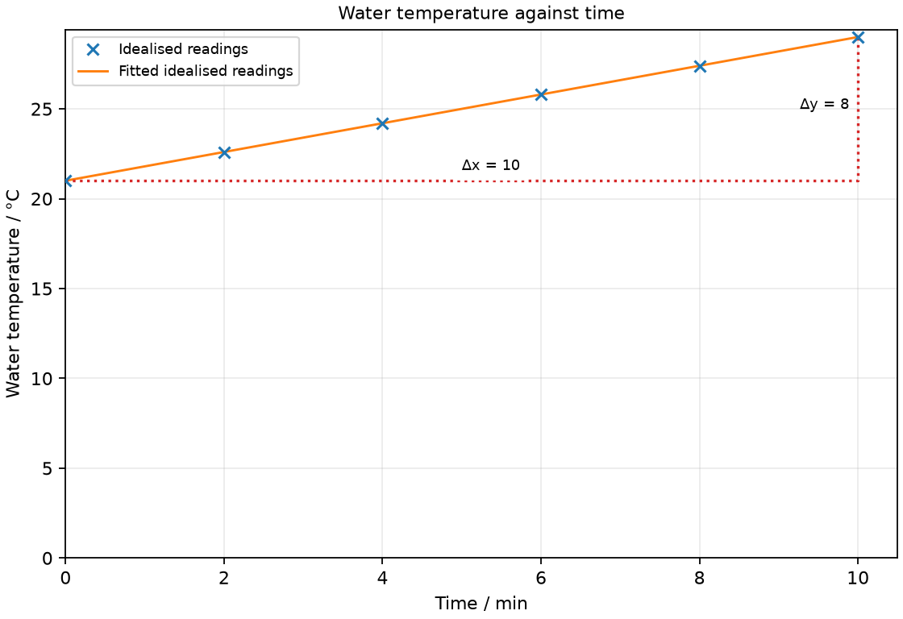

# 9 Energy sources and renewable systems

*nam-6118-nssco-2026. Offline study notes, rendered from the approved content units on 2026-11-01. Everything here is also what the flashcards are built from.*

---

## Energy sources and renewable systems — 2.10.1

### Energy-source pathways

Energy sources supply energy by different physical processes. Chemical reactions rearrange atoms; fission splits heavy nuclei, while fusion in the Sun joins light nuclei.

Distinguish the source from the device that converts its energy. Falling water and wind can turn turbines linked to generators; solar radiation can heat a surface or produce electrical output in a photovoltaic cell. Geothermal systems draw on Earth’s internal energy. Wave motion and tidal flow offer different water-based supplies. Follow each energy pathway rather than calling electricity a primary fuel.

### Outline chemical and fuel energy

Fuel stores chemical energy. A fuel reaction rearranges atoms and can release energy to the surroundings.

Combustion transfers energy from a fuel-and-oxygen system, often heating water to drive a turbine. The atoms are rearranged into products rather than converted wholesale into energy. Fossil fuels such as coal, oil and gas are finite; biomass can be renewable when regrowth replaces consumption.

### Outline energy from hydroelectric water, waves and tides

Water can provide energy through falling from a height, wave motion or tidal movement. Hydroelectricity typically converts raised water’s gravitational energy through turbine motion to electrical energy.

A dam maintains a height difference that makes a flow through turbines useful. Waves are mainly driven by winds over water. Tides arise from gravitational interactions involving the Moon and Sun, so their regular rise and fall differ from weather-driven waves. Appropriate coasts or height differences are needed.

### Outline geothermal energy

Geothermal energy comes from Earth’s hot interior. A suitable system can transfer this energy to water or steam for heating or generation.

Accessible hot rocks can heat circulating water. Steam may drive a turbine connected to a generator. Suitability depends on local geology and drilling costs, so a renewable source is not equally practical at every location.

### Outline nuclear fission as an energy source

Fission of heavy nuclei can release energy in a nuclear reactor. The resulting heating can drive a steam-turbine generator.

Fuel supply is finite. Controlling the chain reaction and removing heat are essential engineering tasks. Radioactive products require containment and management; a low operational carbon output does not remove those concerns. This source account concerns conversion and consequences, without isotope equations.

### Outline solar thermal and photovoltaic energy

Solar radiation can provide heating or photovoltaic electrical output. The Sun’s energy is supplied by fusion of light nuclei in its interior.

A dark collector absorbs radiation and transfers energy to water in a solar thermal system. A photovoltaic cell instead produces electrical output when illuminated. These are different conversions: a water heater is not a photovoltaic panel merely because both use sunlight.

### Outline wind energy

Wind energy uses the kinetic energy of moving air. A wind turbine turns this motion into rotational motion and then electrical output through a generator.

Output depends strongly on wind conditions and site. A wind-driven mechanical pump can transfer energy to water without first generating electricity. Identify the actual arrangement rather than assuming every rotating wind machine has the same output.

### compare advantages and disadvantages of the use of different sources of energy, including environmental considerations and the distinction between finite (non- renewable sources such as oil, coal and nuclear) and renewable sources (such as solar, hydroelectricity, geothermal and wind energy)

An energy-source decision combines supply, environmental effects and practical requirements. No source choice can be justified by a renewable label alone.

Compare a remote pump with an evening urban demand. Solar equipment may suit daytime pumping, but evening supply needs storage or another source. A fossil-fuel generator can operate on demand while creating combustion emissions and consuming finite fuel. Hydroelectric schemes require suitable water and terrain and can alter habitats. State the criteria for the actual task.

### Compare finite and renewable supplies

A finite energy resource is consumed faster than natural processes replace it on human timescales. A renewable flow or resource is replenished naturally on a relevant timescale.

Coal and oil stores are finite, and nuclear fuel is also non-renewable in this classification. Solar, wind and replenished hydroelectric supplies are renewable. Renewable does not mean unlimited power at one instant; drought, darkness or calm weather can restrict output.

### Compare environmental effects of energy sources

Energy sources have different environmental effects across construction, operation and disposal. Operational emissions alone are not a complete account of environmental impact.

Fossil combustion releases carbon dioxide and may release air pollutants. Nuclear generation produces radioactive waste requiring management. Wind and solar avoid fuel combustion during generation but involve materials, land and eventual disposal. Reservoirs can flood land and change river ecology. A useful comparison names a particular impact for each source rather than saying a source has no environmental effect.

### Compare reliability and practical suitability of energy sources

Reliability depends on whether output can meet demand when needed. Site, storage, transmission and maintenance affect the suitability of a source.

Tidal timing is predictable but output varies during a cycle. Wind and solar vary with weather and daylight. Stored fuel can support dispatchable generation if fuel and maintenance are available. Hydroelectric output depends on water resources. A remote site may favour a local system that avoids a long transmission line.

### discuss radioactive isotopes as the source of nuclear energy, its conversion to electrical energy and the problems associated with this process (no nuclide formulas are required)

Nuclear fuel can release energy through controlled fission, heating a working fluid. A turbine and generator convert part of that energy into electrical output, with other energy transferred to the surroundings.

A reactor is an energy-conversion system, not a device that produces electricity directly from a nucleus into the grid. Heat removal, containment, radiation protection, long-lived waste management and eventual decommissioning are important difficulties. Compare these with the benefit of substantial generation without fuel combustion at the station. Do not confuse reactor fission with fusion in the Sun. Uranium-235 is an example of a radioactive isotope used as reactor fuel. The heating in this account comes from controlled nuclear fission, rather than simply from its natural radioactive decay. Radioactive waste needs shielded secure storage, radiation can damage cells, and loss of cooling or containment can cause a serious accident; construction and decommissioning are costly.

### Practice task with worked feedback

Choose one correct option for each original practice question.

1. What changes in a chemical fuel reaction?
A. Atomic nuclei change proton numbers
B. Electrons become new nuclei
C. Atoms are rearranged
D. Total mass-energy disappears

2. Which source uses hot rocks beneath Earth’s surface?
A. Tidal
B. Photovoltaic
C. Geothermal
D. Wind

3. Which fuel is finite in the syllabus classification?
A. Nuclear fuel
B. Sunlight
C. Tidal flow
D. Wind

4. Which process supplies the Sun’s energy?
A. Fusion
B. Radioactive decay alone
C. Fission
D. Chemical combustion

5. Which energy change occurs in an illuminated photovoltaic cell?
A. Radiant energy directly to water flow
B. Radiant energy to electrical energy
C. Electrical energy to sunlight
D. Thermal energy to nuclear energy

6. What is the main useful output of a solar water heater?
A. Electrical energy at the collector terminals
B. Chemical energy stored in new fuel
C. Kinetic energy of a rotor
D. Increased water internal energy

7. Which difficulty is particularly associated with fission products?
A. Combustion ash from burning coal
B. Radioactive waste management
C. Wind-turbine blade noise
D. Flooding a reservoir valley

8. A farm needs water after dark. Which arrangement stores daytime solar pumping’s useful result?
A. A raised water tank
B. A smaller unshaded panel without storage
C. Removing the pump
D. A disconnected empty wire

9. A hydroelectric installation keeps the same water fall height and efficiency while water mass flow per second halves. What happens to its output power?
A. It is unchanged
B. It falls to one quarter
C. It doubles
D. It halves

10. A PV refrigerator is operating. Where is energy rejected?
A. Nowhere because cooling destroys energy
B. To the surroundings through the hot side
C. Into a disappearing mass
D. Into the panel as manufactured sunlight

11. A wind project has no fuel combustion during generation. What follows?
A. Its operation never changes habitat
B. Its output stays constant
C. Its operational combustion emissions are avoided
D. Its whole life cycle has no emissions

12. Water rises from 22 to 30 °C in 4 min. What is its average heating rate?
A. 7.5 °C/min
B. 8 °C/min
C. 32 °C/min
D. 2 °C/min

Worked feedback

1. Key C. A: That would be a nuclear change. B: Ordinary chemical reactions rearrange electrons and bonds. C: The chemical products have a different arrangement. D: Products and energy transfers must be included.

2. Key C. A: This uses tidal movement. B: This uses incident radiation. C: It draws on internal thermal energy. D: This uses moving air.

3. Key A. A: Its usable material is a finite resource. B: It is treated as renewable. C: This is renewable on human timescales. D: This is a replenished flow.

4. Key A. A: Light nuclei join in the Sun. B: Fusion supplies the stellar energy in this course. C: Fission splits heavy nuclei, whereas the Sun fuses light nuclei. D: The Sun is not powered by burning chemical fuel.

5. Key B. A: A pump needs an electrical/mechanical pathway. B: The cell converts incident light directly into electrical output. C: This reverses the operating energy pathway. D: A photovoltaic cell does not produce nuclear fuel.

6. Key D. A: A solar thermal collector heats water. B: The stated heater raises water internal energy. C: That is a wind-turbine pathway. D: The intended service is heating.

7. Key B. A: Coal ash is a combustion issue, not the particular fission-product problem. B: Some products need containment over long periods. C: This is a wind-installation issue rather than the named fission-product difficulty. D: Reservoir flooding is associated with hydroelectric construction.

8. Key A. A: The stored water can later flow down. B: It still lacks night illumination. C: This removes the lifting mechanism. D: This stores no useful pumping output.

9. Key D. A: Same energy per kilogram does not mean same energy per second. B: Only one factor has halved, not two. C: Reduced mass flow reduces input energy rate. D: Each kilogram releases the same mgh, but half as many kilograms pass per second.

10. Key B. A: Energy is conserved. B: The removed heat plus input energy must leave. C: The cooling model does not remove material. D: That is not the cooling pathway.

11. Key C. A: Land use, noise and wildlife effects still need consideration. B: Changing wind changes power availability. C: This is the supported claim. D: Construction, transport and maintenance may have emissions.

12. Key D. A: This divides final temperature by time. B: This omits division by the interval. C: This multiplies rise by time. D: The rise is 8 °C over 4 min.

### Practice task with worked feedback

Original structured practice. Answer the parts with working and units where needed.

(a) State the energy form carried by wind. [1]

(b) State the useful energy output of a PV panel. [1]

(c) Explain how insulation helps a solar water tank. [2]

(d) Calculate the average heating rate when water warms by 9 °C in 6 min. [2]

(e) Explain why storing water can suit a pump with variable solar output. [2]

Worked feedback

(a) Kinetic energy.

(b) Electrical energy.

(c) It reduces energy transfer from hotter water to cooler surroundings, retaining more of the collected energy.

(d) Rate = temperature rise/time = 1.5 °C/min.

(e) Water can be raised while sunlight is available. The tank then supplies water later without the pump operating at that instant.

### Further practice: Explain two problems that must be controlled when using nuclear fission to generate electricity.

Radioactive waste needs secure shielded storage because its radiation can damage cells. Cooling and containment are needed because overheating or release in an accident can expose people and contaminate surroundings.

---

## Energy sources and renewable systems — 2.10.2

### Matching renewable systems to the service

Renewable systems can supply electrical or thermal energy to meet different end uses. Matching the conversion pathway to the intended service reduces unnecessary conversions.

Solar resources offer strong opportunities in Namibia, but actual output depends on location, weather, shading and equipment. The 2018 syllabus gives a world irradiance ranking; that dated ranking is not used here as a current comparison. Heating water directly may avoid generating electricity merely to heat it again. A pump or refrigerator needs the corresponding mechanical or electrical conversion.

### Explain renewable electricity generation

Renewable electricity generation requires a conversion device suited to the source. Photovoltaic cells use radiation directly, while wind and hydroelectric machines commonly drive generators mechanically.

 Storage shifts the use of energy to a later time; it is not an additional primary source. Allow for conversion losses and actual demand.

### Explain renewable heating and greenhouses

Solar collectors can heat water, and transparent greenhouse covers admit useful solar radiation. Absorption raises internal energy, while reduced heat loss helps maintain a warmer interior.

A solar heater uses an absorber, water path and insulated storage. A greenhouse admits radiation that warms surfaces; its enclosure reduces loss by preventing warm air from escaping. Ventilation may be needed to prevent overheating. These systems use thermal pathways rather than requiring photovoltaic conversion first. Sunlight passes through a greenhouse cover and warms the ground and plants. The cover limits escape of warm air and can reduce outgoing infrared transfer, depending on its material. Ventilation releases warm air when cooling is needed.

### Explain renewable water pumping

Renewable energy can operate a water pump through mechanical or electrical conversion. A wind rotor may drive a pump directly, while a photovoltaic system can drive an electric motor.

Pumping raises water’s gravitational potential energy. A storage tank can retain the benefit of pumping when sunshine or wind is available, reducing the need to store electricity for later pumping. The required lifting height and water flow influence system size.

### Explain renewable refrigeration and air-conditioning

Renewable electricity can drive a refrigerator or air-conditioner’s compressor. A refrigerator transfers energy from a cooler region to a warmer region using an external energy input.

Cooling does not mean a panel emits coldness. The machine removes thermal energy from the intended region and rejects that energy plus its input energy elsewhere. Solar electricity can supply the compressor; an appropriately designed thermal absorption system can instead use heat input. Output variability and storage must match the cooling duty. An air-conditioner similarly uses electrical input to move energy from the room to the warmer outdoor surroundings; PV can supply its electrical input.

### describe a basic solar photovoltaic (PV) system, a basic solar water heater and basic wind energy systems stating the energy changes involved

Basic renewable systems contain a collector or rotor and a useful energy-output path. Tracking input, intermediate transfer and output distinguishes PV, water-heating and wind systems.

A PV panel supplies electrical output, a thermal collector raises water temperature, and a wind rotor supplies shaft motion that may drive a generator or pump. Diagrams should label the useful output and losses to the surroundings.

### Describe a basic photovoltaic system and its energy changes

A basic PV system includes illuminated cells connected to an electrical load. An electrical load receives the cell output; a battery can store part of the daytime energy for later use.

Draw energy flow from radiation to electrical output, then to the intended device. Shade, orientation and illumination affect output. A battery adds a chemical storage stage; it must not be depicted as creating energy independently.

### Describe a basic solar water heater and its energy changes

A solar water heater uses an absorber to transfer incident radiation to water. An insulated tank limits the loss of the heated water’s internal energy.

A dark collector with pipes and a transparent cover can improve useful collection. Water may circulate by a pump or, in a suitable arrangement, by density-driven convection. In a short steady-input test, temperature rise per time measures a heating rate rather than efficiency unless input and useful energy are also known.

### Describe a basic wind energy system and its energy changes

A basic wind generator has a rotor coupled to a generator. It converts some air-motion energy through rotational mechanical energy into electrical output.

Wind pumps may instead transmit shaft motion directly to a pumping mechanism. Braking, support and control protect a real machine under changing winds. The rotational stage matters: wind does not directly charge a battery without conversion equipment.

### Practice task with worked feedback

Investigation aim: compare solar-collector water temperature with exposure time. These are invented, idealised practice readings; real readings have scatter. 

| Time / min | Water temperature / °C |
|---:|---:|
| 0 | 21 |
| 2 | 22.6 |
| 4 | 24.2 |
| 6 | 25.8 |
| 8 | 27.4 |
| 10 | 29 |

(a) Draw Water temperature / °C vertically against Time / min horizontally. Plot the supplied readings and add a separate fitted line. [5]
(b) Show two widely separated points on your fitted line and calculate its gradient. State the gradient unit. [3]
(c) Plan how to compare solar-collector water temperature with exposure time. Name the equipment and arrangement, describe the measurements and repeats, state controls and a relevant precaution, design the results table and explain how the results answer the aim. [8]

Worked feedback

Graph: Water temperature / °C is vertical and Time / min horizontal. Use the six readings, draw a separate best-fit line and show a wide gradient triangle; do not join scattered readings in a zigzag.

Gradient construction: choose the separated fitted-line points (0, 21) and (10, 29). Gradient = (29 − 21) / (10 − 0) = 0.8 °C/min. The slope is temperature rise per minute, 0.8 °C/min over this short interval; it is not collector efficiency.

Arrangement: A small solar water collector, measured water mass, thermometer, stirrer and stopwatch under steady illumination

Plan: 1. Measure a fixed water mass into the collector and record its initial temperature. 2. Set the collector at a fixed angle under steady sunlight or a controlled safe lamp. 3. Start a stopwatch when exposure begins. 4. Stir gently before reading temperature every 2 min for 10 min. 5. Repeat with the same water mass and starting temperature under comparable illumination.
Control and accuracy: Hold collector area, angle and water mass fixed; minimise draught changes, avoid looking into intense lamps and handle warm water carefully.
Table: Time / min; Water temperature / °C; repeat readings in separate columns. 
Graph and conclusion: The slope is temperature rise per minute, 0.8 °C/min over this short interval; it is not collector efficiency. Compare repeated readings and report the tested range rather than claiming an exact law from scattered observations.

### Further practice: Explain why a closed greenhouse can remain warmer than the surrounding air on a sunny day.

Sunlight enters and is absorbed by the ground and plants, raising their internal energy. The cover reduces escape of warm air and outgoing energy, so cooling is slower.
