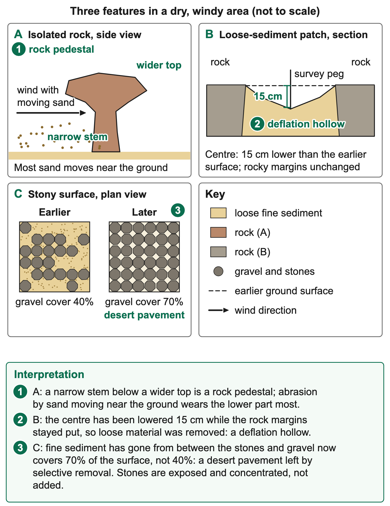
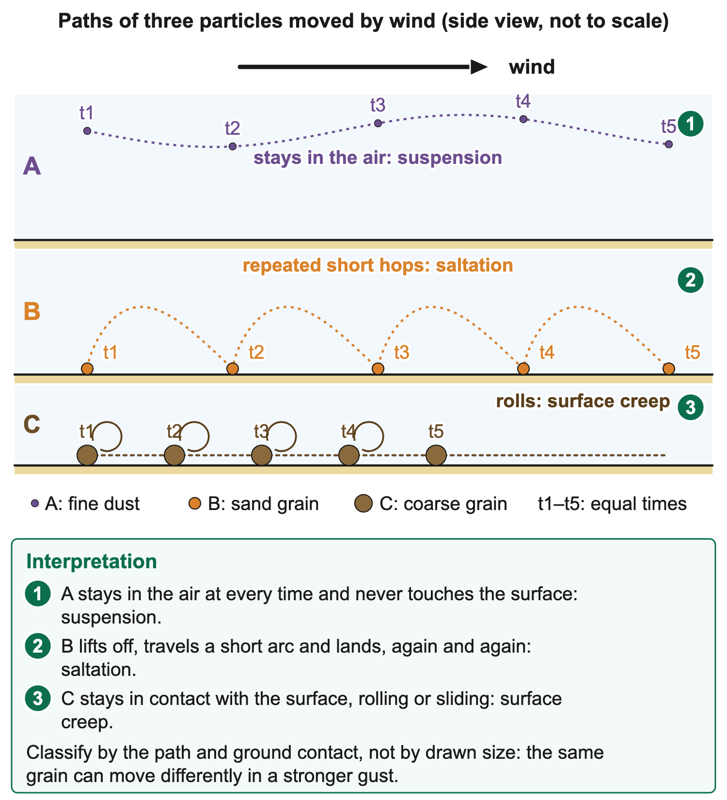
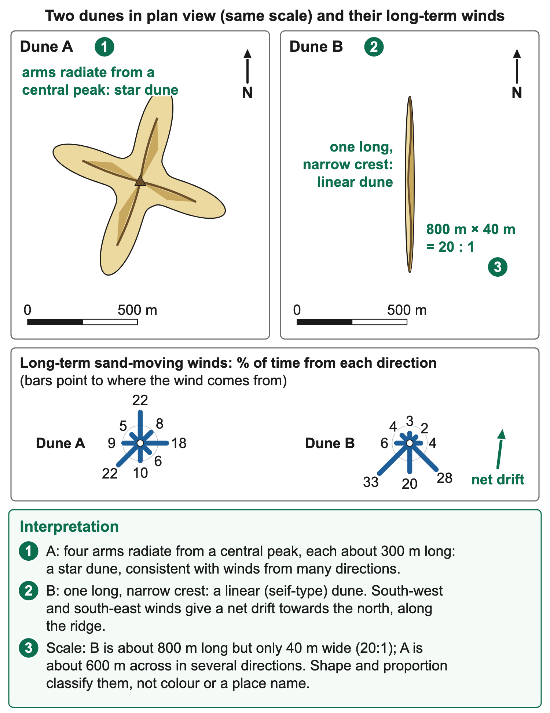

# 1.4 Wind/Aeolian processes

*nam-6137-nssco-2026. Offline study notes, rendered from the approved content units on 2026-10-30. Everything here is also what the flashcards are built from.*

---

## Abrasion, deflation and attrition

### Abrasion, deflation and attrition

Aeolian processes are processes in which wind erodes, transports or deposits material. They are important in dry, sparsely vegetated landscapes with available loose sediment, but they also operate on beaches, agricultural land and other exposed surfaces. Wind does not require a hot desert to move sediment. The amount and type of movement depend on wind conditions, the particles available, moisture, vegetation and surface cohesion. A landscape covered by dunes represents accumulation, while a surface stripped of loose material records removal. These opposite outcomes can occur within the same wider sediment system.

Abrasion is the wear of a surface by material moved against it by water or wind. In wind abrasion, moving sand and other particles strike or scrape an exposed rock, soil clod or other surface. The particles act as abrasive tools. The contact is between the moving load and the target surface, so the process differs from particles simply colliding with one another. A rock surface showing impact-related wear alongside moving sand supports abrasion more directly than a statement that there was strong wind. Wind strength alone does not establish which target was worn or whether suitable sediment was available.

Many sand grains move close to the ground, so abrasion can be concentrated near the surface in suitable settings. However, the height and intensity of wear vary with particle movement, obstacles, wind and rock resistance. Do not use one fixed height as a rule for every desert feature. A low rock face can be worn more strongly where sand impacts repeatedly, while a resistant part survives better. Different winds may expose different faces over time. A polished or faceted surface needs to be interpreted with material and environmental evidence, because several processes can modify exposed rock.

### Worked example

Deflation is removal of loose particles by wind. Wind can lift or sweep fine material away, leaving a lower surface or a relative concentration of coarser fragments. The definition concerns the loss of loose material, not the scraping of a coherent target by flying grains. A resource showing fine sediment disappearing from an exposed patch while stones remain supports deflation. If the resource shows the wind carrying the particles after removal, that also supplies transport evidence. The initial entrainment and the subsequent journey are connected but should be distinguished when the task asks for a particular action.

### Worked example

Moisture and surface binding can limit deflation. Damp grains or a cohesive crust may resist movement more than comparable loose dry material. Vegetation can shelter the surface, bind soil and intercept moving particles. Disturbing that cover can expose sediment, but the effect depends on wind and particle conditions. A vehicle track or heavily trampled area may therefore have different susceptibility from adjacent intact ground. This is a mechanism to investigate, not proof that every footprint produces a dust storm. Look for actual exposure, material loss and wind information in the resource.

Attrition is the wear of transported particles as they collide with one another. Projecting corners may break off and grains may become smaller or rounder through repeated impacts. The main target is the load, whereas abrasion chiefly wears the surface against which the load moves. A grain can be transported by saltation while colliding with other grains or striking the ground, so several actions may occur together. For a classification task, identify the contact and the recorded change. A phrase such as rocks hit things is too vague to distinguish abrasion from attrition.

### Worked example

An original three-row observation record makes the distinctions clear. A shows sand striking and wearing a rock face. B shows loose fines removed from a surface, leaving a concentration of gravel. C shows moving particles colliding, with corners lost from those particles. A supports abrasion, B deflation and C attrition. The distinction does not depend on which process name sounds most familiar. It depends on whether the evidence concerns wear of a fixed surface, removal of loose material or wear of the travelling particles themselves.

The supply of sediment matters as well as wind. Rivers, weathering and coastal processes can produce or deliver particles that later become available to wind. A very windy rocky surface without loose sand may experience limited sand-blasting compared with a nearby area receiving abundant mobile grains. Conversely, abundant sand may remain relatively stable when wet or sheltered. Explaining aeolian activity therefore needs both an agent capable of moving material and suitable material to move. This connects wind processes to the earlier topics on weathering and rivers rather than treating the desert as an isolated system.

A controlled comparison can test part of this relationship. Equal trays of the same sediment can be exposed to the same specified airflow, with one surface dry and loose and the other damp. Collecting and weighing material lost from each over equal periods provides evidence about the stated moisture treatment. It does not test a wind-speed effect if speed was unchanged. An outdoor field comparison needs additional caution because gusts, vegetation and sediment supply may differ. Record what was measured and avoid turning an informal demonstration into a precise claim about every natural surface.

Human consequences include loss of fine soil and nutrients, abrasion of crops or equipment and reduced visibility during dust movement. Not all windblown particles have the same size or effect, and visual dustiness does not itself measure the amount removed from a particular site. Identifying the source and pathway helps explain the problem and select management. Protecting cover can address exposed sediment, while cleaning a road after a storm deals with a deposit farther along the route. The action should match the part of the system being discussed: erosion at the source, transport through the air or deposition at the destination.

### Connections

An abrasion demonstration needs to distinguish the target from the abrasive material. Compare similar target surfaces exposed for the same duration, one with a stated supply of moving sand and one without it under otherwise comparable airflow. Additional wear where grains strike the target supports a sediment-contact mechanism. If the target materials differ, however, resistance becomes an alternative explanation. Record the change to the surface, not merely the amount of sand passing a collector. That design helps separate evidence of abrasion from evidence that transport occurred nearby.

---

## Pedestals, hollows and desert pavements

### Pedestals, hollows and desert pavements

Wind erosion produces landforms through selective removal and wear, interacting with rock structure and other environmental processes. A rock pedestal, a deflation hollow and a desert pavement have different forms and explanations. A pedestal is a residual rock shape with a relatively narrow lower part and broader upper part. A deflation hollow is a depression associated with removal of loose material. A desert pavement is a surface concentration of closely spaced stones or gravel. Their appearance alone does not establish a unique history, so a landform explanation should follow the evidence supplied.

A rock pedestal can develop where sand-bearing wind abrades a lower part of an exposed rock more strongly than its upper part, particularly when rock resistance also favours the survival of a broader top. Many moving sand grains are concentrated close to the ground, giving a plausible pathway for differential wear. As the lower part is removed more rapidly, a narrower supporting stem remains. The explanation needs the abrasive particles, the target rock and uneven wear. Wind alone sculpting a rock without contact by sediment is not a complete abrasion account.

### Worked example

Rock structure and weathering can also affect the shape. A more resistant cap may survive above weaker material, and salt or other weathering can weaken exposed zones. Therefore, not every mushroom-shaped rock proves that sand abrasion acted alone. If a resource specifically shows near-ground sand impacts, a narrow stem and a resistant top, those features support the intended pedestal model. If it shows a different geological structure, account for that rather than forcing one universal history. A description should identify the narrow base and wider upper part before the explanation introduces the responsible mechanisms.

A deflation hollow develops when wind removes loose surface material and lowers a patch of ground. Removal can be concentrated where the cover is sparse and fine particles are exposed. The hollow may enlarge or deepen as more sediment becomes available and is carried away. Resistant layers, a coarser protective surface or dampness can limit further removal. The explanation concerns excavation through loss of material, not a heap of sand building upward. A dune is depositional, whereas the hollow’s development involves lowering the surface in the supplied model.

### Worked example

Water may sometimes collect in a depression, depending on rainfall, drainage and groundwater conditions. That possibility does not explain the original wind removal. An oasis is associated with accessible water and can support vegetation or human use; it is not a synonym for a deflation hollow. A hollow need not contain water, and an oasis need not have formed through deflation. To distinguish the explanations, ask whether the evidence concerns how a depression was excavated or why water is available at a location. Describing a spring does not supply the missing wind-erosion mechanism.

### Worked example

A desert pavement consists of a closely packed surface of stones or gravel. In a simple deflation model, finer material is removed while coarser fragments remain as a residual cover. The increasing stone concentration can shelter the underlying fines and reduce further removal. The pavement does not require the wind to carry every large stone into position. In other settings, soil development, dust accumulation and vertical movement of stones also contribute. Use the process specified by the resource and avoid presenting deflation as the sole origin of every pavement surface.

### Worked example

An original sequence shows an initially mixed surface of gravel and finer sediment. In the next stage, exposed fines are carried away by wind. In the final stage, coarse fragments form a more continuous cover over the remaining material. This supports the residual-concentration explanation. The volume of coarse fragments need not increase; their proportion at the exposed surface increases because other material has been lost. The distinction is similar to concentrating a mixture by removing one component. A higher visible gravel percentage is not proof that gravel was added from outside the site.

### Worked example

The three landforms can be distinguished from a resource by asking what remains and how surface level changes. Abrasion can leave a pedestal as an isolated residual rock. Deflation can leave a hollow where ground level is reduced. Selective removal can expose a gravel pavement without forming one deep depression. A drawing with a raised sand mound and no excavated surface is not evidence of a deflation hollow. A drawing of loose water below a tree does not identify a pedestal. Use the key, material symbols and earlier surface line where supplied to reconstruct the change.

### Worked example

A measurement example can reinforce the contrast. Suppose fixed survey points show the centre of a loose-sediment patch falling by 15 cm over a stated observation period, while its rocky margin changes little and collected sediment downwind matches the removed fines. The evidence is consistent with deflation concentrated in the patch, though the source attribution still depends on the investigation design. A photograph alone cannot provide that measured lowering without a scale and dated reference. If a pavement’s gravel cover is recorded as 40% initially and 70% later, investigate loss of fines before assuming that the number of stones increased.

These landforms connect erosion to transport and deposition elsewhere. Material removed from a hollow may contribute to dunes or dust deposits downwind, while a pavement can restrict later sediment supply. Disturbing a protective surface may expose fines again. This gives management a process basis: vehicles, excavation or vegetation changes can alter susceptibility, and the outcome depends on conditions. In a judgement, separate the scientific explanation of a landform from a proposal about its use. A surface that looks stony or stable on one date does not establish that unrestricted disturbance will have no effect on neighbouring land.

### Connections

A pedestal interpretation can be strengthened by paired measurements: a lower zone loses more material than an upper zone while sand impacts are recorded mainly near the ground. This supports differential abrasion in the observed setting. If the lower rock is also less resistant, both factors may contribute and the comparison cannot isolate height of impact alone. A careful account can state both pathways without pretending that one excludes the other. The surviving wider cap and narrower stem then become results to explain, not independent proof that every part of the rock had the same initial resistance.

---

## Suspension, saltation and surface creep

### Suspension, saltation and surface creep

Wind transport moves material after it becomes available at the surface. The main school-level modes are suspension, saltation and surface creep. They are distinguished by the particle’s movement and its contact with the ground, not by three rigid size classes that apply regardless of wind conditions. Fine particles can remain airborne, many sand grains hop near the surface, and coarser grains can roll or slide along it. Several modes can operate together. A strong explanation identifies the observed path and the conditions that allow it, rather than calling all windblown movement suspension.

Suspension occurs when particles are carried within the air for a substantial period relative to repeated ground contacts. Very fine dust can be supported by turbulent air and transported far from its source. The duration and distance depend on particle properties, wind, turbulence and weather. A dust cloud shows airborne material, but its colour or size in one image does not measure concentration or identify every source. The particles eventually leave suspension through settling or other removal, but the fact that dust later deposits does not mean it was never transported within the air.

### Worked example

An original observation might record fine particles passing an observation station above ground while no ground contacts are visible during the interval. That supports suspension for those particles. It does not establish that all grains at the site are suspended or that the same conditions persist throughout a season. Some coarse material may remain still while fine dust is carried away. An explanation should keep the sampled particle group and period clear. If a diagram uses dots to represent dust, its key should state their meaning rather than drawing them large enough to imply airborne boulders.

Saltation is repeated hopping or bouncing of grains close to the surface. A grain is lifted or launched, follows a short path and lands again. Impact can help eject other grains, contributing to continued movement where wind conditions support it. The repeated lift–travel–landing sequence distinguishes saltation from longer-duration suspension. A single drawn grain above ground is ambiguous unless the path or sequence shows its contacts. Arrows should indicate the direction of movement and stages without implying that wind transports grains through the solid surface.

### Worked example

In a time-labelled record, grain A is on the surface at the first instant, above it at the second, and in contact again at the third. Repetition over further observations supports saltation. Its path can include impacts that contribute to abrasion or attrition, but those terms identify wear, not the mode of travel. A grain can saltate without the resource establishing a measurable amount of wear. This distinction helps discriminate a transport question from an erosion question even where both use a drawing of sand grains in motion.

Surface creep is rolling or sliding along the ground. Wind force and impacts from saltating grains can help move grains too coarse to be carried in sustained suspension under those conditions. Contact with the surface is the defining feature. The motion may be intermittent, with a grain moving after an impact and then stopping until another force acts. Do not describe surface creep as the slow downhill movement of an entire soil mass; that is a different slope process sharing the ordinary word creep. State that the wind-transported particle rolls or slides across the surface.

### Worked example

An original three-path resource can show A remaining within the air over the observation, B making repeated short hops and C rolling along the ground. The paths support suspension, saltation and surface creep respectively. Classification should cite those paths. Saying that C must be creep because it is drawn largest is weaker than using its continuous ground contact. The same grain could behave differently during a stronger gust, so the interpretation belongs to the supplied conditions. Relative size can help explain the pattern but should not replace the evidence of movement.

Changes in wind speed can alter which particles move and how. A gust may initiate movement, while a sheltered patch can promote deposition. Surface moisture and vegetation affect access to particles, and the supply can change after a river flood, dune disturbance or prolonged dry period. A wind-speed measurement at one height is not a complete description of the forces acting on every grain at the surface. For school tasks, use the stated conditions, and avoid inferring precise thresholds when none are supplied. A qualitative explanation can still make the causal connection clearly.

A simple investigation can compare material collected at several heights or along a downwind transect, provided it is safe and uses a consistent method. Keep collector size, exposure time and the reference to wind direction clear. More collected material in a low trap may be consistent with near-surface transport, but collector efficiency and local obstacles can influence the result. Repeated observations strengthen the conclusion. Never infer the absence of suspended dust simply because a trap designed for rolling sand collects none: the method must be suited to the transport mode being tested.

Wind transport connects a sediment source to a depositional site. Grains may move repeatedly, spend time stored and be remobilised during later windy periods. A dune’s shape records the accumulated result of transport and deposition over time, rather than one instantaneous wind reading. Dust carried beyond a dune field can affect soils or air quality elsewhere, while heavier grains remain closer to the surface or source under the same conditions. This link prepares the explanation of dunes: their form depends on available sediment, wind directions, obstacles and the redistribution of material, not on transport terminology alone.

### Connections

A useful sequence can show an impacting saltating grain setting a larger surface grain rolling. The first grain follows a hopping path, while the second moves by surface creep. One impact therefore links two transport modes without making them identical. The second grain may later stop, and the first may rebound or lose energy. The diagram should keep separate arrows for their respective paths, with a clear ground line and a time order. This is a more discriminating resource than three differently sized dots labelled only with process names.

---

## Star and linear dunes in Namibia

### Star and linear dunes in Namibia

A dune is a mound or ridge of sand accumulated by wind. Deposition occurs where the conditions no longer sustain continued movement of some of the transported grains. Vegetation, obstacles, changes in wind flow and existing relief can trap sand, while the growing accumulation itself modifies airflow. Sand can be moved up a gentler windward surface and fall or slide down a steeper sheltered slip face where the slope becomes unstable. Do not describe a dune as a rock mountain created by abrasion: its principal construction involves deposited sediment, even though erosion and redistribution can later modify it.

Dune form depends on the wind regime, sediment supply and other site conditions. A single wind arrow drawn on one date cannot establish the long-term directions that built a large dune. The shape may also retain effects of earlier conditions. Identify the plan-view pattern and the arrangement of ridges before explaining formation. A profile across one arm can resemble a simple dune even where the full plan shows a more complex form. This makes viewing direction important: an aerial image reveals relationships that a ground-level outline may hide.

A star dune has several arms or ridges radiating from a central high area, producing a multi-armed plan form. Star dunes form where winds blow from several directions during the year. Each wind pushes sand back towards the centre, so the dune mainly grows upward rather than migrating steadily in one direction across the desert, and each arm develops its own slip face. In the Namib Sand Sea, star dunes occur on the eastern side around Sossusvlei, where some are more than 300 m high. It is not identified merely by being high, red or located in a desert. A plan showing three or more arms meeting around a central peak provides more discriminating evidence than colour. The number and length of arms can vary, and their exact angles need not form a perfect geometric star.

Star dunes occur in the Sossusvlei area of the Namib Sand Sea. NASA descriptions of the sand sea identify star forms among the regional dune types and relate them to winds from multiple directions. These examples connect the named Namibian setting to the visible morphology. They do not make every nearby dune a star dune, nor do they justify assigning an exact age or height without a specific source. A photograph supplied for interpretation must be classified from its ridges and viewing angle, rather than from a caption naming the region alone.

### Worked example

Linear dunes, including seif forms, are elongated ridges whose length is large relative to their width. They commonly occur in sets and can extend broadly along the resultant direction of sand transport under suitable wind regimes, including winds from more than one dominant direction. Their geometry and formation are more varied than a rule that every ridge points exactly along one constant wind. Some are compound or have smaller features on their sides. In a resource, describe the dominant long axis, the spacing of ridges and any branching or superimposed forms actually visible.

### Worked example

Seif (linear) dunes are found in the dune belt near Swakopmund, and linear dunes dominate inland across much of the Namib Sand Sea. They form where strong winds blow from the south for much of the year and winds from a second direction blow at other times. Each wind piles sand onto one flank, so the ridge does not move forward as a crescent but grows in length along the average (resultant) direction of the two winds, producing long, parallel ridges. The sand comes mainly from the Orange River: it is carried into the Atlantic Ocean, moved north along the coast by waves and currents, and blown inland by southerly winds. Sparse vegetation and dry, loose sand let the wind move it freely.

### Worked example

An original plan resource can compare dune A, with four ridges meeting near a central peak, and dune B, with a long narrow crest and much smaller cross-ridge width. A supports a star interpretation; B supports a linear interpretation. Multi-directional long-term winds are consistent with A’s complex arms, while B’s elongation needs interpretation with the supplied wind-regime information. A one-day observation of wind from the west cannot prove how either large dune formed. The causal explanation should retain the difference between current weather and the cumulative process shaping the landform.

These dunes connect wind transport to Namibia’s climate, tourism and conservation. Vehicle tracks, vegetation disturbance and movement of sand can affect access or sensitive surfaces, but specific impacts need site evidence. A management judgement should identify the objective and the dune processes involved rather than assuming that stabilising every dune is desirable. For interpretation tasks, begin with form, use the key and scale, and connect the observed pattern to sediment accumulation and the appropriate wind regime. This keeps the named examples useful without replacing geographical reasoning with a place-name association.

### Connections

For a simple plan comparison, a ridge 800 m long and 40 m wide has a length-to-width ratio of 20:1. That supports an elongated form in the stated resource, but it does not by itself identify the winds responsible or establish the dune’s age.
