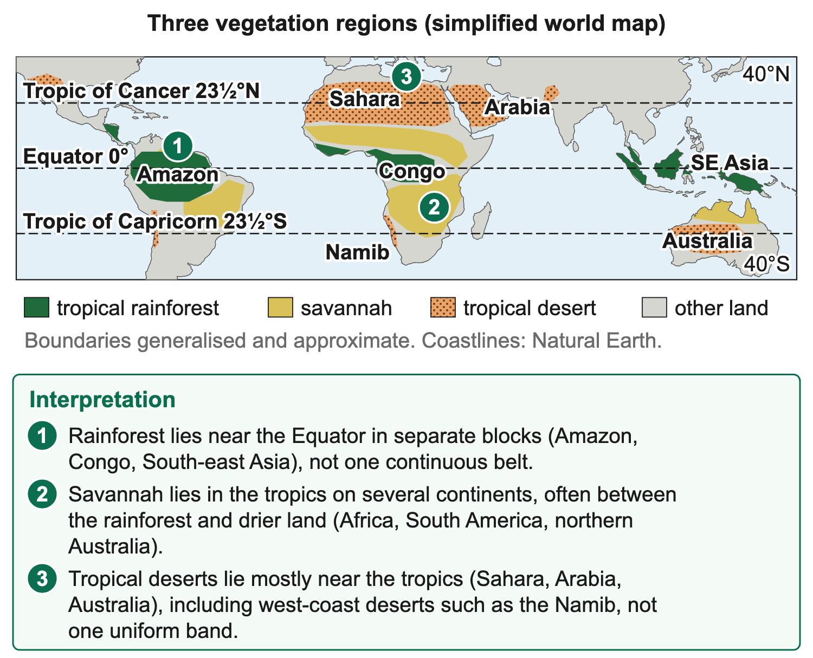
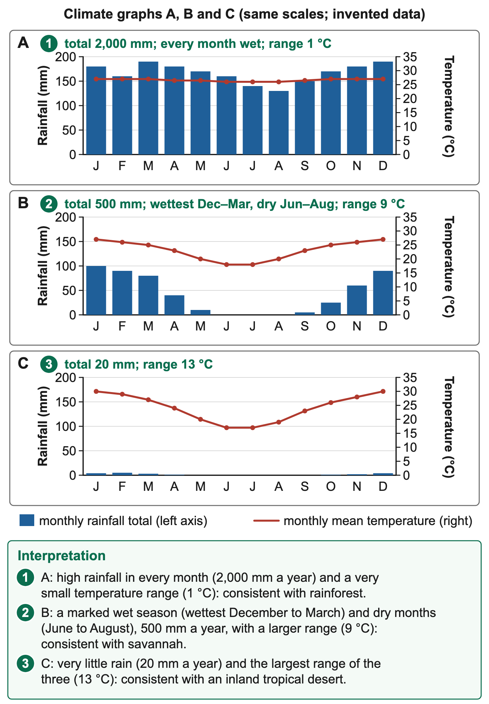

# 1.7 Climatic regions and natural vegetation

*nam-6137-nssco-2026. Offline study notes, rendered from the approved content units on 2026-10-30. Everything here is also what the flashcards are built from.*

---

## Distribution of rainforest, savannah and tropical deserts

### Distribution of rainforest, savannah and tropical deserts

A vegetation region is an area with broadly characteristic plant communities, influenced by climate, soils, relief, disturbance and land-use history. Tropical rainforest, savannah and tropical desert represent contrasting patterns rather than three identical belts covering every longitude. A world map is a useful generalisation, but boundaries can be gradual and local conditions create variation. Read the legend to distinguish natural vegetation, potential vegetation and current land cover. A cultivated field inside a rainforest climate does not demonstrate that its crops are the undisturbed natural forest of that region.

Equatorial or tropical rainforest is strongly associated with warm, moist low-latitude environments, with extensive examples in the Amazon Basin, the Congo Basin and parts of Southeast Asia. These areas lie broadly around the Equator, but the vegetation is not a narrow line exactly on zero latitude. Rainfall, topography and land use affect its actual extent. A map showing rainforest in several separate continental blocks should be described as such, not as one continuous forest circling the planet. Sea areas and intervening drier regions interrupt the distribution.

Savannah is tropical grassland with varying amounts of scattered trees or shrubs, commonly associated with marked wet and dry seasons. Extensive examples occur in tropical Africa, parts of South America and northern Australia. Savannah regions can lie between wetter forest and drier environments, but their boundaries and characteristics vary. The term does not mean a uniform lawn with identical tree spacing. Rainfall, soils, grazing, fire and management influence the vegetation. East African savannah provides a useful named context for the relationship between seasonal water, grasses, trees and human or wildlife use.

Tropical deserts commonly occur in or near subtropical dry belts, often around 20–30 degrees north and south, Many lie on the western sides of continents beside cold ocean currents, such as the Namib beside the Benguela Current and the coastal desert of northern Chile, while others stretch far into continental interiors. Examples include the Sahara and Arabian deserts in the north and the Namib and parts of Australia in the south. The word tropical here concerns the broad climatic setting; it does not mean every desert lies wholly between the two tropics. Aridity depends on limited water availability relative to demand, not simply on the presence of sand dunes. Many desert surfaces are rocky, gravelly or otherwise not dune-covered.

The Namib lies along southwestern Africa and combines dry land with a strong cold-ocean influence on its coastal setting. Fog can provide moisture in parts of that environment even where rainfall is limited. This shows why coastal location does not automatically imply a wet forest. Similarly, high mountains within low latitudes can support different conditions from nearby lowlands. A distribution account should use the scale and location of the region rather than assuming that latitude alone determines every vegetation patch. The climatic explanation belongs alongside, not in place of, the mapped pattern.

### Worked example

To locate the regions on a world map, identify the Equator, tropics, continents and oceans first. Then compare the shading with those references. A tropical forest band across central Africa differs from desert shading in northern Africa, while savannah can occupy seasonal tropical environments between or beyond wetter zones. If a resource uses different colours, interpret them from the key rather than from an assumed convention that green always means forest. A map may also show human modification, protected areas or a selected vegetation date, so the legend and caption constrain what can be concluded.

### Worked example

An original schematic resource can shade the Amazon, Congo and Southeast Asian blocks as A, seasonal tropical grassland areas as B and the Sahara, Arabian, Namib and Australian dry areas as C. A’s separate low-latitude blocks support rainforest identification, B’s broader seasonal-tropical pattern supports savannah and C’s dry-belt/coastal-interior examples support tropical deserts. The classification should be checked against climate or vegetation evidence where supplied. A letter does not have a fixed regional meaning outside that resource, and a country can contain more than one of the categories.

A small inset may show rainforest at a moist lowland site and grassland on a drier neighbouring plateau. The local contrast does not invalidate the broad world pattern. It shows that relief, water balance and other controls matter at a finer scale. Likewise, current forest clearance can create an agricultural mosaic within a region once mapped as continuous natural forest. A careful answer distinguishes the broader climatic-vegetation setting from the observed land cover on a particular date. Avoid using one cleared patch to claim that all of the region naturally lacks trees.

### Worked example

Maps from different dates can support analysis of change if their categories, resolution and coverage are comparable. A smaller green area can reflect actual forest loss, but it can also result from a changed classification or mapping method. Check the legend and source before calculating a percentage change. If a resource supplies areas directly, use those values and the specified denominator rather than estimating precise numbers from a small unscaled picture. A distribution description may be qualitative, while a change calculation needs suitable quantitative information. The two tasks have different evidence requirements.

The three regions connect to climate patterns, plant adaptations and land use. Warm moist rainforest conditions favour a different vegetation structure from seasonal savannah or highly water-limited desert. However, a map by itself does not reveal every leaf, root or management process. Use it to establish location and pattern, then bring in the appropriate climate and plant evidence. A supported regional account combines those sources without treating the region’s name as proof of every possible characteristic. This prepares the explanation of how particular features help plants survive the constraints of their environments.

### Connections

Country boundaries should not replace vegetation boundaries. Brazil includes rainforest, savannah and other landscapes, while tropical Africa includes wet forest, seasonal grassland and extensive dry regions. A resource asking for a region therefore needs the relevant shaded part, not an entire country filled indiscriminately. If a map provides latitude lines and named rivers, use them to locate the area more accurately. The name of a country can orient the description without implying that all its territory has the same natural vegetation.

---

## Vegetation structure and adaptation

### Vegetation structure and adaptation

Plant features should be explained in relation to the conditions they address. A description names a feature such as a small leaf, thick stem, deep root or high canopy. An explanation connects it to water, light, support, grazing or another relevant challenge. Listing rainforest drip tips in a desert answer does not show understanding merely because both are plant adaptations. Regions contain many species with different strategies, so use examples as conditional or common features rather than asserting that every plant in a region has the same roots and leaves.

Tropical rainforest commonly has dense, layered vegetation. Tall trees form a canopy with some emergent trees above it, while lower layers receive less light. Warmth and generally abundant moisture can support growth through much of the year, though individual species have their own seasonal patterns. Evergreen appearance means that the forest as a whole retains foliage, not that each leaf lasts forever or that every tree sheds no leaves. Species diversity and the layered structure create varied habitats. A simplified profile should show different heights and a light gradient rather than one uniform row of identical trees.

Competition for light helps explain tall growth, climbing plants and some forms of large shaded leaves. Lianas use other plants for support as they reach better-lit positions, while epiphytes grow on other plants without necessarily drawing nutrients parasitically from them. Buttress roots can help support tall trees where shallow root systems and the local soil conditions make that form useful. Drip tips and leaf surfaces can help water drain from leaves. Each feature has a function; it should not be assigned automatically to all rainforest plants or treated as a mechanism for storing desert water.

Nutrient cycling is important in many warm moist forests. Rapid biological activity can move nutrients through living vegetation and litter, while heavy rainfall can leach some materials from soils. Clearing vegetation can disrupt that cycle and expose the ground. This does not mean every rainforest soil has identical fertility or that plants grow without soil nutrients. A useful explanation connects roots and litter use to the local conditions, while recognising differences in parent material and soil history. The visible density of the canopy is not a direct measurement of the nutrient content remaining in every cleared field.

Savannah commonly has grasses with scattered trees and shrubs, with vegetation responding to a wet season and a dry season. Grasses can grow rapidly when water becomes available and may become dry or dormant during water shortage. Some trees shed leaves in the dry season, reducing transpiring surface. Deep or extensive roots can access water in suitable soils, while small leaves or protective features can reduce water loss or browsing. Two southern African trees show different strategies: the baobab stores water in its thick trunk and drops its leaves in the dry winter, while the camel thorn sends a very deep taproot down towards groundwater and carries paired thorns that deter browsing animals.

Fire and grazing influence savannah structure. Some grasses have growing points or stored reserves that support regrowth after above-ground material is removed under suitable conditions. Some trees have protective bark or other responses, but severe or poorly timed fires can still damage vegetation. The presence of fire adaptations does not make every fire harmless or justify unrestricted burning. Grazing pressure, rainfall and recovery time interact. An explanation should connect a specified plant feature to the disturbance described, rather than assuming that savannah is simply forest destroyed by fire in every setting.

### Worked example

Desert vegetation is commonly sparse, with plants using varied strategies to obtain, store or conserve water and survive irregular supply. Some have reduced leaves or spines, thick waxy surfaces, succulent water-storing tissues or photosynthetic stems. Others have deep roots reaching accessible reserves, shallow spreading roots that take up brief surface moisture, or short life cycles that complete during favourable wet intervals. These strategies are alternatives or combinations, not a list that every desert plant must possess. A deep taproot should not be assigned to a plant whose resource clearly shows shallow spreading roots.

A small leaf or spine can reduce exposed transpiring area, while a thick cuticle can reduce water loss from suitable surfaces. Water-storing tissues buffer the interval between supplies. Deep roots may reach moisture below the surface where geology and water depth permit, while wide shallow roots can intercept small or brief rainfall near the surface. A short-lived plant can survive unfavourable periods as seeds and complete growth when conditions improve. State the water pathway or conservation mechanism in each explanation. The phrase it adapts to the desert simply repeats the environmental label without explaining survival.

### Worked example

The Namib is a useful named setting because fog and highly variable rainfall create different water opportunities across its coastal and inland zones. Adaptations should therefore be matched to the species or resource evidence rather than described as if every plant relies only on deep groundwater or only on fog. East African savannah provides the contrasting wet–dry seasonal setting, while the Amazon provides a moist layered-forest context. The named example supports a feature–condition link; it is not a substitute for identifying the actual leaf, root, growth form or seasonality being explained. The welwitschia is the best-known Namib plant. It grows only in the Namib of Namibia and southern Angola, has just two long leaves that keep growing from its crown throughout its life, and tends to occur where water lies below the surface of dry river courses.

### Worked example

An original three-plant resource can show A with drip tips and a tall supported trunk in a shaded moist forest, B shedding leaves during a marked dry season, and C with a waxy water-storing stem and reduced leaves. A’s features suit its water/light/support setting; B’s leaf loss reduces dry-period water use; C’s storage and reduced surface support survival between scarce supplies. The functional explanation distinguishes the adaptations. If a question shows only roots, do not add unseen leaves as evidence. Describe the supplied feature and connect it directly to the environmental constraint.

### Connections

A leaf or root drawing also needs a scale and context. A broad leaf can help capture light in a shaded layer but may create a water-loss trade-off in another setting. A root reaching a labelled moist layer supplies evidence for water access; a long line drawn without the soil-water information is less specific. Interpret the feature actually shown and connect it to a supported function, rather than guessing a complete species strategy from one visible part.

---

## Regional climate characteristics

### Regional climate characteristics

Climate comparisons should consider temperature, rainfall, winds, cloud and humidity together, while keeping their meanings distinct. A region can have high humidity near the surface and limited rainfall if the vertical conditions do not support substantial precipitation. A rainfall season can occur without a large annual temperature range. A broad vegetation label therefore does not replace the data. Use the region’s characteristic pattern as an organising model, then interpret the actual graph or observations supplied, retaining local differences, altitude effects and the period covered.

Equatorial rainforest climates are commonly warm throughout the year with a relatively small annual range of monthly mean temperature. Many have abundant rainfall spread through much of the year, though the exact seasonal pattern varies. Because the midday sun is always high, monthly means usually change by only about 2°C through the year. The rain is convectional: strong heating of the ground makes warm, moist air rise in the low-pressure belt called the ITCZ, so surface winds are often light. The rising air cools, its water vapour condenses into towering cumulonimbus clouds and heavy showers or thunderstorms follow, often in the early afternoon. Evaporation from wet ground and transpiration from trees keep humidity high. High humidity and cloud are common under suitable conditions, while incoming solar energy remains substantial at low latitudes. Totals still differ between months, places and years.

The Amazon, Congo and Southeast Asian forest regions have different rainfall distributions and circulation influences despite their shared tropical rainforest characteristics. An example should therefore be used at the right scale. A graph with all months wet and little temperature variation is consistent with an equatorial model, but it does not identify a unique city without location information. Wind direction and pressure patterns need their own observations or regional context. A climate graph plotting only temperature and rainfall cannot directly reveal every humidity percentage, cloud type or prevailing wind direction.

Savannah climates commonly have a marked wet season and dry season while remaining warm overall. The contrast follows the overhead sun. In the high-sun (summer) season the ITCZ moves over the region: converging, heated air rises, cools and gives convectional rain, with more cloud and higher humidity. In the low-sun (winter) season the ITCZ moves away and the subtropical high-pressure belt takes its place. Its sinking air stops clouds forming, so skies are clear, humidity is low and rain is rare or absent. Monthly means range from about 18°C to above 25°C. Temperature also varies, but rainfall seasonality is especially important for vegetation and livelihoods. In the Southern Hemisphere, a summer-wet example may peak around the early or late calendar months; northern examples can have different month timing.

### Worked example

An East African savannah context should not be reduced to one uniform annual pattern. Latitude, altitude and circulation can produce different rainy seasons in different locations. The learning model is seasonal water availability linked to grasses and scattered woody vegetation. A supplied graph determines the precise months and values for a task. If it shows two rainfall peaks, retain them instead of redrawing one because a familiar model uses a single wet season. The explanation should be calibrated to the resource rather than allowing the regional name to overrule the observations.

Tropical desert climates are strongly water-limited, commonly with low and irregular rainfall. The main cause is the subtropical high-pressure belt at about 20–30° north and south. Air that rose near the Equator sinks here; sinking air is compressed and warms, so its relative humidity falls and its water vapour cannot condense. Deserts on the sheltered side of mountain ranges also lie in a rain shadow. Clear skies and low humidity often contribute to strong daytime heating and night-time cooling inland, producing a large diurnal range under suitable conditions. This is distinct from annual range, which compares seasonal temperature summaries. Cloud, winds, surface and coastal influence can modify the pattern. Not every tropical desert is extremely hot every night, nor does desert mean literally no precipitation. Short heavy events and long dry intervals can coexist within a dry climate.

### Worked example

The Namib coast is a useful qualification to an overly simple hot-desert model. Along this coast the cold Benguela Current cools the sea air from below. The cool, moist layer is trapped beneath warmer sinking air of the subtropical high (a temperature inversion) within a few hundred metres of the ground, so it cannot rise high enough to form rain clouds. Its moisture condenses as fog instead, which is common in the evenings and mornings, while rainfall stays very low. Fog moisture and sparse vegetation are compatible with aridity; they do not make the coast an equatorial forest environment. Inland desert sites can have different temperature ranges and moisture patterns. A comparison between a coastal Namib resource and an inland tropical-desert resource should therefore identify current, sea influence and pressure controls rather than claim that one is incorrectly labelled because its temperatures differ.

### Worked example

Original monthly teaching data can make the contrasts concrete. Series A has monthly mean temperatures between 26 and 27°C and rainfall in every month, totalling 2,000 mm. B has a marked Southern Hemisphere wet season with 500 mm annually and several winter months at 0 mm, while temperature varies between 18 and 27°C. C has 20 mm for the year and temperatures between 17 and 30°C. A is consistent with a rainforest model, B seasonal savannah and C an inland tropical-desert model. These are invented datasets, not measured climates of the named case-study places.

### Worked example

For each series, explain what the graph establishes and what it leaves unmeasured. Rainfall totals and temperature range can be calculated from the plotted values, but wind, cloud and humidity cannot be assigned precise numbers without data. A likely cloudier wet season is an inference supported by a mechanism, not a direct reading from an unlabelled rain bar. Likewise, a low rainfall total alone does not identify whether dry conditions result mainly from subsidence, rain shadow, cold-current influence or continental position. A location or circulation resource adds the necessary evidence.

These climate patterns connect directly to vegetation features and land use. Persistent warmth and moisture can support layered forest, seasonal shortage favours different savannah strategies, and severe water limitation favours conservation, storage or short life cycles in desert plants. The links are causal but not one-to-one proof that every species has the same traits. Soils, fire, grazing and management also shape the actual vegetation. A supported regional explanation combines the climatic pattern with the plant evidence and states the relevant scale, rather than replacing either with a familiar label.

### Connections

An original supplementary climate table can record more frequent cloud and higher relative humidity during B's wet months than its dry months. That would strengthen the seasonal-moisture interpretation. Without those columns, the rainfall graph supports the rain pattern directly but only a conditional inference about cloud and humidity. Likewise, a prevailing-wind arrow needs its source convention and location. An easterly reaching one region across an ocean may carry different moisture from an easterly that has crossed a long dry land route. The compass label alone cannot explain the full rainfall contrast.

---

## Reading climate graphs

### Reading climate graphs

A climate graph usually combines monthly precipitation totals with monthly mean temperatures, using separately labelled axes. Read the months and hemisphere context before identifying the seasons. Rainfall is commonly shown with bars and temperature with a line, but the legend controls the interpretation. Add the twelve complete monthly rainfall values for annual rainfall. For annual temperature range, subtract the lowest monthly mean from the highest. Do not average rainfall bars when the task asks for the annual total or use the hottest day’s temperature in place of the monthly mean.

In supplied series A, monthly rainfall is 180,160,190,180,170,160,140,130,150,170,180,190 mm. The annual total is 2,000 mm. Monthly mean temperature varies from 26 to 27°C, giving a 1°C annual range. The high year-round rainfall and small temperature range support an equatorial-rainforest interpretation. They do not prove a particular wind direction or that a shower occurred every day. A graph summarises observations at its stated scale and period, not every event within each bar.

Series B has rainfall 100,90,80,40,10,0,0,0,5,25,60,90 mm and monthly means ranging from 18 to 27°C. Its total is 500 mm and temperature range 9°C. The concentration of rain towards the start and end of the calendar year is consistent with a Southern Hemisphere summer-wet example. Series C totals 20 mm and has a 13°C temperature range, supporting an inland tropical-desert model. Always retain the stated synthetic status of these examples rather than attributing their invented numbers to the Amazon, East Africa or Namibia.

### Connections

When estimating the wettest or driest period, identify the exact months and values from the resource. An annual total can conceal a long dry interval, so two places with equal annual rain may offer different growing conditions. The timing matters alongside the amount.

---

## Clearance, deforestation and desertification

### Clearance, deforestation and desertification

Deforestation involves conversion from forest to another land use or a long-term loss of forest cover under the definition being used. Forest degradation concerns reduced condition or functions without necessarily converting the whole area to non-forest. Clearance can provide land, timber, fuel or short-term income, while also reducing habitats and changing water, soil and carbon processes. The causes and consequences need to be linked. A bare statement that people cut trees because they are bad gives no economic or geographical explanation and ignores the varied circumstances of land users.

Agricultural expansion can create demand for forest land for crops or livestock. Roads can improve access for timber extraction, settlement and later conversion, while mining, infrastructure and urban development can also remove vegetation. Commercial incentives, tenure and enforcement influence the pattern. NASA’s documented Amazon deforestation sequences show road-related access and conversion involving crops and cattle pasture. This gives a named example of an access–land-use pathway without requiring an invented current clearance rate. The same pathway is not the sole cause of every clearing across the whole Amazon Basin.

Removing vegetation can reduce habitat extent and connectivity, affecting species that depend on the forest structure. Exposed soils may experience increased erosion where rain or runoff acts on an unprotected surface. Without a canopy less rain is intercepted, so water reaches the ground quickly: runoff and flooding increase, soil is washed into rivers and nutrients are leached, and cleared tropical soils can become unable to support crops within a few years. Trees return much rainfall to the air by transpiration, so large clearances make the local climate less humid, drier and hotter. Burning the cleared wood releases its stored carbon as carbon dioxide, adding to global warming. The magnitude depends on what is removed and what replaces it. A newly cleared field does not automatically have the same water and soil behaviour as a mature forest, but the account should identify the mechanism rather than claim that every soil immediately becomes useless.

Desertification is land degradation in arid, semi-arid and dry sub-humid areas resulting from factors including climatic variations and human activities. It is not simply the outward movement of an existing sand desert. Loss of vegetation, soil erosion, declining soil condition and reduced productivity can occur without a dune crossing the land. Drought is a period of deficient rainfall or water conditions relative to a reference; it can contribute to stress, but drought and desertification are not synonyms. A short drought does not by itself establish a long-term loss of land condition.

### Worked example

Overgrazing relative to available growth and recovery can reduce cover and expose soil. Repeated cultivation without suitable soil protection, excessive wood removal and poor water management can also contribute under particular conditions. Climate variability can intensify pressure when rainfall is low and recovery slows. The causal chain links pressure to reduced cover or soil condition and then to lower productivity. Do not blame livestock numbers alone without considering area, timing, rainfall and management. A carefully managed grazing system can differ greatly from continuous pressure concentrated around one water point.

A supplied comparison can hold two dryland sites similar in rainfall while one retains cover through managed use and the other loses cover under repeated disturbance. Greater erosion at the second is consistent with the cover pathway, though soil and slope differences still need checking. A satellite image showing less greenness in a dry year could instead reflect temporary moisture shortage, land-cover change or other factors. Repeated comparable records and ground evidence help distinguish a short climatic response from persistent degradation. One brown image is not a complete diagnosis of desertification.

### Worked example

Consequences can include reduced farm or grazing productivity, more difficult water management, loss of habitat and greater livelihood pressure. These effects can encourage further short-term resource use, creating feedbacks under some circumstances. Management needs both physical and social responses, such as maintaining cover, protecting soils, using water appropriately and providing workable livelihood options. This connects deforestation and desertification to agriculture, water resources and settlement. A supported discussion uses named pathways and evidence, recognising that environmental change and people’s decisions interact rather than assuming a single inevitable chain at every site.

Natural deserts should not be explained as if they were all created by recent human clearance. The Namib's arid climate has physical controls, while desertification concerns degradation within drylands under the relevant definition. A naturally sparse vegetation cover is not automatically evidence that a community has damaged the land. Establish the baseline, change through time and the mechanisms involved. This avoids confusing conservation of a natural dryland ecosystem with planting trees simply to make a satellite image greener.

### Connections

An investigation should also distinguish changed land use from seasonal change. Comparable dates, categories and ground evidence make a persistent loss interpretation stronger than two images taken in different seasons.

---

## Agroforestry, reforestation and sustainable harvesting

### Agroforestry, reforestation and sustainable harvesting

Forest management can aim to retain habitats, support livelihoods, supply products and maintain soil, water or carbon functions. Agroforestry, reforestation and sustainable harvesting address different parts of that task. A scheme should be judged against a stated objective and the actual conditions, not by counting how often the word sustainable appears in its title. Tree planting can be beneficial yet fail if species, water, tenure or maintenance are unsuitable. A harvesting rule can look careful on paper yet fail if removal exceeds regeneration or enforcement is absent.

Agroforestry combines trees with crops and/or livestock in a managed land-use system. Suitable trees can supply fuelwood, fodder and timber, shelter crops and livestock from wind, and reduce soil erosion, while nitrogen-fixing trees can raise soil fertility, all while farming continues. Because trees on the farm provide fuelwood and fodder, households need to cut less natural forest. The system is more complex than a single crop and needs effort, time, skill and secure land rights. Species choice, spacing and management affect whether trees support or compete with the other uses. A dense planting that shades a light-demanding crop too strongly or consumes scarce water may undermine the intended benefit. The mechanism should be stated: for example, a managed shelterbelt can reduce wind exposure, while useful tree products can diversify supply. Benefits are conditional on the design rather than automatic consequences of any mixed planting.

### Worked example

An original agroforestry proposal can compare field A with appropriately spaced trees, a stated crop and a plan for pruning and water use, against field B with no management of tree density. A’s design provides a more plausible route to combining products and crop use. Yet actual results need monitoring, and costs or delayed returns can matter to the household. A supported judgement identifies the condition that makes the benefit possible and the trade-off it addresses. Merely saying agroforestry is good for the environment does not explain whether the scheme meets the supplied crop and livelihood objectives.

Reforestation restores forest cover on land previously forested, while afforestation establishes forest on land not recently forested under the stated definitions. The terms should not be used as interchangeable names for every planting project. Reforestation can use planting, assisted natural regeneration or combinations suited to the site. Restoring cover can improve some habitat and soil functions, but the result depends on survival, species diversity, structure and time. A single-species plantation does not immediately reproduce all functions of a cleared natural forest simply because tree numbers increase.

### Worked example

A reforestation plan should consider suitable species, protection of young growth, water and soil conditions, tenure, maintenance and how success will be assessed. Counting seedlings planted measures an input, not necessarily surviving forest. Repeated survival and growth observations provide more direct evidence. If seedlings die after the first dry season, a high planting-day total does not establish recovery. A better programme may alter species choice, timing, protection or aftercare according to the documented causes. The improvement should address the actual problem rather than assume that repeating the same planting at a larger scale will resolve it.

Sustainable harvesting aims to keep extraction within the capacity of the forest to maintain the relevant stock and functions over time. Regeneration, harvest intensity, species, rotation, retained habitat and damage to soils or waterways all matter. Selective cutting can reduce some impacts compared with complete clearance under suitable conditions, but the label selective does not guarantee adequate regeneration. Removing the most valuable trees repeatedly without recovery can degrade a forest. A numerical annual cut alone needs comparison with growth, stock, mortality and the management objective.

### Worked example

An original stock record can show removal of 100 teaching units while regeneration adds only 60 over the same interval, with other changes stated absent for the exercise. Stock falls by 40 units, so the record does not support maintained supply. If removal is reduced, monitoring still needs to confirm regeneration and other functions rather than assuming a fixed safe quota forever. These synthetic units illustrate balance, not a real forest’s measured growth. Habitat and species composition can change even where total wood volume appears stable, so a broader sustainability objective needs more than one numerical indicator.

Governance and livelihoods influence whether the physical plan can work. Clear rights, participation, enforcement, access to alternatives and realistic income expectations can reduce pressures that make uncontrolled clearance attractive. A restriction that removes household fuel without providing a workable alternative may be difficult to maintain. Conversely, improved farm yields alone may not prevent clearing if greater profits encourage expansion into new land. FAO guidance emphasises the need to connect production approaches with forest protection and wider land-use planning. The interaction matters more than presenting one technical measure as a complete solution.

A combined programme might use agroforestry to diversify farm products, restore a degraded forest patch and manage harvesting in a retained woodland. Each component has a different location and role. To judge it, ask whether the crop system remains viable, restored trees survive and extraction stays within a supported recovery plan. Compare costs, timing and affected people, and identify evidence still needed. Equal praise and criticism are unnecessary if the supplied facts favour one option, but the decision should address the explicit criterion rather than rely on a general preference for planting or banning all use.

### Worked example

These techniques connect natural vegetation to agriculture, energy, water and wildlife management. Forest products can support people while removal changes habitats and resource availability. A supported evaluation therefore follows the mechanism, states the conditions and uses the data. It distinguishes a planted seedling from an established tree, a rule from compliance and a stable wood-volume total from all ecological functions being protected. The objective is a defensible balance of uses and recovery, with monitoring capable of detecting whether the intended outcome is actually occurring.

A recovery record should state the observation period and what was counted. Seedlings alive after one month, established trees after several dry seasons and a functioning mixed forest are different outcomes. Monitoring survival, regeneration and habitat indicators against the project objective provides a more informative judgement than reporting a single large planting total without its later condition.

### Connections

Tree-based returns may take longer than a household can wait for food or income. An agroforestry or restoration proposal therefore needs a feasible transition, such as continued compatible production or other support, rather than assuming future benefits finance present needs. The timing of costs and returns can determine whether the agreed management is practical even when its ecological mechanism is sound.
