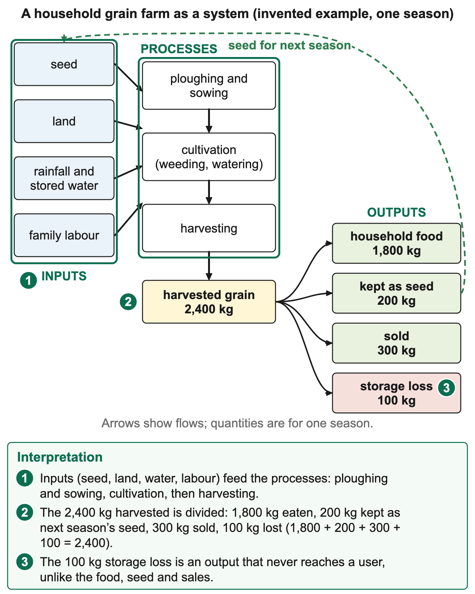
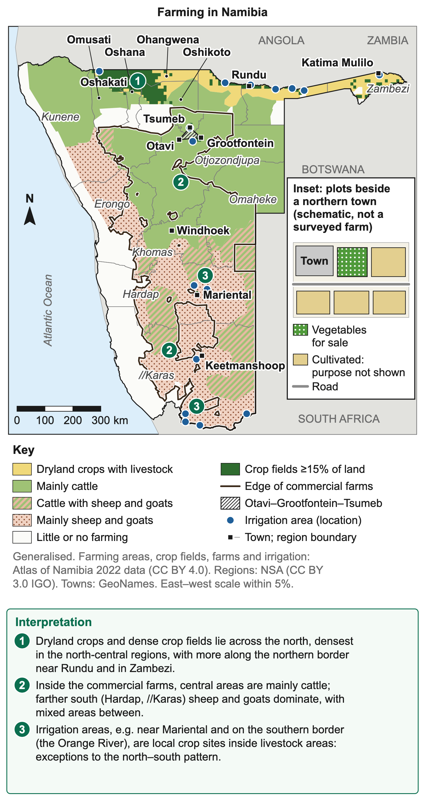

# 2.2 Agriculture

*nam-6137-nssco-2026. Offline study notes, rendered from the approved content units on 2026-10-30. Everything here is also what the flashcards are built from.*

---

## Agriculture as a primary activity

### Agriculture as a primary activity

Agriculture produces crops and livestock by using land, water, sunlight, biological processes and human work. It is a primary activity because it obtains products directly through the use of natural resources. Growing mahangu, raising cattle and harvesting vegetables are agricultural activities. Milling grain into flour is secondary processing, while carrying bags to a shop is a tertiary service. These links belong to the same supply chain but perform different functions.

Classification follows the activity rather than the machinery used. A tractor does not turn crop cultivation into manufacturing. A large cattle enterprise remains engaged in primary production when it breeds and raises animals. Conversely, a small workshop making packaged food is processing rather than primary production. One enterprise may undertake farming, processing and selling, so identify the particular operation described instead of assigning every operation its owner's main label.

Agriculture supplies food, fibres, raw materials and livelihoods. Crops may be eaten by the producing household, sold locally or supplied to processors. Livestock can provide meat, milk, hides, manure, draught power or a store of wealth, depending on the farming system. A product's destination helps distinguish subsistence from commercial purposes, but does not change cultivation or livestock rearing from a primary activity.

### Connections

Agriculture also alters natural systems. Clearing vegetation changes soil protection; taking irrigation water affects its availability elsewhere; grazing changes plant cover. Its contribution therefore includes both output and effects on the resources supporting future production. A useful geographical explanation connects what farmers do, why the setting permits or limits it, and what happens to people and the environment. This leads into the farm-system model of inputs, processes and outputs.

---

## The farm as a system

### The farm as a system

A farm system links inputs, processes and outputs. Inputs are the resources and conditions used in production. Processes are the operations and biological changes through which production takes place. Outputs are the products and other results leaving the system. The categories are connected: seeds, soil moisture, labour and equipment support crop cultivation, which produces grain alongside residues and possible losses. A list of inputs alone does not explain how a farm works.

Physical inputs include relief, soil, climate and available water. They affect which crops or animals can be supported and how reliably. Human inputs include labour, knowledge, capital, machinery, seed selection, fertilisers, pest management and access to markets or services. Some inputs are purchased, others are supplied by household labour or the environment. Unpaid work still contributes to production; its absence from cash accounts does not mean it has no value or opportunity cost.

Crop processes can include preparing the field, sowing, weeding, supplying water where needed, managing pests, harvesting, drying and storing. Their sequence matters. Planting before a suitable moisture supply is established may expose seedlings to failure. Harvesting a crop is not the end of food production if poor drying or damaged storage allows later losses. An explanation should follow the crop through the stages relevant to the question, with the effect of each operation made clear.

Livestock processes include breeding, feeding, watering, managing grazing, maintaining animal health and marketing products or animals. Grazing management links stocking levels to the vegetation available during different seasons. Animal health work can reduce avoidable losses, but its effectiveness depends on the relevant disease, timely access and appropriate practice. Calling livestock farming a process of simply leaving cattle outside misses the human decisions that influence survival, output and environmental pressure.

### Worked example

Consider a crop enterprise using two hectares, seed, household labour and rainfall. The workers prepare land, sow, weed, harvest and store. A harvest of 2,400 kg is divided into 1,800 kg for household food, 200 kg retained as seed, 300 kg sold and 100 kg lost during storage. These destinations sum to the harvested mass. The grain sold is not the whole output, and the storage loss should not be counted as food successfully consumed.

Yield is output per unit area for a stated crop and period. The example gives 2,400 kg divided by two hectares, or 1,200 kg per hectare. Total output and yield answer different questions. A larger farm might produce more tonnes with a lower yield per hectare. If two farms are compared, use the same crop, unit and harvest period before interpreting differences. Higher yield alone also does not establish higher profit, because costs and prices may differ.

Outputs can be intended or unintended. Grain, vegetables, milk and animals sold are intended products. Crop residues may become livestock feed, bedding, compost or fuel where appropriate. Wastewater, nutrient runoff and greenhouse gas emissions can also leave farming systems. Describing only saleable products can hide environmental effects. Whether a residue is a useful by-product or a disposal problem depends on its condition, use, handling and the needs of the receiving system.

### Worked example

Some flows return to the farm. Manure can return nutrients and organic material to fields; retained seed can support a later planting; income can finance repairs or new inputs. Such feedback does not make the system closed. Nutrients can leave in sold products, water evaporates or drains, and machinery requires outside materials. Recycling reduces some losses or purchases under suitable management, but a diagram must still show important imports and exports rather than pretending that resources circulate without loss.

A farm diagram is read by following arrows and their labels. An arrow from a seed store to a field represents an input flow. An arrow through sowing and crop growth represents a production sequence. An arrow from harvest to a market represents an output destination. Water availability is a physical input, while pumping and applying it are processes. A label should identify the quantity or action being represented; arrow direction alone does not explain an unfamiliar symbol.

### Worked example

Suppose a farmer purchases a pump but the water source becomes unavailable. The equipment input exists, yet the irrigation process cannot operate as planned. Alternatively, sufficient water may be available while a broken pump prevents application. These are different constraints with different remedies. The system model helps locate the interruption instead of assuming that buying one input automatically produces a harvest. It also shows why training, maintenance and timing can matter alongside the quantity of an input.

Labour requirements change through the season. Sowing and harvesting may require concentrated work over short intervals, while animal watering is recurrent. If a household lacks workers during a planting window, land may remain uncultivated even when seed is available. A machine can ease a particular bottleneck if fuel, repairs, suitable terrain and operating skill are available. Mechanisation should therefore be connected to the operation it changes rather than presented as a general explanation of success.

### Worked example

The system approach links to food security and sustainability. A harvest can be adequate but inaccessible to some households because it is sold beyond their purchasing power. A high-output season can also deplete soil or groundwater if recovery is ignored. Assessing the farm means considering the production chain, who receives its benefits and whether its resource base can continue supporting it. Keep these questions separate before combining them in an overall judgement.

A mass account helps distinguish harvested output from usable food. In the two-hectare example, the 100 kg storage loss is about 4.2% of the 2,400 kg harvest. If a safer store prevents 60 kg of that loss while field production stays unchanged, usable grain rises without a yield increase. Field yield remains 1,200 kg per hectare because that measure uses harvested production. Keeping the measures separate makes the effect of the storage improvement clear.

### Connections

A system comparison should also specify its boundary. If the farm buys feed from elsewhere, that feed is an input even though it was another farm's output. If processing takes place outside the farm, the farm's grain sale is an output and the mill's grain purchase is an input to a different system. The same flow can occupy different positions when the boundary changes. State the system being described before assigning categories.

---

## Subsistence and commercial farming

### Subsistence and commercial farming

Subsistence farming mainly aims to provide for the producing household's own needs. Commercial farming mainly aims to produce for sale. Purpose and destination are the defining differences. Subsistence does not mean that nothing is ever sold, and commercial does not mean that every product leaves the household. Many real farms combine own consumption and sales, so describe the dominant purpose while recognising mixed livelihood arrangements.

A household growing mahangu largely for meals, retaining seed and selling a small surplus has a strong subsistence component. A vegetable grower producing mainly to supply buyers has a commercial purpose even if the plot is small. Scale is a separate dimension. Large commercial enterprises may employ workers and machinery, but a small cash-crop operation is also commercial because sale is central to its production decisions.

Inputs often differ in amount and organisation, but they do not define the categories on their own. Subsistence households may use purchased seed, a hired tractor or fertiliser. Commercial producers may use family labour or relatively simple tools. Avoid classifying by a single visible item. A photograph of hand cultivation does not establish that the harvest will be eaten at home; the question needs evidence about production purpose or destination.

Income and food can interact. Selling one crop may finance the purchase of other foods, education or farm inputs. A household can therefore improve its access to food through commercial activity without growing all its meals. Conversely, reliance on one cash crop can expose income to price falls or harvest losses. Producing food for home use may reduce some purchasing needs but does not remove vulnerability to drought, disease or storage failure.

### Worked example

Consider three farm records. A retains 90% of its grain for household use and seed, selling the rest when available. B sells most vegetables through a local market. C operates a large livestock business supplying buyers. A best fits a mainly subsistence purpose; B and C are commercial despite differing scales and products. The percentages are evidence in this example, not fixed thresholds that define every farm in the world.

Risk management may include combining crops, livestock, sales and off-farm income. The appropriate mix depends on rainfall, land access, labour, transport and household needs. A farm should not be described as backward simply because some production is for home use. Its decisions may reflect sensible responses to uncertain markets or limited services. Equally, commercial purpose alone does not prove that the enterprise is profitable or environmentally sustainable.

The distinction can change over time. A household may begin selling a regular surplus after obtaining reliable water or market access. A commercial grower might retain more food after a price shock. These changes concern production and marketing decisions, not a biological transformation of the crop. Compare records from stated periods before claiming that a system has changed. A single exceptional sale during an emergency may not represent a lasting shift in farming purpose.

Organisation influences how purposes are achieved. Family decisions may allocate grain between food, seed and sales. A commercial enterprise may use contracts, paid managers or regular hired labour. These arrangements can affect access to skills and finance, but neither ownership type nor legal land category automatically establishes production purpose. A communal-area farmer can sell commercially, and a farm on privately held land can grow some household food. Use evidence about the activity itself.

Food security includes sufficient supply, ability to obtain food, appropriate use and reliability through time. Own production contributes directly; sales income can contribute through purchasing. A judgement about which system better supports a particular household must therefore examine seasonal output, prices, costs and access rather than assert a universal winner. This distinction prepares for comparing Namibia's small-scale subsistence, small-scale cash-crop and large-scale commercial farming systems.

### Worked example

The distinction is useful for interpreting food destination records. Suppose a household harvests 1,000 kg, keeps 700 kg for meals, 100 kg for seed and sells 200 kg. Most of the harvest supports its own needs. If another grower harvests the same amount but sells 800 kg and retains 200 kg, sale is dominant. The identical harvest total does not establish identical purpose. Equally, a smaller marketed amount might bring more income if products and prices differ.

### Connections

When asked to suggest a classification, give the category and connect it to the evidence. “Mainly subsistence, because the household retains most production for its needs” is stronger than “subsistence because it is small”. If the destination record is missing, make the inference conditional rather than invent a sale. A self-contained resource should supply enough information to distinguish purpose, scale and organisation.

---

## Farming distribution in Namibia

### Farming distribution in Namibia

Namibia's farming distribution reflects rainfall, soils, water access, land history, infrastructure and markets. Northern crop-producing areas contrast with much of the drier central and southern interior. The pattern is not a simple division between a farming north and a non-farming south: livestock production is widespread, and irrigation creates crop-growing locations where rainfall alone would be inadequate. Read a map's legend to identify the system actually represented. Atlas of Namibia data show crop fields densest in Oshana, eastern Omusati and western Ohangwena, with smaller patches near Rundu and in Zambezi; commercial farms are mainly cattle in Otjozondjupa, Omaheke and Khomas and mainly sheep and goats in Hardap and //Karas.

Small-scale household-oriented crop farming is strongly associated with northern communal areas. Mahangu, maize and sorghum are relevant products, with the crop mix varying between places and households. The north-central regions include Omusati, Oshana, Ohangwena and Oshikoto, while crop farming also occurs farther east in the Kavango and Zambezi areas. Some homesteads also keep cattle, mainly as wealth and security rather than for regular sale.

The generally more favourable northern rainfall compared with the arid south helps explain rain-fed crop cultivation. Rain-fed means that rainfall supplies the crop's water without deliberate irrigation application. Its timing and reliability still matter. A seasonal total can conceal long dry intervals during germination or flowering. Northern location therefore does not remove drought risk, and a field near an oshana may face excess water or flooding as well as shortages in other periods.

Small-scale cash-crop farming is less usefully treated as one continuous belt. It occurs where growers combine access to land and water with buyers and suitable transport. Examples include vegetable plots near towns, Green Scheme plots at Etunda near Ruacana, and irrigation along the Okavango River in the Kavango regions. Commercial purpose is established by production for sale, not by simply colouring all small northern plots as subsistence. The actual mapped evidence must identify where sale-oriented activity is being represented.

A map showing a small irrigated vegetable plot near a town market can support a cash-crop interpretation if the key identifies production for sale. Water access explains why crops can be maintained; nearby demand and transport help explain the chosen location. The map alone may not reveal ownership, profit or the amount sold. Do not add those details from assumptions about the region. A named river beside a field shows proximity, while a canal, pump or stated water application gives stronger evidence of irrigation.

Large-scale commercial livestock farming is associated particularly with central and southern farming areas. Central cattle production contrasts with the importance of sheep and goats in drier southern settings. The usable grazing and water supply help shape stocking and land requirements. Extensive production uses large areas relative to output or inputs per hectare; it does not mean that farmers perform no management or that all large farms are equally productive. The south was long known for karakul sheep reared for pelts, but that industry collapsed in the 1980s when fashion demand fell; southern farms now keep mainly sheep and goats.

The Maize Triangle lies around Otavi, Grootfontein and Tsumeb. Both rain-fed and irrigated maize are grown in this broad area. It provides a useful crop-farming contrast with the dry southern livestock pattern. A town triangle is a locational aid, not a sharp environmental boundary. Crop suitability varies within it, and crop production elsewhere means that it is not the country's only agricultural region.

Irrigation can create local exceptions to broad rainfall patterns. The Hardap area near Mariental and production near perennial rivers illustrate why a dry-region crop map may contain concentrated irrigated sites. Water must be available in a usable quantity and quality, and equipment, land, power and management are needed to apply it. A river or reservoir on a map is therefore a potential source rather than proof that every nearby field is irrigated. Beside the Orange River at Aussenkehr, where rainfall is under 50 mm a year, large irrigated farms grow table grapes for export; Naute Dam near Keetmanshoop irrigates grapes and dates.

Describe spatial evidence before explaining causes. First identify concentration, direction, extent and exceptions using the legend and place labels. Then connect the observed distribution to relevant factors. For example, a concentration of rain-fed fields in the north is consistent with a rainfall advantage over more arid areas, but a particular commercial cluster may also reflect roads, markets and investment. A distribution answer should not become an unsupported story about every farmer's decisions.

Maps represent a date and a classification method. A map of farm boundaries is not automatically a map of the crops grown in the current season. A map of communal and freehold tenure represents rights and administration, not a complete classification of subsistence and commercial purpose. Changing rainfall, investment or livelihoods can alter production without changing a boundary. Check the title, date and key before using map colours as evidence for a farming system.

### Worked example

Suppose a schematic resource marks A in the north-central crop belt with household grain, B beside a northern town with vegetables grown for sale, and C in central livestock country with cattle raised for buyers. A, B and C illustrate the three systems, but their symbols do not imply that the entire surrounding region has the same purpose. Name the evidence at each site, then make the relevant broader locational comparison. This approach links agricultural geography to map-reading skills.

A map description can use relative positions and named anchors together. The Maize Triangle is inland in north-central Namibia, around the three named towns, rather than beside the Atlantic coast. Northern household crop areas should be distinguished from the central livestock association and the drier southern small-stock association. These broad contrasts support orientation; the actual mapped symbols still determine where a particular answer can place a field, herd or irrigation scheme.

Small-scale cash-crop locations require especially careful reading because smallholder and cash-crop are not interchangeable terms. A plot growing vegetables for sale near a northern settlement fits the category, while a similarly sized mahangu plot supplying household meals may not. If a map groups both under cultivated land, it cannot by itself separate their purposes. Use an accompanying key, destination table or stated farm record instead of claiming that an unclassified symbol proves commercial production.

### Connections

A useful regional explanation recognises local exceptions. Water supplied through irrigation can support a crop site within a generally dry region; a patch of unsuitable soil or flooding can limit crops within a wetter region. Regional patterns guide investigation but do not replace site evidence. This is why a map answer should name concentration and exceptions before adding a qualified explanation.

---

## Why Namibia's farming systems developed differently

### Why Namibia's farming systems developed differently

Namibia's farming systems developed through physical and historical conditions. The north receives more rain, so households grow mahangu, sorghum and maize on communal land and keep cattle mainly as wealth and security. The drier centre and south suit extensive cattle, sheep and goat ranching. In the colonial period the centre and south became freehold commercial farms, mostly owned by white settlers, while black farmers were largely confined to communal areas, mainly in the north.

A veterinary cordon fence, the Red Line, separates the north from the centre and south. It protects southern livestock from foot-and-mouth disease and lung sickness, so meat from the south can be exported and large commercial ranches developed there. Northern cattle face quarantine before moving south and restricted access to some export markets, which raises costs and helps keep many northern herds outside commercial production.

After independence in 1990, the Agricultural (Commercial) Land Reform Act of 1995 let the state buy commercial farms offered for sale (“willing buyer, willing seller”) to resettle previously disadvantaged farmers, though progress was slow. The Green Scheme develops irrigation along perennial rivers so that small-scale farmers can grow crops for sale beside commercial operators, for example at Etunda near Ruacana in the Omusati Region, where each irrigates about 3 ha.

### Connections

Farming systems therefore change. Reliable buyers, water and transport can turn a household's surplus into regular sales, while drought or price falls can push a farm back towards household use.

---

## Scale, organisation and products

### Scale, organisation and products

The three systems can be compared using scale, organisation and products while keeping production purpose clear. Small-scale subsistence farming mainly supplies household needs; small-scale cash-crop farming mainly supplies buyers from a relatively small operation; large-scale commercial farming produces for sale over a larger enterprise. Their names combine different dimensions. Small scale does not necessarily mean low yield, and large scale does not necessarily mean high profit per hectare.

Scale can describe cultivated area, herd size, total output, workforce or capital committed. State the measure being compared. A two-hectare irrigated vegetable plot and a large grazing enterprise cannot be ranked meaningfully using area alone if the question concerns food output, labour intensity or income. Their products and production environments differ. A large area of dry grazing may support relatively low stocking compared with a much smaller intensively managed crop plot.

### Worked example

Organisation includes who makes decisions, who supplies labour, how resources are obtained and how products reach users. Household farming often uses family labour and allocates output between meals, seed, animals and sale. A small cash-crop grower may still use family labour but organise planting and harvesting around market demand. A large commercial enterprise may use hired labour, managers, purchased machinery or contracts, though the actual arrangement requires evidence rather than a stereotype.

Products should be named specifically. Mahangu and sorghum are crop examples relevant to northern household food production. Vegetables grown for market are cash-crop examples; cattle and sheep provide commercial livestock examples. Maize can be grown for either household needs or sale, so a crop name by itself does not settle purpose. Likewise, livestock can be kept for food, security, draught power or regular commercial sales, sometimes within the same household.

Methods reflect constraints and opportunities. Hand tools may be appropriate on a small plot; a tractor can help cultivate a larger area within a short planting window. Machinery requires suitable land, fuel, repairs and skill. A hired tractor service may allow a household to mechanise one operation without owning a machine. The presence of mechanisation therefore does not automatically make a farm large-scale or establish the destination of its crop.

### Worked example

Commercial growers must consider buyers' requirements, timing and costs. A small vegetable plot close to a town may benefit from short delivery distances for perishable produce. A distant livestock enterprise may depend on animal transport, veterinary services and marketing facilities. These different links help explain organisation. They also show why a common label, such as commercial, does not imply identical resource needs or environmental effects.

### Worked example

Consider a comparison using stated records. Farm A cultivates three hectares with household labour, retaining most mahangu for food. B cultivates one hectare of vegetables with household and occasional hired labour, selling most produce. C manages a large cattle enterprise using hired workers and selling animals. A and B differ in purpose despite both being small. B and C share a commercial purpose despite contrasting scale, product and labour arrangements.

In this comparison, neither machinery nor ownership was needed to establish the basic distinctions. If additional records show output and area, yield can be calculated for comparable crops. If they show sales and complete costs, profitability can be assessed. Do not infer either from the labels. A small operation can have high output per hectare, while a large enterprise can have high total output and a lower output per hectare at the same time.

### Worked example

Labour intensity describes labour input relative to land or output. It is not simply the absolute number of workers. Ten workers on a small horticultural plot can represent greater labour input per hectare than twenty workers across a very large grazing area. To compare fairly, use the denominator specified. Similar care is needed with capital intensity, which concerns the use of capital relative to other resources rather than a photograph containing one machine.

### Worked example

A mixed farm combines crop and livestock production, which is a different distinction from subsistence versus commercial purpose. Crops can supply residues for feed, and manure can return nutrients to fields. These links can improve resource use, but may be limited by feed quality, labour, animal numbers or nutrient losses. A mixed farm can still be commercial or mainly household-oriented. Avoid treating every classification as a single mutually exclusive list.

Comparisons are strongest when each sentence uses the same basis on both sides. Compare A's production destination with B's destination, A's land area with B's area, or A's labour organisation with B's organisation. Comparing one farm's crop with another's ownership gives disconnected facts. Using paired evidence develops a clear distinction and prepares for judging improvement strategies in the particular system where they are proposed.

Output measures also need matching products. Tonnes of grain and numbers of cattle are not directly comparable totals. A question may instead compare income, labour requirements, land use or contribution to household food, using suitable records for each. Do not add incompatible units to make one total. Even two grain crops may differ in nutritional use, price or storage requirements, so state the question being answered by the comparison.

### Worked example

Suppose one crop farm uses two hectares and harvests four tonnes, while another uses ten hectares and harvests fifteen tonnes of the same crop in the same season. The first yield is two tonnes per hectare; the second is 1.5 tonnes per hectare. The larger farm has more total output, while the smaller has higher yield. Neither record supplies complete costs or sales receipts, so neither proves which enterprise is more profitable. This numerical contrast shows why “larger” and “more productive per hectare” should not be used as synonyms.

### Connections

A comparison table is most useful when its columns have the same meanings throughout. Put purpose, area, labour arrangement, processes and products in separate rows. Where a fact is absent, leave the inference open rather than filling it from a typical stereotype. The resulting comparison explains real differences without turning common tendencies into definitions.

---

## Improving commercial farm output

### Improving commercial farm output

Farm output can be improved by addressing the factor that limits production. Improved varieties, irrigation, fertilisers and pest management act through different mechanisms. Their effects depend on crop, soil, water, management and affordability. A proposed technology should therefore be judged against a stated aim, such as stable food output, net income or reduced water use. A larger harvest does not by itself establish success against every one of those aims.

Plant varieties differ in their inherited characteristics. A high-yielding variety has been developed for greater yield potential under suitable conditions. That potential must be distinguished from the yield actually achieved. A variety capable of producing more grain with sufficient moisture and nutrients may perform poorly where those inputs are unavailable. Growing season, pest pressure and suitability to local conditions also matter. A packet label cannot replace a comparison under the farm's actual constraints.

### Worked example

High-yielding varieties can increase output per hectare when their requirements are met. Higher output from existing land may reduce pressure to expand cultivation, but this is a possible consequence rather than an automatic outcome. Farmers may still expand if prices or land incentives favour it. Purchased seed and accompanying inputs may raise costs. A useful judgement compares additional output with the extra expenses, risks and resource requirements rather than treating potential yield as a guaranteed harvest.

Genetically modified crops have genetic material altered using genetic-engineering methods. Genetic modification is a technique, not a single crop characteristic. A particular crop may have a trait intended to resist a specified insect, tolerate a herbicide or address another production problem. The relevant question is whether that trait helps under the stated conditions. An insect-resistance trait does not supply water, prevent every disease or establish that all genetically modified crops have higher yields.

A relevant benefit occurs when a trait reduces a loss that would otherwise limit production. If a specific insect is causing substantial damage and a suitable resistant crop reduces that damage, usable harvest may rise. Performance must be monitored, and suitable resistance-management practices are needed because pest populations can change over time. Seed cost, access, approved use, management requirements and market acceptance may also influence whether the choice meets a farm's stated objective.

Avoid confusing genetic modification with ordinary selective breeding or with every high-yielding variety. Conventional breeding selects and crosses plants to develop useful inherited characteristics; genetic engineering uses different methods to alter genetic material. A high-yielding variety may have been produced without genetic engineering. These categories overlap in possible outcomes but are not synonyms. Evaluate the actual trait, evidence and growing requirements instead of assuming that a technical label describes the whole farming system.

Irrigation deliberately supplies water to crops. It can reduce dependence on the timing of rainfall, support growth through dry intervals and permit suitable crops where rain alone is insufficient. It requires a dependable source, an application system, operation and maintenance. Water quality, cost, availability to other users and crop demand all matter. Installing pipes without securing usable water does not remove the farm's water constraint.

Different application methods have different implications. Surface irrigation distributes water across the soil; sprinklers spray it; drip systems deliver smaller flows near plants through emitters. Drip can reduce some evaporation or unnecessary wetting compared with poorly managed alternatives, but requires appropriate design, filtration and maintenance. Blocked emitters can leave plants short of water. Choose a method using the crop, soil, slope, water quality, available capital and operating capacity rather than calling one method ideal everywhere.

### Worked example

Water efficiency and total use are separate. If a system needs less water per hectare but the irrigated area expands, total abstraction may still rise. Suppose application falls from 1,000 to 700 cubic metres per hectare for the stated interval, while area rises from two to four hectares. Total application changes from 2,000 to 2,800 cubic metres. Efficiency per hectare improved in this narrow comparison, but the total volume increased. A resource-management judgement needs both measures and the source's sustainable availability.

Irrigation can also create waterlogging or salinisation where drainage and water management are unsuitable. Evaporation and plant water use leave salts behind; a shallow saline water table can supply additional salts to the root zone. Rising salt concentration can make water uptake more difficult and reduce crop performance. Prevention may require suitable drainage, water quality assessment and appropriately managed leaching where conditions allow. Adding more water without drainage can worsen rather than resolve the problem.

Fertilisers supply plant nutrients. A suitable nutrient application can relieve a deficiency and support growth, but crops also require adequate water, suitable soil conditions and protection from serious damage. Applying a nutrient already present in sufficient quantity may bring little benefit. Soil information and crop requirements help select the type, amount and timing. The goal is usable nutrient supply, not simply the largest possible application rate.

Mineral fertilisers can provide relatively concentrated nutrients in known formulations. They may be easier to apply precisely than bulky organic materials, but purchase cost and loss pathways matter. Excess or poorly timed application can allow nutrients to reach water through runoff or leaching. Nutrient enrichment can stimulate excessive algal growth; subsequent decay uses oxygen and can harm aquatic organisms. Appropriate rate, timing and placement link the production benefit to reduced waste and pollution risk.

Organic fertilisers such as suitably managed manure and compost can return nutrients and organic matter. Their nutrient content and release rate vary with material and decomposition conditions. They may improve soil structure and water retention as well as nutrient supply, but they still need suitable handling and application. The words organic and natural do not establish that a material is harmless, nutrient-balanced or sufficient for a particular crop. These options are developed further in the sustainable-agriculture section.

Pesticides are substances used to control pests; different products target different organisms. Insecticides target insects, herbicides weeds and fungicides fungi. A suitable intervention can reduce a specific loss, but a product chosen for one target does not solve every pest problem. Application must be appropriate to the pest and crop, with safe handling and relevant instructions. This geographical discussion explains production and environmental effects; it is not a set of application directions.

Repeated reliance on the same control can favour resistant pests. Some treatments can also harm non-target organisms, including beneficial predators or pollinators, depending on the substance and exposure. Integrated pest management combines monitoring with appropriate cultural, biological and, where needed, chemical measures. It aims to manage damaging populations while avoiding unnecessary treatments. Monitoring distinguishes a real damaging outbreak from the mere presence of an organism that does not justify intervention.

### Worked example

An improvement package works best when its components fit together. Better seed may fail without water; irrigation may underperform without nutrients; fertiliser may be lost during erosion; pest control may not compensate for late planting. A farm's output responds to the combined constraints. This is why an explanation should identify the limiting problem and connect each proposed measure to that problem, including the resources needed for the measure to function.

### Worked example

Consider a hypothetical comparison over the same area and season. A new seed-and-nutrient package increases crop sales receipts by N$12,000 but adds N$9,000 in complete additional costs. The additional net return is N$3,000 under those stated figures. If the extra costs instead total N$14,000, the added harvest reduces net return by N$2,000. This partial change comparison assumes other receipts and costs are unchanged; it does not establish the farm's total profit.

### Worked example

A good judgement also considers reliability. One favourable season may not reveal how a variety performs in dry conditions or whether equipment can be repaired locally. Compare results over suitable conditions and time, with the same crop and units. Yield records, input costs, water use and relevant environmental observations answer different parts of the decision. The preferred strategy is the one supported against the stated criterion under the stated constraints, rather than whichever has the most modern name.

The appropriate evidence depends on the improvement claim. To test whether irrigation stabilises production, compare yield variation through wet and dry periods alongside water availability. To test a nutrient response, compare crops receiving different suitable treatments while accounting for water, variety and field conditions. A single high yield after several changes cannot identify which change produced the gain. It supports the combined outcome, with uncertainty about the contribution of each component.

### Connections

A hypothetical pest-resistant variety gives 2.5 tonnes per hectare where a susceptible comparison gives two tonnes under the stated insect pressure. That is a 0.5-tonne difference, or 25% relative to the comparison. The result concerns those conditions. If a separate trial has no target pest and both yield two tonnes, the trait has not produced an observed yield advantage there. This does not contradict its value where the target damage actually occurs.

---

## Physical and human controls on production

### Physical and human controls on production

Farm production reflects interactions between the physical environment and human decisions. Relief, climate and soil establish opportunities and constraints, while finance, labour, knowledge, infrastructure and policy affect how those resources are used. A productive explanation follows a connection from factor to farming operation to output. Naming rainfall or capital without showing that connection does not explain a farm's performance.

Relief is the shape and elevation of the land, including slope. Gentle land can make machinery movement and field layout easier where other conditions are suitable. Steep slopes can increase runoff speed and soil-erosion risk, while making some operations difficult or costly. Terraces or contour practices can alter those relationships, but require appropriate design and maintenance. A steep slope therefore presents constraints that suitable farming practices may address.

Altitude can influence temperature and growing conditions. It must not be confused with a river or drainage pattern. A map showing close contour spacing gives evidence of steep relief; a river line gives evidence of a watercourse. Both may affect farming but through different mechanisms. A question about relief needs slope or elevation evidence, while a question about water access needs relevant source and supply evidence. Substituting one for the other produces an explanation of the wrong factor.

Slope aspect can affect exposure to sunshine and moisture conditions. Its importance depends on latitude, season and local setting. Valley bottoms may accumulate deeper material or water, but can also flood or become waterlogged. Upland sites may drain better yet have thinner soil or greater exposure. Use the supplied observations to assess low land’s particular advantages and constraints. The same landform can create a benefit and a hazard under different conditions.

Climate includes rainfall, temperature and other long-term weather characteristics. Rainfall amount helps determine whether a crop's water needs can be met, while timing affects germination, growth and harvest. A short intense storm may produce runoff without supplying useful root-zone moisture for the whole season. Long dry intervals can interrupt growth despite a reasonable annual total. Explain the relevant crop stage when possible, rather than treating all rain as equally effective.

Temperature influences growth rate and the length of a suitable growing period. Extreme heat can increase water demand and damage susceptible crops; frost can injure plants adapted to warmer conditions. Requirements differ between crops and varieties. A record of one cold night does not establish the climate, but it can explain a particular frost loss if the crop and exposure are stated. Separate long-term suitability from a short-term weather event affecting one harvest.

Rainfall also affects livestock indirectly through pasture growth and directly through drinking-water availability. A poor rainy season can reduce feed, weaken animals and require lower stocking or supplementary feed. Buying feed may help if it is affordable and available, but raises costs and does not restore degraded grazing by itself. A rainfall-to-livestock explanation should include the vegetation or water link rather than imply that animals produce less simply because rain is absent.

Soil supplies rooting space, water and nutrients, with properties varying between locations. Depth influences how much soil can store water and support roots. Texture affects water movement and retention: very sandy soils may drain rapidly, while poorly structured fine soils may become waterlogged. Structure, organic matter and management can modify these effects. Texture alone should not be used as a complete judgement of fertility or crop suitability.

Fertility concerns the soil's ability to supply nutrients in forms and amounts plants can use. Repeated removal of crops without adequate replacement can reduce nutrient availability. Soil tests and field observations can help identify a limitation, but a pale crop might also reflect water stress or disease. Choosing a remedy requires evidence about the cause. Fertiliser addresses nutrient supply; it cannot replace missing topsoil or correct every drainage problem.

Soil pH affects the availability of some nutrients, while salts can restrict water uptake. These are different properties. A soil can contain nutrients yet provide poor growing conditions because salinity, compaction or waterlogging interferes with root function. A description such as rich soil is too vague to explain the mechanism. Name the relevant property and its effect on the crop or management operation, using the evidence actually supplied.

Economic inputs include capital, equipment, purchased materials, transport and access to markets. Capital can finance a borehole, fencing, storage or machinery. Working funds pay for seasonal inputs before sales arrive. A lack of affordable finance may prevent timely planting or repairs even when an investment could increase output. A lender's willingness depends on risk and repayment prospects; approval remains uncertain even where finance is needed.

Market access influences what is worthwhile to produce. Perishable vegetables require timely movement and suitable handling. Long journeys, poor roads or unreliable transport can raise costs and losses, reducing the amount reaching consumers. A farm closer to a market may have an advantage, but distance is not the whole explanation: road quality, transport frequency, buyer requirements and competition also matter. Link the specific access condition to saleable output or net income.

### Worked example

Incentives influence farmers' decisions. An expected price that covers costs may encourage planting or investment, while uncertain buyers or low returns can discourage it. Policies, contracts or improved information can reduce some uncertainty, but responses depend on available resources. A farmer cannot expand production through price encouragement alone if water, seed or labour is unavailable. Explain how the incentive interacts with the farm's capacity to respond.

### Worked example

Social inputs include skills, household labour, education, health, experience and ways of organising work. Knowledge of suitable planting times, soil care or animal management can improve the use of physical resources. Access to extension advice may support new methods where advice is understandable and appropriate. Local experience also matters: a method successful elsewhere may need adaptation to local rainfall, soils and labour. Education is an enabling factor, not an automatic harvest increase.

### Worked example

Household responsibilities can shape labour availability. Schooling, care work, illness or off-farm employment may compete with time needed for planting and harvesting. Cooperation or hired services can ease a bottleneck if accessible. The social explanation should describe the practical effect on an operation instead of making unsupported assumptions about a group's willingness to work. Different households within the same village may have different labour, knowledge and income resources.

Political and institutional inputs include land rights, agricultural policy, public investment, security and rules affecting production or trade. Secure and usable access to land can support longer-term investment, while uncertainty or conflict can discourage it. Public roads, water services, research or veterinary programmes can reduce barriers. Whether a stated policy helps depends on delivery, suitability and access; a policy announcement is not the same as farmers receiving a functioning service.

### Worked example

Policies can also create trade-offs. Support for irrigation may increase crop supply while increasing competition for water. A conservation rule may protect a resource but require farmers to adjust practices or bear costs. An evaluation should identify who benefits, who bears costs and over what period. Avoid assuming that a measure has the same effects across producers. Scale, location, water access and market links can influence the distribution of benefits.

### Worked example

Suppose two farms have the same rainfall and crop but different outcomes. A has timely seed, skilled labour and functioning storage; B receives seed late and loses grain through damaged storage. The physical input is similar, while human arrangements affect establishment and usable output. Conversely, similar management may still leave a severe water-supply constraint unresolved. The comparison illustrates interaction, rather than proving that physical or human factors alone determine production.

### Worked example

A useful answer selects the factors relevant to its resource. If the evidence shows gentle land, deep soil, a reliable water supply and a poor road, explain each stated advantage or constraint. Do not add a steep slope or an imagined drought. Distinguish observation from inference: an abandoned field is visible, but the cause might require a record of water, labour or market conditions. This evidential discipline connects agricultural explanation with geographical resource interpretation.

An input can be available in principle but inaccessible to a particular farmer. A reservoir may contain water while the farm has no lawful allocation or functioning delivery system. A tractor service may operate nearby while its booking arrives after the planting window. A buyer may exist but require a volume or quality the farm cannot supply alone. These examples distinguish regional availability from effective farm access. They also explain why public or cooperative services may need suitable timing and organisation to produce benefits.

Physical interactions can be followed through a short comparison. On a gentle field with deeper soil, more rain may infiltrate and remain available to roots than on a nearby steep, bare, shallow field, depending on soil properties and storm intensity. The second field may lose more water and sediment as runoff. The mechanism combines relief, cover and soil rather than attributing the difference to rainfall alone. A record of equal rainfall helps isolate those other conditions but does not establish that every unmeasured factor is equal.

Human interactions are similarly linked. Skills can improve irrigation scheduling, but workers need a functioning system and enough available water to apply that knowledge. Finance can purchase fertiliser, but transport must deliver it in time and soil conditions must permit a response. A better road may reduce costs while a missing store still causes losses. Explain the weakest practical link in the supplied chain instead of assuming that improving one factor solves all constraints.

A decision can also affect people outside the farm. Increased upstream abstraction may limit downstream water under a shared supply; nutrient runoff may affect other users; local hiring may bring income to neighbouring households. These effects connect farm inputs to geographical interdependence. They should be included when the question asks about wider development or sustainability, while a narrowly defined yield question may require only the production mechanism.

### Connections

Compare soil, weather, labour and cost records for the same production period. Mixing a wet-season yield with a different year’s expenditure can create an apparent relationship that the matched evidence does not support. Record crop, area, dates and units before interpreting the apparent difference or proposing a change to farming practice.

---

## Economic and political causes of food shortages

### Economic and political causes of food shortages

A food shortage can arise because too little food is available, because people cannot obtain what exists, or because supplies are unstable through time. Production is therefore part of the explanation, but not the whole of food security. A region can import food after a poor harvest; a household can go hungry near a stocked market if it lacks purchasing power. Identify whether a question concerns physical supply, access or both.

Capital investment can increase production or reduce losses through suitable equipment, water systems, storage and transport. Without investment, land may remain underused, a pump may remain broken or grain may spoil. The causal chain must name the missing function. Simply saying that a country is poor does not explain which stage prevents food reaching consumers. Different investments solve different constraints, and their effectiveness depends on operation, maintenance and local suitability.

Seasonal working funds matter as well as large projects. Farmers often pay for seed, labour or fuel before receiving harvest income. If funds arrive after the planting window, cultivated area or crop establishment may suffer. Expensive borrowing can also reduce the net benefit from increased production. Financial support can help where the production plan is viable, but debt creates obligations and does not remove risks from drought, market changes or crop damage.

Incentives affect how much and what farmers produce for sale. Unreliable buyers, prices below costs or uncertainty about payment can discourage investment and marketing. Better information, dependable purchasing arrangements or reduced transaction costs may encourage supply. These responses require capacity: a higher expected price cannot immediately create water or mature a crop. The time between a decision and harvest helps explain why supply may respond slowly to shortages.

Transport problems can create a shortage at the destination even when food exists elsewhere. Damaged roads, fuel costs, unavailable vehicles or disrupted routes delay movement and raise costs. Perishable food may deteriorate during the delay. Higher delivery costs can raise retail prices and reduce the quantity poor households can buy. A transport explanation should connect the route problem to loss, quantity or affordability, rather than merely state that roads are bad.

Storage links harvest periods with later needs. Damage by moisture, insects or rodents can reduce usable stocks after production has taken place. Lack of drying facilities or suitable containers can therefore create a seasonal access problem even following a reasonable harvest. Better storage protects part of the existing output; it is not the same as raising field yield. Compare losses and surviving stocks before claiming that a production strategy has solved the household's food gap.

Conflict can interrupt several stages at once. People may leave fields or livestock to seek safety, infrastructure can be damaged, trade routes may close and assistance may be unable to reach those in need. Lost income reduces purchasing power while reduced production or trade affects supply. The explanation concerns these mechanisms, not a claim that conflict exists in every food-insecure area. Namibia examples should not be assigned an invented war to illustrate a general process.

Political decisions can influence access through public investment, trade arrangements, emergency responses and allocation of support. Delayed or poorly targeted assistance may leave vulnerable households unreached. Restrictions or administrative barriers can disrupt the movement of food under some circumstances. Evaluate the actual measure and evidence rather than assume every intervention helps or harms. Delivery records, local prices and household access provide more useful evidence than a policy title alone.

### Worked example

Consider a hypothetical village needing 10 tonnes of grain for the stated interval. Six tonnes are available locally and four can arrive by a functioning road. Physical supply can meet the requirement if delivery occurs. If the road closes and no alternative is available, the four-tonne gap remains. If all ten tonnes arrive but some households lack money, aggregate availability does not establish access for everyone. These are distinct diagnoses requiring different responses.

Imports can fill a national production gap if food, finance and transport are available. Dependence on external supply can also expose buyers to exchange-rate changes, world prices or route disruptions. Neither importing nor self-production is automatically secure. A diversified and dependable supply arrangement may reduce some risks, while local production still depends on rainfall and inputs. Judge reliability and affordability rather than equating a country's harvest total with every household's food situation.

### Worked example

Several causes can reinforce each other. Drought can reduce a household's crop and income, while transport costs raise the price of replacement food. Selling livestock to buy grain may help immediately but reduce later livelihood resources. A shortage can therefore persist after the weather improves. Trace the links through the household's stocks, purchasing power and future production capacity instead of treating each factor as an isolated item on a list.

The historical FAO/WFP assessment of northern Namibia's 2009 floods illustrates interaction rather than a single national outcome. It recorded damage to crops, stored food and infrastructure in affected low-lying areas, while some upland farms had better harvests than in the previous season. The date and place matter. This case supports a discussion of uneven vulnerability and disrupted food systems; it should not be presented as a measurement of current production or as proof that all northern farms suffered equally.

A response should match the identified cause. Reopening a route helps a distribution problem; temporary food or purchasing support helps immediate access; repairing storage reduces later losses; suitable production support helps recovery. Some situations require several measures together. A supported judgement names the mechanism and relevant timescale, distinguishing emergency needs from the slower restoration of livelihoods and infrastructure.

### Worked example

A simple household stock account separates production from consumption access. Suppose opening grain stocks are 100 kg, the new harvest adds 500 kg and purchases add 200 kg. Before any other inflow, there are 800 kg. If seed retention is 50 kg, storage losses 50 kg and household food needs 750 kg, available grain for those food needs is 700 kg, leaving a 50 kg gap. The harvest figure alone would not reveal that gap. All quantities refer to the same interval and product in this example.

### Worked example

Price changes can worsen access even when a market's grain quantity remains constant. If a household has N$600 available and grain costs N$10 per kilogram, it can buy 60 kg. At N$15 per kilogram, the same funds buy 40 kg. The reduction is a purchasing-power effect, not evidence that the field yield fell. An answer should identify which resource changed. If incomes rise too, their size relative to the price change must also be considered.

The timing of support matters. Seed delivered after the feasible sowing period may not repair the immediate season's loss. Food arriving after household stores run out may leave an avoidable gap even if the eventual total is adequate. Conversely, suitable storage and transport prepared before a hazard can reduce later disruption. A response should therefore specify when the need occurs and when the proposed measure can reasonably produce its benefit.

### Connections

Political and economic explanations should remain specific and respectful. Poverty describes constrained resources, but the causal explanation needs the missing income, service or opportunity. Conflict affects people through displacement, damage and interrupted access, not through a presumed personal failing. This distinction keeps the analysis accurate and helps identify a response that actually addresses the problem.

---

## Natural hazards and food shortages

### Natural hazards and food shortages

Natural conditions can reduce crop or livestock output through nutrient limitations, drought, floods, pests and diseases. The size of the resulting food shortage depends on exposure, vulnerability and the resources available for response. A hazard is not a complete explanation on its own. A failed crop may be offset by stocks, other income or imports, while a household with few reserves may face a severe gap after a smaller loss.

Low soil fertility can limit crop growth when nutrients are insufficient or unavailable in usable forms. Repeated harvest removes nutrients, while erosion can remove fertile topsoil. Suitable nutrient replacement and soil management can help, but the remedy should address the actual problem. Applying fertiliser cannot restore a field's lost depth immediately or compensate for severe water shortage. Connect the soil condition to root access, growth and usable output rather than simply calling the land poor.

### Worked example

A nutrient limitation may become more serious over repeated seasons. If crops remove nutrients and residues are also taken away, the return flow may be small. Manure, compost, suitable mineral inputs or managed rotations can help replenish resources under appropriate conditions. Their availability and cost influence farmers' options. The geographical issue includes both the soil process and the human capacity to respond, which explains why similar soils can support different outcomes under different management.

Drought is a sustained shortage of water relative to the needs or normal conditions of the setting. Agricultural drought concerns inadequate water for crops, pasture or livestock needs. Reduced rainfall, poor timing and high evaporative demand can contribute. A dry climate is not automatically an unusual drought event; use the stated baseline and crop requirement. A desert's normal aridity and a failed rainy season in a crop-growing area are different descriptions.

### Worked example

Timing affects drought damage. Lack of moisture at planting may prevent germination; a dry interval during a sensitive growth stage may reduce grain formation; prolonged shortage reduces grazing and water for animals. A seasonal rainfall total alone may not reveal those effects. A useful resource might compare monthly rain with planting and growth periods, while field observations establish whether crops or pasture actually experienced stress. Avoid inferring exact losses from rainfall alone without production evidence.

### Worked example

Livestock can be affected through reduced forage, drinking-water shortages, declining condition and increased vulnerability. Moving animals, reducing stocking or buying feed may help where feasible, but each has costs and limits. Concentrating animals around remaining water points can intensify grazing and soil disturbance locally. The immediate attempt to maintain animals can therefore increase pressure on a limited resource. Responses need to consider pasture recovery and the time until dependable rain returns.

Floods can damage crops by submergence, uprooting, erosion or prolonged waterlogging. Waterlogged soil has restricted air spaces, which can impair root function in susceptible crops. Floodwater can also damage storage, roads and water supplies, and displace workers. These are distinct pathways from the same event. A question about food shortages may require the crop-loss link, the stored-food link or the disrupted-distribution link, depending on the evidence supplied.

Flood effects vary by depth, duration, timing, crop and location. A short inundation can have different consequences from weeks of standing water. Higher fields may escape while low-lying plots are submerged. Floodplain water and deposited material can also support later production under suitable conditions. Recognising a possible later benefit does not deny immediate losses; it shows why a judgement needs a period and location rather than a statement that floods have one uniform agricultural effect.

Pests reduce output by damaging growing plants, animals or stored products. Insects can consume leaves or grain; rodents can eat or contaminate stocks; weeds compete with crops for water, nutrients and light. The relevant mechanism depends on the pest. An observation of damaged leaves supports a different explanation from insects found in a grain store after harvest. Name the stage affected and connect the damage to saleable or edible output.

Diseases can impair crop growth or animal health and sometimes restrict marketing through control measures. A disease outbreak is not simply another word for drought, and a pesticide is not a universal treatment for every disease. Prevention, surveillance, suitable varieties, hygiene and appropriate expert support may reduce particular risks. The level of explanation required here is the effect on farming and food supply, without offering unsupported veterinary or medical treatment instructions.

### Worked example

Natural and human factors interact. A drought-resistant variety may reduce a particular risk but still need a minimum water supply. A flood warning can help protect stores if households have time, a safe site and means to move them. Pest monitoring is useful only if the information can lead to suitable action. Vulnerability therefore reflects resources and decisions as well as the severity of the physical event.

### Worked example

Suppose two households each lose half a crop. A has safe grain reserves and an income allowing food purchases; B has neither. The field-loss percentage is the same, yet the immediate food-access consequences differ. Conversely, a household with reserves may become vulnerable if repeated poor seasons exhaust them. A comparison needs both the hazard record and the household's response capacity, rather than assuming equal losses produce equal hunger.

### Worked example

Measures to reduce risk include suitable crop choices, planting arrangements, soil and water conservation, secure storage, diversified livelihoods and early warning linked to action. Each addresses a particular pathway. Diversification can reduce dependence on one crop, but several crops may still fail in the same severe drought. A supported judgement explains what risk is reduced and what remains, then links immediate assistance with the longer-term protection of productive resources.

Historical case evidence can show several natural pressures in sequence. The FAO/WFP assessment dated 14 July 2009 discussed northern Namibian food insecurity following an earlier drought and subsequent floods. This is useful because households can enter a new hazard with reserves already weakened. It does not justify importing that year's figures into a current answer. Use the case to explain repeated shocks and uneven exposure, keeping the date attached to the event.

A stock reserve illustrates the time dimension. A household beginning with 400 kg and using 100 kg more than it adds during each interval would retain 300, then 200, then 100 kg after three such intervals, assuming no other changes. Its first shortfall may be buffered, while repeated gaps reduce protection. A fourth interval would exhaust the starting reserve. This arithmetic is a simplified account, not a forecast of a real household's decisions, but it explains why consecutive poor seasons matter.

### Worked example

Damage percentages also need their denominator. Losing two tonnes from a ten-tonne crop is a 20% loss; losing two tonnes from a four-tonne crop is a 50% loss. The same lost mass has a different proportional effect. Neither percentage establishes how many people go hungry without consumption needs, stocks and purchasing options. A resource answer should report the loss accurately before linking it to the additional access evidence.

### Connections

Risk reduction can have trade-offs. Moving crops away from a flood-prone low area may lower inundation exposure but involve thinner soil, a longer journey or different water needs. A resistant variety may address one disease while still requiring suitable management against other problems. A supported recommendation explains the particular risk reduced and weighs relevant remaining constraints, rather than treating risk reduction as complete protection.

---

## Food aid: benefits and problems

### Food aid: benefits and problems

Food aid can protect life and nutrition when people cannot obtain enough food. Its immediate purpose should not be confused with restoring a complete farming livelihood. In-kind assistance supplies food itself, while cash or vouchers help people buy where suitable markets function. The appropriate approach depends on availability, prices, access, safety and people's needs. Money alone cannot create food in an inaccessible market with no supplies.

Delivery can be delayed by damaged roads, insecurity, weak storage or poor coordination. Food may deteriorate or fail to reach intended recipients if handling and targeting are unsuitable. The quantity delivered is therefore not enough to judge success: timing, nutritional suitability and actual access matter. Needs vary between households, and a standard package may require adjustment to dietary requirements and local conditions.

Poorly planned large distributions can reduce demand for local producers' crops or undermine prices, particularly if they arrive at an inappropriate time. This is a conditional risk, not a claim that assistance necessarily destroys farming. Local purchasing, suitable timing and coordination with livelihood support can reduce some problems. Long dependence can develop where the underlying causes remain unresolved, rather than because recipients lack effort.

### Connections

Judge assistance against immediate access and longer-term recovery separately. Emergency food may be needed while damaged fields, transport or stores are repaired. Providing suitable seed or tools can support a later harvest, but cannot feed a family immediately before that harvest exists. A useful response combines appropriate short-term support with measures addressing the cause, while monitoring whether intended people receive enough usable food.

---

## Environmental effects of agriculture

### Environmental effects of agriculture

Agriculture can damage the resources on which it depends when extraction, disturbance or waste exceeds what the setting can support. Relevant effects include erosion, overgrazing, salinisation, bush encroachment and pollution. These are different processes with different evidence and remedies. A bare field does not establish every form of degradation, and a management label does not prove that soil or water condition has improved.

Soil erosion involves removal and movement of soil by agents such as water or wind. Clearing vegetation, leaving ground bare or disturbing soil can increase exposure. Plant cover intercepts some rain, roots help bind soil and roughness can slow runoff. When these protections decline, raindrop impact and flowing water can detach and carry material more readily. The effect depends on slope, rainfall intensity, soil properties and the length of time the ground remains unprotected.

### Worked example

Loss of topsoil can reduce rooting depth, organic matter and nutrient reserves, making later production harder. Sediment can also accumulate in channels or reservoirs, affecting water storage and aquatic habitats. This links an on-farm effect to downstream consequences. Erosion is not the same as soil becoming infertile through nutrient removal in a harvested crop, although both processes can reduce nutrient availability. State the mechanism supported by the resource.

Wind erosion is especially relevant where dry, loose soil lacks protective cover. Strong winds can remove finer particles, damage seedlings or deposit sand elsewhere. Suitable cover, windbreaks and reduced exposure can help, but a windbreak's effect depends on its design and maintenance. A photograph of dust does not establish the total amount lost from a particular field. Measurements or repeated observations are needed to quantify change.

### Worked example

Overstocking means keeping more animals than the available resource can support over the relevant period. Overgrazing occurs when grazing removes vegetation faster than it can recover under the conditions. The terms are related but not identical. Repeated heavy use at a water point can overgraze a local area even when the whole farm's average stocking appears moderate. Recovery time, seasonal growth and the spatial distribution of animals all matter. In Namibia's northern communal areas, new boreholes allowed livestock numbers to rise, and heavy grazing around water points has stripped grass cover. Large areas of woodland in Kavango West and Kavango East have also been cleared for crops. Together with bush encroachment on rangeland, these practices contribute to desertification.

Removal of grass cover exposes soil and can reduce infiltration or increase runoff where compaction and surface conditions are unfavourable. Trampling may further disturb the soil. Reduced cover and soil loss can then weaken future pasture growth, reinforcing the problem. The explanation is a chain through vegetation and soil; saying cattle cause drought confuses a management pressure with rainfall failure. Drought can lower carrying capacity and make a previously supportable stocking level excessive.

### Worked example

Carrying capacity is conditional rather than a permanent fixed animal count. The forage available after good rains differs from that during a prolonged dry period. Stocking decisions should respond to resource condition and expected recovery, not simply the area within a fence. Water provision also changes grazing distribution: a new point can spread use but may increase pressure nearby or support more animals if stocking rises. Judge the actual pattern of use and recovery.

Salinisation is the accumulation of salts in soil to levels that can impair production or other functions. Irrigation water often contains dissolved salts. Water taken up by plants or lost through evaporation leaves much of that salt behind. Where insufficient drainage and leaching remove it, salts can build up in the root zone. A shallow saline water table can add salt through upward water movement and evaporation.

High salt concentration can make plant water uptake more difficult even when soil contains water. Sensitive crops may grow poorly or die, reducing yield. Salinisation is therefore not simply the soil being dry, and it differs from waterlogging, although the two can be connected through poor drainage. Appropriate management depends on water quality, soil, drainage and crop tolerance. Applying extra irrigation without a suitable drainage outlet can make the water-table problem worse.

Bush encroachment involves an increase in woody vegetation that changes the balance with grasses in rangeland. In Namibia it is a relevant issue for grazing management. Its causes can include interacting grazing, fire, rainfall and other ecological influences, rather than one universal cause. Heavy use of grasses can reduce their competitive influence, while changes in fire patterns can favour woody establishment in some settings. Interpret the actual vegetation and management evidence.

Dense woody cover can reduce accessible grass forage and affect livestock carrying capacity. Some woody plants also provide browse, shade, habitat or useful biomass, so clearing every tree is not a sound definition of restoration. A management aim might be to restore a suitable grass–wood balance while retaining ecological functions. Appropriate thinning needs selectivity, follow-up and monitoring of regrowth and ground cover, because removing stems once does not establish lasting recovery.

Bush management can create its own damage if heavy equipment disturbs soil, useful species are removed or bare ground remains exposed. The product obtained from removed biomass also has transport and processing requirements. A saleable biomass output is an economic benefit, but it does not prove that rangeland condition improved. Compare grass recovery, cover, erosion and relevant biodiversity with the stated management objective over an appropriate period.

Agricultural pollution can arise from nutrients, pesticides, animal waste, fuel or other materials entering the wider environment in harmful quantities or forms. Nutrient runoff and leaching connect field application with water quality. Too much available nutrient can support excessive plant or algal growth; decay then consumes oxygen, potentially harming aquatic life. The causal chain needs the movement to water and the oxygen effect, not a vague claim that fertiliser poisons everything.

Pesticides can affect non-target organisms if exposure occurs, while unsuitable storage or handling can create risks beyond the target field. Effects depend on substance, dose, route and conditions. Manure can also contribute nutrients, pathogens or oxygen-demanding material when badly managed. The organic origin of a material does not remove the need for suitable storage, placement and quantities. Agricultural pollution should therefore be assessed through actual pathways and effects rather than a simple natural-versus-chemical distinction.

### Worked example

Consider a hypothetical farm record. After a field is left bare on a slope, a storm produces sediment-rich runoff and a lower reservoir becomes silted. This supports a cover-to-runoff-to-sediment pathway. A separate irrigated plot shows rising soil salt measurements over repeated seasons with poor drainage. That supports salinisation, not proof that the first field's sediment came from salt. Matching observations to processes prevents an answer from combining unrelated environmental labels.

### Worked example

Environmental effects can reduce later livelihoods as well as current ecosystem condition. Eroded soil, poor grazing or degraded water may increase costs or lower future output. Sustainable management therefore concerns the continuity of useful production and ecological functions. A strategy must be judged by observed resource condition and human needs over time; short-term output alone cannot establish that the productive base has been maintained.

The scale of an environmental observation matters. Bare soil around one water point does not prove that an entire district is equally degraded. A grass-cover increase at a managed plot does not establish improvement across all farms. Compare observations at matched locations and seasons, accounting for rainfall as well as management. Repeated measurements can help distinguish a temporary response from a longer trend. A judgement should stay within the spatial and temporal extent of its evidence.

For example, plot A has 80% ground cover before heavy use and 40% afterwards; a matched plot B changes from 80% to 75% over the same interval. The first decline is larger, but attributing the whole difference to grazing still requires information about soils, rainfall and other disturbance. The record supports a cover contrast. If runoff and sediment observations are also available, they can strengthen a proposed erosion pathway. Evidence should be combined through the mechanism, rather than allowing one percentage to establish every environmental consequence.

### Worked example

Management outcomes should be assessed beyond the visible intervention. Installing a drainage ditch is an action; a lower harmful water table or reduced root-zone salt concentration is an outcome requiring observations. Thinning bush is an action; recovery of suitable grass cover and reduced erosion require follow-up. Applying a pesticide is an action; reduced crop damage and limited non-target effects require relevant evidence. This distinction prevents an environmental evaluation from confusing expenditure or activity with successful resource protection.

Environmental costs may fall outside the farm's own accounts. Sediment or nutrients entering shared water can affect other users even if the producing farm earns a return. A judgement of sustainability therefore needs a wider boundary than the enterprise's immediate revenue. It can recognise employment and food production while still requiring improvements in soil retention, water quality or recovery.

### Connections

Source and receiving area both matter: pollution can leave a field and affect water users elsewhere. A farm boundary does not contain every environmental consequence of the farm’s decisions.

---

## Strategies for sustainable agriculture

### Strategies for sustainable agriculture

Sustainable agriculture aims to maintain useful production and livelihoods while protecting the resources and environmental functions needed for future farming. A practice is not sustainable simply because it is traditional, modern or described as green. Plant breeding, mixed cropping, organic fertilisers and other measures can contribute when matched to the actual constraints. Judge the resulting soil, water, output and livelihood evidence rather than the name of a scheme.

Plant breeding develops varieties with useful inherited characteristics. Farmers and breeders can select for qualities such as suitable maturity period, resistance to a particular disease or performance under specified moisture conditions. A variety that matures within the usual wet season can reduce exposure to a later dry interval. The benefit depends on local growing conditions and the trait involved; breeding does not eliminate a crop's need for water, nutrients and appropriate management.

A drought-tolerant variety may maintain output better than another under a stated degree of water stress, yet still fail in a more severe shortage. Compare performance under relevant conditions rather than interpreting tolerance as immunity. Other characteristics may involve trade-offs, such as grain quality, maturity, market requirements or yield under different rainfall. A useful evaluation asks whether the chosen variety meets the household's or enterprise's combined objectives over the conditions it is likely to face.

Mixed cropping grows more than one crop on the same land during a production period. It can spread risk and make complementary use of light, rooting zones or timing when crops are chosen and arranged suitably. A cereal-and-legume mixture can contribute different products and functions. Legumes with effective nitrogen-fixing associations can add nitrogen to the system, but the amount available to a companion or following crop depends on growth, residues and management. Their presence is not an instant complete fertiliser supply.

### Worked example

Mixed cropping can also create competition for water, nutrients and light. Poor spacing or incompatible growth habits may reduce the output of one or both crops. Labour and harvesting can become more complex. Judge the combined food or income output and resource effects rather than comparing one component's yield in isolation. A lower cereal yield may or may not be offset by the additional crop, depending on the stated objective and quantities.

### Worked example

Diversification reduces dependence on a single product where failures or prices differ. It does not remove a widespread hazard affecting all components, such as a severe regional water shortage. Crop mixtures should therefore be considered alongside soil care, water management, storage and livelihood options. A strategy's contribution can be real without solving every risk. State what it changes and what conditions it still requires.

Organic fertilisers return nutrients and organic matter through materials such as suitably managed manure and compost. Organic matter can improve structure, support soil organisms and help some soils retain water. Nutrients are released as materials decompose, so their timing and amount vary. Applying bulky material requires collection, transport and labour. A farm with few animals or limited residues may not have enough suitable material to meet all crop requirements.

### Worked example

Organic materials also have competing uses. Crop residues may be needed for animal feed or household fuel, reducing the amount available for soil cover or compost. Manure can be concentrated near kraals rather than where crops need nutrients. An effective plan must consider those flows and labour requirements. Simply recommending compost to every farm without checking supply and handling may overlook the main constraint to adoption.

### Worked example

Suitable nutrient management matches sources, amounts and timing to crop needs and soil conditions. Organic and mineral sources can sometimes complement each other. The sustainable criterion concerns efficient use and resource protection rather than choosing a label in advance. Excess nutrients from either source can be lost to water or create other problems. Monitoring soil and crop response helps assess whether the application supports production without avoidable loss.

Soil and water conservation can complement these strategies. Maintaining suitable cover reduces exposure; contour practices can slow runoff where appropriate; managed grazing allows recovery; careful irrigation and drainage address water and salt risks. Each measure needs a mechanism and a suitable setting. A contour line on paper is not a functioning erosion-control system, and a rotational-grazing plan does not prove adequate recovery if animals return before vegetation regrows. In northern Namibia, conservation agriculture is promoted on maize and mahangu fields. Instead of ploughing the whole field, farmers rip narrow lines, which breaks the hard layer below the topsoil so that water and roots go deeper; crop residues are left as a cover; and cereals are rotated with legumes. Trials in the Zambezi Region found maize yields similar to ploughed fields while disturbing far less soil.

### Worked example

Consider a farm comparing two seasons under similar recorded weather. The new crop mixture provides more total edible output, soil cover remains through vulnerable periods and water use stays within the available supply. Those observations support part of a sustainability judgement. They do not by themselves establish profitability, long-term nutrient balance or biodiversity outcomes. Additional cost and resource records would be needed for those questions. A precise conclusion states both the supported benefit and the relevant evidence still missing.

### Worked example

The strongest plan connects immediate household or enterprise needs with continued resource condition. Affordable inputs, suitable skills, markets and time for benefits to develop affect whether a practice can be maintained. A technically useful measure may need financial or advisory support before adoption is feasible. Sustainable farming is therefore a linked judgement about production, people and resources over time, rather than a list of approved techniques to repeat without context.

### Worked example

A practical evaluation can distinguish adoption, production response and lasting resource condition. A farmer trying mixed cropping has adopted a method; a higher combined edible harvest shows a production response; stable or improving soil cover and nutrient balance over time add evidence about continuation. Those are different stages of the claim. A one-season demonstration is useful but cannot establish every long-term outcome.

### Connections

Suppose a compost plan needs four tonnes of suitable material but the household can collect only one tonne without taking essential animal feed. The plan has an input constraint even if the soil benefits of compost are plausible. A smaller targeted use, another nutrient source or changes to the material supply may be more feasible. Sustainable recommendations need this link between ecological mechanism and the resources people can realistically maintain.
