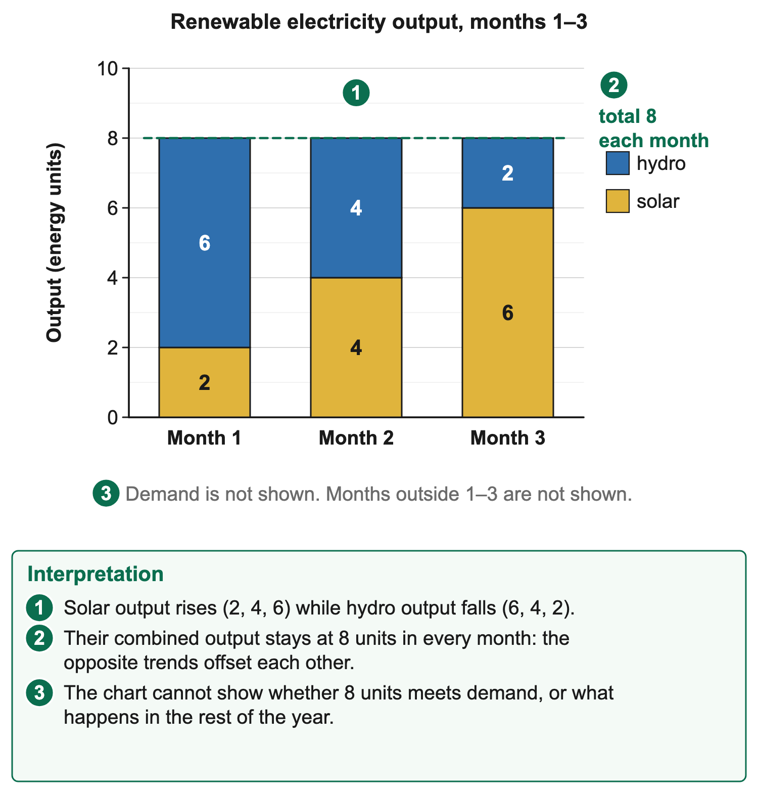

# 2.4 Energy sources

*nam-6137-nssco-2026. Offline study notes, rendered from the approved content units on 2026-10-30. Everything here is also what the flashcards are built from.*

---

## Renewable and non-renewable sources

### Renewable and non-renewable sources

A renewable energy source is replenished by natural processes on a human time scale. A non-renewable source exists as a finite stock that is not replaced at a useful rate relative to consumption. Sunlight, wind and flowing water provide renewable flows; coal, oil, natural gas and uranium rely on finite deposits. The distinction concerns replenishment, not whether equipment can be reused or whether electricity can be recycled after use.

Fossil fuels formed from ancient organic material through geological processes over very long periods. Coal, oil and natural gas are fossil sources. They are non-renewable on human timescales because new formation does not replace current extraction at a comparable rate. Uranium is also a non-renewable fuel, but it is not a fossil fuel. This distinction matters when comparing coal and nuclear electricity: both use finite fuel stocks, while their generation processes and emissions differ.

### Worked example

Electricity is an energy carrier rather than a single primary source. A socket can supply electricity generated from coal, water, sunlight or a mixture of sources. Calling electricity renewable without identifying its generation mix confuses the carrier with the resource. Similarly, a battery stores energy and later releases part of it; it does not create a new primary renewable source. Storage can help match supply to demand while involving losses and equipment needs.

### Worked example

Renewable does not mean that usable supply is unlimited at every place and time. A river can have insufficient flow for a power station, solar output changes with sunlight and wind output changes with wind conditions. The natural process continues, yet an installation's immediate useful output can be limited. A supply plan must consider the timing of demand, the resource pattern, transmission and any storage or complementary generation.

Renewable also does not mean environmentally harmless. Hydroelectric works can alter rivers and habitats; solar and wind installations use land and materials; biomass burning can create emissions. Compare the relevant effects over the system's construction, operation and disposal where the question requires them. The absence of fuel combustion during generation is a specific advantage, not proof that the whole project has no environmental footprint.

Wood is a special case requiring a condition. Trees can regrow, so wood biomass can be replenished, but harvesting faster than regrowth depletes a local woodland. Sustainable fuelwood use requires suitable recovery and harvesting arrangements. The presence of wood in a list alongside fossil fuels must not be interpreted as proof that wood formed geologically or cannot regrow. Its immediate availability, use and depletion still belong in the energy discussion.

### Worked example

A stock comparison clarifies the distinction. Suppose a woodland begins with 100 units, grows by twenty and loses thirty through harvesting, with other changes absent. Its closing stock is ninety, a decline of ten. Regrowth exists but does not match extraction in this interval. By contrast, recovering some metal from a used solar panel concerns material recycling, not the definition of the sunlight flow that powered it. Replenishment and recycling answer different questions.

Energy choices also differ from power ratings. Power measures the rate of energy conversion or delivery; energy measures the amount over a period. A kilowatt is a power unit and a kilowatt-hour an energy unit. A device drawing two kilowatts for three hours uses six kilowatt-hours if that rate is maintained. A station's maximum power rating does not establish its annual output without operating time and actual performance.

### Worked example

A supported classification should therefore identify the resource, replenishment timescale and relevant condition. Solar is renewable because sunlight is naturally supplied; coal is non-renewable because its stock is not replenished at the extraction timescale; fuelwood can be replenished where recovery keeps pace with use. These clear distinctions prepare for comparing availability, generation processes and trade-offs rather than grouping all sources under a single label of clean or dirty.

Reusing an appliance does not replenish the fuel it consumes. A stove can be used repeatedly while each load of coal reduces a finite fuel stock. Conversely, a solar panel may eventually need replacement even though the sunlight flow continues. Equipment life and source renewability therefore require separate statements. This distinction prevents a familiar household object from being used as evidence for the wrong classification.

### Connections

A source can also be locally scarce while globally renewable. A particular community may have little usable running water, or insufficient biomass recovery, even though the water cycle and plant growth continue elsewhere. Resource availability must be assessed at the relevant scale. A national category does not establish that every household can access a suitable amount at an affordable cost.

---

## Fossil fuels and fuelwood: availability and use

### Fossil fuels and fuelwood: availability and use

Coal, oil and natural gas remain significant because their stored chemical energy can be transported, held and released when suitable equipment is operated. Their availability depends on deposits, extraction, transport, finance and infrastructure, not simply on their existence underground. Together, coal, oil and natural gas have supplied around four-fifths of the world's energy for decades. Oil dominates transport, while coal and gas generate much of the world's electricity. A country may consume imported fuels without producing them domestically. The source's geological location and the location of its users can therefore differ substantially.

Coal is a solid fossil fuel used for heat and electricity generation. In a conventional coal power station, combustion supplies heat to produce steam, which drives a turbine connected to a generator. Coal can be stored near a station, supporting planned operation if supplies and equipment are available. Mining, transport, ash handling and emissions create additional costs and environmental effects. A coal deposit alone does not provide delivered electricity without the conversion and network system.

Coal transport affects location. Moving large quantities requires suitable roads, rail or port facilities, while the station needs land, connections and often water for its steam/cooling system. A station near a mine may reduce fuel-haul distance, whereas a coastal or demand-centred station may rely on imported or transported coal. The appropriate explanation follows the specified supply chain. Do not assume every coal station is built directly on a coalfield.

### Worked example

Oil is a liquid fossil resource refined into products such as petrol and diesel. These fuels are important for vehicles, machinery and some electricity generation. Their usefulness reflects energy content, transportability and an extensive system of storage and distribution. Crude oil and a refined transport fuel are not identical products. A country importing finished fuel depends on refining and transport elsewhere even if the fuel is sold locally.

Oil availability involves global production, shipping, refining, storage, currency and local distribution. Disruption at one stage can affect costs or delivery. International price changes can influence imported fuel costs, but the retail effect also depends on exchange rates and relevant domestic arrangements. A statement that oil becomes more expensive globally does not provide an exact new local price without those additional facts. Namibia has no oil refinery, so all its petrol and diesel are imported, mainly by ship through Walvis Bay.

Diesel generation can provide controllable electricity where suitable engines, fuel and maintenance exist. It may be useful for particular backup or remote needs, but continued operation requires recurrent fuel purchases and supply. A generator's presence does not establish affordability or reliability if fuel is unavailable. Burning liquid fuels also creates emissions, and storage or handling can create spill or fire risks requiring appropriate controls.

### Worked example

Natural gas is a fossil fuel largely composed of methane. It can supply heat or drive electricity generation through gas turbines and, in some systems, combined processes. Gas can be transported through pipelines or as specially handled liquefied gas. Each route needs infrastructure and investment. A gas discovery is therefore a resource opportunity rather than immediate proof of a functioning supply or an operating power station.

Gas combustion releases carbon dioxide. Upstream methane leakage can add climate impacts, so a comparison should not call gas emission-free. It can have lower direct carbon dioxide emissions per unit of electricity than some coal systems under suitable comparable conditions, but efficiency, leakage and the assessed boundary matter. A broad label of cleaner must identify what pollutant or measure is being compared rather than imply an absence of environmental cost.

Finite stocks can last for different periods under different rates of extraction. A simplified deposit of 1,000 fuel units consumed at fifty per year would last twenty years if the usable stock and rate remain unchanged. This is an arithmetic scenario, not a forecast of a real reserve. New information, extraction costs, technology and changing demand can alter what is economically available and how quickly it is used. Availability is therefore both physical and economic.

Fuelwood provides heat for cooking or other uses where wood can be obtained. It may be locally accessible and usable with relatively simple equipment, but collecting it takes time and sustainable supply depends on recovery. The fuel's cash price may not capture the labour of collection or effects on woodland. In Namibia wood is the most common main cooking fuel: the 2023 census main report records wood/firewood as the main cooking fuel for 50.1% of private households nationally and 84.6% in rural areas. Households may rely on it because other options are unavailable or unaffordable.

Woodland depletion occurs where harvesting and other losses exceed growth or replacement over the relevant period. Reduced cover can affect habitat, soil protection and future fuel availability. Longer collection journeys can then increase the time burden. Planting or protecting trees may help where survival and growth are maintained, but a seedling count is not the same as an established replacement stock. Compare actual recovery with removal rather than assuming that any planting programme closes the gap.

### Worked example

Fuelwood is not inherently non-renewable, even when discussed alongside fossil fuels because of its use and availability. The classification depends on replenishment, while a particular locality may experience unsustainable depletion. Keep the two statements together: biomass can regrow, and use faster than regrowth reduces the resource. Calling wood fossil or calling every harvest renewable without a recovery condition would both obscure the relevant mechanism.

The contribution of these sources is also sector-specific. Oil products can power transport, coal can supply electricity or industrial heat, gas can serve heat and power systems, and fuelwood can meet household thermal needs. A table of electricity generation does not describe all national energy use, because it may omit transport and direct cooking fuels. Check the title and units before drawing a conclusion about which source dominates the entire energy economy.

A useful supply comparison includes stock, delivery and conversion. A warehouse full of fuel can still fail to provide electricity if a generator is broken. A functioning generator can remain idle if fuel delivery fails. A household may have access to electricity for lighting but lack an affordable cooking appliance or sufficient supply for cooking. Energy availability and effective access therefore require a usable chain through to the intended service.

### Worked example

Fuel stores and reserves are different. A station's stockpile is fuel already extracted and held for use, while a geological reserve is a quantity judged recoverable under specified conditions. A shipment delay can reduce the stockpile without changing the underground deposit. An economic change can alter recoverability without physically creating new fuel. These distinctions help explain why a resource-rich region can still experience an immediate supply problem.

### Worked example

Transport and storage have different requirements for solids, liquids and gases. Coal needs bulk handling and ash disposal after combustion. Oil products need suitable tanks and distribution arrangements, while gas needs containment and pressure or temperature controls appropriate to its form. These systems cost money and require maintenance. A comparison of fuel availability should therefore include the infrastructure connecting the resource to its user rather than treating all fuels as interchangeable bags of energy.

### Worked example

A direct-use account differs from an electricity account. Suppose a community uses twenty energy units of cooking fuel and thirty units of electricity. Total recorded energy use is fifty units if both figures use the same unit and system boundary. Electricity forms 60% of that account, but its generation mix must still be identified separately. If only electricity generation is tabulated, the cooking fuel can be invisible. Avoid reporting a source's share of one account as its share of all energy use.

### Connections

Compare like units and periods: a monthly fuel-delivery mass cannot directly establish annual electricity output without conversion and operating information.

---

## Renewable supplies and reducing fossil dependence

### Renewable supplies and reducing fossil dependence

Renewable generation can replace part of fossil energy use where suitable resources, technology and networks are available. It can diversify supply and reduce recurrent purchases of fossil fuel. The size of the contribution depends on actual usable output at the times it is needed. Installed equipment or a maximum rating is not the same as delivered energy, and a growing renewable share does not by itself show that total fossil consumption has fallen.

Geothermal energy uses heat from within the Earth. In suitable settings, hot fluids or heated rock can provide usable heat and sometimes electricity generation. For electricity, the system must deliver heat capable of driving the appropriate generating process. Favourable geology, accessible depth, water or fluid arrangements and drilling costs influence feasibility. Iceland, a volcanic island, is a well-known example: in 2003 its government reported that about 88% of homes were heated with geothermal water and that geothermal power stations supplied 18% of its electricity. A hot climate at the surface is not evidence of a geothermal reservoir; solar heating and internal Earth heat are different sources.

### Worked example

A geothermal resource can provide relatively steady energy where the field is productive and managed suitably. Constraints include exploration risk, drilling and maintenance costs, fluid handling and possible local environmental effects. Extracting heat or fluids faster than a particular system can sustain can reduce its useful performance. The source is renewable in the broader natural-process sense, while an individual project still requires management and monitoring of its resource.

### Worked example

Wave energy draws on the movement of surface waves. Devices can convert that motion into mechanical work and electricity. The resource depends on the wave climate, so coastlines differ in suitability. A site requires sufficient usable waves, survivable equipment, maintenance access and a way to deliver power. Being beside the sea does not establish that the resource or the connection costs are suitable for a particular installation.

Wave systems face a difficult operating environment. Saltwater, storms and moving components create design and repair challenges. Devices may interact with navigation, fishing, habitats or other coastal uses. The relevant judgement compares expected useful energy with cost, reliability and environmental effects. Waves are not tides: surface waves are largely generated by wind, while tidal changes reflect gravitational interactions. Both involve moving seawater but have different timing and technologies.

Tidal energy uses regular changes or currents associated with tides. A tidal-range system can use a water-level difference, while tidal-stream systems use flowing tidal currents. Suitable range, current speed, seabed and access influence location. Tides are predictable in timing, but generation still varies through the tidal cycle and is not a constant output. A predictable pause is still a period that the supply system must accommodate.

### Worked example

Tidal works can alter sediment movement, habitats or other uses, depending on the design. Strong currents can be useful for energy while also challenging installation and maintenance. A wide coast does not itself establish a suitable range or stream resource. Site-specific measurements and environmental assessment are needed. The explanation should identify the actual energy movement used rather than simply say water makes power.

Hydroelectric power uses water moving through a height difference to drive turbines connected to generators. River flow supplies water and the usable head provides a vertical energy difference. Some schemes store water in reservoirs; others operate mainly with river flow and limited storage. These designs have different capacity to shift generation through time. Running water is a renewable source, but a station's output can still fall in a dry period.

Hydroelectric generation can reduce fuel combustion during operation and supply useful electricity where flow, head and infrastructure are suitable. Reservoir designs may allow some control over timing, while run-of-river operation is more directly constrained by current flow. Both need maintenance, transmission and suitable management of river effects. The renewable label does not establish unlimited output or the absence of ecological consequences.

### Worked example

Solar energy uses incoming radiation. Photovoltaic cells convert light into electricity directly, while solar thermal systems capture heat for uses such as water heating; some larger thermal designs generate electricity through a heat-driven process. These methods should not be merged into a claim that every panel heats water or every solar system drives a turbine. Identify the conversion process shown by the resource.

Solar photovoltaic output changes with sunlight, cloud, shading and equipment conditions. At night a panel does not provide new sunlight-based generation, so a demand at that time needs storage, another supply or a changed use pattern. Strong sunlight can support a project, but heat, dust, maintenance and connection arrangements also affect useful output. The highest temperature is not automatically the site with the greatest dependable electrical supply.

Solar can support distributed services where a suitable system supplies local needs without a long network extension. The design still needs appropriate equipment size, maintenance, affordability and any required storage. A lighting system is not necessarily capable of running cooking equipment or an irrigation pump. Compare the actual load and timing with system capability rather than treating a solar connection as an identical service in every household.

Biogas is a fuel mixture, including methane, produced when suitable organic material decomposes without oxygen under managed conditions. A digester can use materials such as manure or other appropriate organic residues. The resulting gas can provide heat or power with suitable equipment. A functioning system needs a dependable feedstock, appropriate operating conditions, handling and maintenance. Organic material present somewhere in a district does not automatically become usable gas at a household.

Biogas can provide an energy use for organic residues and leave material that may have nutrient value when appropriately managed. Benefits depend on the whole system. Gas leakage, unsuitable waste handling or poorly maintained equipment can create risks. Feedstock can also have other uses, while collection requires labour and transport. Assess whether the material supply and practical operation can be maintained rather than assuming that waste means a free unlimited fuel.

### Worked example

Wind, although considered separately in siting, is another renewable flow. Turbines extract some energy from moving air and drive a generator. Output varies with wind conditions and turbines have operating limits. The timing of wind generation may complement or coincide with other sources, depending on the actual patterns. A diversified system requires those patterns to be assessed, rather than simply adding several renewable names and assuming a dependable total.

### Worked example

A generation-mix comparison distinguishes shares from amounts. Suppose renewable energy rises from twenty to forty units while total supply rises from 100 to 200 units. Its share remains 20% although its amount doubles. If fossil energy simultaneously rises from eighty to 160, total fossil use has grown. Conversely, a rising renewable share can coincide with stable or falling fossil use, depending on total demand. State both numerator and total before describing dependence.

A chart of monthly renewable output should show the interval, unit and sources. Compare geothermal, water, solar or other series using matched periods and quantities. A high maximum point does not establish annual dominance; totals require the complete period or suitable aggregation. If the chart has missing observations, do not treat them as zero. The chart's boundaries determine whether a conclusion concerns one station, electricity generation or total national energy.

### Worked example

Renewables can improve security by diversifying resources and reducing some imported fuel needs, while also requiring materials, investment and grid services. Storage can move energy to another time, with losses and cost; complementary sources can fill gaps if available; efficient use can reduce the load to be supplied. A realistic plan connects generation to demand, transmission and maintenance instead of judging sources in isolation.

### Worked example

The strongest explanation of growing significance therefore combines opportunity and conditions. A suitable solar project can replace some daytime fossil generation; an appropriate hydro resource can contribute low-combustion electricity; biogas can serve a defined fuel need. Their actual contribution is measured in useful delivered energy or displaced fuel under stated conditions. The renewable source remains distinct from the equipment and from the wider supply system that makes it useful.

Each renewable process has a different physical pathway. In geothermal generation, internal heat drives a suitable conversion system. In wave and tidal systems, moving seawater supplies mechanical energy. In hydroelectricity, flowing water through head turns a turbine. In photovoltaic systems, light is converted directly to electricity. In biogas systems, organic feedstock becomes a combustible gas through managed decomposition. Naming these pathways prevents the generic statement “it turns a turbine” from being used for a photovoltaic panel that has no turbine.

### Worked example

Resource quality can vary within the same broad region. Two coastal sites can have different usable wave conditions or tidal currents; two river sites can have different head; two roofs can have different shading. A large resource map identifies opportunities for closer investigation rather than a final engineering design. Local measurements, access, construction and environmental information are needed before assigning a project a dependable output.

A biogas account should specify feedstock and continuity. A digester receiving enough suitable material during one demonstration may not receive it throughout the year. Livestock movement, competing uses or collection difficulties can interrupt the input. A dependable service needs a maintained operating sequence and suitable equipment as well as the biological process. Output should be measured in useful gas or delivered energy over the relevant interval, not inferred solely from the digester's volume.

### Worked example

A hydroelectric time series illustrates the difference between a renewable resource and a stable output. Suppose monthly generation is twelve, eight and four energy units in three consecutive months as usable flow falls. The three-month total is twenty-four units. Water remains part of a renewing cycle, yet this station's output has declined. Without the rest of the year, the series cannot establish its annual total or prove the same trend will continue indefinitely.

### Worked example

Diversification should be tested against coinciding low-output periods. Suppose daylight solar output covers a daytime load, but both solar output and wind fall below an evening load. Listing two technologies does not establish adequacy. A second resource improves reliability only to the extent that its available contribution, storage or other support fills the relevant gap. This is a timing problem that annual energy totals alone can conceal.

Lower dependence on fossil fuels can refer to a smaller share, a smaller absolute quantity or less exposure to imported supply. Those are different objectives. A country can raise domestic renewable production while still importing fossil fuel for growing transport demand. The conclusion needs the sector and measure being assessed. A precise answer can describe a successful electricity contribution without claiming an unmeasured change across the whole energy economy.

### Connections

A paired teaching chart gives solar output of 2, 4 and 6 energy units and hydro output of 6, 4 and 2 across three months. Each combined monthly total is eight. Opposite component trends therefore coexist with a constant combined total; the chart alone does not show demand or prove adequacy.

---

## Locating hydroelectric power

### Locating hydroelectric power

Hydroelectric siting depends on a usable water flow and head, suitable physical works and access to a demand network. Greater head and suitable discharge can provide more generating potential, but neither a high waterfall without enough flow nor a large flow without usable head automatically makes a viable station. Seasonal reliability, geology, construction access, costs and environmental effects influence the decision.

Good HEP sites usually have a large, reliable river flow; a steep drop, waterfall or narrow gorge where a short dam can be built; impermeable rock so water does not seep away; a wide valley upstream to store water; low evaporation; and land of low value with few people who would need to be moved. A run-of-river arrangement needs less storage but depends more directly on flow. The catchment supplies water, so rainfall upstream can matter even where the station itself lies in a dry area. A local rainfall observation alone cannot describe the whole river supply. Transmission routes and distance to users also affect the cost of delivering generated electricity.

### Worked example

Ruacana on the Kunene River is Namibia's named hydroelectric example. It is a run-of-river station with little storage, so output depends strongly on river flow. The Kunene rises in Angola and its catchment rainfall affects the supply. In 2018/19 Ruacana contributed 26% of all electricity used in Namibia. This is a dated share of total use, including imported electricity, rather than a share of local generation alone. When flow is low, Namibia needs more power from other stations or imports.

### Connections

An appropriate site assessment also considers downstream flow, aquatic habitats, land use and affected people. A physically attractive generation site may have high environmental or social costs. A supported choice weighs those effects alongside usable energy and construction feasibility. This leads into the generation sequence, which explains how the site's water resource becomes electricity rather than assuming that a river's presence alone supplies power.

---

## How hydroelectricity is generated

### How hydroelectricity is generated

Hydroelectric generation converts energy associated with water moving through a height difference into mechanical rotation and then electricity. Water enters an intake and falls through a large pipe called the penstock, gaining speed. The moving water turns the turbine; the turbine's shaft spins the generator, which converts rotation into electrical energy. A transformer raises the voltage and power lines carry the electricity to users.

Water continues out through a discharge channel or tailrace into the downstream system. It is not burned as a fuel or converted wholesale into electricity. Generation uses part of the water's available energy. This distinction separates hydroelectricity from a thermal power station, where heat first produces steam or hot gases. Both can use turbines and generators, but their energy sources and conversion sequences differ.

A reservoir can store water and provide head in some schemes, while a run-of-river scheme relies more directly on available river flow. The precise layout varies, so follow the supplied diagram's arrows rather than assuming a large storage dam in every design. An intake lies upstream of the turbine flow path and the tailrace carries water away; electrical transmission is a separate path from the water outlet.

### Connections

Reduced usable flow or head can limit generation even if the generator's maximum rating is unchanged. Maintenance or network constraints can also limit delivered power. A clear process answer names water movement, turbine rotation and generation in sequence, then distinguishes the water's continuation from the electricity's transmission. These mechanisms support the later comparison of hydroelectric benefits and dry-period constraints.

---

## Comparing HEP, coal, nuclear and solar

### Comparing HEP, coal, nuclear and solar

Energy sources should be compared against a stated service and criterion. A system may need dependable evening electricity, affordable new supply, reduced emissions or local access. The preferred option can differ with that aim and the available resources. Compare usable output, timing, fuel and operating costs, construction needs, environmental effects and system connections rather than selecting one label as best in every setting.

Hydroelectric power avoids fuel combustion during generation and uses a renewable water flow. Where a suitable scheme has usable storage, generation can sometimes be adjusted to demand within its limits. Construction can require substantial investment and can alter land, rivers and habitats. Output depends on flow and operating conditions; drought can constrain it. A run-of-river station should not be credited with large seasonal storage unless the actual design provides it.

Coal generation can provide controllable output when fuel, machinery and network capacity are available. Stockpiles can buffer some delivery variation. However, mining and transport affect land and communities, and ash needs management. Burning coal releases carbon dioxide, a greenhouse gas that adds to the enhanced greenhouse effect and global warming, and sulphur dioxide and nitrogen oxides, which form acid rain that damages soils, forests, lakes and fish. Smoke and dust also reduce air quality. Pollution controls can reduce particular emissions without making combustion carbon-free. Continuing fuel and maintenance costs must be included in an affordability judgement alongside initial construction.

Nuclear generation uses energy released through fission rather than burning a fossil fuel. Heat supports a generating process, usually involving steam and a turbine. Nuclear can supply substantial output with low direct carbon dioxide emissions during operation compared with fossil combustion. It still requires fuel, complex infrastructure, skilled operation, cooling arrangements and strong safety systems. Uranium is non-renewable and radioactive materials require appropriate management.

Nuclear disadvantages include high initial capital requirements, long planning or construction periods in many projects, radioactive waste management and decommissioning responsibilities. Severe accidents are rare but serious. On 11 March 2011 an earthquake and tsunami cut the power and cooling at Japan's Fukushima Daiichi station; three reactor cores melted, radioactive material escaped and about 110,000 people were evacuated because of radiation. A comparison should not call nuclear renewable because it has low direct carbon emissions, or call it fossil because its fuel is mined. Replenishment, emissions and risk are separate dimensions.

Solar photovoltaic generation avoids combustion at the point of generation and can be built at different scales. It needs no fuel, has low running costs and suits sunny places and homes far from the grid. Its disadvantages are a high cost to buy panels and batteries, and small home systems that can run lights and phones but not cooking or large appliances. Its direct output varies with sunlight and is unavailable from new sunlight during night. Storage or another source is needed if the service requires supply beyond that pattern. Manufacturing, land, materials and eventual equipment disposal also belong in a wider environmental assessment.

Construction cost and operating cost differ. A project with higher initial investment may have lower recurring fuel purchases, while a cheaper generator may require expensive fuel throughout operation. The comparison needs the same service, period and relevant costs. A single equipment price is not a complete lifetime cost. It also does not establish whether households can afford a tariff or an appliance needed to use the energy.

### Worked example

A hypothetical evening-service comparison makes the timing issue clear. Demand is ten energy units after sunset. A solar-only system without storage or another connection supplies no new solar generation then, even if it produced fifteen units earlier. With suitable storage, some earlier energy could be shifted, subject to capacity and losses. The daytime total alone cannot establish that the evening need is met.

### Worked example

Storage calculations should state losses. Suppose ten units enter a store and eight can later be delivered under the stated efficiency. It can meet an eight-unit later load if timing and power capacity also fit, but not a ten-unit load from that charge alone. Storage is useful without being loss-free. Compare the delivered service rather than adding generated energy and stored energy as if they were two independent supplies.

The environmental boundary also matters. Hydropower and solar may have low operational combustion emissions while construction affects materials, habitats and land. Coal's fuel use and emissions continue during operation. Nuclear's low direct carbon dioxide emissions do not resolve waste or safety requirements. A supported evaluation identifies the relevant benefit and cost, rather than using a single adjective such as clean to stand for all environmental measures.

### Worked example

Supply reliability concerns the whole chain. A fuel-based plant can be unavailable during fuel disruption or maintenance; renewable output can vary with its resource; transmission can interrupt any source. Diversity, appropriate reserves, storage, maintenance and demand management can reduce different risks. The existence of more than one source is helpful only where their available output and connections cover the relevant service when needed.

### Worked example

Ruacana illustrates why a named case needs its actual design. As a run-of-river station, it uses a river resource but remains sensitive to flow. It supports a renewable contribution without proving constant annual output. A proposed solar addition could diversify daytime supply, but evening adequacy still needs a full demand and supply account. The case encourages system reasoning rather than an unsupported claim that one project makes Namibia independent of every import.

A good conclusion answers the selected criterion under the supplied conditions. If the objective is avoiding on-site combustion during daylight generation, solar can meet that narrow aim where suitable. If the objective is dependable all-hour service, the wider system must be demonstrated. If the objective is affordability, complete comparable costs are needed. Such bounded judgements remain useful while recognising that every source has practical requirements.

Power and energy adequacy need checking separately. A storage device may contain enough energy for several hours but lack the discharge power required to run a large load at once.

A simple load example uses a two-kilowatt appliance for three hours, requiring six kilowatt-hours. A store able to deliver only four kilowatt-hours cannot supply the full interval without another source, even if it can provide two kilowatts initially.

Environmental and social costs may occur before electricity is delivered. Land acquisition, construction traffic or altered river access can affect people during development. Later benefits may not go to the same households bearing those costs. A comparison of generation options therefore needs stakeholder and timing information where the question concerns development. Compensation or participation arrangements should be assessed through their terms and delivery, not assumed from the promise of electricity.

### Worked example

Operational flexibility also varies between technologies and designs. Some generators can change output more readily than others, while minimum operating levels, start-up times and maintenance affect practical decisions. A system plan connects resource availability, demand timing and the usable characteristics of each component.

A lower-emissions claim should identify its boundary and comparison. Avoiding combustion at a solar panel is a point-of-generation statement. Comparing construction, fuel supply, operation and disposal is a wider assessment. Neither should be substituted silently for the other. An evaluation can recognise a specific emissions benefit while still discussing land, materials, waste or safety responsibilities.

### Connections

Compare the same required service over the same interval, then identify which costs, emissions and availability observations the resource actually supplies.

---

## Wind and solar location

### Wind and solar location

Wind-power siting requires a suitable wind resource at the relevant turbine height and over time. Mean conditions, variability, extreme winds and turbulence influence usable output and equipment demands. A windy observation on one afternoon cannot establish annual suitability. Measurements need an appropriate period and height, with a clear account of missing observations. Exposed sites can have useful winds but also difficult access or environmental constraints.

### Worked example

Turbines need suitable foundations, space, installation access and a connection to users or storage. Terrain and obstacles can affect airflow. A hilltop may increase exposure while complicating construction or transmission, so the highest point is not automatically the best site. The relevant judgement combines resource and practical delivery rather than choosing from a map of altitude alone.

### Worked example

Wind installations can affect nearby people, landscapes, birds or bats depending on location and design. Assessment can identify sensitive areas and suitable separation or operating arrangements. A low population density does not mean an area has no ecological value or land-use rights. The choice should consider affected users and habitats alongside expected energy. A promise of mitigation requires follow-up evidence that it works.

### Worked example

Solar siting requires suitable incoming radiation, limited shading and appropriate orientation or layout. Available land or roof space, structural suitability, maintenance access and a connection to demand also matter. Sunlight resource and temperature are different: strong heat can affect equipment performance, while a cooler sunny site can still be productive. Dust or shading can reduce output, so cleaning and upkeep are practical considerations, with any water needs assessed locally.

### Worked example

The location of demand influences both technologies. A remote installation may avoid a costly line extension for a suitable local service, but needs an appropriate load, storage or complementary supply and maintenance. A grid-scale project requires enough network capacity to deliver output. A high-resource site with a costly or constrained connection may be less suitable than a slightly weaker resource nearer usable infrastructure.

### Worked example

A schematic comparison can separate the factors. Site A has strong measured wind but no feasible grid route and difficult construction access. B has a somewhat lower resource with suitable land, access and a usable connection. A resource-only ranking favours A, but a delivered-cost or near-term-service judgement may favour B if the supplied cost evidence supports it. The choice must state its criterion and avoid inventing a price difference.

Timing matters as well as annual totals. Solar can align with daytime demand, while an evening load needs another arrangement. Wind may complement solar in some places but not automatically. A paired time series helps assess whether low output occurs simultaneously. A map of sunny and windy regions alone cannot prove that their combined system covers every hour's demand.

### Worked example

Site assessment therefore combines resource measurement, construction, connection, cost and environmental or social effects. A recommendation should identify the decisive evidence and the remaining uncertainty. A proposal can be promising without having a completed feasibility study. This distinction links physical energy geography with the policy choices about dependable access and appropriate project assessment.

### Worked example

A suitable solar comparison can use a measured resource and access record. Roof A is shaded for much of the relevant daylight period and needs structural work; roof B has little shading and suitable support. If other conditions match, B offers a more favourable starting point for the stated installation. That does not provide its exact energy output without system size, orientation and performance data. The resource helps rank constraints, not invent a precise generation total.

Wind records should distinguish measurement height and period. A ground-level gust observed during a storm is not interchangeable with a long-term series at turbine height. Using unmatched records can create a false ranking. The same principle applies to solar records from different months: a longer daylight observation should not automatically be compared with a shorter one as if exposure time were equal. State the basis of the comparison before drawing the location conclusion.

### Worked example

Grid access can be an enabling factor and a limit. A line close to a site may still lack capacity or require additional connection works. A remote site may have excellent resources but high delivery costs. Conversely, an off-grid system can suit a particular local service without exporting power. The best siting explanation follows the intended service from resource to user, including the relevant network or local-storage arrangement.

### Connections

A location recommendation should name the decisive resource advantage, its delivery conditions and any unresolved environmental or construction constraint.

---

## Environment, woodland and household energy

### Environment, woodland and household energy

Energy policy needs to consider environmental effects, resource depletion and household health or safety alongside supply. Under the Environmental Management Act (Act 7 of 2007), listed activities, which include generating and transmitting electricity, may not go ahead without an environmental clearance certificate. The Environmental Commissioner decides each application after an assessment of likely effects and may hold public hearings. The geographical purpose is to identify impacts, alternatives and appropriate management, with attention to affected people and environments. An assessment or clearance record is different from proof that every predicted outcome has occurred.

### Worked example

An energy-project assessment can consider construction footprints, land and water requirements, emissions, waste, habitat effects and community concerns. Relevant issues differ between a river project, a solar installation, a fuel store and a transmission line. A useful assessment follows the actual pathways rather than applying one identical checklist of consequences to every technology. Alternatives may include a different site, scale, design or demand-side response.

Mitigation aims to avoid or reduce harm where feasible. Changing a route can avoid a sensitive area; suitable waste arrangements can reduce pollution pathways; maintaining equipment can reduce failures. Residual effects and monitoring still matter. A mitigation plan sets intended actions, while inspections and environmental observations provide evidence of implementation and outcomes. Public participation can reveal local uses or concerns that a purely technical description misses.

### Worked example

Woodland depletion links household fuel access with ecological recovery. Where fuelwood removal exceeds regrowth, the standing resource declines. Reduced cover can affect soil protection and habitat, while longer collection distances can increase household labour. Protecting regrowth, suitable planting, efficient use and accessible alternatives can contribute to a response. Their effectiveness depends on survival, recovery, affordability and continued access to an energy service people can use.

Planting is not identical to replenishment. Seedlings need suitable species, space, water and protection to become established. A project planting 1,000 seedlings but retaining only 300 after a dry period cannot claim 1,000 established replacement trees. Counts of surviving stock and growth over time are needed. Similarly, a reduction in fuelwood per meal may not reduce total harvesting if the number of meals or users rises sufficiently.

Fuel collection also has a social dimension. Time spent obtaining wood can compete with paid work, education or care responsibilities. A cleaner or more convenient service can reduce some burden where it is affordable and reliable. Supplying an appliance alone may not change practice if the required fuel or electricity cannot be obtained. Policy needs to address the usable service rather than assuming that ownership of equipment proves sustained adoption.

Household combustion in open fires or inefficient stoves can create harmful air pollution. Exposure depends on fuel, equipment, ventilation and use. WHO identifies access to cleaner fuels and suitable technologies as central to reducing this burden. Ventilation alone is not proof that a polluting arrangement meets health-protecting performance. The energy discussion should distinguish health evidence from a household's understandable need to cook or heat under constrained conditions.

Suitable electric cooking avoids combustion emissions at the point of use, while dependable and affordable electricity and suitable equipment are needed. Cleaner fuels and properly designed technologies can offer other options. The wider electricity system may still have generation impacts elsewhere. Point-of-use health and whole-system environmental effects are related questions with different boundaries. A policy judgement should state which one it assesses.

Safety includes risks of burns, fire, fuel spills, unsuitable wiring or leaking equipment, depending on the system. Appropriate installation, maintenance, storage and user information matter. These general principles do not replace competent installation or the specific instructions for an appliance. A move to another energy source should include practical safety arrangements rather than claim that one label removes every household risk.

Affordability has both upfront and recurrent parts. A household may obtain a low-cost stove yet face expensive fuel, or receive an electrical connection but lack funds for the relevant appliance and ongoing use. A meaningful access measure should identify the service and its practical requirements. Support can improve adoption where it addresses these barriers, while evidence of continued use helps establish whether the service remains feasible.

### Worked example

Environmental and health aims can reinforce each other, but not every measure achieves both automatically. Efficient use can reduce fuel demand under stated conditions; sustainable supply can protect woodland; cleaner technologies can reduce exposure. The result depends on actual operation and the scale of demand. Monitor relevant resource and household outcomes instead of treating a policy announcement, distributed device count or planting total as final success.

### Worked example

A woodland balance can guide an environmental judgement. Suppose annual regrowth is forty units and harvesting sixty, with other changes stated absent. Stock falls by twenty units during the interval. Harvesting may provide immediate cooking energy, but the recorded balance does not maintain the starting resource. An effective response needs recovery to match use or use to fall sufficiently, with attention to other losses and the needs of those relying on the supply.

### Worked example

Project assessment is also comparative. A proposed transmission route might cross a sensitive habitat while another avoids it at a different construction cost. The choice needs evidence about both effects and feasibility. Considering an alternative before construction can prevent harm more effectively than relying entirely on later repair. Assessment should therefore inform decisions, not merely describe a project after its location and design are treated as fixed.

Monitoring should use outcomes relevant to the policy aim. Seedling survival and woodland growth relate to replenishment; sustained service use relates to practical access; relevant exposure measures relate to household pollution. A distributed-device count or project budget can describe activity without proving those outcomes. Matching the evidence to the claim makes it possible to recognise partial progress while identifying what still needs improvement.

### Connections

Demand growth can offset efficiency. If wood use per meal falls by a quarter but the number of meals served doubles, total use can rise. Efficiency remains a benefit per service unit, while the resource balance still needs checking at the total scale. This distinction links household energy measures with the wider conservation and development objectives.

---

## Energy and development policy

### Energy and development policy

Dependable, affordable and suitable energy supports education, health services, communications, water pumping, food storage and enterprise activity. Interruptions or high costs can constrain these services. An energy connection is useful when it can deliver the required power and energy at the times users need them. Lighting access and the capability to run a large machine are different service levels.

### Worked example

Namibia's White Paper on Energy Policy (1998) set six goals: effective governance, security of supply, social upliftment, investment and growth, economic competitiveness and efficiency, and sustainability. Security of supply was to come from diversifying sources and using local resources such as sunshine. The Off-Grid Energisation Master Plan (2007) aimed to bring energy, mainly solar, to rural households far from the grid. The 2022 National Integrated Resource Plan sets out options for future electricity investment.

Investment choices involve scarce capital, operating costs, imported inputs and environmental responsibilities. Local generation may reduce some import exposure while requiring equipment and finance from abroad. Regional exchange may improve access while depending on transmission and partner availability. Because Namibia imports much of the electricity it uses, local generation can displace imported electricity and reduce payments to neighbouring suppliers.

### Connections

Efficiency and demand management can reduce the supply needed for a given service where suitable methods are available. Better insulation, appropriate equipment or changed timing may help, but the effect should be measured in comparable service terms. Reducing electricity by stopping an essential service is different from maintaining the service with less energy. Policy success therefore needs evidence of useful access, cost and resource outcomes, not just a lower consumption total.

---

## Regional and global energy links

### Regional and global energy links

For many years Namibia generated less than half of the electricity it used; in December 2025 local generation accounted for 51.6% of electricity supplied to the domestic economy. The rest is imported through the Southern African Power Pool. It has long relied mainly on South Africa, and also has purchase agreements with Botswana, Zambia, Zimbabwe, the DRC and Mozambique. The 950 km Caprivi Link, opened in 2010 between Gerus in central Namibia and Katima Mulilo, connects Namibia to the northern part of the power pool. Imports depend on spare supply in partner countries and on line capacity.

Regional supply can also transmit disruption. Reduced generation or constrained transmission elsewhere can affect import options, while shared planning and diverse connections can reduce some risks. Domestic generation, regional trade, maintenance and demand management therefore interact. A balanced explanation recognises both the opportunity of cooperation and the practical limits of relying on a particular route or source.

Namibia has no oil refinery, so all its petrol, diesel and other refined fuels are imported, mainly by ship through Walvis Bay. When world oil prices rise or the Namibia dollar weakens, the import bill and pump prices rise. Transport, mining, farming and diesel generators then cost more to run.

### Connections

Energy security is consequently a supply-chain question. A local generator may still need imported fuel or components, while a renewable installation may reduce fuel imports but require maintenance equipment. Regional and global links are part of the system rather than evidence that local resources have no value. Assess the diversity, reliability, affordability and environmental effects of the actual connections supporting the required service.
