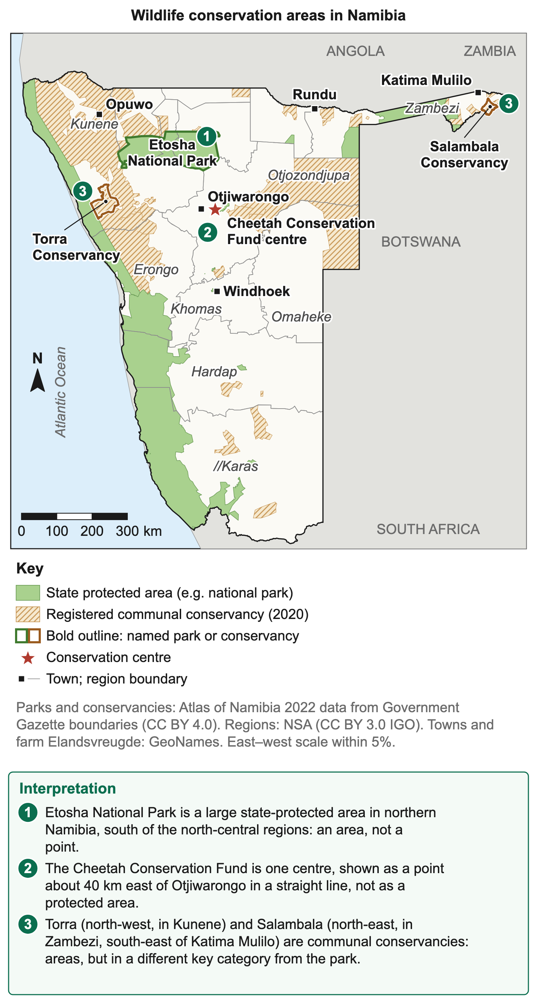
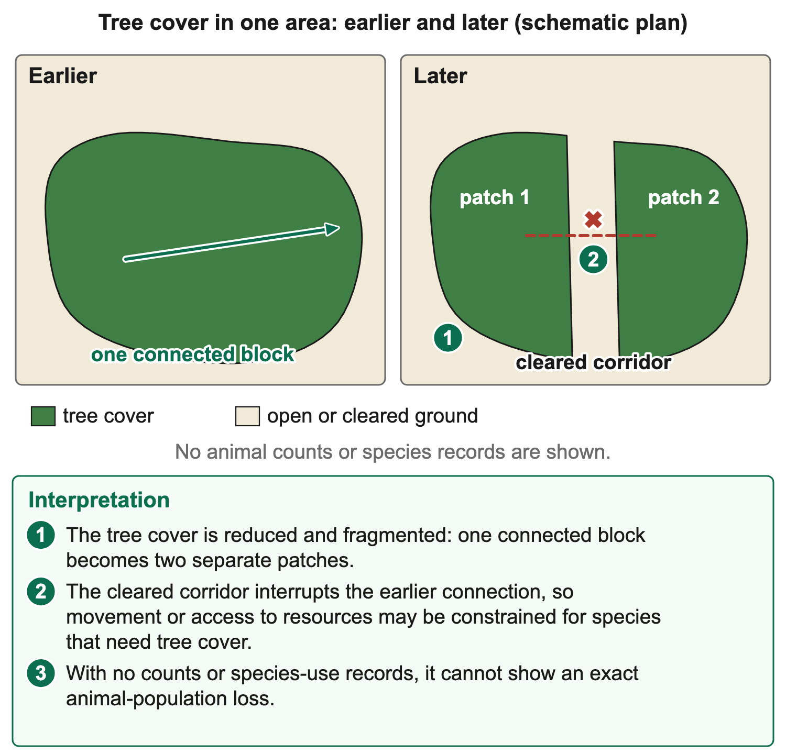

# 2.6 Utilisation and management of wildlife animals in Namibia

*nam-6137-nssco-2026. Offline study notes, rendered from the approved content units on 2026-10-30. Everything here is also what the flashcards are built from.*

---

## Conservation locations and management areas

### Conservation locations and management areas

Wildlife conservation and management take place through different institutions and land arrangements. A national park, a communal conservancy and a specialist conservation organisation are not identical categories. Maps should identify the actual boundary, site or symbol rather than colour every area with wildlife as a national park. Wildlife can move outside designated areas, so a management boundary does not necessarily contain every animal throughout its life.

Etosha National Park is a major conservation area in northern Namibia. It provides a named location for studying wildlife, habitat management and nature-based tourism. Ministry information identifies game viewing, research and visitor facilities within the park. These activities show several uses of a protected area, but their existence does not establish a current visitor total or a precise trend in every species. Such claims need dated monitoring records.

Etosha's pan and surrounding habitats provide a geographical setting, while waterholes influence where animals and visitors may concentrate. A location answer should place the park using the map's labels and regional position. A process answer about wildlife distribution needs water, habitat and species evidence. The park boundary alone does not explain where each species occurs within it or how distributions change between seasons.

The Cheetah Conservation Fund's research and education centre is about 44 km east of Otjiwarongo. The organisation works on cheetah conservation, including research, education and relationships between conservation and farming. It is a named institutional site rather than another national park. The syllabus’s “cheetah foundation” can be studied through either of two organisations near Otjiwarongo: the Cheetah Conservation Fund, or the AfriCat Foundation at Okonjima, about 50 km south of the town, which works mainly on cheetahs and leopards. Neither is a national park.

A point symbol for a research centre differs from an area boundary representing a park or conservancy. On a national map, the point can establish approximate location while an inset may show the centre more precisely. Do not infer the full distribution of cheetahs from one organisation's headquarters. A species-range map, a centre-location map and a protected-area map answer different questions even where they concern the same animal.

Communal conservancies are member-based management arrangements with defined boundaries and responsibilities. Ministry information describes elected committees, wildlife management plans, meetings and financial reporting. They are recognised through the relevant national framework but are not simply government-run national parks. Community participation and livelihood activities are central to understanding their management. A conservancy boundary can include people and several land uses rather than representing an empty animal enclosure.

Northern conservancies occur in different environmental settings. Torra provides a north-western example and Salambala a north-eastern example. These named anchors help avoid treating all northern Namibia as one continuous conservancy. A map should show separate areas and relevant labels, with the key distinguishing conservancies from national parks and institutional sites. Beyond the north, national parks cover almost the whole coastline apart from the coastal towns (Skeleton Coast, Dorob, Namib-Naukluft and Tsau ǁKhaeb), and Bwabwata, Mudumu and Nkasa Rupara lie in the north-east. In 2022 the 86 communal conservancies covered about a fifth of Namibia, while freehold conservancies manage wildlife on privately owned farmland.

The north-west and north-east differ in water, vegetation and land-use opportunities. Management therefore needs local ecological and livelihood evidence. A tourism model suitable for one setting may not generate the same benefits elsewhere. Some areas have strong conservation value without large tourism earnings. A map of conservation areas is not a map of guaranteed enterprise profit or of identical wildlife density.

A national location comparison can identify Etosha in the northern part of the country, the Cheetah Conservation Fund near Otjiwarongo and separate conservancy examples towards the north-west and north-east. Use the provided map's orientation, labels and key to make the comparison. A road distance should be read from an appropriate route and scale, not invented from the apparent closeness of two symbols. On an Atlas-based map, Etosha covers about 22,900 km² of the north; Torra (about 3,500 km², in Kunene) and Salambala (about 940 km², in Zambezi, south-east of Katima Mulilo) were both registered in June 1998; and the Cheetah Conservation Fund centre lies about 40 km east of Otjiwarongo in a straight line, a little farther by road.

### Worked example

Map evidence also has a date and scale. A small-scale national map may omit small areas or simplify boundaries. The omission of an institutional site does not prove that no conservation activity occurs there. Conversely, a point symbol cannot establish the land area managed by that organisation. State what the resource actually represents before drawing conclusions about extent, proximity or management responsibility.

Conservation can connect areas through movement routes or compatible neighbouring land use. Fragmentation, roads and fences may limit those connections. A boundary map alone may not show whether animals can move safely between habitats, so movement or land-use evidence is needed. Recognising this distinction connects the location objective to later questions about environmental change and conflict beyond park boundaries.

A useful conservation map therefore distinguishes categories, names places and supports a clear spatial description. It should not be used to supply unsupported wildlife counts, management success or household benefits. Those require other records. Keeping location separate from outcome allows the same named case to support several different geographical questions without turning one map into evidence for claims it cannot establish.

A map key should make the institutional distinction visible. For example, an area fill can identify national parks, a different boundary style communal conservancies and a point symbol a specialist centre. A learner should read the key rather than assume that colour means vegetation or population density. If an inset shows detail around Otjiwarongo, its scale may differ from the national map. Distances measured on one must not be transferred to the other without checking the scales.

### Worked example

A location description can use a hierarchy. First place Namibia within southern Africa if that is relevant to the resource, then locate the named area within Namibia and finally relate the site to labelled towns or neighbouring areas. The answer should match the requested scale. A national question does not need an invented street address, while a local route question cannot be answered adequately by saying somewhere in northern Namibia.

### Worked example

Conservation categories may overlap or adjoin without becoming identical. A tourism concession can create particular operating rights, while a national park retains its own status and a communal conservancy has member-based arrangements. The actual resource must identify which boundary or right is shown. Do not infer complete private ownership from a tourism facility, or assume that every tourism operator governs the wildlife area it uses.

### Connections

Map comparisons are also limited by what is omitted. If roads are not shown, a straight-line separation cannot establish journey time or access cost. If only conservation boundaries are shown, the map cannot establish current animal density or successful enforcement. These limitations help select the additional evidence needed for later economic or management questions.

---

## Wildlife and the economy

### Wildlife and the economy

Wildlife can support Namibia's economy through nature-based tourism, guiding, accommodation, research, related services and appropriately regulated uses. Visitor demand can create receipts and jobs, while suppliers may gain customers. The economic pathway depends on actual activity and spending rather than the presence of animals alone. A wildlife population in a remote area does not automatically produce an accessible tourism enterprise.

Etosha illustrates the connection between wildlife viewing and visitor services. Conservancy tourism can connect local participation with enterprise arrangements. Income can support management, employees or community benefits under suitable agreements. Receipts, profit and household welfare remain different measures. A rise in bookings does not show how much income stays locally or whether people bearing wildlife costs receive a fair share.

### Worked example

Conservancies also earn from conservation (trophy) hunting, in which visiting hunters pay high fees to shoot a small number of animals within a quota, and from game meat. In 2022 communal conservancies earned about N$92 million from tourism and about N$35 million from hunting, and about 318 tonnes of game meat were shared with residents. Visitors from abroad bring in foreign currency, and the lodges and operators they use pay wages and taxes. Their sustainability depends on appropriate ecological information, limits and compliance. A quota or permit is a management instrument, not proof that extraction matches recovery. Economic value should therefore be assessed together with the resource base supporting continued use.

### Worked example

Wildlife also has non-market value through biodiversity, ecological functions and cultural importance. These values may not appear in a lodge's accounts. A development judgement should recognise them without inventing a monetary total. It can also consider costs such as crop damage, livestock losses or management expenditure. The strongest explanation connects a particular use to its beneficiaries and conditions, then asks whether benefits and resource functions can continue rather than treating the highest immediate receipts as the only criterion.

### Connections

The beneficiary and time period should remain explicit in the economic conclusion, alongside the relevant ecological recovery conditions.

---

## Wildlife and environmental processes

### Wildlife and environmental processes

Wild animals influence vegetation, food webs and nutrient movement. Grazing and browsing remove plant material, while predators interact with prey populations. Many effects are positive. Dung returns nutrients to the soil and improves its fertility. Elephants and other animals swallow seeds and drop them far away in their dung, spreading plants to new places. Grazing and browsing remove dry plant material that would otherwise fuel fires, so fires tend to be less frequent and less intense. Predators keep herbivore numbers in check, which helps prevent overgrazing. Effects differ between animals and settings. A single claim that wildlife destroys vegetation or that wildlife has no environmental cost would overlook these varied ecological roles.

Grazing at a level compatible with vegetation recovery can be part of a functioning ecosystem. Concentrated or excessive use under limited recovery can reduce cover and expose soil. Animal numbers alone do not establish the balance: food availability, movement, water distribution, season and species needs matter. A water point can concentrate use locally even when the wider landscape retains more cover.

### Worked example

Browsers can change woody vegetation and influence habitat structure. Those changes can benefit some organisms while reducing resources for others. The judgement needs the stated conservation objective and ecological evidence, not simply a count of damaged branches. Predation likewise should not be described as automatically harmful because an individual prey animal dies; it forms part of food-web relationships.

### Connections

Management needs to monitor condition and interactions rather than aim for the largest possible number of every animal. A hypothetical site where use exceeds plant recovery can lose cover despite having many animals. Another may support stable resources with fewer animals and suitable movement. Compare habitat condition, regeneration and relevant species trends over time. This links environmental effects to the later evaluation of sustainable use, in which a high animal count is one observation rather than a complete definition of success.

---

## Environmental change and wildlife

### Environmental change and wildlife

Environmental change affects wildlife by altering habitat, food, water, movement and conditions for survival or reproduction. Desertification, deforestation and global warming are distinct processes that can interact. A strong explanation names the change, follows its effect on a resource or condition and then identifies the consequence for the relevant animals. Avoid using a single generic phrase such as animals die without explaining the pathway or evidence.

Desertification concerns degradation of land in arid, semi-arid and dry sub-humid settings through interacting climatic and human pressures. It is not simply a desert existing or sand moving in a photograph. Loss of vegetation or soil function can reduce forage and water-related habitat quality. The effect on wildlife depends on species needs and the degree, location and persistence of the change.

### Worked example

A grazing species can be affected where suitable grass declines, while loss of cover can reduce shelter or breeding opportunities for other species. Movement towards remaining resources may increase competition or contact with people. A lower animal count at one observation site can reflect movement as well as death. Additional evidence is needed to distinguish local redistribution, population decline and a change in the ability to observe animals.

Deforestation removes forest or woodland cover through land conversion or other relevant processes. It can reduce habitat, fragment remaining areas and interrupt movement. Species depending on the removed trees for shelter, food or reproduction may be especially affected. A species using open ground may respond differently, so the same vegetation change should not be assigned an identical effect on every animal.

### Worked example

Fragmentation matters as well as total area. Two habitat patches separated by a road, settlement or incompatible land use may be harder to move between. Smaller or isolated populations can lose access to resources or suitable mates. Whether the barrier is effective depends on the species and actual crossing conditions. A map showing fragments supports a spatial pattern; movement observations strengthen the proposed consequence.

Global warming refers to an increase in global average temperature through time. Local wildlife effects can involve altered heat exposure, water availability, habitat suitability or timing of food and breeding. Species differ in tolerance and capacity to move or adapt. The mechanism is not that every place warms identically every day. A short hot spell is weather evidence, while a climate trend requires a suitable longer record.

Changed rainfall or evaporation can affect water and vegetation where the regional evidence supports that link. A water-dependent species may face reduced suitable habitat, while movement towards remaining water can concentrate animals and grazing. The severity depends on access to alternatives, landscape connections and other pressures. Warming should not be treated as proof of one exact local population change without the relevant ecological observations.

### Worked example

Environmental pressures can combine. Habitat fragmentation may prevent movement towards newly suitable conditions, while degraded land can reduce resilience during a dry period. A protective boundary does not stop climate processes, and maintaining a single patch may not preserve every resource needed through a species' life cycle. The management response should therefore consider habitat quality and connections as well as the named area itself.

A teaching habitat diagram can compare connected vegetation in an earlier schematic with separate patches after a clearing corridor. It can show a lost route and remaining habitat, but not a measured real-world population decline unless count data are supplied. A separate warming panel can show a changed temperature record and a species' stated tolerance. Those are examples of different evidence, not licence to invent numbers for Etosha or a named conservancy.

### Worked example

Interpretation should separate observation from attribution. Suppose repeated records show less cover and fewer animals counted at a site. They establish changes in observed cover and counts. Drought, management, movement, observer effort or other factors may contribute. A causal account becomes stronger with matched methods, resource records and evidence connecting the animals to the changed condition. One pair of images cannot resolve every explanation.

Management can reduce some pressures through habitat protection, restoration, suitable land-use planning and maintaining connections where appropriate. These measures need realistic attention to local livelihoods and ecological requirements. Restoring cover is not simply planting any tree anywhere. Suitable species, survival, water and the intended habitat matter. A planted area does not immediately replace mature habitat or establish that displaced animals returned.

The timescale affects judgement. Some animals can move quickly, while vegetation or soil recovery may take longer. An immediate increase at a water point might reflect concentration during stress rather than a healthy population increase. A later count can vary with season and observation effort. State the period and method so a trend is not confused with a temporary redistribution.

### Worked example

A supported evaluation therefore asks which resource changed, which animals depend on it and what evidence shows the outcome. It can recognise a plausible risk without claiming an unmeasured extinction or uniform national decline. This precision helps compare management responses against the actual problem, rather than recommending the same action for desertification, tree clearance and climate change without regard to their different pathways.

A paired monitoring example can separate count and effort. If ten animals are seen during one hour in an earlier survey and twenty during four hours later, the raw count rose but observation effort also changed. The later count alone cannot establish that the population doubled. Even counts per hour need attention to routes, season, detection and animal behaviour. Consistent methods or suitable adjustments make a trend more interpretable.

### Worked example

A decline in habitat area is different from a measured population response. Suppose a schematic habitat changes from ten to six area units. That is a four-unit or 40% area decline under its stated classification. It does not prove a 40% decline in every animal population, because species use, density and movement differ. A resource answer should report the land change accurately, then connect it conditionally to species needs rather than invent a matching animal percentage.

### Connections

Restoration monitoring should look beyond the intervention. Removing a barrier can reopen a possible route, but actual movement needs suitable observations. Replanting can create future cover, while survival and habitat structure develop over time. The relevant evidence differs for the action and the ecological outcome.

---

## Conflicts with other land uses

### Conflicts with other land uses

Wildlife management can conflict with agriculture, settlement, infrastructure and resource use where objectives overlap. Elephants can trample crops and damage water pipes and fences; lions, leopards, cheetahs and hyenas can kill cattle and goats; livestock and wildlife compete for the same grazing and water in the dry season; and large animals can injure or kill people, while fences and land conversion can restrict wildlife movement or habitat. A land-use conflict therefore has more than one perspective. People bearing direct costs may not receive the same benefits as a tourism operator or a wider conservation programme.

A farmer may need to protect livestock, while conservation seeks to maintain predators and ecological functions. Suitable husbandry or protective arrangements can reduce some losses, but effectiveness depends on species, location, upkeep and affordability. Removing every predator is not the only possible response, and a promise of tourism income does not itself replace an animal lost by a household.

Land-use planning can separate some incompatible activities or maintain suitable movement routes. Consultation, clear responsibilities, timely reporting and appropriate support can improve cooperation. A fence may reduce one form of contact while blocking movement or transferring pressure elsewhere. Judge the specified design and consequences rather than assuming a barrier has identical effects in every setting.

### Worked example

A fair evaluation considers who decides, who gains and who bears costs. A reserve or conservancy's total income does not establish that an affected household receives support. Records of losses, benefit distribution and ecological condition are needed to judge the arrangement. Sustainable management aims to maintain wildlife resources alongside workable livelihoods, using evidence and participation to reduce conflict rather than pretending that one land use can proceed without consequences for the others.

### Connections

Agreements need clear responsibilities and follow-up evidence that support actually reaches affected people when required.

---

## Stakeholders and sustainable use

### Stakeholders and sustainable use

Sustainable wildlife use maintains relevant populations, habitats and ecological functions while providing workable and appropriately shared human benefits. It is not simply a large animal count, a tourism label or a collection of permits. Government, NGOs, private enterprises, local authorities and local communities contribute different responsibilities and capacities. Their roles should be evaluated against explicit objectives and observed outcomes rather than listed as names without mechanisms.

### Worked example

Government establishes and implements the relevant conservation framework, manages public responsibilities and supports enforcement or monitoring. Rules can protect species, regulate use and guide management. Their effectiveness depends on suitable ecological information, practical capacity and compliance. A rule on paper does not demonstrate that illegal removal has fallen or that habitat condition improved. Patrol, incident and resource records help assess outcomes while recognising reporting limitations. In Namibia the government passed the Nature Conservation Amendment Act of 1996, which let communal residents gain rights over wildlife and tourism by registering conservancies. It runs national parks such as Etosha, works with conservancies and NGOs on annual game counts and issues hunting and use quotas based on them, and enforces the law against poaching. The results are largely successful but not complete: elephant numbers rose from about 7,600 in 1995 to about 23,600 in 2016, yet since 2012 counts of several species in north-western monitoring areas have fallen because of drought, animal movement and suspected poaching.

Government also coordinates across boundaries and sectors. Wildlife movement, tourism, farming and infrastructure can involve competing objectives. A national decision may need local evidence and participation, while a local project may affect a wider ecosystem. Coordination matters because protecting one area can be undermined by incompatible action nearby. A declaration of cooperation is an input; evidence of aligned decisions and results is stronger support for success.

NGOs can contribute research, training, technical advice, monitoring support and help with community capacity. A specialist organisation may link wildlife knowledge with practical ways of reducing conflict. Their effectiveness depends on the relevance and quality of assistance, continuity and whether intended users can apply it. Training attendance or money spent is not the same as demonstrated improvement in practice or ecological condition.

The Cheetah Conservation Fund provides a named research-and-education example near Otjiwarongo. It illustrates that conservation work can extend beyond maintaining a park boundary to understanding animals and relationships with land users. Its existence should not be treated as proof that every farmer has received help or that a specified national trend improved. Use programme records for such claims rather than infer them from the organisation's name.

NGO-supported monitoring needs suitable methods. A larger reported count can result from greater effort or improved detection rather than population growth. A training programme may improve recording, causing more incidents to be reported even if the underlying rate is unchanged. An evaluation should compare effort, definitions and coverage alongside the results. This is a reason for careful interpretation, not for dismissing monitoring as useless.

Private enterprises can provide capital, operating skills, employment and payments through tourism or other appropriately regulated wildlife activities. Demand can give an economic reason to maintain habitat or wildlife. The incentive depends on actual returns, obligations and control. An enterprise can also create disturbance, waste or unequal benefits if poorly managed. Profitability and sustainability therefore need separate evidence rather than one being assumed from the other. In 2022 conservancies held 67 joint-venture tourism agreements with private lodge operators and 44 conservation hunting concessions; operators pay fees or a share of income to the conservancy, and hunting income helps pay for anti-poaching work and game guards.

A private partnership should specify responsibilities, payments, employment arrangements and environmental requirements. Clear records allow participants to compare promises with delivery. A signed contract is relevant but does not establish that all terms were fulfilled. An evaluation might examine payments received, local sourcing, jobs, site condition and the way complaints are addressed. The appropriate evidence depends on the claim being judged.

Local authorities can influence land-use planning, infrastructure, waste services and coordination within their responsibilities. Their decisions can reduce some conflicts or create new pressures near wildlife areas. A road or waste facility should be assessed through siting, operation and effects, not simply construction. Jurisdiction matters: a local authority is not automatically responsible for every wildlife decision in the country.

### Worked example

Local service planning can reduce avoidable pressure where settlements and wildlife areas interact. Appropriate waste control can reduce pollution or attraction of animals to unsuitable places; land-use decisions can protect important connections. These measures need resources and cooperation. A collection schedule that is not delivered may leave the original problem unchanged. Maintenance and monitoring connect the authority's role to the intended environmental result.

Communities bring local knowledge, rights, labour and direct experience of wildlife benefits and costs. Communal conservancies provide a Namibian framework for member participation and management. Ministry information describes elected committees and reporting responsibilities. These arrangements create opportunities for accountability, while their actual operation must be assessed through participation, understandable information and delivery. A committee's existence does not establish every member's agreement. Conservancy members also protect wildlife directly: in 2022 conservancies employed 733 community game guards, who monitor animals and report poaching, and members take part in annual game counts and decide how income and game meat are shared.

Community perspectives can differ. A household employed in tourism may receive wages while another loses crops or livestock. Women, younger people, remote households or others may face different opportunities to participate. A management interview alone may miss those experiences. Suitable consultation and benefit records help identify distribution, while an anonymous or appropriately protected survey can gather views without assuming that one representative speaks for all.

### Worked example

Sustainable use needs an ecological balance as well as human arrangements. A hypothetical managed population begins with 100 animals, gains twenty through births and immigration and loses thirty through stated removals or deaths, with other changes absent. Closing stock is ninety. A permit allowing those removals does not change the balance. Judging longer-term sustainability needs recovery, age structure, habitat and other relevant evidence, not a label attached to the activity.

Count totals also depend on movement and detection. If animals leave a surveyed area, the local count can fall without an equal decline in the whole population. If effort increases, more may be seen without growth. Comparisons need the same area, season and suitable method or an account of differences. Those conditions make monitoring more useful and prevent a headline count from being treated as a complete management verdict.

Benefits should be measured at the level claimed. Revenue to a conservancy, wages to workers, payments to members and wildlife condition are separate outcomes. The June 2017 evaluation of Namibia’s Conservancy Support Activity, discussed in topic 2.3 Leisure and tourism, illustrates why enterprise or employment gains cannot automatically establish equal household income gains. A stakeholder evaluation should connect each role to the relevant result and retain the limits of the evidence.

Coordination can improve outcomes where roles complement one another: suitable government rules, NGO advice, private operating capacity, local services and community decisions can address different parts of the system. None of these contributions alone proves the whole system succeeds. A useful judgement identifies which role is functioning, what remains constrained and how monitoring or changes could address it.

### Worked example

Long-term success also needs continuity. Short grants or a favourable tourist season may support immediate work while leaving future operating costs unresolved. A management plan should consider finance, skills, resource recovery and changing environmental conditions. It should be possible to revise a measure when evidence shows harm or weak benefits. Adaptation based on monitoring is stronger than defending a method solely because it was previously approved.

A supported conclusion weighs wildlife condition, habitat, livelihoods and accountability against the stated aim. It can recognise a useful contribution while withholding a wider claim that lacks evidence. This is how stakeholder roles become an evaluation of sustainable management rather than a list of institutions or a claim that every intervention succeeds because conservation is its declared purpose.

### Worked example

An enforcement evaluation can separate effort from outcome. More patrol days show activity, while fewer detected incidents may reflect deterrence, changed reporting or movement of illegal activity elsewhere. Compare patrol coverage, reporting methods and resource indicators before claiming a precise effect. A rise in reported incidents after improved recording does not automatically mean that the underlying rate worsened. The direction of the count must be interpreted through how it was produced.

### Worked example

A benefit-distribution account needs clear totals and recipients. Suppose a hypothetical management body receives N$100,000, spends N$40,000 on agreed conservation work, N$30,000 on recorded household benefits and retains N$30,000 for stated future obligations. The account identifies flows, not equal benefit to every member. Household-level records and agreed criteria are needed to assess fairness. The retained amount should not be called private profit or unexplained loss without evidence about ownership and obligations.

A community survey can reveal views but requires a suitable target population and neutral questions. Random, systematic and stratified selection have different coverage implications. A conveniently available group at a meeting may omit people who could not attend. A majority among those interviewed is evidence about that sample, not proof of unanimous community consent. The limitation should guide a suitable improvement, such as broader eligible coverage or clearer access to participation.

The stakeholder contributions can be compared against the same criterion. If the aim is reducing livestock losses without undermining a predator population, examine both reported losses and suitable wildlife evidence. A measure reducing one total while causing an unassessed ecological cost has not established the combined goal. Joint monitoring and revision can address the trade-off more effectively than reporting each institution’s activity in isolation.

Accountability also needs accessible communication. A financial report can exist while members cannot obtain or understand its key information. Clear summaries, appropriate meeting arrangements and ways to raise concerns can make the reporting function more useful. Their value is judged through actual participation and response, rather than the number of pages produced.

### Connections

An extraction limit should be compared with recovery and other losses rather than treated as a biological result in itself. Suitable counts, habitat information and uncertainty inform the decision; compliance then concerns whether actual use follows the limit. An ecologically appropriate rule that is ignored and an inappropriate rule that is obeyed create different problems, both requiring attention.
