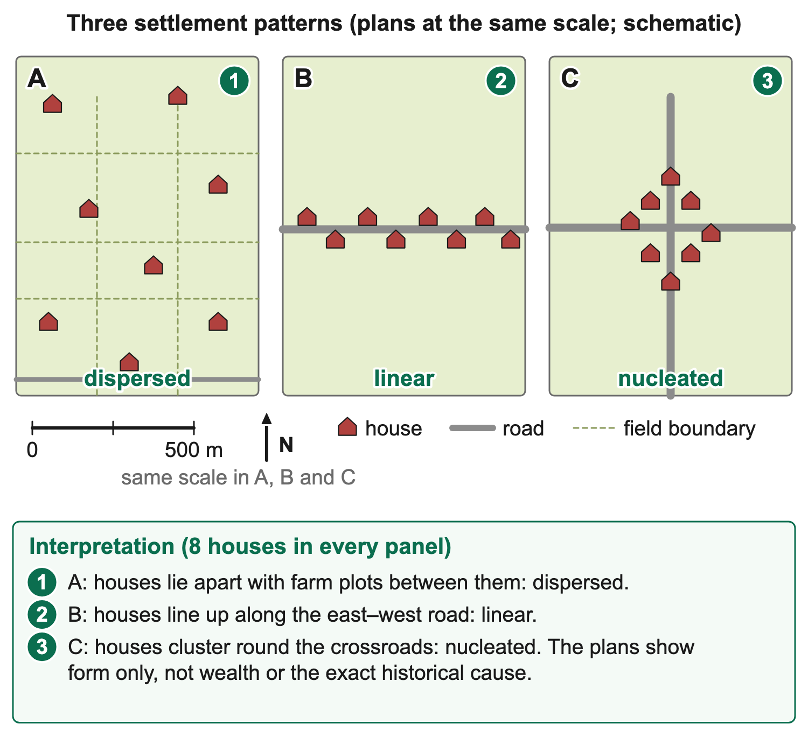
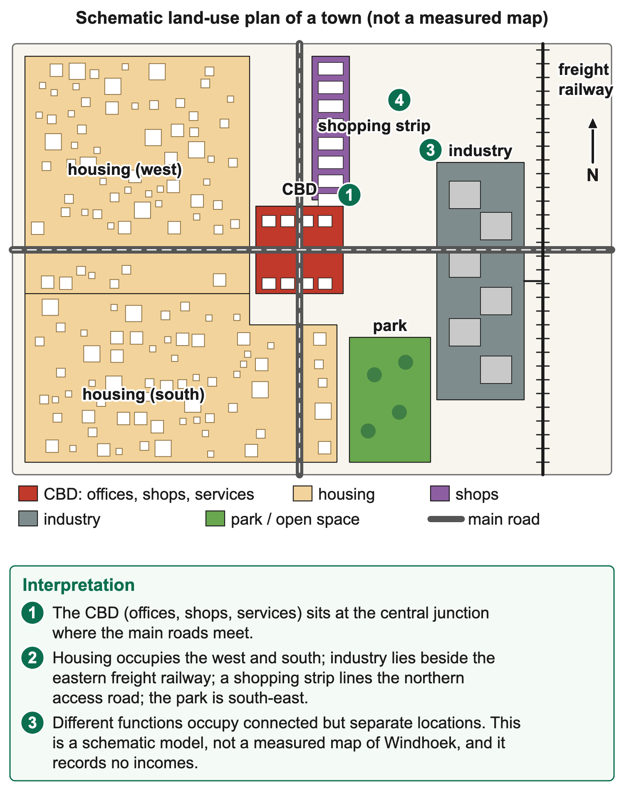

# 3.3 Settlement Studies

*nam-6137-nssco-2026. Offline study notes, rendered from the approved content units on 2026-10-30. Everything here is also what the flashcards are built from.*

---

## Rural settlement patterns

### Rural settlement patterns

Settlement pattern describes the arrangement of dwellings rather than simply how many people live in an area. Dispersed settlement has dwellings spread apart; nucleated settlement groups them into a cluster; linear settlement follows an elongated alignment. A map can show combinations, so choose the pattern supported at the requested scale. A village may have a clustered centre with houses extending along one road.

In a dispersed pattern, individual dwellings or farmsteads lie separately across the area. Agricultural land can lie between them, and households may be close to their own fields or grazing operations. The pattern does not mean the land is uninhabited or that each home lacks services. The spacing describes location. Access, infrastructure and livelihood evidence are needed to explain why a particular arrangement developed.

A nucleated pattern concentrates dwellings near one another. A crossroads, shared service, suitable site, security arrangement or historical decision can help explain a cluster where the evidence supports it. The cluster can reduce some distances between households and shared facilities, while fields or workplaces may lie farther away. Nucleation does not by itself establish a large town, a high income or one particular political history.

A linear pattern extends along a line such as a road, river margin, valley floor or other accessible strip. The visible alignment should be stated before its cause is inferred. Houses along a road may reflect access; those beside a valley route may also reflect relief or available land. A line of houses on a map is evidence of shape, not proof that each resident uses river water or works on the road.

A teaching plan can use identical house symbols in three panels with the same orientation and scale. Panel A places eight houses apart across farm plots; B places eight along one east–west route; C groups eight around a crossroads. Keeping the count equal shows that the difference is arrangement rather than total houses.

### Worked example

To describe the panels, use spacing, alignment and concentration. A is scattered with intervening land, B forms an elongated route-related arrangement and C has a compact cluster. An answer saying only that all panels contain houses does not describe the distinguishing pattern. If a resource includes a scale, distances can support the comparison; without it, avoid invented spacing in metres.

Pattern also depends on the map's extent. Several separate farmsteads can appear dispersed within one district, while the district's villages may be clustered at a national scale. A small inset can make a line or cluster visible that is lost on a national map. Read the boundary and scale so a local observation is not extended to an entire country.

Aerial photographs require similar care. Identify visible buildings or the stated dwelling symbols rather than count every roof as a separate household. Barns, workshops and homes can look similar. A caption or key can identify the intended objects. The lesson concerns arrangement; household numbers or occupancy require appropriate data rather than assumptions from building size.

A settlement can change as new dwellings are added. Growth along an access road can create a linear extension around an older nucleus, while new farm plots can support more scattered homes. Comparing dated maps helps establish the change. A single present map cannot prove the sequence or the reason for it. Distinguish the current form from a historical explanation.

The three pattern names are useful descriptions rather than a ranking of quality. Dispersed homes can provide proximity to fields but longer service routes; clustered homes can share some facilities while requiring journeys to land; linear development can provide route access while creating an elongated service corridor. These are conditional trade-offs, not outcomes established for every settlement with the same shape.

A geographical explanation links the pattern to physical and human evidence. A narrow accessible valley, a shared water point or a planned village can each influence arrangement through different processes. The relevant factor should be visible or supplied in an accompanying record. Shape alone cannot establish an exact history of land rights, household income or government policy.

Settlement size and pattern should be described separately. Two panels can each contain eight house symbols, with one scattered and one clustered. The count is equal, while the arrangement differs. Another panel may have more houses yet remain dispersed across a larger area. A pattern classification should therefore use spacing relative to the mapped area, not simply the largest number of symbols.

A line can be interrupted without losing its overall linear form. Gaps may reflect land access, unsuitable ground or later development, but the cause needs evidence. Conversely, a curved alignment can follow a winding route and still be linear in the geographical sense. Linear does not require a perfectly straight ruler line. The important feature is an elongated arrangement along a shared axis or corridor.

A nucleus can be irregular rather than circular. Houses may cluster around a junction or service without equal spacing or a neat outline. Likewise, dispersed farmsteads need not be arranged randomly: each can occupy a deliberate position on a holding. These details help interpret realistic maps, where the three ideal shapes are often modified by terrain and history.

A change in map extent can also change the apparent form. A close view of one village shows a nucleus, while a wider view can show a series of separate nuclei across farmland. State which pattern belongs to the requested scale. This prevents describing the distribution of villages as if it were the arrangement of houses within one village.

### Connections

A precise comparison can therefore say that the same number of dwellings is spread among plots at A, aligned along the route at B and grouped near the crossroads at C. It identifies the features visible in the resource without assigning an unsupported cause. The later explanation then uses any supplied water, land-use or planning evidence.

---

## Factors influencing rural size and pattern

### Factors influencing rural size and pattern

Rural settlement reflects physical opportunities and constraints interacting with access, agriculture, policy and history. Relief, soil and water can affect feasible sites, while land rights and infrastructure shape where households can use them. The syllabus's LEDC and MEDC labels provide broad comparison contexts, not a rule assigning one pattern to each country group. Dispersed, linear and nucleated forms can occur in different economies.

### Worked example

Relief influences construction and movement. Gentle ground can make building and access easier where other conditions are suitable, while steep slopes can raise costs or restrict available sites. A narrow valley may concentrate development along a route or flatter strip. These tendencies need the actual resource evidence. A steep area can still contain settlement through suitable design, and a plain can remain sparsely settled for other reasons.

Soils matter where farming supports settlement. Productive land can attract cultivation, while households may place homes to maintain access to fields without occupying the most useful crop area. Waterlogging, erosion or thin soil can create constraints. A soil's role should be linked to the livelihood or building condition rather than merely named. Fertile soil alone does not provide transport, capital or secure land access.

Water availability supports drinking, livestock and production. A dependable accessible source can favour settlement, but proximity to a river can also expose homes to flooding. A location on slightly higher ground near a usable source may balance access and risk. The best site cannot be selected from distance alone. Water quality, seasonal reliability, ownership and delivery arrangements affect practical access.

A shared water point may help explain a cluster where alternatives are distant, while individual boreholes can support more dispersed occupation under suitable aquifer and service conditions. The water point's presence does not prove that it caused the settlement or that it remains dependable today. Historical or service evidence strengthens the explanation. Distinguish an enabling condition from a demonstrated origin story.

Accessibility concerns the ease of reaching work, services, markets and other places. Roads, paths, public transport and terrain can influence travel time and cost. A roadside line of houses can reflect a desire for access, while a crossroads can support a nucleus of services. Distance in a straight line is not the same as a practical route. A nearby clinic across an impassable channel may be less accessible than a farther one on a dependable road.

Agricultural land use can shape spacing. Large separate holdings may support farmsteads among their fields or grazing areas, while shared village arrangements can cluster homes with agricultural land outside. Labour, land tenure, machinery and the location of fields affect the trade-off. A dispersed pattern does not prove large commercial ownership, and a cluster does not prove subsistence. Production purpose and settlement shape are separate dimensions.

Households may also combine farming with other livelihoods. A village near a road can provide services, trade or commuting opportunities. Changing access can alter the balance between living near land and living near facilities. A new route might encourage an extension without changing every older dwelling. To explain the change, compare the dates and actual new locations rather than assume the whole pattern was built at once.

Political factors include land allocation, planned settlement, service policy and historical restrictions. A planned village can place houses in a nucleus or grid, while past dispossession can shape access to land and investment. These are human decisions, not natural consequences of relief or rainfall. A fair explanation should avoid presenting historical inequalities as differences in people's inherent preferences or ability.

Policy can also encourage conservation, protect hazard zones or reserve productive land. The resulting pattern depends on implementation and people's feasible options. A regulation on paper does not establish that every dwelling follows it. Comparing approved plans with actual dated settlement maps can identify differences, while interviews or records help explain them. Do not infer compliance solely from the existence of a planning boundary.

Services can reinforce concentration where schools, clinics or shops are located together. They can also be extended to dispersed households through appropriate networks or transport. The cost per user and travel burden vary with spacing and terrain. A settlement label alone does not establish which service design is most efficient. Use distances, population and operation costs where supplied, alongside essential access needs.

### Worked example

A schematic comparison can show two equally sized rural populations. A's homes cluster near a shared water point and school; B's homes are spaced across separate agricultural plots with road access. The pattern differences can be explained through the stated resource and land-use arrangements. Neither record establishes a difference in wealth or national development category unless additional evidence is supplied.

A supported comparison therefore uses matched factors on both sides. Describe relief with relief, access with access and land organisation with land organisation. A statement that one settlement has a road while the other has fertile soil does not directly compare the same dimension. Linking each factor to feasible sites and livelihood choices gives a coherent explanation without treating the broad country labels as causes in themselves.

### Worked example

The same physical feature can create an opportunity and a constraint. A river can provide a potential source and a route through a valley, while flooding threatens low ground. An elevated site may reduce one flood risk but increase the cost of moving water uphill. A location decision should weigh the relevant trade-off rather than call river proximity entirely good or bad. The resource must show which conditions apply.

Agricultural work can encourage different relationships between home and land. A household managing scattered plots may value a village base with shared services, while a large separate holding may support a home near livestock and equipment. These are mechanisms, not universal ownership rules. The actual tenure and work arrangement are needed before explaining the dwellings' spacing from a land-use map alone.

Infrastructure can alter a pattern's practical consequences. A dispersed settlement connected by dependable roads and services may have better access than a cluster with unusable routes. Conversely, a compact group can reduce some network distances where shared systems operate. Service cost and availability therefore need measurement; shape is not a direct score of development. The comparison should use the same service and period.

Political decisions can leave a pattern after their immediate purpose changes. Earlier planned sites, restrictions or transport investments can continue shaping settlement even when economic activities shift. A present map may show that legacy without explaining it. Historical records and dated maps support a stronger causal account than assigning every current pattern to present-day physical conditions.

A schematic example can hold rainfall and household count constant while changing the stated land arrangement. At A, homes are permitted only near a shared service node; at B, each household occupies a separate farm plot. Different arrangements can emerge without a rainfall difference. This helps distinguish a political or tenure mechanism from an invented environmental explanation.

A second comparison can hold the land arrangement constant but introduce a narrow usable valley strip at one site. The physical constraint can then help explain alignment, while the other site has more feasible building locations. Even this simplified comparison does not establish every real-world cause. Its purpose is to make a specific mechanism visible and to identify the conditions needed for the explanation.

### Connections

Matched evidence about services, land access and terrain is needed to distinguish competing explanations for a settlement pattern.

---

## Size, growth, function and urbanisation

### Size, growth, function and urbanisation

A settlement's site is the land it is built on, such as a dry point above flood level, a wet point near water or a defensive hill. Its situation is its position relative to surrounding places, routes and resources. Its function is the main work or services it provides. In Namibia, Windhoek is the capital and administrative centre, Walvis Bay is a port with the country's only natural deep-water harbour and a large fishing industry, Oranjemund is a diamond-mining town and Swakopmund is a beach resort.

Urban growth is an increase in the size or population of an urban area. Urbanisation is an increase in the proportion of a population living in urban areas under the stated classification. Rural–urban migration can contribute, but natural increase and reclassification can also matter. Urbanisation should not be defined solely as a person moving from a village to a town.

A country with 400 urban residents out of 1,000 has a 40% urban share in a teaching example. If later it has 600 out of 1,200, the share is 50%: both urban growth and urbanisation occurred. If the urban count rises in proportion to the national total and the share remains unchanged, urban growth occurred without a higher urban share.

### Worked example

Settlements grow when natural increase adds residents and when their functions create jobs and services that attract migrants. Rural–urban migration is driven by push factors in rural areas, such as drought, few jobs and poor services, and pull factors in towns, such as jobs, schools, hospitals and better services. Settlements decline when their function ends: Kolmanskop grew after diamonds were found in 1908 but was abandoned in 1956, after richer deposits near the Orange River drew people away.

### Connections

Function, population size and proportion urban are related measurements with distinct meanings and evidence requirements.

---

## Urban structure and land use

### Urban structure and land use

Urban morphology is the arrangement and form of the built environment and land uses. CBDs, residential zones, industry, shopping, open space and transport routes occupy different but interacting parts of a settlement. Their arrangement reflects access, land values, physical setting, planning and history. A model simplifies those relationships; it is not a measured map or a rule that every city has the same rings or sectors.

The central business district commonly contains a concentration of offices, shops, services and other commercial activity with strong access. Competition for central space can favour intensive use or taller buildings under suitable conditions. A CBD is identified through functions and relative concentration, not merely a tall building. New business centres and edge developments can create more than one important commercial node.

### Worked example

High central accessibility can support many customers and workers while increasing competition for road and pedestrian space. Land values and rents may influence which activities remain. Some functions can move outward where more land or easier vehicle access is available. These are mechanisms to investigate using the supplied resource. A central position alone does not prove the highest rent or busiest street without actual evidence.

Residential areas provide housing but vary in form, density, age, services and access. Flats, detached homes, shared accommodation and incremental housing can occur in different parts of a city. A building's height or roof material does not establish residents' income or quality of life. Service access, affordability, occupancy and household evidence are needed for that judgement.

### Worked example

Residential areas in MEDC cities are often described with the concentric zone model, which Ernest Burgess based on Chicago in 1925. Around the CBD lies a zone of transition with older factories and run-down housing, then inner suburbs of older, low-cost workers' housing, then outer suburbs of larger, newer middle-class homes, and finally a commuter zone. Wealthier people live farther from the centre, where land is cheaper, there is more space and less pollution, and they can afford to travel in by car or train.

### Worked example

Industrial areas can need space, freight access, power, water and appropriate separation from incompatible activities. A site near a railway, port or major road can reduce some handling costs. Noise, emissions or heavy traffic may create conflict with nearby homes. The resource must identify the actual process or land use; a large roof can also belong to a warehouse, market or sports facility rather than a factory.

Older industry may lie near an early transport route, while newer industrial estates may occupy the edge where suitable land is available. Redevelopment can replace former industrial uses with services or housing. A present map cannot establish the earlier sequence without dated evidence. Describe the observed zone and access relationship before explaining its likely location.

Shopping includes central stores, local centres, strip malls and larger out-of-town developments. A strip mall has shops arranged along a frontage or shared access area, often with vehicle access. A local shop can serve nearby homes, while a larger centre draws from a wider area. Shop size alone does not establish the origin of customers; catchment evidence comes from suitable surveys or records.

### Worked example

Out-of-town shopping can benefit from land and parking but increase travel needs or compete with central businesses. Public transport, walking access and the distribution of customers influence the balance. A new centre can create jobs while excluding some residents through distance or cost. A supported comparison considers both the service opportunity and who can actually use it.

Open space can include parks, recreation grounds, protected land and other areas not built over. Its function depends on condition and access. Green colour on a map may represent vegetation rather than a public park, so read the key. Open space can support recreation, habitats, drainage or urban amenity, while unsafe or inaccessible land may not provide the assumed service to residents.

Protecting open space can involve trade-offs with housing or commercial development. The answer should not assume land without buildings has no value. Flood-risk management, ecosystem functions and public use can be relevant. Equally, a designated park needs maintenance and usable access. A planning label does not prove the space delivers all intended benefits.

Transport routes connect zones and influence where activities can operate. Main roads, railways, bus routes, paths and interchanges have different roles. A freight route can support industry, while a public-transport corridor can improve access to jobs and services. The existence of a road does not establish frequent affordable transport, and a straight-line distance does not describe every journey's time or cost.

Routes can also divide neighbourhoods or create barriers and pollution. Pedestrian crossings, suitable public transport and coordinated planning can reduce some problems. Widening a road may improve one movement while encouraging more traffic or reducing space for other uses. Evaluate the specified service and conditions rather than call every road project a universal congestion solution.

A teaching urban plan can locate a CBD at a central route junction, housing to the west and south, industry beside an eastern freight corridor, a northern shopping strip and a south-eastern park. These positions are schematic, not the measured land-use map of Windhoek. Each zone's interpretation should follow its labelled function and spatial relationship.

Cities in LEDCs often show the reverse pattern. The wealthiest people live close to the CBD or along a main road leading out of it, in good-quality housing with full services and security. Middle-income housing lies farther out. The poorest people, many of them recent rural–urban migrants, live on the edge of the city in informal or squatter settlements, where land is unclaimed or cheap but services are few. Industry is often found along the main roads and railways leading out of the city.

Windhoek shows parts of the LEDC pattern, shaped by its apartheid history. Black residents were forcibly moved from the Old Location to Katutura, about 8 km north of the centre, during the forced-removal programme of the late 1950s and 1960s. Today large informal settlements such as Havana have grown on the north-western edge, where many households share a few toilets and have limited water and legal electricity. Both models are generalisations: real cities contain exceptions, such as new wealthy estates on the edge of some LEDC cities.

Internal structure changes over time as employment, transport and planning change. A bypass can shift some traffic, a new housing project can add residents and a redeveloped site can alter local functions. Each can affect neighbouring areas through demand and access. A before-and-after map supports a land-use change, while population, rent or traffic records are needed for those separate outcomes.

Reading morphology therefore involves both pattern and evidence. Identify the functions, locate their relationships and explain a supported mechanism. A photograph or plan may show building form but lack household experience or service reliability. Those limits matter when judging living conditions. The next sections connect land-use structure to housing, congestion and environmental pressures rather than treating a model as a complete city description.

Functional zones need not have sharp boundaries. Offices, housing and shops can occupy the same street or building. A classification system may use the dominant ground-floor function, the whole building's use or a mixed category. Those choices affect the resulting map. State the rule before comparing surveys so a changed coding method is not mistaken for changed urban structure.

CBD evidence can combine functions and movement. A concentration of banks, offices, retail and route convergence supports a commercial-centre interpretation. A tall residential block alone does not. Pedestrian counts may be high at certain hours while residential population is low, but those patterns require actual records. The label CBD should follow the supplied land-use evidence rather than an assumption that the tallest point marks the centre.

Residential density differs from building height. A tall block can have large units or low occupancy, while closely spaced lower homes can house many people per hectare. Income and service conditions are different again. Suitable household and area records are needed to compare density, while affordability, condition and access inform living-standard questions. Visual form is one observation, not a complete social classification.

Industrial location can change as freight technology or regulation changes. Older firms may remain near rail or ports, while newer operations use road-based distribution at the edge. A redundant site may be redeveloped for housing or services. These possibilities explain why a city may contain several industrial locations rather than one neat zone. A dated sequence is needed to establish which change occurred in the selected case.

Shopping catchments can be investigated through customers' stated origins and access, with privacy protected. A centre beside a major road may attract a wider area, while a local store may serve nearby residents. These are hypotheses to test, not facts established by shop size alone. Survey timing and non-response can affect the apparent catchment. An origin sample collected on one special-event day may differ from ordinary use.

Open space should be classified by its actual function and access. A sports ground, protected habitat, drainage corridor and vacant development plot are all unbuilt in a simple image but have different uses. A key showing only green areas cannot automatically distinguish them. Additional labels or field observations improve interpretation. This distinction matters when evaluating a proposal to build on land described as unused.

Transport links can shape zones by access rather than distance alone. An industrial plot close to a freight interchange can be more useful than a nearer one reached only through unsuitable residential streets. A housing site may be close to jobs in straight-line terms but separated by a difficult crossing. Compare feasible journeys and service connections rather than using proximity as a complete explanation.

The main difference between the two models is the location of rich and poor housing. In MEDCs most low-income housing lies near the centre and most high-income housing in the suburbs; in LEDCs most high-income housing lies near the centre and low-income informal housing on the edge. In both, the CBD occupies the most accessible point and industry follows the main transport routes.

An urban transect samples one route through this structure. It might cross housing, mixed retail, the CBD and a transport corridor. A change in frontage proportions along that route can support a spatial description, but cannot show every neighbourhood. More routes or a suitable area survey would be needed for a citywide claim. This links morphology to the investigation methods without treating a convenient walk as a complete census of urban land use.

### Connections

A labelled function map supports interpretation more strongly than building shape alone; use its key before assigning each zone or proposing a cause.

---

## Urban growth problems and responses

### Urban growth problems and responses

Urban growth can increase demand for housing, serviced land, transport, jobs and public facilities. Problems can arise when access or capacity does not keep pace, while the city can also create opportunities. The explanation needs the specific mismatch rather than the claim that growth is automatically harmful. Residents face different conditions, and a national or city average can conceal serious local shortages.

CBD congestion can involve crowded pedestrian areas, limited loading or parking space and delays on routes where demand exceeds usable capacity. Commercial activity concentrates trips at particular times. A busy centre is not necessarily failing: the evidence should identify delays, conflicts or access problems. Suitable management can improve use of space without removing the functions that make the centre valuable.

Responses can include coordinated public transport, safe walking routes, appropriate delivery times, managed parking or relocating some activities where justified. Their effects depend on implementation and access. Charging for parking may reduce some trips while affecting particular users; moving loading to another time may reduce conflict if businesses can adapt. The measure should match the observed bottleneck rather than be selected from a generic list.

Housing shortage concerns inadequate access to suitable accommodation, which can involve quantity, affordability, location or services. Empty high-cost homes can coexist with unmet need. A simple dwelling count therefore does not establish that everyone is housed adequately. Population, household size, income, tenure, condition and service access help identify the actual problem.

Housing responses can include serviced land, incremental improvement, suitable construction, finance and upgrading existing areas. Building houses without affordable terms or usable services may leave needs unresolved. Relocation can improve some conditions while increasing travel costs or disrupting livelihoods. Consultation and the practical needs of affected residents should inform the judgement rather than assume that any new building is an unqualified improvement.

Informal settlements can develop where residents cannot obtain sufficient affordable, appropriately located and serviced land or housing through formal systems. Conditions vary. Some areas lack essential services or secure arrangements, while residents create homes, enterprises and community networks under constrained options. Informality should not be treated as proof of criminality, lack of effort or an identical condition in every dwelling.

Upgrading can improve water, sanitation, access, drainage, tenure arrangements or housing while retaining useful social and livelihood connections where feasible. The appropriate package depends on the site and risks. A service connection needs maintenance and affordability; a tenure document does not itself provide a safe structure. Separate components help evaluate whether the intervention meets the actual need.

Windhoek provides a named upgrading case. City information describes a collaborative Informal Settlement Upgrading Project that supports affordable housing on serviced land, so that families can build on plots with water, sewerage and roads instead of in unplanned shacks. Upgrading of this kind keeps people near their jobs and neighbours, but plots, materials and loans must be affordable for the poorest households, and the city must keep pace with new arrivals.

### Worked example

The case links housing to service and financial conditions. Existing basic services can enable construction, while repayment or household resources influence affordability. A loan offer is not equivalent to a grant, and a constructed house is not a complete measure of livelihood improvement. Access to work, transport, schools and ongoing charges can affect the result. Evaluate the actual terms and outcomes rather than infer them from the project name.

Traffic congestion occurs where travel demand and usable capacity conflict, often at peaks or bottlenecks. More vehicles can create queues, longer journeys, emissions and noise. Public transport, land-use coordination, suitable crossings and demand management can address different mechanisms. Adding lanes may temporarily improve capacity but can also attract additional trips; the long-term effect needs evidence rather than an automatic prediction.

### Worked example

A hypothetical road has 100 vehicles passing a point in ten minutes with short delays, while a narrower route has eighty with long queues. The larger count alone does not identify worse congestion. Capacity, flow, delay and timing must be considered together. Similarly, a fall in traffic at one point can reflect rerouting rather than a fall in citywide movement or emissions.

A supported solution states the problem, mechanism and criterion. A bus improvement can help access if it is reliable, safe, affordable and useful for relevant routes. Upgrading can help housing if services and terms fit residents' needs. Parking management can help a CBD if it addresses the observed conflict without simply displacing it. Monitoring should compare outcomes and affected groups over an appropriate period.

Housing supply is a flow as well as a stock. Existing suitable dwellings provide current capacity, while construction, deterioration, conversion and household formation alter it over time. If 100 suitable homes are added while the number of households needing them rises by 200, a previous gap can widen even though construction occurred. The figures need matching areas, dates and suitability criteria. A house count alone cannot determine affordability or occupancy.

### Worked example

Informal settlements grow because migrants arrive faster than affordable serviced housing can be provided, and many cannot afford rent or plots in formal areas. Problems include shared or missing toilets and taps, illegal electricity connections, fire risk in closely packed shacks, flooding on low-lying land, disease and insecure tenure. Responses include site-and-service schemes, where plots with water, sewerage and roads are provided for people to build on, self-help housing with cheap materials or loans, and upgrading existing settlements in place.

Affordability includes ongoing payments. A lower purchase price can help access, while loan repayment, transport and utility costs still affect a household's budget. A relocated home farther from work can increase journey costs even if its structure is better. A supported judgement compares the whole relevant arrangement under the supplied figures rather than treating any loan as an automatic improvement for every applicant.

Traffic congestion is common in the CBD because many roads converge there and many people travel in to work, shop and use services at the same times each day. Old CBD streets are often narrow, delivery vehicles stop to unload, cars park along the roadside or circle in search of parking, and where public transport is limited most people drive. Solutions include ring roads or bypasses to divert through-traffic, park-and-ride schemes, bus lanes, one-way streets, pedestrianised shopping streets and restricting large vehicles at busy times.

A bypass can remove some through-traffic from a centre, but its wider effects depend on new trips, route choices and destination traffic. A park-and-ride arrangement needs a useful transfer service; a pedestrian area needs access for relevant deliveries and users. Measures can displace pressure or create new requirements. Compare before-and-after evidence across affected locations, not only the street where traffic fell.

Upgrading and transport decisions benefit from resident participation because people know their journeys, services and livelihood links. Consultation is an input to understanding, while accessible participation and responses to concerns show more about practice. A meeting attended by a few residents cannot establish unanimous agreement. The evaluation should identify who was represented and what outcomes were measured.

### Worked example

A hypothetical monthly comparison includes housing, transport and services. Option A costs N$900, N$600 and N$300, totalling N$1,800. B costs N$1,000, N$200 and N$200, totalling N$1,400. A has the lower housing charge but higher combined stated cost. The example shows why location and ongoing services matter to affordability; it does not establish every household expense or the quality of either home. A household with N$1,500 available for these specified costs could cover B but not A under the stated figures. Suitability, security and access still need their own evidence before recommending one option as a complete solution.

### Connections

The budget comparison should retain the same monthly period and household, while separate observations establish whether either location provides adequate services.

---

## Urbanisation and environmental change

### Urbanisation and environmental change

Urban development changes land cover, demand and waste flows. Effects can include air, water, visual and noise pollution, as well as outward expansion into surrounding land. Their scale depends on consumption, production, infrastructure and management, not population alone. A growing urban share is a demographic measure; an expanded built footprint is a spatial change. They can be linked without being identical.

### Worked example

Air pollution can arise from vehicles, industry, burning or other relevant sources. Exposure depends on emissions, weather, location and the people or environments affected. More traffic can contribute under suitable conditions, but a vehicle count alone is not a pollutant concentration. A clear explanation identifies source, pathway and consequence using the resource rather than assigning every respiratory problem to the nearest road.

Urban air management can include appropriate emission controls, cleaner services, reliable public transport or reduced unnecessary journeys. Each targets a pathway and has costs or requirements. Shifting pollution away from one street is not the same as reducing total emissions. Compare the relevant system boundary and service before declaring success. The environmental result needs suitable measurements beyond a plan or equipment purchase.

Water pollution can arise where sewage, industrial wastes, fuel or runoff enter sources without suitable control. Hard surfaces can route water rapidly, carrying pollutants towards drains or channels. Inadequate sanitation can create exposure pathways, while treatment and source protection can reduce them. A drain's presence does not establish effective treatment; it may only move water elsewhere. Quantity and quality require separate observations.

Pollution can affect people downstream or outside the urban boundary. A city can benefit from activity while other users bear water-treatment costs or ecological damage. Appropriate management therefore includes the receiving environment rather than treating the city limit as the end of the pathway. A visible improvement in one area can coexist with displaced harm if waste is simply transferred unsafely.

Visual pollution concerns an unwanted or damaging effect on appearance or amenity, such as unmanaged litter, derelict sites or unsuitable clutter in a specified context. Judgements can be subjective, so an assessment needs clear indicators and stakeholder perspectives. A difference in building style is not automatically pollution. Define the feature being assessed rather than label an unfamiliar neighbourhood as unattractive without evidence.

Noise pollution involves unwanted sound affecting people or other relevant receptors. Traffic, industry, construction and activities can contribute. Effects vary with level, timing, duration and sensitivity. A short sound reading during a special event may not describe normal conditions. Comparisons need matched periods and a suitable method. A management response can address route, timing, design or operation depending on the source.

Urban sprawl is outward expansion of the urban built area into surrounding land, often creating more extensive development. It is not simply rural–urban migration or a synonym for informal housing. Formal estates, industry, shopping areas and sports facilities can all contribute to an expanding footprint. Population can become more urban without the exact same pattern of land expansion, so read the spatial evidence separately.

Expansion can convert agricultural land or habitats, fragment open space and alter runoff. Longer distances can increase travel needs where development is poorly connected to jobs or services. New facilities may also create employment or improve access for some users. A supported evaluation recognises the specific benefits and costs rather than assuming that all edge development has one effect.

Out-of-town shopping areas can use larger sites and parking, while affecting central trade or increasing car dependence if alternatives are weak. Sports facilities may need open land and transport access, while industrial estates need freight and service infrastructure. These uses can cluster at the fringe for different reasons. Their location should be explained through land, access and function rather than just called sprawl without a mechanism.

Land-use planning can protect sensitive areas, coordinate housing and services or encourage suitable reuse of existing sites. Brownfield redevelopment can reduce pressure for new land in some situations, but remediation, cost and suitability matter. Compact development can shorten some journeys while requiring adequate open space, services and affordable access. No single density or design removes all environmental and social trade-offs.

A teaching before-and-after plan can show a built area expanding from ten to fifteen square units, replacing five units of surrounding land under a fixed classification. That is a 50% footprint increase. It does not prove a 50% population increase, an exact emissions rise or that all converted land was farmland. Each additional claim needs the relevant population, activity or land-use key.

### Worked example

Environmental assessment should compare matched dates and conditions. Changes in waste collection, industrial operation, rainfall or travel can affect observations independently of population growth. An increase in litter near new housing might reflect inadequate collection capacity rather than residents' supposed attitudes. Identifying the service mechanism helps select a useful response and avoids blaming a group from an aggregate pattern.

A supported conclusion connects the development, environmental pathway and appropriate measure. Safe sanitation addresses a different problem from noise timing or habitat protection. Monitoring checks whether the condition improved, not merely whether a service was announced. This approach links urban structure, growth and management while keeping urbanisation, sprawl and migration as distinct concepts.

### Worked example

Urbanisation and sprawl can move differently. Suppose the urban population share rises while new residents occupy existing buildings or appropriate infill sites. The urban share can increase without a comparable extension of the footprint. Conversely, a low-density edge estate or new industrial park can expand built area even where the urban share changes little. Distinguishing the measures prevents a spatial map from being used as proof of a demographic rate.

A land-cover account needs a fixed classification. Built area expanding from ten to fifteen square units is a five-unit gain relative to an opening ten, or 50%. The surrounding area lost depends on the full boundary and key. If the added area includes former farmland, habitat and vacant land, their individual totals must be read separately. A single total cannot establish that all conversion was agricultural loss.

Hard surfaces can increase rapid runoff where infiltration falls. More water reaches drains or channels quickly, potentially increasing local flood pressure if capacity is inadequate. Suitable drainage, permeable surfaces or protected flow routes can address parts of the mechanism. Their usefulness depends on design, maintenance and storm conditions. A drainage asset that merely transfers polluted water downstream has not established an overall environmental improvement.

Air-quality comparisons should use suitable observations and conditions. A lower pollutant reading on a windy day can partly reflect dispersion rather than reduced emissions. A higher roadside reading may reflect traffic, weather or other nearby sources. A count, a concentration and a health outcome are different measures. A supported conclusion should not replace them with one another or assign a clinical cause from a simple field observation.

Noise assessment can record comparable locations and times with an appropriate instrument and definition. A perception survey adds information about experience, but respondents can differ in sensitivity or activity. Both forms of evidence can be useful while measuring different things. A quiet daytime reading does not establish acceptable night-time conditions. The management recommendation should match the affected period and source.

Visual assessment similarly needs an operational scale. Observers can record litter, condition of buildings or signage using defined anchors rather than an unexplained personal score. Agreement can be improved through practice, but cultural preferences and site context still matter. A low score should describe the chosen indicators, not judge the worth of residents. This keeps environmental-quality work both interpretable and respectful.

Outward development can also raise infrastructure lengths and service costs. Longer pipes, roads or collection routes may be needed for scattered edge uses, depending on layout and existing capacity. A new centre may create local access while drawing journeys from a wider area. Compare the relevant network and users before assuming all edge development is inefficient. Some designs may connect effectively to existing routes and mixed uses.

Reusing existing land can reduce one pressure while introducing others. A former industrial site may need remediation before housing is suitable; a compact development may need additional school or water capacity. A greenfield site may be cheaper initially while converting habitat or productive soil. The evaluation should include the stated costs and environmental pathways over time rather than treat a category name as a complete verdict.

### Worked example

A good urban-environment conclusion can therefore be conditional and specific. If sewage treatment and collection expand to meet usable needs, some pollution risks can decline despite population growth. If demand rises while services fail, pressure can worsen. The relationship is mediated by infrastructure, behaviour and resources. Identifying that mechanism supports useful responses instead of blaming a population total alone.

### Connections

Compare the same service and area before claiming an efficiency gain; a lower recorded supply can reflect interrupted access rather than reduced waste. Environmental outcomes need their own observations.

---

## Traffic counts

### Traffic counts

A traffic count records vehicles passing a defined point during a stated interval, often separated by type and direction. Define the counting line and categories before observation. Use safe positions away from the carriageway and obtain any needed permission. Observers should not direct traffic or enter dangerous locations to improve a view. A count measures passage, not the purpose of every journey.

A hypothesis might predict more vehicles on a main access route than a comparable side route during matched periods. Record the same duration, time category and relevant conditions at each point. Random, systematic or stratified sampling can guide which routes or periods are included, depending on the defined frame. A single convenient location can omit important flows.

Prepare a tally sheet with non-overlapping vehicle categories and separate direction columns if required. Agree how unusual vehicles are classified so they are not counted twice. At the end, total the marks and retain the raw record. A ten-minute total can be converted to a rate, but multiplying it by six assumes that interval represents the hour; it does not create an observed hourly count.

A higher traffic total does not establish worse congestion without capacity or delay evidence. Repeated counts across comparable weekdays and peak/off-peak periods improve coverage. Evaluation should name the actual limitation, such as a short interval or obstructed view, then propose a matched improvement. Conclusions remain about the sampled locations and times unless wider evidence supports extension.

### Connections

Record the actual observation duration alongside totals so later comparisons use equivalent intervals rather than assumed hourly figures.

---

## Pedestrian counts

### Pedestrian counts

A pedestrian count records people crossing a defined line during a specified period. State the direction rule and what constitutes a crossing, especially where people pause or return. Use a safe position without blocking access, and avoid identifying individuals. The count describes passages, not necessarily unique people or shoppers. One person crossing twice can create two passages under the stated rule.

A hypothesis might predict greater pedestrian flow near a central shopping area than a peripheral comparison during matched periods. Select sites and times through a clear random, systematic or stratified design appropriate to the target. Record weather, closures or events that may affect the result. Match duration so totals can be compared directly or converted transparently to rates.

A tally sheet can separate directions or relevant observable categories without guessing private characteristics. Agree the counting line and use a consistent start and end time. Repeated observers or intervals can identify inconsistency or temporal variation. A larger sample does not fix an unclear definition, so operational rules should be tested before the main count.

### Worked example

Suppose one site records thirty crossings in ten minutes and another forty in twenty. Their rates are three and two crossings per minute respectively. The second has a larger total but a lower rate. Neither record proves every person was shopping or identifies customer spending. Describe the flow comparison, retain its time limits and propose improvements linked to the actual method rather than inventing a daily total.

### Connections

Repeat the count at matched times to assess variation before extending a short observation to a wider period.

---

## Shopping surveys and urban transects

### Shopping surveys and urban transects

A shopping survey can investigate the activities, access or origin of an eligible group, while a land-use transect records functions along a defined route. They produce different evidence: respondents' answers and observed spatial uses. State the target and question before selecting a method. A pedestrian count alone cannot establish why people came or how much they spent.

For a questionnaire, use neutral wording, suitable answer options and voluntary participation without unnecessary personal information. Pilot the question and define an eligible selection rule. Random, systematic and stratified sampling have different coverage implications. Record non-response rather than silently replacing people with the easiest available respondents. Surveying only inside one store may omit other users of the area.

A transect can classify successive frontages or stations as retail, residential, industrial, open space or mixed use under a clear key. Use the same rule along the route and record uncertainty. A shop below flats can be mixed use rather than forcing the whole building into one category. A line through a city reveals that route, not the entire urban land-use pattern.

### Connections

A result of twelve local respondents among twenty completed interviews is 60% of the sample under the stated definition of local. It is not proof that 60% of every visitor lives nearby. Combine survey and transect evidence only where the question warrants it, retaining their different populations and scales. Specific improvements include broader site/time coverage, clearer classification or less leading wording, each matched to the limitation identified.
