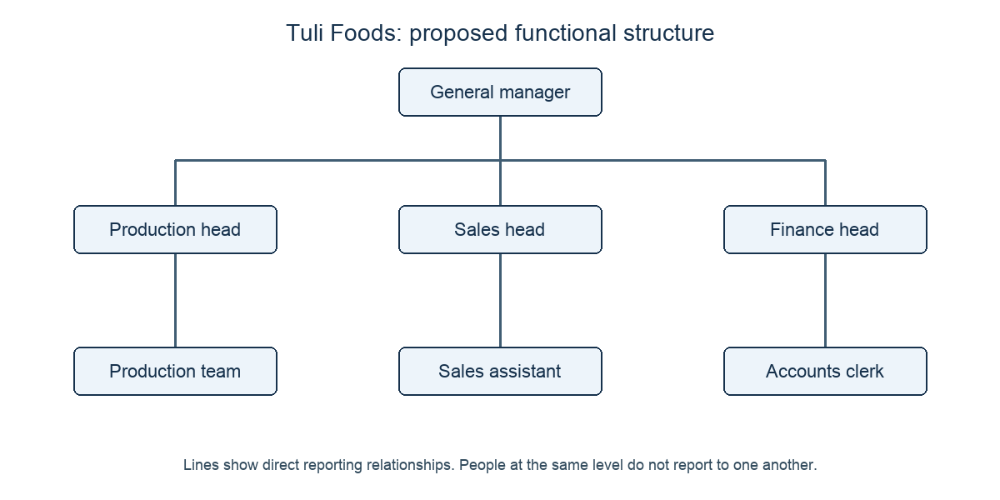
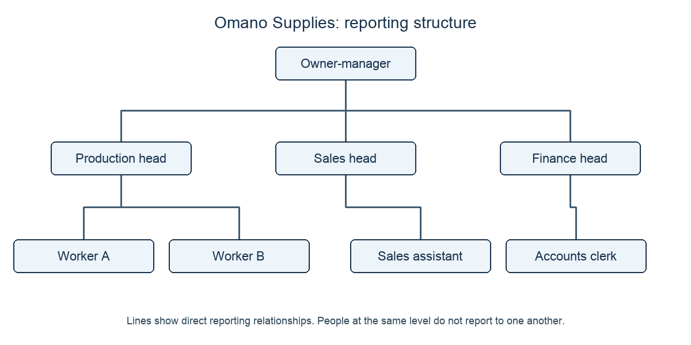

# 2.2 Organisational structures, by level and by function

*nam-6144-nssco-2026. Offline study notes, rendered from the approved content units on 2026-10-27. Everything here is also what the flashcards are built from.*

---

## Organisational structure

### Organisational structure

An organisational structure is the levels of management and divisions of responsibilities within an organisation. It clarifies who performs each role, who may decide and who reports to whom. This can reduce duplicated work and gaps where everyone assumes someone else is responsible. In a centralised structure most decisions are retained at the centre or higher management levels. In a decentralised structure many decisions are delegated to lower levels. The distinction concerns the location of decision-making authority, not the number of buildings or whether the business uses computers. A structure can combine central financial policy with decentralised local service decisions. Clear roles help accountability, but the chart alone cannot ensure cooperation or competent decisions. Structure should fit the scale, activities and skills of the enterprise.

### Putting the idea to work

Huma Stores has three branches. Head office sets the purchasing budget while branch managers may arrange their staff rotas. Purchasing authority is centralised while rota decisions are decentralised. Three locations do not by themselves prove decentralisation; identify the decision and the person authorised to make it.

### A centralised structure

A centralised structure is a management structure in which most decisions are taken at the centre, or at higher levels of management. It can support consistent policy and senior oversight, especially where decisions carry substantial risk. However, referring routine matters upward can delay a response and overload senior managers. The location of offices is not the test; locate the authority.

### Putting the idea to work

All Iita Stores branches must ask head office before changing product prices. Pricing is centralised even though branches are geographically separate. The branches carry out the decisions but do not make them.

### A decentralised structure

A decentralised structure is a management structure in which many decisions are not taken at the centre of the business but are delegated to lower levels of management. It can use local knowledge and reduce waiting for head-office approval. Its effectiveness depends on staff competence, clear limits and coordination; different decisions can otherwise become inconsistent. Senior managers retain overall oversight.

### Putting the idea to work

Meva Lodges allows each lodge manager to choose locally suitable guest activities within a budget. The activity decisions are decentralised. A shared budget policy does not remove the local authority that has been granted.

### Keeping the ideas apart

Explain why saying “three levels of managers” is not a complete definition of organisational structure. Otavi Makers also needs to know which roles handle production, finance and sales.

Hierarchy describes ranked levels. Organisational structure includes levels and the division of responsibilities, so the three-level statement omits who does what and reports to whom. Allocating production, finance and sales roles supplies part of the missing structure; counting levels alone cannot do that.

---

## The language of authority and accountability

### The language of authority and accountability

Hierarchy arranges roles by authority; responsibility is the duty to complete work; authority is the right to make decisions and give instructions; span of control counts direct subordinates; chain of command traces the formal route from higher to lower levels; centralisation keeps most decisions near the top; delegation gives a subordinate authority for particular tasks while final responsibility remains with the delegating manager. These concepts describe different features of the same structure. In an organisation chart, use boxes for positions and lines for direct reporting relationships. A manager’s span counts the roles directly linked below that manager, not every person at lower levels. A long chain may support close supervision but delay messages; a wide span can reduce supervisory layers but may overburden a manager if tasks are complex. The effect depends on staff competence, work difficulty and support systems.

### Putting the idea to work

At Laku Goods the owner supervises two heads. Each head supervises four employees. The owner’s direct span is two, not ten. Each head’s span is four. A message from an employee to the owner follows the employee–head–owner chain, while the owner remains accountable for work entrusted to the heads.

### Hierarchy

A hierarchy is a system in which people or things are arranged according to their importance or authority. In a business it indicates the ranked levels of roles. It is one feature of organisational structure, which also allocates responsibilities. A higher position in a hierarchy can have fewer direct reports than a lower position.

### Putting the idea to work

Uano Works has an owner, department heads and workers. Those are three hierarchical levels. The worker’s immediate supervisor is the relevant head, not whichever employee has worked there longest.

### Responsibility

Responsibility is a duty or obligation to satisfactorily perform or complete a task and which has a consequent penalty for failure. It concerns what a person is answerable for doing. Clear responsibility helps prevent missed tasks, but staff also need the authority, information and resources necessary to carry them out.

### Putting the idea to work

A warehouse clerk is responsible for checking delivery quantities. The clerk must carry out that check and report discrepancies. Responsibility for counting is not authority to approve unlimited replacement purchases.

### Authority

Authority is the right to give orders, make decisions, and enforce compliance. It should be adequate for the responsibility assigned and limited to the role’s scope. Having technical expertise does not itself grant authority to direct every other department.

### Putting the idea to work

The production head at Temo Tools may allocate workshop tasks but cannot approve an unbudgeted building purchase. Task allocation falls inside the stated authority; the building decision must go to the authorised level. Authority is the right to decide, not merely willingness to accept a duty.

### Span of control

Span of control is the number of subordinates working directly under a manager. Count direct reporting relationships, not every worker further down the organisation. A wide span may be manageable with experienced staff doing familiar work; complex tasks or inexperienced staff may require more supervision.

### Putting the idea to work

A branch manager supervises three team leaders, each responsible for five workers. The branch manager’s span is three. The fifteen workers report directly to the team leaders, so adding them to the manager’s span would count indirect reports.

### Chain of command

Chain of command is a structure within an organisation which allows instructions to be passed down from senior management to lower levels of management. It describes the formal authority route. Information and reports can travel upward along that route. Several stages can support supervision but may increase delay or distortion.

### Putting the idea to work

At Ilo Mills, the owner instructs a production head who instructs a shift supervisor who directs operators. That route is the chain of command. Counting the owner’s direct reports would answer a different question about span of control.

### Centralisation

Centralisation means retaining most decision-making at the centre or higher levels of management. It can preserve consistency and let senior staff control major risks, but can reduce lower managers’ discretion and slow matters requiring quick local responses. A business can centralise major investments while delegating routine service decisions.

### Putting the idea to work

Sano Supplies reserves all large equipment decisions for its directors. Equipment investment is centralised. Do not infer from that single fact that every rota or delivery decision must also be made by the directors.

### Delegation

Delegation is giving a subordinate the authority to perform particular tasks (NB it is the authority to perform a task which is being delegated – not the final responsibility). The delegating manager should specify the task, authority, resources and limits, and retain oversight. Delegation is a specific act; decentralisation describes a wider distribution of decisions throughout the organisation.

### Putting the idea to work

The owner of Heno Print authorises a supervisor to reorder paper up to an agreed amount and review spending weekly. The supervisor can decide within the limit; the owner remains ultimately accountable for the delegated work. Handing over paperwork while retaining every decision would not provide the same authority.

### Worked practice: Structure, delegation and expansion

Tuli Foods has expanded. The general manager currently approves routine work allocations and delays occur. The proposed chart puts the general manager above production, sales and finance heads. A production team reports to the production head, a sales assistant to the sales head and an accounts clerk to the finance head. The heads know their functional work well, but spending limits have not yet been agreed.

a(i) Define delegation. [2]
a(ii) State two structural changes that business expansion may require. [2]
b State the meaning of responsibility and the meaning of span of control. [2]
c Explain how Tuli’s proposed reporting structure could help it manage expansion. Include the proposed chart relationships in your explanation. [6]
d Evaluate delegating routine work-allocation decisions to the three heads. [8]

a(i) Giving a subordinate authority for particular tasks while the delegating manager retains final responsibility. a(ii) Appointing specialist functional heads; adding a supervisory level so that each manager’s span of control stays manageable. b Responsibility is the duty to complete a task satisfactorily; span is the number of direct subordinates. c Put the general manager at the top and the three heads beneath, then each specified team or assistant directly below the appropriate head. This gives the general manager a direct span of three and clarifies functional supervision. Heads can coordinate their areas, reducing the general manager’s direct workload and giving staff a clear reporting route. An extra level can delay communication, so authority must be real rather than sending all routine decisions upward. d The heads’ functional knowledge supports delegation and their faster work allocations could reduce the stated delays. Against this, undefined spending limits could cause inconsistent or excessive commitments and the general manager remains accountable. Delegate routine allocations with clear boundaries and review arrangements; keep major commitments centrally approved. Adding titles without authority would leave the bottleneck, while unrestricted authority is not needed to solve it.

### Worked practice: Structure, delegation and expansion

Tuli Foods has expanded. The general manager currently approves routine work allocations and delays occur. The proposed chart puts the general manager above production, sales and finance heads. A production team reports to the production head, a sales assistant to the sales head and an accounts clerk to the finance head. The heads know their functional work well, but spending limits have not yet been agreed.

a Explain what Tuli’s proposed organisation chart would show and how it could improve accountability as the business expands. [8]
b Evaluate retaining central approval of all routine decisions compared with delegating within limits. [12]

a The chart puts the general manager above the three heads, with each team or assistant under its specified functional head. It has three levels and a direct general-manager span of three. Staff can identify the supervisor responsible for work and where to report problems; heads can be held answerable for their functional activities. The chart clarifies the formal chain and reduces uncertainty about who allocates work, but does not by itself grant discretion or prove effective cooperation. Actual authority and communication must match the boxes and lines.

b Central approval can preserve consistency and allow senior oversight of substantial risk, but approving every routine allocation is already causing delays and leaves knowledgeable heads underused. Delegation can improve response and free the general manager for expansion planning. It also creates a need to specify limits, report performance and coordinate between functions. Delegate routine decisions to the experienced heads within agreed limits because that directly addresses the current bottleneck. Retain central decisions for major commitments and review outcomes. This is preferable to either unrestricted discretion or unchanged approval of every small matter; if competence or control proved inadequate, the delegated limits should be tightened.

### Worked practice: Structure, delegation and expansion

Nari Repairs has grown to twelve operational staff plus two supervisors. Two experienced supervisors report to the owner and six staff report to each supervisor. Routine work decisions still await the owner, causing delays. The supervisors can make competent routine decisions if authorised within clear limits. The owner is deciding whether to delegate these decisions. For part (b) only, both experienced supervisors leave and are replaced by newcomers with no supervisory experience. Other facts remain unchanged.

a Evaluate delegated routine decision authority in Nari’s original structure. Describe the chart’s reporting relationships as part of your answer. [12]
b Evaluate the same proposal after the supervisors are replaced by inexperienced newcomers. Explain whether the judgement changes. [12]

a The owner has two direct supervisor reports; each supervisor has six direct staff. The three-level chart defines the chain but current decisions still await the owner. Delegation would let experienced supervisors allocate routine work faster while retaining the owner’s final responsibility. Clear limits and reporting reduce inconsistency, although the owner must still monitor the results. Delegate because the necessary competence is stated and the approval delay is a real constraint. The benefit comes from moving authority, not merely redrawing boxes. b The formal chart and direct spans remain unchanged, but the competence condition has changed. Broad immediate delegation now risks errors and insufficient support for six staff per newcomer. Keeping every decision with the owner would preserve the original delay, so use narrower authority with close checking initially, and develop competence before widening it. On these facts reduce the initial scope of delegation rather than abandoning it permanently. The original wide routine discretion is less justified because experienced judgement is no longer available.

### Worked practice: Structure, delegation and expansion

Nari Repairs has grown to twelve operational staff plus two supervisors. Two experienced supervisors report to the owner and six staff report to each supervisor. Routine work decisions still await the owner, causing delays. The supervisors can make competent routine decisions if authorised within clear limits. The owner is deciding whether to delegate these decisions.

Evaluate delegating routine decisions to Nari’s supervisors. Give an answer plan that explains the formal reporting structure. [12]

Structure: owner above two supervisors, each above six staff; owner span two, supervisor span six. Delegation transfers task authority but not the owner’s final responsibility. Benefit: competent supervisors can decide routine matters sooner, relieving the stated delay and allowing the owner to focus on wider needs. Risk: inconsistent choices or poor coordination if boundaries and reporting are unclear. Judgement: delegate within agreed limits and monitor outcomes, because experienced supervisors are available and central approval is the bottleneck. Do not change the owner’s span by counting the twelve indirect reports. The choice depends on competence and control, not on decentralisation being universally superior.

### Keeping the ideas apart

Explain the owner’s span of control. At Lumi Works, two supervisors report directly to the owner and six workers report to each supervisor. A learner says the owner’s span is fourteen.

The owner’s span is two because the supervisors are the direct reports. The twelve workers report directly to those supervisors. Fourteen counts everyone beneath the owner, including indirect reports, which is not span of control.

### Keeping the ideas apart

Explain the difference between these changes: an owner authorises one supervisor to reorder materials within a limit; later the business permits all branch managers to decide routine local service matters.

The first is a particular act of delegation: authority for a task is given to a subordinate while final responsibility remains above. The wider redistribution across branches describes decentralisation. Delegation helps make decentralisation possible, but one delegated task does not establish that most of the organisation’s decisions have moved to lower levels.

---

## Reading the structure as a working system

### Reading the structure as a working system

The features of a structure interact. Adding supervisors can narrow a manager’s direct span and provide closer support, but it can also add a level to the chain of command. Removing levels may speed formal communication while widening the remaining managers’ spans. Delegation can relieve a bottleneck by authorising a subordinate to decide, but responsibility, resources and limits must be clear. A manager cannot meaningfully expect someone to resolve customer complaints while denying authority to offer any remedy. Central control can preserve consistency for high-risk or expensive decisions; local discretion can improve response where staff understand customers and have the necessary competence. Judge these effects in context because neither a tall nor a flat structure has a guaranteed performance advantage. An organisation chart shows the formal structure, not informal friendships or how well people cooperate.

### Putting the idea to work

Ulima Furniture requires the owner’s approval for every small replacement part, even though the workshop head knows the repair work. The owner becomes a decision bottleneck. Delegating purchases up to an agreed limit can let the head obtain parts sooner; the owner should monitor spending and retain oversight. Removing the spending limit entirely would create a different risk from authorising routine repairs.

---

## Constructing and explaining an organisation chart

### Constructing and explaining an organisation chart

To draw a simple organisation chart, identify the most senior position, group positions at the correct levels and join each subordinate to the position it reports to directly. Use role titles rather than a list of names without jobs. Do not connect neighbouring roles merely because they are at the same level: a connecting line would imply a reporting relationship not stated. Keep direct spans distinguishable from all lower-level staff. The chart makes formal authority visible and helps a new worker identify a supervisor, but it does not show the quality of management or the informal communication network. Check the finished chart against each reporting fact. A line accidentally bypassing a supervisor changes the structure even if all job titles are present.

### Putting the idea to work

Omano Supplies has an owner-manager. Production, sales and finance heads each report to the owner-manager. Workers A and B report to the production head; a sales assistant reports to the sales head; an accounts clerk reports to the finance head. 

Place the owner-manager at the top, the three heads at the second level and their direct staff at the third. The owner-manager’s span is three; the production head’s span is two. There are three levels. The chain from Worker A to the owner-manager goes through the production head, not the sales head.

---

## Changing structure as a business expands

### Changing structure as a business expands

A small owner can coordinate a few staff directly, but growth may increase the number, variety and location of decisions beyond that person’s capacity. Appointing functional managers can introduce specialist skills and clarify responsibility. Delegating routine decisions can let local staff respond sooner and free senior management for wider planning. These changes require competent staff, clear authority and communication. More levels may lengthen the formal chain, increasing delay or distortion; extra managers also cost money. Alternatively, flattening the structure may shorten communication while giving remaining managers wider spans. Expansion does not dictate one correct shape. A business with risky technical work may need closer supervision than one with experienced staff carrying out familiar tasks. Review whether the proposed changes solve the actual overload and whether control remains adequate.

### Putting the idea to work

Kawa Packaging grows from five to twenty staff, but its owner still approves every order and work allocation. Customers are waiting for decisions. Appointing an operations head with authority over routine allocations can reduce delay and provide supervision. The owner should specify decision limits and reporting. Adding a manager without passing any authority would add cost while leaving the original bottleneck in place.

---

## Ways to group activities

### Ways to group activities

Businesses can group work by function, product, market or systems. Functional organisation groups similar activities, such as finance and marketing. Product organisation groups responsibility around different products or product ranges. Market organisation groups work around customer markets, which may be geographical areas or customer types. Systems organisation can use project-based teams bringing different skills together to complete a defined piece of work. These approaches answer different coordination needs and can be combined. A product division may still contain functional specialists. Grouping by function does not, by itself, establish whether decisions are centralised: finance staff can be grouped together while some spending authority is delegated elsewhere. The organisation should make reporting and responsibility clear so that coordination across groups does not become a dispute about who decides.

### Putting the idea to work

Taleni Manufacturing has both household furniture and school furniture ranges. It considers product teams instead of one shared production department. Product teams can focus on the different ranges and customer needs, but may duplicate specialist support. A functional structure pools that expertise, although the two product ranges then compete for its attention.

### Organisation by function

Organisation by function groups jobs and activities according to their role, such as production, finance, marketing or human resources. It pools specialist expertise and can clarify functional responsibility. However, departments may focus on their own targets and coordination between them can be difficult. Functional grouping is not a synonym for decentralisation; decision authority can be retained centrally or delegated.

### Putting the idea to work

Yela Goods groups all accounting staff in finance and all sales staff in marketing. These are functional departments. Whether their heads may approve spending depends on the authority granted, not simply their department names.

### Organisation by product

Organisation by product groups activities around a product or product range. A product head can coordinate the production and sales needs of that range, making responsibility for its performance clearer. Different divisions may duplicate support services, and resources can be contested between products. Use product grouping where distinct ranges need concentrated attention rather than assuming every product needs a separate division.

### Putting the idea to work

Alu Home has a bedding division and a cooking-equipment division. The grouping is by product range. A finance team within each division would be a function inside the product structure, not a different classification of the whole enterprise.

### Organisation by market

Organisation by market groups activity according to the market served, such as geographical areas or customer types. It can focus attention on different local or customer needs. Separate market units may duplicate activities and need common policy to protect consistency. A market-based structure does not prove that local heads have unlimited decision authority.

### Putting the idea to work

Tula Supply has a northern-region unit and a southern-region unit; another supplier separates household and institutional customers. Both organise around markets, one geographical and one by customer type. Product grouping would instead divide the enterprise by the goods it supplies.

### Organisation by systems

Organisation by systems uses a project-based arrangement in which people with relevant skills work together on a defined project. A project team can coordinate contributions from different functions and focus on a shared result. Clear responsibility is needed where specialists also retain links to their functional departments. When the project ends, people may move to other work. This is an organisational arrangement, not simply installing computer software.

### Putting the idea to work

Eha Shelters draws a designer, purchasing officer and installation supervisor into a team for a school-shade project. The team coordinates a defined project rather than grouping everyone permanently by a single function. It needs agreed authority so project priorities and departmental requests do not conflict.
