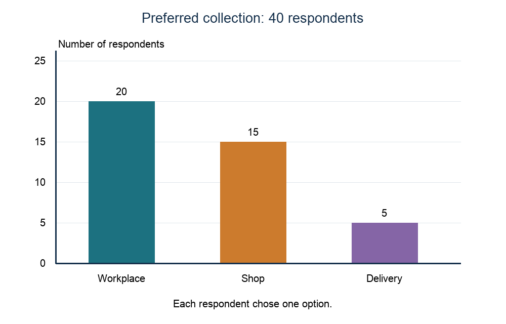
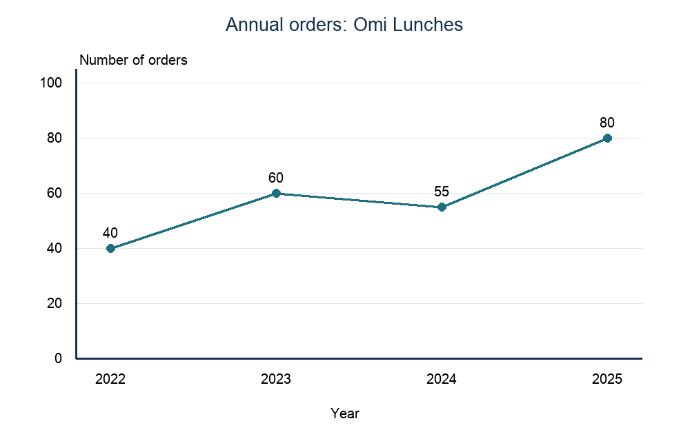
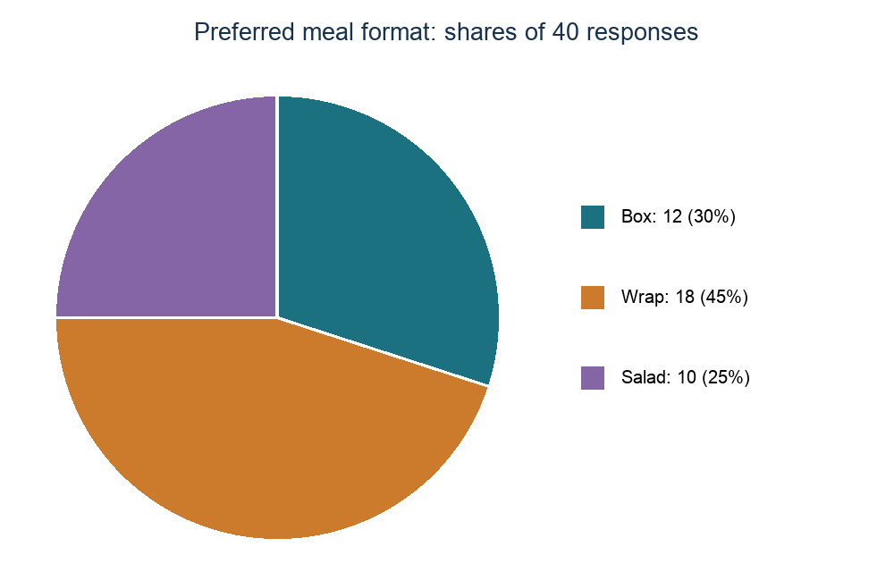
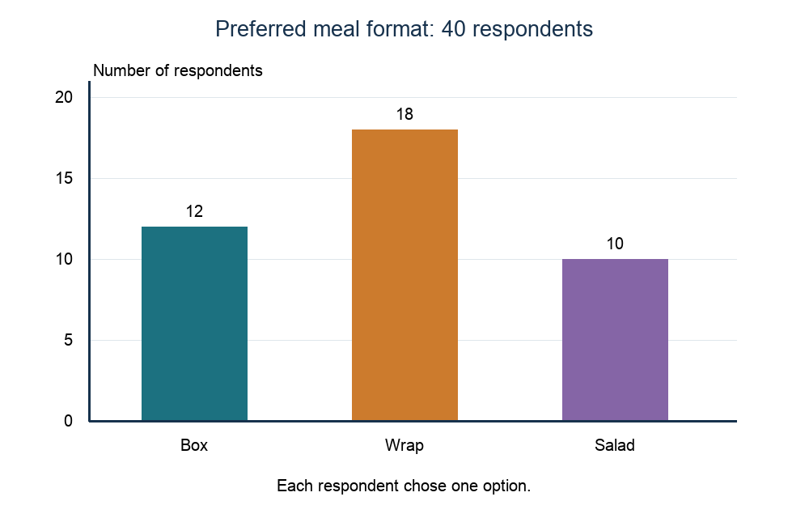

# 4.2 Market research

*nam-6144-nssco-2026. Offline study notes, rendered from the approved content units on 2026-10-27. Everything here is also what the flashcards are built from.*

---

## Why research matters

### Why research matters

Market research collects and analyses information relevant to a market decision, such as customer needs, demand, competitors or preferences. It can reduce uncertainty before committing resources, guide a suitable offering and review whether existing customers are satisfied. It does not guarantee success. A biased sample, outdated information or leading question can create misleading confidence. Start with the decision and information needed, choose appropriate sources, collect and analyse evidence, then assess its limitations before acting. A stated willingness to buy is not an actual order. Research is part of marketing, not the whole process of designing and supplying an offering.

### Putting the idea to work

Omi Lunches wants to choose a meal format before buying specialised packaging. Asking relevant prospective buyers about preferred formats and feasible prices can reduce the risk of buying unwanted packaging. Interviewing only the owner’s friends would weaken the evidence if they do not represent the intended customers.

---

## Primary and secondary research

### Primary and secondary research

Primary research gathers new information for the current purpose, through surveys, interviews, observation or other direct collection. Secondary research uses information that already exists, such as previous sales records, published reports or earlier studies. Primary work can be tailored and current but costs time and can suffer sampling or question bias. Secondary information may be quicker and cheaper but may use an unsuitable market, date or definition. Internal/external is a different distinction: old business sales records are internal secondary data, while a newly commissioned customer survey is primary even though customers are outside the business. Assess relevance, accuracy, age and coverage rather than assuming either category is superior.

### Putting the idea to work

Tula Meals compares a new survey of intended buyers with its existing sales records and a published regional report. The survey is primary. Existing records are internal secondary data and the report is external secondary data. The report’s regional scope may not describe Tula’s specific local buyers.

### Primary research

Primary research is the collection and collation of original data via direct contact with potential or existing customers. It is also called field research. Surveys, interviews and relevant observation can gather new evidence for a specified decision. The business controls the questions and focus but needs time, suitable sampling and unbiased collection. Paying another researcher to gather new data does not make it secondary.

### Putting the idea to work

Eha Bags commissions new interviews about a proposed bag. The information is primary because it is newly gathered for this purpose, even though an outside researcher collects it.

### Secondary research

Secondary research uses existing information rather than collecting new data for the present question. It is also called desk research. It can use internal records or external publications and may give an inexpensive starting point. Check the date, definitions, source reliability and relevance to the target market. Data collected for another purpose may leave the current question unanswered.

### Putting the idea to work

Ota Foods examines last year’s sales records and an existing public report. Both are secondary sources. The sales records are internal and the report external, so secondary is not a synonym for outside the business.

### Keeping the ideas apart

Explain the research classifications: Omi Meals uses old internal sales records and commissions new interviews with outside customers.

The existing records are secondary research and internal information. The new interviews are primary research even though respondents are outside the business. New/existing describes primary/secondary; inside/outside describes source location. These questions must be answered separately.

### Worked practice: Research evidence and a research decision

Tula Meals surveys forty intended local customers about format at a feasible price using neutral questions. Wrap receives 18 responses, box 12 and salad 10. It considers a small paid-sales trial before committing to a large launch. Historical records concern a different menu. For part (b) only, the forty respondents are now known to be the owner’s friends from outside the intended local market. Other facts remain unchanged.

a Evaluate Tula’s proposed small trial using the original research. [12]
b Evaluate the research basis after the respondent information changes. Explain which parts of the conclusion should change or hold. [12]

a Local intended buyers and neutral questions provide a relevant starting point, but forty preferences do not establish actual orders. A bar chart can compare 18, 12 and 10; it cannot remove uncertainty. Prefer a small paid trial and review sales before scaling. b Friends outside the target market weaken representativeness despite unchanged counts and correct charts. Do not use the original preference lead to set the local offer confidently. Gather new evidence from suitable target buyers with neutral questions, then conduct a limited trial. The preference for caution holds, but the original evidence’s relevance no longer holds; redrawing the chart cannot repair the sample.

---

## Developing a useful questionnaire

### Developing a useful questionnaire

Define the research purpose and target respondents before drafting. Use short, neutral questions about one issue at a time, a relevant time period and response options that do not overlap. Include a no-purchase or other option where needed rather than forcing favourable answers. Avoid asking two questions with one answer, such as whether a meal is cheap and tasty. Pilot the questionnaire to find unclear terms and check that answers can be analysed. Keep unnecessary personal information out and explain that responding is voluntary. A well-worded questionnaire still needs suitable respondents; clarity alone does not make a convenience sample representative.

### Putting the idea to work

Nela Lunches asks nearby workers about weekday collection and meal format at a proposed price of N$35. Model questionnaire: Introduction—Voluntary anonymous study of weekday lunches; select one option unless stated. Q1 In a usual working week, how many days do you buy lunch? 0 / 1–2 / 3–5. Q2 Which format would you prefer at N$35? Box / Wrap / Salad / Would not buy / Other: ____. Q3 Where would you prefer to collect? Workplace collection / Shop / Delivery / No preference. Q4 What time is most convenient? Before 12:00 / 12:00–13:00 / After 13:00. Q5 What one improvement would most affect your choice? ____. Pilot these terms before wider use.

---

## Choosing a clear representation

### Choosing a clear representation

Tabulation presents figures in labelled rows and columns. Bar charts compare categories with equally wide separated bars and a common numerical scale. Pie charts show shares of one whole, with sector angles proportional to values. Line graphs can show actual values through time, using ordered time intervals on the horizontal axis and a labelled measure on the vertical axis. Choose the representation that answers the decision: categories are not automatically a time trend. State title, period, units, categories and the relevant total; avoid scales that exaggerate differences. A chart makes information clearer but cannot remove sampling bias or turn preferences into guaranteed demand.

### Putting the idea to work

Forty respondents each choose one collection option: workplace 20, shop 15, delivery 5. Draw separated bars at 20, 15 and 5 on a respondent-count axis starting at zero, with collection categories on the horizontal axis. Workplace is most selected in this sample, with half the responses; it is not proof half the whole market will buy.

### Time-series line graphs

A time-series line graph plots recorded values against ordered time periods. Label both axes and units, choose a consistent scale, plot each point accurately and join consecutive observations in time order. A fall between two periods should be shown rather than replaced with a smooth theory curve. The graph describes the data; it does not explain the cause without more evidence.

### Putting the idea to work

Omi Lunches records annual orders: 2022—40, 2023—60, 2024—55, 2025—80. Plot those years horizontally and number of orders vertically, including the fall from 60 to 55. Overall orders double from 40 to 80, but the path is not a continuous rise. It is not a generic product-life-cycle diagram.

### Pie charts

A pie chart represents a whole as proportional sectors. Divide each category count by the total and multiply by 360 degrees for its angle, or by 100 for its percentage. Check that categories form one non-overlapping whole and angles total 360 degrees. Include a title and category key. A pie chart suits shares but makes small differences harder to compare than bars.

### Putting the idea to work

Forty respondents select one preferred format: box 12, wrap 18, salad 10. Box is 30% and 108 degrees; wrap is 45% and 162 degrees; salad is 25% and 90 degrees. Angles total 360 degrees. Wrap is the largest share but below half, so it is not a majority preference.

### Bar charts

A bar chart uses separate bars for distinct categories, with equal widths and a shared scale. Heights show category values; the spacing indicates categories rather than a continuous numerical interval. Label the categories and the measure, give a title and plot the counts accurately. A zero baseline gives a clear comparison of bar lengths. Unlike a pie chart, bars need not describe shares of one whole, although this example does.

### Putting the idea to work

A meal survey records box 12 responses, wrap 18 and salad 10, each respondent choosing one format. Draw the bars at 12, 18 and 10. Wrap leads box by six responses and salad by eight, but this sample does not establish the preferences of every potential buyer.

### Tabulation

Tabulation arranges data into rows and columns with clear headings and units. It helps readers locate exact figures and check totals before constructing a chart. Separate counts from percentages and state the survey base. A table without headings may leave readers unable to distinguish sales value from respondents. Check that category totals fit the stated number of responses, especially if multiple answers were allowed.

### Putting the idea to work

A survey of forty people permits one format choice each: box 12, wrap 18, salad 10. Model table:

| Preferred format | Respondents | Share of 40 |
|---|---:|---:|
| Box | 12 | 30% |
| Wrap | 18 | 45% |
| Salad | 10 | 25% |
| Total | 40 | 100% |

The table preserves exact counts and the denominator; it does not describe forty confirmed purchases.

### Keeping the ideas apart

Iya Goods is asked to draw a line graph of its annual sales for four named years. Explain why the actual figures must be plotted rather than an unmeasured product-life-cycle curve sketched.

The task concerns recorded values at stated times, so plot those values on labelled time and sales axes, including any fall. A product-life-cycle curve models stages and cannot replace the observations. A bar chart could also compare the years, but when a line graph is asked for, the actual values must be plotted in time order and joined.

### Worked practice: Research evidence and a research decision

Omi Lunches surveys forty intended local buyers using a neutral single-choice format question: “Which format would you prefer at N$35: box, wrap, salad or would not buy?” All forty choose a format: box 12, wrap 18, salad 10. It also has last year’s sales records. The manager considers treating wrap’s lead as proof of enough demand for a large launch.

a(i) Define market research. [2]
a(ii) State two features needed on a clear bar chart of these results. [2]
b State two reasons to research before a launch. [2]
c Distinguish Omi’s survey from its existing sales records, referring to the questionnaire purpose. [6]
d Evaluate using the charted preference lead as sufficient evidence for a large launch. [8]

a(i) Collecting and analysing information relevant to a market decision. a(ii) Labelled categories and a respondent-count scale. b Reducing uncertainty about needs and guiding a suitable offering. c The neutral question gathers new primary data tailored to format and price. Last year’s records are existing internal secondary information and may describe a different offer. Both can help, but the new survey is not automatically free of sampling or stated-intention limits. d A bar chart shows wrap’s lead clearly; a pie chart shows its 45% share, which is below half. Neither turns forty stated preferences into confirmed sales or establishes launch volume. Use the evidence for a limited trial and investigate demand and cost before a large commitment.

### Worked practice: Research evidence and a research decision

Omi Lunches surveys forty intended local buyers using a neutral single-choice format question: “Which format would you prefer at N$35: box, wrap, salad or would not buy?” All forty choose a format: box 12, wrap 18, salad 10. It also has last year’s sales records. The manager considers treating wrap’s lead as proof of enough demand for a large launch.

a Draw a labelled bar chart of the three response counts and explain its main finding and limit. [8]
b Evaluate the manager’s large-launch proposal compared with a small trial supported by further suitable research. [12]

a Bars: box 12, wrap 18, salad 10, on a common respondent-count scale beginning at zero, with category labels and a title identifying forty responses. Wrap leads by six over box but does not have a majority.

b Research reduces uncertainty but these are stated choices, not actual purchase commitments. Neutral wording and intended local respondents help relevance, while the small base and one proposed price limit certainty. Existing records offer background but may concern another menu. A large launch could create unsold stock if interest fails to convert. Prefer a small paid-sales trial, track actual purchases and supplement specific missing evidence before scaling. Retain the questionnaire’s price and no-purchase option in further work rather than ask leading questions that force favourable responses.

### Worked practice: Research evidence and a research decision

Tula Meals surveys forty intended local customers about format at a feasible price using neutral questions. Wrap receives 18 responses, box 12 and salad 10. It considers a small paid-sales trial before committing to a large launch. Historical records concern a different menu.

Evaluate a small trial against a large immediate launch at Tula. Give a concise plan. [12]

Evidence: neutral primary responses from intended buyers; existing records describe another menu. Presentation: bars compare counts and a pie shows wrap at 45%, not a majority. Limitation: intentions do not prove volume of paid demand. Trial: tests purchases at a feasible price while limiting stock risk. Cost: time and smaller initial sales. Judgement: use the trial and review results before a large launch.
