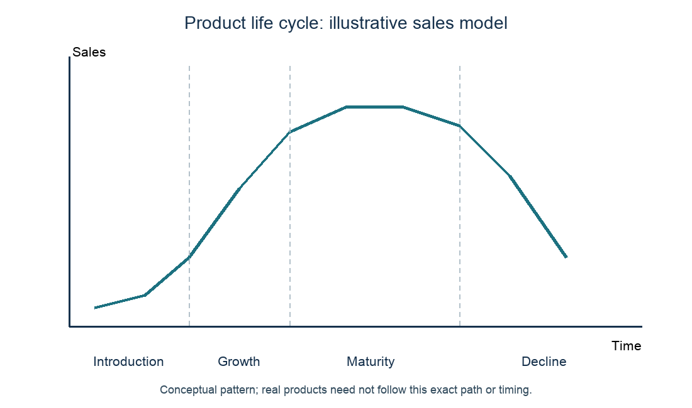

# 4.4 The marketing mix: product and packaging, price, promotion, distribution

*nam-6144-nssco-2026. Offline study notes, rendered from the approved content units on 2026-10-27. Everything here is also what the flashcards are built from.*

---

## The product offering

### The product offering

A product is the good or service offered to meet a customer need. It includes relevant features, quality, design and supporting service rather than only a physical object. A repair service is a product offering even though the customer is not simply buying a newly manufactured item. Product is distinct from production, the process of creating the offering. Customers judge whether benefits meet their purpose at an acceptable price. A technically impressive feature may add cost without value if buyers do not need it.

### Putting the idea to work

Omi Bags offers a durable tool bag with repair support. Its product includes the bag’s strength, compartments and support. The cutting and sewing process is production, not the name of this marketing-mix element.

---

## Product types and purpose

### Product types and purpose

Consumer products are bought for personal or household use; producer goods are bought by businesses to make other goods or services; they include capital goods such as machinery and equipment, and materials or components used up in production. Durable goods are used repeatedly over time, while non-durable goods are used up more quickly. Services provide an activity or benefit rather than ownership of a new physical good. Classify using purpose and characteristics: the same item can be a household consumer durable or business equipment depending on who buys it and why. The categories can overlap because they answer different questions.

### Putting the idea to work

A household buys a freezer for its food; a meal business buys a freezer to support production. The first is a consumer durable, the second business equipment or a capital good. Both are physical durable items; buying purpose changes the consumer/producer distinction.

---

## Product life cycle

### Product life cycle

A product life cycle describes the stages a product passes through from introduction, through growth and maturity, and finally decline. It is a model of sales through time, not a promise of identical timing for every product. Introduction commonly involves low initial sales and awareness-building; growth brings rising sales; maturity involves slower growth or a plateau; decline involves falling sales. In introduction, promotion costs are high, there are few competitors and profit is usually low or negative. In growth, sales and profit rise and competitors start to enter. In maturity, sales peak, competition is strongest, prices may be cut and extension strategies (new markets, new versions or new packaging) may be used. In decline, sales and profit fall and the product may be withdrawn or sold at reduced prices. Development can precede introduction, but sales have not yet begun. Managers can use evidence to consider changes, while recognising a temporary fall does not prove permanent decline.

### Putting the idea to work

Tula Bottles observes an established range’s sales flattening after earlier growth. The pattern could suggest maturity, but management should examine competition, availability and actual data before choosing a response.

---

## Drawing the life-cycle model

### Drawing the life-cycle model

Put time on the horizontal axis and sales on the vertical axis. Draw low introductory sales, a rising growth section, a high flatter maturity section and a declining section. Label the stages so the reader can distinguish the changes in the sales pattern. Some descriptions distinguish saturation within the mature plateau. The curve is conceptual unless data are supplied; do not present it as actual measured sales or assume a given number of years per stage. Extension actions such as adapting the product or finding new buyers can sometimes prolong sales but do not guarantee revival.

### Putting the idea to work

Construct an illustrative life cycle for a lunch-container range, with no numerical sales data provided. 

The labelled diagram shows the model’s changing sales direction rather than forecasts for a real range. Maturity does not mean zero sales, and decline is falling sales rather than necessarily an immediate end to all demand.

---

## What can make a product successful

### What can make a product successful

Useful success features include meeting a real need, reliable quality, suitable design, value at the price, accessible supply and appropriate differentiation. Repeat purchases depend on the experience as well as awareness. A memorable brand can help recognition but cannot make a defective product reliable. Judge success against the business objective and customer group rather than assuming every product must be the cheapest or most technically advanced. Demand, cost and consistent delivery matter together.

### Putting the idea to work

Eha Lunch Boxes keeps food secure and is easy for its target workers to carry. Those features meet a practical need. An expensive decorative feature may contribute little if it prevents the target customers affording the box.

---

## Brand name, loyalty and image

### Brand name, loyalty and image

A brand name identifies an offering and distinguishes it from competitors. Brand loyalty is repeated preference and purchasing of that brand. Brand image is the identity or impression associated with it. A business can choose a name and communicate an intended image, but customers’ actual experiences influence the image they hold. Recognition is not itself loyalty: someone may know the name and still buy a rival. A strong image can support differentiation, but it needs credible quality and service rather than unsupported claims.

### Putting the idea to work

Oru Gear names its bag “Tana”. Buyers associate it with durability and some repeatedly choose it. Tana is the name; the durability association is image; repeated choice is loyalty. They are connected but not definitions of the same thing.

### Brand name

A brand name is the unique name of a product that distinguishes it from other brands. It helps recognition and can support repeat identification, but a name alone does not establish quality, loyalty or a particular customer image. Consistent use and a reliable experience can help the name become meaningful.

### Putting the idea to work

A tool bag is named “Oru Carry”. Oru Carry is the identifying name; whether buyers associate it with strength and repeatedly choose it concerns image and loyalty respectively.

### Brand loyalty

Brand loyalty is when customers keep buying the same brand again and again instead of choosing a competitor’s brand. It can support repeat demand and reduce switching, but depends on customer experience and alternatives. Awareness or one trial purchase is not enough to establish loyalty.

### Putting the idea to work

A buyer repeatedly chooses Omi Bags after satisfactory use despite available alternatives. That repeated preference illustrates loyalty. Merely recognising the logo would not show the same behaviour.

### Brand image

Brand image is the identity or impression associated with an offering, distinguishing it from rivals. It can concern reliability, affordability, design or other perceived qualities. The business can communicate an intended identity, while customers’ experience influences the image actually held. It differs from the identifying name and the behaviour of repeat buying.

### Putting the idea to work

Customers describe Hela Cases as practical and durable. That association describes image. The product name identifies it; repeated purchases would be evidence of loyalty.

---

## Packaging does work

### Packaging does work

Packaging is the physical container or wrapping for a product, also used for promotional purposes. It can protect contents, contain portions, preserve quality, make handling and transport easier, supply instructions or information and support recognition on display. Explain the function and consequence: a secure seal reduces leakage, while a readable label helps correct use. Packaging adds cost and waste, so the design should fit the product and customer need. Saying product or promotion does not explain what the container actually does.

### Putting the idea to work

Nela Soup uses a secure food container and a clear label showing contents and handling information. Containment reduces spills during the journey; information helps customers use and identify the meal. A colourful logo can help recognition but does not by itself explain protection.

### Keeping the ideas apart

Explain why “promotion” alone does not identify the function of Nela Soup’s sealed container.

A function describes what the packaging does. Its seal contains the soup and reduces spills; its label can communicate contents or handling. Attracting attention can also be a packaging function, but it must be explained, for example an eye-catching design that helps the product stand out on a shelf. Writing only “promotion” names a marketing-mix element without stating what this container does.

---

## Price

### Price

Price is the monetary value that you pay for something or that something costs. For the customer it is part of the sacrifice made to obtain the offering; for the seller it affects revenue and the surplus after costs. Price interacts with perceived quality, competition, affordability and demand. A higher price can increase revenue per unit while reducing quantity sold; a lower price can increase volume without necessarily increasing profit. Distinguish the price paid by the customer from the producer’s cost of making the item.

### Putting the idea to work

Kena Bags sells a bag for N$150 although its stated unit cost is N$100. N$150 is price and N$100 is cost. The N$50 difference over that stated cost is not evidence that every future price rise would be profitable.

---

## Pricing strategies fit circumstances

### Pricing strategies fit circumstances

Cost-plus pricing adds a mark-up to a relevant unit-cost base. Penetration sets a low initial price to encourage market entry and customer trial. Skimming sets a high initial price for a distinctive new offering where some buyers will pay, often reducing it later. Competitive pricing uses rivals’ prices as a reference. Promotional pricing makes a temporary price reduction or special offer. Choose according to objectives, demand, competition, costs, product and capacity. A strategy is a pricing approach, not proof of customer response. A low price cannot compensate for an unwanted or unavailable product.

### Putting the idea to work

Teya Drink enters a competitive local market with a familiar product, while Omi Devices introduces a distinctive design valued by a small early market. Penetration may help Teya attract trial if it can afford the low price; skimming may suit Omi only if the distinctive benefit supports willingness to pay and rivals cannot immediately remove it.

### Cost-plus pricing

Cost-plus pricing adds a specified mark-up to an appropriate unit-cost base. It offers a clear starting rule and can cover the included cost if the resulting price is actually paid, but ignores demand and rival prices if used alone. A wrong or incomplete cost base can mislead. Mark-up is on cost; margin is on sales revenue.

### Putting the idea to work

Ota Cups adds a 20% mark-up to full unit cost. The rule is straightforward, but the business must check whether buyers accept the resulting price and whether costs remain accurate.

### Penetration pricing

Penetration pricing uses a low initial price to encourage entry, trial and market share. It may suit a familiar product with strong competition and price-sensitive buyers if the firm can finance the low return and supply the extra demand. It risks weak margins, a low-price image and customers resisting later rises. Extra volume is not guaranteed and more sales do not automatically mean more profit.

### Putting the idea to work

Teya Juice enters a competitive local market and can supply a limited trial at a low introductory price. The low entry price may encourage switching, but the owner should monitor margins and capacity and explain any later normal price clearly.

### Price skimming

Price skimming uses a high initial price for a new distinctive offering where early buyers are willing to pay, often lowering it later as the market develops. It may help recover development spending and capture a high return per early unit. It requires credible differentiation and can attract competitors or restrict demand. A high price without a valued distinctive benefit is not enough.

### Putting the idea to work

Hena Devices has a new design valued by a small group of early buyers and few close substitutes initially. Skimming may suit that early demand, but the firm should reassess as rivals appear rather than assume the high price can continue indefinitely.

### Competitive pricing

Competitive pricing uses rival prices as a reference when setting the firm’s price. It can help where customers compare similar offerings, but the firm’s costs, quality and service may differ. Matching a rival below a sustainable cost can harm the business. It does not mean every firm must charge exactly the same amount or ignore differentiation.

### Putting the idea to work

Oru Stationery compares prices for a standard notebook sold by several local shops. A similar price can avoid an unexplained premium, while availability or service may justify some difference. Check Oru’s own cost before matching a rival.

### Promotional pricing

Promotional pricing offers a temporary reduced or special price to stimulate a response, such as trial or clearing suitable stock. It differs from a continuing low entry strategy in its temporary promotional purpose. It reduces revenue per unit and may bring purchases forward rather than create lasting demand. Clear duration and conditions matter, and repeated offers can train customers to wait for discounts.

### Putting the idea to work

Nela Cases offers one week’s discount on its established range. The temporary offer may encourage purchases now, but management should compare added contribution and promotion cost rather than equate more units with higher profit.

### Worked practice: Marketing choices in a coherent mix

Tula Tea has full unit cost N$80 and uses a 50% mark-up on cost for its normal price. It considers a temporary 25% reduction from that price. Local buyers know where to buy but are unsure about the new flavour. Controlled sampling at its collection point is affordable; a broad campaign costs much more. No increase in paid demand is yet confirmed.

a Explain how Tula’s pricing and promotion choices interact with its stated customer barrier and costs. [8]
b Evaluate a temporary price cut against controlled sampling as the next step. [12]

a Cost-plus gives N$120 normal price; the 25% reduction gives N$90 and reduces the amount above stated unit cost from N$40 to N$10. More units would therefore be needed to preserve a given surplus before new campaign costs, and no volume increase is confirmed. Sampling addresses taste uncertainty directly; a price cut may not resolve that uncertainty. Promotion should fit the actual barrier and preserve feasible supply. b A lower price could encourage trial but reduces the return on each sold unit and may attract temporary bargain demand. Controlled sampling lets buyers experience the flavour without reducing the price on every qualifying sale, although samples and administration cost money. Given known location and uncertain taste, start with an affordable limited sample trial, measure paid conversion and reassess price evidence. Do not claim higher profit merely from a lower price or count samples as sales. If affordability proves decisive, test a sustainable price response instead.

### Worked practice: Marketing choices in a coherent mix

Tula Tea has full unit cost N$80 and uses a 50% mark-up on cost for its normal price. It considers a temporary 25% reduction from that price. Local buyers know where to buy but are unsure about the new flavour. Controlled sampling at its collection point is affordable; a broad campaign costs much more. No increase in paid demand is yet confirmed.

a(i) Define cost-plus pricing. [2]
a(ii) State two factors affecting promotion choice. [2]
b State two initial pricing strategies for a new product. [2]
c Calculate Tula’s normal and proposed promotional prices. [6]
d Evaluate sampling against the broad campaign for the stated barrier. [8]

a(i) Adding a specified mark-up to a relevant unit-cost base. a(ii) Target access and available budget. b Penetration and skimming. c Mark-up = 80 × 0.50 = N$40. Normal price = 80 + 40 = N$120. Discount = 120 × 0.25 = N$30. Promotional price = 120 − 30 = N$90. The customer saving is N$30 and the price remains N$10 above the stated unit cost before any new campaign cost. d Sampling directly addresses uncertain taste among relevant local buyers, while the broad campaign mainly adds awareness they already have. Samples cost money and do not prove paid demand, but a controlled trial limits that exposure. Prefer sampling with clear price and purchase information, then review conversion; choose wider advertising if evidence later shows lack of awareness is the actual barrier.

### Worked practice: Marketing choices in a coherent mix

Omi Snacks sells at N$50 with stated full unit cost N$35. Buyers know the outlet but are uncertain about taste. It compares affordable controlled sampling with a broad awareness campaign and a temporary 10% price reduction.

Evaluate Omi’s sampling, awareness campaign and price offer. Give a concise plan. [12]

Barrier: taste uncertainty, while location awareness already exists. Price calculation: 10% of N$50 is N$5, so the offer price is N$45, leaving N$10 above stated N$35 cost before new promotion cost instead of N$15 normally. Sampling directly tests taste but has cost and uncertain conversion. Broad awareness spending may miss the real obstacle. Judgement: controlled sampling first, with honest purchase information and paid-response review; change priority if evidence identifies price as the problem.

---

## Calculating cost-plus and promotional prices

### Calculating cost-plus and promotional prices

For cost-plus pricing, calculate the mark-up on the stated cost and add it to that cost. A mark-up on cost is different from a profit margin on sales. For a promotional percentage reduction, calculate the reduction on the original selling price and subtract it. State the base, currency and final price. A discount on a cost-plus price is applied to the resulting selling price, not silently to the original cost. The final price must still be assessed against demand and relevant costs; arithmetic alone does not establish a good strategy.

### Putting the idea to work

Luma Cases has full unit cost N$80 and applies a 25% mark-up on cost, then offers 10% off that selling price. Mark-up = 80 × 0.25 = N$20. Normal price = 80 + 20 = N$100. Reduction = 100 × 0.10 = N$10. Promotional price = 100 − 10 = N$90. The final price leaves N$10 above the stated unit cost, before any new cost not included in it.

### Calculating a cost-plus price

Multiply the stated unit cost by the mark-up rate as a decimal to find the added amount, then add it to cost. Check whether the rate is a mark-up on cost rather than a margin on revenue. State the final selling price in N$ and retain appropriate cents. The price provides a surplus over the included cost only if customers buy at that price.

### Putting the idea to work

Tano Packs has full unit cost N$120 and a 20% mark-up on cost. Mark-up = 120 × 0.20 = N$24. Price = 120 + 24 = N$144. The added N$24 is 20% of cost, not 20% of the final selling price.

### Calculating a promotional price

For a percentage discount, multiply the original price by the discount rate, then subtract that reduction from the original price. The base is the price being discounted. A 15% reduction leaves 85% of the original price, not 15%. State both the reduction and final price clearly so customers’ saving is not confused with the amount payable.

### Putting the idea to work

Eha Bags reduces an original N$150 price by 15%. Discount = 150 × 0.15 = N$22.50. Promotional price = 150 − 22.50 = N$127.50. Customers save N$22.50, not N$127.50.

---

## Promotion in marketing

### Promotion in marketing

Promotion is the entire set of activities which communicate the product, brand, service or business to customers. It can inform, persuade, remind or support relationships. It includes advertising, sales promotion, personal selling and public relations, rather than only a price cut. The message and method should fit the target, objective and budget. Promotion can create awareness but cannot guarantee purchases, especially if supply or product suitability is weak. It differs from job promotion, an employee’s move to a higher position.

### Putting the idea to work

Eya Repairs demonstrates its service and supplies clear booking information. These activities communicate its offer to customers. Appointing a worker as supervisor is a different use of promotion, concerning a job.

### Keeping the ideas apart

Explain the different meanings: Tano Tools promotes a new bag to customers and later promotes a worker to supervisor.

The customer activity is marketing communication about an offering. The worker’s promotion is movement to a higher job position. The shared word does not make the staffing decision a sales-promotion method.

---

## Promotion types and their purposes

### Promotion types and their purposes

Advertising communicates a paid promotional message through a medium. Sales promotion provides a usually short-term incentive such as a discount, sample or coupon. Personal selling involves direct interaction to explain an offering and respond to questions. Public relations manages relationships and reputation through appropriate communication and activities. A radio station is an advertising medium, not a separate promotion type equivalent to personal selling.

### Putting the idea to work

Nara Tools compares a local advert with direct explanation of a complex tool to business buyers. An advert can build awareness across an audience, while personal selling can handle detailed individual questions. The time and cost per contact may make direct selling unnecessary for a simple low-price everyday item.

### Advertising

Advertising is paid promotional communication through a medium to inform, persuade or remind a target audience. It can reach many people with a consistent message but may reach uninterested people and usually lacks individual clarification. The medium, such as radio or print, is distinct from advertising as a promotion type. Check audience access, budget and message needs.

### Putting the idea to work

Hila Bakery places a local notice showing its collection service. The notice can reach relevant readers consistently, but its presence does not prove they buy. Measure response and ensure the offered service is available.

### Sales promotion

Sales promotion uses an incentive to encourage a customer response, often over a limited period. Examples include samples, coupons, discounts or gifts. It can prompt trial but has a cost and may attract people who buy solely for the offer. Distinguish the promotion type from its particular method and from the medium announcing it.

### Putting the idea to work

Kena Snacks gives a small tasting sample and advertises the event on a notice. Sampling is the sales-promotion method; the notice communicates it. A larger sample count does not establish profitable paid demand.

### Personal selling

Personal selling involves direct interaction with a prospective buyer to explain an offering, answer questions and seek a sale. It can tailor information and gather feedback, making it useful for complex or high-value products. Staff time and cost per contact can be high, and misleading pressure can harm trust. It is not simply any sale completed in a shop without an explanatory interaction.

### Putting the idea to work

Nara Pumps demonstrates its equipment to a business buyer with detailed operating questions. The seller can adapt the explanation and clarify suitability. The same effort may be too costly for a simple very low-value item.

### Public relations

Public relations concerns managing relationships and reputation with relevant publics. Communication about responsible activity, appropriate events or responses to concerns can support trust. It differs from a short-term price incentive and from buying an advertising slot. Credibility depends on conduct as well as messages; publicity is not fully controlled and a promotional event alone cannot erase poor service.

### Putting the idea to work

Ota Repairs explains how it is addressing customer complaints and reports the changes honestly. The communication can support reputation if the changes are real. A promise without improved conduct may deepen distrust.

### Keeping the ideas apart

Explain why Omi Bags’ bag design is a product decision while cutting and stitching are production activities.

Product is what is offered, including features and support. Production is the process creating it. Product is the marketing-mix category; substituting the word production would confuse the offering with how it is made.

### Worked practice: Marketing choices in a coherent mix

Omi Snacks sells at N$50 with stated full unit cost N$35. Buyers know the outlet but are uncertain about taste. It compares affordable controlled sampling with a broad awareness campaign and a temporary 10% price reduction. For part (b) only, reliable feedback now shows buyers already know and like the taste but consider the price too high. Other facts remain unchanged.

a Evaluate the promotion options at Omi under the original facts. [12]
b Evaluate the options after the taste and price evidence changes. Explain whether the original recommendation should change. [12]

a Affordable sampling addresses the unknown taste, whereas a broad awareness campaign spends on a need already met. A discount from N$50 to N$45 reduces the surplus above stated unit cost from N$15 to N$10 without proving it solves the barrier. Prefer a controlled tasting trial and measure paid demand, recognising sample cost and capacity. b Taste is now known and liked, so more sampling has less diagnostic value. A price test or revised value proposition becomes more relevant. The 10% offer still leaves N$10 above the stated cost before extra promotion costs, but profit depends on volume and total costs. Test a limited sustainable price response and review paid sales rather than promise a permanent discount. The recommendation changes because the demonstrated barrier changes, not because price cuts are universally effective.

---

## Informative and persuasive advertising

### Informative and persuasive advertising

Informative advertising emphasises facts about the offering, such as features, price, location or how to use it. Persuasive advertising emphasises reasons to prefer or want it, often through a benefit or identity. A message can contain both. Classify by emphasis rather than assuming all information is neutral or all persuasion gives no facts. Neither purpose permits inaccurate claims. The right balance depends on what the target needs to know and why it might choose the offer.

### Putting the idea to work

One bag advert lists capacity, price and collection point; another stresses the confidence of keeping tools organised. The first mainly informs; the second mainly persuades through a benefit. The persuasive message still needs to reflect what the bag can actually do.

### Informative advertising

Informative advertising emphasises full relevant information about the product or service. It can explain features, uses, price, availability or a new arrangement, helping customers make sense of an unfamiliar offer. Accurate facts still need a clear audience and accessible presentation. Informative and persuasive elements can coexist in one advert.

### Putting the idea to work

A meal notice states the menu, price, collection point and time. Its main emphasis supplies practical facts rather than a lifestyle appeal. Those facts still need to be accurate and useful.

### Persuasive advertising

Persuasive advertising emphasises reasons to prefer or want an offering. It may highlight a benefit, emotion or identity to build preference over rivals. It can contain factual information as well, and persuasion should remain consistent with the actual product. A striking message without a credible benefit may attract attention but fail to convert interest into a purchase.

### Putting the idea to work

A bag advert stresses keeping tools organised and ready for work. That benefit-led appeal is persuasive. The bag still needs compartments that support the claimed usefulness.

---

## Advertising media and online commerce

### Advertising media and online commerce

Media include print, radio, television, outdoor displays and online channels. Compare audience reach, cost, targeting, message detail, access and the need for sound or images. Radio can reach listeners without showing a detailed design; print or online images can show it but require suitable access and attention. Online advertising can link to an e-commerce transaction, yet a promotional webpage alone is not proof that a purchase can be completed online. E-commerce concerns buying and selling through electronic networks, with fulfilment and customer support still needed.

### Putting the idea to work

Ota Crafts wants local buyers to see the shape of a product. Some buyers access local online notices; others rely on a shop display. An image-based notice or display can show shape directly, unlike audio alone. Choose accessible media and a clear buying route; online reach does not make delivery free or automatic.

### E-commerce

E-commerce is buying and selling through electronic networks. It can let customers browse, order or pay remotely, depending on the arrangement. It can widen access but requires suitable connectivity, trust, payment arrangements and fulfilment. An online advertisement alone is promotion; a route for carrying out the purchase is the commerce function. Physical products still need collection, delivery or returns arrangements.

### Putting the idea to work

Teya Crafts accepts orders and payments online and sends the goods by a carrier. The transaction is e-commerce; the carrier is transport. The online channel does not remove physical handling cost.

---

## AIDA as an advertising guide

### AIDA as an advertising guide

AIDA is a simple way of planning an advert’s design: attention, interest, desire and action. Attract attention so the target notices; build interest with a relevant message; develop desire by connecting a credible benefit to need; make the next action clear. It is a planning guide, not a guarantee that every viewer moves through a fixed sequence or buys. Keep it distinct from the marketing mix of product, price, promotion and place or distribution. AIDA helps shape a promotional message within that wider mix.

### Putting the idea to work

Nela Bags uses a clear headline, shows tool compartments, explains easier organisation and gives the collection point and opening time. These respectively support attention, interest, desire and action. A bright headline without relevant information or a buying route is an incomplete advert.

### Attention in AIDA

Attention means getting the target audience to notice the advert. A clear relevant headline or image can help it stand out, but excessive clutter can hide the message. Attention is a starting requirement, not evidence that a person wants or buys the product.

### Putting the idea to work

Omi Bags uses a clear tool-storage headline. It can attract the intended buyer’s attention more usefully than an unrelated bright image.

### Interest in AIDA

Interest means engaging the viewer with relevant information after attracting attention. Show what the offering does and why it relates to the target’s needs. An attention-grabbing claim without useful detail can lose the audience before it understands the benefit.

### Putting the idea to work

Omi Bags shows labelled compartments and capacity. The detail helps a prospective tradesperson see whether the bag is relevant.

### Desire in AIDA

Desire means developing a wish for the offering by connecting credible benefits with the customer’s needs. It goes beyond noticing features to seeing their value. It must not assume all viewers share the same priorities or replace evidence with an unsupported promise.

### Putting the idea to work

Omi Bags explains easier access to organised tools. The benefit can create preference if customers value it and the design delivers it.

### Action in AIDA

Action means making the intended next step clear, such as how to order, visit, enquire or buy. Supply accessible contact or collection information and relevant timing. A customer who wants the product may still fail to act if no practical route is shown.

### Putting the idea to work

Omi Bags gives its workshop collection point and stated opening hours. The information helps interested customers take the next step rather than merely remember the name.

### Keeping the ideas apart

Explain why product, price, promotion and distribution are not the four letters of AIDA. An advert uses a headline, useful detail, a credible benefit and a clear ordering route.

AIDA means attention, interest, desire and action, describing how the advert is designed to encourage a response. Product, price, promotion and distribution are the wider marketing-mix decisions. The advert is part of promotion within that mix.

---

## Sales-promotion methods

### Sales-promotion methods

Sales-promotion methods include temporary discounts, coupons, samples, gifts, competitions and loyalty arrangements. A sample can reduce uncertainty about an unfamiliar low-value product; a coupon encourages a qualifying purchase; a temporary discount changes the immediate price. Assess cost, target behaviour and risks. Repeated discounts can make customers wait for offers, and a free gift has a cost even if its retail value appears attractive. A method should encourage a useful response without misleading terms or promises.

### Putting the idea to work

Eha Snacks considers a small tasting sample against a temporary price discount. A sample addresses uncertainty about taste, while a discount mainly reduces price resistance. Choose the method that matches the barrier and monitor paid conversion rather than count samples as sales.

---

## Choosing promotion for the case

### Choosing promotion for the case

A promotion choice depends on objective, target access, product complexity, budget, stage of awareness and the obstacle to purchase. An unfamiliar taste may suit sampling; a complex high-value machine may need personal explanation; a local simple offer may need an accessible concise advert. Compare the strongest alternative and include cost and capacity. A campaign that creates orders beyond supply can disappoint customers. Do not choose television merely because it is widely known or claim that a modern medium is universally effective.

### Putting the idea to work

Omi Tea has a small local budget and buyers are uncertain about a new flavour. It can offer controlled samples at its existing collection point. Sampling directly addresses taste uncertainty and reaches relevant buyers. A broad expensive campaign may create awareness without resolving that barrier. Prefer a limited sample trial with clear buying information and review paid sales; protect hygiene, cost and capacity.

---

## Distribution and availability

### Distribution and availability

Distribution is the process of supplying goods to businesses and, through appropriate channels, making the offering available to final customers. It includes choosing the route through intermediaries or direct supply, stock availability and fulfilment. Transport is physical movement, one activity supporting distribution. A retailer can make goods conveniently available even when a separate carrier moves them. A good channel must fit customer access, product characteristics, costs and control; having a delivery vehicle alone does not describe the full route to buyers.

### Putting the idea to work

Teya Pots supplies shops that sell to households, with a courier carrying the orders. The route through shops is its channel; the courier provides transport. Calling the channel a truck would confuse a business arrangement with the movement method.

### Keeping the ideas apart

Explain why “road transport” does not fully describe Eha Pots’ distribution channel. Eha sells to shops, which sell to households; a carrier moves the pots by road.

Producer to retailer to consumer is the channel, describing the selling route. Road transport physically moves goods within it. Distribution concerns how the offer reaches customers, while transport is one supporting movement activity.

---

## Distribution channels and e-commerce

### Distribution channels and e-commerce

A direct channel supplies from producer to customer without an intermediary taking that selling role. Indirect routes may include producer to retailer to consumer, or producer to wholesaler to retailer to consumer. Wholesalers can buy in bulk and supply smaller quantities to retailers; retailers provide customer access and service. E-commerce can support direct orders or sales through an intermediary platform. Online contact does not remove storage, payments, returns or physical delivery. Describe who sells to whom and distinguish that route from road, rail or another movement method.

### Putting the idea to work

Oru Bags sells some items directly at its workshop and others through local shops. The workshop sale is direct; producer to shop to household is indirect. An online direct order still needs a collection or delivery arrangement and does not automatically become indirect because a carrier transports it.

---

## Why use direct or indirect supply?

### Why use direct or indirect supply?

Direct selling can preserve contact with customers, control the offer and retain the share otherwise taken by intermediaries. The producer must then perform selling, storage, delivery and support or pay for them separately. Indirect channels can provide reach, local stock, specialist selling and smaller customer transactions, but intermediaries require a margin and can reduce producer control. Choose by target dispersion, volume, perishability, complexity and resources. Removing a retailer does not guarantee lower total cost if the producer takes on expensive fulfilment.

### Putting the idea to work

Kena Furniture makes customised items for a small number of nearby buyers. Another producer supplies standard low-price items to many distant households. Direct contact may suit Kena’s detailed requirements. Retail intermediaries may suit dispersed standard sales if their reach is worth the margin. The decision depends on functions and costs, not a belief that intermediaries add no value.

---

## Transport methods

### Transport methods

Road transport can offer flexible routes and door-to-door delivery but faces distance, road conditions and vehicle costs. Rail can suit large heavy loads on accessible routes but may require transfer at each end. Sea transport can suit bulky international cargo but takes time and requires port access. Air can suit urgent high-value light goods but is expensive for bulky low-value loads. Match speed, reliability, distance, bulk, perishability, access and cost. These are movement choices rather than definitions of wholesale or retail channels.

### Putting the idea to work

Nela Parts must send a small urgent high-value component, while Omi Materials moves a large non-urgent heavy load. Air may be worth considering for the urgent component if accessible and affordable; rail or sea may suit the heavy load where routes fit. Local final delivery may still require road transport.

---

## A coherent marketing plan

### A coherent marketing plan

A marketing plan sets a target, objective and coordinated product, price, promotion and distribution decisions, with resources, actions and review. The elements should reinforce the same need: a premium fragile product, bargain price, mass discount message and unreliable handling would conflict. Specify enough to act and monitor results, while treating sales expectations as assumptions to test. Marketing planning sits inside the broader business plan and must fit capacity and finance.

### Putting the idea to work

Tula Tools can make a small reliable range of durable tool bags for local tradespeople. Full unit cost is N$80 and research supports testing a price of N$120. The owner has limited promotion funds and can supply by workshop collection. Model plan: target local tradespeople needing durable organised storage; objective—test paid demand and repeat interest over four weeks within current capacity. Product—durable tool bag with practical compartments and clear care information. Price—test N$120 against N$80 stated unit cost, review actual uptake and costs. Promotion—local demonstration and a concise accessible notice explaining the benefit and collection arrangements. Distribution—direct workshop collection, recording orders to avoid exceeding capacity. Action/review—owner confirms material supply, schedules a small trial, records paid units and feedback weekly and revises the offer before expansion. This is a connected plan, not four unrelated definitions.
