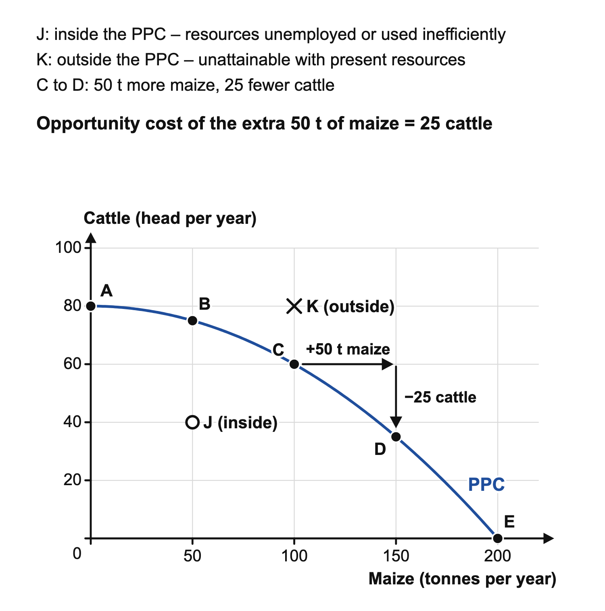

# 1.1 Basic economic problem: scarcity and exercise of choice

*nam-6145-nssco-2026. Offline study notes, rendered from the approved content units on 2026-10-28. Everything here is also what the flashcards are built from.*

---

## Basic economic problem: scarcity and exercise of choice — 1.1

### Why choices arise

A fishing co-operative may want to repair its boats, improve storage and offer additional training. It has a limited number of skilled workers, a limited working day and a limited stock of equipment. These resources have competing uses. Completing a repair can prevent the same worker from delivering training at that time. The basic economic problem is scarcity: resources are limited while human wants are unlimited, so not every want can be satisfied and choices must be made. It is not necessary for the co-operative to be bankrupt before this problem exists. Even a successful organisation has to decide how to allocate its resources. Wants can also change as circumstances improve. A household that can afford adequate food may then want a more convenient journey, better communication or additional leisure. Higher income can expand the choices available without removing the need to choose.

### Plenty of goods does not remove scarcity

Distinguish scarcity from a shortage of a particular product. If a delivery is delayed, a local store may temporarily have fewer bags of flour than its customers want at the current price. A later delivery can remove that shortage. It does not make the store's building, staff time or customers' incomes unlimited. Equally, shelves full of flour do not prove that people can satisfy every competing want. Resources still have alternative uses. A useful check is to name the constraint and the choices it creates. A business may have enough materials but too little specialist labour for the orders it could accept. A learner may have access to learning materials but insufficient time to complete every activity today. Money influences access to resources, while physical resources and time are the means actually used.

### What the next-best alternative means

Opportunity cost is the value of the next-best alternative forgone when a choice is made. Identify the decision, establish the feasible alternatives and name the most valuable rejected option. Suppose a community hall can host either an evening sewing class or a youth discussion at the same time. If the discussion is the best alternative to the sewing class, choosing sewing sacrifices the benefit of the discussion. The opportunity cost is not the sewing class that takes place. Nor is it a list of every imaginable use of the hall. An event requiring equipment the hall cannot obtain is not a feasible alternative for this decision. If several rejected events competed for the same evening, their benefits cannot simply be added: the hall could not have hosted that combined collection instead.

### Drawing a production possibility curve

Opportunity cost can be illustrated with a production possibility curve (PPC). The curve shows the maximum combinations of two goods an economy can produce when all its resources are fully and efficiently used, with resources and technology fixed. Suppose a farming district can use its land, labour and equipment to produce maize and cattle. Its yearly production schedule is: A, 0 t of maize and 80 cattle; B, 50 t and 75 cattle; C, 100 t and 60 cattle; D, 150 t and 35 cattle; E, 200 t and no cattle. Put maize (tonnes per year) on the horizontal axis and cattle (head per year) on the vertical axis, plot the five combinations and join them with a smooth curve.

Moving along the curve shows opportunity cost. From C to D the district gains 50 t of maize and gives up 25 cattle, so the opportunity cost of the extra 50 t of maize is 25 cattle. From B to C the same 50 t of maize cost only 15 cattle. The cost rises because the land and workers moved into maize last are better suited to raising cattle, which is why this curve is bowed outwards. If resources were equally suited to both goods, the PPC would be a straight line and each extra 50 t of maize would cost the same number of cattle.

Point J (50 t of maize and 40 cattle) lies inside the curve. Some resources are unemployed or used inefficiently, because the district could raise 75 cattle alongside the same 50 t of maize. Point K (100 t of maize and 80 cattle) lies outside the curve and cannot be reached with present resources and technology. More resources or better technology could shift the whole curve outwards.

### A calculation with a clear interpretation

A repair team has one free afternoon. It can complete either a paid repair providing net receipts of N$480 or a delivery providing net receipts of N$350. Assume these are the available alternatives and the amounts are comparable after the relevant costs. If it chooses the repair, the opportunity cost is the delivery's N$350 net receipts. The additional immediate benefit of the repair is N$480 minus N$350, which equals N$130. This difference is not the opportunity cost; it compares the selected benefit with the alternative sacrificed. If the team chooses a free skills session instead, its best immediate alternative is the repair. The session can therefore have an opportunity cost of N$480 despite requiring no entry payment. Its potential future benefits still need to be considered.

### Explain the sacrifice rather than naming a price

A causal explanation follows the resource through the choice. The repair team has a fixed afternoon of working time. Attending training uses that time. The paid repair cannot be completed in those hours, so its net receipts are forgone. This shows how the opportunity cost arises. Simply stating that training is expensive would miss the difference between a payment and a sacrificed alternative. The same method works with a learner choosing rest instead of additional study, or an organisation using a building for one service rather than another. Where benefits are not measured in money, describe them rather than attaching a price. Rest, confidence, a useful skill and access to a service can matter to a decision even when no sale takes place.

### Choose according to a stated priority

Recognising opportunity cost can improve a decision by exposing a benefit that would otherwise be ignored. However, it does not supply the decision maker's priorities. The repair team may need immediate receipts to meet a bill, making the N$480 repair attractive. Alternatively, it may have secure current finances and credible evidence that training reduces mistakes, making a future-oriented choice reasonable. These are different arguments because their objectives and time horizons differ. A future gain is not guaranteed merely because training is offered. Consider the relevance of the skills, the time needed to use them and the evidence that performance could improve. Compare alternatives over a consistent period and identify who receives the benefit. A strong judgement states the priority that settles the choice and a change in circumstances that could reverse it.

### Using the method elsewhere

To approach a fresh decision, state the scarce resource, the feasible options, the chosen use and the next-best rejected benefit. Then explain why the sacrifice matters to the stated goal. Resource allocation under different economic systems is developed in topic 1.2. Topic 6.2 examines government objectives, where competing priorities can make the comparison especially important. Topic 9.1 extends the reasoning to costs and benefits affecting different people. Keep the basic distinction clear as those tools are added: a cash expense, a chosen benefit and an opportunity cost answer different questions.
