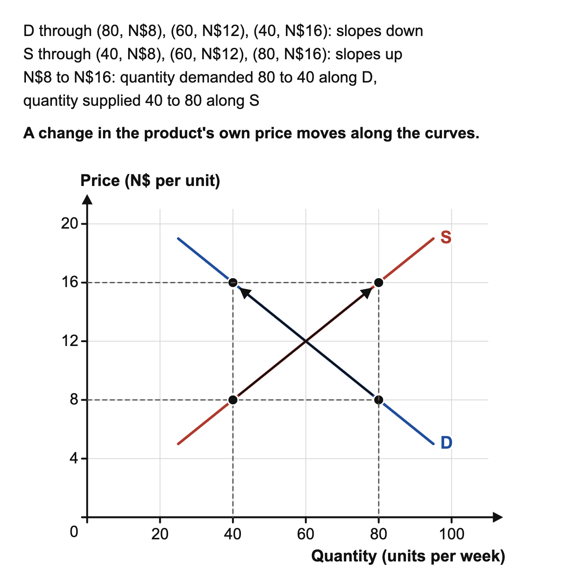
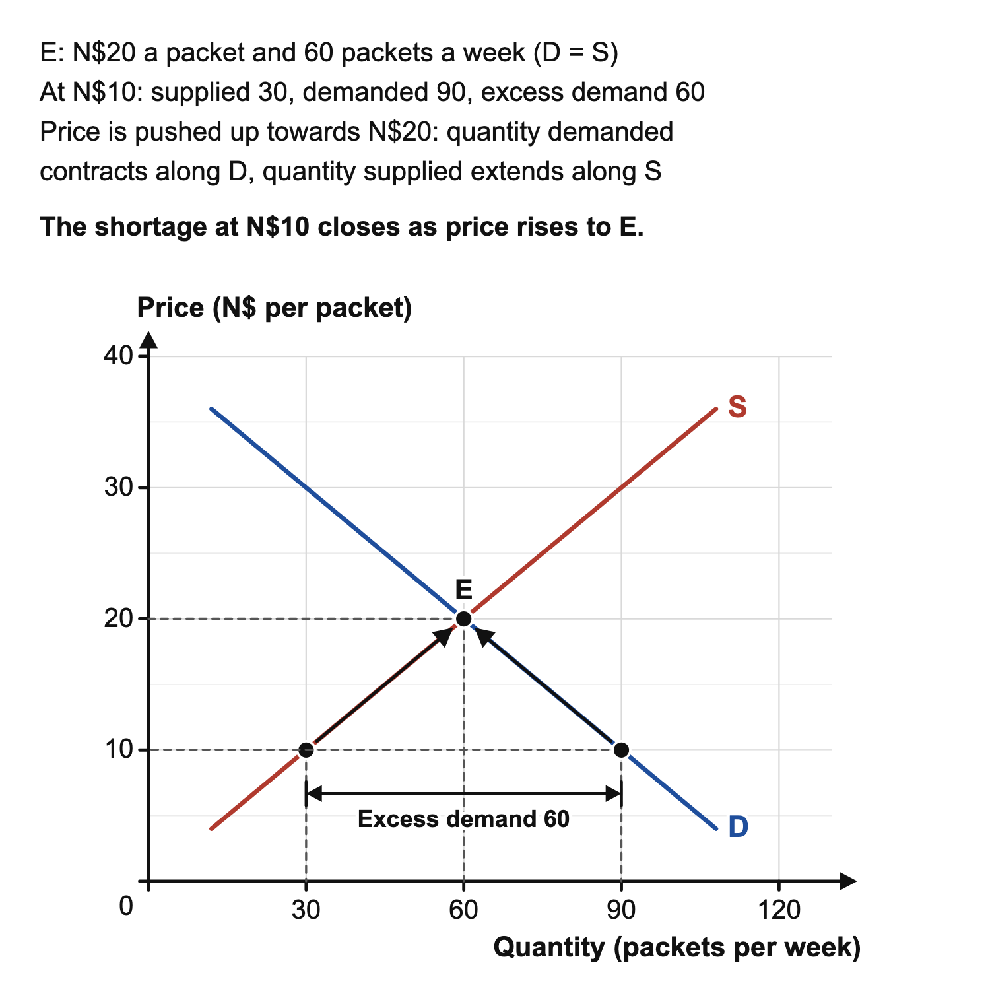
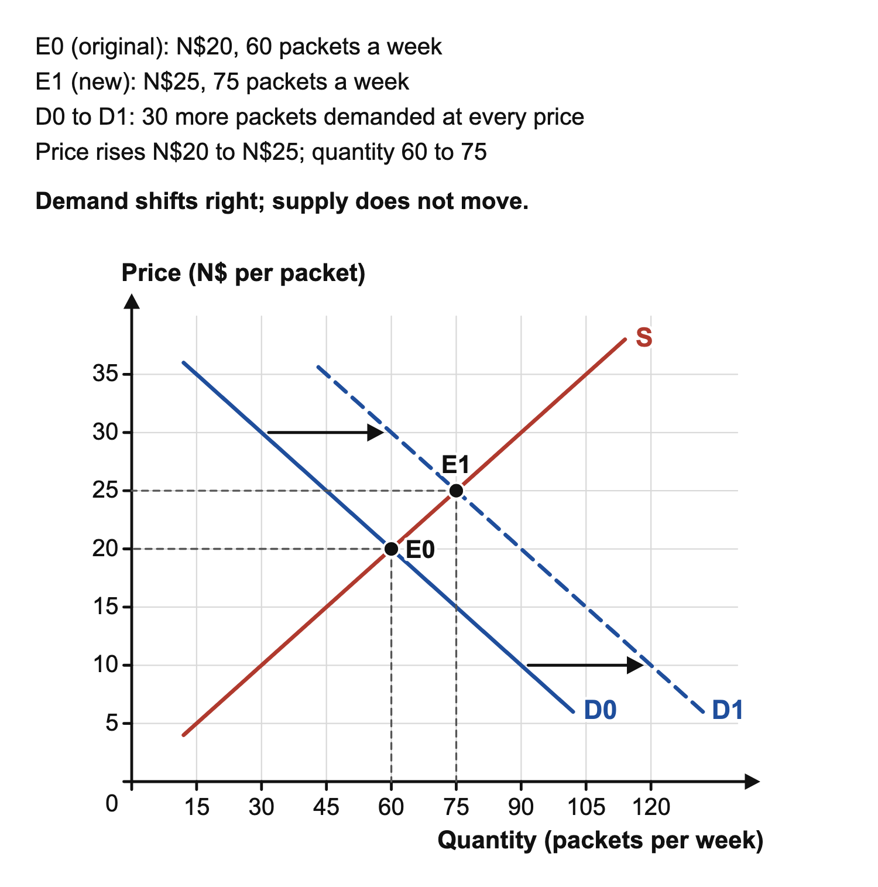
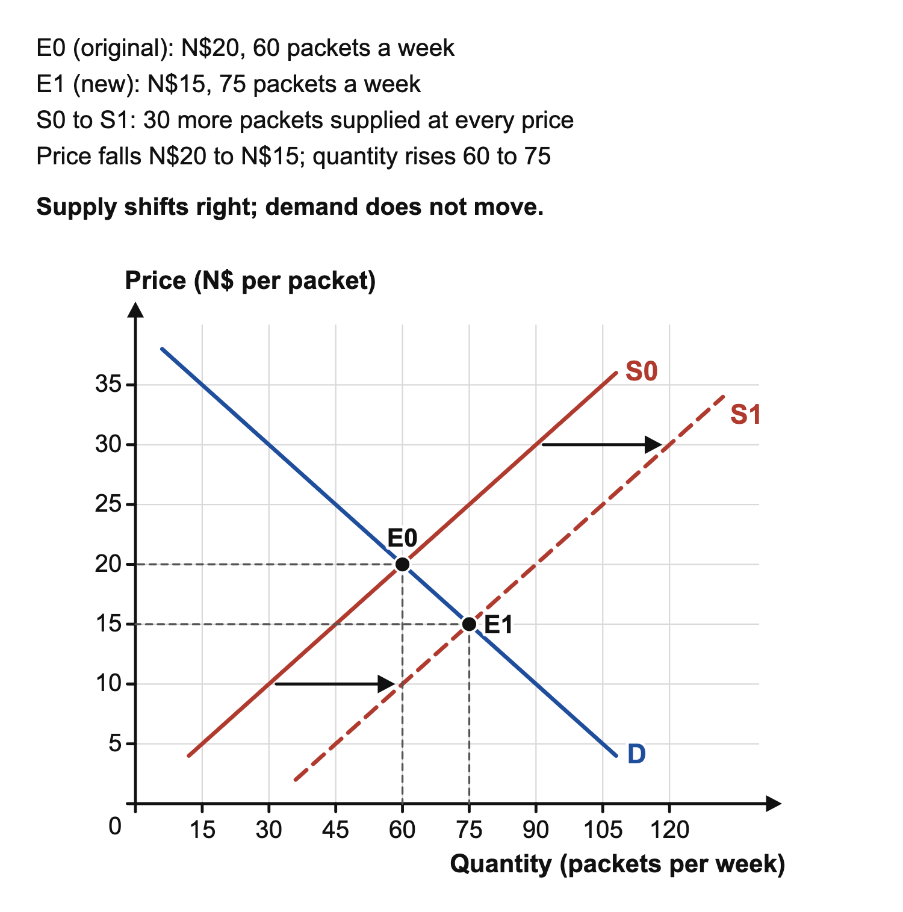

# 3.2 Market forces

*nam-6145-nssco-2026. Offline study notes, rendered from the approved content units on 2026-10-28. Everything here is also what the flashcards are built from.*

---

## Market forces — 3.2

### From a schedule to curves

Demand and supply schedules describe planned purchases and sales at different prices during a stated period. Quantities need units and a time period: packets per week differs from packets held in a storeroom. A demand curve shows the buyer relationship and a supply curve the producer relationship. Conventionally put price on the vertical axis and quantity per period on the horizontal axis. Label the curves D and S, attach units to the axes and use one consistent scale. Each plotted point is a price-quantity pair, not an arbitrary mark on the page.

For a simple market in seed packets, use prices N$10, N$20 and N$30 per packet. Quantities demanded per week are respectively 90, 60 and 30; quantities supplied are 30, 60 and 90. Plot demand coordinates as (quantity, price): (90,10), (60,20), (30,30). Supply points are (30,10), (60,20), (90,30). Join each set with a straight line for this simple example. Demand slopes down (the law of demand): at a lower price more buyers can afford the product and some switch to it from alternatives. Supply slopes up (the law of supply): a higher price makes production more profitable, so firms offer more. The data are illustrative relationships, not a claim about every real market. Moving from N$10 to N$20 along these schedules reduces quantity demanded and increases quantity supplied while other relevant conditions remain unchanged.

Check the placement of coordinates before joining points. At a price of N$10, the demand quantity 90 belongs at horizontal coordinate 90 and vertical coordinate 10. Reversing the axes while leaving the labels unchanged would misrepresent the schedule. The supply point at that same price is at horizontal coordinate 30. The horizontal distance between them therefore represents a quantity difference at one price. A vertical distance instead represents a price difference at one quantity. Reading the units makes these two comparisons easier to keep separate.

### Movements along both curves

A second schedule shows the same shapes. At N$8, N$12 and N$16, buyers want 80, 60 and 40 units a week and sellers offer 40, 60 and 80. As the price rises from N$8 to N$16, quantity demanded falls along D and quantity supplied rises along S; neither curve shifts.

### Equilibrium and adjustment

Equilibrium price is the price at which quantity demanded equals quantity supplied. In the seed-packet schedule it is N$20, where both equal 60 packets per week. Mark the intersection E, then project to the axes to show the equilibrium price and quantity. Equality matters: a high quantity or a price acceptable to one trader alone does not establish equilibrium. Equilibrium also does not mean every consumer obtains all they would like at no cost; it concerns planned quantities at the stated market price.

At N$10, buyers want 90 packets while sellers offer 30, producing excess demand of 60 packets per week. Excess demand is also called a shortage, and excess supply a surplus. A movement along the demand curve caused by a fall in price is an extension of demand; one caused by a rise in price is a contraction. Competition for limited offers can put upward pressure on price. As price rises along unchanged curves, quantity demanded falls and quantity supplied rises. At N$30, supply of 90 exceeds demand of 30, leaving excess supply of 60 and downward pressure on price. In the basic model prices can adjust towards N$20.

Real adjustment may take time, and regulation or contractual arrangements can prevent free movement. A controlled price below equilibrium would be drawn as a horizontal price line below E, not as a new demand curve. Price control changes the permitted price; its imposition alone does not establish that buyers’ tastes or producers’ costs changed.

### Shifts and their causes

A movement along a curve follows a change in the product’s own price, other relevant conditions unchanged. A shift follows a change in another determinant, so the quantity at a given price changes. Higher income may raise demand for a normal good; changes in preferences, population and related-product prices can also shift demand. The direction depends on the relationship. If tea and a herbal drink are substitutes, a higher tea price may increase demand for the herbal drink. If two products are used together, a higher price of one can reduce demand for the other. Name two distinct alternatives when giving a substitute pair: a named type of bread and bread as its whole category do not provide two separate alternatives.

Supply determinants concern producers’ willingness and ability to offer output. Higher input costs can reduce supply, while improved technology can increase it. Weather can affect agricultural output, and entry or exit of producers can change market supply. Explain the channel rather than assigning a factor by its name alone. A household income change directly concerns buyers; a rise in the cost of cloth concerns suppliers of clothing. Demand-shift factors also differ from determinants of price responsiveness. The availability of close substitutes helps explain responsiveness to a product’s own price; a change in tastes can instead move the entire demand curve. Responsiveness is developed in topic 3.3, so do not treat a shift as evidence that elasticity has increased.

When the term price elasticity is used, its categories include elastic, inelastic, unit elastic and perfectly inelastic demand. These describe responsiveness, not a choice between a rightward and a leftward shift. Their definitions and calculations belong to topic 3.3. A change in tastes alone does not supply the price-and-quantity evidence needed to select a responsiveness category. Holding the distinction clear here prevents the same word change being used for two different analytical questions.

Demand increases (shifts right) when: income rises, for a normal good (for an inferior good, such as a cheap staple that people buy less of as they become richer, demand falls instead); the price of a substitute rises; the price of a complement falls (complements are in joint demand because they are used together, such as torches and batteries); tastes move in the product’s favour or advertising succeeds; the population grows; or buyers expect prices to rise soon. Supply increases (shifts right) when: costs of production fall; technology improves; the government gives a subsidy or cuts an indirect tax such as VAT; good weather raises harvests; or more firms enter the market. The opposite changes shift each curve to the left. State whether each factor increases or decreases demand or supply.

### A demand increase

Keep the original seed-packet supply schedule. Now suppose more households begin home gardening, and demand at N$10, N$20 and N$30 becomes 120, 90 and 60 packets per week. Plot the new demand curve D1 through (120,10), (90,20), (60,30), to the right of D0. At the old N$20 price, demand is now 90 but supply remains 60, so excess demand is 30. This puts upward pressure on price if it can adjust. The new intersection lies at N$25 and 75 packets per week: on the straight-line schedules, demand and supply both equal 75 there.

Show E0 at (60,20) and E1 at (75,25), with axis projections for both.

Demand has shifted, but the price adjustment creates a movement along the unchanged supply curve. It would be wrong to shift supply simply because producers offer more at the higher price. The new equilibrium has both higher price and higher quantity because buyers demand more at each price while the supply relationship is unchanged. The direction can be explained without calculating a slope: compare the old and new curves, identify the imbalance at the old price, then trace the adjustment towards the new intersection.

### A supply change and competing effects

Return to the original demand curve and consider improved production methods that raise supply by 30 packets at each listed price. New supply at N$10, N$20 and N$30 is 60, 90 and 120. Plot S1 to the right of S0. At the old N$20 price, supply is 90 and demand is 60, leaving excess supply of 30. Price tends downwards; the new equilibrium is N$15 and 75 packets per week.

This is a supply increase, not a reduction, because more is offered at the same price. The demand curve stays in place while quantity demanded rises along it as price falls.

A supply reduction works in the opposite direction: with demand unchanged, price tends to rise and equilibrium quantity to fall. If both demand and supply increase, quantity rises in the basic model but the direction of price depends on the relative shifts. Stronger demand pushes price upwards, while stronger supply pushes it downwards. Without magnitudes, a definite net price claim would be unsupported. This gives a useful analysis sequence: identify the affected side and determinant, state the shift, compare quantities at the old price, then locate the new equilibrium. Connect this reasoning to productivity in topic 5.2 for production changes and to advertising in topic 3.4 for changes in buyer information or preferences. A diagram supports the mechanism only when its labels, direction and written conclusion agree.

A price rise and a quantity fall together are consistent with a supply reduction when demand is unchanged. A price rise and a quantity rise are consistent with a demand increase when supply is unchanged. These comparisons help interpret a supplied case, but observations alone do not prove the unchanged conditions. A real event may affect both sides. For example, a local festival may attract more buyers while temporary transport problems restrict deliveries. Explain both changes if the case supplies them, then state what additional information is needed for a definite net conclusion. Do not use the convenience of a simple diagram to erase a stated second change. A conclusion should state the comparison explicitly: price relative to the original equilibrium, quantity relative to the original equilibrium, and which conditions were held unchanged. This keeps a correct curve shift connected to its economic meaning.

---

## Market forces — 3.2.1

### Demand is willing and able buying

Demand means the quantities buyers are willing and able to buy at different prices over a stated period, other relevant conditions unchanged. Wanting an expensive product without the ability to pay does not constitute effective demand at that price. Ability alone is also insufficient if the person chooses not to buy. The definition brings willingness and ability together. State the period because buying ten loaves each week differs from buying ten loaves each month.

A demand schedule describes several possible quantities at different prices, rather than a single purchase. In a simple example, a household buys six packets per month at N$12 each but four at N$18, with its income and preferences unchanged. That is a movement between quantities on the same demand relationship. If a change in the household’s circumstances causes it to buy more at both prices, the relationship itself has changed. This distinction avoids saying demand increased merely because a lower price encouraged a larger purchase. For a market, the quantities bought by relevant buyers can be combined at each price. Do not add quantities referring to different prices as though they were simultaneous purchases at one market price. The curve is a set of alternatives under stated conditions, not a pile of quantities to be summed across the price axis.

The willingness-and-ability test also explains why a survey of wishes is not a complete demand schedule. Respondents might like a product while being unable or unwilling to purchase it at the listed price. A useful schedule specifies the product, price, quantity and period under relevant conditions. It can concern one buyer or a whole market, so state which is meant before interpreting a quantity. A change in market buyer numbers can alter market demand even if each existing buyer’s schedule is unchanged.

### Supply is planned offering

Supply means the quantities producers are willing and able to offer at different prices over a stated period, other relevant conditions unchanged. A producer might possess inputs but lack the capacity to produce more immediately. It might also hold output but choose not to offer all of it at the current price. Supply therefore concerns planned offers under stated conditions, rather than physical stock alone. An existing inventory records what is held at a point in time; weekly supply records a flow offered during a period.

For a soap workshop, a higher selling price may make additional weekly output worthwhile, provided inputs and capacity allow it. The workshop moves along its existing supply curve when its own product price changes and other relevant conditions stay the same. If a new process reduces the resources needed per bar, more may be offered at each price, shifting supply. The words more output are insufficient to distinguish the two cases: explain why the planned quantity changes. A seller choosing an asking price does not establish that buyers will purchase the entire offer. Demand and supply are separate plans, and their equality identifies equilibrium. This links these definitions back to the market diagram: price belongs on the vertical axis, quantities per period on the horizontal axis, and the labels identify buyer or producer plans rather than actual sales assumed in advance.

Capacity matters when interpreting producers’ plans. Higher prices can encourage more output, but a workshop already using its equipment fully may be unable to respond quickly. This does not change the definition of supply; it shows why the time period and production conditions belong in the explanation. Stocks can help a seller meet current orders, while future supply may depend on replenishment or new production. Avoid treating goods sitting in storage as necessarily offered for sale at every possible price.
