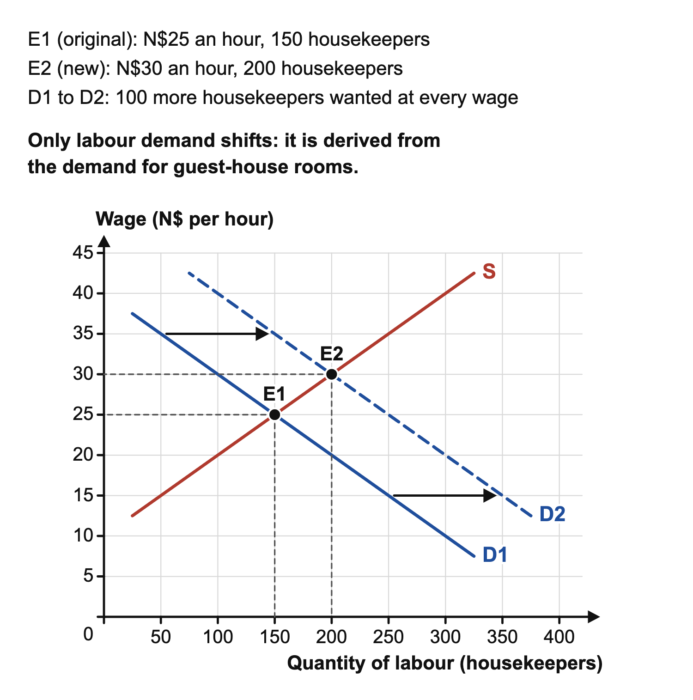

# 4.2 Earnings

*nam-6145-nssco-2026. Offline study notes, rendered from the approved content units on 2026-10-28. Everything here is also what the flashcards are built from.*

---

## Earnings — 4.2

### How earnings are determined

Earnings are monetary rewards from work over a stated period. They can depend on the pay rate, hours worked, overtime, bonuses or other payment arrangements. A worker receiving more per month may simply work more paid hours. Compare like with like before explaining a difference. State whether figures are hourly, weekly or monthly and whether they include additional payments. An explanation of a wage rate is not automatically an explanation of total annual earnings.

Labour demand is related to the work employers need done and the value of the output workers help produce. Rising orders for an equipment-maintenance service can increase demand for its technicians. If trained applicants are scarce, employers may offer higher pay to recruit or retain them. Supply matters alongside demand: lengthy training or qualifications can limit the number able to enter quickly. Bargaining and employment arrangements, such as trade-union negotiation and a legal minimum wage, can also affect settlements. These influences interact, so a single label such as skilled does not prove a particular wage. Explain the demand for the skill, its availability and the relevant conditions. Dangerous or inconvenient work may require higher rewards to attract applicants, but workers’ alternatives and bargaining position affect whether such compensation is achieved.

Consider two reasons an employer might offer a higher wage. It may need more labour because customer orders increased, shifting demand for the work. Alternatively, fewer suitable applicants may be available because training places were limited. Both can put upward pressure on pay, but the initial changes differ. Distinguishing them helps explain why a later training expansion could ease recruitment pressure even if orders stay strong. The effect still depends on the amount of labour demanded and how workers respond to the offered terms.

Gross pay is total earnings before deductions. Net (take-home) pay is gross pay minus deductions such as income tax (PAYE), social security contributions, and pension and medical-aid contributions. Workers may be paid a time rate (a fixed amount per hour, week or month, as a wage or salary), a piece rate (a fixed amount for each unit produced), commission (a percentage of the value of sales), overtime (a higher rate for extra hours) or bonuses. Fringe benefits such as housing, transport or medical aid are non-wage rewards.

### The labour market on a diagram

Draw the wage rate on the vertical axis and the quantity of labour on the horizontal axis. Labour demand slopes downwards, labour supply upwards, and the equilibrium wage is where they cross. In a coastal town, guest houses want 150 housekeepers at N$25 an hour and 150 will work for that wage. More tourists then raise the demand for rooms and so for housekeepers, because labour demand is derived demand: guest houses want 100 more at every wage. Labour demand shifts right, from D1 to D2; supply does not move. The wage rises to N$30 and employment to 200.

More trained workers would instead shift supply right and lower the wage. Strong trade unions (topic 2.2) may push wages above equilibrium, and a legal minimum wage (topic 6.3) sets a floor.

### Comparing different groups

An earnings differential is a difference in rewards between workers or groups, measured on a comparable basis. Differences can arise from skills, experience, responsibilities, hours, employment continuity, location, bargaining and access to opportunities. Discrimination can also affect pay or entry to work. A descriptive average tells us that measured earnings differ; it does not identify how much each factor caused. To investigate, compare the jobs, hours and worker characteristics relevant to the question rather than assuming that the group label itself supplies an explanation.

For example, two employee groups average N$6,000 and N$7,500 a month. The raw difference is N$1,500. If one group works longer hours or contains more supervisors, that affects interpretation. The difference does not show that each worker in the higher-average group earns more than each worker in the other. Nor does it prove the gap is entirely explained by hours or that unfair treatment is absent. Better evidence is needed to separate these possibilities.

A common comparison basis is essential even for simple arithmetic. A difference between an hourly rate and a monthly total is not an earnings gap that can be meaningfully subtracted. If both figures are monthly, ask whether the months involve comparable hours and whether one includes a bonus. A summary may be useful for describing a workforce while remaining insufficient for judging equal work. The purpose of collecting more detail is to identify which comparison the evidence can support, rather than to dismiss a measured difference merely because several explanations are possible.

Typical reasons for differences in earnings are as follows. Skilled workers usually earn more than unskilled workers because training is long and costly, so supply is limited, while their higher productivity raises employers’ demand; unskilled labour is plentiful. On average men have earned more than women because women are more often in lower-paid occupations, more often take career breaks for childcare or work part-time, and may face discrimination in pay or promotion. Public-sector pay is set on national salary scales negotiated with government, often with more job security and pension benefits; private-sector pay depends more on profitability, performance and demand, so specialists may earn more there. Agricultural workers usually earn less than manufacturing and service workers because farm work is often seasonal, output per worker and its value are low, many workers are unskilled and few belong to trade unions. Services range from low-paid work (cleaning, retail) to very high-paid work (medicine, finance). Over time, earnings in an occupation rise relative to others when demand for it grows faster than supply (for example technology raising demand for IT technicians), when unions bargain successfully or when minimum wages or public salary scales are raised. They fall relatively when technology replaces the work or training expands supply.

### Changes over time and purchasing power

Nominal earnings are rewards measured in current money without adjustment for prices. A rise in nominal pay does not establish an equal rise in purchasing power. Real income is income adjusted for the price level. If an illustrative salary rises from N$5,000 to N$5,500 while the relevant price index rises from 100 to 110, real salary at base-period prices is N$5,500 divided by 110 times 100, or N$5,000. The 10 percent nominal rise just matches the index change in this example. For exact comparisons use the index ratio rather than subtracting percentage rates and treating the approximation as exact.

Disposable income is a different concept: income available for spending and saving after relevant taxes and deductions. Removing a tax deduction does not adjust for prices. A worker can have higher disposable money income yet lower purchasing power if prices rise sufficiently. Keep the two adjustments separate. Use the deductions supplied in an exercise.

Relative earnings can also change across occupations or sectors. Technology may increase demand for some skills while reducing demand for tasks it replaces. Training can expand labour supply over time, and changes in product demand can alter employers’ need for workers. A growing occupation’s average might rise partly because it recruits more experienced staff. Compare consistent measures and avoid attributing a time change to one cause without evidence. An index converts money into a common purchasing-power basis; it does not identify the goods each household buys. Interpret the result for the stated basket and comparison period, and avoid inventing individual spending patterns.

### Splitting a factor reward

A factor’s total reward can be divided into transfer earnings and economic rent. Transfer earnings are the minimum needed to retain the factor in its current use. Economic rent is the amount above that minimum. The split depends on the relevant alternative, so the reference use must be clear. It is not a division between wages and profit, and transfer earnings are not money transferred to a bank account.

Suppose a technician receives N$9,000 monthly and would remain in the current use for a minimum of N$7,200 given the stated alternative. Transfer earnings are N$7,200 and economic rent N$1,800. They sum to the actual reward of N$9,000. If the alternative changes so the minimum required becomes N$8,000 while actual pay stays fixed, rent falls to N$1,000. No cut in current pay is needed for the split to change. This connects earnings analysis to opportunity cost in topic 1.1: the minimum depends on what must be offered to retain the resource relative to its alternatives. It also links to occupational choice in 4.1 and bargaining in 2.2. Reward levels and the minimum needed to retain a factor answer different questions.

---

## Earnings — 4.2.2

### Male and female earnings

A gender earnings gap is a measured difference between male and female earnings for a specified population and comparison basis. The measure might concern hourly rates, monthly earnings or annual receipts. These are not interchangeable. A monthly average can reflect hours worked as well as pay per hour, and an annual average can reflect periods without paid work. State which population and measure the data describe before explaining the result. This avoids treating an undefined gap as though it were one universal statistic.

Possible influences include occupation mix, experience, paid hours, career interruptions, access to education or promotion, caring responsibilities and discrimination. Their relevance must be established from evidence. Gender itself does not determine an individual’s skill, work effort or productivity. It would be unsound to explain a pay gap by assuming one gender is naturally more productive or uniformly prefers a particular job. A raw average also cannot show that discrimination is either the whole explanation or absent. To investigate, compare like work and relevant circumstances while recognising that unequal access to opportunities may itself affect the observed job mix. An example comparing average monthly earnings of male and female groups can illustrate measurement. The example shows the difference between a measured gap and its causes.

For example, N$6,000 over 120 hours is N$50 per hour; N$7,000 over 175 hours is N$40 per hour. Higher monthly earnings can coexist with a lower hourly rate.

### Skills, training and scarcity

A skill earnings differential compares rewards for work requiring different levels or kinds of acquired expertise. The shorthand skilled and unskilled concerns requirements of the work, rather than a judgement about a person’s worth or general ability. A job requiring less formal training can still involve effort, judgement and reliability. Longer training can limit the immediate supply of qualified workers, while the usefulness of the skill to employers affects demand. Both sides contribute to the possible pay difference.

A refrigeration technician may need training that few local applicants possess. If firms need the service and replacing the worker is difficult, scarcity can support higher pay. The explanation requires demand for the expertise as well as limited supply; a rare skill that employers do not need may attract little reward. Similarly, an experienced worker in a role requiring less formal training may earn more than a newly qualified worker elsewhere. Hours, bargaining and responsibility can reverse a simple comparison. When analysing a supplied case, trace training or expertise to availability and productive contribution, then to possible negotiating or recruitment pressure. Do not turn the tendency into a claim that every trained worker earns more than every worker in another category. The market and time period determine how strongly the influences operate.

### Public and private employment

A public-private earnings comparison contrasts rewards in government-owned or controlled employment with rewards in privately owned employment. Ownership sector is different from occupation and from stage of production. Both sectors can employ clerical staff, drivers, managers and specialists. Comparing their overall averages without examining the job mix may therefore compare different types of work. A higher public-sector average in an illustrative dataset would not prove that the same individual would receive a higher rate for identical work merely by changing ownership sector.

Budgets, recruitment needs, pay structures, bargaining and institutional objectives can affect rewards in either sector. A public employer may use formal salary scales, while a private employer may link some payments to performance or commercial conditions; actual arrangements vary. These are possible explanatory mechanisms rather than universal rules. Neither ownership form guarantees higher pay, greater security or a particular bonus. If a case supplies differences in benefits or hours, include them in a fair comparison while distinguishing direct earnings from non-wage conditions. For a driver choosing between a public service and a private delivery business, the stated wage, hours, responsibilities and conditions provide a better basis than ownership labels alone. The explanation should identify why the particular employer needs the worker and what resources or arrangements shape its offer.

An overall average can change even when no existing worker’s rate changes. If an employer recruits several highly paid specialists, the average for its workforce may rise because its composition changed. This illustrates why a comparison across ownership sectors needs information about the people and jobs included. It does not show that one ownership form is intrinsically more generous or productive.

### Agriculture, manufacturing and services

Sectoral earnings comparisons group rewards by economic activity. Agriculture concerns activities such as growing crops and raising livestock. Manufacturing transforms materials into products. Services provide activities such as repair, transport or teaching. Each broad sector contains varied occupations and business conditions. A sector average is therefore a summary, not a promise about the reward for a particular job. Services can include both highly specialised and less formally trained work, while agricultural and manufacturing businesses also employ specialists and managers.

Productivity, the demand for output, available skills, labour supply, seasonality and the mix of jobs can influence differences. Seasonal work may provide fewer paid weeks even if the hourly rate is similar. Equipment can raise output per worker, but the effect on earnings depends on demand, bargaining and how gains are shared. A factory’s higher average annual earnings than a seasonal farm’s might partly reflect steadier employment rather than a higher rate for each hour. Conversely, a specialist agricultural role may pay more than a routine manufacturing role. Explain the evidence supplied instead of arranging the three sectors in a fixed ladder. This links to productivity in 5.2 and employment in 7.2: activity, working time and skill composition help interpret earnings, while a label alone cannot establish either individual productivity or a fair wage comparison.

For a simple seasonal contrast, a worker paid for eight months and one paid for twelve months at the same monthly rate receive different annual totals. The shorter employment period can explain that difference without assuming unequal monthly rates. A complete account should distinguish rate, working time and availability of employment before comparing productive contribution or skill. The basis should remain consistent when comparing sectors or tracking the same sector through time.

---

## Earnings — 4.2.4

### Economic rent

Economic rent is the part of a factor’s reward above the minimum needed to keep it in its current use. The factor could be labour or another productive resource. In a labour example, the minimum is the reward needed to prevent the worker moving away from the specified use given the relevant alternative. The excess above that minimum is rent in the economic sense. It does not mean the worker makes no productive contribution or that receiving it is unlawful.

For a designer paid N$8,400 monthly who would remain for at least N$6,900, economic rent is N$1,500. The subtraction compares the actual reward with the minimum stated in the case. A housing payment described as rent in everyday speech is not automatically the same concept. Nor is total salary economic rent merely because the worker enjoys the job. We need the minimum reward or relevant alternative to identify the split. If that information is absent, explain the relationship rather than manufacture a numerical minimum. This distinction also prevents treating rent as the amount received when leaving a job: it is the excess within the current factor reward.

The current-use reference prevents a second common mistake. A worker might need a different minimum to remain with a particular employer than to remain in an occupation generally. A case specifying one employer’s alternative should not silently be interpreted as the minimum for the whole industry. Use the scope stated in the prompt and carry it through the subtraction.

### Transfer earnings and the reference alternative

Transfer earnings are the minimum reward needed to retain a factor in its current use. They reflect the opportunity to put that factor to another use. The word transfer does not mean a government benefit or an electronic movement of funds. It identifies the threshold below which the factor would move away from the specified use. The relevant comparison could change if new alternatives appear, training improves access or conditions change. State the scope of the current use and the alternative rather than assuming one minimum applies permanently.

Using the designer example, N$6,900 is transfer earnings and N$1,500 is economic rent, together making N$8,400. If an improved alternative raises the minimum required to N$7,500 while current reward stays N$8,400, transfer earnings rise and rent falls to N$900. The actual total is unchanged. If the reward exactly equals the minimum, the example has no economic rent above that minimum. These calculations do not establish how much pay an employer can cut in practice; agreements, information and worker responses matter. They explain an economic decomposition relative to stated alternatives. This links to the comparison of earnings and to occupational choice (4.1): feasible alternatives help determine the minimum needed to retain a worker, while the actual reward can exceed it. Checking the split provides a useful arithmetic control: minimum plus excess must equal actual reward. If a proposed rent exceeds the whole reward despite a positive retention minimum, the labels or subtraction are wrong. The check validates the numerical decomposition, while identifying the relevant minimum remains an economic interpretation of the stated alternative.
