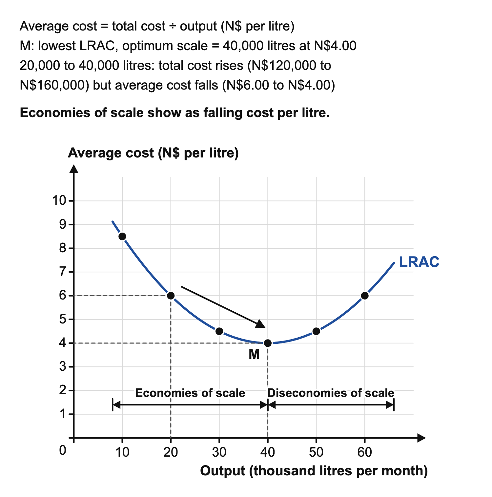

# 5.4 Economies and diseconomies of scale

*nam-6145-nssco-2026. Offline study notes, rendered from the approved content units on 2026-10-28. Everything here is also what the flashcards are built from.*

---

## Economies and diseconomies of scale — 5.4

### Integration and growth routes

Integration joins business activities under common ownership or control. It differs from a firm simply making more output using its own existing organisation. Integration can bring together firms at the same stage, activities at different stages of a production chain or unrelated businesses. The relationship between the activities determines the category. It is not determined by whether the joining businesses have similar names, are located near each other or have equal numbers of employees.

Take a flour producer as the focal firm. Joining another flour producer concerns the same stage and industry, so is horizontal. Acquiring a grain supplier reaches back towards an input source. Acquiring a bakery reaches forward towards customers through a later stage. Acquiring an unrelated repair business would be conglomerate. State the focal business before deciding direction, because the same transaction can be described from different positions in the chain. The baker acquiring its flour supplier moves backward, while the flour producer acquiring the baker moves forward. Integration may create control or cost advantages, but the type alone does not prove those advantages are realised.

Classifying integration does not require assuming all production stages are owned by one firm. Independent suppliers can trade with producers without integration. Ownership or control joining the activities is the relevant change. A regular purchase agreement alone does not establish an acquisition. Equally, two businesses selling to the same customers need not be in the same industry or chain. Examine the activities themselves and what is joined. This makes the classification depend on concrete relationships rather than the general aim of increasing sales.

### What economies of scale mean

Economies of scale are reductions in long-run average cost as the scale of production increases. The long run is the comparison in which the productive scale and inputs can adjust, rather than a fixed number of calendar years. A larger operation may support specialised equipment or staff that a small operation could not use efficiently. The effect is on cost per unit, not necessarily total cost. A bigger firm can spend more money in total while producing enough additional output to reduce its average.

For a packer, a small-scale plan costs N$30,000 for 5,000 satisfactory units, or N$6 each. A larger-scale plan costs N$50,000 for 10,000, or N$5 each. The total rises N$20,000 but average falls N$1. The numbers show the direction; the explanation still needs evidence about the scale-related mechanism. Simply observing a discount or a new machine does not establish a lasting scale advantage without considering utilisation, quality and other costs. Nor is this the same as adding more workers to unchanged equipment and experiencing crowded working conditions in a short period. Keep scale changes distinct from an input adjustment with another factor fixed.

A long-run comparison can involve a small factory and a larger factory each designed for its own scale. That is different from producing extra units in the original building using more labour but unchanged equipment. The latter can change short-period average cost without demonstrating an economy from a new scale. Keep the resource assumptions visible. The wording long run identifies which adjustments are feasible, while the numerical total divided by output shows the resulting average. Neither the passage of a particular number of months nor the size of a single bill supplies that definition.

Internal economies of scale arise inside one firm as it grows: technical, purchasing, financial, marketing, managerial and risk-bearing economies. External economies of scale arise when the whole industry grows or is concentrated in one area, lowering average cost for every firm in it. Examples are a pool of skilled workers trained in the area, specialist suppliers and repair firms locating nearby, better roads, ports and power supply, and training colleges or research centres serving the industry. External diseconomies of scale occur when an industry becomes too concentrated: traffic congestion, rising land and rent prices, and shortages of skilled labour that push up wages raise costs for all firms in the area.

### When expansion adds difficulty

Diseconomies of scale are increases in long-run average cost as production scale expands. A larger organisation may need more layers of decisions, longer information paths and more complex schedules. Mistakes, delays, monitoring and lost coordination can use resources without creating additional satisfactory output. These mechanisms are possibilities to investigate, not a prediction that a firm of a certain size must fail. Good organisation can reduce them.

If the expanded packer instead costs N$70,000 for 10,000 satisfactory units, average cost is N$7, above the original N$6. If the case attributes the extra requirement to coordination problems arising with scale, it supports a diseconomy explanation. A higher input price imposed from outside is a different cause and should not automatically receive the scale label. A comparison needs the same quality and a suitable period. Temporary setup problems during expansion may differ from the continuing operation once routines improve. Ask which mechanism persists and what it does to cost per satisfactory unit. Calling all trouble in a large business a diseconomy of scale would miss that causal requirement.

### Net effect on business costs

Long-run average cost compares cost per unit when the scale of the productive operation can adjust. Economies and diseconomies may operate together. Larger purchases could lower the input price while more complicated scheduling adds waste. The net result depends on their relative effects. A list of benefits without considering new organisational requirements is not a complete expansion judgement; a list of problems without examining feasible savings is incomplete too.

The cost comparison should specify complete relevant cost, satisfactory output and the alternative scale. A plan with total cost N$48,000 for 8,000 units gives N$6 per unit; another with N$70,000 for 10,000 gives N$7. The larger plan has higher average cost in those data, but the figures alone do not identify its cause. It may still be chosen for another objective, though that would need a separate argument. Lower average cost also does not prove higher profit if sales price or sold quantity changes. Expansion must be linked to demand and complete receipts as well as productive capacity. These distinctions connect to costs and revenue in topic 5.3: total, average and net financial result are different measures.

### Long-run average cost on a diagram

Long-run average cost (LRAC) is usually drawn as a U-shaped curve, with output on the horizontal axis and average cost on the vertical axis. A juice bottler compares factories built for monthly outputs of 10,000 to 60,000 litres. Their total costs are N$85,000, N$120,000, N$135,000, N$160,000, N$225,000 and N$360,000, so average cost is N$8.50, N$6.00, N$4.50, N$4.00, N$4.50 and N$6.00 a litre.

As the firm grows, economies of scale make average cost fall. At the lowest point, 40,000 litres at N$4.00, the firm is at its optimum size. Beyond that point diseconomies of scale outweigh economies and average cost rises. Total cost rises at every step, even from 20,000 to 40,000 litres, where average cost falls from N$6.00 to N$4.00: economies of scale are judged by cost per unit. Each point is a different factory size, so the curve does not show the short-run effect of adding workers to one factory.

### Why firms remain different sizes

Firm size means the scale of operations measured by a stated indicator, such as output, employment, sales or capital employed. These indicators can rank firms differently. An equipment-intensive producer may employ fewer people than a labour-intensive service while using more capital. State the measure rather than calling one business bigger without a basis. The suitable size also depends on the market it can serve. A specialised local repair service may face limited demand even if the owner could purchase more equipment.

Finance and production requirements matter. Some activities require large indivisible equipment or a broad network, while others can be provided effectively on a small scale. Organisation can limit how fast expansion is managed. Owners may value control, flexibility or personal service and choose not to grow despite a possible financial opportunity. A small firm is therefore not necessarily unsuccessful or waiting to become large. A large firm is not necessarily more efficient on every task. Evaluate the relevant market, technology, available capital, organisational capacity and objective before recommending a scale. This links to integration routes, occupational choices in 4.1 and productivity in 5.2: combining activities changes the organisation, while the result depends on the resources and demand that support it.

A size recommendation should also acknowledge the indicator used. Output of unlike products cannot be compared by adding physical items without considering what they represent. Employee numbers may be useful for a workforce question, while capital employed may suit an equipment question. State the evidence and avoid implying that one indicator captures the entire organisation. The factors limiting growth may differ by business: a niche market can bind one firm while another has ample demand but insufficient organisational capacity. Explaining the particular limit makes the recommendation specific and reviewable.

Firms grow internally, by producing more and opening new branches, or externally, by a merger (two firms agree to join) or a takeover (one firm buys control of another). Integration is external growth. Motives for growth include higher profits, a larger market share, gaining economies of scale, spreading risk by diversifying, reducing competition, and securing supplies or sales outlets. Small firms survive because the market is small or specialised, customers want personal service, the owner lacks capital or wants to keep control, small firms can be flexible, and they supply parts or services to larger firms. Disadvantages of remaining small include higher average costs, difficulty obtaining finance and greater vulnerability to a fall in demand.

Internal growth means expanding the firm’s own operations, rather than growing by merger or acquisition.

---

## Economies and diseconomies of scale — 5.4.1

### Horizontal integration

Horizontal integration joins firms at the same stage of production in the same industry. Two bakeries combining their businesses provide a straightforward example: both turn ingredients into baked goods. They do not become vertically integrated merely because one is larger or uses a different building. The distinguishing test concerns their place in the production chain and industry, not their geography. A firm opening another outlet by itself is also different from joining an existing separate business, although both can enlarge operations.

Combining similar activities may allow shared facilities, larger purchases or removal of duplicated administration. It may also reduce rivalry between the former competitors. These are potential effects, not part of the definition. The firms may have incompatible systems, different quality routines or locations that limit practical sharing. A larger combined output must have sufficient demand to use its capacity. In a bakery merger, cheaper bulk flour might be offset by additional transport between sites. Evaluating the transaction therefore requires more than naming horizontal integration. First classify the relationship, then examine the possible mechanism and its costs. The question is what activities have been combined and how their resources or market position may change. A joining of similar firms may increase market share, but that possible effect is not the defining test. The classification still depends on stage and industry. If a case supplies no production relationship, ask what each business does before choosing a label rather than using its motive as a substitute.

Two independent bakeries joining at the same production stage illustrate horizontal integration. Merely opening another branch within one existing bakery is internal growth, without a merger.

### Forward vertical integration

Forward vertical integration joins a firm with an activity at a later stage of the same production chain, towards the customer. A juice producer acquiring a shop that sells its juice moves forward. The shop is closer to final consumers than the processing stage. The term does not mean moving to a new town, raising the selling price or simply producing more juice. It describes the ownership or control relationship across stages.

Possible motives include securing an outlet, gaining better information about customers or coordinating availability. The producer may keep some distribution activity within the business rather than relying on an independent retailer. It also takes on retail responsibilities and associated costs. Running a shop requires suitable staff, premises and knowledge, so expertise in production alone does not establish success. Other retailers may respond differently when a supplier becomes a competitor. The outcome depends on capacity, demand and organisation. For classification, keep the focal business explicit: a retailer acquiring a producer is a backward move from the retailer’s position, even though the same stages are connected. This prevents memorising a pair of business names without understanding direction. Explain earlier or later relative to the starting firm and then separately evaluate whether the resulting control or coordination advantage outweighs the new commitments.

### Backward vertical integration

Backward vertical integration joins a firm with an earlier stage of the same chain, towards its input sources. A furniture maker acquiring a timber supplier moves backward. The supplier provides an input before the furniture-production stage. The direction is about the chain, not whether goods physically travel west, inland or back to a warehouse. A furniture maker buying another furniture maker would instead be horizontal because the businesses occupy the same stage.

The motive might be more control over input timing, quality or availability. That can reduce the difficulty of depending on an outside supplier, but internal ownership does not eliminate production risk. The acquired supplier may face weather, equipment or skill constraints. The furniture maker must also manage an activity different from its existing work and commit resources that could have served other purposes. A guarantee of cheaper materials cannot be inferred from ownership alone. A fair evaluation compares the full cost and reliability of internal supply with realistic alternatives. This links to derived factor demand: inputs are wanted because they support the final output. Integration changes who controls the input activity; it does not remove the need for useful contribution or efficient organisation. In a prompt, identify what the focal firm makes and which acquired activity provides its inputs before assigning the backward label.

### Conglomerate integration

Conglomerate integration joins businesses in unrelated industries or activities. A packaging manufacturer combining with an unrelated guesthouse operator illustrates the distinction. The guesthouse is neither another packaging manufacturer nor an earlier or later stage in making the packages. Simply serving customers does not make all businesses part of the same production chain. The classification requires the relationship between the specific activities.

Possible motives include spreading commercial risks or entering a new market. Different demand patterns might reduce dependence on one activity. However, unrelated expertise can be difficult to manage, and the purchase may add complexity without useful shared production resources. Risks may also move together: a broad downturn can affect several activities at once. Diversification does not mean losses become impossible. A combined firm still needs suitable managers, finance and information for its operations. This connects to risk-bearing economies of scale, but the integration category alone does not establish an average-cost reduction. A firm acquiring an unrelated service could increase its scale and complexity without improving efficiency. State the category first, then examine whether the claimed benefits arise. Across the integration routes, the defining test is same stage, later stage, earlier stage or unrelated activity; a broad claim that joining makes a firm stronger is not a substitute for that classification. A shared parent can coordinate finance while the activities remain unrelated in production. Conversely, using separate managers does not make stages unrelated if one supplies the other within the same chain. Organisational charts and production relationships answer different questions, so the integration category should follow the economic activities described. The focal firm and production relationship should remain explicit throughout.

---

## Economies and diseconomies of scale — 5.4.2

### Technical economies

Technical economies of scale are reductions in long-run average cost from production methods or equipment made economical by larger scale. Some equipment can perform a task efficiently but needs substantial output to justify its resources and operating requirements. A small operation may leave it idle, while a larger one can use it regularly. The mechanism is effective utilisation or a production advantage enabled by scale, not machinery being inexpensive merely because it is large.

At a bottle processor, a specialised filling line might handle large standard batches with less resource use per acceptable bottle than a small manual arrangement. Compare complete costs, suitable output and utilisation. A large line used for a few bottles or frequent unusual formats might lose the potential advantage. Additional capacity also does not prove that customers buy the output. Demand and distribution need to support use of the technique. A newer machine can improve a small firm through technological progress without the cause being greater scale; distinguish the changed method from the scale condition that makes a technique viable. This distinction protects the explanation from labelling any equipment purchase a technical economy. The question is whether larger operation allows a resource-saving technique to be used effectively and how that lowers average cost under the stated conditions.

External economies arise from industry growth or concentration, outside one firm’s own expansion. A shared pool of trained workers or nearby specialist repair suppliers can lower a producer’s average cost even without that producer expanding.

### Purchasing economies

Purchasing economies of scale are reductions in long-run average cost from obtaining inputs on more favourable terms at larger scale. A supplier may offer a lower price per input unit for a sufficiently large order because serving that order reduces its own transaction or handling cost, or because it values the relationship. The buyer can then obtain a lower input cost for the same output requirement. The saving depends on the actual terms rather than a certainty that suppliers grant discounts to any large business.

Suppose a packer needs one container per product. A small order costs N$5 per container while a qualifying bulk order costs N$4.50, saving N$0.50 per product before other effects. If the bulk order creates extra storage, breakage or unused stock, compare those costs with the discount. A lower purchase price is not automatically a lower complete average cost. The order also ties up funds until the stock is used. Appropriate demand and storage capacity are therefore conditions for the advantage. This connects to total and per-unit costs in 5.3: the bulk bill may be larger in total because more inputs are bought, even while the price per container is lower. Explain the unit comparison rather than say that buying more always costs less. A comparison should also hold the input requirement clear. A discount per container lowers the materials bill per product only when the product still uses the stated number of containers and waste is accounted for. More elaborate packaging could offset the quoted discount. The useful saving is the complete resource difference for comparable satisfactory output, not a favourable quotation isolated from the process.

### Financial economies

Financial economies of scale are reductions in long-run average cost through more favourable access to finance associated with larger operation. A lender might view an established firm with assets, reliable records and varied receipts as lower risk, potentially offering more favourable terms. Larger transactions can also spread the administrative work of arranging finance. These are possible reasons for cost advantage, while approval and the actual rate remain decisions dependent on the application and risk.

A heavily indebted large business with weak receipts may still face expensive finance or refusal. The financial position and risk matter as well as size. For a processor, compare the actual financing terms and the productive use of funds rather than assume its name or workforce establishes cheap borrowing. A lower stated interest rate also needs a consistent basis when fees, term and repayment arrangements differ. Identify the possible risk or transaction-cost mechanism and its conditions. Easier access can support productive investment, but the borrowing obligation remains. A larger loan is not itself an economy unless the relevant cost per output is improved through the scale-related terms. Keep access to finance, the price of finance and the success of the financed project as distinct questions.

### Marketing economies

Marketing economies of scale are reductions in long-run average cost from spreading relevant marketing resources over larger sales or operations. Preparing a catalogue, designing packaging or producing a campaign can involve costs that do not rise proportionately with each additional item sold within the relevant range. If the same effective work serves more sales, the marketing cost per unit can fall. The claim concerns a per-unit resource requirement, not the campaign being free.

A producer spends N$12,000 on a suitable campaign. Spread across 6,000 sold units that is N$2 per unit; across 10,000 it is N$1.20 if the same campaign cost and effectiveness apply. Those conditions matter. A new region may need different language, distribution or message work, raising total resources. A broad audience may contain few relevant buyers, so views alone cannot supply the sales denominator. The firm needs evidence about actual useful reach and sold output. This links to advertising in 3.4: purpose, method and audience fit remain important at larger scale. A large campaign can cost more in total and still less per sold unit, but a bigger advertising budget alone does not establish an economy. Explain what work is shared and why the relevant output expands sufficiently.

### Managerial economies

Managerial economies of scale are reductions in long-run average cost from effective managerial specialisation supported by larger operation. A small owner may handle finance, staffing, purchasing and production personally. Larger activity can support specialists who bring relevant knowledge to each task. Better purchasing decisions, scheduling or maintenance planning may reduce mistakes, delays and wasted resources. The mechanism is improved decisions and organisation relative to output, not the job title manager automatically increasing efficiency.

At a furniture producer, a trained production planner may coordinate material arrivals and work schedules more effectively than an overstretched owner. If the resulting saving exceeds the specialist’s cost and the added coordination requirements, average cost can fall. If the firm is too small to use the expertise regularly or responsibilities overlap, the new role may instead add expense. The scale must support useful specialisation. Managerial economies can coexist with diseconomies if adding layers makes communication slower. Treat them as opposing mechanisms rather than claim a firm can have only one. The evaluation should identify the particular decision improved, how resources are saved and what additional cost the specialist creates. This connects organisational capacity to the suitable size of a firm, rather than assuming that hiring more managers is itself evidence of growth being beneficial. A specialist purchasing manager might negotiate suitable terms, while a production manager arranges the work that uses those inputs. Their contribution should be connected to fewer errors, delays or wasted resources. Merely increasing administrative headcount can add cost without that mechanism. The appropriate division of responsibility depends on tasks and volume, which explains why a useful specialist role at one scale may be unnecessary at another.

### Risk-bearing economies

Risk-bearing economies of scale describe potential cost advantages associated with spreading risks across activities or markets at larger scale. Dependence on one customer group can leave an operation vulnerable to a local fall in demand. Serving varied markets may help maintain use of resources when one weakens, reducing the cost of severe interruption or unused capacity. The potential advantage depends on risks not moving together and the firm being able to manage the wider operation.

A maker supplying school and household products may find their demand patterns differ over the year. That could support steadier use of equipment than relying on one short season, if the same resources are suitable. It does not make each product profitable or remove broader risks such as a common input shortage. New activities can also need different equipment and expertise, offsetting any stabilising benefit. Diversification must therefore be linked to an actual resource or cost mechanism, not simply called safer. Conglomerate integration can be one route into varied activities, but the legal joining alone is not proof of a risk-bearing economy. This links each type back to the main definition: each proposed economy requires a reason for lower long-run average cost at larger scale. Risk spreading and efficiency should be evaluated with the relevant evidence and limits. To evaluate a diversification claim, identify which demand patterns differ and what resources can be used across them. If the activities need entirely separate capacity, steady demand in one may not prevent idle equipment in the other. If both depend on the same vulnerable input, they may share the disruption. These contrasts clarify the condition needed for the proposed stabilising advantage without assuming that unrelated names mean independent risks.

---

## Economies and diseconomies of scale — 5.4.3

### Communication diseconomies

Communication diseconomies are increases in long-run average cost when greater scale makes information transfer slower, distorted or more costly. A message may pass through several management levels or between distant sites, creating opportunities for delay or misunderstanding. The resulting mistake can waste materials, require rework or leave resources waiting. The diseconomy is not the existence of a message or meeting; it is the scale-related resource cost relative to satisfactory output.

At a uniform producer, a changed size instruction may reach one factory late. Producing the wrong batch uses cloth and labour but does not meet the order, raising cost per satisfactory uniform. A larger firm could reduce this risk through clear responsibilities and a shared record, so size alone does not establish inevitable failure. Compare the process rather than stereotype the workforce. Communication improvements may themselves cost resources, and their value depends on avoided mistakes and delays. This also distinguishes the category from coordination: a message can be transmitted accurately while schedules still fail to fit together. Identify whether the initial problem concerns information reaching the right people or the arrangement of interdependent work. Both can occur, but the mechanism should not be counted twice without explaining their separate effects. A useful remedy must address the diagnosed information problem. Repeating more meetings may add time without making instructions clearer. A shared record can help if staff receive and understand the right version, while clear responsibility can prevent conflicting messages. Compare the resources used by the remedy with the avoidable mistakes it removes.

External diseconomies arise outside the firm as an industry grows or concentrates. Competition for scarce local land and skilled workers can raise rents and wages; congestion can delay deliveries and raise cost per unit.

### Co-ordination diseconomies

Coordination diseconomies are increases in long-run average cost when expansion makes interdependent activities harder to organise. Several departments may each meet their own targets yet fail to support the whole production process. Materials may arrive before storage is available, or completed components may wait for another stage. Idle labour, extra handling and missed schedules use resources without a corresponding rise in satisfactory output. The problem concerns how the activities fit, not merely how many departments exist.

A packaging business might schedule printing ahead of the delivery of suitable cartons. Printers and workers then wait, while later overtime is needed to meet the shipment date. If this complexity arose with expanded scale, it can explain a diseconomy. A one-off delay caused by an unrelated external event should not automatically receive that label. Better scheduling may reduce the problem, but implementing a system has costs and requires accurate information. The explanation should link scale to complexity, complexity to a specific mismatch and that mismatch to cost per output. A higher total bill alone is insufficient because a larger firm normally uses more resources in total. The relevant comparison is whether the resources grow disproportionately relative to satisfactory output, holding the basis and period clear. Coordination can fail even with accurate information if departments use incompatible schedules. A printing team may know exactly when cartons arrive but still be assigned an earlier production slot. The remedy then concerns organising interdependence, rather than merely transmitting the delivery date again. This contrast keeps coordination distinct from the communication category.

### Control and motivation diseconomies

Control and motivation diseconomies are increases in long-run average cost when growth weakens oversight or engagement. Employees may be less clear about responsibility, managers may be remote from the process, or workers may feel their contribution receives little recognition. Monitoring or correcting work can require extra resources, and reduced engagement can affect effort or retention. These are conditional organisational mechanisms, not assumptions that people in large firms are lazy or untrustworthy.

For a repair network, unclear responsibility for quality checks can lead to jobs returning for rework. A manager adding detailed approvals might reduce errors but delay routine decisions, so stronger control also needs an effective design. More layers are not automatically better supervision. Clear roles, suitable delegation and ways to raise problems may help, while their cost should be compared with the improvement. This links to managerial economies: specialist knowledge can be useful, but the wider structure must preserve workable communication and responsibility. A judgement about expansion should identify the actual bottleneck, the proposed remedy and the evidence on satisfactory output and resources. Treating any complaint as proof that growth is harmful would be as unsupported as assuming a larger operation must have lower costs. The cost effect depends on how the operation is organised and whether benefits outweigh the additional demands. Evidence should test that relationship.
