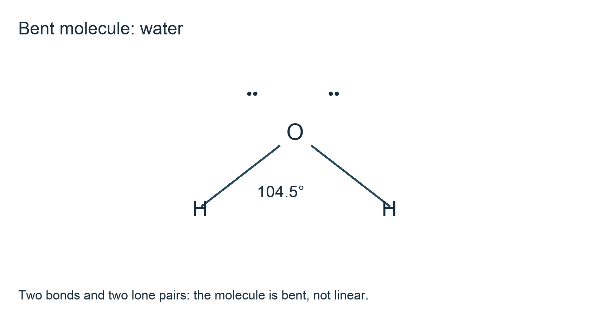
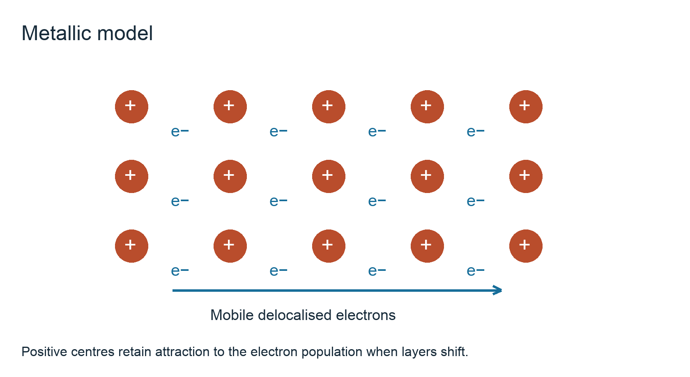
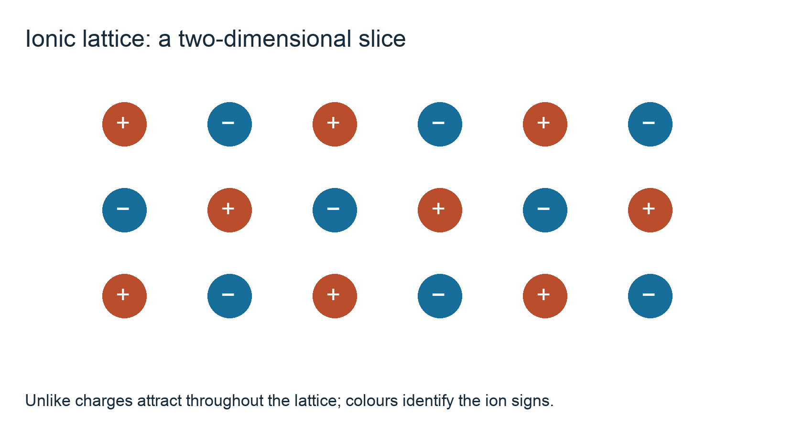
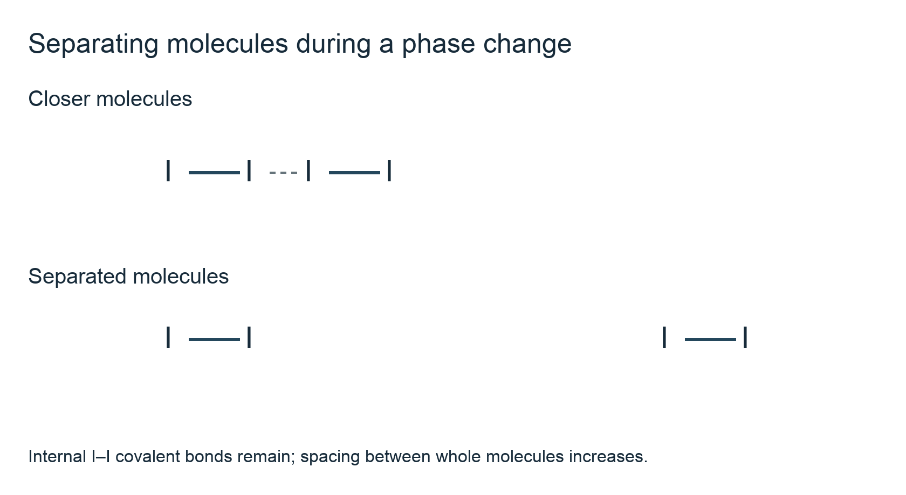

# 1.3 Chemical bonding

*nam-8224-nsscas-2026. Offline study notes, rendered from the approved content units on 2026-10-22. Everything here is also what the flashcards are built from.*

---

## Chemical bonding — 1.3.1

### Electron transfer and the ionic lattice

An ionic compound contains positive and negative ions. To explain its formation, begin with the outer electrons of the atoms and show electron transfer. The resulting oppositely charged ions attract. Electron transfer describes how the ions are obtained in this model; the attraction between the ions is the ionic bonding. Do not define an ionic bond merely as the transfer of an electron.

Sodium has one outer electron and chlorine has seven. Sodium loses one electron to form Na+, while chlorine gains one to form Cl−. A dot-and-cross representation can show the chloride outer shell as four pairs, three pairs of dots and one dot–cross pair: [Cl(••)(••)(••)(•×)]−, alongside [Na]+. Brackets and charges identify ions; the dot and cross record where the electrons came from, not different varieties of electron.

For magnesium oxide, magnesium transfers two electrons to oxygen. Show [Mg]2+ and [O(••)(••)(•×)(•×)]2−. For calcium fluoride, calcium transfers one electron to each of two fluorine atoms. Show one [Ca]2+ with two [F(••)(••)(••)(•×)]− ions. Charge balance gives one Mg2+ for each O2−, but two F− for each Ca2+. A formula must balance total charge, not merely match the number of symbols used in an illustration.

These representations show outer electrons. They are not pictures of isolated NaCl or MgO molecules. In a crystal, each ion is surrounded by other ions in a repeating arrangement. A small dot-and-cross diagram accounts for the electrons and formula ratio; an extended lattice diagram accounts for the bulk structure. Use both descriptions together rather than assuming that the ion which donated an electron is joined exclusively to the ion which received it.

### Why oppositely charged ions stay together

A positive ion attracts a negative ion because their electric charges have opposite signs. A positive ion also repels other positive ions, and negative ions repel other negative ions. An ionic crystal adopts an arrangement in which the overall balance of these interactions is stable. It is therefore incomplete to mention attractions without recognising that a lattice contains many interacting ions.

In a small two-dimensional lattice sketch, place alternating plus and minus signs in rows. This is a slice through an extended solid, not its complete three-dimensional structure. Mark an attraction between a selected positive ion and a neighbouring negative ion. If two like-charged layers are forced into alignment by a displacement, their repulsion helps explain why an ionic solid can fracture instead of bending smoothly.

The attraction is not a shared electron pair. The outer electrons have already been assigned to the ions in the transfer model. Nor is ionic bonding restricted to one direction along a line joining the atoms that initially reacted. Each ion interacts with several neighbouring ions; the crystal's structure and physical properties reflect the collective network of electrostatic interactions.

Compare the charge magnitudes in NaCl and MgO. The ions in MgO have charges 2+ and 2−, whereas those in NaCl have 1+ and 1−. Larger charges can produce stronger attractions at comparable separation. Separation also matters: a comparison of actual lattice strength cannot be made from charge alone if the sizes and arrangements differ. This qualitative charge-and-distance reasoning is useful for discussing trends without pretending that every ionic compound has the same melting point. A complete explanation names the charged particles, the attraction between opposite charges, and the extended arrangement through which the interaction acts.

### From an ionic structure to physical properties

At ordinary room temperature, sodium chloride, magnesium oxide and calcium fluoride are ionic solids. Their ions are arranged in extended lattices. Raising the temperature increases particle motion, but turning such a solid into a liquid requires enough energy to disrupt its ordered ionic structure. Strong attractions between ions therefore help account for relatively high melting temperatures compared with many small molecular substances.

Different ionic solids need different amounts of energy. Ionic charge, ion size and the particular lattice arrangement affect attraction strength. It is reasonable to use a 2+/2− example as a contrast with a 1+/1− example while acknowledging that more than charge changes between real substances. A structural explanation is stronger than a memorised statement that ionic means high melting point: it identifies the attractions that must be overcome.

Solubility requires a separate argument. Water molecules are polar, so their partially negative oxygen ends can interact with cations and their partially positive hydrogen ends with anions. If separating the lattice and surrounding the ions with water is favourable overall, dissolution occurs. Some ionic substances dissolve readily in water; others dissolve only slightly. Sodium chloride and magnesium oxide must not be treated as if the ionic label guarantees identical water solubility.

When interpreting an unfamiliar solid, a high melting temperature and a crystalline appearance support an ionic possibility but do not prove it. Giant covalent substances can also have very high melting temperatures. Add evidence about conductivity in the solid and molten states, and about what happens on dissolution. This combination links the proposed particle arrangement to several observations. It also prevents one property, such as water solubility, from being used as an infallible classification test.

### Conductivity depends on moving charge

For electrical conduction, charge carriers must be able to move through the material. Ionic compounds contain charged particles, but the presence of charge is not enough by itself. In a solid ionic lattice the ions remain around fixed positions and cannot migrate through the solid to carry a sustained current. The solid is therefore a poor electrical conductor in the simple model used here.

On melting, the ordered lattice breaks down into a liquid in which ions can migrate. Positive ions move in one direction under the applied electrical influence and negative ions in the other. Their movement transports charge through the liquid, so the molten compound conducts. Do not replace this explanation with a claim that electrons have become free as they do in a metal: ions are the charge carriers in this comparison.

If the substance dissolves in water and produces separated, mobile ions, the solution can also conduct. The necessary qualifications are dissolution and ion mobility. An undissolved insoluble ionic solid sitting in water does not make the same contribution as an appreciable concentration of dissolved ions. The solution's conductivity also depends on how many mobile ions are present, so two solutions need not conduct equally strongly.

A useful state comparison is therefore: fixed ions in the solid, mobile ions in the melt, and mobile solvated ions when an ionic solute dissolves. In a model answer, state the particle type as well as whether it can move. This distinguishes the explanation from metallic conduction, where delocalised electrons carry current. It also distinguishes an ionic solution from a molecular solute such as sugar, which can dissolve without supplying a comparable population of ions.

---

## Chemical bonding — 1.3.2

### Shared pairs and donated pairs

In a covalent bond, a shared pair of electrons is attracted to both bonded nuclei. A dot-and-cross diagram distinguishes the starting contributions without implying that electrons retain separate identities after bonding. Use • for one atom's original electrons and × for the other's. A single bond can then be shown as H(•×)H. Chlorine has the same single shared pair between its atoms, with three lone pairs around each chlorine.

Oxygen uses two shared pairs in O2, with two lone pairs on each atom. Nitrogen uses three shared pairs in N2, with one lone pair on each. In HCl, put one shared pair between H and Cl and three lone pairs around Cl. Carbon dioxide is O=C=O: two shared pairs in each C=O bond and two lone pairs on each oxygen. Methane has four C–H shared pairs and no carbon lone pair. Ethene has a C=C double bond and four C–H single bonds. Check every outer-electron total instead of drawing unlabelled lines as if they were a complete dot-and-cross representation.

A dative, or co-ordinate, covalent bond starts with both electrons supplied by one atom. In NH3 + H+ → NH4+, nitrogen donates its lone pair to the proton; in H2O + H+ → H3O+, oxygen donates a lone pair. Draw a donor-to-acceptor arrow when explaining formation. Once formed, the new N–H bond in ammonium is not a separate weak intermolecular attraction.

For CO, the Lewis count uses ten outer electrons: three shared pairs and one lone pair on each atom. A donation description can account for one shared pair from oxygen. The syllabus also requires Al2Cl6: two AlCl3 units are connected through two bridging chlorine atoms, each providing a lone pair towards an electron-deficient aluminium centre. The donor arrow runs from a chlorine lone pair towards aluminium; reversing it would reverse the donor and acceptor.

Representation cross-links: Topic 1.1 distinguishes molecular and empirical formulae; Topic 4.1 compares structural condensed, displayed and skeletal formula representations. A displayed drawing includes bonds explicitly; a molecular formula gives composition without specifying all connections.

### Electron regions, molecular shapes and angles

Count the electron-density regions around the central atom before naming a shape. A single bond is one region; a double or triple bond is also treated as one region for the basic geometry. Lone pairs count as regions too. The regions repel and adopt a spatial arrangement that reduces their repulsion. The molecular shape names the positions of the atoms, rather than the positions of lone pairs.

CO2 has two regions around carbon and no central lone pair, giving a linear molecule with a 180° angle. BF3 has three bonding regions and is trigonal planar, with 120° angles. CH4 has four bonding regions in a tetrahedral arrangement, with angles close to 109.5°. Five bonding regions give PF5 a trigonal bipyramidal shape: three equatorial bonds at 120°, and two axial bonds at 90° to the equatorial plane and 180° to each other. Six give SF6 an octahedral shape, with neighbouring bonds at 90° and opposite bonds at 180°.

NH3 and H2O both have four electron regions, but their molecular shapes differ from methane. NH3 has three bonds and one central lone pair, so it is trigonal pyramidal, with H–N–H angles about 107°. H2O has two bonds and two lone pairs, giving a bent or V-shaped molecule with an angle about 104.5°. Lone pairs exert greater repulsion on neighbouring bonding regions in this qualitative model.

A diagram must communicate three-dimensional arrangement. A flat cross is not an adequate drawing of tetrahedral methane. Use solid wedges for bonds pointing towards the viewer and dashed bonds for those pointing away, with ordinary lines for bonds in the page. Label central lone pairs where they explain the difference between electron-region arrangement and atom positions.

### Using the model on a new species

The examples provide a method rather than a list of unrelated shapes. For an unfamiliar species, identify the central atom and count its outer-electron contribution. Include electrons added by a negative charge or removed by a positive charge when constructing the full electron diagram. Establish the bonded atoms and remaining lone pairs, then count electron-density regions around the centre.

Ammonium, NH4+, contains four N–H bonds and no nitrogen lone pair after the donated pair has formed the additional bond. It therefore resembles methane in its electron-region count and tetrahedral molecular shape, with angles close to 109.5°. It does not retain ammonia's pyramidal shape simply because ammonia supplied the starting nitrogen atom. The species after bonding must be counted afresh.

Hydronium, H3O+, contains three O–H bonds and one oxygen lone pair. Its four electron regions lead to a pyramidal arrangement of atoms. Do not claim an exact angle merely by copying the ammonia value; the analogous model gives the broad shape, while actual angles depend on the particular species. For a simple molecule with two bonds and two central lone pairs, the same reasoning predicts a bent shape rather than a linear arrangement.

An explanation should connect the count to the geometry: state the number of bonding regions, state the number of lone pairs, and then name or draw the molecular shape. If only a shape name is supplied, an incorrect electron count can remain hidden. Drawings also need clearly labelled atoms and any relevant lone pairs. Use the examples to transfer the reasoning while avoiding unsupported numerical precision for a molecule whose angle has not been supplied.

### Covalent does not identify one structure type

A substance can contain strong covalent bonds while melting or boiling at a relatively low temperature. The explanation depends on its structure. In a simple molecular substance, covalent bonds hold atoms together inside each molecule. Separate molecules attract one another through intermolecular forces. A phase change that separates the molecules can overcome those intermolecular attractions while leaving the internal covalent structure intact.

Hydrogen, methane and carbon dioxide are examples of discrete molecules. Their low-temperature phase changes do not mean that their internal covalent bonds are weak. Diamond and silicon dioxide instead contain extended covalent networks. There are no small independent diamond molecules to separate during melting, so disrupting the structure requires covalent bonds in the network to be broken. The covalent label must therefore be combined with a statement about molecular or giant structure.

Solubility is also structure- and solvent-dependent. A polar molecular solute can interact favourably with water, and some molecular substances dissolve well. Others do not. Many non-polar molecular substances dissolve more readily in suitable non-polar solvents. Giant covalent networks are generally insoluble in ordinary solvents because dissolving them would require disrupting an extended bonded structure rather than separating intact molecules.

Electrical conductivity requires its own carrier argument. A pure simple molecular substance generally lacks mobile ions and delocalised electrons. An aqueous molecular solute may nevertheless react to form ions, as hydrogen chloride does in water. The resulting conducting solution does not prove that the original gas consisted of an ionic lattice. State which phase and which particles your explanation describes before inferring a bonding model.

---

## Chemical bonding — 1.3.3

### What electronegativity describes

Electronegativity is the ability of an atom to attract the electrons in a covalent bond towards itself. The definition concerns a bonded atom and a shared pair. It is not the same quantity as an isolated atom's charge, and it is not a direct measure of atomic mass. When two bonded atoms have the same electronegativity, the sharing is equal in the simple model. When their electronegativities differ, the shared electron density is drawn more towards one end of the bond.

In HCl, chlorine attracts the bonding pair more strongly than hydrogen. Chlorine is assigned a partial negative charge, δ−, and hydrogen a partial positive charge, δ+. The delta marks are important: the molecule contains a polar covalent bond, rather than a fully separated H+ and Cl− ion pair in a gas-phase ionic lattice. Partial charge reflects an uneven distribution within the bond.

An electronegativity difference is therefore useful for identifying the direction of bond polarity. If a hypothetical bonded pair has values 2.1 and 3.0 on the same scale, the atom at 3.0 attracts the pair more strongly. The numerical difference is 0.9, but converting that difference into a categorical claim of perfectly ionic or perfectly covalent bonding would overstate a simplified guideline. Actual bonding lies along a continuum of electron distribution.

Use electronegativity to explain where the shared electrons are drawn, then connect that distribution to the property being discussed. It does not by itself give the shape of the molecule, its total dipole moment, or a guaranteed melting point. Those questions also need the arrangement of the bonds or the attractions between particles.

### Bond dipoles and whole-molecule polarity

A bond dipole describes an uneven charge distribution along one bond. A molecular dipole describes the resultant of the bond dipoles throughout a molecule. Direction matters. Equal polar bonds placed symmetrically can cancel, while polar bonds in an asymmetric arrangement can give a net molecular dipole. A molecule therefore cannot be labelled polar merely by finding one polar bond and ignoring its geometry.

Carbon dioxide has two polar C=O bonds arranged in a straight line. Their dipoles have equal magnitudes and opposite directions, so the molecule has no net dipole in this model. Water has polar O–H bonds in a bent arrangement. The two bond dipoles do not oppose one another along a single straight line, so water has a net dipole. The comparison separates a bond-level statement from a molecule-level statement.

The same care is needed for reactions with water. Hydrogen chloride molecules contain polar covalent bonds before dissolution. In water, proton transfer produces hydronium and chloride ions, explaining why the solution conducts. A gas molecule's bonding and the particles present after reaction are different stages of the explanation. Some covalent oxides react with water to form acidic solutions, while strongly basic ionic oxides can react with water to produce hydroxide-containing solutions. Others are poorly soluble or relatively unreactive. Bond polarity can help explain interactions, but it is not a standalone test guaranteeing an oxide's water reaction.

When given a new molecule, first identify the more electronegative end of each bond. Next use the three-dimensional shape to decide whether the bond dipoles cancel. Finally state the resulting overall polarity. If discussing an aqueous observation, identify whether the original molecules remain intact or have reacted to form different species.

---

## Chemical bonding — 1.3.4

### Name the particles on each side of an attraction

Intramolecular means within a molecule. The C–H covalent bonds in methane are intramolecular: each shared electron pair attracts the carbon and hydrogen nuclei within the same CH4 unit. Intermolecular means between molecules. The attractions between one methane molecule and another act across the space separating two complete molecular units. A useful diagram labels the intact molecules first and the between-molecule attraction second.

Heating liquid methane to its boiling temperature separates methane molecules into the gas phase. The product is methane gas, not a mixture of isolated carbon and hydrogen atoms. The chemical formula of each molecule remains CH4 because the ordinary boiling process has not broken the C–H covalent framework. Confusing these two scales leads to an incorrect account of why small molecular substances can boil relatively easily.

A solid molecular crystal also contains both scales of interaction. In solid iodine, strong covalent bonds join pairs of iodine atoms into I2 molecules. Attractions between neighbouring I2 units organise the solid. Naming only the intermolecular attractions would omit the bonding inside the molecules. Naming only covalent bonds would omit the interactions that explain why those molecules form a condensed phase.

Use precise language when interpreting a question. If asked for the bonding within a molecule, identify covalent sharing and the bonded atoms. If asked what is weakened during boiling, discuss attractions between intact molecules. A force diagram can use a solid line inside each molecule and a dotted line between molecules, with a key distinguishing their meanings. The symbol choice is a convention; the essential distinction is which particles it connects. This way of describing structure will be reused for hydrogen bonding, molecular polarity and changes of state.

### Comparing ionic attractions with molecular attractions

An ionic lattice contains particles with full net electric charges. A simple molecular substance contains neutral molecules whose internal charge distributions can fluctuate or be uneven. Attractions between the fully charged ions in typical ionic crystals are much stronger than those between the small molecules used in introductory comparisons. That difference helps explain why sodium chloride is a solid at room temperature while methane is a gas.

The comparison concerns the attractions that must be disrupted to change the bulk structure. In sodium chloride, separating the lattice involves ions that attract several neighbours. In methane, separating molecules mainly opposes the much weaker attractions between intact CH4 units. It is not necessary to break all the C–H covalent bonds to vaporise methane, so comparing the C–H bond strength directly with an ionic lattice misses the relevant process.

Charge magnitude and separation affect electrostatic attraction. An ionic compound with 2+ and 2− ions can differ markedly from one with 1+ and 1− ions. Molecular size, shape and polarity also affect the total intermolecular attraction. A high-level comparison is therefore a trend for appropriate examples, rather than a numerical rule assigning one fixed strength to every ionic or molecular substance.

Suppose two unfamiliar solids are compared. One melts only at a high temperature and its liquid conducts electricity. The other vaporises readily and its pure liquid does not conduct. An ionic lattice is a plausible account of the first because it combines strong attractions with mobile charged particles after melting. A molecular structure is plausible for the second because molecules can separate without creating a conducting ionic liquid. Both observations are needed to support the structural inference.

### Why boiling is different from decomposition

The strength of a covalent bond within a molecule is not measured by that substance's boiling temperature alone. Water can boil while its H2O units remain chemically intact. Breaking an O–H covalent bond would change the molecular species. Separating one water molecule from its neighbours does not require the same operation, even though energy is needed for both processes.

This distinction can be made concrete by comparing products. After ordinary boiling and condensation, pure water is still water. If a process actually breaks and rearranges covalent bonds to form hydrogen and oxygen, a chemical transformation has occurred. The identity of the products gives information about whether intramolecular bonding has changed. Do not infer bond breaking merely because bubbles appear during heating; bubbles can be the substance's own vapour.

The typical intermolecular interactions between small covalent molecules are weaker than the bonds within them. Consequently, a temperature sufficient to overcome enough between-molecule attraction for boiling need not be sufficient to decompose the molecules. The molecules still experience rapid motion and collisions in the vapour, but their persistent internal structure explains why molecular formulae remain meaningful in that phase.

In an energy explanation, identify the initial and final particle arrangement. For a liquid-to-gas change, initially close molecules become more separated. For a bond-breaking chemical change, the connections between atoms change. An answer that says only 'energy breaks bonds' fails to tell the reader which of these processes is meant. Name the covalent bond if it is actually broken, or name the between-molecule attraction if intact molecules are being separated. This precise particle-level description is more informative than calling one process easy and the other difficult.

### Explaining several properties without one blanket rule

Volatility describes how readily a substance enters the vapour phase. For comparable simple molecular substances, weaker attractions between the molecules generally mean that separation into vapour requires less energy. A more volatile liquid often has a lower boiling temperature at the same external pressure. State the comparison and pressure assumption rather than treating boiling temperature as independent of the surroundings.

An ionic solid behaves differently because its condensed structure is an extended charged lattice. Consider a sample that remains solid on gentle heating, and another that readily gives a molecular vapour. A model based on strongly attracting ions is consistent with the less volatile solid; a model based on weakly attracting molecules is consistent with the more volatile sample. This is a structural explanation of the trend, rather than a claim that all covalent materials are volatile. A giant covalent network has no small molecular units to evaporate in the same way.

Solubility depends on the solvent too. A polar solvent can interact with ions or polar molecules, while suitable non-polar solvents can dissolve non-polar molecular solutes. These are useful tendencies, but actual dissolution depends on the balance between interactions disrupted and formed. An ionic label does not guarantee water solubility, and a covalent label does not guarantee insolubility.

For conductivity, ask whether charge can move. Ions fixed in a solid do not migrate through it; ions in a melt can. Neutral molecules do not provide the same carriers as an ionic melt. Metals and some extended carbon structures conduct by electrons instead. To explain a set of physical observations, choose the relevant mechanism for each observation: attractions for volatility and phase changes, solute–solvent interactions for dissolution, and mobile charge carriers for electrical conduction.

### Three intermolecular interactions used in this topic

An electron cloud is not a motionless, perfectly balanced object. At an instant its distribution can be uneven, producing an instantaneous dipole. This unevenness can influence a neighbouring electron cloud and induce a dipole there. The resulting induced-dipole attractions are often called dispersion or van der Waals forces in this syllabus. They occur even between non-polar molecules and between noble-gas atoms.

A molecule with a permanent dipole has an enduring uneven charge distribution associated with its bonds and shape. Neighbouring polar molecules can orient so that partial positive and partial negative regions attract. These permanent dipole attractions occur alongside dispersion forces; a polar molecule does not cease to have a fluctuating electron cloud. When comparing substances, consider the combination of relevant interactions.

Hydrogen bonding is a particularly strong kind of directional intermolecular interaction in the examples required here. A hydrogen already covalently bonded to N, O or F is strongly polarised. It can interact with a lone pair on a suitable N, O or F atom of another molecule. For water, the between-molecule interaction can be written O–H···O, where the solid O–H connection is covalent and the dotted H···O connection is the hydrogen bond.

Methane contains hydrogen but does not hydrogen-bond between its own molecules in this model because its hydrogens are bonded to carbon, not N, O or F. The presence of the word hydrogen in a formula is therefore insufficient. Check both the attached atom and the accepting lone pair. For water, ammonia and hydrogen fluoride, name the donor bond and accepting atom explicitly when identifying the interaction.

### Applying the interactions to actual particles

Noble gases consist of individual atoms rather than covalently bonded molecules. Their atoms can still attract through instantaneous and induced dipoles. Down the group the electron clouds become larger and more easily distorted, so dispersion attractions generally become stronger. More energy is then required to separate the atoms, helping explain the increasing boiling temperatures in that comparison.

Bromine is a non-polar diatomic substance. Its Br2 molecules have sizeable electron clouds, and their dispersion attractions are sufficient for liquid bromine to exist at room temperature. The absence of a permanent molecular dipole does not mean that there are no attractions. It means that the explanation must use induced dipoles rather than inventing a permanent polar bond between identical bromine atoms.

HCl is polar because its two atoms attract the shared pair unequally. CHCl3 is also polar as a molecule and has a much larger electron cloud than HCl. Permanent dipole attractions and dispersion both contribute. CHCl3 is a liquid at room temperature while HCl is a gas, illustrating why simply counting the kinds of forces present is not a complete numerical strength comparison. Molecular size and shape still matter.

Ammonia and water add hydrogen bonding to the description because they contain N–H and O–H bonds respectively and suitable lone pairs. Compare these with methane, which has only the dispersion interaction between its molecules in this introductory account. A sound explanation names each particle first, identifies which interactions it can form, and then uses electron-cloud size, polarity or hydrogen bonding to support a stated physical-property comparison. It does not assign one identical force strength to every member of a broad category.

### What is disrupted in each structural model

A giant covalent solid is an extended network of bonded atoms. There is no collection of small independent molecules waiting to move apart when it melts. Disrupting its solid structure therefore requires covalent connections within the network to be broken or rearranged. This accounts for the large energy requirement and the high-temperature changes associated with such materials.

A simple molecular solid instead consists of discrete molecules held in an ordered arrangement by intermolecular attractions. Melting changes that arrangement so the molecules can move relative to one another. Boiling separates them more extensively into the gas phase. The internal covalent framework can survive both changes. For iodine, an explanation should distinguish I–I bonding inside each I2 molecule from attractions between different I2 units.

This distinction also prevents an incorrect explanation of carbon allotropes. Diamond and graphene contain extended covalent connections, whereas C60 is a discrete molecular cage. The covalent bonds inside a C60 cage can be strong while the forces between separate cages are much weaker. Comparing the phase behaviour requires identifying which connections are being disrupted, rather than using the element name carbon as if it implied one structure.

If given a particle diagram, locate the boundaries of any independent units. A diagram showing separate bonded clusters suggests a molecular model. A repeated connected structure with no small-unit boundary suggests a network. Then state what heating must do to that model. This reasoning supports a high or low phase-change temperature without confusing internal bonding with forces between whole molecules. It also provides a way to challenge a memorised classification when the diagram itself shows a different arrangement.

### A relative-strength statement needs a comparison

Hydrogen bonding is the strongest of the three named intermolecular interaction types in the small-molecule comparisons emphasised here. This is a useful qualitative hierarchy: an appropriate hydrogen bond is stronger than an ordinary permanent dipole interaction or a small dispersion interaction considered individually. It is still much weaker than a typical covalent bond within the molecule.

The hierarchy should not be turned into the claim that every hydrogen-bonded liquid must boil above every liquid without hydrogen bonds. A large molecule can have many substantial dispersion interactions. Its total attraction to neighbouring molecules depends on the size and shape of the interacting surfaces as well as the interaction types. Consequently, comparisons should use suitable related molecules or enough information about the whole structure.

In water, label an O–H bond within one molecule as covalent. Label an attraction from that hydrogen towards an oxygen lone pair on another molecule as a hydrogen bond. These connections involve different pairs of particles and have different strengths. Breaking the between-molecule interaction during boiling does not require breaking the internal O–H bond. The water molecules can therefore separate while remaining H2O.

When asked to contrast the two, state both the location and the strength comparison. A phrase such as 'hydrogen is strongly bonded' is ambiguous because it does not identify which connection is meant. Use O–H for the intramolecular bond and O–H···O for the intermolecular arrangement, with a key explaining the dots. This retains the distinction even when the same hydrogen atom participates in both descriptions. The model connects diagram notation directly to the energy argument for physical changes.

### Hydrogen bonding and bulk behaviour

Water molecules can connect to several neighbours through hydrogen bonds. Separating them into vapour requires energy to overcome this between-molecule cohesion, contributing to water's relatively high boiling temperature for such a small molecule. Hydrogen fluoride, ammonia and methanol also form hydrogen bonds through their F–H, N–H or O–H groups. Methane does not form the corresponding interaction between its own molecules, so it provides a useful contrast for discussing the role of hydrogen bonding.

The comparisons require care. Ammonia, water and hydrogen fluoride do not have identical hydrogen-bond networks. Their numbers of donor hydrogens and accepting lone pairs differ. Molecular size and other interactions also contribute to physical properties. Use hydrogen bonding as a reason within a supported comparison rather than as a universal numerical formula for boiling or melting temperature.

Ice illustrates an effect on structure as well as attraction strength. Its hydrogen-bonded arrangement is relatively open. When ice melts near its ordinary melting temperature, the liquid can adopt a less open average arrangement even though many hydrogen bonds still exist and continually change. Ice is therefore less dense than liquid water near freezing and floats on it. Melting does not eliminate every hydrogen bond or break every O–H covalent bond.

Liquid cohesion also helps explain surface tension: molecules at a surface experience a different balance of attractions from those surrounded by neighbours. Viscosity concerns resistance to flow and can increase when intermolecular interactions impede molecules moving past each other. Temperature changes molecular motion, so viscosity and surface tension should not be compared without considering temperature. Methanol's hydrogen bonding contributes to its liquid behaviour, but its carbon-containing portion and molecular size also matter. An explanation should connect the particular structure to the particular property instead of treating all hydrogen-bonded substances as interchangeable.

---

## Chemical bonding — 1.3.5

### A metallic structure contains mobile electrons

In a simple metallic model, positive metal centres occupy an extended lattice and outer electrons are delocalised through the structure. Metallic bonding is the electrostatic attraction between these positive centres and the delocalised electrons. The whole piece remains electrically neutral because its positive and negative charges balance; a metal is not a solid block carrying an overall positive charge.

The phrase positive ions is a model description of the metal centres after the outer electrons have been treated as delocalised. It does not mean that separate negative ions are arranged between the metal centres as in sodium chloride. The negative charge is associated with a mobile electron population spread through the material. Distinguishing the carrier type is important when explaining why a solid metal conducts while an ordinary solid ionic lattice does not.

A structural sketch can show rows of positive circles with electron symbols distributed between them. Label the circles as positive metal centres and the negative symbols as delocalised electrons. A key is more useful than relying on a decorative sea metaphor without explaining what it represents. The sketch is a model of an extended metallic structure, not the detailed electron arrangement of a single isolated atom.

The attraction acts throughout the structure and is not restricted to a fixed pair of neighbouring atoms. This helps account for why a change in the relative positions of the centres need not destroy all the bonding. The same model connects electron mobility to electrical conduction and the extended attraction to cohesion. Different metals have different charge densities, arrangements and electron involvement, so the model does not assign them one identical melting temperature.

### Conducting, bending and melting a metal

Electrical conduction through a metal is carried by delocalised electrons that can move through the structure. Applying an electrical influence produces a net electron movement. The positive metal centres do not need to migrate from one end of a solid wire to the other. This is why a solid piece of copper can conduct even though its bulk lattice remains in place.

Malleability is the ability to be shaped into sheets; ductility is the ability to be drawn into a wire. In the simple metallic model, layers of metal centres can change position while remaining attracted to the delocalised electrons. The attraction is not a set of rigid directional links that must all break when the layers move. Contrast that with an ionic lattice displaced until like charges face one another, where repulsion can promote fracture.

Melting a metal requires energy to disrupt its ordered solid arrangement. The amount varies from metal to metal because the strength of attraction and the structure are not identical. Copper's metallic model therefore supports conduction and deformability, but the word metal alone does not give an exact melting point or prove that a substance is solid at every temperature. A physical-property argument should name the material and state under what temperature range or physical state it is being considered.

When interpreting a sketch, identify which particles are mobile for the property in question. For current in a solid wire, identify electrons. For deformation, describe changing metal-centre positions while cohesion persists. For melting, discuss the energy needed to disrupt ordered attraction. These are related consequences of the same model, but one sentence about free movement is not a complete explanation of all three.

---

## Chemical bonding — 1.3.6

### Reading the structural unit in a crystal

A crystalline solid contains a repeating arrangement of particles. The identity of the particles and the connections between them determine the structural model. In sodium chloride and magnesium oxide, the repeating particles are oppositely charged ions. In iodine, they are I2 molecules with covalent bonds inside each molecule and weaker attractions between molecules. In copper, positive metal centres are associated with delocalised electrons.

Diamond contains carbon atoms each covalently connected to four others in a three-dimensional network. Silicon dioxide also forms an extended network, with silicon and oxygen connected throughout the solid rather than forming separate small SiO2 molecules. Graphite contains sheets in which each carbon is covalently joined to three neighbours; there are weaker attractions between sheets and electrons that can be delocalised within the extended arrangement. Graphene is one such sheet, so it must not be described as several layers sliding past each other.

The NSSCAS syllabus groups C60 and carbon nanotubes under its fullerene/molecular examples. Each C60 unit is a discrete cage of 60 covalently bonded carbon atoms. A nanotube is a long cylindrical covalent carbon unit, with weaker attractions between separate tubes. Preserve the syllabus grouping while distinguishing strong bonds within a cage or tube from attractions between separate units. A tube's extended length does not turn the attractions between tubes into the covalent bonds of a continuous three-dimensional diamond network.

Ice is molecular but has a particularly organised hydrogen-bonded arrangement between its water molecules. The molecules remain internally covalent. A structural explanation should therefore state both the nature of the individual units and the connections between them. A picture of repeating circles without a key is insufficient: circles might mean atoms, ions or entire molecules. Label the represented particles and the attraction or bond that links neighbouring units before using the drawing to explain a property.

### Relating energy input to a change of state

A change-of-state explanation starts with the structural model. For an ionic crystal, melting disrupts the ordered arrangement of ions against their electrostatic attractions. For a metal, it disrupts the ordered arrangement held by metallic attraction. For a giant covalent network, extensive covalent connections must be disrupted. For a simple molecular solid or liquid, the relevant change separates or rearranges whole molecules against their intermolecular attractions.

These different processes account for broad differences in temperature and energy requirement. Small molecular substances often change state at lower temperatures than ionic or giant covalent solids. Stronger between-molecule attractions can raise a molecular substance's boiling temperature without converting it into a giant network. Water is a useful example: hydrogen bonding influences boiling while H2O remains the molecular unit in the vapour.

Do not compare temperatures without considering pressure or the possibility of decomposition. A quoted temperature is an observation under specified circumstances, rather than a complete definition of bonding type. A giant structure may undergo chemical change or sublimation before an ordinary liquid is obtained at a particular pressure. The basic model remains useful because it asks what kind of connection would have to change, rather than assuming that every solid follows one experimentally identical melting process.

For an unfamiliar substance that requires substantial heating to lose its solid structure, identify at least two plausible extended models and seek additional evidence. Conductivity while solid, conductivity after melting, hardness and solubility can narrow the possibilities. This prevents the statement 'high melting point means ionic' from replacing the full particle argument. An energy explanation is complete when it names both the interacting particles and the attraction or covalent connection whose disruption requires the input.

### Choosing the carrier and the interaction together

An explanation of physical properties must combine structure with the type of movement or separation involved. Diamond's three-dimensional network gives strong cohesion and hardness, but its electrons are held in localised bonding in the simple model, so it does not conduct electricity in the way graphite does. Graphite has strong covalent sheets and electrons that can move within that extended structure. It can conduct while the solid remains intact.

The layers in graphite can move relative to one another because the between-layer attractions are much weaker than the covalent connections within a sheet. Its softness in this sense does not mean that the carbon–carbon bonds throughout each sheet are weak. Graphene is an individual sheet, so explanations of its behaviour should refer to that sheet's extended bonding rather than to a stack of layers. Nanotube behaviour also depends on its extended carbon framework and particular structure; it is not evidence for a small, weakly bonded molecular unit.

An ionic compound offers a different combination. Strong attractions give a cohesive lattice, but the fixed ions do not carry current through the ordinary solid. Melting gives ion mobility and conductivity. A metal conducts in the solid through delocalised electrons, while a simple molecular solid generally lacks either kind of mobile carrier. Hydrogen bonding can strengthen molecular cohesion without supplying a metallic electron population.

Use a table of observations to identify the explanation needed in each column. State the carriers for conductivity, the connections for hardness or deformability, and the interactions disrupted during heating. It is acceptable for one substance to combine a high phase-change temperature with solid conductivity or for another to combine water solubility with non-conducting pure liquid behaviour. The combination of mechanisms, rather than a single classification slogan, explains the observed set.

### Deducing a structure from a set of observations

Begin a structure deduction by recording the observations exactly. A solid might have a high melting temperature, fail to conduct as a solid, and conduct when molten. The combination suggests an ionic lattice: strong attractions explain the heating requirement, fixed ions explain solid non-conduction, and mobile ions explain conduction after melting. The conclusion is supported by the whole set rather than just the melting temperature.

A different sample might conduct while solid and be readily bent into a thin sheet. A metallic model is plausible because it supplies mobile electrons and an extended attraction that persists during deformation. A third might vaporise readily and fail to conduct in its pure liquid state, supporting a simple molecular model with relatively weak between-molecule attractions and no appreciable mobile charge population.

Some cases remain ambiguous without another test. A very high melting temperature and non-conduction as a solid could fit both an ionic crystal and a giant covalent network. Information about the molten state or a carefully interpreted solubility test can help. Graphite shows why solid conductivity alone does not prove metallic bonding. It is an extended covalent structure that can conduct, so a deduction should remain tied to the specific evidence supplied.

When drawing the proposed structure, include the evidence-relevant feature. For an ionic model, show labelled positive and negative ions in a repeating arrangement. For a metal, show positive centres and delocalised electrons. For a molecular substance, show distinct bonded units separated by weaker attractions. The drawing is a model that makes the explanation inspectable. State a limitation if the data do not uniquely identify one structure, and identify the additional observation that would distinguish the alternatives. This is a supported inference rather than an unsupported guess from one familiar property.
