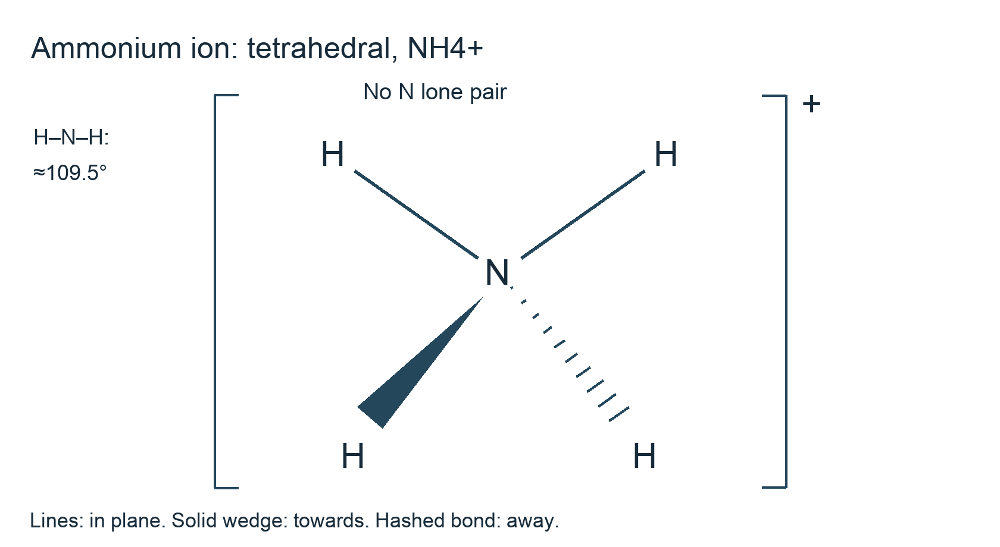

# 3.5 Nitrogen and Sulfur

*nam-8224-nsscas-2026. Offline study notes, rendered from the approved content units on 2026-10-22. Everything here is also what the flashcards are built from.*

---

## Nitrogen and Sulfur — 3.5.1

### Ammonia, ammonium and proton transfer

Ammonia has three N–H bonds and one lone pair on nitrogen. It is a Brønsted–Lowry base because it accepts a proton. Nitrogen donates its lone pair to H+, forming NH4+. The donated pair makes a co-ordinate covalent bond in the formation description; after formation the four N–H bonds in the ammonium ion are equivalent rather than one being a permanently different weak attachment.

The ammonium ion is tetrahedral, with four bonding pairs and no lone pair on its central nitrogen. Its bond angles are approximately 109.5°. Draw brackets and the overall positive charge. Nitrogen has not acquired an extra electron from the proton: H+ contributes no electron, so the new shared pair comes from nitrogen. The valence count in NH4+ is five from nitrogen plus four from hydrogen minus one for the positive charge: eight electrons in four shared pairs. Topic 1.3 explains the electron-pair geometry.

In water, NH3(aq) + H2O(l) ⇌ NH4+(aq) + OH−(aq). Only part of the ammonia reacts in the weak-base model, and the hydroxide concentration makes the solution alkaline. Ammonia does not need an OH group in its original composition to act as a base. It accepts a proton from water, leaving OH−.

Adding a strong base to an ammonium salt reverses the proton-transfer role: NH4+(aq) + OH−(aq) → NH3 + H2O(l). Warming can help release NH3 gas from the mixture. For example, NH4Cl(aq) + NaOH(aq) → NH3(g) + NaCl(aq) + H2O(l) under the stated warming. Damp red litmus turns blue in a suitable ammonia-gas test. Do not explain this as oxidation of nitrogen: it remains −3 in NH3 and NH4+. The change is transfer of a proton, and the equation gives one mole of ammonia per mole of ammonium ion used.

### Why soils lose nutrient elements

Growing plants take up nutrient elements including nitrogen, phosphorus and potassium. When crops are harvested and removed, some of those elements leave the field in the crop material. Repeated farming can therefore deplete an available nutrient supply unless it is replenished. A plant does not create a nutrient element from water simply because its mass increases.

Leaching is a separate loss pathway. Water moving through soil can dissolve and transport nutrient-containing species below the root zone or into drainage. Highly soluble nitrate can move readily in this way. The process depends on water movement, nutrient form, soil retention and plant uptake; a dry period and a heavy-rainfall period need not give equal losses from the same field.

Phosphorus and potassium are also removed by harvest, but their soil species do not necessarily leach as readily as nitrate. Phosphate can interact strongly with soil solids, and potassium can be retained by some soil surfaces. Losses can still occur depending on soil composition, dissolved transport and movement of soil particles. Do not interpret “NPK depletion” as evidence that all three elements have identical water solubility or travel in the same ions.

For an original inventory, a field that loses 20.0 mol of a nutrient in harvested material and 5.00 mol through drainage has lost 25.0 mol through those two measured pathways. That total does not include an unmeasured process automatically. A fertiliser comparison should consider which nutrient is deficient and what reaches the roots, rather than merely choosing the largest product mass. This links the chemistry of soluble species to the soil application without inventing a recommended dose for a particular Namibian farm.

### Abundant nitrogen is not automatically available nitrogen

Nitrogen gas is abundant in air, but the N2 molecule is relatively unreactive under ordinary room-temperature settings. Its atoms are joined by a strong triple covalent bond. Chemical changes that rearrange this stable molecule often face a large activation barrier. The abundance of nitrogen in the atmosphere therefore does not guarantee that a crop can use it directly.

Industrial ammonia manufacture converts nitrogen and hydrogen into ammonia: N2(g) + 3H2(g) ⇌ 2NH3(g). A catalyst and suitable temperature and pressure give a useful production rate while recognising the exothermic reaction's equilibrium limit. The purpose of the process here is to convert atmospheric nitrogen into a form that can be used to make fertiliser compounds. Topic 2.3 explains why low temperature favours the equilibrium product but does not by itself give a useful industrial rate.

Ammonia can react with acids to form ammonium salts. For example, 2NH3 + H2SO4 → (NH4)2SO4. These products supply chemically accessible nitrogen rather than expecting N2 gas to react readily in the soil by the same uncatalysed industrial pathway. Biological nitrogen fixation can also convert atmospheric nitrogen into usable compounds; the existence of that specialised route does not make ordinary N2 chemically reactive in every setting.

An explanation of fertiliser manufacture should connect bond stability, difficulty of direct reaction and conversion into suitable compounds. Saying “plants need nitrogen” identifies the nutrient role but leaves out why industrial conversion is useful. Saying “nitrogen has a triple bond” names a structure but should also connect it to strong bonding and the reaction barrier. The industrial catalyst changes the pathway and approach rate, while the overall atom balance still requires one N2 for two NH3.

### Tracking nitrogen through different forms

Use the oxidation-number rules from Topic 2.2 to track the specified nitrogen species. In NH3, three hydrogens at +1 require nitrogen −3. In uncombined N2, nitrogen is zero. In NO3−, three oxygens at −2 require nitrogen +5. These values refer to the nitrogen atoms, not the overall charge of each molecule or ion.

For N2O, oxygen contributes −2 and the molecule is neutral. The two nitrogen atoms therefore contribute +2 together, giving an average oxidation number of +1. This average does not claim that the two chemically different positions in the actual molecule must have identical local electronic descriptions. It is the whole-molecule accounting value requested for this comparison.

Fixing N2 into ammonia takes nitrogen from 0 to −3 and is reduction. Conversion of reduced nitrogen into nitrate raises its oxidation number towards +5 and is oxidation. Processes that return nitrate nitrogen to N2 lower the value from +5 towards 0 and are reductions; N2O can occur among gaseous nitrogen-containing forms in the cycle. Different biological and chemical steps carry out the transformations rather than a single universal reaction in one vessel.

Follow the direction before assigning a redox label. NH3 to NO3− is an increase of eight oxidation-number units per nitrogen atom; the reverse change would be a decrease. The atom does not become a new element when its number changes. Nitrogen is conserved even when it moves from dissolved species into a gas that leaves the soil. That phase transfer can remove plant-available nitrogen locally while keeping nitrogen in the wider cycle. Naming the species and calculating their values makes this a chemical account rather than a memorised circular arrow.

### From ammonia to a fertiliser product

Ammonia is important industrially because it is a starting material for nitrogen-containing fertilisers and other nitrogen compounds. Its reaction with an acid can form an ammonium salt. With sulphuric acid, 2NH3 + H2SO4 → (NH4)2SO4; with nitric acid, NH3 + HNO3 → NH4NO3. These acid–base equations show nitrogen entering salts rather than turning N2 directly into a plant nutrient without chemical conversion.

The nitrogen mass percentage depends on the composition. Ammonium sulphate contains two nitrogen atoms per composition unit. With supplied relative atomic masses N 14, H 1, S 32 and O 16, its molar mass is 132 g mol⁻¹ and nitrogen contributes 28 g mol⁻¹. Its nitrogen percentage is 28/132 × 100, about 21.2%. A product's total mass is therefore not the same as its mass of nitrogen.

Ammonium nitrate contains nitrogen in both the ammonium and nitrate parts, with different oxidation numbers. The compound name does not make the two nitrogen environments identical. A mixture described as NPK fertiliser contains nutrient sources for nitrogen, phosphorus and potassium; the exact proportions and chemical forms need the supplied composition data.

Industrial importance does not imply that more soluble fertiliser should be added without limit. A useful agricultural supply must match crop demand and soil information, while losses into drainage reduce efficiency. Compare nutrient amount, availability and environmental pathways when data are given. At this level, identify ammonia as a chemical feedstock and explain how its salts can supply accessible nitrogen. Keep the manufacturing reaction separate from the field processes that later release, retain, transform or remove the nutrient.

### Leaching, eutrophication and water quality

A soluble nitrate fertiliser dissolves in soil water and can be taken up by roots. If dissolved nitrate is carried away before uptake, some of the applied nutrient is lost through drainage or runoff. Groundwater can receive that transported nitrate, so a borehole drawing from affected water may contain contamination. The word “borehole” does not itself guarantee that nutrient-rich surface water cannot influence the source.

Nutrient enrichment of a lake or slow-moving water body can stimulate excessive growth of algae or other aquatic producers. As the material dies and is decomposed, microorganisms use dissolved oxygen. Oxygen depletion can harm fish and other organisms. This linked process is eutrophication. State the growth and decomposition stages rather than saying simply that nitrate removes oxygen directly in a one-step reaction.

The outcome depends on nutrient loading, water movement, light and other ecological factors, so a single small addition need not cause the same visible result in every water body. Soluble fertiliser can contribute to the nutrient input without being the only possible source. Compare the transport pathway and amounts in a supplied scenario before assigning a cause to one field.

Nitrate contamination of drinking-water sources is a separate concern from visible algal growth. A clear sample may contain dissolved species that cannot be seen. Chemical measurement is needed to assess the relevant contaminant; appearance or absence of smell is not a concentration result. The syllabus requires recognition of possible contamination, not a diagnosis or an invented safe concentration. A reasoned explanation links high solubility to transport and possible exposure, and links aquatic nutrient enrichment to growth, decay and oxygen use. This supports environmental evaluation of fertiliser use alongside its agricultural benefit.

### Benefits of less immediately soluble nutrient sources

Organic fertilisers such as suitable composted plant or animal material can contain nutrients in forms that are less immediately soluble than a readily soluble nitrate salt. Decomposition and other soil processes progressively release chemically available nutrients. This can spread supply over time rather than placing the entire nutrient amount into soil water at once.

Lower immediate solubility can reduce rapid leaching in a comparison where other relevant factors are suitable. More nutrient may remain in or near the soil until it becomes available for uptake. This can improve retention relative to a soluble application followed immediately by heavy water movement. Explain the benefit through delayed release and transport rather than claiming that an organic label prevents movement of all nutrient species.

Organic materials differ in composition and can also contain soluble nutrient fractions. They may release nutrients when crop demand is low, and runoff or excessive application can still contribute to water pollution. The timing depends on material, soil and environmental settings. A slower-release source can also be less immediately available where a crop needs a prompt supply. These are trade-offs, not reasons to classify either fertiliser type as universally best.

For a supplied choice, compare the same nutrient amount rather than only the same mass of product. A bulky organic material and a concentrated nitrate salt can contain very different nitrogen percentages. Use data on release rate, rainfall or irrigation and uptake where available. State a conditional benefit, such as lower immediate leaching under a particular water regime, and a limitation, such as uncertain timing of release. This connects the solubility argument to the environmental mechanisms above without inventing a field-specific recommendation.

---

## Nitrogen and Sulfur — 3.5.2

### Where sulphur dioxide comes from

Sulphur dioxide is an atmospheric pollutant associated with burning fuels that contain sulphur compounds and with processing sulphide ores. Sulphur in the feed is oxidised during combustion or roasting. The simplified elemental relation is S + O2 → SO2. The sulphur may originally be in a compound, so the fuel is not assumed to contain only free yellow sulphur. Elemental sulphur changes from oxidation number 0 to +4 in SO2, consistent with oxidation and the oxygen consumed in this equation.

Coal and petroleum-derived fuels can contain sulphur-bearing material. If it is oxidised to SO2, increasing the mass of sulphur burned increases the potential gas amount unless capture or another pathway intervenes. Carbon combustion produces carbon oxides, whereas sulphur supplies the sulphur atom of SO2. A fuel's carbon content cannot by itself establish its sulphur dioxide output.

Roasting sulphide ores gives a second source. As the feed is heated in oxygen, sulphur can leave as SO2 while the metal-bearing material changes to a form suitable for further extraction. The precise equation depends on the ore, but the pathway connects to the copper-processing outline in Topic 3.3. Not every ore is a sulphide, so the pollutant cannot be assigned equally to every metal extraction solely from the word mining.

For original amount arithmetic, 1.00 mol of sulphur atoms can give 1.00 mol SO2 in the simplified complete-oxidation model. Using molar masses 32.0 and 64.0 g mol⁻¹, 32.0 g sulphur corresponds to 64.0 g SO2, with oxygen supplying the extra mass. Actual atmospheric release also depends on combustion and capture. Distinguish pollutant formed from pollutant emitted when interpreting an industrial scenario; neither a fuel label nor a reaction equation replaces an emission measurement.

### Breathing effects and acid deposition

Sulphur dioxide is relevant to health because exposure can affect breathing. WHO identifies an association between SO2 exposure and asthma-related hospital and emergency visits. This is a reason to control exposure, not a claim that an observed illness in one person can be diagnosed from a nearby chimney. The chemistry resource concerns the pollutant pathway and general consequence rather than individual medical assessment.

SO2 also contributes to acid rain and other acidic deposition. It dissolves and reacts in atmospheric water, and oxidation can produce sulphuric acid. A simplified overall balance is 2SO2 + O2 + 2H2O → 2H2SO4. The real atmosphere contains several reaction pathways, so this net equation does not describe a single collision occurring as written.

Acidic water can change soil and surface-water chemistry and harm susceptible organisms. It also reacts with carbonate building materials such as limestone: CaCO3 + 2H+ → Ca2+ + CO2 + H2O. The material is gradually lost through chemical reaction, not simply stained by a coloured gas. Nitrogen oxides can contribute to acidic deposition as well, so identifying SO2 as a cause does not mean it is the only atmospheric acid precursor.

When evaluating a proposed control, identify the target. Reducing SO2 formation or capturing it lowers a precursor to both exposure and acid deposition. Filtering dust alone does not establish that SO2 has been removed, and a measured stack concentration does not directly equal the concentration inhaled by a population after dispersion. A complete explanation connects the source, gas transport or chemical transformation, and the named effect. No numerical exposure threshold is needed to recall the syllabus's breathing and acid-rain consequences.

### Low-sulphur fuels and interpreting a guideline

Using a lower-sulphur fuel reduces the sulphur available to form SO2 in a comparable combustion process. This is a source-control approach. Gas treatment can provide an additional control after formation. The relevance to vehicles and power generation follows the same atom balance: less sulphur feed generally means less potential sulphur dioxide, while the actual emitted amount also depends on capture and operation.

For an original comparison, two equal 1000 kg fuel batches containing 1.00% and 0.200% sulphur supply 10.0 kg and 2.00 kg sulphur respectively. Under the simplified complete-conversion model they could form 20.0 kg and 4.00 kg SO2. These are potential formation masses, not measured emissions. The example shows how changing fuel composition can reduce a pollutant source without assigning any current value to a named station.

The syllabus refers to WHO limits in this context. WHO's air-quality guidelines are health-based recommendations for pollutant concentrations over specified exposure averaging periods. They can inform national standards, but do not themselves establish a particular plant's legal emission permit. Keep ambient exposure, stack emissions and legal compliance distinct. This clarification follows the [official WHO explanation](https://www.who.int/news-room/questions-and-answers/item/who-global-air-quality-guidelines).

Van Eck at Windhoek is the syllabus's named power-station context. A question can use it to ask why low-sulphur fuel helps reduce SO2. A claim that the station currently meets or exceeds a requirement would instead need current relevant measurements, averaging basis and the applicable requirement. No such compliance claim is made from the chemical equation. State the control's purpose and the evidence required to assess it, preserving the syllabus lesson while keeping the meaning of a guideline precise.
