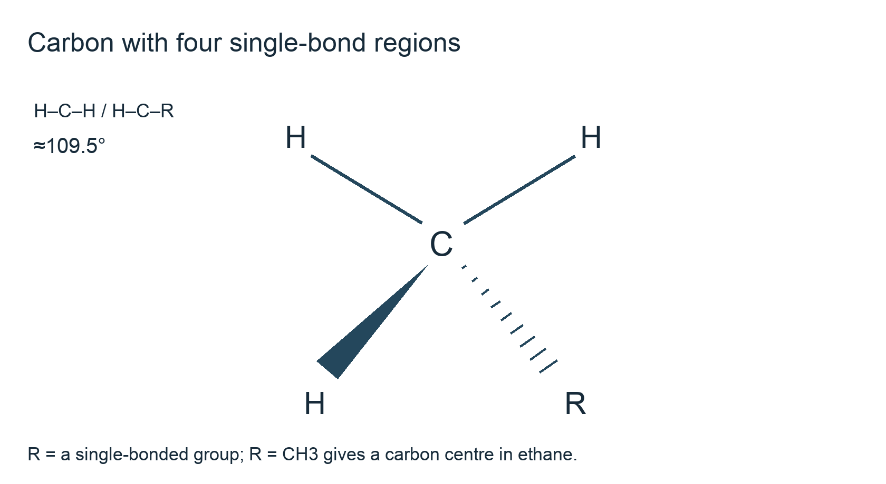
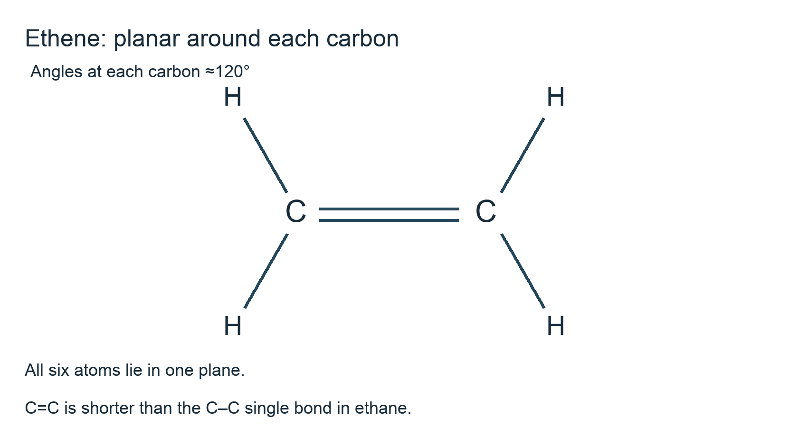
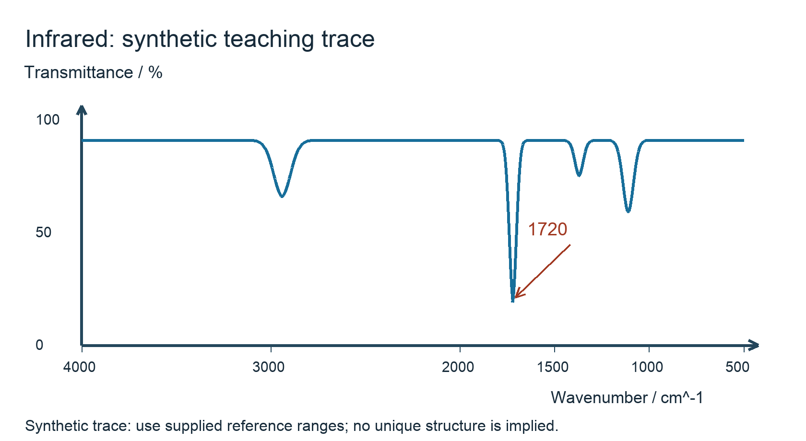

# 4.1 Foundations of organic chemistry

*nam-8224-nsscas-2026. Offline study notes, rendered from the approved content units on 2026-10-22. Everything here is also what the flashcards are built from.*

---

## Foundations of organic chemistry — 4.1.1

### Terms describe particles, electron movement and overall change

A functional group is an atom or group of atoms responsible for characteristic chemical behaviour, such as C=C in an alkene or –OH in an alcohol. A free radical contains an unpaired electron, shown by a dot. Homolytic fission splits a covalent bond with one electron going to each fragment; heterolytic fission sends both electrons to one fragment. Draw single-electron fishhook arrows for homolysis and a full-headed curved arrow for an electron pair in heterolysis.

A nucleophile is an electron-pair donor and an electrophile an electron-pair acceptor. A nucleophile can be neutral or negative; a lone pair or a multiple bond can supply its reactive pair. An electrophile can be positive or a suitable electron-deficient centre in a neutral molecule. Start a pair arrow at the electron source, not at a positive charge, and end it where the pair goes.

Initiation creates radicals, for example Cl2 splitting under suitable light. Propagation consumes a radical and makes another: Cl• + CH4 → HCl + CH3•, followed by CH3• + Cl2 → CH3Cl + Cl•. The methyl radical is an intermediate and chlorine radical is regenerated. Termination combines radicals without making another radical. These terms explain a chain, rather than three alternative names for its overall equation.

Addition joins species across a multiple bond without eliminating a small molecule. Substitution replaces one atom or group by another. Elimination removes groups to form a multiple bond. Hydrolysis breaks a bond through reaction with water; condensation joins species while eliminating a small molecule such as water. Organic oxidation commonly gains oxygen or loses hydrogen; reduction commonly gains hydrogen or loses oxygen, alongside the general electron/oxidation-number definitions from Topic 2.2. The symbols [O] and [H] may represent supplied oxidising and reducing equivalents, but an equation still needs atom balance.

### Naming and representing the syllabus families

Choose the appropriate parent chain containing the principal functional group and number it to give that group or required prefix its lowest permitted locant. The one-to-six-carbon stems are meth-, eth-, prop-, but-, pent- and hex-. Alkanes use –ane, alkenes –ene, alcohols –ol, aldehydes –al, ketones –one, carboxylic acids –oic acid and amines –amine. Halogen substituents use fluoro-, chloro-, bromo- or iodo-. An ester has an alkyl name from the alcohol-derived part followed by an alkanoate name from the acid-derived part. Thus CH3COOCH2CH3 is ethyl ethanoate: the two-carbon group attached through oxygen supplies ethyl, while the acid-derived portion supplies ethanoate. Naming requires those connections, not just total carbon count.

Examples include hexane, but-1-ene, 1-chlorobutane, propan-2-ol, butanal, butan-2-one, pentanoic acid, ethyl ethanoate and ethanamine. The carboxyl or aldehyde carbon is part of the parent chain. Use di-, tri-, tetra-, penta- and hexa- for two through six repeated features; mono- means one but is commonly omitted where the naming convention implies it. For example, CH2ClCHClCH3 is 1,2-dichloropropane, not a name obtained by numbering from the end that gives 2,3.

A molecular formula gives actual atom numbers; an empirical formula gives their simplest ratio. Structural condensed notation such as CH3CH2OH shows grouped connections; a displayed representation shows the bonds explicitly; skeletal notation uses line ends and vertices for carbon and omits its attached hydrogens. Molecular, empirical, structural condensed, displayed and skeletal forms therefore answer different requests. Check that carbon has four bond contributions, counting a double bond twice, when moving between representations. Topic 1.1 covers composition ratios, while later organic topics apply the named functional groups.

---

## Foundations of organic chemistry — 4.1.2

### Ethane and ethene through electron-pair repulsion

Electron regions around a carbon centre repel and adopt an arrangement that keeps them apart. In ethane, each carbon has three C–H single bonds and one C–C single bond: four bonding regions with no carbon lone pair. The local geometry is tetrahedral and angles are approximately 109.5°. Do not draw ethane as a flat 120° carbon centre merely because a condensed composition is printed on one line.

In ethene, each carbon has two C–H bonds and one C=C double bond. The double bond counts as one region for the repulsion arrangement, although it contains two shared electron pairs between the same bonded atoms. Three regions give trigonal-planar geometry around each carbon, with angles approximately 120°. The molecule's atoms lie in one plane in this simple description.

The C=C bond is shorter and stronger than the C–C single bond in ethane. Greater shared electron density between the nuclei produces a stronger attraction and a shorter internuclear separation. Do not attribute that length difference to intermolecular attractions: the comparison is between covalent bonds inside molecules.

A displayed connectivity sketch and a three-dimensional shape sketch serve related but different purposes. For tetrahedral carbon, use a wedge towards the viewer and a hashed bond away where needed to make depth unambiguous. For ethene, show a double line and planar connections. In an explanation, count bonding regions first, state the repulsion arrangement and then give the angle. A numerical angle without that structural reasoning does not explain why the two molecules differ. Topic 1.3 established the same region-counting method for other covalent centres.

### Applying the geometry rule to another molecule

Use the same electron-region count at a named atom rather than assigning one shape to an entire chain. A saturated carbon with four single bonds and no lone pair is approximately tetrahedral. Replacing one H by Cl or OH leaves four bonding regions around that carbon, so the local carbon angles remain near 109.5° in the simple prediction.

For example, the carbon of chloromethane has three C–H bonds and one C–Cl bond. A tetrahedral drawing should show all four attachments without accidentally giving carbon five bonds. In ethanol, both carbons have approximately tetrahedral arrangements, but this does not imply that oxygen also has a tetrahedral atom arrangement: its bonding pairs and lone pairs need their own count.

At a carbonyl carbon in propanone, the C=O double bond is one region and its two C–C bonds are two more. Three regions give an approximately trigonal-planar arrangement near 120°. The methyl carbons elsewhere in the same molecule still have four regions and remain approximately tetrahedral. This contrast shows why the phrase “the molecule has 120° bonds” is too broad unless the particular centre is specified.

To make a new prediction, identify the central atom, count its attached atoms and lone pairs, then select the arrangement. Multiple bonds count as one region in this method. Local substituents can cause departures from ideal angles, so use approximate values rather than claiming perfect regularity in an arbitrary molecule. The purpose is to transfer electron-pair repulsion reasoning, not to introduce a new bonding theory or memorise a separate shape for each named organic compound. Check the displayed structure after drawing: correct geometry does not excuse a missing atom or charge.

---

## Foundations of organic chemistry — 4.1.3

### Reading an infrared spectrum

Infrared radiation can be absorbed when it matches a molecular vibration that interacts with that radiation. Functional groups therefore have characteristic absorption regions. Read the horizontal axis as wavenumber in cm⁻¹; a conventional IR plot runs from higher wavenumber on the left to lower on the right. On a percentage-transmittance plot, stronger absorption appears as a downward band. An absorbance plot uses the opposite visual direction, so inspect the axis label first.

Use the official Data Booklet, reproduced in syllabus Annexe E, printed page 64. Its selected reference ranges are in cm⁻¹:

| Bond / group | Range | Appearance |
|---|---|---|
| C–O: alcohol, ether, ester | 1040–1300 | strong |
| C=C: alkene | 1500–1680 | weak unless conjugated |
| C=O: amide | 1640–1690 | strong |
| C=O: ketone or aldehyde | 1670–1740 | strong |
| C=O: carboxylic acid | 1680–1730 | strong |
| C=O: ester | 1710–1750 | strong |
| C–H: alkane | 2850–2950 | strong |
| C–H: alkene | 3000–3100 | weak |
| N–H: amide or amine | 3300–3500 | weak |
| O–H: carboxylic acid | 2500–3000 | strong, very broad |
| O–H: hydrogen-bonded alcohol | 3200–3600 | strong |
| O–H: free alcohol | 3580–3650 | strong, sharp |

These ranges overlap; a band identifies supporting bond evidence rather than a unique molecule.

For this synthetic teaching trace, the strong band at 1720 cm⁻¹ supports a carbonyl group. It does not alone distinguish every aldehyde, ketone, acid and ester. Use an O–H pattern, other bands and any composition or chemical evidence to narrow the choice. The absence of an expected strong band can help rule out a candidate in a suitable clean spectrum, but a weak feature, mixture or poor-quality measurement may limit that deduction. Do not infer a full carbon skeleton from one absorption. The trace is generated for practice and is not a reproduced experimental spectrum. Its interpretation links bond evidence to the functional groups named earlier.
