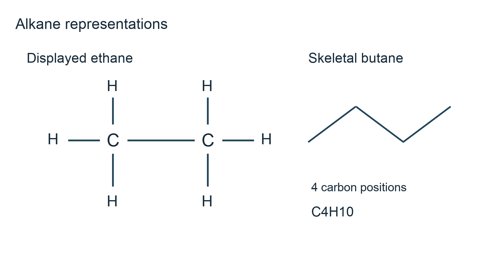
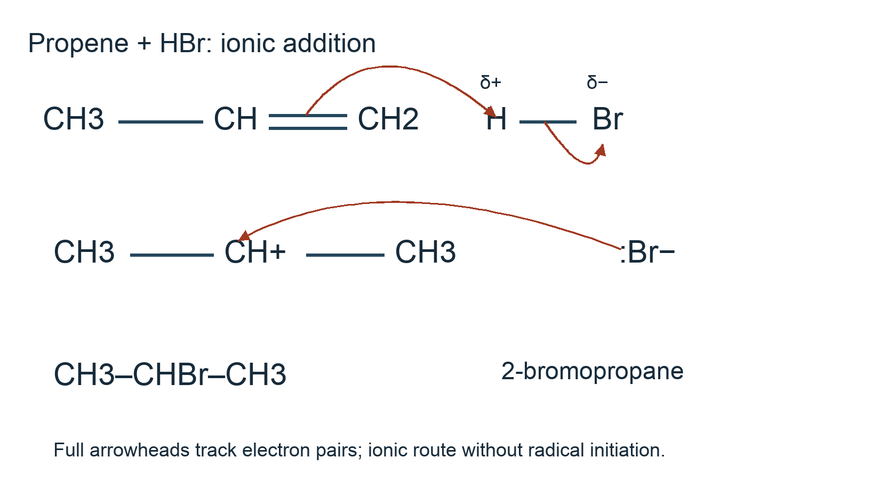
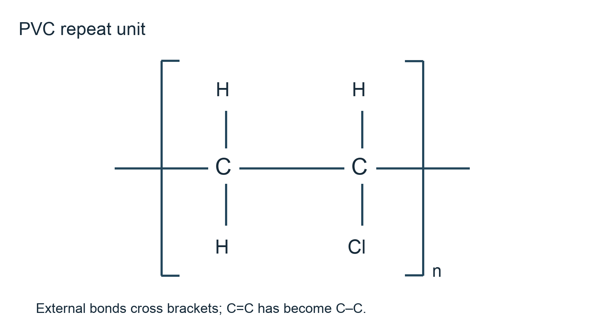

# 4.2 Hydrocarbons

*nam-8224-nsscas-2026. Offline study notes, rendered from the approved content units on 2026-10-22. Everything here is also what the flashcards are built from.*

---

## Hydrocarbons — 4.2.1

### Alkanes in several representations

An alkane is a saturated hydrocarbon: it contains carbon and hydrogen, with single bonds between its carbon atoms. The open-chain series has general composition CnH2n+2. Here n counts all carbon atoms, including branches. Methane is CH4, ethane C2H6 and hexane C6H14. This relationship applies to open chains; a saturated carbon ring has a different hydrogen count because closing the ring makes an additional C–C connection.

A molecular formula records actual numbers of atoms, while an empirical formula gives their simplest ratio. Structural condensed notation groups atoms by their connections, a displayed drawing shows each bond, and skeletal notation omits carbon labels and hydrogens bonded to carbon. These molecular, empirical, structural condensed, displayed and skeletal forms carry different amounts of information. For ethane, C2H6 gives composition, CH3CH3 shows two connected methyl groups, and a displayed drawing shows six C–H bonds and one C–C bond. Its empirical ratio is CH3, which does not describe an isolated ethane molecule.

In skeletal notation a line end or unlabelled corner represents a carbon. A three-segment zigzag has four carbon positions, not three. With single bonds and no ring it represents butane, CH3CH2CH2CH3. At each end the carbon has one carbon neighbour and therefore three hydrogens; each internal carbon has two neighbours and two hydrogens. A branch creates another carbon position and must be counted.

Practise both directions: expand a skeletal drawing into grouped atoms, then hide the carbon labels and carbon-bound hydrogens again. The connectivity must survive the conversion. Neither the zigzag's angle on the page nor its orientation changes the atom count. Topic 4.1 explains why a connectivity drawing is different from a three-dimensional shape drawing.

### Names reconstruct connections

The parent name describes the longest continuous carbon chain. For one through six carbons use methane, ethane, propane, butane, pentane and hexane. A continuous chain can turn a corner in a drawing; the horizontal row is not automatically the parent. Trace possible routes without visiting a carbon twice, then choose the longest suitable route. Carbons outside that chain become substituents.

A methyl substituent, –CH3, is obtained conceptually by removing one hydrogen from methane. An ethyl substituent is –CH2CH3. Number the parent from the end giving the lower sequence of branch positions, comparing the first point of difference. CH3CH(CH3)CH2CH3 is 2-methylbutane: its longest route has four carbons, and its methyl branch is at carbon 2 rather than carbon 3. The molecule has five carbons altogether. Do not call it methylpentane just because five carbons appear in total.

Repeated identical substituents use di-, tri- and related prefixes. Each substituent needs a locant, including when two attach to the same parent carbon. Thus CH3C(CH3)2CH2CH2CH2CH3 is 2,2-dimethylhexane. Carbon 2 has four carbon bonds and no hydrogen. There are six parent carbons and two additional methyl carbons: eight in the molecule. The syllabus's six-carbon parent-chain limit therefore does not impose a six-carbon limit on the whole branched molecule.

Use commas between numbers and hyphens between numbers and words. To work backwards, draw the parent chain, number it, attach the named groups, and finally fill hydrogen valencies. Recheck the longest route before accepting the name. This prevents an apparently neat drawing from hiding a longer chain that should have been the parent.

### Counting atoms rather than line segments

To determine composition from a structure, count carbon positions first, then count attached hydrogen by valency. A neutral alkane carbon has four single bonds. An end carbon attached to one other carbon is CH3, a carbon attached to two is CH2, one attached to three is CH, and one attached to four is C with no hydrogen. In a skeletal drawing the omitted hydrogen is still chemically present; its absence from the ink does not remove it from the molecule.

For CH3CH(CH3)CH2CH3, there are three CH3 groups, one CH and one CH2. The total is five carbon atoms and 9 + 1 + 2 = 12 hydrogens, giving C5H12. The parent-chain length is four but the total carbon count is five. The open-chain check gives 2(5) + 2 = 12 hydrogens, consistent with the detailed count. Use that check after reading the branches, rather than treating the parent name as the whole molecule's carbon count.

For 2,2-dimethylhexane, CH3C(CH3)2CH2CH2CH2CH3 contains four CH3 groups, three CH2 groups and one carbon without hydrogen. Total hydrogen is 12 + 6 = 18 and carbon is eight, so the molecular composition is C8H18. A wrong answer C6H14 has ignored the two methyl groups; C8H20 has not accounted for the four bonds already attached to the central carbon.

Molecular, empirical, structural condensed, displayed and skeletal forms can describe related information but answer different requests. The molecular formula C8H18 reduces to empirical C4H9; neither gives the connectivity by itself. If asked for the molecular form, retain actual atom counts. If asked for a displayed structure, show individual bonds instead of supplying just C8H18. Topic 1.1 covers the separate calculation of composition from measured masses.

### Why many polar reagents leave alkanes unchanged

Alkanes are generally unreactive towards many polar reagents under ordinary laboratory settings. Their C–C and C–H bonds are strong, and their bonding has little charge separation. A C–C bond joins identical atoms; the electronegativity difference between carbon and hydrogen is relatively small. There is no strongly electron-deficient carbon attached to a leaving group and no electron-rich C=C region for the familiar polar addition route.

An electrophile needs an accessible electron pair with which to form a bond; a nucleophile needs a suitable electron-poor centre. The saturated alkane skeleton provides neither of the strongly reactive sites used in the simple ionic reactions taught here. Saying merely that an alkane has “no charge” is insufficient: several neutral molecules, including alkenes, react readily with electrophiles. The relevant explanation concerns bond strength, electron distribution and the available reaction pathway.

Consider two separate samples, ethane and ethene, contacted with bromine without radical-initiating light. Ethene can react by addition at C=C. Ethane lacks that multiple bond and does not undergo the corresponding rapid addition. Under suitable ultraviolet light, however, bromine can form radicals and substitute a hydrogen in ethane. The different outcome follows a different mechanism, rather than contradicting the general statement about resistance to polar attack.

Alkanes also burn after ignition in oxygen. A high activation barrier can prevent noticeable reaction before ignition even when the overall combustion releases energy. Bond breaking needs energy at the start; formation of product bonds releases more energy over the complete process. Topic 2.1 separates activation energy from overall enthalpy, while Topic 2.4 explains how a temperature increase changes the fraction of sufficiently energetic collisions. Do not translate general unreactivity into a claim that alkanes cannot take part in chemical reactions.

### Ethane combustion and halogen substitution

Ethane burns in sufficient oxygen to produce carbon dioxide and water. A balanced equation is 2C2H6(g) + 7O2(g) → 4CO2(g) + 6H2O(g) for water vapour in hot combustion products. If products are specified after cooling, water can be written as liquid instead; the stated physical setting determines its symbol. Balance carbon first, hydrogen second and oxygen last. One ethane molecule needs seven oxygen atoms, so using whole-number coefficients requires two ethane molecules and seven oxygen molecules.

Incomplete combustion under oxygen shortage can produce carbon monoxide and carbon particles as well as water. An idealised carbon-monoxide equation is 2C2H6 + 5O2 → 4CO + 6H2O. Actual flames can give mixtures rather than one pure carbon product. A black deposit indicates carbon-containing soot, not carbon dioxide, which is a gas under these settings.

With chlorine under suitable ultraviolet light, ethane gives chloroethane and hydrogen chloride: C2H6 + Cl2 → C2H5Cl + HCl. With bromine under radical-initiating light, C2H6 + Br2 → C2H5Br + HBr. These are substitution reactions: a hydrogen attached to carbon is replaced by a halogen atom, and the removed hydrogen appears in a hydrogen halide. Both atoms of a halogen molecule are therefore accounted for. The C–C skeleton remains intact in the first substitution.

Further substitution can follow because the first organic product still contains C–H bonds. Consequently the equations show one substitution stage, not a guarantee of a single pure final product. Excess alkane relative to halogen favours a greater proportion of singly substituted material, but the process can still need separation. Topic 4.3 develops haloalkane reactions; here the focus is their formation from an alkane and the radical chain that explains it.

### Following the radical chain

A free radical is a species containing an unpaired electron. A dot records that electron; it is not a negative charge. In initiation, light supplies energy for homolytic fission of chlorine: Cl2 → 2Cl•. Each atom takes one electron from the original Cl–Cl pair. Draw two fishhook arrows starting at the bond, one towards each chlorine atom. Full-headed arrows would incorrectly indicate the movement of electron pairs.

Propagation in ethane chlorination has two linked steps. First, Cl• + CH3CH3 → HCl + CH3CH2•. The chlorine radical abstracts hydrogen and leaves an ethyl radical intermediate. Second, CH3CH2• + Cl2 → CH3CH2Cl + Cl•. The ethyl radical forms a C–Cl bond and regenerates chlorine radical. Add these equations and cancel the intermediate radicals to recover C2H6 + Cl2 → C2H5Cl + HCl. One radical is used and another is produced at each propagation step, which permits the chain to continue.

For electron movement in hydrogen abstraction, one electron from C–H remains on carbon, while the other pairs with the chlorine radical's electron in H–Cl. For attack on Cl2, one electron from Cl–Cl pairs with the carbon radical's electron in the new C–Cl bond; the other stays on the departing chlorine. Fishhook arrows distinguish these single-electron changes from ionic addition.

Termination combines radicals without regenerating a radical. Examples are Cl• + Cl• → Cl2, C2H5• + Cl• → C2H5Cl, and C2H5• + C2H5• → C4H10. The last equation explains a possible longer-chain side product. Substituting a hydrogen on a methyl group does not replace the entire carbon group: methane analogously forms CH3Cl through CH3•. Identify initiation, propagation or termination from the radical accounting, rather than from whether an organic product happens to appear.

### Crude oil as a chemical feedstock

Crude oil is a complex mixture rather than a pure compound with one fixed composition. It contains hydrocarbons with a range of molecular sizes and structures, together with other substances. Aliphatic hydrocarbons include open-chain saturated and unsaturated compounds; aromatic hydrocarbons contain the characteristic benzene-type ring system. The word aromatic describes this structural family, not a test based on a pleasant smell.

Fractional distillation separates crude oil into groups of substances with different boiling ranges. Vapours rise through a temperature gradient and condense in regions suited to their boiling behaviour. A fraction is still a mixture: collecting one fraction does not establish that it contains a single alkane. Larger hydrocarbon molecules generally have stronger intermolecular attractions and higher boiling temperatures within comparable families, which helps organise the separation.

Some fractions serve as fuels, while others provide feedstock for producing useful smaller molecules and polymer monomers. Aliphatic and aromatic materials can be obtained through separation and further refinery processing. A refinery can also change molecules by chemical reactions; it is therefore necessary to distinguish a source of a substance from a claim that simple distillation makes that substance. Distillation does not break covalent bonds in a large molecule to create an alkene. Cracking does change those bonds.

For example, an invented materials workshop receiving a mixed hydrocarbon feed cannot infer a unique molecular structure merely from its boiling range. It needs composition information before identifying individual molecules. Nor does a sample's origin in crude oil prove that all its molecules are saturated open chains: aromatic structures belong to a different hydrocarbon family. Topic 1.3 provides the bonding background for benzene-type delocalisation, while the next section explains why chemical cracking changes the balance between large fuel molecules and useful smaller feedstocks.

### Cracking changes molecules

Cracking breaks larger hydrocarbon molecules into smaller molecules. High temperature supplies energy, and catalytic routes use a suitable catalyst to change the available pathway. Products commonly include smaller alkanes and alkenes. Smaller fuel molecules may be more useful for transport, while alkenes are reactive feedstocks for making polymers and other chemicals. The purpose is to alter the useful product distribution, rather than merely sort the original molecules into separate containers.

One possible balanced representation is C10H22 → C6H14 + C4H8, with the C4H8 product specified as an open-chain alkene. The starting molecule has ten carbon atoms and twenty-two hydrogens; the products contain six plus four carbons and fourteen plus eight hydrogens. Both totals are conserved. Relative molecular masses using Ar(C) = 12 and Ar(H) = 1 are 142 for the starting alkane, 86 for the smaller alkane and 56 for the alkene. Each product molecule has lower Mr, while the combined product mass equals the original mass for the balanced equation.

A second possible split is C10H22 → C8H18 + C2H4. These equations are alternative illustrative outcomes, not two compulsory consecutive stages. Real cracking gives a mixture, and a balanced atom count alone cannot identify the proportions or exact structures formed. In particular, C4H8 does not specify the location of a double bond without additional structural information.

Fractional distillation is a physical separation governed by boiling behaviour; cracking is a chemical change involving covalent-bond rearrangement. Use that distinction when explaining how a refinery can obtain more small molecules than were originally present in a chosen heavy fraction. Topic 2.4 connects catalysts and temperature to rate, while addition polymerisation later in this topic explains an important use of the alkene products.

---

## Hydrocarbons — 4.2.2

### Representing the carbon–carbon double bond

An alkene contains a carbon–carbon double bond. For an open-chain hydrocarbon with one such bond, the general composition is CnH2n, beginning with ethene, C2H4. Relative to an open-chain alkane with the same carbon count, it has two fewer hydrogen atoms because the additional carbon–carbon bond contribution uses valencies that could otherwise attach hydrogen. The C=C region gives the characteristic addition chemistry.

Structural condensed notation for propene is CH2=CHCH3. A displayed drawing expands that into individual atoms and bonds, including two lines between the first two carbons. A skeletal drawing has three carbon positions and a double line on the appropriate first segment. The end of a double line is not an extra carbon: both lines join the same pair of atoms. Molecular C3H6 states the atom count but does not locate the double bond. Empirical CH2 gives a ratio, while structural condensed, displayed and skeletal representations can preserve connectivity. These five molecular, empirical, structural condensed, displayed and skeletal forms answer different questions about the same material.

Complete valencies carefully. The terminal double-bond carbon in propene has two hydrogens; the next has one; the remaining methyl carbon has three. A four-carbon open chain with one double bond has composition C4H8 whether the bond is terminal or internal. CnH2n by itself is therefore not proof of a particular alkene structure. A saturated ring can also have that composition.

Use the representation requested and mark C=C explicitly. A single zigzag without a second bond line communicates a different hydrogen count. Topic 4.1 explains the planar geometry around an alkene carbon; Topic 4.5 will use restricted rotation about the double bond when considering spatial arrangements.

### Naming alkenes up to a six-carbon parent

Choose the longest suitable carbon chain containing the double bond. Use the parent stem corresponding to its carbon count and the ending –ene. Ethene and propene have no alternative double-bond position after equivalent end numbering. In a longer chain the locant specifies the lower-numbered carbon of C=C, so CH2=CHCH2CH3 is but-1-ene and CH3CH=CHCH3 is but-2-ene.

Number from the end nearer the double bond, rather than choosing numbering simply to minimise a methyl branch position. For CH3CH2CH=CHCH2CH3, numbering from either end gives hex-3-ene. For CH3CH2CH2CH=CH2, start at the terminal CH2 end to obtain pent-1-ene, not pent-4-ene. The number refers to the first carbon of the double bond, not to the number of double bonds present.

Branches are named as substituents using their positions on that numbered parent. CH2=C(CH3)CH2CH3 is 2-methylbut-1-ene. The parent contains four carbons, the methyl branch supplies a fifth, and carbon 2 has no attached hydrogen because it already has four bond contributions. Reversing the naming process provides a useful check: draw but-1-ene, attach a methyl group at carbon 2, then complete valencies.

Use the syllabus's placement of locants, such as but-2-ene. A name must communicate the double-bond position unambiguously even when different drawing orientations are used. Turning a drawing around does not create a new molecule. Conversely, moving the double bond from the end to the middle changes connectivity and therefore the name. Topic 4.5 develops isomerism in more detail; naming here supplies the language needed to distinguish the structures without introducing additional naming systems.

### Atom counting in unsaturated structures

Read the complete carbon skeleton before counting hydrogen. For each neutral carbon, subtract the bond contributions already used from four: a single bond contributes one and a double bond contributes two. Add the resulting attached hydrogens over all carbons. This direct method works on structural condensed, displayed and skeletal drawings and reveals errors that can be hidden by guessing a general series relationship.

Take CH2=C(CH3)CH2CH3. The terminal alkene carbon is CH2, the other double-bond carbon has no hydrogen, its methyl branch is CH3, and the remaining chain groups are CH2 and CH3. The totals are five carbons and 2 + 0 + 3 + 2 + 3 = 10 hydrogens. Thus its molecular composition is C5H10. The open-chain, one-double-bond check also gives 2(5) = 10. Counting the parent chain alone would miss the branch and give an incorrect four-carbon answer.

For CH3CH=CHCH3, two methyl groups contribute six hydrogens and the two double-bond carbons contribute one each, giving C4H8. The same total arises for CH2=CHCH2CH3 even though the double bond is in another position. Equal composition therefore does not establish identical connectivity. The empirical ratio of either is CH2, not the complete four-carbon molecular count.

If the question requests a molecular formula, give actual atom numbers; molecular, empirical, structural condensed, displayed and skeletal forms are distinct choices. If it instead requests a structure, retain the connections and double-bond location. A useful self-check is to redraw each carbon with explicit hydrogen and verify four bond contributions. A carbon drawn with a double bond and three additional single bonds has five contributions and cannot represent the neutral alkene intended here.

### A reaction map for ethene and propene

Addition uses the reactive C=C region to form two new bonds while retaining the carbon skeleton. With hydrogen and a heated nickel catalyst, CH2=CH2 + H2 → CH3CH3; propene similarly gives propane. This hydrogenation is reduction because the organic molecule gains hydrogen. The catalyst changes the reaction pathway and is regenerated overall. Simply mixing a cold alkene with hydrogen without a suitable catalyst does not provide the stated preparation.

Addition of steam gives an alcohol. Industrial ethene hydration uses a phosphoric-acid catalyst at elevated temperature and pressure: CH2=CH2 + H2O ⇌ CH3CH2OH. Temperature, pressure and steam proportion influence the practical rate and equilibrium yield; the double arrow represents the reversible overall process. Propene hydration favours propan-2-ol, CH3CH(OH)CH3. The reaction supplies H and OH across C=C, rather than adding a separate water molecule as a loosely bound attachment.

Hydrogen halides supply H and halogen. Ethene plus HBr gives bromoethane: CH2=CH2 + HBr → CH3CH2Br. For propene under ordinary ionic addition, CH3CH=CH2 + HBr → CH3CHBrCH3 gives the major product, 2-bromopropane. Hydrogen adds preferentially to the end already bearing more hydrogen, while bromine ends up on the central carbon. This Markovnikov orientation follows the relative stability of the intermediate cations; it is not a reason to describe both orientations as equally favoured. HCl analogously supplies H and Cl.

Bromine or chlorine adds across C=C without requiring the radical-initiating light used for alkane substitution. CH2=CH2 + Br2 → BrCH2CH2Br gives 1,2-dibromoethane; CH3CH=CH2 + Br2 → CH3CHBrCH2Br gives 1,2-dibromopropane. Bromine is consumed and its orange-brown colour disappears. The written dibromo product describes the simple addition in a suitable non-aqueous medium; water can participate in aqueous mixtures, so a colour test by itself does not prove the isolated organic product's full identity.

The syllabus specifies cold, dilute, acidified manganate(VII) for oxidation to a diol. Ethene gives ethane-1,2-diol, HOCH2CH2OH, and propene gives propane-1,2-diol, CH3CH(OH)CH2OH. An organic oxidation balance is CH2=CH2 + [O] + H2O → HOCH2CH2OH. The two adjacent carbons each gain OH and C=C becomes C–C. Purple manganate(VII) is reduced; under adequately acidic settings its reduction product is Mn2+, rather than assuming a brown precipitate for every solution. Keep the specified temperature, dilution and acidity with the predicted organic product.

Hot, concentrated, acidified manganate(VII) oxidises further and cleaves C=C. At a double-bond carbon bearing a hydrogen, the resulting carbon-containing fragment becomes a carboxylic acid; a terminal CH2 carbon is oxidised to CO2. A double-bond carbon bonded to two carbon groups and no hydrogen gives a ketone. For but-2-ene, CH3CH=CHCH3 + 4[O] → 2CH3COOH. The two identical acid fragments locate a central double bond in the known four-carbon chain. Propene gives CH3CH=CH2 + 5[O] → CH3COOH + CO2 + H2O. All three original carbons are accounted for, including the one in CO2.

Finally, many alkene molecules can join by addition polymerisation. Ethene produces poly(ethene), while propene produces poly(propene), with carbon–carbon single-bond backbones and the original substituents retained. Later sections show repeat units and reverse the process on paper to identify monomers. In a reaction map, pair each arrow with its reagent and settings. An answer naming “oxidation” without distinguishing mild addition from vigorous cleavage leaves the key product undecided.

### Heterolytic fission and charge accounting

Heterolytic fission is the breaking of a covalent bond with both electrons of its shared pair going to one fragment. For H–Br in the ionic addition pathway, the pair goes to bromine as the bond breaks. In an isolated charge-accounting representation this gives H+ and Br−. During reaction with an alkene, formation of the new C–H bond and H–Br cleavage are coupled; the mechanism need not first accumulate free hydrogen ions as separate gas particles.

Draw a full-headed curved arrow from the H–Br bond towards Br. The arrow begins at an electron source, which here is a bond, and ends on the atom receiving the pair. A straight reaction arrow records overall chemical change but does not tell which electrons moved. A fishhook arrow records one electron and is therefore the wrong symbol for transfer of the intact shared pair.

Charge provides an independent check. Neutral HBr has total charge zero. The formal products H+ and Br− also sum to zero. In the alkene addition step, the organic fragment becomes a positively charged carbocation while Br− carries the balancing negative charge. A drawing that shows neutral bromine and a positive carbocation after transferring both bonding electrons to bromine has lost track of an electron.

Contrast homolysis: Br–Br can split under suitable light to give two Br• radicals, each receiving one bond electron. That route uses two fishhook arrows and does not produce Br+ and Br−. Choose the fission description from the electron allocation and reaction setting, rather than from the fact that a bond has broken. Topic 4.1 introduced the terminology; the following mechanisms use it to connect the electron source, intermediate charge and final covalent product.

### Electrophilic addition: two examples

An electrophile is an electron-pair acceptor. The π electron pair of C=C can form a bond to an electrophile, so the alkene acts as the electron-pair donor in the first step. A mechanism must show where that pair goes, which bond breaks, the intermediate and the final product. Naming addition without those changes does not explain the reaction.

For propene with HBr under ordinary ionic addition, start a full curved arrow at C=C and end it at H of H–Br. At the same time start another at H–Br and end it on Br. Bonding H to the terminal CH2 leaves the secondary carbocation CH3–CH+–CH3 and Br−. Next, a curved arrow starts at a bromide lone pair and ends at the positively charged carbon. A C–Br bond forms, giving CH3CHBrCH3. The bromide electron pair removes the electron deficiency; no radical dot belongs on this intermediate.

For ethene with bromine in a suitable non-aqueous medium, the approaching electron-rich double bond polarises Br2. The nearer bromine becomes δ+ and accepts the alkene pair while the Br–Br pair moves to the farther bromine. The chemically supported intermediate is a three-membered bridged bromonium ion, in which positively charged Br bonds to both carbons, together with Br−. A bromide lone pair then attacks a carbon; the corresponding carbon–bridging-Br bond pair returns to bridging Br as the ring opens. The product is BrCH2CH2Br.

Partial charges on the approaching neutral Br2 molecule are different from the full charges on the intermediate ions. Keep those labels distinct. Both examples are electrophilic addition, but their intermediates need not be drawn as identical free carbocations. The HBr example supplies the carbocation reasoning used to explain propene's major product; the bridged bromine example explains the pair movement without teaching an unsupported free ethene-derived cation as its established intermediate.

### Alkyl donation and the preferred cation

A carbocation has a positively charged, electron-deficient carbon. Alkyl groups can donate electron density through their bonds towards that centre: their positive inductive effect helps disperse the electron deficiency. Within the simple comparable alkyl cations considered here, increasing the number of attached alkyl groups increases stability. The order is tertiary greater than secondary greater than primary. This is a comparison of cations, not of the final haloalkanes' reaction speeds.

A primary carbocation has one carbon group attached directly to its positively charged carbon, a secondary has two and a tertiary has three. Count those attachments at the charged centre. CH3CH2+ is primary; CH3CH+CH3 is secondary; (CH3)3C+ is tertiary. The plus sign marks a full positive charge. Inductive donation does not make the species neutral and should not be drawn as the loss of a whole alkyl group from the skeleton.

Propene can be protonated in two orientations. Attaching H to the terminal carbon produces CH3CH+CH3, the secondary intermediate. Attaching H to the middle carbon would produce CH3CH2CH2+, a primary intermediate. Formation of the more stable secondary cation is favoured in ordinary ionic HBr addition. A bromide lone pair then forms a bond to the charged carbon, giving 2-bromopropane as the major product. Thus a stability explanation connects the first electron-pair movement, the cation and the observed product orientation.

In a sketch, show the two CH3 groups attached to the positive centre and label their inductive donation towards it. Use full curved arrows separately for actual pair transfer in the reaction steps; a small inductive-direction marker does not mean that an entire C–C bond pair has moved to make a new bond. Topic 4.1 supplies the distinction between electron-pair arrows and other directional annotations.

### Addition polymerisation conserves monomer atoms

A monomer is a small molecule that can join repeatedly to make a polymer, a very large molecule built from repeating structural units. In addition polymerisation of an alkene, the π contribution of C=C is used as new bonds connect monomers. The two original alkene carbons become adjacent carbons in a single-bond backbone. No small molecule such as water is eliminated in this overall addition process.

Ethene gives poly(ethene): nCH2=CH2 → [–CH2–CH2–]n. Here n is a large number of monomer molecules and repeat units, not a balancing coefficient to replace with a fixed small integer. The bracketed unit represents the repeating interior of a long chain; actual chain ends are not fully specified by that shorthand. Poly(ethene) has the same carbon-to-hydrogen ratio as its monomer, but very different molecular size and useful physical properties.

Chloroethene, CH2=CHCl, produces poly(chloroethene), commonly called PVC: nCH2=CHCl → [–CH2–CHCl–]n. Chlorine stays attached to the same carbon as a side substituent. It is not expelled as HCl in this addition equation, and it does not become a link in the main chain. The carbon–carbon double bond changes to a single bond while new links join neighbouring units.

A suitable initiator or catalyst and appropriate temperature and pressure are needed for practical polymer manufacture; different routes need different operating settings. The equation alone is an atom-accounting description, not a complete factory recipe. To check it, compare one monomer with one repeat unit: the atom types and counts should agree. Do not infer from the long polymer chain that extra hydrogen atoms have been inserted between the units. The open bonds at the bracket boundaries show precisely where the original monomer units connect.

### Building a repeat unit from a monomer

Start by identifying the two carbon atoms of the monomer's C=C bond. Put those two carbons in the repeat-unit backbone, replace the double bond by a single bond and draw an external single bond from each end. Keep every substituent attached to its original carbon. Place brackets around the unit so that the external bonds cross the bracket boundaries, and write n outside the brackets.

For propene, CH2=CHCH3, the result is [–CH2–CH(CH3)–]n. The methyl group is a side branch, not a third consecutive backbone carbon within this two-carbon unit. The repeat unit contains three carbon atoms altogether, matching the monomer. For chloroethene the corresponding construction is [–CH2–CHCl–]n. The original H and Cl attachments remain while the new backbone links replace the π bonding contribution.

Check each carbon's four bond contributions after including the links to neighbouring units. In poly(ethene), each backbone carbon has two C–H bonds and two C–C single bonds. If C=C were retained between the two carbons while each also acquired an external chain bond, those carbons would have five bond contributions. That count distinguishes a plausible polymer unit from a drawing that has merely put brackets around the unchanged monomer.

Practise expanding three units into a chain segment and then enclosing the smallest chemically appropriate repeating section again. Do not put a terminal CH3 group at each bracket edge: the unit is part of a continuing chain, not an isolated two-carbon molecule. The subscript n counts repeat units in the idealised representation. It does not instruct you to multiply the number of bonds on one carbon or to insert n hydrogens at a boundary.

### Recovering a monomer from a chain segment

To identify an alkene monomer from a polymer, first find the repeating pattern of backbone atoms and side substituents. For the simple polymers considered here, select the two adjacent backbone carbons corresponding to one original C=C. Remove their continuation links on paper, restore a double bond between them and retain the side groups. The resulting molecule must satisfy carbon valency and reproduce the supplied repeat unit when polymerised again.

For a chain segment –CH2–CHCl–CH2–CHCl–CH2–CHCl–, the repeating two-carbon pattern is –CH2–CHCl–. Restoring C=C gives CH2=CHCl, chloroethene. Three copies of the same pattern in the drawing do not require three different monomers. For –CH2–CH(CH3)– repeated along a chain, the monomer is CH2=CHCH3, propene. The methyl side group remains attached to the second double-bond carbon.

A common wrong approach selects the bond between a backbone carbon and a methyl branch and turns that into the monomer's double bond. That changes which atoms form the main chain and fails to regenerate the original repeat pattern. Another wrong approach removes chlorine or adds hydrogen arbitrarily to obtain a familiar hydrocarbon. Substituents in the supplied unit are evidence about the starting alkene and must be preserved.

Use a forward check as the final step: convert the proposed monomer back to a repeat unit, complete the external bonds and compare the positions of side groups with the original chain. If the prompt supplies more than one distinct kind of repeat structure, assess the actual patterns rather than assuming one monomer from the mere existence of a long chain. This reverse construction is the same conservation-of-atoms reasoning used in reaction equations, applied to repeated molecular connectivity.

### Why durable polymers create disposal problems

Poly(alkene)s such as poly(ethene) have strong carbon–carbon backbones that resist attack by the biological processes normally responsible for decomposing many natural materials. Their useful resistance to water and chemical attack also makes discarded objects persistent. Calling a material non-biodegradable in this context means that it does not readily undergo biological breakdown under the ordinary disposal settings being considered, rather than claiming that no chemical change can occur over any timescale.

A bag can lose its visible shape without its polymer carbon having been fully converted into small molecules by organisms. Sunlight, abrasion and mechanical stress can break an object into smaller fragments. Those fragments may remain plastic and can be harder to collect. The observation that a film has torn into pieces is therefore insufficient evidence that it has biodegraded completely.

Consider two discarded films examined after a stated period. One remains as a large sheet; another is fragmented. To compare biodegradation, information about actual biological conversion is needed, alongside the temperature, moisture, oxygen availability and time. Counting visible pieces alone can even make a persistent material appear to have disappeared when it has simply become too small to see easily.

Durability is not automatically undesirable during use: a water container or protective covering needs to remain serviceable. The problem arises when the required useful lifetime is much shorter than persistence after disposal. A reasoned explanation links backbone structure to resistance and then to accumulation, rather than saying just that plastics are bad. The next section considers ways of reducing the amount discarded and choosing routes suited to the material and available facilities. Topic 4.2.3 returns to carbon-containing products when polymers or fuels are burned.

### Choosing an approach to polymer waste

Reducing unnecessary use and reusing serviceable objects can lower the amount of polymer entering a waste stream. Mechanical recycling collects and sorts suitable material, cleans it and reprocesses it into another product. This retains material value and can reduce demand for new feedstock, but collection, contamination, mixed polymer types and the properties needed in the next product constrain the route. A recycling symbol identifies material information; it does not prove that a particular local facility accepts the object.

Controlled combustion with energy recovery uses the chemical energy in the waste. It reduces the amount of solid polymer, but produces gases and requires suitable equipment and emission control. Carbon-containing polymers produce carbon dioxide on complete combustion; chlorinated material also needs appropriate treatment of chlorine-containing products. This is not a recommendation to burn waste in an open household fire. Landfill contains material in a managed site but uses space and does not by itself solve persistence or recover the original polymer's material value.

Manufacturing biodegradable polymers can help when the object's use and its eventual collection route match the settings required for biological breakdown. Temperature, moisture, oxygen, organisms and time affect performance. A material designed for a controlled composting facility cannot simply be assumed to degrade equally fast in dry soil or seawater. Product design and disposal arrangements must be considered together.

Suppose an invented Namibian packing cooperative has clean, separately collected poly(ethene) offcuts accepted by its recycler. Recycling is a supported option because the stated sorting and acceptance barriers are already addressed. If the waste were instead a contaminated mixture, the same conclusion would need further information. Explain a choice using the given material, route and constraint. No single approach is established as best by naming it without specifying the waste stream.

### Biodegradable and water-soluble are different properties

New polymer development can target useful changes in performance during use and after disposal. A biodegradable polymer is designed to undergo chemical breakdown through biological activity under specified settings. A water-soluble polymer can dissolve in water: its chains become dispersed in the liquid rather than remaining as a separate visible solid. These descriptions refer to different processes and cannot be substituted for one another.

Dissolution does not necessarily break the covalent backbone of a polymer. A clear solution can contain dissolved polymer chains. Conversely, a material may be biologically degradable under suitable settings without dissolving rapidly in a beaker of water. Evidence about one property therefore cannot establish the other. Avoid using the disappearance of a visible film as the sole test for complete biological conversion.

For an original comparison, imagine film A dissolves in water but its recovered dissolved chains retain their original backbone. That observation supports water solubility and supplies no demonstration of biodegradation. Imagine film B undergoes measured biological breakdown in a moist, controlled composting system over a specified period. That supports degradation in that system; it does not establish the same rate on a dry roadside. The relevant test must match the claimed property and environment.

Design also involves the intended service lifetime. A water-soluble coating may be useful where removal by water is needed, while a container exposed to rain may require water resistance. A biodegradable item still needs a suitable route after use and should not be treated as permission to litter. In interpreting a product claim, ask what changed chemically, what remained dissolved, and which temperature, moisture and biological setting were used. These questions connect polymer structure to observed behaviour without assuming that a newer material solves each waste problem automatically.

---

## Hydrocarbons — 4.2.3

### Why alkanes are used as fuels

Combustion transfers stored chemical energy into thermal energy. Although breaking C–C, C–H and O=O bonds requires energy, forming the bonds in carbon dioxide and water releases more over the complete alkane combustion reaction. The overall change is exothermic. Ignition supplies the initial activation energy; it is not the source of the much larger continuing energy release while fuel and oxygen react.

Alkanes and alkane-rich mixtures are used for industrial heating, domestic heating or cooking, and transport. In a stove the useful transfer heats cookware and its contents. In a furnace it heats a material or process stream. In an engine part of the released energy ultimately produces mechanical work, while substantial energy is transferred elsewhere as heat. Fuel usefulness therefore involves controllable combustion and practical handling as well as the energy per unit mass.

For propane, complete hot combustion is C3H8(g) + 5O2(g) → 3CO2(g) + 4H2O(g). This accounts for all atoms; writing energy on the product side can express the qualitative release, but energy is not an additional substance to be balanced as an atom. If an enthalpy value is supplied, keep its stated water phase because condensation changes the numerical energy transfer.

An illustrative heater transfers 480 kJ usefully from 800 kJ released. Its useful fraction is 480/800 = 0.600, or 60.0 percent. The remaining 320 kJ has not vanished; it is transferred outside the intended load. This links combustion to Topic 2.1's energy accounting. More fuel burned does not ensure a proportionate increase in useful heating if oxygen supply or heat transfer becomes limiting. Topic 4.2.1 explains incomplete combustion, while the next section considers the gases associated with engines.

### Exhaust chemistry and the enhanced greenhouse effect

Oxygen shortage or incomplete mixing can leave carbon monoxide and unburnt hydrocarbons in engine exhaust. High engine temperatures also permit nitrogen and oxygen from the air to react, producing nitrogen oxides. Nitrogen in the fuel is therefore not required for this source of NO. Carbon monoxide interferes with oxygen transport in the body; nitrogen oxides and unburnt hydrocarbons contribute to harmful air pollution, including photochemical smog. These effects should be distinguished from a greenhouse-gas explanation.

A catalytic converter supplies surfaces that promote exhaust reactions at a useful rate once sufficiently warm. Carbon monoxide is oxidised: 2CO(g) + O2(g) → 2CO2(g). Unburnt hydrocarbons are oxidised to carbon dioxide and water. Nitrogen monoxide can be reduced by carbon monoxide: 2NO(g) + 2CO(g) → N2(g) + 2CO2(g). Check nitrogen, carbon and oxygen in this combined equation. The catalyst is regenerated overall rather than being a reagent consumed in that balance.

Treatment changes pollutants; it does not make carbon atoms disappear. A converter can lower CO emissions while increasing the conversion of fuel carbon into CO2. Carbon dioxide, methane and nitrous oxide contribute to the greenhouse effect by absorbing infrared radiation and interacting with Earth's outgoing energy transfer. Increasing their atmospheric amounts can enhance warming. This is distinct from explaining ozone-layer depletion.

When interpreting an exhaust comparison, identify the measured gas. A lower CO reading alone is not evidence of lower total CO2 production or lower fuel consumption. Converter effectiveness also depends on temperature and the fuel–air mixture. Topic 2.4 explains catalytic rate changes, and Topic 3.5 connects nitrogen oxides with another part of the subject's environmental chemistry.

### Infrared monitoring of air pollutants

Infrared radiation is absorbed at energies corresponding to suitable molecular vibrations. Different bonds and molecular structures give characteristic patterns, so an instrument can use selected absorption regions to detect gases such as carbon monoxide and carbon dioxide. Absorption must involve a vibration that changes the molecule's electric dipole. Nitrogen and oxygen are not detected by simply assuming that each gas has a strong ordinary infrared absorption band; their homonuclear diatomic vibrations do not satisfy that requirement.

Monitoring needs more than spotting a dip in a spectrum. First select a characteristic band for the target gas. Pass infrared radiation through a known optical path containing the sample and compare with a suitable reference. Use standards of known concentration to calibrate how absorption strength changes with concentration. Under matched measurement settings, stronger absorption in the selected working range can indicate a greater concentration of that gas.

Suppose two air samples are measured using the same instrument, path length and calibration, with interference corrected. The sample with greater calibrated CO absorption contains more CO within that working range. Without matching the path length, stronger absorption could instead arise because the radiation travelled through more gas. Water vapour and other absorbing species can overlap bands, so selecting a less interfered region and checking the reference are part of obtaining a defensible result.

An infrared concentration measurement identifies and quantifies a suitable absorber; it does not by itself establish the source of that gas or whether an unspecified legal limit has been met. Report the gas, concentration unit and measurement setting. Topic 4.1 teaches interpretation of infrared bands in organic compounds. Here the same physical principle is applied to air monitoring, with calibration supplying the additional link between an absorption signal and gas concentration.
