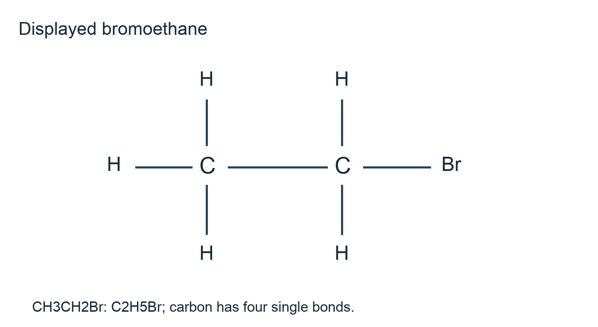
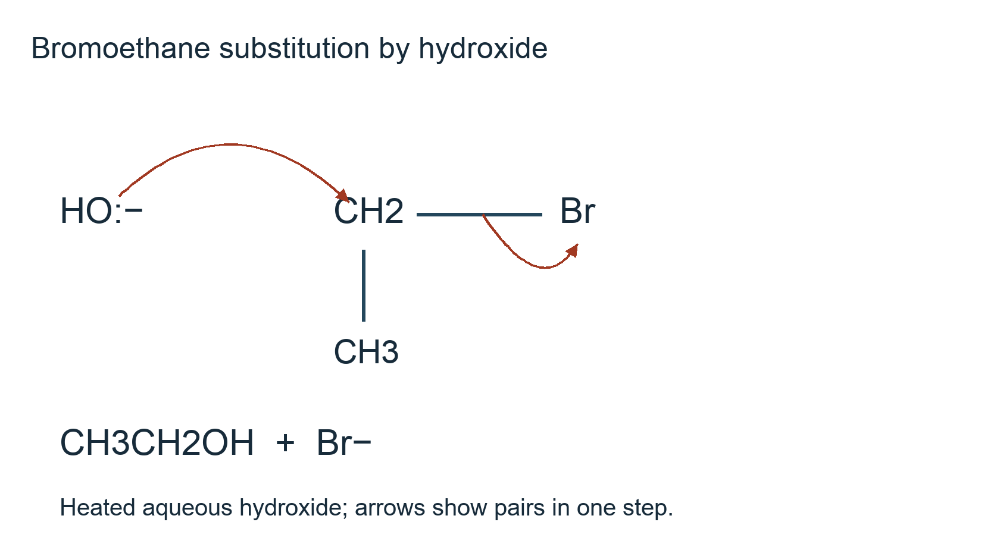

# 4.3 Halogen derivatives

*nam-8224-nsscas-2026. Offline study notes, rendered from the approved content units on 2026-10-22. Everything here is also what the flashcards are built from.*

---

## Halogen derivatives — 4.3.1

### Representing halogenoalkanes

A halogenoalkane, also called a haloalkane, has one or more hydrogen atoms of an alkane replaced by halogen atoms. The halogen is bonded to a saturated carbon. Write X as a placeholder for F, Cl, Br or I when discussing the family. A saturated open-chain monohalogenoalkane has general composition CnH2n+1X; if two hydrogens are replaced, the corresponding count is CnH2nX2. Do not apply the monohalogen count to a molecule containing several halogens.

Structural condensed notation CH3CH2Br shows bromoethane's two-carbon connection and terminal bromine. A displayed drawing shows each C–H, C–C and C–Br bond. In skeletal notation the carbon positions and carbon-bound hydrogens can be omitted, but the halogen label must be written. A line ending at a printed Br means a bond to bromine, not an additional carbon hidden under that label.

Molecular, empirical, structural condensed, displayed and skeletal forms serve different purposes. A molecular formula gives actual atom counts, an empirical formula gives their simplest ratio, and the remaining forms preserve connectivity with different amounts of detail. For bromoethane, C2H5Br alone does not display each bond. Supplying that count when asked to draw the displayed structure leaves the representation unfinished.

Carbon still needs four bond contributions: in CH3CH2Br the first carbon has three H and one C bond; the second has two H, one C and one Br bond. The neutral halogen has one covalent bond in this simple representation. Topic 4.2 supplies the hydrocarbon skeleton conventions, and this topic adds explicit halogen attachments without changing the valency-counting method.

### Naming halogen attachments

Choose the longest suitable carbon chain and name it as the parent alkane. Number the chain to obtain the lowest permitted sequence of substituent locants, comparing the first point of difference. The halogen prefixes are fluoro-, chloro-, bromo- and iodo-. A locant identifies the parent carbon carrying each halogen. Thus CH3CH2CH2CH2Cl is 1-chlorobutane, while CH3CHBrCH3 is 2-bromopropane.

Use di- or tri- when the same halogen appears more than once and give a locant for each occurrence. BrCH2CH2Br is 1,2-dibromoethane. Both numbers matter: 1,1-dibromoethane would put both bromines on one carbon and describe a different connectivity. A number records position, whereas di- records how many substituents of that type are present.

When different halogens occur, write their prefixes in alphabetical order. BrCH2CH2CH2Cl is 1-bromo-3-chloropropane: both numbering directions give the locant set 1,3, and the alphabetically earlier bromo receives the lower locant in this tie. Alphabetical order of prefixes is a writing rule; it does not mean their physical positions must follow that order along a drawing. Ignore multiplicative di- and tri- when ordering different substituent names.

Work backwards to check a proposed name: draw the parent, mark the stated carbon numbers, attach each halogen and complete hydrogen valencies. For 1,2-dibromoethane the two carbons each bear two hydrogens, giving BrCH2CH2Br. If the reconstruction does not match the given connectivity, revisit numbering or parent selection. Parent chains up to six carbons are used here, matching the syllabus naming range. Topic 4.1 introduces the shared stems and naming language.

### Counting halogen and hydrogen separately

Count the carbon skeleton, including branches, and then count every printed halogen label. At each carbon complete four bond contributions with hydrogen. A terminal carbon attached to another carbon and to Br has two hydrogens, not three. A carbon attached to two other carbons and one Br has one hydrogen. The halogen replaces a hydrogen attachment; it is not an extra group added on top of a completed CH3 carbon.

For CH3CHBrCH2Cl, the first carbon supplies three hydrogens, the middle carbon one and the terminal carbon two. The molecular count is C3H6BrCl. An open-chain propane skeleton would have eight hydrogens; replacing two by halogens leaves six, confirming the direct count. The structure is 2-bromo-1-chloropropane after lowest-locant numbering, illustrating that atom counting and naming ask related but distinct questions.

In a skeletal drawing, trace each unlabelled carbon end and vertex once. If a final line meets the printed symbol Cl, that endpoint is chlorine. Inventing an extra carbon there would increase both the carbon and hydrogen totals. Conversely, omitting a labelled halogen from the atom count gives the composition of a different substance even if the carbon count happens to agree.

A molecular formula records actual atom numbers, while an empirical formula records their simplest ratio. Structural condensed, displayed and skeletal forms additionally communicate connections. For BrCH2CH2Br, molecular C2H4Br2 reduces to empirical CH2Br; neither request is satisfied by accidentally giving the other. Molecular, empirical, structural condensed, displayed and skeletal representations should therefore be chosen deliberately. Topic 1.1 explains composition calculations from measurements, whereas the present method reads atoms directly from a supplied structure.

### Substitution and elimination use different routes

Heating bromoethane with aqueous sodium or potassium hydroxide gives ethanol by nucleophilic substitution: CH3CH2Br + OH− → CH3CH2OH + Br−. A hydroxide lone pair forms a bond to the electron-deficient carbon attached to Br while the C–Br bond pair goes to Br. Draw a full curved arrow from oxygen's lone pair to that carbon and a second from C–Br to Br. In this direct primary-halogenoalkane route, the changes occur together; there is no separate ethyl carbocation intermediate.

Heating bromoethane with ethanolic potassium or sodium cyanide gives CH3CH2CN, propanenitrile: CH3CH2Br + CN− → CH3CH2CN + Br−. The attacking carbon of cyanide becomes part of the organic product, so the chain gains one carbon. Heating with excess ethanolic ammonia favours ethanamine: CH3CH2Br + 2NH3 → CH3CH2NH2 + NH4Br. The first attack gives an alkylammonium species; another ammonia removes a proton. Excess ammonia favours attack by ammonia rather than further alkylation of the amine, although it does not guarantee a pure single product.

Heating 2-bromopropane with ethanolic hydroxide instead favours elimination. CH3CHBrCH3 + OH− → CH3CH=CH2 + H2O + Br−. The base removes hydrogen from a neighbouring carbon as the carbon–carbon double bond forms and Br leaves. Hydrogen and bromine are removed from adjacent carbons; they are not replaced by OH on the same carbon. Aqueous hydroxide favours the substitution preparation, while heated ethanolic hydroxide favours this elimination preparation. Carry solvent and heating information with the predicted product. Topic 4.4 studies the resulting alcohol chemistry; Topic 4.2 studies the resulting alkene.

---

## Halogen derivatives — 4.3.2

### Interpreting hydrolysis reactivity

Compare halogenoalkanes with the same carbon skeleton under matched temperature, solvent composition and reagent concentration. Changing several factors at once would make a rate difference ambiguous. For analogous alkyl compounds, hydrolysis tends to become faster in the order fluoroalkane, chloroalkane, bromoalkane, iodoalkane. The C–halogen bond becomes weaker down that sequence, making the required bond breaking easier in the relevant reaction pathway.

The C–F bond is strongly polar because fluorine is much more electronegative than carbon, but it is also particularly strong. A prediction based on polarity alone would therefore be misleading. An iodoalkane can hydrolyse more rapidly than its fluoro analogue despite the C–I bond's smaller polarity. The explanation must consider the energy and pathway for bond cleavage, not just the partial positive charge at carbon.

Suppose equal concentrations of chloroethane, bromoethane and iodoethane are compared in the same solvent at the same temperature. If the measured times to a defined equal extent of reaction are 150 s, 45 s and 12 s, the iodo compound reaches that endpoint fastest. This evidence supports faster hydrolysis under the stated settings; it is not a claim that a reaction time is a universal constant for that compound. Changing the endpoint would change the times used in the comparison.

Keep the carbon skeleton matched because substitution pattern can affect mechanism and rate. The simple halogen trend is not a licence to rank arbitrary primary, secondary and tertiary molecules using just one bond-energy number. Topic 2.4 supplies the broader kinetic reasoning, and the final section here distinguishes bond energy, bond length and polarity as different properties.

### Uses depend on resistance during service

Fluorinated compounds can be relatively resistant to chemical attack because C–F bonds are strong. A molecule that remains stable during use can be useful where unwanted reaction would damage equipment or contaminate a material. Fluorohalogenoalkanes were historically used as refrigerants and aerosol propellants partly because of their relative chemical inertness during normal service. Their physical properties, including suitable volatility, also mattered: bond strength alone does not explain the complete engineering choice.

Relative inertness needs a setting. Resistance to reaction in the lower atmosphere or inside equipment does not mean resistance to energetic ultraviolet radiation in the stratosphere. A chlorofluoroalkane can survive long enough to be transported upwards and then undergo photochemical C–Cl cleavage. Its C–F bonds being strong does not prevent a different bond in the molecule from breaking. Treating the molecule as if all its bonds had fluorine's bond strength would miss the ozone problem.

An explanation of a use should connect a material property to the application. For a refrigerant example, stability under ordinary operating settings limits unwanted chemical reaction, while evaporation and condensation transfer thermal energy. It is insufficient to say “it contains fluorine, therefore it is useful” without identifying the relevant property and task. Equally, usefulness in one setting does not establish environmental suitability after release.

The next sections explain the separate ozone consequence and the development of replacement compounds. The discussion is historical and conceptual; it does not claim that a particular substance is currently permitted in a jurisdiction or recommend a refrigerant for a modern installation. Such a choice would require additional engineering and current regulatory information beyond the chemistry comparison taught here.

### Chlorofluoroalkanes and stratospheric ozone

Stratospheric ozone absorbs ultraviolet radiation that would otherwise reach Earth's surface in greater amounts. Ozone depletion means a reduction in that protective ozone concentration. Chlorofluoroalkanes, often called CFCs, can be sufficiently persistent in the lower atmosphere to reach the stratosphere. Energetic ultraviolet radiation there can break a C–Cl bond homolytically and release a chlorine radical.

One simplified catalytic cycle is Cl• + O3 → ClO• + O2, followed by ClO• + O → Cl• + O2. Adding the two steps cancels Cl• and ClO• and gives O3 + O → 2O2. Chlorine radical is regenerated, so its effect is not limited to removing one ozone molecule and then becoming permanently used up. This example uses atomic oxygen already present in stratospheric photochemistry; the second step is not a claim that atomic oxygen is the main bulk form of atmospheric oxygen.

The consequence is reduced shielding from harmful ultraviolet radiation. Keep this chain of reasoning distinct from the enhanced greenhouse effect, which concerns absorption of outgoing infrared radiation. The same broad environmental discussion can include both, but they are different mechanisms involving different radiation and atmospheric roles. Ozone also has a different effect near the ground, where it contributes to air pollution; its usefulness in the stratosphere does not make ground-level ozone desirable.

When a compound contains fluorine and chlorine, identify which bond supplies the relevant radical rather than assuming that fluorine is responsible because C–F is polar. The stability of the original molecule during ordinary service can help it reach the region where photolysis occurs. Topic 4.2 provides radical-chain language, while the preceding section shows why an apparently useful property can have a different consequence after environmental release.

### Replacement compounds and ozone recovery

Replacement compounds were developed to preserve useful applications while reducing damage to stratospheric ozone. One structural approach is to avoid chlorine in a refrigerant molecule, so it cannot supply chlorine radicals by C–Cl photolysis. Hydrofluorocarbons contain hydrogen, fluorine and carbon but no chlorine. They illustrate how changing molecular composition can remove the specific chlorine-based ozone-destruction route associated with CFCs.

Some earlier replacement families retained chlorine but incorporated hydrogen, which can make lower-atmosphere breakdown more likely. Such a change can reduce the fraction reaching the stratosphere, but retaining chlorine means the compound should not be described as structurally incapable of releasing chlorine radicals. Distinguish a reduced contribution from complete removal of a proposed source.

Reduced input of ozone-destroying substances allows natural ozone formation and destruction processes to move towards recovery. It does not imply that previously released persistent molecules disappear immediately or that adding a replacement repairs ozone directly. The replacement reduces further damaging input; atmospheric processes then determine the timescale. This explanation does not depend on claiming a current measured size of the ozone hole or forecasting a particular recovery year.

A compound with no chlorine can still absorb infrared radiation and contribute to warming. Evaluating ozone depletion and greenhouse impact therefore requires two separate questions. For example, the structural observation that a candidate refrigerant contains C, H and F but no Cl supports absence of its chlorine-radical source. It supplies no numerical information about atmospheric lifetime or warming effect. A careful conclusion states what the evidence establishes and what additional properties would be needed for a complete comparison, rather than calling a replacement environmentally harmless from one structural feature.

### Energy, length and polarity are different comparisons

Bond energy is the energy required to break one mole of a specified covalent bond in gaseous species; tabulated mean bond energies average over suitable molecular environments. Breaking bonds requires energy. Bond length is the distance between the bonded nuclei at their stable separation, commonly expressed in picometres. Bond polarity is unequal sharing of the bonding electron density because the bonded atoms differ in electronegativity. It is indicated by partial charges, not by assigning complete ionic charges to a neutral covalent molecule.

For comparable carbon–halogen bonds, the halogen atom becomes larger from F to I, so C–halogen length increases. Bond strength generally decreases along C–F, C–Cl, C–Br, C–I. This is a trend within a specified related family, not a universal mathematical rule linking the length of any two unrelated bonds to their reaction rate. Electronic structure and the rest of each molecule also matter.

The halogen attracts the C–halogen pair more strongly than carbon does, leaving carbon δ+ and halogen δ−. A nucleophile can donate a pair to that electron-deficient carbon. However, the particularly strong C–F bond resists breaking even though it is very polar. Thus “more polar” and “more easily hydrolysed” are different judgments and can lead to different rankings.

As a worked interpretation, suppose analogous compounds have supplied C–X breaking energies 340 and 240 kJ mol−1. The lower value represents easier isolated gaseous bond breaking, but neither number alone specifies the whole activation barrier in solution. Use it alongside the matched hydrolysis evidence and settings. Topic 1.3 explains electronegativity and bond polarity, Topic 2.1 uses bond energies in overall enthalpy estimates, and Topic 2.4 distinguishes those estimates from the kinetic barrier determining rate.
