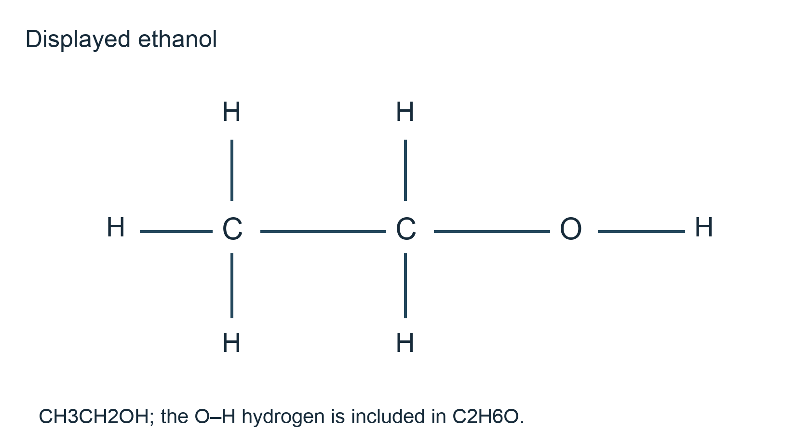

# 4.4 Hydroxyl compounds

*nam-8224-nsscas-2026. Offline study notes, rendered from the approved content units on 2026-10-22. Everything here is also what the flashcards are built from.*

---

## Hydroxyl compounds — 4.4.1

### Representing the alcohol families

An alcohol has a hydroxyl group, –OH, attached to a saturated carbon. For an open-chain saturated molecule with one hydroxyl group and no other functional group, the general composition is CnH2n+2O, also written CnH2n+1OH. The hydrogen on oxygen is part of the total hydrogen count. This relationship does not apply without qualification to molecules containing rings, additional multiple bonds or several hydroxyl groups.

Structural condensed notation CH3CH2OH makes ethanol's connections clear: two carbon atoms lead to O–H. A displayed drawing must show the C–O and O–H bonds, together with each C–H bond. In skeletal notation the carbon skeleton can omit carbon-bound hydrogen, but O and its attached H must remain explicit. Molecular, empirical, structural condensed, displayed and skeletal forms answer different requests: a molecular formula gives actual counts, an empirical formula their simplest ratio, and the other forms retain connectivity.

The local environment of the carbon bearing OH distinguishes alcohol classes. CH3CH2OH is primary because that carbon has one carbon neighbour. CH3CH(OH)CH3 is secondary because it has two, while (CH3)3COH is tertiary because it has three. The oxygen has one bond to carbon and one to hydrogen in each example; classifying by oxygen's two bonds would not distinguish them.

Keep branches and OH on their specified atoms when converting representations. In the tertiary example the central carbon has no attached H: it is bonded to three methyl carbons and oxygen. Drawing an additional H there would give five single bonds. Topic 4.1 supplies representation conventions, while the classification section below connects the OH-bearing carbon's attachments to oxidation behaviour.

### Naming the hydroxyl position

Choose the longest suitable chain containing the carbon attached to OH and use the ending –ol. Number from the end giving the hydroxyl group its lowest permitted locant. The one-to-six-carbon parent stems are meth-, eth-, prop-, but-, pent- and hex-. Methanol and ethanol have no distinct alternative hydroxyl position after equivalent end numbering. Longer chains can require a number: CH3CH2CH2OH is propan-1-ol and CH3CH(OH)CH3 is propan-2-ol.

The locant belongs immediately before –ol in the naming style used here. For CH3CH2CH(OH)CH3, start numbering from the end nearer OH and obtain butan-2-ol. Butan-3-ol would describe the same connections with unnecessarily high numbering. Position is read from the molecular connections, not from which end happens to be printed on the left.

Branches are included as prefixes with their own locants. (CH3)2CHCH2OH is 2-methylpropan-1-ol: a three-carbon parent includes the OH-bearing carbon, and carbon 2 has a methyl substituent. (CH3)3COH is 2-methylpropan-2-ol. Both contain four carbons altogether but differ in the OH-bearing carbon's attachments. The names distinguish those connections instead of merely announcing a total atom count.

To check a name, draw the numbered parent, attach OH at the stated carbon and add the substituents. Complete valencies last, including O–H. Reconstructing propan-2-ol gives one hydrogen on the OH-bearing carbon, whereas reconstructing 2-methylpropan-2-ol gives none there. Naming and classification thus provide useful independent checks, but neither replaces the requested drawing or molecular count when a question asks for those forms. Topic 4.2 uses related locant reasoning for carbon–carbon double bonds.

### Counting atoms without losing the OH hydrogen

Count all carbon atoms, including methyl branches, then count oxygen and hydrogen separately. Carbon has four bond contributions; neutral alcohol oxygen has two single bonds, normally one to carbon and one to hydrogen. The hydrogen in OH can be overlooked when expanding a skeletal drawing, so include it explicitly in the final total. Classifying a molecule as primary, secondary or tertiary does not change this accounting method.

For CH3CH(OH)CH2CH3, two CH3 groups supply six hydrogen atoms, the OH-bearing CH supplies one, CH2 supplies two and OH supplies one. The total is ten, giving C4H10O. For (CH3)3COH, three methyl groups supply nine hydrogens and OH supplies one; the central carbon supplies none. The result is also C4H10O. Equal composition therefore does not prove equal connectivity or equal alcohol class.

For a saturated open-chain alcohol with one OH, use CnH2n+2O as a check after reading the structure. With n=4 it predicts H10, matching both examples. This check cannot locate OH or distinguish a branched structure from an unbranched one. It is also not a replacement for reading additional functional groups if the given molecule contains them.

A molecular formula states the actual numbers, while an empirical formula gives the simplest whole-number ratio. Structural condensed, displayed and skeletal forms show connections in different detail. Molecular, empirical, structural condensed, displayed and skeletal answers are therefore not interchangeable. In ethanol the molecular count C2H6O cannot be reduced further; this coincidence does not make the two definitions identical. Topic 1.1 develops composition from mass data. Here the evidence is the supplied connectivity, and a correct answer follows from completing each atom's allowed bonding.

### Ethanol as a reaction hub

Complete combustion is CH3CH2OH(l) + 3O2(g) → 2CO2(g) + 3H2O(g) for hot gaseous water. Ethanol can therefore act as a fuel. In substitution with hydrogen bromide under suitable heated acidic settings, CH3CH2OH + HBr → CH3CH2Br + H2O. The OH-derived group is replaced by bromine; this differs from replacing the hydrogen on oxygen in the reaction with sodium.

With sodium, 2CH3CH2OH + 2Na → 2CH3CH2O−Na+ + H2. The product is sodium ethoxide and hydrogen gas. The carbon skeleton and C–O connection remain, while the O–H hydrogen is removed. The whole molecule does not become a sodium atom with an attached hydrocarbon, and OH− is not the stated organic product.

Warm acidified dichromate(VI) oxidises ethanol. Controlled oxidation with removal of volatile ethanal as it forms gives CH3CH2OH + [O] → CH3CHO + H2O. Heating under reflux with excess oxidant permits further oxidation: CH3CH2OH + 2[O] → CH3COOH + H2O. Acidified dichromate changes from orange towards green as it is reduced. Distillation removes the aldehyde; reflux returns volatile material so reaction can continue. The choice changes the intended organic endpoint.

Dehydration eliminates water to give ethene: CH3CH2OH → CH2=CH2 + H2O. Heating with concentrated sulfuric acid, around 170°C for this conventional preparation, supplies a suitable dehydration setting. Passing ethanol vapour over heated aluminium oxide is an alternative catalytic route. Merely naming dilute acid does not specify the concentrated-acid dehydration preparation. The concentration and heating distinguish the stated route from mixing ethanol with a dilute aqueous acid.

Esterification with ethanoic acid gives CH3COOH + CH3CH2OH ⇌ CH3COOCH2CH3 + H2O using an acid catalyst and heating. The ester is ethyl ethanoate. At fixed temperature, equilibrium means the reaction need not consume all starting material. Topic 4.7 develops ester structure and hydrolysis; here recognise the alcohol's role and preserve the balance in each reaction.

For a stoichiometric example, the sodium equation shows that 0.200 mol ethanol produces at most 0.100 mol hydrogen when sodium is in excess and reaction is complete. Divide the alcohol amount by two because two O–H hydrogens combine to make each H2 molecule. The ratio follows the balanced equation, not the number of carbon atoms.

### Classifying the carbon carrying OH

Locate OH, then identify the carbon directly bonded to its oxygen. Count the carbon atoms directly attached to that carbon. One gives a primary alcohol, two a secondary alcohol and three a tertiary alcohol. This is a local count. The total length of the molecule and the number of hydrogens elsewhere in the chain do not determine the class. Methanol has no attached carbon group but is conventionally treated with primary alcohols for its oxidation behaviour.

In CH3CH2CH2CH2OH, the OH-bearing carbon is at an end and touches one other carbon, so butan-1-ol is primary. In CH3CH(OH)CH2CH3, that carbon touches two carbons, making butan-2-ol secondary. In (CH3)3COH, it touches three methyl carbons, making 2-methylpropan-2-ol tertiary. All three examples contain one OH group; “tertiary” does not mean three hydroxyl groups.

The same local count shows how much hydrogen is attached to the OH-bearing carbon. A usual primary RCH2OH has two, a secondary R2CHOH has one, and a tertiary R3COH has none. These patterns help explain the simple oxidation outcomes: forming a carbonyl by removal of the O–H hydrogen and a hydrogen on the same carbon is possible for the first two types. The tertiary type lacks that second hydrogen.

Practise circling the relevant carbon before assigning a class, particularly in branched structures. For (CH3)2CHCH2OH the branched carbon is not the OH-bearing carbon; the terminal CH2OH still makes it primary. This prevents a neighbouring branch from being mistaken for a tertiary alcohol centre. The next section applies the classification to distinguishing reactions, while Topic 4.6 develops the carbonyl products formed by oxidation.

### Distinguishing alcohols by oxidation

Warm a suitable alcohol with acidified dichromate(VI) in the school oxidation comparison. Primary and secondary alcohols reduce the oxidant as they are oxidised, so an orange-to-green change supports reaction. A tertiary alcohol normally does not undergo the corresponding mild oxidation because its OH-bearing carbon lacks hydrogen. This is a statement about the specified mild route, rather than a claim that severe oxidation could not break other bonds.

A primary alcohol can give an aldehyde and then a carboxylic acid. A secondary alcohol gives a ketone. For propan-1-ol, controlled oxidation produces propanal, CH3CH2CHO; further oxidation produces propanoic acid. Propan-2-ol gives propanone, CH3COCH3. Keeping the carbon skeleton intact provides a useful check on the oxidation products. An unexpected extra carbon in a proposed product would require an additional reagent or reaction not supplied here.

Suppose samples A and B both change orange dichromate to green, while C does not under matched mild settings. This supports reactive primary or secondary structures for A and B and, among the stated alcohol candidates, a tertiary structure for C. It does not decide which of A and B is primary, because both types react. Additional identification of an aldehyde versus ketone product is required. Topic 4.6 develops the structures of those carbonyl products.

State an observation separately from a conclusion. “Orange becomes green” is observable; “it is secondary” is a structural inference that needs adequate discrimination. To compare samples, match temperature, reagent concentration and observation time. A negative result from a cold mixture or insufficient mixing cannot be treated as an equally controlled comparison. The best distinguishing reaction is one whose different outcomes separate the actual candidate structures given, rather than a memorised colour change applied without checking what it distinguishes.

### The alkaline iodine test identifies a local arrangement

An alcohol containing CH3CH(OH)R can be oxidised under the alkaline iodine test to a methyl carbonyl arrangement and then form triiodomethane, CHI3. The positive observation is a yellow precipitate, not merely disappearance of iodine colour or a yellow solution. Triiodomethane is also called iodoform. Write its identity clearly: three iodines and one hydrogen are attached to its single carbon.

Propan-2-ol, CH3CH(OH)CH3, and butan-2-ol, CH3CH(OH)CH2CH3, have the required local arrangement and give positive results with warm alkaline aqueous iodine. Ethanol also gives the test: it is oxidised to ethanal, which has the required CH3CO– arrangement for the subsequent reaction. This special primary alcohol must not be rejected simply because the other familiar positive alcohol examples are secondary.

Pentan-3-ol, CH3CH2CH(OH)CH2CH3, is secondary but lacks a methyl group directly attached to its OH-bearing carbon, so it does not give the corresponding positive alcohol test. Likewise, primary propan-1-ol lacks the required arrangement. Thus a positive result is not a general test for alcohols or even for all secondary alcohols. Inspect the local connections around OH rather than counting methyl groups somewhere else in the molecule.

For an original discrimination, a four-carbon alcohol gives a yellow CHI3 precipitate and is known to be secondary. Butan-2-ol fits both pieces of evidence. The test alone would not have established a unique structure without those restrictions. Nor is the precipitate 2-iodobutane: the alcohol's entire chain has not simply had OH replaced by I. Topic 4.6 connects the test with carbonyl structure. Record reagent, warmth, the solid observation and its chemical identity before drawing the structural conclusion.

### Why alcohols can act as solvents

An alcohol combines a polar hydroxyl group with a hydrocarbon group. Its OH can form hydrogen bonds with water and compatible solutes, while its carbon-containing part provides interactions with less polar substances. This combination allows suitable alcohols to dissolve a range of materials that would not all dissolve equally well in water alone. Dissolution is explained through favourable solute–solvent interactions, not by assuming the alcohol chemically destroys each dissolved substance.

Short-chain alcohols have a relatively large polar contribution and mix well with water. As the hydrocarbon portion becomes larger, its non-polar character becomes more influential and water solubility generally decreases within comparable alcohols. Consequently “contains OH” does not establish unlimited miscibility for an arbitrary long-chain alcohol. Both the molecule's structure and the identity of the solute need consideration.

In cosmetics, a suitable alcohol can help dissolve selected ingredients and distribute them through a formulation; volatility can also assist drying after application. This explains a solvent role and does not assert that all alcohols are appropriate for skin products. In the syllabus's coal application, an alcohol-based solvent can extract compatible soluble sulfur-containing compounds into the solvent phase. Extraction transfers those compounds for later separation. It does not mean that all forms of sulfur, including insoluble mineral material, are removed just by dissolving coal in any alcohol.

Suppose an invented materials laboratory observes that a selected sulfur-containing organic solute dissolves in its chosen alcohol but poorly in water. The supported explanation invokes the balance of polar and hydrocarbon interactions. The observation supplies no percentage removal for a whole coal sample, because that sample may contain other sulfur forms and an inaccessible solid matrix. Topic 1.3 explains hydrogen bonding; Topic 4.3 distinguishes chemical substitution from the physical separation involved here. A useful solvent claim names what is dissolved and the setting in which the solvent works.
