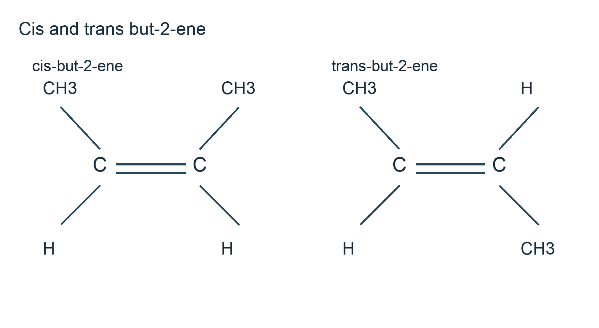
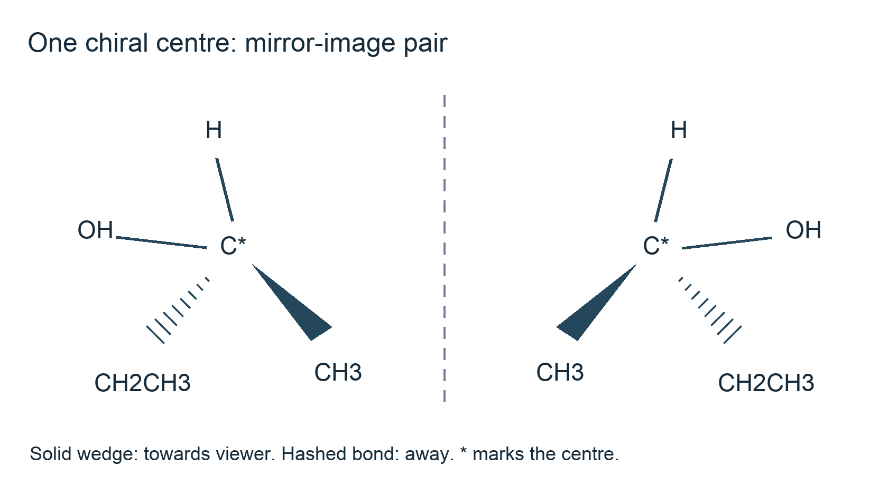

# 4.5 Isomerism: structural and stereoisomerism

*nam-8224-nsscas-2026. Offline study notes, rendered from the approved content units on 2026-10-22. Everything here is also what the flashcards are built from.*

---

## Isomerism: structural and stereoisomerism — 4.5

### Enumerating structures systematically

Begin with the molecular composition and any class restriction in the question. The same atom count can sometimes describe several families, so “all isomers” needs the stated scope. A molecular formula gives actual counts, an empirical formula their simplest ratio; structural condensed, displayed and skeletal forms reveal connectivity. Keep these molecular, empirical, structural condensed, displayed and skeletal representations distinct while checking that a proposed drawing has the required atom count.

For C4H10 as an open-chain alkane, arrange four carbons first in an unbranched route and then in a branched skeleton. The distinct possibilities are butane, CH3CH2CH2CH3, and 2-methylpropane, (CH3)3CH. Fill hydrogens to valency four. Drawing butane in a different zigzag or reversing its left-to-right order does not create another connectivity. The two names make it easier to detect duplicate drawings.

For C4H8 restricted to open-chain alkenes with one double bond, use an unbranched four-carbon skeleton and move C=C between inequivalent positions. This gives but-1-ene, CH2=CHCH2CH3, and but-2-ene, CH3CH=CHCH3. Putting the bond at the opposite terminal end repeats but-1-ene. A branched skeleton supplies 2-methylpropene, CH2=C(CH3)2. These are three structural connectivities. Saturated rings are outside this particular question's stated open-chain restriction, rather than being impossible with C4H8.

Now inspect each connectivity for spatial alternatives. But-2-ene has cis and trans forms; the other two have a double-bond carbon with identical attachments and do not give this pair. Thus there are four distinct alkene forms when those two are counted separately. Record whether your total counts connectivities or includes stereoisomers. Check atom numbers, valencies, parent names and duplication at each stage. Topic 4.2 provides naming and composition tools; the later sections here explain the spatial test used in this enumeration.

### Three kinds of structural isomerism

Structural isomers have the same molecular composition but a different arrangement of connections between atoms. Chain isomerism changes the carbon skeleton. Butane and 2-methylpropane both contain four carbons and ten hydrogens, but the first has an unbranched route and the second a carbon attached to three methyl groups. Their difference is not merely that one drawing looks straighter on a page.

Positional isomerism keeps the basic carbon skeleton and functional-group type but changes the position of a group or multiple bond. Propan-1-ol and propan-2-ol both have three-carbon chains and one OH, but OH is attached at an end in one and at the middle carbon in the other. But-1-ene and but-2-ene supply the corresponding double-bond example. Both members of each pair have matching total atom counts.

Functional-group isomerism changes the functional group while retaining total composition. Ethanol, CH3CH2OH, and methoxymethane, CH3OCH3, both have C2H6O. One has an O–H bond as an alcohol; the other has C–O–C connectivity as an ether. This example identifies a family difference; it does not require learning an extra ether reaction scheme. The oxygen's position among the connections supplies the distinguishing evidence.

To assign a type, compare the carbon skeleton, then the functional group and its position. A change in the way a molecule is oriented in space without changing which atoms bond belongs to another comparison. Turning a sheet upside down or rotating a flexible single bond can produce a different-looking sketch of the same compound. Name both drawings and trace each atom's neighbours before counting them separately. A matching molecular atom count is necessary for an isomer pair, but is insufficient: two identical drawings after reorientation also have matching counts. Topic 4.1's functional-group vocabulary helps identify what has actually changed.

For a final duplicate check, label the carbon atoms temporarily and follow the route between branch points or functional groups. Two sketches that can be matched atom for atom with the same neighbours represent one connectivity, even if one has been bent on the page. Remove the temporary labels before giving the chemical structure. By contrast, moving OH from an end carbon to an internal carbon changes its neighbours and gives a positional pair. This method keeps visual appearance separate from the evidence used to classify the isomers.

### Same connections, different arrangement in space

Stereoisomers have the same structural connections but a different arrangement of atoms in space. They also have the same molecular composition. The two divisions used here are geometrical, or cis–trans, isomerism and optical isomerism. A spatial difference must survive attempts to rotate the entire molecule into coincidence; a different viewing angle is not by itself a new stereoisomer.

In but-2-ene the two methyl groups can lie on the same side of C=C or opposite sides. Both structures have the same sequence CH3–CH=CH–CH3. Nothing has been moved from one carbon to another, so this is not positional isomerism. They differ in the arrangement held by the double bond: cis has the methyl groups on the same side and trans has them on opposite sides.

Optical isomers in the simple one-centre examples are a pair of non-superimposable mirror images, called enantiomers. A tetrahedral carbon attached to four different groups provides a common source. A pure member can rotate the plane of plane-polarised light; the corresponding pure mirror form rotates it equally in the opposite direction under matched settings. Equal amounts of the two can cancel the net rotation. This cancellation concerns the sample, not disappearance of the chiral centres in its molecules.

The diagnostic questions differ. For cis–trans, inspect C=C and compare attachments at each end. For the optical examples, inspect a tetrahedral centre and compare its four groups. Do not label any two differently drawn molecules “optical” merely because they have the same counts. Likewise, a cis–trans pair is not automatically a mirror-image pair. The following sections develop the restricted-rotation and four-different-groups tests without adding a new stereochemical naming system.

### Restricted rotation makes cis and trans distinct

A carbon–carbon double bond prevents the free rotation characteristic of a simple carbon–carbon single bond. Twisting the two alkene ends relative to one another would disrupt the π bonding interaction and requires a substantial energy input. Under ordinary settings the cis and trans structures therefore remain distinct rather than continuously exchanging through easy rotation about intact C=C.

Restriction alone is not enough to give two distinguishable forms. Each double-bond carbon must have two different attached groups. But-2-ene meets that test: each carbon has H and CH3. The methyl groups can be on the same side, cis, or opposite sides, trans. In propene, one double-bond carbon has two H atoms. Interchanging those identical hydrogens gives the same arrangement, so propene does not form a cis/trans pair. Likewise CH2=C(CH3)2 fails the test at its CH2 end and at its two-methyl end.

When drawing the but-2-ene pair, put C=C horizontally, give each carbon one H and one CH3, and keep three bonding directions around each alkene carbon. In the cis drawing both methyl labels are above, or both below, the double bond. In trans one is above and the other below. Reversing the entire drawing does not convert cis to trans, because the same-side or opposite-side relationship is unchanged.

Avoid saying simply that cis–trans is caused by molecules being unable to move. Molecules can translate, rotate as whole objects and rotate around other bonds; the relevant constraint is relative rotation about the double bond. That is why a freely rotating butane sketch does not supply an analogous isolable pair just by showing its methyl groups in two positions on paper. Topic 4.1 describes local planar alkene geometry, and Topic 4.2 supplies the names used to identify which bond is under discussion.

### A tetrahedral centre with four different groups

A chiral centre in the carbon examples taught here is a tetrahedral carbon attached to four different groups. The groups need not begin with four different elements: two can both begin with carbon but differ farther along their connections. For butan-2-ol, the OH-bearing carbon has H, OH, CH3 and CH2CH3. These are four different groups, making that carbon a chiral centre.

Its mirror image has the same atom connections but cannot be placed on the original so that all four groups coincide by rotating the whole molecule. A simple pair of such non-superimposable mirror images gives optical isomerism. A wedge represents a bond towards the viewer, a hashed bond one away, and ordinary lines bonds in the page. A flat four-arm cross without a depth convention does not demonstrate the tetrahedral mirror relationship adequately.

Propan-2-ol does not have this centre because its OH-bearing carbon has two identical methyl groups. A CH2 carbon also has two identical H atoms. Neither becomes chiral simply because the other two groups look different. In a candidate with a longer branch, trace each attached group far enough to decide whether it is genuinely different. The plus or minus sign for measured light rotation cannot be assigned from a wedge drawing by guessing which group lies to the right.

Some molecules contain more than one chiral centre. Identify each candidate locally by its four attachments, but do not assume that the count of centres alone completely describes the whole molecule's optical behaviour. The syllabus does not require a fuller multi-centre classification. The essential transfer here is to inspect actual connections and show depth correctly in a one-centre pair. Topic 4.4 supplies the alcohol structures used in these examples; the centre remains a geometric property rather than a separate alcohol reaction.

### Applying both structural tests

Use two separate inspection routes on a supplied structure. First mark each C=C and inspect the two groups attached at each end. If either end has identical groups, the simple geometrical pair is absent at that bond. If both ends have different groups, the relevant same-side and opposite-side arrangements can be considered where the cis/trans description is unambiguous. Do not infer this property merely from the appearance of two parallel bond lines.

Second inspect tetrahedral carbons. A carbon carrying two H atoms fails the four-different-groups test immediately. A carbon with four different attachments is a candidate chiral centre; mark that atom with an asterisk and identify the groups. The alkene carbons themselves have three attachment directions and are not the tetrahedral centres in this test. Thus the presence of a double bond does not automatically establish a chiral carbon.

For CH3CH=CHCH(OH)CH2CH3, the C=C carbons each have one H and one different carbon-containing group, so geometrical alternatives are possible. The OH-bearing carbon has H, OH, an ethyl group and an unsaturated three-carbon group. Those attachments are different, making it a chiral centre. The example illustrates that both kinds of structural feature can occur in one molecule without requiring a complete catalogue of its spatial forms.

By contrast, CH2=CHCH2OH has a terminal CH2 at the double bond and a CH2OH carbon. It fails the geometrical test because one alkene end has two H, and it fails the tetrahedral test because the alcohol carbon also has two H. State the specific duplicated group when rejecting a candidate. This is more informative than saying that the molecule is “too small” or “not symmetrical enough”. Throughout, preserve atom connections before discussing space: a change in OH position or carbon skeleton would create a structural comparison rather than a different arrangement of the same connections.
