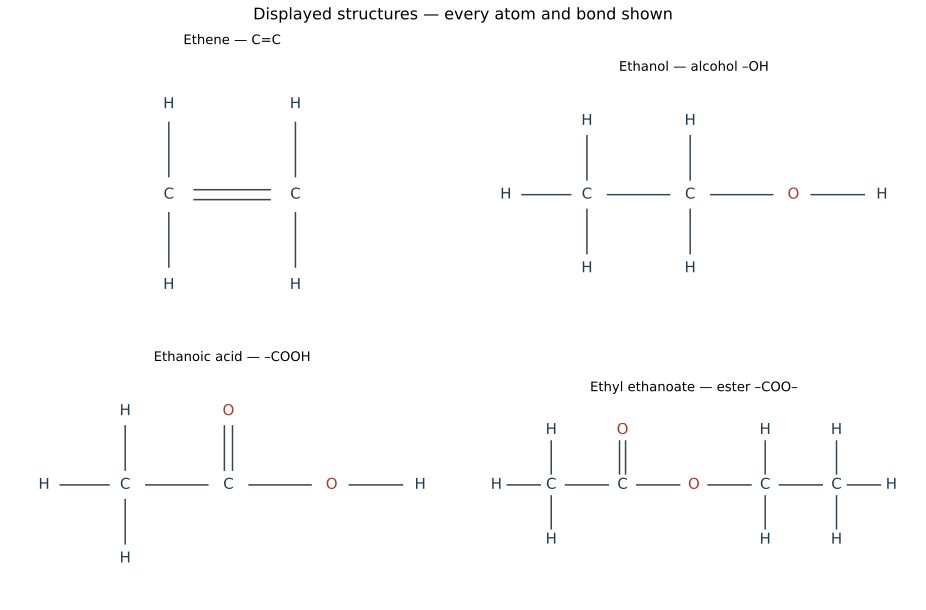
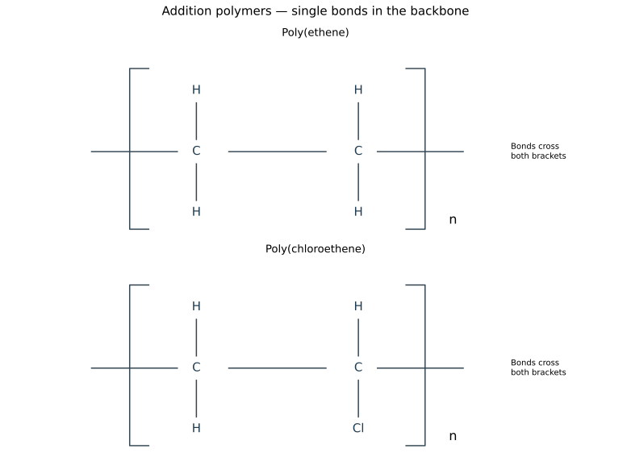
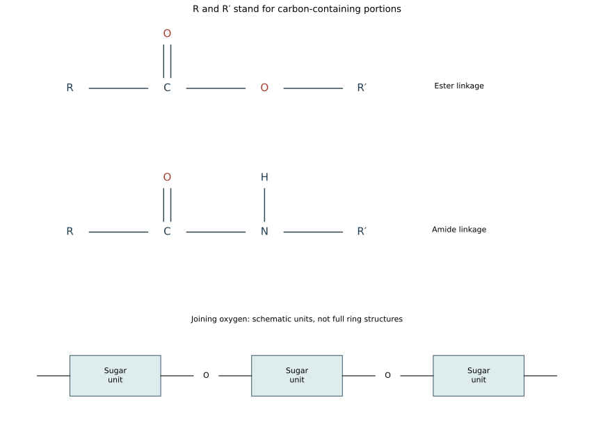
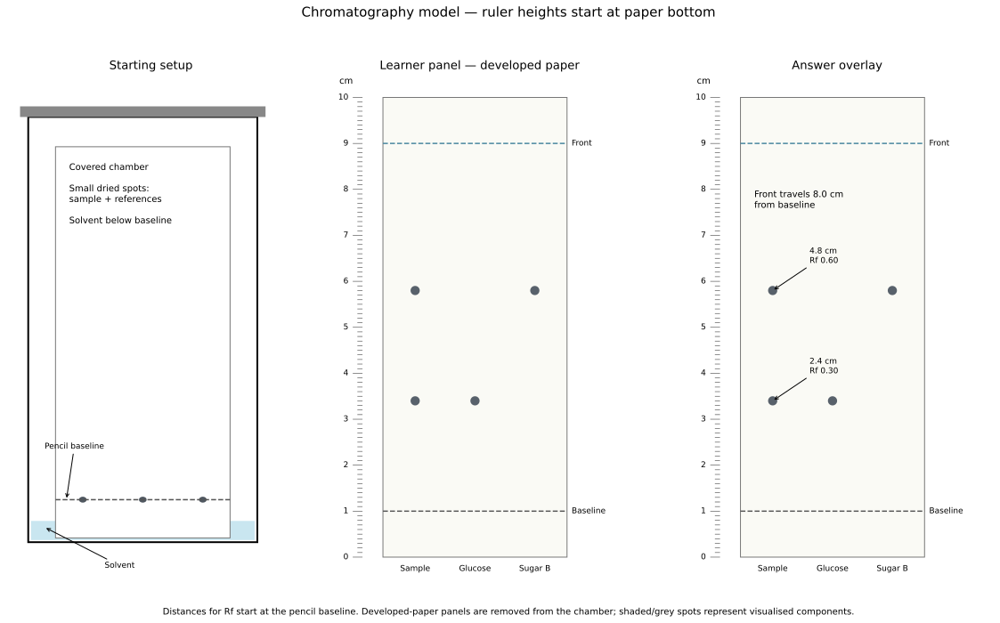

# 10 Organic chemistry

*NSSCO Chemistry 6117 — study notes. Worked examples teach methods; assessment tasks are supplied separately.*

---

## 10.1 — Names of compounds

### Reading and building organic names

An organic name is a compact description of a structure. Start with the number of carbon atoms: meth- means one, eth- two, prop- three and but- four. The ending identifies the family. For the unbranched alkanes, methane, ethane, propane and butane have condensed structures CH4, CH3CH3, CH3CH2CH3 and CH3CH2CH2CH3. Each carbon makes four bonds. A single line counts as one bond, a double line as two. In a displayed structure show every atom and every bond, including C–H and O–H bonds; a condensed formula groups those bonds to save space.

An alkene needs at least two carbons because it contains C=C. Ethene is CH2=CH2 and propene is CH2=CHCH3. But-1-ene is CH2=CHCH2CH3; but-2-ene is CH3CH=CHCH3. Number the chain from the end giving the double bond the smaller number. Alcohols include methanol CH3OH, ethanol CH3CH2OH, propan-1-ol CH3CH2CH2OH and propan-2-ol CH3CH(OH)CH3. The four-carbon unbranched alcohols are butan-1-ol and butan-2-ol. Their OH group belongs to an alcohol when it is not part of COOH. Methanoic acid HCOOH, ethanoic acid CH3COOH, propanoic acid CH3CH2COOH and butanoic acid CH3CH2CH2COOH each include the carboxyl carbon in the chain count. Ethyl ethanoate, CH3COOCH2CH3, has two carbon fragments joined by an ester linkage. Check the functional group before counting: an oxygen between two fragments does not join them into a single uninterrupted carbon chain.

### Functional groups and endings

A functional group is the atom or group of atoms responsible for a family's characteristic chemical reactions. In a simple alkene it is the carbon–carbon double bond, C=C. In an alcohol it is the hydroxyl group, –OH, bonded to a saturated carbon. A carboxylic acid contains the complete –COOH group, written more explicitly as –C(=O)–OH. An alkane contains carbon and hydrogen with single carbon–carbon bonds; it has no separate reactive functional group of the kinds just listed. The ending -ane therefore identifies the saturated hydrocarbon family.

Names ending in -ene, -ol and -oic acid usually identify the alkene, alcohol and carboxylic-acid families studied here. Use the full structure if one is supplied. Seeing OH somewhere in a formula is not sufficient to call the compound an alcohol: ethanoic acid contains an OH within COOH, and its reactions are those of a carboxylic acid. Similarly an ester contains –C(=O)–O– between carbon-containing groups, not a free carboxyl OH. Classification should explain the relevant bond or group rather than rely on how the whole molecule looks on the page. A rotated drawing represents the same compound when its connections are unchanged.

### Displayed functional groups

Full bonds in ethene, ethanol, ethanoic acid and ethyl ethanoate. These labelled diagrams are answer and teaching references; attempt drawing tasks before consulting them.

---

## 10.2.1 — Fractional distillation of petroleum

### Three fossil fuels

Coal, natural gas and petroleum are important fossil fuels. They formed from ancient organic material over geological time. Coal is a carbon-rich solid with other substances present; natural gas is a gaseous fuel mixture; petroleum, also called crude oil, is a liquid mixture of hydrocarbons. A fuel releases useful energy during combustion. It is not the same as an oxidising agent: oxygen normally comes from the air and supports burning, while the fuel supplies the material that is oxidised.

These fuels are non-renewable on a human timescale. Consuming a store rapidly does not allow geological processes to replace it rapidly. A school comparison can separate physical form, ease of transport, useful energy and emissions instead of declaring one fuel best in every setting. Solid coal must be handled and may leave ash. Gas can be supplied through pipes or appropriate containers. Petroleum is commonly separated before its fractions are used. Combustion chemistry also depends on oxygen supply; changing the source of fuel alone does not guarantee complete combustion. Do not confuse natural gas with refinery gas: they are related fuel mixtures obtained from different sources.

### Methane in natural gas

Methane, CH4, is the main constituent of natural gas. It is a hydrocarbon because it contains only carbon and hydrogen. Its carbon atom forms four single bonds to hydrogen, making it the smallest alkane. A sample described as natural gas need not be pure methane: the term identifies a naturally occurring gas mixture with methane as its major component, rather than a formula for a pure substance.

With a sufficient oxygen supply, methane burns to form carbon dioxide and water: CH4 + 2O2 → CO2 + 2H2O. Count one carbon, four hydrogen and four oxygen atoms on each side. With insufficient oxygen, carbon monoxide and sometimes carbon particles can form instead. Carbon monoxide is poisonous; a clean-looking flame is not a complete safety test for a fuel system. Distinguish the formula of the fuel from the formulae of its combustion products. Methane is CH4, whereas carbon dioxide is CO2. Naming methane as the major constituent is more precise than answering simply 'a gas' or 'a hydrocarbon'.

### Fractional distillation of petroleum

Petroleum is a mixture of many hydrocarbons with different boiling ranges. Fractional distillation separates this mixture by physical changes, not by breaking carbon–carbon bonds. Crude oil is heated and vapours enter a fractionating column. The column is hotter near the bottom and cooler near the top. As vapours rise, components condense in regions where the temperature is low enough for them to become liquid. Fractions containing smaller molecules generally have lower boiling ranges and are collected higher in the column; larger-molecule fractions condense lower down or remain as residue.

A fraction is still a mixture, containing hydrocarbons with similar boiling ranges. It is not one pure compound with a single molecular formula. For a homologous family, increasing molecular size generally increases intermolecular attractions and boiling temperature. Distillation overcomes attractions between molecules; it does not turn an alkane into an alkene. Repeated evaporation and condensation in the column improve separation compared with collecting all vapour together in one receiver. The order of fractions is more useful here than memorising exact boiling temperatures, which vary with how a refinery defines its cuts. Refinery gas leaves near the top; bitumen is obtained from the heavy residue. Cracking is a different process that changes molecules chemically and is considered later.

### Refinery gas and its use

Refinery gas is a petroleum fraction used for cooking and heating. The use is linked to the physical and chemical properties of the material, not just to its position in a list. Fractional distillation sorts a mixture into boiling ranges so that each collected mixture is more suitable for particular purposes. The molecules in a fraction do not all have identical chain lengths. Different refinery operations can produce somewhat different mixtures while retaining the same broad fraction name.

Its small hydrocarbon molecules remain gaseous at ordinary conditions. A burner mixes fuel with air; useful combustion depends on an adequate oxygen supply. Do not call the gas ‘air’, because air supplies the oxidant rather than the hydrocarbon fuel. To answer a one-mark use question, give one precise accepted use, then stop. For a longer explanation, connect an appropriate property to that use: a fuel supplies energy through combustion, while a heavy waterproof residue provides a barrier. Do not describe distillation itself as the use of the fraction; it is the separation process used to obtain it. Compare neighbouring fractions by their broad boiling ranges and molecule sizes without inventing fixed values. The trend from lighter to heavier fractions helps reconstruct the sequence: refinery gas, gasoline, naphtha, kerosene, diesel oil, fuel oil, lubricating fraction and bitumen. A fraction can have more than one industrial application, but a clear familiar example is sufficient for the stated recall task.

### Gasoline and its use

Gasoline is a petroleum fraction used for fuel for petrol engines. The molecules in a fraction do not all have identical chain lengths. Different refinery operations can produce somewhat different mixtures while retaining the same broad fraction name.

Gasoline is also called petrol. Its useful volatility helps it form a fuel–air mixture in an appropriate engine. It is a fraction containing several hydrocarbons, not a pure substance called octane. Engine suitability is a use, whereas ‘a liquid’ is only a physical description.

### Naphtha and its use

Naphtha is a petroleum fraction used for a chemical feedstock. The molecules in a fraction do not all have identical chain lengths. Different refinery operations can produce somewhat different mixtures while retaining the same broad fraction name.

A feedstock is a raw material for making other chemicals. Naphtha can be processed to supply smaller molecules used in chemical manufacture, including starting materials for plastics. It should not be treated as the name of a finished polymer. Burning and using as a feedstock are different ways of consuming a hydrocarbon resource.

### Kerosene and its use

Kerosene is a petroleum fraction used for fuel for aircraft jet engines. The molecules in a fraction do not all have identical chain lengths. Different refinery operations can produce somewhat different mixtures while retaining the same broad fraction name.

Kerosene has a boiling range between the lighter gasoline fractions and heavier diesel fractions. The name describes a mixture suitable for a particular fuel use. It is not the gas used to inflate an aircraft tyre, and its purpose in a jet engine is energy release by combustion.

### Diesel oil and its use

Diesel oil is a petroleum fraction used for fuel for diesel engines. The molecules in a fraction do not all have identical chain lengths. Different refinery operations can produce somewhat different mixtures while retaining the same broad fraction name.

Diesel engines and petrol engines use different fuel systems, so the names of their fuels should not be interchanged. Diesel oil contains hydrocarbons with generally larger molecules and higher boiling ranges than gasoline. ‘Transport’ alone is too broad when an examination asks for a named use.

### Fuel oil and its use

Fuel oil is a petroleum fraction used for fuel for ships and home heating systems. The molecules in a fraction do not all have identical chain lengths. Different refinery operations can produce somewhat different mixtures while retaining the same broad fraction name.

Heavy fuel fractions can provide heat in suitable industrial equipment and marine engines. Their greater viscosity affects handling; it does not mean they contain no chemical energy. Combustion may produce pollutants, especially if sulfur compounds are present or oxygen supply is insufficient.

### Bitumen and its use

Bitumen is a petroleum fraction used for road surfacing and roofing. The molecules in a fraction do not all have identical chain lengths. Different refinery operations can produce somewhat different mixtures while retaining the same broad fraction name.

Bitumen is the heavy residue associated with the bottom of the fractionation process. Its viscosity, adhesion and resistance to water are useful in road surfacing and waterproof roofing. It is not a light volatile fuel collected at the cool top of the column.

### Petroleum fractions, structures and tests

The syllabus assigns fuel oil to fuel for ships and home heating systems. The lubricating fraction supplies lubricants, waxes and polishes. Keep these distinct from diesel fuel and from bitumen used for roads. Fractional distillation separates a mixture by boiling behaviour; cracking instead breaks larger molecules into smaller molecules.

Structural isomers have the same molecular formula but different connectivity. Rotating a drawing does not create an isomer. For pentane, compare a straight chain, a four-carbon chain with one methyl branch, and a three-carbon chain with two methyl branches on the central carbon. Count five carbon atoms in every representation. In propanol, moving the OH from an end carbon to the middle carbon gives propan-1-ol and propan-2-ol; both retain the same molecular formula.

Name an unbranched compound by carbon count and functional group, numbering the chain to locate a double bond or OH group where necessary. Include the carbon of a COOH group in the chain count. Ethyl ethanoate’s name contains the alcohol-derived ethyl part and the acid-derived ethanoate part.

Cold dilute acidified potassium manganate(VII) is purple. An alkene removes that colour under the stated test conditions, while a simple alkane does not. Bromine water is an alternative unsaturation test away from ultraviolet light. State reagent and conditions before interpreting an observation; neither test identifies one unique compound from colour change alone.

---

## 10.2.2 — Homologous series

### What a homologous series means

A homologous series is a family of organic compounds with the same functional group, a common general formula and similar chemical reactions. Successive members differ by CH2. Their physical properties show a gradual trend as the chain becomes longer. For example, the boiling temperatures of the unbranched alkanes generally rise with increasing chain length. Similar reactions do not mean that all members have identical boiling points, densities or physical states.

Separate a chemical similarity from a physical trend. Alcohols share reactions associated with their hydroxyl group. Differences in molecular size change attractions between molecules and therefore affect physical properties. A family definition should contain both ideas when requested: common chemical behaviour because of the common functional group, and a systematic variation in physical behaviour. A molecule with a different functional group belongs to a different family even when it happens to have the same number of carbon atoms. Ethane and ethanol both have two carbons, but their functional groups and characteristic reactions differ. A molecular formula by itself may not reveal the functional group, so inspect the structural formula when classification is uncertain.

### General formulae

A general formula expresses the atom-number pattern for a family. For unbranched or branched open-chain alkanes it is CnH2n+2. The open-chain alkenes considered here, with one carbon–carbon double bond, follow CnH2n. Saturated monohydric alcohols follow CnH2n+1OH; writing the OH separately makes the functional group visible. The symbol n is a positive whole number representing the number of carbon atoms, not a chemical element.

Substitution into a general formula is a check, not a substitute for reading bonds. At n = 3, the alkane formula gives C3H8, the alkene formula gives C3H6 and the alcohol formula gives C3H7OH. Count the OH hydrogen when comparing total hydrogen atoms. The alcohol has eight hydrogen atoms in total. A formula pattern applies within its stated family: matching CnH2n without any structural information is not proof of an alkene in every possible organic compound. In the syllabus cases, inspect C=C or the name ending as well. Confusing general formula with molecular formula is another common mistake: CnH2n is general, whereas C2H4 describes a particular molecule's atom counts.

### Structural isomers

Structural isomers have the same molecular formula but different arrangements of bonds between atoms. Drawing a chain in a curved shape instead of a straight line does not create an isomer if its connections are unchanged. Butane, CH3CH2CH2CH3, and 2-methylpropane, CH3CH(CH3)CH3, are the two structural isomers of C4H10. Both contain four carbons and ten hydrogens, but one has an unbranched carbon chain and the other has a branched carbon skeleton.

For C5H12 the required examples are pentane CH3CH2CH2CH2CH3, 2-methylbutane CH3CH(CH3)CH2CH3 and 2,2-dimethylpropane C(CH3)4. Check the central carbon of the last structure: it has four carbon neighbours and no hydrogen. Propan-1-ol CH3CH2CH2OH and propan-2-ol CH3CH(OH)CH3 are positional isomers with the same formula C3H7OH. The OH group occupies a different position on the same three-carbon skeleton. Numbering from the other end must not duplicate an existing structure. The alcohols have different connectivity, not merely a different orientation on the page. These named isomers extend beyond the unbranched naming set, but that does not require a general study of all branched organic compounds.

---

## 10.3 — Alkanes

### Saturated hydrocarbons

Alkanes are saturated hydrocarbons: they contain only carbon and hydrogen, and their carbon–carbon bonds are single. Saturated means that the carbon skeleton has no carbon–carbon double bond available for the addition reactions studied here. For open-chain alkanes, CnH2n+2 gives the atom counts. Methane CH4, ethane C2H6, propane C3H8 and butane C4H10 illustrate the pattern.

The word saturated does not mean dissolved to a solubility limit in this context. Chemistry uses the same word in different settings; here it describes bonding within molecules. Carbon has four bonds in the displayed structure. An internal carbon in a straight alkane chain normally bonds to two other carbons and two hydrogens; an end carbon bonds to one carbon and three hydrogens. Methane is a special one-carbon case with four hydrogens. Counting available bonds explains why an alkene with one double bond has two fewer hydrogens than the corresponding alkane. The bonds within a molecule should also be distinguished from attractions between separate molecules, which control many physical properties.

### Complete and incomplete combustion

Alkanes are relatively unreactive under many ordinary conditions, but they burn when ignited with oxygen. Complete combustion of methane is CH4 + 2O2 → CO2 + 2H2O. The products contain all the carbon as carbon dioxide and all the hydrogen as water. Combustion is exothermic; energy is transferred to the surroundings. A balanced equation conserves atoms and does not imply that oxygen is part of the fuel before reaction.

An insufficient oxygen supply leads to incomplete combustion. One possible equation is 2CH4 + 3O2 → 2CO + 4H2O; very oxygen-poor conditions can also produce carbon particles, seen as soot. Real flames can produce mixtures of carbon products. Carbon monoxide is poisonous and cannot be identified safely by smell or by tasting combustion gases. A practical explanation should connect poor air supply to incomplete oxidation rather than saying that the fuel somehow 'turns into oxygen'. Improving air mixing can promote complete combustion in suitable equipment. Carbon dioxide still contributes to greenhouse warming even when combustion is complete, so complete combustion reduces some hazards without making fossil-fuel use environmentally neutral.

### Substitution with chlorine

Methane reacts with chlorine in suitable light, commonly stated as ultraviolet light, to form chloromethane and hydrogen chloride: CH4 + Cl2 → CH3Cl + HCl. This is substitution because a hydrogen atom in the alkane is replaced by a chlorine atom. The carbon skeleton remains saturated. It is different from addition across C=C, since methane has no carbon–carbon double bond.

The equation describes one substitution stage. Further substitution can occur, so conditions and reactant proportions affect the mixture obtained. For this course, name the reaction type, give the required light condition and show the appropriate overall product rather than introducing a stepwise mechanism. Chlorine is hazardous, so this is a teacher-controlled demonstration or a paper model, not an invitation to mix gases. Counting atoms catches a frequent error: Cl2 supplies one chlorine for CH3Cl and one for HCl. Writing CH4Cl2 as though both chlorine atoms simply attach without replacement would violate the intended chemistry and the carbon valency. A colour change by itself must be interpreted with the light and reactants stated.

---

## 10.4 — Alkenes

### Alkenes and unsaturation

Alkenes in this course are open-chain hydrocarbons containing one carbon–carbon double bond. Their general formula is CnH2n. Ethene CH2=CH2 is the smallest member; one carbon cannot make a carbon–carbon double bond by itself. Propene CH2=CHCH3 and the butenes extend the same family. Unsaturation refers to the C=C bond and the possibility of addition reactions, not to a shortage of solvent.

A double bond counts twice toward carbon's valency of four. In ethene each carbon is bonded twice to the other carbon and once to each of two hydrogens. In propene the middle carbon has a double bond, a single carbon bond and one hydrogen bond. Draw those connections explicitly when asked for a displayed formula. Replacing a double bond by a single bond makes one further bond available at each of its two carbons; this is the structural basis for addition. Do not leave the double bond in an addition product while also attaching extra atoms: that would give some carbons too many bonds. The general formula should be applied only within the stated open-chain, single-double-bond family.

### Addition reactions of alkenes

Ethene reacts with bromine by addition: CH2=CH2 + Br2 → CH2BrCH2Br. The C=C bond becomes C–C and one bromine atom attaches to each carbon. Bromine water is decolourised under the usual test conditions. With hydrogen and a suitable nickel catalyst, ethene forms ethane: C2H4 + H2 → C2H6. With steam and a suitable acid catalyst under industrial conditions, it forms ethanol: C2H4 + H2O → C2H5OH.

In each example the atoms of the added substance become part of the product. Hydrogenation adds H and H; hydration adds H and OH; bromination adds Br and Br. Keep these reagent–product pairs separate. Steam is gaseous water, not oxygen, and hydration is not fermentation. The overall equations and conditions are sufficient here; reaction mechanisms are outside this topic's required scope. Where a diagram is given, first locate C=C, then change it to C–C and place the added groups on those two carbons. Count valencies before naming the product. Reaction conditions matter: a statement that ethene simply becomes ethanol whenever it meets cold water would be misleading.

### Catalytic cracking

Cracking breaks larger hydrocarbon molecules into smaller molecules. Heating hydrocarbon vapour over a suitable hot catalyst can produce a mixture of shorter alkanes and alkenes. This is a chemical change because carbon–carbon bonds are broken and new molecules form. It is different from fractional distillation, which separates molecules already present according to boiling range. Cracking helps convert less useful heavy fractions into more useful fuels and alkene feedstocks.

An illustrative balanced equation is C10H22 → C8H18 + C2H4. It conserves ten carbons and twenty-two hydrogens. It represents one possible overall split, not the unique product mixture from every industrial cracking process. To complete a simple cracking equation, subtract the atoms in a named product from those in the original molecule, then check whether the remaining formula fits the proposed family. The appearance of an alkene explains why a cracked product mixture can decolourise bromine water. Laboratory demonstrations need controlled heating, appropriate collection and precautions against liquid being drawn back into hot apparatus; students should interpret the model or supervised demonstration rather than improvise a setup.

### Testing for unsaturation

A simple test compares a saturated hydrocarbon with an alkene under the same conditions. Add a small amount of bromine water and mix. In ordinary conditions away from ultraviolet light, an alkene decolourises the orange-brown reagent, whereas an alkane does not produce that reaction. Keep the test conditions explicit because alkanes can react with chlorine or bromine by substitution under suitable light. A disappearing colour is an observation; the inference is that the sample contains a reactive unsaturated bond in the stated comparison.

Cold dilute potassium manganate(VII) provides another test. In acidified solution, an alkene removes the purple colour, giving a colourless solution under the usual test conditions. In neutral or alkaline conditions a brown manganese dioxide product can appear, so the reagent conditions should be stated before predicting a final colour. Other reducing substances can also react with these reagents. Therefore the test distinguishes the given hydrocarbon alternatives rather than proving the identity of every unknown organic liquid. Fresh portions prevent one reagent contaminating the other test. In a written response distinguish 'colourless' from 'clear': a coloured solution may still be clear because it contains no suspended solid.

### Suggested practical SP-6117-46 — Comparing saturated and unsaturated samples

Aim: distinguish a supplied alkane from an alkene using their chemical responses. Use teacher-approved small hydrocarbon samples in labelled tubes, separate droppers, bromine water and cold dilute acidified potassium manganate(VII). Work under the teacher's supervision with protection and ventilation appropriate to the reagents; this is not an unsupervised home test. Keep both hydrocarbon samples away from flames and ultraviolet illumination.

Add the same small volume of bromine water to equal sample portions and mix consistently. An alkene decolourises the orange-brown reagent; the alkane retains the reagent colour under the stated conditions. On fresh sample portions, the purple acidified manganate(VII) is decolourised by the alkene. State that the reagent is acidified: neutral or alkaline manganate conditions can produce a brown solid instead. Record the initial reagent colour and the final observation separately from the inferred identity.

Controls include equal reagent quantities, equal sample volumes, mixing time and light conditions. A reagent blank helps distinguish a reaction from a faded or contaminated reagent. The conclusion is restricted to the given hydrocarbon alternatives; other reducing compounds can also remove reagent colours. Do not conclude that a colourless final liquid is pure water. Separate droppers and fresh portions avoid carrying one reagent into another test.

### Connections

Connect each organic family to its functional group and characteristic reactions. Count atoms and bonds separately; distinguish physical separation from chemical conversion and interpret a test only under its stated conditions.

---

## 10.5 — Alcohols

### Alcohol structure

The saturated monohydric alcohols considered here contain one hydroxyl group, –OH, and follow CnH2n+1OH. 'Saturated' refers to the carbon skeleton having single carbon–carbon bonds. The oxygen has two bonds, one to carbon and one to hydrogen. Ethanol is CH3CH2OH, with six hydrogen atoms in total. The hydroxyl group should be drawn as part of the molecule rather than as a separate hydroxide ion.

Alcohol molecules are electrically neutral compounds; writing OH in an alcohol formula does not make the substance an alkali. Sodium hydroxide contains hydroxide ions in solution, whereas ethanol contains covalent C–O and O–H bonds. This distinction links organic formula reading to the earlier distinction between molecules and ions. The position of OH can matter: propan-1-ol and propan-2-ol have the same atom totals but different connectivity. In a displayed structure include the O–H bond, and make sure the carbon bearing oxygen still has four bonds. For the family formula, n counts carbon atoms in the hydrocarbon part, while the OH is shown separately to emphasise the functional group.

### Two routes to ethanol

Fermentation converts glucose into ethanol and carbon dioxide using enzymes from yeast: C6H12O6 → 2C2H5OH + 2CO2. Conditions are warm rather than boiling, commonly about 30–40 °C, with oxygen excluded after preparation. Excessive temperature damages the enzymes; low temperature slows the process. The product is a dilute aqueous mixture, and ethanol is separated and concentrated by fractional distillation. Fermentation uses a renewable sugar feedstock when the crop is replenished, but that does not remove energy and land-use considerations.

The industrial hydration route reacts ethene with steam using an acid catalyst, commonly phosphoric acid, at elevated temperature and pressure. C2H4 + H2O ⇌ C2H5OH gives the overall transformation. A typical account uses approximately 300 °C and high pressure; the essential distinction is a catalytic addition process rather than biological conversion of sugar. Ethene can be obtained from petroleum cracking. Compare feedstocks, reaction speed, purity and process conditions rather than simply calling one method 'natural' and therefore superior. Fermentation releases carbon dioxide as a reaction product, whereas the hydration equation incorporates water into ethene. Both routes produce the same ethanol molecule.

### Burning ethanol

Ethanol burns in a sufficient supply of oxygen to form carbon dioxide and water: C2H5OH + 3O2 → 2CO2 + 3H2O. The oxygen already present in ethanol must be included when balancing the equation. On the product side there are seven oxygen atoms: four in carbon dioxide and three in water. One comes from the ethanol and six from three oxygen molecules.

Combustion transfers energy to the surroundings, so ethanol can be used as a fuel. A classroom comparison of fuels must control factors such as water mass, starting temperature and burner-to-container distance. A measured temperature rise does not capture all the energy released because heat is lost to air and apparatus. Burning an alcohol is not the same transformation as oxidising it to a carboxylic acid under controlled laboratory conditions. Complete combustion breaks down the carbon framework to carbon dioxide; controlled oxidation can retain the two-carbon framework. Ethanol is flammable, so heating ethanol mixtures for separation or reactions requires an appropriate controlled heat source rather than an exposed flame near vapour.

### Uses of ethanol

Ethanol is used as a solvent, as a fuel and as a constituent of alcoholic drinks. As a solvent it can dissolve many substances used in preparations such as fragrances. As a fuel it releases energy by combustion. In drinks it is the ethanol formed by fermentation that is relevant to the chemistry; laboratory ethanol is not suitable for tasting or drinking.

Match the use to the property. A solvent provides a medium in which a solute dissolves; a fuel is consumed in an energy-releasing reaction. These are different roles even though the same substance can perform both. Ethanol mixes with water, so separating a fermented solution is not a matter of filtering out solid ethanol. Fractional distillation exploits volatility and produces an ethanol-enriched distillate. A use question normally needs a concise specific response. 'It is useful in industry' does not name a use, whereas 'solvent in a fragrance preparation' does. Where a product contains several substances, do not assume the whole product is pure ethanol or assign it ethanol's exact physical properties.

### Suggested practical SP-6117-44 — Fractionating a fermented mixture

Aim: separate an ethanol-rich fraction from a teacher-prepared fermented sugar solution. Use a distillation flask, fractionating column, thermometer with its bulb at the vapour outlet, condenser, receiver and controlled electric heater or water bath appropriate to the setup. Condenser water enters at the lower connection and leaves at the upper connection. The apparatus remains open to pressure relief through the receiver; it is not a sealed heated system. Avoid exposed flames because ethanol vapour is flammable.

The teacher heats the mixture gently, allowing repeated evaporation and condensation within the column. Record vapour temperature and collect successive small fractions as directed. An early fraction is enriched in the more volatile ethanol compared with the starting mixture; later fractions contain relatively more water. Do not infer that one distillation gives chemically pure ethanol, and do not taste any fraction. Cloudiness or colour in the original mixture need not carry into the distillate because non-volatile material remains in the flask.

Interpretation: the separation is physical and uses different volatilities. It does not convert glucose into ethanol during distillation; fermentation has already occurred. A useful limitation is imperfect separation of miscible liquids and changes in temperature as composition changes. Keep the thermometer position and heating rate appropriate, and compare fractions using a suitable teacher-selected measurement rather than a smell test. Cross-reference the fractional-distillation apparatus in Topic 1 and fermentation in this unit.

---

## 10.6 — Carboxylic acids

### Carboxylic acids

Carboxylic acids contain the carboxyl group, –COOH. This combines a carbonyl bond, C=O, with an O–H group on the same carbon: –C(=O)–OH. Ethanoic acid is CH3COOH. The carboxyl carbon is one of the two carbon atoms, so the prefix eth- is consistent with its formula. Methanoic acid HCOOH has one carbon, while propanoic and butanoic acids contain three and four respectively.

The full group controls classification. An alcohol also has an O–H bond, but that OH is not attached as part of COOH. A carboxylic acid can show acid reactions in aqueous solution, such as reacting with a carbonate to release carbon dioxide. Ethanoic acid is a weak acid: it partially ionises in water. Weak is different from dilute; strong/weak describes ionisation, while concentrated/dilute describes the amount per volume. The carbonyl carbon has four bonds in total: two to one oxygen, one to the hydroxyl oxygen and one to the rest of the molecule, or to hydrogen in methanoic acid. A structural drawing that gives that carbon five bonds is incorrect even if its atom totals seem plausible.

### Oxidation of ethanol

Ethanol can be oxidised to ethanoic acid. One route uses microorganisms in the presence of oxygen, as in the formation of vinegar from an alcoholic liquid. This oxygen-dependent stage differs from the oxygen-excluding fermentation used to produce ethanol from sugar. A liquid left exposed to air may therefore change from containing mainly the alcohol product to containing more acid under suitable biological conditions.

A laboratory route uses an oxidising agent such as acidified potassium manganate(VII), with appropriate controlled warming. Its purple colour is lost as the oxidising agent reacts. This observation alone is not a unique test for ethanol, since other reducing substances also react. Keep the transformation at the required level: ethanol is converted to ethanoic acid, with the oxidising conditions stated. Detailed equations and mechanisms for this conversion are not needed. Compare it with combustion carefully. Both are oxidation processes, but complete combustion forms carbon dioxide and water, while this controlled conversion retains the two-carbon skeleton. Acidified oxidant and flammable alcohol require a teacher-controlled procedure and appropriate heating arrangements.

---

## 10.7 — Esters

### Making ethyl ethanoate

Ethanol reacts with ethanoic acid to form ethyl ethanoate and water. This esterification is commonly carried out with an acid catalyst and gentle warming in a controlled water bath. Ethyl ethanoate has the structure CH3C(=O)OCH2CH3. The ethyl part of its name comes from ethanol and the ethanoate part from ethanoic acid. The ester linkage is –C(=O)–O– between the carbon-containing parts.

Condensation describes joining molecules with elimination of a small molecule, here water. Esterification is reversible, so a simple reaction mixture need not be pure ester. Do not identify a product by smell alone or directly inhale laboratory vapours. A structural answer should preserve the carbonyl double bond and oxygen's two bonds. When applying the naming pattern to a supplied different alcohol, keep the acid-derived part separate: propan-1-ol with ethanoic acid gives propyl ethanoate. That extension uses the same naming relationship; it does not require a new reaction mechanism. Distinguish ethyl ethanoate from ethanol: their names share letters, but their functional groups and molecular structures differ.

### Uses of esters

Many esters are used in flavours and fragrances because they have characteristic smells. The name of the chemical family is not a guarantee that every member smells pleasant or is safe to ingest. Commercial food or fragrance use requires the appropriate substance and formulation. In this course, flavours and fragrances are sufficient named applications of esters.

An ester use should not be confused with an alcohol use. Ethanol can act as a solvent carrying a fragrance, while an ester can contribute a particular fragrance. The roles may occur in the same product but belong to different substances. A named use earns more useful credit than 'making chemicals'. For a structure question, identify the –COO– linkage rather than assuming that any substance with a fruity smell must have a particular formula. Observations such as odour can support an account of a known preparation but are not a substitute for structural evidence or controlled identification. Do not taste laboratory products, and vapour exposure is controlled by the teacher.

---

## 10.8.1 — Synthetic polymers

### Monomers and polymers

A polymer is a very large molecule built from many smaller units derived from monomers. A monomer is a small molecule capable of joining with other molecules to form the polymer. 'Polymer' describes the resulting large molecule, not a loose pile of unconnected monomer molecules. The chemical bonds linking units give the material properties different from those of the starting monomer.

Different polymers can have different units, different linkages, or both. Poly(ethene) has a carbon backbone derived from ethene. A polyester contains ester linkages, while a polyamide contains amide linkages. The repeat unit is the smallest section whose repetition represents the chain; it is not necessarily identical in bonding to the original monomer. In addition polymerisation the monomer's double bond changes to single bonds in the backbone. A bracket with n outside indicates many repetitions, not a charge or a fixed small atom count. Chain ends are often omitted in a repeat-unit drawing, but continuation bonds must show how the unit joins to its neighbours.

### Addition and condensation polymerisation

Addition polymerisation joins alkene monomers by changing their carbon–carbon double bonds into single bonds in a long chain. No small molecule is eliminated in this overall process. All the monomer atoms appear in the polymer. Ethene forming poly(ethene) is the simplest example. The word addition here describes joining many monomers, not the addition of bromine to one alkene molecule.

Condensation polymerisation joins monomers with reactive groups at more than one position. Each joining step forms a linkage and can eliminate a small molecule such as water. A diol and a dicarboxylic acid can form a polyester; a diamine and a dicarboxylic acid can form a polyamide. The resulting chain contains ester or amide links. Bifunctional monomers can continue joining at both ends, whereas a simple esterification between monofunctional molecules produces a small ester rather than an extended chain. Compare the processes by the monomer features, linkage and small-molecule product. Avoid the false rule that all polymers are made by addition just because molecules are being joined in ordinary language.

### From alkene to repeat unit and back

To draw an addition-polymer repeat unit, identify the two carbons of the monomer's C=C bond. Change that bond to a single bond, retain every attached atom or group, and extend a bond from each of those carbons through the repeat-unit brackets. Put n outside the brackets. Ethene gives [–CH2–CH2–]n. Chloroethene CH2=CHCl gives [–CH2–CHCl–]n, with chlorine attached to a backbone carbon, not inserted into the backbone.

To recover a monomer from a suitable two-carbon repeat unit, remove the continuation bonds and restore C=C between those carbons, preserving the substituents. For [–CH2–CH(CH3)–]n, the monomer is CH2=CHCH3. Check carbon valency in both forms. Leaving C=C inside the polymer while retaining both continuation bonds would overbond the backbone carbons. A polymer drawing represents repeated connectivity; it is not an instruction to join the end hydrogen atoms. The task can require interpretation rather than recall when an unfamiliar substituent arrangement is supplied, so show how the atoms have been preserved rather than naming a memorised polymer unrelated to the given structure.

### Poly(ethene)

Poly(ethene) forms when many ethene molecules join by addition polymerisation. The overall representation is n CH2=CH2 → [–CH2–CH2–]n. Each carbon retains two hydrogen atoms, but its double bond becomes part of the single-bonded chain. Suitable industrial conditions and a catalyst or initiator are used; merely storing ethene does not imply that it instantly becomes a solid polymer.

The polymer is a different substance with much larger molecules and different physical properties. Ethene is a small gaseous molecule at ordinary conditions; poly(ethene) is used as a solid plastic. Different grades can have different properties, so a bag and a rigid bottle need not behave identically even when both are described as polyethylene products. For a reaction classification, identify the alkene monomer and the absence of an eliminated small molecule. For a drawing, maintain the two-carbon repeat unit and continuation bonds. Do not write a water product simply because many molecules have joined: water elimination belongs to appropriate condensation reactions, not this addition process.

### Nylon and amide links

Nylon is a synthetic polyamide. In a simplified condensation model, a diamine H2N–R–NH2 reacts with a dicarboxylic acid HOOC–R′–COOH. The joining reaction forms amide linkages, –C(=O)–NH–, and eliminates water. R and R′ represent carbon-containing sections; their detailed structures are not needed to recognise the linkage. A general repeating section can be written [–NH–R–NH–C(=O)–R′–C(=O)–]n.

Follow the boundary of the repeat unit: the terminal carbonyl carbon joins the NH of the next unit. This creates another amide link when repetitions are connected. The carbonyl double bond is retained; the nitrogen is not an oxygen atom. Condensation uses functional groups at both ends of the monomers so the chain can continue. A drawing of one small amide molecule without continuation bonds does not show the polymer adequately. Nylon's strong fibres are used in textiles and ropes, but its identity is established by the polyamide structure, not by a particular colour or use. Proteins also contain amide links, yet their units differ from the units used in nylon.

### Terylene and ester links

Terylene is a polyester made by condensation polymerisation. A diol and a dicarboxylic acid join to form repeated ester links, –C(=O)–O–, with water eliminated. A schematic chain is [–O–R–O–C(=O)–R′–C(=O)–]n. The symbols represent the internal carbon-containing portions of the relevant monomers. This schematic emphasises the repeated linkage without requiring every atom of the commercial monomers.

Compare the schematic with nylon: an ester link contains oxygen where the amide link contains NH. Both retain a carbonyl double bond. A polyester is not the same as the small ester ethyl ethanoate, although the linkage is related. Monomers with two reactive ends allow an extended chain, whereas ethanol and ethanoic acid form a small ester under the ordinary reaction described earlier. Terylene fibres are used in fabrics and other materials. To identify a supplied polymer structure, locate the connecting groups first and classify by those groups rather than guessing from its trade name. Continuation bonds and brackets make clear that the structure repeats beyond the displayed fragment.

### Choosing a plastic

Plastics are used in packaging, containers, electrical insulation, pipes and many other products. Useful properties can include low density, resistance to water, electrical insulation and the ability to be shaped. These are not universal properties of every plastic under every condition. A material chosen for a flexible bag needs different mechanical behaviour from a material chosen for a rigid water pipe.

Link a use to a relevant property. An insulating covering on an electrical wire must resist electrical conduction and remain suitable under the expected temperature and mechanical conditions. A drinks container needs to retain liquid and withstand handling. A lightweight package can reduce transport mass, but disposal and recycling remain separate considerations. Naming 'plastic' does not by itself identify a chemical structure or establish whether it is biodegradable. Different polymer units, chain arrangements and additives can change performance. A reasoned selection states the requirement, names a matching property and recognises an important limitation when the context calls for it.

### Addition repeat units

Single backbone bonds with continuation through brackets. These labelled diagrams are answer and teaching references; attempt drawing tasks before consulting them.

---

## 10.8.2 — Natural macromolecules

### Food constituents

Proteins, fats and carbohydrates are major chemical constituents of food. They are not interchangeable names for one kind of molecule. Proteins are polymers of amino-acid-derived units joined by amide links. Fats are esters formed from glycerol and fatty acids. Carbohydrates include simple sugars and larger molecules assembled from sugar units. Water, minerals and other substances can also be present in food; the three named classes are not a claim that every food contains nothing else.

A chemical classification concerns structure and composition. A food sample is usually a mixture, so a positive test or a stated nutrient content does not imply a pure substance. The same food can contain more than one of the major classes. Hydrolysis breaks suitable linkages using water: proteins yield amino acids, and complex carbohydrates can yield simple sugars. Fats contain ester linkages, but a fat molecule is not automatically a long-chain polymer like a polyester. Keep the class, linkage and hydrolysis product as separate pieces of information. This helps prevent assigning protein products to carbohydrate hydrolysis simply because both processes involve breaking large molecules into smaller ones.

### Protein and nylon: same link, different units

Proteins contain amide linkages, also called peptide links in the protein context. The characteristic section is –C(=O)–NH–. Nylon is also a polyamide, so the link type is shared. This structural similarity does not make nylon a protein. The repeating units and their arrangement differ, and the resulting substances have different biological and material properties.

When comparing two chain drawings, isolate the joining group from the larger blocks on either side. A shared C(=O)–NH section supports a statement about the linkage. It does not establish that the entire chains have the same composition or function. The protein chain contains units derived from amino acids, while the nylon model uses its own monomer units. A generic representation is sufficient here; names and detailed structures of individual amino acids are not required. Carbonyl oxygen should be shown with a double bond, and nitrogen must retain chemically appropriate bonding. Replacing NH with O changes the link to an ester and therefore changes the chemical classification.

### Representing a protein chain

A simplified protein chain can be represented with generic units joined through –C(=O)–NH– links. One convenient schematic is …–NH–U–C(=O)–NH–V–C(=O)–NH–W–C(=O)–…, where U, V and W stand for the appropriate carbon-containing portions of different units. The letters are placeholders, not element symbols or named amino acids. Their purpose is to show that different units can occur within the same chain.

Draw the linkage accurately even when the rest is schematic. Carbonyl carbon has a double bond to oxygen and single bonds connecting it into the chain. The NH group lies between the carbonyl carbon and the next unit. A protein is not represented by isolated boxes touching without any indication of the joining chemistry. Conversely, the course does not require an atom-by-atom structure of every amino-acid unit. A labelled schematic can show the requested relationship clearly. Hydrolysis later breaks these links to release smaller units; it does not merely stretch the chain or change its drawing orientation. Use the structure to explain the process rather than relying on a remembered biological function.

### Protein hydrolysis

Hydrolysis uses water to break chemical linkages. Hydrolysis of proteins breaks amide links and produces amino acids. Suitable acid conditions and heating can be used in a laboratory account. The process is a chemical change: the large molecule is converted into smaller molecules. Dissolving a protein or simply cutting a piece of food into smaller pieces is not the same transformation.

The required product class is amino acids; individual names and structures are outside this outcome. A useful explanation follows the chain representation: breaking multiple links separates the monomer-derived units and adds the elements of water at the broken connections. Hydrolysis is related to the reverse of condensation, although actual reaction conditions and complete biological processes need not be symmetrical. A partially hydrolysed sample may still contain shorter chains, so a claim of complete conversion requires appropriate conditions or evidence. Chromatography can help separate and compare products with reference substances. A single unresolved spot is not proof that every link has broken or that the original protein had one type of unit.

### Fats and ester links

Fats are esters with linkages of the same chemical type as those in Terylene: –C(=O)–O–. Their units are different. A typical fat molecule contains glycerol joined to three fatty-acid-derived groups. It is not an indefinitely repeating polyester chain. This is an important limit to the analogy: a shared linkage does not imply the same molecular size, shape or material properties.

The carbonyl double bond is part of the ester group. Do not identify an ester simply by seeing a C–O single bond, because alcohols and other compounds also contain such bonds. Hydrolysis of fats can break ester links. With an alkali, the products include glycerol and salts of the fatty acids; these salts form soaps. The soap-making practical connects this structural idea to Topic 3. The detailed structures of every fatty acid are unnecessary for recognising the relationship. A schematic should show the glycerol-derived part connected through ester groups to the carbon chains, with correct oxygen bonding. A fat is neither a protein nor a carbohydrate simply because all three occur in food.

### Complex carbohydrates

Complex carbohydrates such as starch contain many sugar-derived units joined together. A schematic can represent each sugar unit by a box and show oxygen-containing links between boxes. The boxes are a model of the units, not literal square molecules. Condensation joins units with elimination of water, producing a much larger molecule than an individual sugar.

Keep the model at the required level: many sugar units, covalent linking and the relationship between condensation and hydrolysis. Detailed ring structures are unnecessary for this task. A chain diagram should connect the units rather than draw an unconnected collection of sugar boxes. If the drawing uses a joining oxygen explicitly, show its two bonds to neighbouring units. Complex carbohydrate is not a synonym for any substance containing carbon, hydrogen and oxygen: fats also contain these elements but have different units and linkages. A supplied diagram with three boxes usually represents part of a much larger chain. It should not be interpreted as a claim that starch contains exactly three sugar units.

### Hydrolysing starch

Heating starch with a suitable dilute acid can hydrolyse the complex carbohydrate to simple sugars. Water participates in breaking the linkages, while the acid provides conditions that promote the reaction. The large molecule is converted into smaller sugar molecules. This process differs from simply dispersing starch in water or melting a material; the chemical connectivity changes.

A teacher-prepared hydrolysate can be compared with the starting material and with reference sugars. When interpreting results, separate evidence for disappearance of the original material from evidence for formation of a particular product. A chromatogram can show spots matching reference substances under the same conditions. Complete hydrolysis should not be inferred from colour or clarity alone. The familiar relationship is condensation joining sugar units and hydrolysis separating them. Do not transfer the protein product class to this case: starch yields sugars, whereas proteins yield amino acids. Any practical involving hot acid requires controlled preparation, suitable cooling and the appropriate treatment of the sample before later tests.

### Chromatography of hydrolysis products

Chromatography separates components of a mixture because they move at different rates between the moving solvent and the stationary material. For a hydrolysed food sample, place small sample and reference spots on a pencil baseline above the solvent level. Develop them together under the same conditions. Mark the solvent front when the paper is removed, and make colourless spots visible by a suitable method; the identity of a specific locating agent is not required here.

Compare sample spots with reference spots on the same run. A matching position supports a possible identification, but different substances can sometimes travel similar distances. Additional evidence can be needed for a firm conclusion. Rf equals the distance from baseline to spot centre divided by the distance from baseline to solvent front. Both distances must use the same units, so Rf has no unit. For practice data, a spot travelling 2.4 cm while the front travels 8.0 cm has Rf = 0.30; another at 4.8 cm has Rf = 0.60. Two resolved sample spots indicate at least two detected components, not necessarily every component originally present. Keep the baseline above the solvent to stop the sample dissolving directly into the reservoir.

### Worked example: reading a chromatogram from a baseline

A chromatogram has a pencil baseline 1.0 cm above the bottom of the paper. After development, a spot centre is at 4.0 cm and the solvent front at 7.0 cm on the same ruler. Measure both distances from the baseline: the spot travelled 4.0 − 1.0 = 3.0 cm and the solvent travelled 7.0 − 1.0 = 6.0 cm. Therefore Rf = 3.0/6.0 = 0.50, with no unit. Dividing the raw ruler heights would give the wrong ratio.

Apply a small sample spot to the pencil line, keeping it above the initial solvent level. Let it dry before adding more sample to the same point. Place the paper upright in a covered chamber and mark the solvent front immediately after removing it. A large wet spot spreads, reducing separation. Ink is unsuitable for the baseline because its dyes may travel with the solvent.

Run reference substances on the same paper with the same solvent when comparing identities. A matching Rf supports a possible identity under those conditions; it does not uniquely prove it because different compounds can travel similarly. Two spots show at least two detected components, not a guarantee that every component has been resolved or visualised. For repeated trials keep solvent, paper type, temperature and development conditions comparable. An apparatus drawing should show the initial solvent below the baseline and should distinguish the initial setup from the developed chromatogram.

Read a scale at eye level using its divisions; a meniscus reading describes the liquid level, and reported precision must match the instrument. Record quantities and units in table headings and calculate changes by final reading minus initial reading before calculating a rate or ratio. An improvement must identify the source of error and explain how the change reduces it; repeats estimate variation but do not automatically remove a persistent bias. A fair investigation specifies the changed variable, measured outcome, controls, repeats, relevant precautions and the comparison used for its conclusion.

### Suggested practical SP-6117-45 — Preparing soap from oil and alkali

Aim: connect ester hydrolysis to soap formation. A teacher-controlled preparation uses a measured oil or fat portion, an appropriate alkali solution, a beaker or reaction vessel, stirring equipment and a controlled warming bath. Alkali can damage skin and eyes; wear the specified protection and follow the teacher's quantities and handling procedure. If any flammable solvent is included in the approved method, avoid flames and control vapour exposure.

Warm and stir the prescribed mixture so the fat's ester links react with alkali. The products include glycerol and fatty-acid salts, the soap. An approved procedure may add concentrated salt solution to separate the soap, then filter and wash it. A separated solid is evidence of product isolation, but its appearance alone does not establish purity or absence of residual alkali. The product is a laboratory sample, not a cosmetic for use on skin.

Compare a small appropriately prepared soap solution with an unreacted oil control using the same water volume and mixing procedure. Soap can help disperse oil and produce lather, whereas oil alone is not a soluble soap. Hard-water ions can affect the test, so use the same water for both samples. Explain the result through chemical conversion and soap behaviour, not by saying that stirring made the oil disappear. Cross-reference Topic 3 for the cleaning action and hard-water limitation.

### Ester, amide and sugar links

Generic units preserve carbonyl and joining-oxygen connectivity. These labelled diagrams are answer and teaching references; attempt drawing tasks before consulting them.

### Hydrolysate chromatogram

Chromatography diagram with ruler, separate learner and answer panels, and covered-chamber setup. These labelled diagrams are answer and teaching references; attempt drawing tasks before consulting them.

---

## 10.8.3 — Properties and uses of fibres

### Natural and synthetic fibres

Natural fibres include cotton and wool. Cotton is a plant fibre based mainly on cellulose, a carbohydrate polymer; wool is an animal fibre containing proteins. Synthetic fibres include nylon and polyester such as Terylene. Their polymers are manufactured through chemical processes. A textile can contain a blend, so its label may name more than one fibre class.

Classify by source and chemical type rather than appearance alone. A soft fibre is not necessarily natural, and a shiny one is not necessarily synthetic. In the home, clothing labels provide evidence for identifying fibre mixtures; the feel of a fabric is a useful observation but not a definitive chemical test. The polymer structure contributes to behaviour, while weaving, fibre thickness and finishes also affect the fabric. A comparison should therefore state whether it concerns individual fibres or finished textiles. Natural does not mean identical or suitable for every use: cotton and wool differ chemically and physically. Synthetic does not automatically mean waterproof, because water uptake depends on the particular material and construction.

### Fibres become textiles

Fibres are spun or assembled into yarns and fabrics. A textile's useful properties include insulation, water absorption, strength and flexibility. Insulating fabrics reduce heat transfer, often partly by trapping air. An absorbent fabric takes up water, making it suitable for a towel but not necessarily for an outer rain barrier. The intended use determines which property matters.

A fair comparison controls specimen size, thickness, initial dryness and test conditions. Water absorption can be compared by weighing equal dry samples, applying a defined soaking and draining method, and calculating the mass of water retained. Insulation can be compared by wrapping identical warm-water containers with equal layers of fabric and recording temperature against time. A smaller temperature drop suggests better insulation under those conditions. It does not prove that fibre chemistry alone caused the difference if weave or thickness also varied. State that limitation and improve the design. Repeating measurements helps reveal variation rather than relying on one convenient result.

### Persistent plastic and fibre pollution

Many conventional plastics and synthetic fibres are not readily biodegradable. They can persist in the environment, accumulate as litter and fragment into smaller pieces. Wildlife can be harmed by entanglement or ingestion. Persistent does not mean chemically indestructible: sunlight and physical wear can break an object into fragments without rapidly converting it into harmless simple substances through biological action.

Waste management should distinguish reduction, reuse, recycling and disposal. Reducing unnecessary material prevents waste at source. Reuse extends the service of an item. Recycling can recover material but depends on collection, sorting and suitable processing. Mixed materials and contamination can make recycling difficult. Burning mixed plastic waste can release harmful products and is not a suitable classroom solution. Synthetic fibres shed from textiles can contribute small particles to water systems. An explanation should connect slow biodegradation to accumulation, not claim that a material disappears merely because its pieces become too small to see. Compare benefits during use with the persistence and management of the resulting waste.

### Suggested practical SP-6117-47 — Testing fabric absorption and insulation

Aim: compare fabric properties with a controlled measurement. For absorption, use equal-area, comparable-thickness dry fabric pieces, a balance, water, a timer and a standard draining arrangement. Weigh each dry sample, soak for the same time, then drain for the same time without arbitrary squeezing and reweigh. Practice data: sample X has dry mass 2.00 g and drained mass 5.60 g; sample Y has dry mass 2.00 g and drained mass 3.20 g. X retains 3.60 g water and Y retains 1.20 g under this procedure.

For insulation, wrap identical containers with equal layers of the fabrics, add equal masses of water at the same initial temperature, and record temperature at fixed times in the same surroundings. Use comfortably warm teacher-prepared water rather than an unnecessary scalding temperature. Practice data after ten minutes: from 50 °C initially, X ends at 43 °C and Y at 39 °C. The drops are 7 and 11 °C, suggesting better insulation by X in this arrangement.

Repeat trials and compare averages. Do not infer natural or synthetic origin from these results alone. Fibre chemistry, weave, thickness and trapped air all affect the outcome. If thickness cannot be matched, identify it as a limitation and describe the result as a comparison of the fabrics as supplied. A good conclusion distinguishes water absorption from thermal insulation; one property does not logically prove the other.
