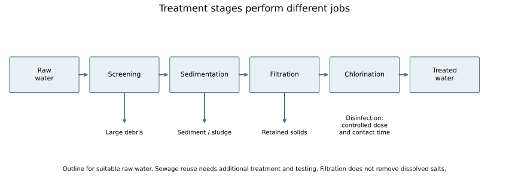
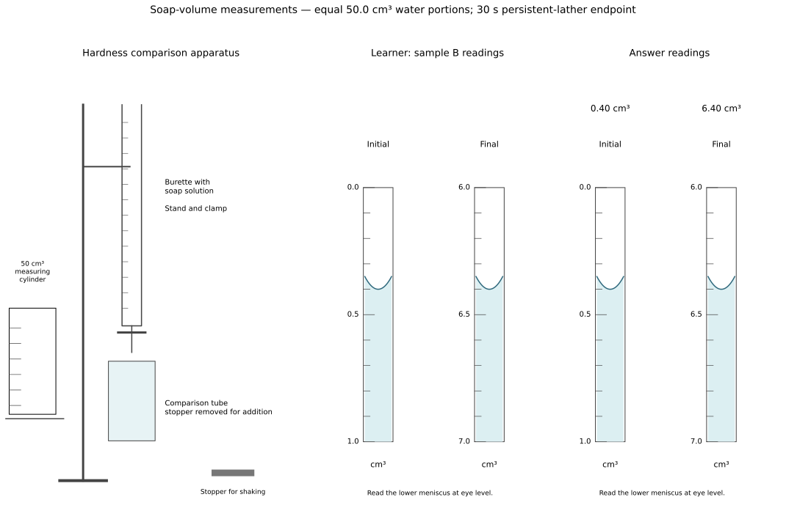
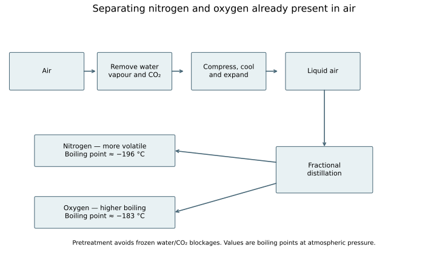
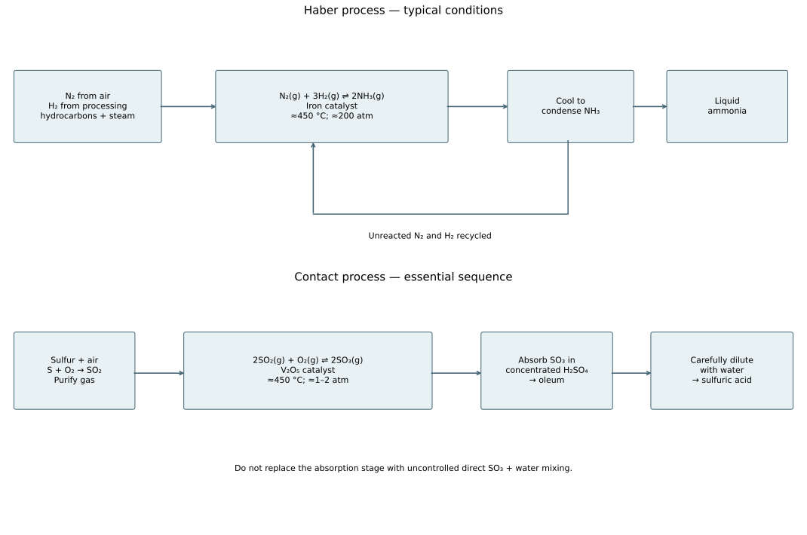

# 11 Environmental and industrial chemistry

*NSSCO Chemistry 6117 — study notes. Worked examples teach methods; assessment tasks are supplied separately.*

---

## 11.1.1 — Physical and chemical properties of water

### Purity is different from presence

Pure water has characteristic physical properties under stated conditions. At standard atmospheric pressure it freezes/melts at about 0 °C and boils at about 100 °C. A sample that boils over a range or at a different temperature may contain dissolved substances, but pressure must be considered before concluding that a difference proves impurity. Density can also be compared with a reference at the same temperature; water is approximately 1.0 g/cm³ under ordinary laboratory conditions.

A physical purity test is not the same as a chemical test for the presence of water. A salt solution contains water and can give a positive water test, yet it is not pure water. Likewise, a boiling-point measurement cannot certify that a sample is safe to drink. Very small amounts of harmful material may not cause an easily measured change. State the measurement, reference condition and conclusion carefully.

### Water identification and industrial conditions

A chemical water test establishes presence, not purity. White anhydrous copper(II) sulfate becomes blue with water. Blue cobalt(II) chloride paper becomes pink. A solution containing salts can give a positive result, so purity needs a physical test at controlled conditions, such as a boiling or melting point.

Seawater desalination is expensive, so it is not a complete solution to Namibia’s water-scarcity problem. Its energy and infrastructure requirements limit its use.

The Haber process uses nitrogen and hydrogen, commonly in a 1:3 feed ratio, an iron catalyst, about 450 °C and high pressure of about 200 atm. Nitrogen comes from air; hydrogen may come from hydrocarbons reacting with steam. Temperature is a compromise between rate and equilibrium yield. A catalyst speeds approach to equilibrium without increasing the equilibrium yield at fixed conditions.

The Contact process makes sulfur dioxide from sulfur and oxygen, then oxidises it reversibly to sulfur trioxide over vanadium(V) oxide near 450 °C and about atmospheric pressure. The equation is 2SO2 + O2 ⇌ 2SO3. Industrial absorption into concentrated sulfuric acid avoids the acid mist produced by direct reaction with water; subsequent dilution produces the required acid.

Nitrogen, phosphorus and potassium are all plant nutrients. Fertiliser selection should respond to deficiencies, rather than increasing nutrients indiscriminately. Nitrogen supports protein formation and growth; phosphorus supports root development; potassium supports healthy growth and physiological function. Run-off of excessive fertiliser can cause eutrophication.

Dry air contains about 78% nitrogen, 21% oxygen and 1% other gases. Removing oxygen does not leave pure nitrogen, because the other gases remain. Carbon dioxide forms during complete combustion, aerobic respiration, fermentation, acid–carbonate reactions and decomposition of suitable carbonates. Heating limestone gives calcium oxide and carbon dioxide. Adding water to calcium oxide makes calcium hydroxide; both the oxide and hydroxide have basic uses, such as neutralising acidic soils or waste.

### Suggested practical SP-6117-49 — Testing for water

Aim: test whether water is present, without claiming purity. Under teacher supervision, a small sample can be applied to white anhydrous copper(II) sulfate; a blue colour indicates hydration. Blue cobalt chloride paper can turn pink in the presence of water, but its handling requires the teacher's specified controls. Use clean equipment and suitable protection; do not taste an unknown liquid.

Compare a water-containing sample with an appropriate dry control. Reagent exposed to moist air may already have changed colour, so check its starting appearance. A salt solution gives a positive test because it contains water, demonstrating why the result does not establish pure water. A physical boiling/freezing-point or density comparison answers a different question. Report reagent, initial colour, final colour and the limited conclusion: water is present.

---

## 11.1.2 — Availability, distribution and purification of water in Namibia

### Water availability and location

Water supply depends on where water is stored, how reliably it is replenished, its quality and the infrastructure needed to deliver it. Namibia’s arid conditions make rainfall variable and evaporation important. Dams can store surface runoff, while groundwater occupies pores and fractures in rocks and sediments and is accessed through boreholes. Rivers, lakes and other surface stores differ in permanence and location. Groundwater should not be pictured as an underground open river in every aquifer.

A source can exist without being easily available to every settlement. Distance, pumping, treatment and storage influence access. A large surface area can increase evaporative losses from a reservoir. Groundwater abstraction must be considered alongside recharge and water quality, because a borehole is not an unlimited source. Compare source reliability over dry periods rather than only the volume visible after rain. In a discussion, include both the natural distribution and the human arrangements that make water usable. This course does not require current dam percentages; use dated supplied data when a task asks for a numerical comparison.

### Comparing hardness with soap

Soft water forms a persistent lather readily with soap. Hard water uses up more soap before a persistent lather forms because dissolved calcium and magnesium ions react with soap to make insoluble material. A comparison therefore measures the volume of a fixed soap solution required for equal water volumes under a standard shaking and endpoint procedure. A few bubbles immediately after shaking are not necessarily a persistent lather.

Practice data: equal 50.0 cm³ portions of samples P and Q require 2.0 and 6.0 cm³ of the same soap solution respectively. Q is harder under these test conditions. The result is comparative; it is not a direct calcium concentration unless the method has been calibrated. Keep temperature, shaking time, soap concentration and the definition of the endpoint constant. A sensible endpoint might be a lather remaining for 30 seconds. Repeats establish whether a difference is reliable. Detergent behaviour cannot simply replace the soap test because many detergents form lather in hard water without the same scum reaction.

### What scum is

Scum is the insoluble product formed when soap reacts with calcium or magnesium ions in hard water. It is often seen as a deposit or curdy material rather than the stable foam expected from excess soap. The ions remove soap from solution, so additional soap is needed before a lasting lather can develop. This is a chemical reaction producing an insoluble substance, not simply undissolved dirt.

Distinguish scum from lather. Lather consists of gas bubbles stabilised by a film of solution; scum is a solid reaction product. A water sample can look clear before soap is added because its calcium and magnesium salts are dissolved. Hardness is therefore not diagnosed by visible cloudiness alone. Also distinguish soap scum from scale deposited during heating: both can involve calcium compounds, but they form by different processes. Naming the product's origin is more precise than describing it only as 'white stuff'. A one-mark definition should include insolubility and the soap–hardness-ion reaction.

### Ions responsible for hardness

Hard water contains dissolved calcium and/or magnesium salts that supply the ions responsible for the characteristic soap response. Calcium ions are Ca2+ and magnesium ions are Mg2+. Hardness does not mean that water has become a solid, nor that every dissolved salt causes the same effect. Sodium chloride solution, for example, is not classified as hard water merely because it contains ions.

The negative ions help distinguish types of hardness. Hydrogen carbonates are associated with temporary hardness; sulfates are examples associated with permanent hardness. The calcium and magnesium ions are the common cause of soap consumption. A complete account separates cause from treatment: knowing that water is hard does not by itself show whether boiling will soften it. The appropriate test is to compare the water before and after boiling under controlled conditions. Calcium and magnesium may enter water through contact with rocks and soils. Their presence does not imply visible particles; dissolved salts pass through ordinary filter paper.

### Temporary hardness

Temporary hardness is associated with dissolved calcium and magnesium hydrogen carbonates. These substances supply calcium or magnesium ions that react with soap. The word temporary refers to hardness that can be removed by boiling, not to water that becomes soft simply by standing for a short time. Carbon dioxide dissolved in rainwater can help limestone dissolve as hydrogen carbonate, connecting rock chemistry to water quality.

For calcium hydrogen carbonate, heating can be represented by Ca(HCO3)2 → CaCO3 + CO2 + H2O. Insoluble calcium carbonate forms, reducing the amount of dissolved calcium available to react with soap. A solid deposit may collect on a heating surface as scale. Boiling, cooling and removing the precipitate should be followed by a fair comparison at the original volume; evaporative loss otherwise changes concentrations. Magnesium chemistry can involve further changes on heating, so do not assume every deposit has exactly the same composition. The core explanation is removal of the hardness ions from solution by a heating-induced process.

### Permanent hardness

Permanent hardness can be caused by dissolved calcium or magnesium sulfates. These supply the same hardness ions as hydrogen carbonates, but boiling does not remove them in the way it removes temporary hardness. Permanent does not mean impossible to treat: it means that boiling alone is ineffective. Washing soda or ion exchange can remove the relevant ions.

A sample may contain both temporary and permanent hardness. If boiling reduces the soap requirement but does not reduce it to the soft-water control, a mixture is possible. A single before-and-after observation should be interpreted with the controls, volume and endpoint in mind. Evaporating some water without replacing the loss can increase the concentration of salts remaining, which complicates interpretation. Distinguish a sulfate salt from sulfuric acid: the salt's dissolved metal ions cause hardness, and the solution need not be a concentrated acid. The negative ion identifies the type of salt, while calcium or magnesium is central to the soap reaction.

### Washing soda and ion exchange

Washing soda supplies carbonate ions. These react with dissolved calcium ions to form insoluble calcium carbonate, removing those ions from solution: Ca2+ + CO3^2− → CaCO3. This approach can soften both temporary and permanent hard water because it targets the hardness ions rather than relying on hydrogen-carbonate decomposition. Magnesium ions can also be removed through precipitation under the treatment conditions. The solid formed must be separated when clear treated water is needed.

Ion exchange passes water through a material that exchanges calcium and magnesium ions for other ions, commonly sodium ions. The resin is not just a filter trapping visible particles; it changes the dissolved-ion composition. A spent exchanger needs regeneration or replacement according to its design. Softening is different from making water pure or safe to drink. Sodium salts may remain after ion exchange, and neither treatment by itself establishes microbiological safety. Explain the chemical purpose of each stage and avoid claiming that removal of hardness removes every dissolved substance.

### Boiling and scale

Boiling temporarily hard water can remove hydrogen-carbonate hardness while producing scale. Calcium hydrogen carbonate decomposes to calcium carbonate, carbon dioxide and water. The insoluble carbonate can build up on the surfaces of kettles, pipes or water heaters. Thus a process that softens the water can create a maintenance problem in the apparatus.

Scale reduces efficient heat transfer and can narrow passages. It is not the same substance as steam or a layer of evaporated pure water. To demonstrate softening, compare equal volumes of untreated and boiled/cooled water using the same soap solution. Replace evaporative loss with an appropriate soft-water control before measuring, and separate suspended precipitate if needed. If the starting water contains permanent hardness as well, some hardness can remain. The conclusion should be 'temporary hardness has been reduced under these conditions', rather than 'all water is purified by boiling'. Boiling can have a separate disinfection role, but the hardness experiment concerns dissolved salts and precipitates.

### Worked example: separating temporary and residual hardness evidence

Equal portions of water need 9.0 cm³ of a soap solution before boiling and 4.0 cm³ after boiling and cooling. A soft-water control needs 1.5 cm³. Use the same soap solution, water volume, shaking method and persistent-lather endpoint for each test.

The fall from 9.0 to 4.0 cm³ supports a component of hardness removable by boiling. The boiled sample still requires 4.0 − 1.5 = 2.5 cm³ more soap than the control, so boiling has not removed all the soap-consuming effect. Do not claim that all hardness was permanent merely because some remains. A further softening treatment can be evaluated by comparing its result with the same control, rather than assuming any decrease means completely soft water.

Read delivered soap volume as final minus initial burette reading. If the initial reading is 2.10 cm³ and the final is 6.10 cm³, delivery is 4.00 cm³. Keep the burette vertical, read the meniscus consistently and add smaller amounts near the endpoint. A drawing should label the burette, sample vessel and the endpoint being judged; writing a volume beside a picture is not a substitute for showing the relevant scale.

Repeat the comparisons because a lather endpoint is partly observational. Positive chemical tests for water establish its presence, while hardness and purity are different questions.

### Removing carbonate scale

A suitable dilute acid reacts with carbonate scale to form a salt, carbon dioxide and water. For calcium carbonate and hydrochloric acid, CaCO3 + 2HCl → CaCl2 + CO2 + H2O. The deposit decreases and bubbles of carbon dioxide can be observed. The reaction is chemical removal, not merely mechanical scraping. The acid must be compatible with the material of the vessel and used according to a supervised or product-approved procedure.

Acid strength and concentration are different ideas. A weak acid such as ethanoic acid is partially ionised; strong hydrochloric acid is extensively ionised in dilute aqueous solution. Either can be dilute or concentrated relative to a stated amount per volume. For a classroom comparison, use specified dilute reagents and keep scale mass, exposed surface area, temperature and acid volume controlled. A faster reaction does not necessarily mean more total scale can be removed if the acid runs out. Do not mix cleaning chemicals, and do not treat a laboratory descaling experiment as evidence that the vessel is ready for food use without proper rinsing and checks.

### Sources of hardness

Water acquires dissolved salts as it passes through or over rocks and soils. Carbon dioxide in water helps dissolve calcium carbonate from limestone, producing dissolved hydrogen carbonate associated with temporary hardness. Dissolution of calcium or magnesium sulfate-containing material can produce permanent hardness. The source is therefore contact with appropriate mineral material, not the addition of soap during the test.

The exact composition depends on the geology and water history. Two boreholes need not have the same hardness, and a clear river sample can contain dissolved salts. Avoid the rule that groundwater is invariably hard or surface water invariably soft. A chemical test and a controlled treatment comparison provide evidence for a particular sample. Ordinary filtration removes suspended particles but does not remove dissolved hardness ions. The terms temporary and permanent describe response to boiling, not whether the salt came from a temporary puddle or a permanent river. Link the named salt to the treatment response when answering a longer question.

### Why fertilisers are used

Plants need mineral nutrients, including nitrogen, phosphorus and potassium, for healthy growth. Fertilisers replenish nutrients when soil supply is insufficient or nutrients have been removed in harvested crops. Nitrogen supports production of proteins and growth, phosphorus supports processes including root development and energy transfer, and potassium is important in plant function and healthy growth. A fertiliser supplies nutrients, not ready-made energy from sunlight.

The useful amount depends on the crop and soil. Adding more than the plant can use does not guarantee a larger harvest and can increase costs and environmental losses. A balanced discussion separates the benefit of correcting a deficiency from the consequences of over-application. Fertiliser labels may describe nutrient content using conventions supplied with a task; do not invent a concentration from the word 'fertiliser' alone. Soluble nutrient compounds can be carried by water, connecting agricultural practice to water pollution. Controlled trials should keep crop type, water supply, light and growing conditions comparable while varying the nutrient treatment.

### Eutrophication

Excess fertiliser can be washed into a river or dam. Added nitrate and phosphate nutrients can promote excessive algal growth. Dense growth reduces light reaching submerged plants, and dead organic material is decomposed by microorganisms. Their aerobic respiration uses dissolved oxygen, which can lower oxygen availability for fish and other aquatic organisms. This sequence is eutrophication; it is not adequately explained by saying that fertiliser directly 'uses up all the water'.

The risk depends on nutrient loading, water movement and the receiving ecosystem. A practical response can include applying the appropriate amount at a suitable time, reducing runoff and maintaining vegetated buffer areas. These measures target nutrient transfer rather than merely removing visible algae after the cause persists. Given a case with falling dissolved oxygen after nutrient input, connect the observations through growth, death and decomposition. Do not claim that every fertiliser application causes a fish kill. Explain the conditions and the causal chain, and recognise that sewage can also add nutrients and oxygen-demanding material.

### Sewage and landfill leachate

Untreated sewage can introduce pathogens, nutrients and decomposable organic matter into water. Pathogens can cause disease, while decomposition increases oxygen demand and nutrient inputs can contribute to eutrophication. Clear appearance is not proof of safety because harmful microorganisms and dissolved substances may be invisible. Sewage treatment therefore addresses several different kinds of contamination.

Landfill leachate is liquid that has passed through waste and dissolved or carried substances from it. Its composition depends on the waste, and it can contaminate surface water or groundwater if containment and treatment are inadequate. A protective response includes managing waste, controlling leachate and monitoring nearby water rather than assuming soil removes every pollutant. In a comparison, identify the source, possible pollutant and route into water. Do not state that every landfill releases the same concentration of a particular chemical without data. A conclusion about a real site needs measurements; classroom cases should label invented data clearly and avoid attributing pollution to a named local operator without evidence.

### Water treatment stages

Water treatment combines stages with different jobs. Screening removes large debris; settling allows suspended material to collect as sediment; filtration removes finer suspended particles. Chlorination provides disinfection by killing or inactivating many harmful microorganisms under controlled dosing and contact-time conditions. Filtration alone does not guarantee safe drinking water, and chlorine is not a method for removing dissolved salts.

Treatment of sewage-derived water requires additional appropriate processes and monitoring before any intended reuse. A simple classroom sequence of filtration followed by disinfection is an outline, not a complete design for making arbitrary sewage drinkable. Dissolved chemicals may require further treatment. A diagram should show solids and sludge leaving through a waste path rather than disappearing. The treated-water label means water treated by the stated process; it does not establish purity without testing. Compare the purpose of a stage with the contaminant: a suspended particle can be filtered, a dissolved calcium ion passes ordinary filter paper, and a microorganism may require disinfection. Good explanations avoid treating all impurities as one type.

### Water scarcity and feasible responses

An inadequate supply of safe drinking water affects health, hygiene and time spent obtaining water. Insufficient irrigation water can reduce crop production and food security. Availability therefore concerns both quantity and quality. Responses include reducing leaks and unnecessary losses, matching irrigation to crop needs, protecting sources, treating and reusing suitable water, and developing supplies where technically and economically appropriate. No single measure resolves every location's constraints.

The syllabus emphasises that seawater desalination is expensive and does not present it as the solution to Namibia’s water scarcity. Evaluate water conservation, safe supply and treatment using the stated needs and resources.

### Suggested practical SP-6117-50 — Soap with different salt solutions

Aim: compare hardness-ion effects using equal water portions. Prepare teacher-approved dilute calcium salt, magnesium salt and sodium chloride solutions, plus a soft-water control. Use identical tubes, measured soap solution, a timer and a graduated addition device. Keep water volume, temperature, soap concentration, shaking and the persistent-lather criterion constant.

Add soap in measured increments, stopper and shake consistently, and record the volume needed for lather lasting 30 s. Calcium and magnesium solutions generally form scum and need more soap than the soft-water control. Sodium chloride is a useful contrast because the presence of dissolved ions alone does not define hardness. Example volumes for equal portions are 2.0 cm³ control, 2.0 cm³ sodium chloride, 5.5 cm³ calcium salt and 5.0 cm³ magnesium salt; these are results for these test conditions, not universal values.

Repeat and compare means. The conclusion concerns the supplied concentrations and method; it does not rank calcium and magnesium as intrinsically harder from those numbers alone. Clean soap spills and use the teacher's handling rules. Separate observations of precipitate from observations of foam.

### Suggested practical SP-6117-53 — A water-loss audit

Aim: estimate avoidable water loss from a supplied household or school case. With permission, use meter readings or collect a safe accessible drip in a measuring vessel for a measured interval. Do not dismantle plumbing or enter restricted areas. Record the measurement period, units and conditions, and distinguish measured leakage from estimated spillage.

Practice data: a tap loses 120 cm³ in 5 minutes at a roughly steady rate. The rate is 24 cm³/min, equivalent to 34,560 cm³ or 34.56 litres in 24 hours if unchanged. Show the time conversion: 24 × 60 minutes per day. Repeat short measurements because a single drip interval may not represent a whole day.

Compare repair or behaviour options with the measured source of loss. A recommendation to report and repair a leak follows from the data; it does not require blaming a household for all regional scarcity. The estimate assumes a constant rate and should be labelled accordingly. Reducing avoidable losses preserves supply without claiming it replaces every new water source.

### Suggested practical SP-6117-54 — Removing temporary hardness by boiling

Aim: test whether boiling reduces a supplied sample's hardness. Divide the water into matched portions. Keep one untreated; boil the other safely under teacher supervision, cool it, replace lost water with the appropriate soft-water control to the original volume, and remove precipitate if necessary. Compare equal volumes with the same soap test and 30 s lather endpoint.

Results: untreated sample needs 6.0 cm³ soap, boiled/cooled sample 2.5 cm³, and soft-water control 2.0 cm³. The reduction supports removal of temporary hardness. The remaining small excess may reflect residual hardness or experimental uncertainty; it does not prove the sample is chemically pure. A separate calcium sulfate sample is a useful comparison because boiling should not remove its permanent hardness in the same way.

Control soap concentration, shaking and temperature. Cooling matters because hot and cold samples may foam differently. Replacing evaporative loss avoids comparing different concentrations. Record any precipitate separately from the lather result and explain it through removal of dissolved hardness ions.

### Suggested practical SP-6117-55 — Removing scale with dilute acid

Aim: model removal of carbonate scale with teacher-approved dilute acid. Use equal masses and similar surface areas of calcium carbonate chips as a controlled scale model, labelled vessels, measured acid volumes and a timer. Include water as a comparison. Wear the required protection and avoid mixing cleaning products.

Observe gas bubbles and reduction of the solid in acid, compared with little change in the water control over the same interval. Test a separately collected gas portion with limewater if the method permits; milkiness supports CO2. The explanation is acid + carbonate → salt + water + carbon dioxide. A real deposit can contain other materials, so the pure-chip model has limits.

For a fair rate comparison keep acid concentration, temperature, chip mass and exposed area controlled. If comparing final removal, ensure the amount of acid is adequate rather than interpreting reagent exhaustion as an unreactive deposit. A useful conclusion names the chemical mechanism and the model's limits; it does not prescribe arbitrary chemicals for household appliances.

### Water treatment

Solid-removal stages followed by disinfection; sludge leaves through a waste path.

### Hardness apparatus and scales

Soap-test diagram with unkeyed burette scale panels and a separate answer overlay.

### Connections

Connect environmental observations to reactions, separation methods and controlled comparisons. Distinguish concentration from total emissions, treatment from purity, and a local measurement from a national claim.

---

## 11.2 — The air around us

### Interpreting dry air

The approximate composition of dry air is 78% nitrogen, 21% oxygen and 1% other gases by volume. Nitrogen is therefore the largest component, not oxygen. 'Dry' means water vapour has been excluded from this percentage description. Actual humid air contains a variable amount of water vapour, so a question should make clear which basis is being used.

In a 100 cm³ sample of dry air at one set of conditions, the approximate component volumes are 78 cm³ nitrogen, 21 cm³ oxygen and 1 cm³ other gases. For a 200 cm³ sample at the same conditions they double to 156, 42 and 2 cm³. This is proportional reasoning, not a temperature or pressure conversion. If oxygen is removed from a closed measured sample without other changes, the remaining gas is mainly nitrogen but is not pure nitrogen because other gases remain. In a graph, identify the large nitrogen sector and check that the percentages sum to 100. The high nitrogen proportion does not mean nitrogen supports combustion in the same way as oxygen.

### Oxygen and combustion

Combustion in air involves reaction with oxygen. The fuel and oxygen are different reactants: a carbon-containing fuel supplies carbon and often hydrogen, while oxygen supports oxidation. The fact that nitrogen makes up most of the air does not make it the normal reactant responsible for burning a candle or methane. Oxygen itself is not usually described as the fuel in these examples.

An equation should name the actual products under the stated oxygen supply. With sufficient oxygen, carbon forms carbon dioxide; limited oxygen can lead to carbon monoxide. Hydrogen in a fuel commonly forms water during complete combustion. A gas test is separate from the combustion equation: oxygen relights a glowing splint, while carbon dioxide turns limewater milky. Do not substitute the test for a description of the reaction being investigated. Comparing burning in air and oxygen-rich conditions requires controlled teacher demonstrations, because oxygen enrichment can intensify fire. A written answer can explain the chemistry without inviting unsupervised gas handling.

### Routes that form carbon dioxide

Carbon dioxide forms in several different processes. Complete combustion of carbon-containing fuels produces it. Aerobic respiration converts organic nutrients with oxygen, releasing carbon dioxide and water. Fermentation of glucose by yeast produces ethanol and carbon dioxide without requiring oxygen in the overall fermentation equation. An acid reacting with a carbonate produces a salt, carbon dioxide and water. Heating suitable carbonates can release carbon dioxide by thermal decomposition.

For example, CaCO3 → CaO + CO2 represents thermal decomposition of limestone, while CaCO3 + 2HCl → CaCl2 + CO2 + H2O represents an acid–carbonate reaction. These processes share a gas product but have different reactants and conditions. Limewater turning milky supports the presence of carbon dioxide; it does not identify which process produced the gas unless the context is known. Gas bubbles alone are insufficient evidence because many reactions evolve other gases. A complete response gives the source reaction, the condition if relevant, and the observed test result separately. Do not claim that all carbonates decompose under identical heating conditions.

### Suggested practical SP-6117-51 — Carbon dioxide in exhaled air

Aim: compare exhaled air with room air using a carbon dioxide test. A teacher-controlled arrangement uses fresh limewater and a suitable one-way gas delivery or collection system that prevents liquid being drawn into the mouth. Do not share mouthpieces or suck through a tube into limewater. An alternative is teacher-collected gas samples delivered from clean gas syringes.

Pass comparable gas volumes through equal fresh limewater portions. Exhaled air commonly makes limewater milky sooner because it contains more carbon dioxide than room air. The milkiness is a calcium carbonate precipitate. Room air also contains some CO2, so the comparison is not 'CO2 present versus absent'. Keep gas volume, flow rate and limewater concentration comparable.

A limitation is that time to visible cloudiness is an approximate endpoint. Large excess CO2 can eventually dissolve the precipitate, so compare the initial appearance rather than treating a long exposure as a simple stronger result. Connect the exhaled gas to aerobic respiration, not to the claim that oxygen changes into carbon atoms.

### Suggested practical SP-6117-52 — Carbon dioxide from fermentation

Aim: identify the gas released by a fermenting sugar mixture. Use teacher-prepared glucose or fruit-juice mixture with yeast in a suitable warm environment, a gas outlet and fresh limewater. The vessel must have a safe gas escape route rather than becoming a sealed pressure vessel. A control without active yeast helps distinguish biological gas production from effects of the apparatus or warming.

Collect or pass the evolved gas through limewater; initial milkiness supports CO2 formation. The mixture may show bubbles, but bubbles alone do not identify the gas. Fermentation also forms ethanol, as taught in Topic 10. Keep sugar concentration, mixture volume and temperature comparable across trials. Excessive heat can denature enzymes, while low temperature slows the process.

Record observations over a stated time and avoid interpreting unequal temperatures as evidence for different yeast activity. Do not taste the fermented laboratory mixture. The equation C6H12O6 → 2C2H5OH + 2CO2 conserves atoms and links the gas test to a specific chemical process.

---

## 11.3 — The commercial preparation and uses of gases

### Oxygen from liquid air

Commercial oxygen can be separated from air by fractional distillation of liquid air. Water vapour and carbon dioxide are removed before deep cooling so they do not freeze and block equipment. Air is compressed, cooled and expanded through an appropriate refrigeration process until it liquefies. Fractional distillation then separates components using their different boiling temperatures.

Oxygen boils at about −183 °C at atmospheric pressure, while nitrogen boils at about −196 °C. Nitrogen is the more volatile of the two and is removed more readily; oxygen is collected as the higher-boiling component. These figures describe boiling temperatures and are not a request for gas-law calculations. The separation does not create oxygen atoms or split nitrogen into oxygen. It separates gases already present in air. Purification and process control determine the product grade; a classroom flow diagram shows the essential chemistry rather than every piece of industrial equipment. Avoid claiming that filtering ordinary air alone separates its oxygen molecules from nitrogen molecules.

### Nitrogen from liquid air

Nitrogen is the most abundant component of dry air and can be obtained commercially by separating liquid air. Pretreatment removes water vapour and carbon dioxide, then compression and cooling prepare liquid air for fractionation. Nitrogen's lower boiling temperature makes it more volatile than oxygen. On controlled warming, a nitrogen-rich fraction is obtained before the higher-boiling oxygen fraction.

The approximate boiling temperatures, −196 °C for nitrogen and −183 °C for oxygen at atmospheric pressure, must be compared correctly: −196 is the lower temperature. A common mistake is to compare only the magnitudes 196 and 183 and reverse the order. The process is physical separation, so nitrogen remains N2. It does not become single nitrogen atoms during ordinary fractional distillation. Nitrogen's abundance makes air a useful source for the Haber process, but a useful industrial feed requires separation and purity control rather than simply feeding untreated air with all its oxygen into every reaction system.

### Commercial carbon dioxide

Carbon dioxide can be recovered from industrial processes that produce it, including fermentation and suitable combustion or chemical-manufacturing streams. The gas must be separated from unwanted material and purified for its intended use. It can then be dried and compressed or cooled for storage and supply. Recovering a by-product is different from assuming raw exhaust gas is already suitable for food or laboratory use.

A laboratory acid–carbonate reaction illustrates carbon dioxide formation, but it is not necessarily the economical source for a large commercial supply. A process answer should distinguish production from purification and storage. Fermentation produces a gas stream containing carbon dioxide, while impurities, moisture and process conditions determine subsequent treatment. A source does not guarantee a particular purity grade. Carbon dioxide is not obtained as a major fraction of ordinary liquid-air separation in the same way as nitrogen and oxygen; it is removed before deep cooling because of freezing concerns. This links the separate preparation routes without suggesting all three gases are collected by the same column.

### Uses of oxygen

Oxygen is used in medical oxygen supplies, in steelmaking and in high-temperature cutting or welding systems where appropriate. Its role is linked to supporting oxidation and combustion. In steelmaking, oxygen helps oxidise unwanted elements in the molten material. In a suitable fuel–oxygen torch, the fuel provides the combustible substance and oxygen supports a high-temperature reaction.

Medical use depends on controlled equipment and professional management; the chemistry point is oxygen's role in respiration, not instructions for treatment. Oxygen does not itself replace the fuel in a welding flame. A use–property answer should connect the use to the required oxidation or physiological role. Increased oxygen availability can intensify burning, so oxygen-handling systems require appropriate materials and precautions. Do not describe it as inert because it is colourless. Colour and reactivity are separate properties. The same molecular gas can serve different purposes because the surrounding reactants and conditions determine what happens.

### Uses of carbon dioxide

Carbon dioxide is used to carbonate drinks and in suitable fire extinguishers; solid carbon dioxide, dry ice, can provide cooling. In an extinguisher it can displace oxygen around certain fires. That does not make it suitable for every burning material or every enclosed space. A school answer should state a recognised use and its relevant property without giving emergency operating instructions.

Carbonation involves carbon dioxide dissolved under pressure. On opening a container, some gas leaves solution and forms bubbles. Dry ice changes directly from solid to gas under ordinary atmospheric conditions, providing cooling without a liquid-water residue. Cold and asphyxiation hazards mean it is handled with suitable controls. Carbon dioxide is denser than air under comparable conditions, but density alone does not guarantee that a gas forms a perfectly unmixed permanent layer. In a chemistry explanation, link the chosen use to dissolution, cooling or limited support of combustion as appropriate. It is a greenhouse gas, so usefulness does not remove the need to consider emissions.

### Uses of nitrogen

Nitrogen is used as a feedstock for ammonia manufacture and as a relatively unreactive atmosphere in suitable food packaging or industrial operations. Liquid nitrogen is also used for cooling. Its low reactivity under ordinary conditions is useful where oxygen-driven changes are unwanted. This does not mean nitrogen cannot react: the Haber process uses conditions and a catalyst that allow reaction with hydrogen.

A packaging explanation should say that replacing much of the oxygen can slow oxidation, not that nitrogen automatically sterilises food. The package, hygiene and storage conditions still matter. In ammonia manufacture, nitrogen supplies the nitrogen atoms that later enter fertilisers and other compounds. Liquid nitrogen's very low boiling temperature makes it useful for cooling but also requires specialised handling; it is not an ordinary classroom liquid to touch. Distinguish a use based on the molecular gas's low reactivity from a use in which nitrogen becomes chemically combined. The same substance can be unreactive in one set of conditions and a reactant in another.

### Liquid-air fractionation

Remove water and CO2 before liquefaction; lower-boiling nitrogen separates from oxygen.

---

## 11.4 — Pollution of the air

### Gaseous air pollutants

Carbon monoxide, sulfur dioxide and nitrogen oxides are important air pollutants. Carbon monoxide can arise from incomplete combustion. Sulfur dioxide can form when sulfur-containing fuels or sulfide materials are oxidised. Nitrogen oxides can form in high-temperature combustion when nitrogen and oxygen react. These gases have different sources and effects, so an answer should not describe them as interchangeable forms of smoke.

Pollution investigations use observations and measurements with location, time and units stated. A concentration at one roadside site is different from a country's total annual emissions. Weather, traffic and industrial activity can affect readings. Do not infer causation from one coincident measurement without considering alternatives. A controlled classroom dataset can teach comparison without exposing students to gases. Link each pollutant to a plausible source and effect: carbon monoxide interferes with oxygen transport, while sulfur dioxide and nitrogen oxides contribute to respiratory irritation and acidic deposition. The specific conclusion must match the evidence supplied, not a stereotype about a place.

### Carbon monoxide in confined spaces

Incomplete combustion of carbon-containing fuel can produce carbon monoxide. In a confined or poorly ventilated space, oxygen may become limited and the toxic gas can accumulate. Carbon monoxide binds to haemoglobin and reduces the blood's ability to transport oxygen. It is colourless and odourless, so a person cannot rely on smell as a warning.

The chemistry explains why charcoal burners, engines and other combustion sources must not be used in inappropriate enclosed spaces. A small opening does not establish that a dangerous setup is safe. In a written scenario, identify both the production mechanism and the accumulation risk rather than merely saying that smoke is unpleasant. Complete combustion produces carbon dioxide instead, but that is not an argument for running a combustion source indoors without proper approved systems. A classroom investigation should analyse supplied data or a teacher's safe model, not deliberately generate carbon monoxide. The key explanatory chain is limited oxygen, incomplete combustion, toxic gas accumulation and impaired oxygen transport.

### Acid rain chemistry

Sulfur dioxide and relevant nitrogen oxides can lead to acidic deposition. They undergo atmospheric reactions involving water and oxygen to form acids, which lower the pH of rain and other deposited moisture. At this level they are treated as acidic-oxide pollution sources. Not every nitrogen oxide reacts identically with water in one simple step; the overall atmospheric conversion is what links emissions to acid rain.

Ordinary rain is already slightly acidic because carbon dioxide dissolves in it. Acid rain refers to additional acidity associated with pollutants such as sulfur and nitrogen oxides, not simply any pH below seven. Wind can carry pollutants away from the emission source before deposition, so the damaged area may be far from the source. A good explanation names the pollutant, conversion to acid and resulting effect on water or materials. Avoid confusing this process with the greenhouse effect: both can involve emissions from fuel use, but their mechanisms and consequences differ. Sulfur dioxide is not the main gas used to explain carbon-dioxide-driven warming.

### Consequences of acid rain

Acidic deposition can lower the pH of lakes and soils, affecting organisms and nutrient availability. It can damage vegetation and contribute to corrosion of materials. Carbonate stone, such as limestone or marble, reacts with acid, so buildings and monuments made from it can be eroded. The relevant reaction releases carbon dioxide and converts carbonate into other products.

The severity depends on exposure and the receiving environment's ability to neutralise acid. A buffered lake does not necessarily respond in the same way as one with little buffering. A model experiment can compare carbonate chips in water and dilute acid under controlled conditions, but it does not reproduce every feature of long-term weathering. State the specific material or ecosystem and the chemical reason for damage. 'It destroys the environment' is too vague to show understanding. Also distinguish acidic deposition from ordinary physical abrasion: both can damage a surface, but the acid–carbonate reaction is a chemical process. Reducing the precursor emissions addresses the source rather than only treating the visible damage.

### Greenhouse gases

Carbon dioxide and methane are greenhouse gases. They absorb outgoing infrared radiation and influence the Earth's energy balance. Increasing their atmospheric amounts can enhance warming and contribute to climate change. The natural greenhouse effect and its enhancement should be distinguished: the existence of greenhouse gases is not itself a new phenomenon.

The chemistry topic asks for the gases and their sources, not an invented claim about the exact temperature effect of a particular local emission. Carbon dioxide can come from combustion and other processes; methane can come from oxygen-poor decomposition and animal digestion. Greenhouse warming is different from depletion of stratospheric ozone and from acid rain. A learner should not use those labels as synonyms. When a data task provides concentrations or emissions, read the units and time period. A stock of gas in the atmosphere is different from a rate of emission. Comparing two gases requires the stated basis rather than assuming equal masses have identical effects.

### Sources of methane

Methane can form during decomposition of organic material under oxygen-poor conditions. Examples include waterlogged vegetation and some waste deposits. It is also released through digestive processes in animals such as ruminants. Natural gas contains methane as its main constituent, so leaks from fuel systems can be another source. These sources should be distinguished from complete combustion, which converts methane mainly into carbon dioxide and water.

A source answer identifies a process, not simply a place. 'A farm' is less precise than 'digestive processes in cattle' or 'oxygen-poor decomposition of organic waste'. Different conditions can produce different gases during decomposition, so it is inaccurate to assume every decaying leaf releases only methane. Oxygen availability matters. In a classroom context, analyse the process without attempting to collect flammable decomposition gases. A longer response can connect a source to atmospheric accumulation and greenhouse effects. It should avoid treating all animal breath as methane or confusing methane with the carbon dioxide produced in ordinary aerobic respiration.

### Vehicle exhaust pollutants

Vehicle exhaust can contain unburned hydrocarbons, carbon monoxide and nitrogen oxides. Unburned hydrocarbons represent fuel that has not fully reacted. Carbon monoxide arises from incomplete combustion. Nitrogen oxides can form when nitrogen and oxygen react at high engine temperatures. Carbon dioxide and water are also combustion products, but they are not substitutes for the three named pollutant categories in a question targeting them.

The composition depends on engine operation, fuel and emission-control systems. A vehicle does not emit the same mixture at every moment. A supplied dataset might show lower carbon monoxide after an engine or catalyst reaches its operating temperature. Explain such a pattern using the stated conditions rather than assuming that every difference is caused by fuel type. Unburned fuel can escape without being converted into carbon monoxide; these are distinct pollution pathways. A complete account separates pollutant formation from treatment in the exhaust system. Measuring a concentration also differs from measuring total mass emitted, which depends on gas flow and duration.

### Lead pollution

Lead compounds are toxic, and lead contamination can harm the nervous system, particularly during development. Historically, lead-containing petrol additives were an important route for airborne lead from vehicles. Using unleaded petrol removes that particular fuel-additive source. It does not remove carbon monoxide, nitrogen oxides or every other source of lead pollution.

An evaluation should connect the intervention to the pollutant it targets. Replacing leaded fuel can reduce lead emissions, while other vehicle emissions need suitable combustion and exhaust controls. Lead can also enter the environment from other industrial or waste-handling activities. A local claim needs evidence rather than an assumption based on the word 'industry'. The syllabus asks for the rationale for unleaded petrol, not a current legal survey of fuel standards. Keep the discussion at that chemical and environmental level. Do not infer safety from absence of one contaminant: a lead-free exhaust can still contain harmful gases and particles. Monitoring should specify which substance is measured and in what units.

### Catalytic converters

Catalysts in suitable vehicle exhaust systems accelerate reactions that convert harmful gases into less harmful products. Carbon monoxide can be oxidised to carbon dioxide, unburned hydrocarbons can be oxidised to carbon dioxide and water, and nitrogen oxides can be reduced to nitrogen. The catalyst offers a faster reaction route and is not consumed in the overall reaction.

One illustrative balanced reaction is 2CO + 2NO → 2CO2 + N2. It shows carbon monoxide reducing nitrogen monoxide while carbon monoxide is oxidised. This equation is a model of one useful conversion, not the whole exhaust system. Catalysts work effectively only under suitable operating conditions and do not remove every pollutant. In particular, conversion of CO to CO2 reduces a poisonous gas but does not eliminate greenhouse-gas emissions. A response should distinguish a reduction in harmful exhaust components from a claim of zero environmental impact. Mechanical damage, contamination and unsuitable temperature can reduce performance, but diagnose a supplied case from evidence rather than guessing a specific fault.

### Particles and emission data

Smoke and dust contain solid particles suspended in air. Their effects depend on particle size, composition and exposure. Dust from handling mineral material, including the syllabus example of mica dust in Namibia, should be controlled rather than dismissed because it is not a gas. Fine particles can enter the respiratory system. A visible dust cloud does not reveal its precise composition or quantify exposure by itself.

Compare emission data using a consistent basis. Illustrative data: region A emits 120 thousand tonnes of a gas per year and has 12 million people; region B emits 60 thousand tonnes and has 3 million people. A has the larger total, but the per-person amounts are 10 and 20 kg per year respectively. These are invented regions, not claims about actual countries. A total-emissions comparison cannot establish the relative concentration at one school, and gas-emission figures do not directly measure particulate pollution. Industrial activity, population, fuel choices and controls all affect patterns. Avoid assuming that the labels 'industrial' and 'developing' determine every pollutant measurement.

### Investigating local sources

Possible local air-pollution sources include traffic exhaust, open waste burning, cooking fires, construction dust and industrial or mineral-handling operations. Their actual importance differs by place and time. A learner should identify observed or documented sources rather than accuse a named operator without evidence. A source inventory can record location, activity, time and the kind of pollutant plausibly released.

Observation has limits. A visible plume may contain water droplets as well as pollutants, and an odour does not measure toxicity or concentration. Safe school work uses public observations from a suitable distance, supplied monitoring data or teacher-approved records; it does not involve entering industrial sites or approaching smoke. Wind direction and weather can help interpret where emissions travel. A good answer links a specific activity to a pollutant, such as vehicle combustion to CO/NOx or dry construction work to dust. Separating observation from inference makes the investigation more reliable and prevents general statements about an entire neighbourhood from one brief sighting.

### Why pollution crosses borders

Air moves across political boundaries, transporting pollutants and their reaction products. Acidic deposition can occur far from an emission source, while greenhouse gases influence the global energy balance after mixing through the atmosphere. Local reductions can therefore have benefits beyond the immediate area, and local damage may partly reflect distant emissions.

International concern does not mean that all places emit equal amounts or suffer equal effects. Population, industrial activity, fuel use, geography and exposure differ. Cooperation can support monitoring, shared standards and emission reduction, while each proposed measure still has costs and practical constraints. A reasoned discussion links the scale of transport or atmospheric persistence to the scale of response. It should not claim that local action is pointless because pollution is global. Reducing a source can improve nearby air quality and contribute to wider reductions. Compare totals, per-person quantities and local concentrations only when the data provide the necessary denominators and units.

---

## 11.5 — Chemical industrial plants

### Limestone to lime

Heating limestone strongly produces calcium oxide, called lime or quicklime, and carbon dioxide: CaCO3 → CaO + CO2. This is thermal decomposition. Heat is required to break down the carbonate, so a kiln supplies energy. The solid product has a lower mass than the starting pure carbonate if the carbon dioxide escapes; the missing mass has not been destroyed but has left as gas.

Adding water to calcium oxide forms calcium hydroxide, slaked lime: CaO + H2O → Ca(OH)2. This reaction releases heat and requires controlled handling. Limestone, quicklime and slaked lime are different substances, not three names for CaCO3. A sequence diagram should preserve their formulae and reaction conditions. Calcium hydroxide can react with carbon dioxide to form calcium carbonate and water, linking the lime cycle to the limewater test. For a practical, use teacher-controlled amounts and appropriate protection rather than adding water to an uncontrolled mass of quicklime. An explanation should state the chemical conversion and observation separately.

### Neutralising with lime

Calcium oxide and calcium hydroxide are basic materials used to neutralise acidity. Suitable controlled application can reduce excessive soil acidity. They can also treat acidic industrial waste or remove acidic sulfur dioxide from flue gases in appropriate processes. The useful property is acid–base reaction, not a general ability to remove every kind of pollution.

The amount must match the acidity and intended use. Adding too much base can create an unsuitable pH, so monitoring matters. A soil treatment is not an instruction to handle caustic material without guidance. Distinguish lime CaO from slaked lime Ca(OH)2 and limestone CaCO3, even though all can be relevant to neutralisation in particular settings. In flue-gas treatment, the sulfur-containing gas reacts to form retained products rather than simply being made invisible. A one-mark use can be concise: neutralising acidic soil or acidic industrial waste. A longer explanation should link basic character to reaction with acid and the resulting reduction in acidity.

### Uses of calcium carbonate

Calcium carbonate occurs in limestone and marble. Marble is used as a building and decorative stone; the syllabus includes Karibib as a Namibian example. Limestone is used in cement manufacture and in iron extraction. In the blast furnace it decomposes to calcium oxide, which reacts with acidic silica impurities to form slag. These are chemical roles distinct from using a cut stone as a physical building material.

The syllabus also names a Namibian cement works as context, but the chemistry does not depend on a current production figure or ownership claim. Cement manufacture uses limestone with other materials under high-temperature processing; it is not simply powdered pure calcium carbonate. In iron extraction, limestone is a flux precursor rather than the main reducing agent. Carbon monoxide reduces the iron oxide, while calcium oxide helps remove silica. Keep those roles separate when labelling a furnace diagram. Acid rain can attack carbonate building stone, linking the same compound's usefulness to a limitation in some environments.

### Salt from seawater

Salt works can use evaporation of seawater in ponds to concentrate dissolved salts until crystals form. The syllabus gives Swakopmund and Walvis Bay as coastal contexts. Sun and wind help remove water, while the dissolved salt remains. Sodium chloride crystals are harvested and processed, including appropriate washing and purification, for the intended grade of salt.

This is a separation process, not creation of sodium or chlorine from water. Seawater contains several dissolved salts, so uncontrolled evaporation to dryness does not automatically produce pure table salt. Managing concentration and crystallisation stages helps separate products, and food-grade processing requires suitable quality control. Salt crystallisation is different from obtaining fresh water by desalination: the desired product here is the solid salt, whereas a water-supply process seeks water with reduced salt content. Compare filtration with evaporation: ordinary filtration cannot remove dissolved sodium chloride before it crystallises. A labelled flow can therefore show seawater, concentration ponds, crystallisation, harvesting and purification without requiring detailed engineering of a particular works.

### The Haber process

The Haber process makes ammonia from nitrogen and hydrogen: N2(g) + 3H2(g) ⇌ 2NH3(g). Nitrogen is obtained from air; hydrogen is commonly obtained by processing hydrocarbons with steam. Steam supplies hydrogen atoms but is not fed as a substitute for molecular hydrogen in the final ammonia equilibrium equation. Typical school-level industrial conditions are about 450 °C, about 200 atmospheres and an iron catalyst.

The forward reaction is exothermic and reduces four gas molecules to two. Lower temperature favours equilibrium ammonia yield but slows the reaction; a moderate high temperature is a rate–yield compromise. Higher pressure favours the side with fewer gas molecules and increases ammonia yield, but pressure equipment and energy costs constrain the choice. The catalyst increases the rate of reaching equilibrium without changing the equilibrium composition. Ammonia is cooled and condensed for separation, while unreacted nitrogen and hydrogen are recycled. State gas conditions when explaining pressure effects. A diagram should include recycle, not imply complete conversion on one pass. Ammonia's uses connect to nitrogen-containing fertilisers, but the process answer should focus on feedstocks, reaction and essential conditions.

### Uses of sulfur dioxide

Sulfur dioxide is used as a bleaching agent in processes such as wood-pulp treatment and as a preservative in appropriate food applications. Its antimicrobial action can help control spoilage organisms. These uses depend on controlled conditions and permitted formulations; they do not imply that inhaling sulfur dioxide or adding arbitrary amounts to food is safe.

The same substance can be useful in a controlled process and harmful as an air pollutant. In the atmosphere it can contribute to acidic deposition and respiratory irritation. A use question should name the purpose, such as bleaching wood pulp or preserving suitable foods, rather than merely naming 'industry'. Do not confuse sulfur dioxide SO2 with sulfuric acid H2SO4 or sulfur trioxide SO3. Their formulae, properties and roles in the Contact process differ. A longer explanation can connect chemical reactivity to the application while recognising exposure control. The course does not require an operating recipe for food preservation or paper manufacture.

### The Contact process

Sulfuric acid manufacture begins by obtaining sulfur dioxide, for example by burning sulfur in air: S + O2 → SO2. Purified gases then pass over a vanadium(V) oxide catalyst, V2O5, at about 450 °C and approximately 1–2 atmospheres: 2SO2(g) + O2(g) ⇌ 2SO3(g). The conversion is exothermic. The temperature is a practical rate–yield compromise, and the catalyst speeds attainment of equilibrium without changing its position.

Sulfur trioxide is absorbed in concentrated sulfuric acid to form oleum, which is then carefully diluted to produce sulfuric acid of the required concentration. Industrial absorption is not represented as uncontrolled direct addition of SO3 to water, which gives difficult acid mist and intense heating. Raw materials include sulfur, air and water, but the sequence matters. Keep the catalyst separate from reactants and products. Higher gas pressure favours SO3 because fewer gas molecules are present on the product side, yet near-atmospheric pressure is practical because satisfactory conversion can be achieved without the cost of much higher pressure. Distinguish this process from the Haber process: different feedstocks, catalyst and pressure are used.

### Uses of sulfuric acid

Sulfuric acid is used in manufacture of fertilisers and detergents and as the electrolyte in lead–acid batteries. These are distinct applications of the same acid. The battery use involves an aqueous acid electrolyte, not dry sulfur powder or sulfur dioxide gas. Fertiliser manufacture uses the acid in chemical processing rather than adding concentrated acid directly to growing plants.

A useful answer names one application precisely. 'Making things' is too vague, while 'manufacture of fertilisers' states the intended industrial role. Sulfuric acid can be strongly corrosive, and concentration affects handling and reaction behaviour. The word strong refers to ionisation in water rather than to every possible concentration. A dilute strong acid and a concentrated weak acid are different descriptions along different axes. The production sequence in the Contact process is linked to these uses, but a use question does not require reproducing the whole process. Do not confuse sulfuric acid with the sulfate salts found in hard water, even though the same element appears in their formulae.

### Suggested practical SP-6117-48 — Limestone, lime and slaked lime

Aim: distinguish CaCO3, CaO and Ca(OH)2 by their chemical behaviour. Use teacher-prepared small samples, labelled vessels, a thermometer, dilute acid and appropriate gas-test apparatus. Strong heating of limestone and addition of water to quicklime are teacher-controlled demonstrations because high temperatures and exothermic hydration require protection and controlled quantities.

Compare limestone with dilute acid: effervescence occurs and the gas turns limewater milky. Heating limestone strongly produces quicklime and CO2. Carefully adding the prescribed water amount to quicklime forms slaked lime and releases heat. A suitably prepared calcium hydroxide sample shows alkaline behaviour with an indicator. These are different observations from three connected reactions, not proof that the materials are interchangeable.

Record initial material, reagent, observation and inference in separate columns. Control sample size when comparing rates, and distinguish a temperature rise from the presence of gas. A limitation is that an impure limestone sample may not behave exactly like pure calcium carbonate. The model equations are CaCO3 → CaO + CO2 and CaO + H2O → Ca(OH)2; the gas test connects to Ca(OH)2 + CO2 → CaCO3 + H2O.

### Haber and Contact processes

Typical essential conditions, product recovery and appropriate absorption sequence.
