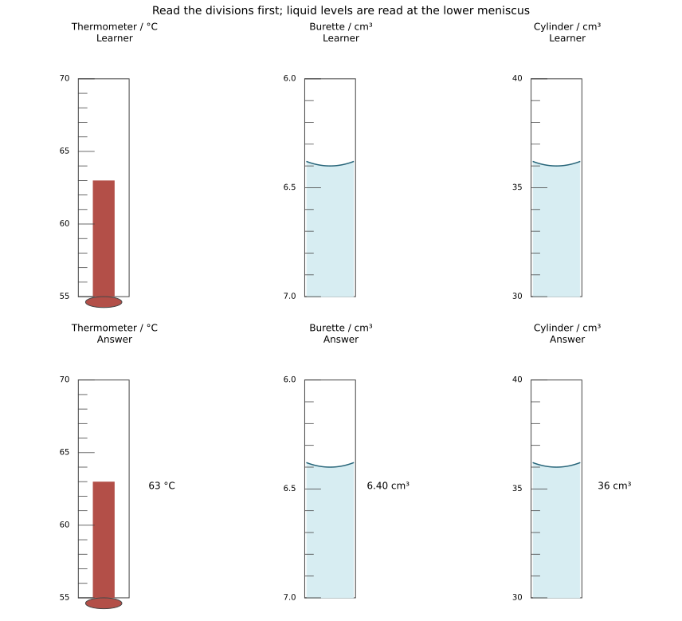
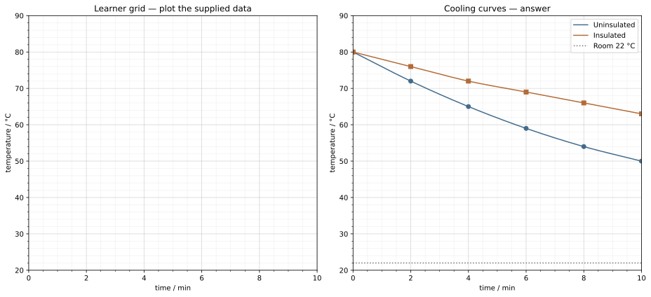
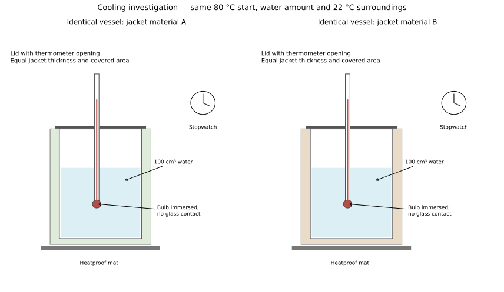

# 12 Practical skills and investigation planning

*NSSCO Chemistry 6117 — study notes. Worked examples teach methods; assessment tasks are supplied separately.*

---

## 12.1 — Reading scales and recording precision

### Reading scales with appropriate precision

A measurement needs a quantity, value and unit. Before reading a scale, identify its direction and the value represented by one small interval. A thermometer usually increases upwards, whereas a burette increases downwards because it records volume delivered from its upper zero. Read an aqueous liquid's lower meniscus at eye level to avoid parallax. Record enough precision to reflect the scale and method, without adding unsupported digits.

For a burette, volume delivered is final reading minus initial reading. If the readings are 1.20 and 24.80 cm³, the delivered volume is 23.60 cm³. Adding the readings gives a number without the required physical meaning. A negative result in an ordinary delivery experiment should prompt a check of reading order. Two readings both have measurement uncertainty, so a very small delivered volume may have a relatively large percentage uncertainty. Instrument readings are evidence; changing a recorded reading to match an expected answer is not legitimate. If a mistake is found, retain a clear correction rather than silently manufacturing agreement.

### Interpolating between divisions

Interpolation estimates a value between nearby marked values. First determine the size of an interval from two numbered marks and the number of spaces between them. If 20 and 30 cm³ are separated by ten equal intervals, each interval is 1 cm³. A liquid level halfway between 24 and 25 cm³ is about 24.5 cm³, provided the drawing or instrument supports that estimate.

Count spaces rather than tick marks. Including both end marks in the count can give the wrong interval size. An estimate between divisions is not a licence to report many decimal places. The useful precision depends on the clarity of the scale, the width of the meniscus or pointer and the instrument. If a diagram is only schematic and has no readable scale, do not infer a precise value from its size. The visual panels for this topic have specified divisions so readings can be checked. Compare upward and downward scales explicitly: a lower meniscus position on a burette corresponds to a larger reading, while a higher liquid column on a thermometer corresponds to a higher temperature.

### Repeats and anomalous results

Repeated measurements help reveal random variation and allow a more reliable estimate of a result. Keep the method and controlled variables the same. Results that agree closely can be averaged where an average is meaningful. A markedly different reading should be investigated; it must not be deleted merely because it is inconvenient or differs from a prediction.

For practice data, titres 20.10, 20.20 and 20.10 cm³ are close together, while 23.80 cm³ warrants checking and a repeat. If a specific procedural error is documented for the outlier, explain why it is excluded from a final average. Repetition does not automatically remove systematic error: a miscalibrated instrument can give very similar but biased results. Distinguish repeatability from accuracy. Also distinguish a preliminary rough trial from carefully repeated measurements when the method calls for that distinction. Record all relevant results, then justify the processing decision. More decimal places in the mean do not necessarily represent greater experimental precision.

### Scale-reading panels

Thermometer, burette and cylinder scales with separate keyed readings.

---

## 12.2 — Apparatus and processing data

### Explaining an arrangement

An apparatus arrangement should make the intended measurement possible and control relevant conditions. To measure gas production, a reaction vessel can be connected through a bung and delivery tube to a freely moving gas syringe. Connections must prevent unintended leakage while allowing gas into the measuring device. A sealed reaction vessel with no expansion or outlet is not an appropriate substitute.

Explain the role of each feature. A thermometer bulb should contact the liquid being measured without touching the hot vessel wall. A condenser's cooling water enters at the lower connection and leaves at the upper connection so the jacket remains filled. A lid in a cooling investigation helps standardise evaporation and heat loss, but must allow the intended thermometer arrangement. General phrases such as 'make it accurate' are weaker than naming the error being reduced. An experimental arrangement also includes timing: define when the reaction starts and when the measurement is taken. For a rate comparison, a delayed bung or timer can lose early gas and bias the measured rate. Link the diagram to the procedure rather than treating it as decorative. In an acid-rate comparison, specify acid identity and concentration: strong/weak describes ionisation, whereas concentrated/dilute describes amount per volume. Changing both at once confounds the comparison.

### Tables and numerical processing

A results table should identify each quantity and place its unit in the heading. Record raw measurements before calculating derived values. For mass loss, subtract later mass from earlier mass; for burette delivery, subtract initial reading from final reading. The direction follows the physical quantity being requested, not a universal rule to subtract the smaller printed number from the larger without thought.

Data: a reaction vessel falls from 104.36 g to 103.92 g, so 0.44 g has left the measured system. If gas escape is the intended cause, the result can represent mass of gas lost under suitable controls, but evaporation or splashing could also affect the measurement. A table column headed 'mass lost / g' is different from 'mass / g'. Keep units consistent during processing and show the formula or relationship. A calculator output should be rounded to a precision justified by the input data. Processed data do not replace raw readings; retaining both allows another person to check the subtraction and interpret a possible error.

A measured change is found by subtracting the initial reading from the final reading. If both readings have the same additive zero offset, subtracting cancels that offset; unequal or changing offsets do not cancel.

### Drawing usable apparatus diagrams

A scientific apparatus diagram shows the functional connections and positions clearly. Simple two-dimensional lines are usually more useful than decorative perspective. Label the vessel, measuring device and relevant liquid or solid. A gas-delivery tube must connect to the gas space or intended reaction arrangement and lead into the collection device without an unexplained break. A label line should end at the component it names.

For filtration, show a funnel containing filter paper above a receiving vessel. The residue remains on the paper and the filtrate passes through. A soluble product is not recovered from the residue merely because the residue is easier to see. For a thermometer in a cooling experiment, show the bulb immersed but clear of the vessel wall and bottom. Diagrams need not reproduce manufacturing details, but they must not imply impossible flow through solid glass. When evaluating a supplied diagram, name the specific missing connection or incorrect position and its consequence. A neat drawing can still be scientifically wrong, while a simple correct schematic can communicate the method well.

### Choosing apparatus for a purpose

Choose apparatus by the quantity, range and precision required. A volumetric pipette is suitable for transferring one specified volume accurately. A burette delivers a measured variable volume, such as during titration. A measuring cylinder is useful for many less precise volume measurements, while an ordinary beaker is usually unsuitable for a precise titre. A balance measures mass, not volume.

The reason should connect the device to the task. Saying that a pipette is 'better' is incomplete without stating the fixed accurate transfer it provides. The instrument range must also fit the quantity: a device that cannot contain the required amount is unsuitable even if its scale is fine. Select a thermometer with an appropriate range and division size for a cooling investigation. A stopwatch is useful for timed observations but does not measure temperature. For gas measurements, consider whether the gas is soluble or reactive in a collection liquid before choosing displacement over water. The choice belongs to the chemistry and measurement requirements together, not to habit.

---

## 12.3 — Interpreting results and graphs

### Conclusions supported by data

A conclusion should answer the investigation question using the observations actually obtained. Quote a relevant comparison, trend or calculated value with units. Cooling results at ten minutes are 50 °C without insulation and 63 °C with insulation, from the same 80 °C starting temperature. The insulated vessel lost less temperature under the stated conditions, supporting better insulation in that test.

Do not claim more than the design establishes. If vessel size or water mass also changed, the result cannot isolate insulation material. If only one trial was made, acknowledge that variation has not been measured. A result consistent with a prediction supports it but does not prove it in every possible setting. 'The graph goes down' is an observation; 'temperature falls as time increases under these conditions' is a more precise trend, and a justified comparison needs the relevant values. Avoid making up a reading outside the measured range. Where differences are small compared with measurement uncertainty, a cautious conclusion may be more appropriate than a definite ranking.

### Observation, inference and limitations

An observation records what is seen or measured; an inference explains what it may mean. 'A white precipitate formed' is an observation. 'The sample may contain chloride' is an inference that requires the reagent and test conditions. A result cannot be interpreted reliably without knowing the procedure. Colour, physical state and behaviour on adding excess reagent may all matter.

Evaluate whether the data distinguish the proposed alternatives. A white precipitate with sodium hydroxide alone is not enough to choose between several cations. Additional observations, such as solubility in excess ammonia, can narrow the possibilities. Similarly, a gas volume difference does not prove a different amount of reactant if temperature, pressure or leakage changed. In this course numerical gas tasks use their stated room-condition relationships; practical comparisons still require matched conditions. A cautious conclusion identifies what is supported and what remains unresolved. Do not replace a missing observation with the expected one. If an outcome conflicts with a prediction, report it and investigate the method or explanation.

### Plotting and interpreting graphs

A graph should label both axes with quantities and units, use an even suitable scale and place points accurately. Time usually belongs on the horizontal axis in a cooling experiment. Choose a scale that uses the available grid well while covering the data. The plotted line should represent the relationship: a cooling curve is usually a smooth decreasing curve, whereas a justified linear relationship uses a straight best-fit line. Do not force every noisy point into a zigzag merely to connect them.

For the cooling experiment, time in minutes is 0, 2, 4, 6, 8, 10 and uninsulated temperature in °C is 80, 72, 65, 59, 54, 50. The insulated series is 80, 76, 72, 69, 66, 63. The graph shows slower cooling with insulation under matched conditions. Read between nearby data points only within the supported range, and state a reasonable tolerance. A curve should not swing above or below the trend because of an unsuitable fitting method. Marking separates axes/scales, point accuracy and the line or curve. A correct answer read from a badly labelled graph does not repair the missing axis information.

### Gradient, intercept and intersection

Gradient measures change in the vertical quantity divided by change in the horizontal quantity. A temperature–time graph therefore has gradient in °C/min when those are the axis units. For a straight segment from (2 min, 72 °C) to (6 min, 59 °C), the average gradient is (59 − 72)/(6 − 2) = −3.25 °C/min. The negative sign means temperature falls. A cooling-rate magnitude can be reported as 3.25 °C/min if the question asks how quickly temperature decreases.

Use a large appropriate triangle on a best-fit line when finding its gradient; nearby points amplify reading uncertainty. For a curved graph, distinguish an average rate over an interval from the instantaneous rate represented by a tangent. The vertical intercept is the value where the graph crosses the vertical axis, often the initial value when time is zero. An intersection represents equal vertical values at the same horizontal value. Those meanings depend on the axes, so do not state simply 'the answer is where lines meet' without naming the physical quantity. An extrapolated intersection outside the data is less secure than an observed one.

### Cooling graph

Blank learner grid and separate cooling answer curves.

---

## 12.4 — Errors and improvements

### Specific errors and improvements

An improvement should address a named source of error. If gas escapes while a stopper is being fitted, some early product is missed; a suitable closed starting arrangement can reduce this loss. If a temperature probe touches the container, reposition it in the liquid. 'Be more careful' is not a method change unless the action and error are specified.

Random variation and systematic error require different responses. Repeats help assess random scatter, while calibration or correction is needed for a consistent instrument offset. Increasing sample size can reduce some relative uncertainties but may introduce new practical constraints. A proposed improvement must remain feasible and safe. Do not choose a more precise instrument if its range is unsuitable or if a much larger uncontrolled error dominates. Explain the chain: source of error, effect on the measured result, and procedural change. When the direction of bias is not known, say so rather than guessing that every error makes the result too low.

### Precautions with reasons

A precaution is useful when its purpose is clear. Reading a meniscus at eye level reduces parallax. Keeping a thermometer bulb off the vessel wall makes it more representative of the liquid temperature. Wearing eye protection reduces injury risk from splashes, but it does not by itself improve numerical accuracy. Distinguish safety precautions from measurement controls, even when both belong in the method.

Evaluate a proposed improvement against the actual task. A lid can reduce evaporation and make cooling comparisons more controlled, but identical lid arrangements must be used for both samples. A stopper must not create a sealed pressure hazard in a gas-producing reaction with no outlet. Controlled heating and a heatproof mat address hot-apparatus risks, while constant starting temperature addresses fairness. The best response is specific and causal: state the action and explain the hazard or error it reduces. A long list of generic laboratory rules does not substitute for the one relevant precaution asked for.

### Limits of repeated measurements

Repeats reveal scatter and allow a more stable mean when random variation is present. They do not prove that a shared instrument offset is absent. Compare an instrument with a calibrated reference, check its zero and record the circumstances. A graph can show a consistent trend even when every temperature has the same offset; the gradient may remain meaningful while absolute temperature values are wrong. Distinguish evidence for repeatability from evidence for accuracy before drawing a conclusion.

---

## 12.5 — Planning investigations

### Planning a fair investigation

An investigation plan needs a testable question, a justified prediction, an independent variable, a measured dependent variable and controlled conditions. Name suitable apparatus and explain the sequence well enough for another person to follow. State quantities or a justified range rather than saying 'some water'. Define timing and the endpoint, include repeats, and explain how results will support a conclusion.

For comparing insulation, vary the jacket material while keeping vessel, water amount, initial temperature, jacket thickness and surrounding conditions matched. Record temperature at fixed times, compare cooling curves and repeat the trials. Predict less temperature loss for a better insulator. A six-mark plan should contain distinct method, control, measurement and interpretation points, not six rephrasings of 'make it fair'. A marked cross in a clouding experiment has a different role: it sits beneath the flask as a visual endpoint marker. It is not chromatography paper used to separate the mixture.

### Worked example: planning a cooling comparison and checking its conclusion

A class wants to compare two insulating sleeves. The independent variable is sleeve material; the measured outcome is water temperature after fixed time intervals. Use the same vessel design, water volume, starting temperature, sleeve thickness and covered area. Place both arrangements in the same surroundings. Put thermometer bulbs in the water without touching the glass and use the same timing method.

Suppose both start at 75 °C. After eight minutes sleeve R gives 57 °C and S gives 63 °C. The temperature decreases are 18 and 12 °C, so S reduces cooling more in this trial. Average cooling-rate magnitudes are 18/8 = 2.25 °C/min and 12/8 = 1.50 °C/min. A temperature drop is not a final temperature, and a rate needs a time denominator. Plot the full recorded series, not just a line joining the first and final values if intermediate readings reveal curvature.

Repeat the comparison. If later trials reverse the ranking, report that variation rather than selecting the preferred result. Investigate uneven sleeve coverage, different starting temperatures or draughts. A proposal such as “be more accurate” earns no clear method credit; specify the change and the error it reduces. A lid can reduce evaporation, but both arrangements need comparable lids. The teacher supplies hot water, vessels stand securely on heatproof mats and handling avoids burns.

In the final conclusion, cite the measured difference and its conditions. One pair of readings cannot prove that a material is the best insulator at all temperatures, thicknesses and uses.

### Controlled investigation apparatus

Cooling-investigation apparatus: labelled answer/reference arrangement.

### Connections

Practise these skills in the content topics. The [55-practical index](../../PRACTICAL-INDEX.md) links each suggested experience to the relevant practical method. Check the measurement, control and conclusion separately.

---

## 12.6 — Drawing conclusions from chemical tests

### Reagent, observation and inference

A qualitative test response should name the reagent or procedure, state the observation and give a conclusion limited by that evidence. For hydrogen, a lighted splint gives a squeaky pop; oxygen relights a glowing splint. Carbon dioxide turns limewater milky. Confusing the splint conditions changes the test, so 'a splint' alone is incomplete.

Ion tests often need observations both before and after adding excess reagent. Copper(II) with aqueous ammonia can first form a light-blue precipitate that dissolves in excess to give a deep-blue solution. The final colour belongs to a solution, not a precipitate. Use fresh portions for separate tests and avoid contamination. The complete test tables are taught in Topic 8. Use the practical index to find a method, its measurements and the evidence needed for a conclusion.
